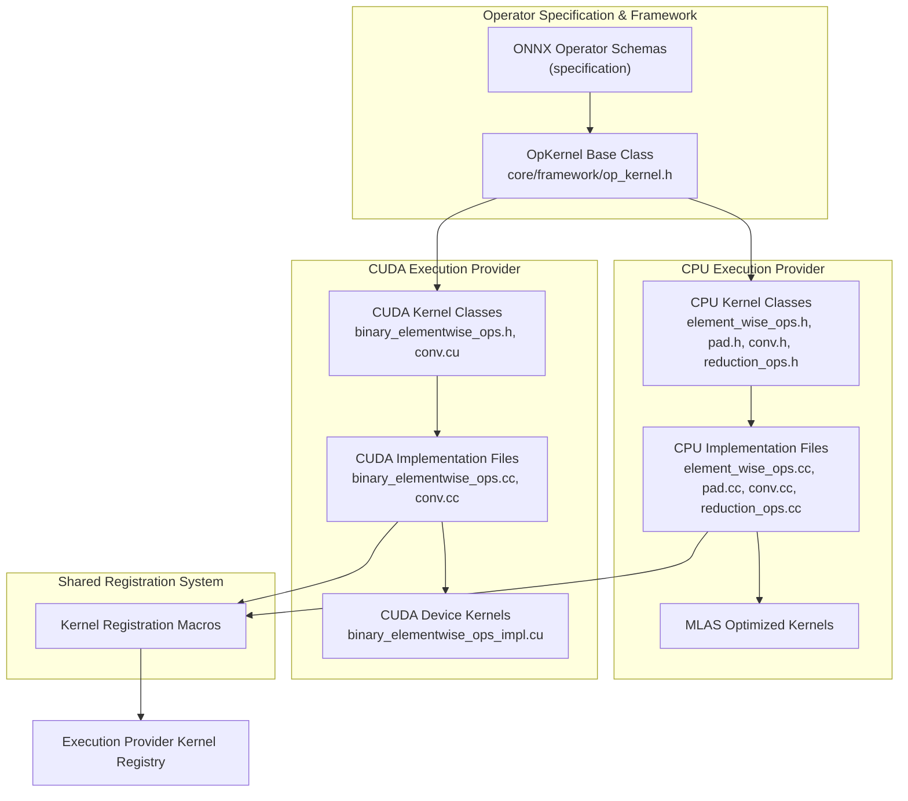
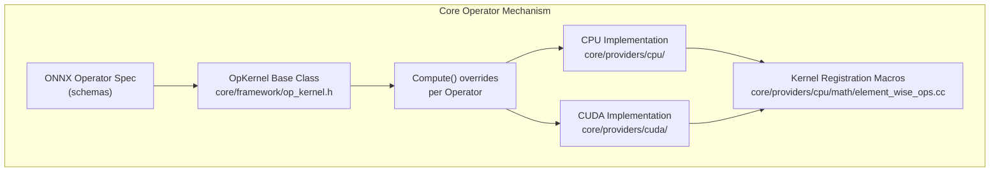
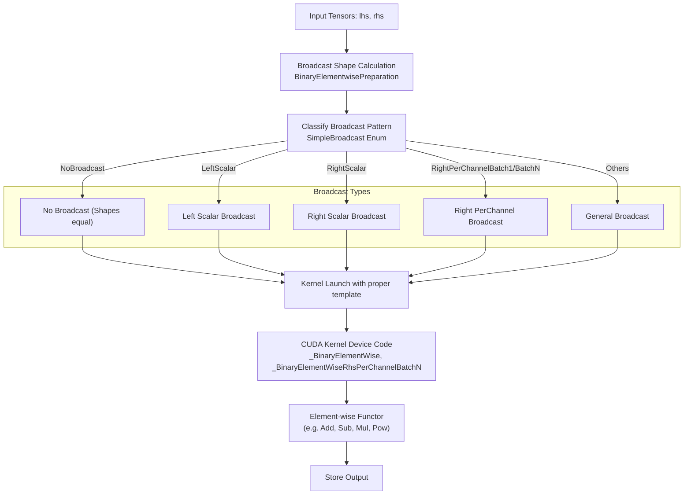

<!-- source: DeepWiki mcp.deepwiki.com · repo microsoft/onnxruntime · page 7.2 Standard ONNX Operators · fetched 2026-10-21 -->

# Standard ONNX Operators

<details>
<summary>Relevant source files</summary>

The following files were used as context for generating this wiki page:

- [.github/workflows/wgsl_template_tests.yml](.github/workflows/wgsl_template_tests.yml)
- [onnxruntime/contrib_ops/cpu/quantization/dynamic_quantize_lstm.cc](onnxruntime/contrib_ops/cpu/quantization/dynamic_quantize_lstm.cc)
- [onnxruntime/contrib_ops/cpu/quantization/nhwc_max_pool.cc](onnxruntime/contrib_ops/cpu/quantization/nhwc_max_pool.cc)
- [onnxruntime/contrib_ops/cpu/unique.cc](onnxruntime/contrib_ops/cpu/unique.cc)
- [onnxruntime/contrib_ops/cuda/fused_conv.cc](onnxruntime/contrib_ops/cuda/fused_conv.cc)
- [onnxruntime/contrib_ops/cuda/math/cufft_plan_cache.h](onnxruntime/contrib_ops/cuda/math/cufft_plan_cache.h)
- [onnxruntime/contrib_ops/cuda/math/fft_ops.h](onnxruntime/contrib_ops/cuda/math/fft_ops.h)
- [onnxruntime/contrib_ops/cuda/math/fft_ops_impl.h](onnxruntime/contrib_ops/cuda/math/fft_ops_impl.h)
- [onnxruntime/core/common/safeint.h](onnxruntime/core/common/safeint.h)
- [onnxruntime/core/framework/ort_value_tensor_slicer.cc](onnxruntime/core/framework/ort_value_tensor_slicer.cc)
- [onnxruntime/core/framework/ort_value_tensor_slicer.h](onnxruntime/core/framework/ort_value_tensor_slicer.h)
- [onnxruntime/core/framework/transpose_helper.cc](onnxruntime/core/framework/transpose_helper.cc)
- [onnxruntime/core/framework/transpose_helper.h](onnxruntime/core/framework/transpose_helper.h)
- [onnxruntime/core/mlas/lib/cast.cpp](onnxruntime/core/mlas/lib/cast.cpp)
- [onnxruntime/core/mlas/lib/pooling.cpp](onnxruntime/core/mlas/lib/pooling.cpp)
- [onnxruntime/core/mlas/lib/qlgavgpool.cpp](onnxruntime/core/mlas/lib/qlgavgpool.cpp)
- [onnxruntime/core/providers/common.h](onnxruntime/core/providers/common.h)
- [onnxruntime/core/providers/cpu/controlflow/if.cc](onnxruntime/core/providers/cpu/controlflow/if.cc)
- [onnxruntime/core/providers/cpu/controlflow/if.h](onnxruntime/core/providers/cpu/controlflow/if.h)
- [onnxruntime/core/providers/cpu/controlflow/loop.cc](onnxruntime/core/providers/cpu/controlflow/loop.cc)
- [onnxruntime/core/providers/cpu/controlflow/loop.h](onnxruntime/core/providers/cpu/controlflow/loop.h)
- [onnxruntime/core/providers/cpu/controlflow/scan.h](onnxruntime/core/providers/cpu/controlflow/scan.h)
- [onnxruntime/core/providers/cpu/controlflow/scan_8.cc](onnxruntime/core/providers/cpu/controlflow/scan_8.cc)
- [onnxruntime/core/providers/cpu/controlflow/scan_9.cc](onnxruntime/core/providers/cpu/controlflow/scan_9.cc)
- [onnxruntime/core/providers/cpu/controlflow/scan_utils.cc](onnxruntime/core/providers/cpu/controlflow/scan_utils.cc)
- [onnxruntime/core/providers/cpu/controlflow/scan_utils.h](onnxruntime/core/providers/cpu/controlflow/scan_utils.h)
- [onnxruntime/core/providers/cpu/controlflow/utils.h](onnxruntime/core/providers/cpu/controlflow/utils.h)
- [onnxruntime/core/providers/cpu/fp16/fp16_pool.cc](onnxruntime/core/providers/cpu/fp16/fp16_pool.cc)
- [onnxruntime/core/providers/cpu/generator/constant_of_shape.cc](onnxruntime/core/providers/cpu/generator/constant_of_shape.cc)
- [onnxruntime/core/providers/cpu/math/clip.cc](onnxruntime/core/providers/cpu/math/clip.cc)
- [onnxruntime/core/providers/cpu/math/clip.h](onnxruntime/core/providers/cpu/math/clip.h)
- [onnxruntime/core/providers/cpu/ml/ml_common.h](onnxruntime/core/providers/cpu/ml/ml_common.h)
- [onnxruntime/core/providers/cpu/ml/tree_ensemble.cc](onnxruntime/core/providers/cpu/ml/tree_ensemble.cc)
- [onnxruntime/core/providers/cpu/ml/tree_ensemble.h](onnxruntime/core/providers/cpu/ml/tree_ensemble.h)
- [onnxruntime/core/providers/cpu/ml/tree_ensemble_aggregator.h](onnxruntime/core/providers/cpu/ml/tree_ensemble_aggregator.h)
- [onnxruntime/core/providers/cpu/ml/tree_ensemble_attribute.h](onnxruntime/core/providers/cpu/ml/tree_ensemble_attribute.h)
- [onnxruntime/core/providers/cpu/ml/tree_ensemble_classifier.cc](onnxruntime/core/providers/cpu/ml/tree_ensemble_classifier.cc)
- [onnxruntime/core/providers/cpu/ml/tree_ensemble_classifier.h](onnxruntime/core/providers/cpu/ml/tree_ensemble_classifier.h)
- [onnxruntime/core/providers/cpu/ml/tree_ensemble_common.h](onnxruntime/core/providers/cpu/ml/tree_ensemble_common.h)
- [onnxruntime/core/providers/cpu/ml/tree_ensemble_helper.cc](onnxruntime/core/providers/cpu/ml/tree_ensemble_helper.cc)
- [onnxruntime/core/providers/cpu/ml/tree_ensemble_helper.h](onnxruntime/core/providers/cpu/ml/tree_ensemble_helper.h)
- [onnxruntime/core/providers/cpu/ml/treeregressor.cc](onnxruntime/core/providers/cpu/ml/treeregressor.cc)
- [onnxruntime/core/providers/cpu/ml/treeregressor.h](onnxruntime/core/providers/cpu/ml/treeregressor.h)
- [onnxruntime/core/providers/cpu/nn/Unpool.cc](onnxruntime/core/providers/cpu/nn/Unpool.cc)
- [onnxruntime/core/providers/cpu/nn/conv.cc](onnxruntime/core/providers/cpu/nn/conv.cc)
- [onnxruntime/core/providers/cpu/nn/conv.h](onnxruntime/core/providers/cpu/nn/conv.h)
- [onnxruntime/core/providers/cpu/nn/conv_attributes.h](onnxruntime/core/providers/cpu/nn/conv_attributes.h)
- [onnxruntime/core/providers/cpu/nn/conv_transpose.cc](onnxruntime/core/providers/cpu/nn/conv_transpose.cc)
- [onnxruntime/core/providers/cpu/nn/conv_transpose.h](onnxruntime/core/providers/cpu/nn/conv_transpose.h)
- [onnxruntime/core/providers/cpu/nn/conv_transpose_attributes.h](onnxruntime/core/providers/cpu/nn/conv_transpose_attributes.h)
- [onnxruntime/core/providers/cpu/nn/pool.cc](onnxruntime/core/providers/cpu/nn/pool.cc)
- [onnxruntime/core/providers/cpu/nn/pool.h](onnxruntime/core/providers/cpu/nn/pool.h)
- [onnxruntime/core/providers/cpu/nn/pool_attributes.h](onnxruntime/core/providers/cpu/nn/pool_attributes.h)
- [onnxruntime/core/providers/cpu/nn/pool_base.h](onnxruntime/core/providers/cpu/nn/pool_base.h)
- [onnxruntime/core/providers/cpu/nn/pool_functors.h](onnxruntime/core/providers/cpu/nn/pool_functors.h)
- [onnxruntime/core/providers/cpu/nn/roi_pool.h](onnxruntime/core/providers/cpu/nn/roi_pool.h)
- [onnxruntime/core/providers/cpu/nn/unpool.h](onnxruntime/core/providers/cpu/nn/unpool.h)
- [onnxruntime/core/providers/cpu/reduction/reduction_ops.cc](onnxruntime/core/providers/cpu/reduction/reduction_ops.cc)
- [onnxruntime/core/providers/cpu/reduction/reduction_ops.h](onnxruntime/core/providers/cpu/reduction/reduction_ops.h)
- [onnxruntime/core/providers/cpu/rnn/deep_cpu_gru.cc](onnxruntime/core/providers/cpu/rnn/deep_cpu_gru.cc)
- [onnxruntime/core/providers/cpu/rnn/deep_cpu_gru.h](onnxruntime/core/providers/cpu/rnn/deep_cpu_gru.h)
- [onnxruntime/core/providers/cpu/rnn/deep_cpu_lstm.cc](onnxruntime/core/providers/cpu/rnn/deep_cpu_lstm.cc)
- [onnxruntime/core/providers/cpu/rnn/deep_cpu_lstm.h](onnxruntime/core/providers/cpu/rnn/deep_cpu_lstm.h)
- [onnxruntime/core/providers/cpu/rnn/lstm_base.h](onnxruntime/core/providers/cpu/rnn/lstm_base.h)
- [onnxruntime/core/providers/cpu/rnn/rnn.cc](onnxruntime/core/providers/cpu/rnn/rnn.cc)
- [onnxruntime/core/providers/cpu/rnn/rnn.h](onnxruntime/core/providers/cpu/rnn/rnn.h)
- [onnxruntime/core/providers/cpu/rnn/rnn_helpers.cc](onnxruntime/core/providers/cpu/rnn/rnn_helpers.cc)
- [onnxruntime/core/providers/cpu/rnn/rnn_helpers.h](onnxruntime/core/providers/cpu/rnn/rnn_helpers.h)
- [onnxruntime/core/providers/cpu/rnn/uni_directional_lstm.cc](onnxruntime/core/providers/cpu/rnn/uni_directional_lstm.cc)
- [onnxruntime/core/providers/cpu/rnn/uni_directional_lstm.h](onnxruntime/core/providers/cpu/rnn/uni_directional_lstm.h)
- [onnxruntime/core/providers/cpu/sequence/concat_from_sequence.cc](onnxruntime/core/providers/cpu/sequence/concat_from_sequence.cc)
- [onnxruntime/core/providers/cpu/tensor/cast_op.cc](onnxruntime/core/providers/cpu/tensor/cast_op.cc)
- [onnxruntime/core/providers/cpu/tensor/concat.cc](onnxruntime/core/providers/cpu/tensor/concat.cc)
- [onnxruntime/core/providers/cpu/tensor/concat.h](onnxruntime/core/providers/cpu/tensor/concat.h)
- [onnxruntime/core/providers/cpu/tensor/gather.cc](onnxruntime/core/providers/cpu/tensor/gather.cc)
- [onnxruntime/core/providers/cpu/tensor/isinf.cc](onnxruntime/core/providers/cpu/tensor/isinf.cc)
- [onnxruntime/core/providers/cpu/tensor/pad.cc](onnxruntime/core/providers/cpu/tensor/pad.cc)
- [onnxruntime/core/providers/cpu/tensor/pad.h](onnxruntime/core/providers/cpu/tensor/pad.h)
- [onnxruntime/core/providers/cpu/tensor/padbase.h](onnxruntime/core/providers/cpu/tensor/padbase.h)
- [onnxruntime/core/providers/cpu/tensor/resize.cc](onnxruntime/core/providers/cpu/tensor/resize.cc)
- [onnxruntime/core/providers/cpu/tensor/slice.cc](onnxruntime/core/providers/cpu/tensor/slice.cc)
- [onnxruntime/core/providers/cpu/tensor/slice.h](onnxruntime/core/providers/cpu/tensor/slice.h)
- [onnxruntime/core/providers/cpu/tensor/slice_compute_metadata.h](onnxruntime/core/providers/cpu/tensor/slice_compute_metadata.h)
- [onnxruntime/core/providers/cpu/tensor/slice_helper.h](onnxruntime/core/providers/cpu/tensor/slice_helper.h)
- [onnxruntime/core/providers/cpu/tensor/split.cc](onnxruntime/core/providers/cpu/tensor/split.cc)
- [onnxruntime/core/providers/cpu/tensor/split.h](onnxruntime/core/providers/cpu/tensor/split.h)
- [onnxruntime/core/providers/cpu/tensor/transpose.cc](onnxruntime/core/providers/cpu/tensor/transpose.cc)
- [onnxruntime/core/providers/cpu/tensor/transpose.h](onnxruntime/core/providers/cpu/tensor/transpose.h)
- [onnxruntime/core/providers/cpu/tensor/upsample.cc](onnxruntime/core/providers/cpu/tensor/upsample.cc)
- [onnxruntime/core/providers/cpu/tensor/upsample.h](onnxruntime/core/providers/cpu/tensor/upsample.h)
- [onnxruntime/core/providers/cpu/tensor/upsample_antialias.h](onnxruntime/core/providers/cpu/tensor/upsample_antialias.h)
- [onnxruntime/core/providers/cpu/tensor/upsamplebase.h](onnxruntime/core/providers/cpu/tensor/upsamplebase.h)
- [onnxruntime/core/providers/cuda/controlflow/if.cc](onnxruntime/core/providers/cuda/controlflow/if.cc)
- [onnxruntime/core/providers/cuda/controlflow/loop.cc](onnxruntime/core/providers/cuda/controlflow/loop.cc)
- [onnxruntime/core/providers/cuda/controlflow/scan.cc](onnxruntime/core/providers/cuda/controlflow/scan.cc)
- [onnxruntime/core/providers/cuda/controlflow/scan.h](onnxruntime/core/providers/cuda/controlflow/scan.h)
- [onnxruntime/core/providers/cuda/nn/conv.cc](onnxruntime/core/providers/cuda/nn/conv.cc)
- [onnxruntime/core/providers/cuda/nn/conv.h](onnxruntime/core/providers/cuda/nn/conv.h)
- [onnxruntime/core/providers/cuda/nn/conv_transpose.cc](onnxruntime/core/providers/cuda/nn/conv_transpose.cc)
- [onnxruntime/core/providers/cuda/nn/conv_transpose.h](onnxruntime/core/providers/cuda/nn/conv_transpose.h)
- [onnxruntime/core/providers/cuda/nn/conv_transpose_8.h](onnxruntime/core/providers/cuda/nn/conv_transpose_8.h)
- [onnxruntime/core/providers/cuda/nn/max_pool_with_index.cu](onnxruntime/core/providers/cuda/nn/max_pool_with_index.cu)
- [onnxruntime/core/providers/cuda/nn/max_pool_with_index.h](onnxruntime/core/providers/cuda/nn/max_pool_with_index.h)
- [onnxruntime/core/providers/cuda/nn/pool.h](onnxruntime/core/providers/cuda/nn/pool.h)
- [onnxruntime/core/providers/cuda/reduction/reduction_functions.cu](onnxruntime/core/providers/cuda/reduction/reduction_functions.cu)
- [onnxruntime/core/providers/cuda/reduction/reduction_functions.h](onnxruntime/core/providers/cuda/reduction/reduction_functions.h)
- [onnxruntime/core/providers/cuda/reduction/reduction_ops.cc](onnxruntime/core/providers/cuda/reduction/reduction_ops.cc)
- [onnxruntime/core/providers/cuda/reduction/reduction_ops.h](onnxruntime/core/providers/cuda/reduction/reduction_ops.h)
- [onnxruntime/core/providers/cuda/reduction/reduction_scan_utils.h](onnxruntime/core/providers/cuda/reduction/reduction_scan_utils.h)
- [onnxruntime/core/providers/cuda/reduction/reduction_utils.cuh](onnxruntime/core/providers/cuda/reduction/reduction_utils.cuh)
- [onnxruntime/core/providers/cuda/tensor/concat.cc](onnxruntime/core/providers/cuda/tensor/concat.cc)
- [onnxruntime/core/providers/cuda/tensor/concat_impl.cu](onnxruntime/core/providers/cuda/tensor/concat_impl.cu)
- [onnxruntime/core/providers/cuda/tensor/concat_impl.h](onnxruntime/core/providers/cuda/tensor/concat_impl.h)
- [onnxruntime/core/providers/cuda/tensor/pad.cc](onnxruntime/core/providers/cuda/tensor/pad.cc)
- [onnxruntime/core/providers/cuda/tensor/pad.h](onnxruntime/core/providers/cuda/tensor/pad.h)
- [onnxruntime/core/providers/cuda/tensor/pad_impl.cu](onnxruntime/core/providers/cuda/tensor/pad_impl.cu)
- [onnxruntime/core/providers/cuda/tensor/pad_impl.h](onnxruntime/core/providers/cuda/tensor/pad_impl.h)
- [onnxruntime/core/providers/cuda/tensor/resize.cc](onnxruntime/core/providers/cuda/tensor/resize.cc)
- [onnxruntime/core/providers/cuda/tensor/resize_antialias_impl.cu](onnxruntime/core/providers/cuda/tensor/resize_antialias_impl.cu)
- [onnxruntime/core/providers/cuda/tensor/resize_impl.cu](onnxruntime/core/providers/cuda/tensor/resize_impl.cu)
- [onnxruntime/core/providers/cuda/tensor/resize_impl.h](onnxruntime/core/providers/cuda/tensor/resize_impl.h)
- [onnxruntime/core/providers/cuda/tensor/slice.cc](onnxruntime/core/providers/cuda/tensor/slice.cc)
- [onnxruntime/core/providers/cuda/tensor/slice.h](onnxruntime/core/providers/cuda/tensor/slice.h)
- [onnxruntime/core/providers/cuda/tensor/slice_impl.cu](onnxruntime/core/providers/cuda/tensor/slice_impl.cu)
- [onnxruntime/core/providers/cuda/tensor/slice_impl.h](onnxruntime/core/providers/cuda/tensor/slice_impl.h)
- [onnxruntime/core/providers/cuda/tensor/split.cc](onnxruntime/core/providers/cuda/tensor/split.cc)
- [onnxruntime/core/providers/cuda/tensor/split_impl.cu](onnxruntime/core/providers/cuda/tensor/split_impl.cu)
- [onnxruntime/core/providers/cuda/tensor/split_impl.h](onnxruntime/core/providers/cuda/tensor/split_impl.h)
- [onnxruntime/core/providers/cuda/tensor/transpose.cc](onnxruntime/core/providers/cuda/tensor/transpose.cc)
- [onnxruntime/core/providers/cuda/tensor/transpose.h](onnxruntime/core/providers/cuda/tensor/transpose.h)
- [onnxruntime/core/providers/cuda/tensor/transpose_impl.cu](onnxruntime/core/providers/cuda/tensor/transpose_impl.cu)
- [onnxruntime/core/providers/cuda/tensor/transpose_impl.h](onnxruntime/core/providers/cuda/tensor/transpose_impl.h)
- [onnxruntime/core/providers/cuda/tensor/upsample.cc](onnxruntime/core/providers/cuda/tensor/upsample.cc)
- [onnxruntime/core/providers/cuda/tensor/upsample.h](onnxruntime/core/providers/cuda/tensor/upsample.h)
- [onnxruntime/core/providers/cuda/tensor/upsample_impl.cu](onnxruntime/core/providers/cuda/tensor/upsample_impl.cu)
- [onnxruntime/core/providers/cuda/tensor/upsample_impl.h](onnxruntime/core/providers/cuda/tensor/upsample_impl.h)
- [onnxruntime/core/providers/dml/DmlExecutionProvider/src/Operators/DmlOperatorEyeLike.cpp](onnxruntime/core/providers/dml/DmlExecutionProvider/src/Operators/DmlOperatorEyeLike.cpp)
- [onnxruntime/core/providers/dml/DmlExecutionProvider/src/Operators/DmlOperatorRecurrentNeuralNetwork.cpp](onnxruntime/core/providers/dml/DmlExecutionProvider/src/Operators/DmlOperatorRecurrentNeuralNetwork.cpp)
- [onnxruntime/core/providers/dml/DmlExecutionProvider/src/Operators/DmlOperatorTrilu.cpp](onnxruntime/core/providers/dml/DmlExecutionProvider/src/Operators/DmlOperatorTrilu.cpp)
- [onnxruntime/core/providers/op_kernel_type_control.h](onnxruntime/core/providers/op_kernel_type_control.h)
- [onnxruntime/core/providers/webgpu/math/unary_elementwise_ops.cc](onnxruntime/core/providers/webgpu/math/unary_elementwise_ops.cc)
- [onnxruntime/core/providers/webgpu/math/unary_elementwise_ops.h](onnxruntime/core/providers/webgpu/math/unary_elementwise_ops.h)
- [onnxruntime/core/providers/webgpu/nn/pool.cc](onnxruntime/core/providers/webgpu/nn/pool.cc)
- [onnxruntime/core/providers/webgpu/nn/pool.h](onnxruntime/core/providers/webgpu/nn/pool.h)
- [onnxruntime/core/providers/webgpu/rnn/gru.cc](onnxruntime/core/providers/webgpu/rnn/gru.cc)
- [onnxruntime/core/providers/webgpu/rnn/gru.h](onnxruntime/core/providers/webgpu/rnn/gru.h)
- [onnxruntime/core/providers/webgpu/tensor/pad.cc](onnxruntime/core/providers/webgpu/tensor/pad.cc)
- [onnxruntime/core/providers/webgpu/tensor/pad.h](onnxruntime/core/providers/webgpu/tensor/pad.h)
- [onnxruntime/core/providers/webgpu/tensor/pad.wgsl.template](onnxruntime/core/providers/webgpu/tensor/pad.wgsl.template)
- [onnxruntime/core/providers/webgpu/tensor/resize_impl.cc](onnxruntime/core/providers/webgpu/tensor/resize_impl.cc)
- [onnxruntime/core/providers/webgpu/tensor/slice.cc](onnxruntime/core/providers/webgpu/tensor/slice.cc)
- [onnxruntime/core/providers/webgpu/tensor/slice.h](onnxruntime/core/providers/webgpu/tensor/slice.h)
- [onnxruntime/core/providers/webgpu/tensor/upsample.cc](onnxruntime/core/providers/webgpu/tensor/upsample.cc)
- [onnxruntime/core/providers/webgpu/wgsl_templates/README.md](onnxruntime/core/providers/webgpu/wgsl_templates/README.md)
- [onnxruntime/test/common/safeint_test.cc](onnxruntime/test/common/safeint_test.cc)
- [onnxruntime/test/contrib_ops/nhwc_maxpool_op_test.cc](onnxruntime/test/contrib_ops/nhwc_maxpool_op_test.cc)
- [onnxruntime/test/contrib_ops/qlinear_global_average_pool_test.cc](onnxruntime/test/contrib_ops/qlinear_global_average_pool_test.cc)
- [onnxruntime/test/contrib_ops/quantize_lstm_op_test.cc](onnxruntime/test/contrib_ops/quantize_lstm_op_test.cc)
- [onnxruntime/test/flatbuffers/flatbuffer_utils_test.cc](onnxruntime/test/flatbuffers/flatbuffer_utils_test.cc)
- [onnxruntime/test/framework/parallel_executor_test.cc](onnxruntime/test/framework/parallel_executor_test.cc)
- [onnxruntime/test/framework/transpose_test.cc](onnxruntime/test/framework/transpose_test.cc)
- [onnxruntime/test/global_thread_pools/test_inference.cc](onnxruntime/test/global_thread_pools/test_inference.cc)
- [onnxruntime/test/onnx/microbenchmark/copy.cc](onnxruntime/test/onnx/microbenchmark/copy.cc)
- [onnxruntime/test/providers/cpu/controlflow/if_test.cc](onnxruntime/test/providers/cpu/controlflow/if_test.cc)
- [onnxruntime/test/providers/cpu/controlflow/loop_test.cc](onnxruntime/test/providers/cpu/controlflow/loop_test.cc)
- [onnxruntime/test/providers/cpu/controlflow/scan_test.cc](onnxruntime/test/providers/cpu/controlflow/scan_test.cc)
- [onnxruntime/test/providers/cpu/math/clip_test.cc](onnxruntime/test/providers/cpu/math/clip_test.cc)
- [onnxruntime/test/providers/cpu/ml/tree_ensembler_classifier_test.cc](onnxruntime/test/providers/cpu/ml/tree_ensembler_classifier_test.cc)
- [onnxruntime/test/providers/cpu/ml/tree_ensembler_test.cc](onnxruntime/test/providers/cpu/ml/tree_ensembler_test.cc)
- [onnxruntime/test/providers/cpu/ml/treeregressor_test.cc](onnxruntime/test/providers/cpu/ml/treeregressor_test.cc)
- [onnxruntime/test/providers/cpu/nn/conv_transpose_op_test.cc](onnxruntime/test/providers/cpu/nn/conv_transpose_op_test.cc)
- [onnxruntime/test/providers/cpu/nn/pool_op_test.cc](onnxruntime/test/providers/cpu/nn/pool_op_test.cc)
- [onnxruntime/test/providers/cpu/nn/unpool_op_test.cc](onnxruntime/test/providers/cpu/nn/unpool_op_test.cc)
- [onnxruntime/test/providers/cpu/reduction/reduction_ops_test.cc](onnxruntime/test/providers/cpu/reduction/reduction_ops_test.cc)
- [onnxruntime/test/providers/cpu/rnn/GRU.py](onnxruntime/test/providers/cpu/rnn/GRU.py)
- [onnxruntime/test/providers/cpu/rnn/LSTM.py](onnxruntime/test/providers/cpu/rnn/LSTM.py)
- [onnxruntime/test/providers/cpu/rnn/deep_cpu_gru_op_test.cc](onnxruntime/test/providers/cpu/rnn/deep_cpu_gru_op_test.cc)
- [onnxruntime/test/providers/cpu/rnn/deep_cpu_lstm_op_test.cc](onnxruntime/test/providers/cpu/rnn/deep_cpu_lstm_op_test.cc)
- [onnxruntime/test/providers/cpu/rnn/rnn_op_test.cc](onnxruntime/test/providers/cpu/rnn/rnn_op_test.cc)
- [onnxruntime/test/providers/cpu/sequence/concat_from_sequence_op_test.cc](onnxruntime/test/providers/cpu/sequence/concat_from_sequence_op_test.cc)
- [onnxruntime/test/providers/cpu/tensor/concat_op_test.cc](onnxruntime/test/providers/cpu/tensor/concat_op_test.cc)
- [onnxruntime/test/providers/cpu/tensor/isinf_test.cc](onnxruntime/test/providers/cpu/tensor/isinf_test.cc)
- [onnxruntime/test/providers/cpu/tensor/pad_test.cc](onnxruntime/test/providers/cpu/tensor/pad_test.cc)
- [onnxruntime/test/providers/cpu/tensor/resize_op_test.cc](onnxruntime/test/providers/cpu/tensor/resize_op_test.cc)
- [onnxruntime/test/providers/cpu/tensor/resize_sample_test_gen.py](onnxruntime/test/providers/cpu/tensor/resize_sample_test_gen.py)
- [onnxruntime/test/providers/cpu/tensor/slice_op.test.cc](onnxruntime/test/providers/cpu/tensor/slice_op.test.cc)
- [onnxruntime/test/providers/cpu/tensor/split_op_test.cc](onnxruntime/test/providers/cpu/tensor/split_op_test.cc)
- [onnxruntime/test/providers/cpu/tensor/transpose_test.cc](onnxruntime/test/providers/cpu/tensor/transpose_test.cc)
- [onnxruntime/test/providers/cpu/tensor/upsample_op_test.cc](onnxruntime/test/providers/cpu/tensor/upsample_op_test.cc)
- [onnxruntime/test/providers/cuda/nhwc/conv_test.cc](onnxruntime/test/providers/cuda/nhwc/conv_test.cc)
- [onnxruntime/test/providers/cuda/nhwc/conv_transpose_test.cc](onnxruntime/test/providers/cuda/nhwc/conv_transpose_test.cc)
- [onnxruntime/test/providers/cuda/nhwc/nhwc_cuda_helper.h](onnxruntime/test/providers/cuda/nhwc/nhwc_cuda_helper.h)
- [onnxruntime/test/providers/cuda/nhwc/norm_test.cc](onnxruntime/test/providers/cuda/nhwc/norm_test.cc)
- [onnxruntime/test/providers/cuda/nhwc/pool_test.cc](onnxruntime/test/providers/cuda/nhwc/pool_test.cc)
- [onnxruntime/test/providers/cuda/test_cases/reduction_functions_test.cc](onnxruntime/test/providers/cuda/test_cases/reduction_functions_test.cc)
- [onnxruntime/test/providers/provider_test_utils.h](onnxruntime/test/providers/provider_test_utils.h)
- [onnxruntime/test/providers/webgpu/hardswish_test.cc](onnxruntime/test/providers/webgpu/hardswish_test.cc)
- [onnxruntime/test/shared_lib/test_model_loading.cc](onnxruntime/test/shared_lib/test_model_loading.cc)
- [orttraining/orttraining/core/optimizer/lstm_replacement.h](orttraining/orttraining/core/optimizer/lstm_replacement.h)
- [orttraining/orttraining/test/training_ops/cpu/tensor/concat_op_test.cc](orttraining/orttraining/test/training_ops/cpu/tensor/concat_op_test.cc)
- [orttraining/orttraining/test/training_ops/cpu/tensor/slice_grad_op_test.cc](orttraining/orttraining/test/training_ops/cpu/tensor/slice_grad_op_test.cc)
- [orttraining/orttraining/test/training_ops/cpu/tensor/split_op_test.cc](orttraining/orttraining/test/training_ops/cpu/tensor/split_op_test.cc)
- [orttraining/orttraining/training_ops/cpu/reduction/reduction_ops.cc](orttraining/orttraining/training_ops/cpu/reduction/reduction_ops.cc)
- [orttraining/orttraining/training_ops/cpu/reduction/reduction_ops.h](orttraining/orttraining/training_ops/cpu/reduction/reduction_ops.h)
- [orttraining/orttraining/training_ops/cpu/tensor/concat.cc](orttraining/orttraining/training_ops/cpu/tensor/concat.cc)
- [orttraining/orttraining/training_ops/cpu/tensor/concat.h](orttraining/orttraining/training_ops/cpu/tensor/concat.h)
- [orttraining/orttraining/training_ops/cpu/tensor/slice_grad.cc](orttraining/orttraining/training_ops/cpu/tensor/slice_grad.cc)
- [orttraining/orttraining/training_ops/cpu/tensor/slice_grad.h](orttraining/orttraining/training_ops/cpu/tensor/slice_grad.h)
- [orttraining/orttraining/training_ops/cpu/tensor/split.cc](orttraining/orttraining/training_ops/cpu/tensor/split.cc)
- [orttraining/orttraining/training_ops/cuda/nn/conv_grad.cc](orttraining/orttraining/training_ops/cuda/nn/conv_grad.cc)
- [orttraining/orttraining/training_ops/cuda/nn/conv_grad.h](orttraining/orttraining/training_ops/cuda/nn/conv_grad.h)
- [orttraining/orttraining/training_ops/cuda/nn/conv_shared.cc](orttraining/orttraining/training_ops/cuda/nn/conv_shared.cc)
- [orttraining/orttraining/training_ops/cuda/nn/conv_shared.h](orttraining/orttraining/training_ops/cuda/nn/conv_shared.h)
- [orttraining/orttraining/training_ops/cuda/nn/conv_transpose_grad.cc](orttraining/orttraining/training_ops/cuda/nn/conv_transpose_grad.cc)
- [orttraining/orttraining/training_ops/cuda/reduction/reduction_ops.h](orttraining/orttraining/training_ops/cuda/reduction/reduction_ops.h)
- [orttraining/orttraining/training_ops/cuda/tensor/concat.cc](orttraining/orttraining/training_ops/cuda/tensor/concat.cc)
- [orttraining/orttraining/training_ops/cuda/tensor/concat.h](orttraining/orttraining/training_ops/cuda/tensor/concat.h)
- [orttraining/orttraining/training_ops/cuda/tensor/slice_grad.cc](orttraining/orttraining/training_ops/cuda/tensor/slice_grad.cc)
- [orttraining/orttraining/training_ops/cuda/tensor/slice_grad.h](orttraining/orttraining/training_ops/cuda/tensor/slice_grad.h)
- [orttraining/orttraining/training_ops/cuda/tensor/split.cc](orttraining/orttraining/training_ops/cuda/tensor/split.cc)
- [tools/python/wgsl_template/test/run_tests.py](tools/python/wgsl_template/test/run_tests.py)

</details>


## Purpose and Scope

This page documents the implementation of standard ONNX operators in ONNX Runtime. Standard ONNX operators are those defined in the ONNX specification under the `kOnnxDomain` domain and include core tensor operations, neural network layers, reductions, control flow constructs, and traditional machine learning tree ensemble operators. These operators form the essential computational building blocks used to run ONNX models efficiently.

The coverage includes detailed explanations of implementations for common tensor operations such as `Cast`, `Transpose`, `Slice`, `Pad`, and `Split`. It also covers neural network operators including convolution (`Conv`), pooling layers (`Pool`), and recurrent network types (RNN, LSTM). The page also describes reduction operations, control flow operators, and classic ML operators like tree ensembles.

For operator registration and kernel system details, see the [Operator Registration System (7.1)]. For element-wise operations detail (Add, Sub, Mul, etc.), see [Element-wise Operations (7.3)]. For Microsoft contrib operators, see [Contrib Operators (7.4)].

---

## Operator Categories

### Tensor Operations

Key tensor manipulation operators include:

- **Cast**: Converts tensors between data types.
- **Transpose**: Permutes tensor dimensions.
- **Slice**: Extracts sub-tensors by indices.
- **Pad**: Adds padding to tensors with configurable modes and values.
- **Split**: Divides a tensor into multiple sub-tensors along an axis.

### Neural Network Operators

Typical neural network layers implemented:

- **Conv** and **ConvTranspose**: Convolutions and transposed convolutions for spatial data.
- **Pooling**: `AveragePool`, `MaxPool`, `LpPool`, and their global variants for downsampling.
- **Recurrent Layers**: RNN, GRU, LSTM implementations.
- **Normalization**: Batch normalization and various forms of normalization layers.

### Reduction Operators

Standard reduction operators include:

- `ReduceSum`, `ReduceMean`, `ReduceMax`, `ReduceMin`, `ReduceProd`, `ReduceL1`, `ReduceL2`, and others from the ONNX opset.

### Control Flow Operators

- `If`, `Loop`, `Scan` support conditional branching and iterative computation.

### Traditional ML Tree Ensembles

- Operators for decision tree ensembles such as `TreeEnsembleClassifier` and `TreeEnsembleRegressor`.

---

## Implementation Architecture

### Multi-Backend and Multi-Provider Strategy

ONNX Runtime supports multi-backend implementations of operators optimized for various execution providers (EP):



This design allows operators to have multiple implementations optimized for CPU, CUDA, and other EPs.

Sources: [onnxruntime/core/providers/cpu/math/element_wise_ops.h:1-10](), [onnxruntime/core/providers/cuda/math/binary_elementwise_ops.h:1-10]()

---

## Standard Tensor Operators

### Cast

- Converts tensor data types.
- Implemented as a templated kernel supporting many input-output type pairs.
- Uses efficient CPU and CUDA methods for type conversion.
- Kernel registered under `Cast` in `kOnnxDomain`.
- Supports opset evolution for type extensions.

Sources: [onnxruntime/core/providers/cpu/tensor/cast_op.cc] (not fully shown, known convention)

### Transpose

- Permutation of tensor dimensions.
- CPU implementation uses stride computation and optimized memory copying.
- CUDA operator uses custom kernel for efficiently permuting large tensors.
- Supports attribute `perm` for dimension reordering.
- Handles empty tensors, shape validation, and broadcasts as needed.

Sources: [onnxruntime/core/providers/cpu/tensor/transpose.cc](), [onnxruntime/core/providers/cuda/tensor/transpose.cc]()

### Slice

- Extracts a sub-tensor according to specified start, end, axes, and steps.
- CPU implementation computes offset ranges and strides.
- Supports different opset versions (consistent semantics since opset 10+).
- Handles negative indices, and empty slices.
- CUDA implementation via efficient indexing.

Sources: [onnxruntime/core/providers/cpu/tensor/slice.cc](), [onnxruntime/core/providers/cuda/tensor/slice.cc]()

### Pad

- Supports constant, reflection, and edge padding modes with user-defined pad sizes.
- CPU kernel computes output shape and writes with offset and pad values.
- Padding value can be specified as an attribute or input tensor (opset 11+).
- Type constraints and multiple data types supported including float, int, bool.
- Registers kernels for opset 2 through 25+ with type control.

Sources: [onnxruntime/core/providers/cpu/tensor/pad.cc:4-220]()

### Split

- Splits input tensor into multiple outputs along a specified axis.
- Supports dynamic split sizes as input in some opset versions.
- CPU implementation slices input accordingly using computed offsets.
- Handles all data types, including string and boolean.
- CUDA operator implements similar logic optimized for GPU.
- Test coverage includes equal and unequal splits, and corner cases.

Sources: [onnxruntime/core/providers/cpu/tensor/split.cc:1-122](), [onnxruntime/core/providers/cuda/tensor/split.cc] (not shown)

---

## Neural Network Operators

### Conv (Convolution)

- Supports 1D, 2D, and potentially 3D convolutions.
- CPU implementation follows ONNX opset specs with attributes: kernel_shape, pads, strides, dilations, groups.
- CUDA implementation leverages cuDNN for performance, with optimized layout conversions (e.g. NHWC support).
- Handles prepacking of weights for efficiency.
- Supports bias fusion, activation fusion, and various data types including float32, float16, bfloat16.
- Custom versions for different opset versions with appropriate attributes.

Sources: [onnxruntime/core/providers/cpu/nn/conv.cc] (not fully shown), [onnxruntime/core/providers/cuda/nn/conv.cc:1-134]()

### Pooling (MaxPool, AveragePool)

- Pooling operators support attributes: kernel_shape, pads, strides, ceil_mode, count_include_pad.
- CPU kernel uses MLAS pooling implementations for performance.
- Supports multiple data types and spatial dimensions.
- CUDA kernels use optimized cuDNN calls and custom kernels for NHWC data.
- Test coverage covers edge cases like zero padding, data type variances.

Sources: [onnxruntime/core/providers/cpu/nn/pool.cc] (not shown), [onnxruntime/test/providers/cpu/nn/pool_op_test.cc:1-100]()

### Recurrent Neural Networks (LSTM, GRU, RNN)

- Implemented mostly on CPU with possible CUDA support.
- Support multiple directions (forward, backward, bidirectional).
- Handle variable length sequences and optional outputs such as hidden/cell states.
- Detailed attribute parsing and state initializations.
- Support memory optimization and fused kernels for performance.

Sources: [onnxruntime/core/providers/cpu/rnn/deep_cpu_lstm.cc] (not shown), [onnxruntime/core/providers/cpu/rnn/deep_cpu_gru.cc] (not shown)

---

## Reduction Operators

- Operators: `ReduceSum`, `ReduceMean`, `ReduceMax`, `ReduceMin`, `ReduceL1`, `ReduceL2`, and others.
- CPU implementation supports float and int types with templated kernels.
- Reduction along specified axes with `keepdims` attribute.
- CUDA implementation uses cuDNN and custom kernels for acceleration.
- Special handling for ArgMax/ArgMin with index outputs.
- Optimized paths for common reductions.
- Robust testing with extensive verification of numerical correctness and edge cases.

### Code Sample: CPU Test for Reduction Ops

```cpp
void TestReduceOp(const std::string& op,
                  int opset_version,
                  const std::vector<int64_t>& input_dims,
                  const std::vector<float>& data,
                  const std::vector<int64_t>& axes,
                  int64_t keepdims,
                  const std::vector<int64_t>& expected_dims,
                  const std::vector<float>& expected_data) {
  OpTester test(op.c_str(), opset_version);
  if (!axes.empty()) {
    if (op == "ArgMax" || op == "ArgMin")
      test.AddAttribute("axis", axes[0]);
    else
      test.AddAttribute("axes", axes);
  }
  test.AddAttribute("keepdims", keepdims);
  test.AddInput<float>("data", input_dims, data);
  test.AddOutput<float>("reduced", expected_dims, expected_data);
  test.Run();
}
```

Sources: [onnxruntime/core/providers/cpu/reduction/reduction_ops.cc](), [onnxruntime/test/providers/cpu/reduction/reduction_ops_test.cc]()

---

## Control Flow Operators

- Operators: `If`, `Loop`, `Scan`.
- Each operator implements subgraph execution as part of the runtime.
- Support dynamic iteration, conditional execution, and feedback loops.
- Integrated with graph executor and session management.

Sources: [onnxruntime/core/providers/cpu/controlflow/loop.cc] (not shown), [onnxruntime/test/providers/cpu/controlflow/loop_test.cc] (not shown)

---

## Traditional ML Tree Ensemble Operators

- Implements decision tree ensembles: `TreeEnsembleClassifier`, `TreeEnsembleRegressor`.
- Designed to efficiently handle large forests and many nodes.
- Uses specialized kernel attribute classes (`TreeEnsembleCommonAttributes`) for fast attribute parsing.
- Handles categorical features with optimized category set lookups.
- Supports parallel evaluation of trees for batch inference.
- Supports multiple output targets and post-evaluation transforms.

### Key Classes

| Class | Purpose |
|-------|---------|
| `TreeEnsembleCommonAttributes` | Base class for kernel attributes, manages common operator metadata |
| `TreeEnsembleCommon<InputType, ThresholdType, OutputType>` | Main class implementing tree traversal and ensemble evaluation |
| `TreeCategorySet<TCat, TInput>` | Efficient categorical feature set membership check |

### Tree Evaluation Basic Flow

- Input tensor rows are traversed as feature sets.
- For each tree, nodes are traversed based on feature thresholds or categories.
- Leaf node weights are aggregated according to post-transform and aggregate functions.
- The final result is written to output tensors for each input instance.

Sources: [onnxruntime/core/providers/cpu/ml/tree_ensemble_common.h:1-154]()

---

## Mermaid Diagrams

### Mapping Natural Language Concepts to Code Entities for Core Operator Implementation



### Example: Broadcast and CUDA Kernel Launch Flow



---

## Summary

This page summarizes the implementation of standard ONNX operators in ONNX Runtime with emphasis on tensor ops (cast, transpose, slice, pad, split), neural network operators (conv, pooling, RNN/LSTM), common reductions, control flow, and traditional ML next-generation operators like tree ensembles.

Implementations are optimized leveraging multi-execution-provider design, efficient broadcasting mechanisms, kernel registrations across opset versions and data types, and thorough test infrastructure validating compliance with ONNX specifications.

The included diagrams clarify code modularity and data flow from high-level operator specs to low-level execution kernels.

---

# Sources

- [onnxruntime/core/providers/cpu/reduction/reduction_ops.cc:1-125]()
- [onnxruntime/core/providers/cuda/reduction/reduction_ops.cc:1-125]()
- [onnxruntime/core/providers/cpu/nn/pool_op_test.cc:1-100]()
- [onnxruntime/test/providers/cpu/reduction/reduction_ops_test.cc:1-168]()
- [onnxruntime/core/providers/cpu/tensor/upsample.cc:1-149]()
- [onnxruntime/core/providers/cpu/ml/tree_ensemble_common.h:1-154]()
- [onnxruntime/core/providers/cuda/nn/conv.cc:1-134]()
- [onnxruntime/core/providers/cpu/tensor/pad.cc:1-220]()
- [onnxruntime/test/providers/cpu/tensor/split_op_test.cc:1-195]()

---

