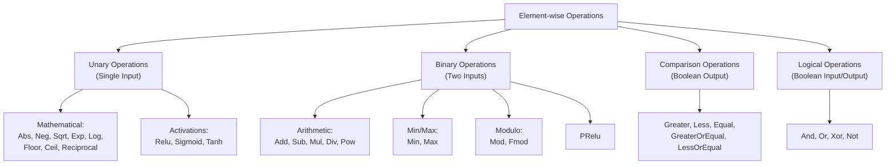
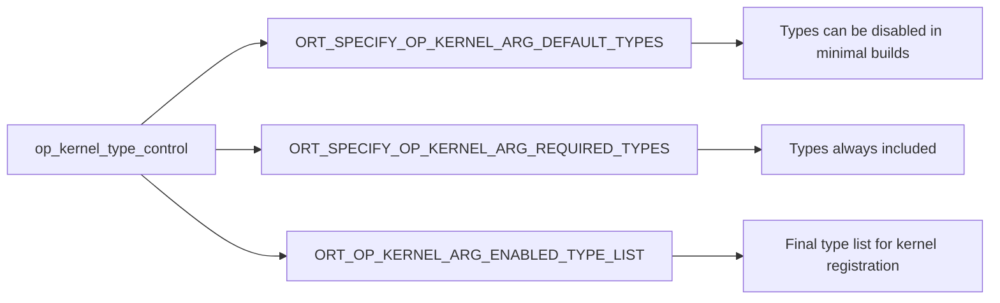
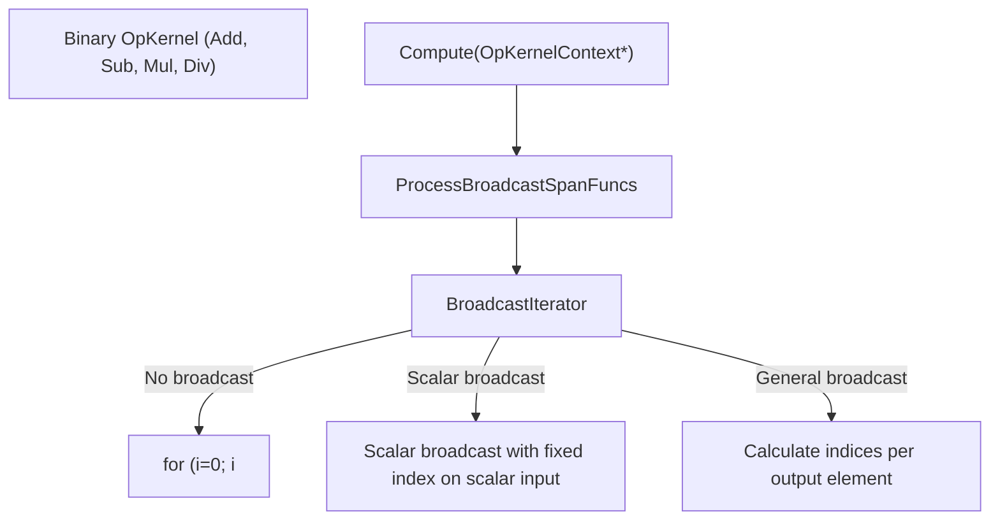
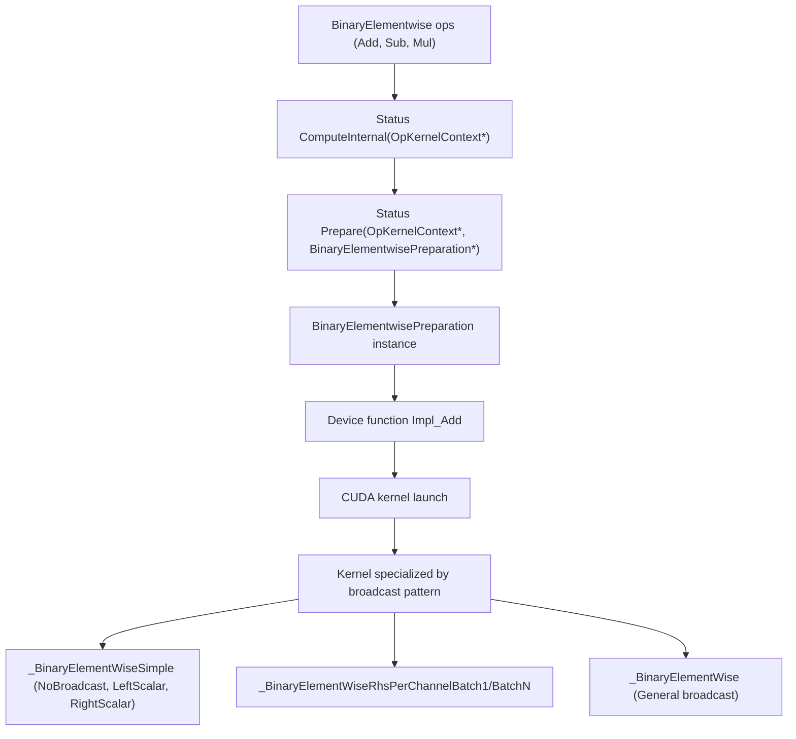
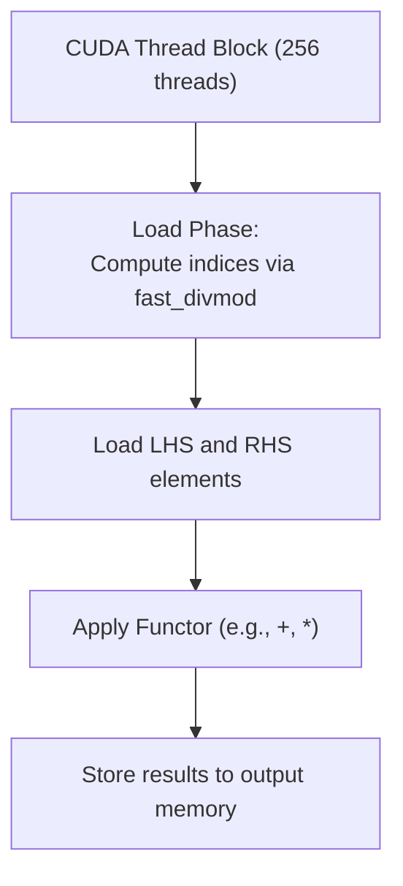
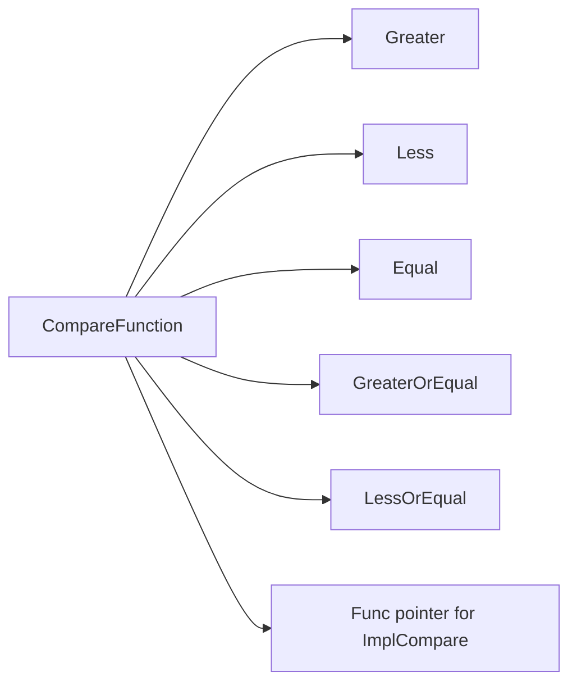
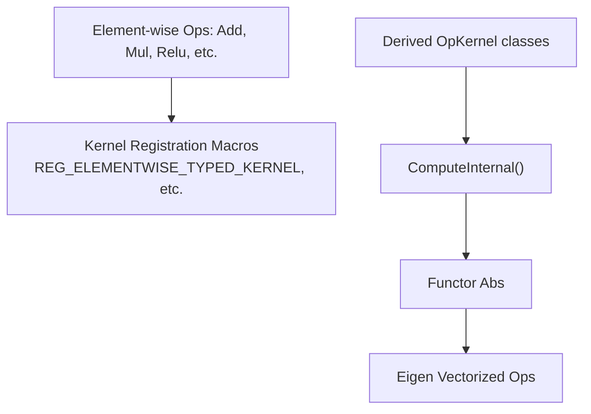

<!-- source: DeepWiki mcp.deepwiki.com · repo microsoft/onnxruntime · page 7.3 Element-wise Operations · fetched 2026-10-21 -->

# Element-wise Operations

<details>
<summary>Relevant source files</summary>

The following files were used as context for generating this wiki page:

- [include/onnxruntime/core/providers/cuda/cuda_provider_options.h](include/onnxruntime/core/providers/cuda/cuda_provider_options.h)
- [onnxruntime/core/providers/cpu/cpu_execution_provider.cc](onnxruntime/core/providers/cpu/cpu_execution_provider.cc)
- [onnxruntime/core/providers/cpu/math/element_wise_ops.cc](onnxruntime/core/providers/cpu/math/element_wise_ops.cc)
- [onnxruntime/core/providers/cpu/math/element_wise_ops.h](onnxruntime/core/providers/cpu/math/element_wise_ops.h)
- [onnxruntime/core/providers/cuda/cu_inc/binary_elementwise_impl.cuh](onnxruntime/core/providers/cuda/cu_inc/binary_elementwise_impl.cuh)
- [onnxruntime/core/providers/cuda/cu_inc/common.cuh](onnxruntime/core/providers/cuda/cu_inc/common.cuh)
- [onnxruntime/core/providers/cuda/cuda_execution_provider.cc](onnxruntime/core/providers/cuda/cuda_execution_provider.cc)
- [onnxruntime/core/providers/cuda/cuda_execution_provider.h](onnxruntime/core/providers/cuda/cuda_execution_provider.h)
- [onnxruntime/core/providers/cuda/cuda_execution_provider_info.cc](onnxruntime/core/providers/cuda/cuda_execution_provider_info.cc)
- [onnxruntime/core/providers/cuda/cuda_execution_provider_info.h](onnxruntime/core/providers/cuda/cuda_execution_provider_info.h)
- [onnxruntime/core/providers/cuda/cuda_provider_factory.cc](onnxruntime/core/providers/cuda/cuda_provider_factory.cc)
- [onnxruntime/core/providers/cuda/math/binary_elementwise_ops.cc](onnxruntime/core/providers/cuda/math/binary_elementwise_ops.cc)
- [onnxruntime/core/providers/cuda/math/binary_elementwise_ops.h](onnxruntime/core/providers/cuda/math/binary_elementwise_ops.h)
- [onnxruntime/core/providers/cuda/math/binary_elementwise_ops_impl.cu](onnxruntime/core/providers/cuda/math/binary_elementwise_ops_impl.cu)
- [onnxruntime/core/providers/cuda/math/binary_elementwise_ops_impl.h](onnxruntime/core/providers/cuda/math/binary_elementwise_ops_impl.h)
- [onnxruntime/core/providers/cuda/math/unary_elementwise_ops.cc](onnxruntime/core/providers/cuda/math/unary_elementwise_ops.cc)
- [onnxruntime/core/providers/cuda/math/unary_elementwise_ops.h](onnxruntime/core/providers/cuda/math/unary_elementwise_ops.h)
- [onnxruntime/core/providers/cuda/math/unary_elementwise_ops_impl.cu](onnxruntime/core/providers/cuda/math/unary_elementwise_ops_impl.cu)
- [onnxruntime/core/providers/cuda/math/unary_elementwise_ops_impl.h](onnxruntime/core/providers/cuda/math/unary_elementwise_ops_impl.h)
- [onnxruntime/test/providers/cpu/math/element_wise_ops_test.cc](onnxruntime/test/providers/cpu/math/element_wise_ops_test.cc)

</details>


## Purpose and Scope

Element-wise operations perform mathematical or logical computations independently for each element or corresponding elements of input tensors. This wiki page details the implementation of core element-wise operators (Add, Sub, Mul, Div, Abs, Relu, etc.) in ONNX Runtime, including the broadcasting logic required when input shapes differ, the kernel registration mechanism, and vectorization strategies. It covers CPU and CUDA execution provider implementations, functor designs, and special optimizations for performance.

For attention-related operators, see [7.5 Attention Mechanisms]. For quantized element-wise operations, see [7.6 Quantization Operators]. For operator registration fundamentals refer to [7.1 Operator Registration System].

---

## Overview

Element-wise operators are central in neural network computations, enabling operations applied element-by-element to tensors. They support **broadcasting**, a rule-based implicit replication of tensor dimensions enabling element-wise operations on tensors of different shapes.

### Categories of Element-wise Operations



**Sources:** [onnxruntime/core/providers/cpu/math/element_wise_ops.cc:157-400](), [onnxruntime/core/providers/cuda/math/binary_elementwise_ops_impl.h:18-92]()

---

## Type Support and Kernel Registration

### Kernel Registration Macros

ONNX Runtime uses macros for concise registration of operator kernels across supported types and opset versions. These macros simplify declaring and binding kernel implementations.

| Macro | Description |
|-|-|
| `REG_ELEMENTWISE_TYPED_KERNEL` | Register a kernel for a given type and opset version |
| `REG_ELEMENTWISE_VERSIONED_TYPED_KERNEL` | Register a kernel over a range of opset versions |
| `BINARY_ELEMENTWISE_COMPUTE` | Generates `ComputeInternal` override for binary ops |
| `BINARY_OP_TYPED` | Combines kernel registration and compute implementation into one macro |

#### Example: Add Operator Registration

```cpp
REG_ELEMENTWISE_VERSIONED_TYPED_KERNEL(Add, 7, 12, float, Add);
REG_ELEMENTWISE_VERSIONED_TYPED_KERNEL(Add, 7, 12, double, Add);
REG_ELEMENTWISE_TYPED_KERNEL(Add, 14, MLFloat16, Add);
```

This registers the `Add` operator to support `float` and `double` for opsets 7 to 12, and `MLFloat16` from opset 14 onward.

### Kernel Type Control for Binary Size Optimization

A type control system (`op_kernel_type_control`) limits which types are included for each operator to reduce binary size. It defines:

- **Default types** enabled for most builds.
- **Required types** always included (e.g., essential integer types).
- Resulting **enabled type lists** used in registration.



**Sources:** [onnxruntime/core/providers/cpu/math/element_wise_ops.cc:17-70](), [onnxruntime/core/providers/cpu/math/element_wise_ops.cc:80-155]()

---

## Broadcasting Semantics

### Broadcasting Logic

Broadcasting allows element-wise operators to work with tensors of differing shapes by implicitly expanding dimensions to match output shapes. ONNX Runtime implements this logic efficiently for both CPU and CUDA kernels.

```mermaid
graph TB
    Start["Input Shapes:<br/>lhs_shape, rhs_shape"]

    CheckEqual["Shapes Equal?"]
    CheckScalar["Either operand is scalar?"]
    CheckPerChannel["RHS per-channel pattern?"]
    GeneralBroadcast["General Broadcasting"]

    NoBroadcast["NoBroadcast (Shapes identical)"]
    LeftScalar["LeftScalar (lhs is scalar)"]
    RightScalar["RightScalar (rhs is scalar)"]
    RightPerChannelB1["RightPerChannelBatch1 (batch=1)"]
    RightPerChannelBN["RightPerChannelBatchN (batch>1)"]
    FullBroadcast["Compute padded strides and output strides"]

    Start --> CheckEqual
    CheckEqual -->|Yes| NoBroadcast
    CheckEqual -->|No| CheckScalar

    CheckScalar -->|lhs.Size()==1| LeftScalar
    CheckScalar -->|rhs.Size()==1| RightScalar
    CheckScalar -->|No| CheckPerChannel

    CheckPerChannel -->|Batch=1| RightPerChannelB1
    CheckPerChannel -->|Batch>1| RightPerChannelBN
    CheckPerChannel -->|No| GeneralBroadcast

    GeneralBroadcast --> FullBroadcast
```

### Broadcasting Data Structures

The key data structure is `BinaryElementwisePreparation` which computes and stores:

- `output_rank_or_simple_broadcast` — either rank or simple broadcast enum.
- `lhs_padded_strides` and `rhs_padded_strides` — adjusted strides reflecting broadcasting.
- `fdm_output_strides` — fast divmod objects for output indexing.
- `fdm_H` and `fdm_C` — fast divmod for per-channel broadcasting dimensions.

This preparation supports accelerated index computations and specialized kernel implementations.

---

## CPU Implementation Architecture

### Unary Operations

Unary ops apply a functor over input tensor elements, typically using Eigen's vectorized operations wrapped by ONNX Runtime.

```mermaid
graph TB
    OpKernel["OpKernel (e.g. Abs, Sqrt)"]
    Functor["functors::Abs<T>"]
    Transformation["ElementWiseRangedTransform<T>"]
    Eigen["Eigen Vectorized Computation"]
    
    InputTensor["Input Tensor"]
    OutputTensor["Output Tensor"]
    
    OpKernel -->|inherits| Transformation
    Transformation --> |uses| Functor
    Functor --> |implements operator()(first, last)| Eigen

    InputTensor --> Functor
    Functor --> OutputTensor
```

#### Functor Example: Abs

```cpp
template <typename T>
struct Abs final : public ElementWiseRangedTransform<T> {
  float Cost() const override { return 1.f; }
  
  void operator()(std::ptrdiff_t first, std::ptrdiff_t last) const {
    ptrdiff_t len = last - first;
    T* output_ptr = this->output + first;
    ConstEigenVectorArrayMap<T> xm(this->input + first, len);
    EigenVectorArrayMap<T> ym(output_ptr, len);
    ym = xm.cwiseAbs();
  }
};
```

This leverages Eigen's `cwiseAbs` for element-wise absolute value computation in a vectorized manner.

### Binary Operations and Broadcasting

Binary kernels explicitly handle broadcasting via logical iteration strategies:



Supported types span FP32, FP64, MLFloat16, and multiple integer sizes.

**Sources:** [onnxruntime/core/providers/cpu/math/element_wise_ops.h:44-203](), [onnxruntime/core/providers/cpu/math/element_wise_ops.cc:157-251]()

---

## CUDA Implementation Architecture

### Binary Elementwise Execution Flow

CUDA implements templated binary element-wise kernels with broadcasting support and vectorized memory access.



### CUDA Kernel Variants and Patterns

| Kernel Variant                        | Broadcasting Pattern          | Description                                      |
|-------------------------------------|------------------------------|-------------------------------------------------|
| `_BinaryElementWiseSimple<true,true>`   | No broadcast                  | Inputs advance by one each                        |
| `_BinaryElementWiseSimple<false,true>`  | Left scalar                   | LHS fixed index 0                                |
| `_BinaryElementWiseSimple<true,false>`  | Right scalar                  | RHS fixed index 0                                |
| `_BinaryElementWiseRhsPerChannelBatch1` | RHS per-channel, batch=1      | `rhs_id = id / H`                                |
| `_BinaryElementWiseRhsPerChannelBatchN` | RHS per-channel, batch > 1    | `rhs_id = (id / H) % C`                          |
| `_BinaryElementWise<true,true>`           | General broadcast             | Compute both indices from output index           |

### Kernel Implementation Highlights

The main kernel performs these steps:

- Uses 256 threads per block, each processing 4 elements (total 1024 elements per block).
- Computes indices based on strides and broadcasting info using fast divmod arithmetic.
- Loads data from LHS and RHS using broadcast-aware strides.
- Applies the functor (e.g., add, mul).
- Stores results back to output.



This structure ensures memory coalescing, vectorized processing and minimizes index computation overhead by precomputing strides and using `fast_divmod`.

**Sources:** [onnxruntime/core/providers/cuda/math/binary_elementwise_ops.cc:15-60](), [onnxruntime/core/providers/cuda/cu_inc/binary_elementwise_impl.cuh:14-306](), [onnxruntime/core/providers/cuda/math/binary_elementwise_ops_impl.cu:10-110]()

---

## Operator Functors

Operator functors encapsulate the element-wise computation logic to be invoked per-element or per-batch.

### CPU Functors

CPU functors inherit from `ElementWiseRangedTransform` and use Eigen vectorized routines:

```cpp
template <typename T>
struct Abs final : public ElementWiseRangedTransform<T> {
  float Cost() const final { return 1.0f; }
  
  void operator()(std::ptrdiff_t first, std::ptrdiff_t last) const {
    ptrdiff_t len = last - first;
    T* output_ptr = this->output + first;
    ConstEigenVectorArrayMap<T> xm(this->input + first, len);
    EigenVectorArrayMap<T> ym(output_ptr, len);
    ym = xm.cwiseAbs();
  }
};
```

### CUDA Functors

CUDA functors are defined as functor structs with an `operator()` marked `__device__ __inline__` and generated by macros for standard operations:

Example (addition):

```cpp
template <typename T, typename T1, typename T2>
struct OP_Add {
  __device__ __inline__ T operator()(const T1& a, const T2& b) const {
    return a + b;
  }
};
```

Macro expansions define the full set of operations and data type combinations.

**Sources:** [onnxruntime/core/providers/cpu/math/element_wise_ops.h:44-65](), [onnxruntime/core/providers/cuda/math/binary_elementwise_ops_impl.h:15-40]()

---

## Comparison and Logical Operations

### Comparison Operators

Comparison operators (Greater, Less, Equal, GreaterOrEqual, LessOrEqual) use a base template `CompareFunction<T, CudaT>` with an implementation function pointer to specialized CUDA device kernels.



Supported types include floating point (float, double, MLFloat16, BFloat16) and integral (int32_t, int64_t, uint32_t, uint64_t).

### Logical Operators

Logical ops (`And`, `Or`, `Xor`, `Not`) work on and produce boolean tensors. Kernel registration ensures `bool` inputs and outputs.

| Operator | Expression | Input Types | Output Type |
|-|-|-|-|
| And      | `a & b`    | `bool`, `bool` | `bool` |
| Or       | `a \| b`  | `bool`, `bool` | `bool` |
| Xor      | `a ^ b`   | `bool`, `bool` | `bool` |
| Not      | `!a`      | `bool`         | `bool` |

**Sources:** [onnxruntime/core/providers/cpu/math/element_wise_ops.h:325-355](), [onnxruntime/core/providers/cuda/math/binary_elementwise_ops.h:181-199]()

---

## Special Cases and Optimizations

### MLAS Integration for Exp Operator

The CPU implementation of the exponential operator uses Microsoft Linear Algebra Subprograms (MLAS) for optimized vectorized execution.

```cpp
template <>
void Exp<float>::operator()(std::ptrdiff_t first, std::ptrdiff_t last) const {
  ptrdiff_t len = last - first;
  float* output_ptr = output + first;
  MlasComputeExp(input + first, output_ptr, static_cast<size_t>(len));
}
```

MLAS kernels provide optimized implementations using AVX2, AVX-512, NEON, etc.

### Zero-Dimension Handling

ONNX Runtime correctly handles tensors containing zero in any dimension (0-sized dimensions), which results in zero-element outputs.

Example test case snippet:

```cpp
OpTester test("Add");
test.AddInput<int64_t>("A", {3, 1}, {1, 2, 3});
test.AddInput<int64_t>("B", {3, 0}, { });
test.AddOutput<int64_t>("C", {3, 0}, { });
test.Run();
```

The implementation performs an early check on the total element count to optimize such cases.

### Half-Precision and BFloat16 Support

Both CPU and CUDA EPs support half-precision formats:

- **CPU:** Conditional compilation with `MLAS_F16VEC_INTRINSICS_SUPPORTED` enables FP16 vectorized kernels.
- **CUDA:** Native support for `half` (FP16) and `BFloat16` types with arithmetic operators overridden for device code.

---

## Testing Strategy

### Unit Tests

Comprehensive unit tests verify correctness of element-wise operators across tensors of varying shapes and types, including broadcasting, zero dimension handling, and precision variants.

Helper test functions facilitate testing float16 and bfloat16:

```cpp
void TestBinaryFloat16(const char* op_name,
                       const std::vector<int64_t>& lhs_dim,
                       const std::initializer_list<float>& lhs_values,
                       const std::vector<int64_t>& rhs_dim,
                       const std::initializer_list<float>& rhs_values,
                       const std::vector<int64_t>& out_dim,
                       const std::initializer_list<float>& out_values,
                       bool enable_bf16 = true);
```

Tests validate CPU, CUDA, and CoreML EPs where available.

### ONNX Backend Tests

ONNX backend test suite ensures conformance with ONNX specification. Filters handle known limitations per provider. Tolerances (`rtol`, `atol`) are set appropriately for FP16 and BF16 ops.

---

## Performance Considerations

### CPU Vectorization

CPU kernels leverage Eigen SIMD vectorization where possible for float and double types, and MLAS for specialized functions like Exp, providing high throughput without manual assembly.

### CUDA Kernel Optimizations

- **Coalesced memory access:** Simple and scalar broadcasting variants ensure coalesced reads/writes.
- **Multi-element processing:** Each thread processes 4 elements to amortize index calculation overhead.
- **Fast division module:** using `fast_divmod` objects to efficiently compute multidimensional indices.
- **Kernel specialization:** Different kernels are specialized per broadcasting pattern for best performance.

### Binary Size Management

Selective inclusion of data types via type control macros allows custom builds to minimize binary size while keeping critical functionality.

---

## Summary Mermaid Diagram: Natural Language to Code Entities for CPU Element-wise Ops



## Summary Mermaid Diagram: Natural Language to Code Entities for CUDA Binary Elementwise Ops

```mermaid
graph TD
  NL_Operation["Binary Elementwise Ops with Broadcasting"]
  KernelClass["Class BinaryElementwise<T> e.g. Add<T>"]
  PrepareFunc["Prepare(...) computes BinaryElementwisePreparation"]
  BEPrep["BinaryElementwisePreparation (broadcast strides, fast_divmod)"]
  ImplFunc["Impl_Add<T> CUDA device function"]
  KernelLaunch["CUDA Kernel launch"]
  SpecializedKernels["_BinaryElementWiseSimple", "_BinaryElementWiseRhsPerChannel", "_BinaryElementWise"]

  NL_Operation --> KernelClass
  KernelClass --> ComputeInternal["ComputeInternal()"]
  ComputeInternal --> PrepareFunc
  PrepareFunc --> BEPrep
  ComputeInternal --> ImplFunc
  ImplFunc --> KernelLaunch
  KernelLaunch --> SpecializedKernels
```

---

# Sources

- onnxruntime/core/providers/cpu/math/element_wise_ops.cc:17-179, 157-400, 215-249  
- onnxruntime/core/providers/cpu/math/element_wise_ops.h:33-70, 44-203, 325-355  
- onnxruntime/core/providers/cpu/cpu_execution_provider.cc:42-118  
- onnxruntime/core/providers/cuda/math/binary_elementwise_ops.h:10-130, 122-178, 180-199, 223-281  
- onnxruntime/core/providers/cuda/math/binary_elementwise_ops.cc:15-60, 127-152  
- onnxruntime/core/providers/cuda/math/binary_elementwise_ops_impl.cu:10-122  
- onnxruntime/core/providers/cuda/math/binary_elementwise_ops_impl.h:15-45  
- onnxruntime/core/providers/cuda/cu_inc/binary_elementwise_impl.cuh:14-306  
- onnxruntime/core/providers/cpu/math/element_wise_ops_test.cc:20-169  
- onnxruntime/test/python/onnx_backend_test_series.py:24-215

---

