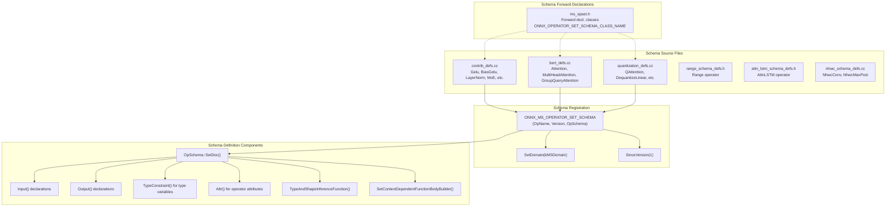
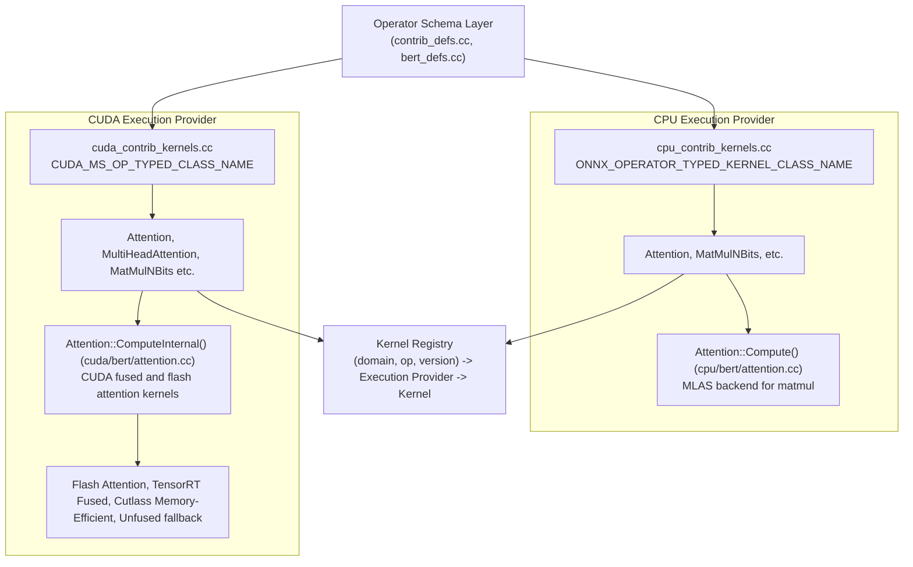
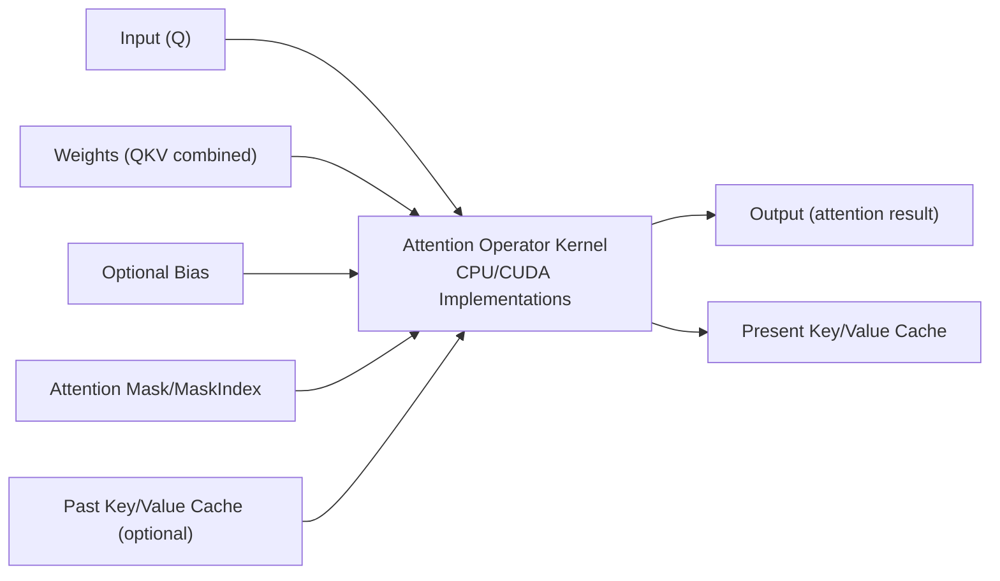
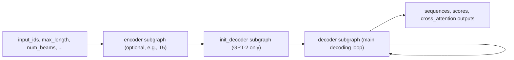
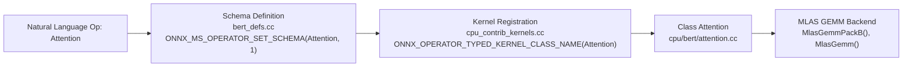
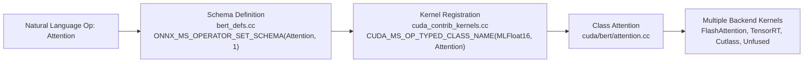

<!-- source: DeepWiki mcp.deepwiki.com · repo microsoft/onnxruntime · page 7.4 Contrib Operators · fetched 2026-10-21 -->

# Contrib Operators

<details>
<summary>Relevant source files</summary>

The following files were used as context for generating this wiki page:

- [docs/ContribOperators.md](docs/ContribOperators.md)
- [docs/OperatorKernels.md](docs/OperatorKernels.md)
- [docs/contrib_ops/cuda/matmul_block_scaled_fp4.md](docs/contrib_ops/cuda/matmul_block_scaled_fp4.md)
- [docs/contrib_ops/cuda/matmul_block_scaled_fp8.md](docs/contrib_ops/cuda/matmul_block_scaled_fp8.md)
- [docs/contrib_ops/cuda/matmul_block_scaled_fp8_experiments.md](docs/contrib_ops/cuda/matmul_block_scaled_fp8_experiments.md)
- [onnxruntime/contrib_ops/cpu/bert/attention.cc](onnxruntime/contrib_ops/cpu/bert/attention.cc)
- [onnxruntime/contrib_ops/cpu/bert/attention_base.h](onnxruntime/contrib_ops/cpu/bert/attention_base.h)
- [onnxruntime/contrib_ops/cpu/bert/attention_common.h](onnxruntime/contrib_ops/cpu/bert/attention_common.h)
- [onnxruntime/contrib_ops/cpu/bert/attention_cpu_base.h](onnxruntime/contrib_ops/cpu/bert/attention_cpu_base.h)
- [onnxruntime/contrib_ops/cpu/bert/attention_helper.h](onnxruntime/contrib_ops/cpu/bert/attention_helper.h)
- [onnxruntime/contrib_ops/cpu/bert/decoder_masked_multihead_attention.cc](onnxruntime/contrib_ops/cpu/bert/decoder_masked_multihead_attention.cc)
- [onnxruntime/contrib_ops/cpu/bert/decoder_masked_multihead_attention.h](onnxruntime/contrib_ops/cpu/bert/decoder_masked_multihead_attention.h)
- [onnxruntime/contrib_ops/cpu/bert/multihead_attention_helper.h](onnxruntime/contrib_ops/cpu/bert/multihead_attention_helper.h)
- [onnxruntime/contrib_ops/cpu/cpu_contrib_kernels.cc](onnxruntime/contrib_ops/cpu/cpu_contrib_kernels.cc)
- [onnxruntime/contrib_ops/cpu/layer_norm.cc](onnxruntime/contrib_ops/cpu/layer_norm.cc)
- [onnxruntime/contrib_ops/cpu/quantization/attention_quant.cc](onnxruntime/contrib_ops/cpu/quantization/attention_quant.cc)
- [onnxruntime/contrib_ops/cpu/skip_layer_norm.cc](onnxruntime/contrib_ops/cpu/skip_layer_norm.cc)
- [onnxruntime/contrib_ops/cpu/skip_layer_norm.h](onnxruntime/contrib_ops/cpu/skip_layer_norm.h)
- [onnxruntime/contrib_ops/cpu/skip_layer_norm_helper.h](onnxruntime/contrib_ops/cpu/skip_layer_norm_helper.h)
- [onnxruntime/contrib_ops/cuda/bert/attention.cc](onnxruntime/contrib_ops/cuda/bert/attention.cc)
- [onnxruntime/contrib_ops/cuda/bert/attention.h](onnxruntime/contrib_ops/cuda/bert/attention.h)
- [onnxruntime/contrib_ops/cuda/bert/attention_impl.cu](onnxruntime/contrib_ops/cuda/bert/attention_impl.cu)
- [onnxruntime/contrib_ops/cuda/bert/attention_impl.h](onnxruntime/contrib_ops/cuda/bert/attention_impl.h)
- [onnxruntime/contrib_ops/cuda/bert/layer_norm.cuh](onnxruntime/contrib_ops/cuda/bert/layer_norm.cuh)
- [onnxruntime/contrib_ops/cuda/bert/multihead_attention.cc](onnxruntime/contrib_ops/cuda/bert/multihead_attention.cc)
- [onnxruntime/contrib_ops/cuda/bert/multihead_attention.h](onnxruntime/contrib_ops/cuda/bert/multihead_attention.h)
- [onnxruntime/contrib_ops/cuda/bert/skip_layer_norm.cc](onnxruntime/contrib_ops/cuda/bert/skip_layer_norm.cc)
- [onnxruntime/contrib_ops/cuda/bert/skip_layer_norm.h](onnxruntime/contrib_ops/cuda/bert/skip_layer_norm.h)
- [onnxruntime/contrib_ops/cuda/bert/skip_layer_norm_impl.cu](onnxruntime/contrib_ops/cuda/bert/skip_layer_norm_impl.cu)
- [onnxruntime/contrib_ops/cuda/bert/skip_layer_norm_impl.h](onnxruntime/contrib_ops/cuda/bert/skip_layer_norm_impl.h)
- [onnxruntime/contrib_ops/cuda/cuda_contrib_kernels.cc](onnxruntime/contrib_ops/cuda/cuda_contrib_kernels.cc)
- [onnxruntime/contrib_ops/cuda/layer_norm.cc](onnxruntime/contrib_ops/cuda/layer_norm.cc)
- [onnxruntime/contrib_ops/cuda/math/matmul_block_scaled_fp4.cc](onnxruntime/contrib_ops/cuda/math/matmul_block_scaled_fp4.cc)
- [onnxruntime/contrib_ops/cuda/math/matmul_block_scaled_fp4.cu](onnxruntime/contrib_ops/cuda/math/matmul_block_scaled_fp4.cu)
- [onnxruntime/contrib_ops/cuda/math/matmul_block_scaled_fp4.h](onnxruntime/contrib_ops/cuda/math/matmul_block_scaled_fp4.h)
- [onnxruntime/contrib_ops/cuda/math/matmul_block_scaled_fp4_tiling.h](onnxruntime/contrib_ops/cuda/math/matmul_block_scaled_fp4_tiling.h)
- [onnxruntime/contrib_ops/cuda/math/matmul_block_scaled_fp8.cc](onnxruntime/contrib_ops/cuda/math/matmul_block_scaled_fp8.cc)
- [onnxruntime/contrib_ops/cuda/math/matmul_block_scaled_fp8.cu](onnxruntime/contrib_ops/cuda/math/matmul_block_scaled_fp8.cu)
- [onnxruntime/contrib_ops/cuda/math/matmul_block_scaled_fp8.h](onnxruntime/contrib_ops/cuda/math/matmul_block_scaled_fp8.h)
- [onnxruntime/contrib_ops/cuda/math/matmul_block_scaled_fp8_tiling.h](onnxruntime/contrib_ops/cuda/math/matmul_block_scaled_fp8_tiling.h)
- [onnxruntime/contrib_ops/cuda/quantization/attention_quantization.cc](onnxruntime/contrib_ops/cuda/quantization/attention_quantization.cc)
- [onnxruntime/core/graph/contrib_ops/bert_defs.cc](onnxruntime/core/graph/contrib_ops/bert_defs.cc)
- [onnxruntime/core/graph/contrib_ops/contrib_defs.cc](onnxruntime/core/graph/contrib_ops/contrib_defs.cc)
- [onnxruntime/core/graph/contrib_ops/ms_opset.h](onnxruntime/core/graph/contrib_ops/ms_opset.h)
- [onnxruntime/core/providers/cpu/nn/layer_norm.cc](onnxruntime/core/providers/cpu/nn/layer_norm.cc)
- [onnxruntime/core/providers/cpu/nn/layer_norm_helper.h](onnxruntime/core/providers/cpu/nn/layer_norm_helper.h)
- [onnxruntime/core/providers/cpu/nn/layer_norm_impl.cc](onnxruntime/core/providers/cpu/nn/layer_norm_impl.cc)
- [onnxruntime/core/providers/cpu/nn/layer_norm_impl.h](onnxruntime/core/providers/cpu/nn/layer_norm_impl.h)
- [onnxruntime/core/providers/cpu/nn/layer_norm_macro.h](onnxruntime/core/providers/cpu/nn/layer_norm_macro.h)
- [onnxruntime/core/providers/cpu/nn/rms_norm.cc](onnxruntime/core/providers/cpu/nn/rms_norm.cc)
- [onnxruntime/core/providers/cpu/nn/rms_norm.h](onnxruntime/core/providers/cpu/nn/rms_norm.h)
- [onnxruntime/core/providers/cuda/nn/layer_norm.cc](onnxruntime/core/providers/cuda/nn/layer_norm.cc)
- [onnxruntime/core/providers/cuda/nn/layer_norm_impl.cu](onnxruntime/core/providers/cuda/nn/layer_norm_impl.cu)
- [onnxruntime/core/providers/cuda/nn/layer_norm_impl.h](onnxruntime/core/providers/cuda/nn/layer_norm_impl.h)
- [onnxruntime/core/providers/cuda/nn/rms_norm.cc](onnxruntime/core/providers/cuda/nn/rms_norm.cc)
- [onnxruntime/core/providers/cuda/nn/rms_norm.h](onnxruntime/core/providers/cuda/nn/rms_norm.h)
- [onnxruntime/core/providers/dml/DmlExecutionProvider/src/Operators/DmlOperatorLayerNormalization.cpp](onnxruntime/core/providers/dml/DmlExecutionProvider/src/Operators/DmlOperatorLayerNormalization.cpp)
- [onnxruntime/core/providers/dml/DmlExecutionProvider/src/Operators/DmlOperatorSkipLayerNormalization.cpp](onnxruntime/core/providers/dml/DmlExecutionProvider/src/Operators/DmlOperatorSkipLayerNormalization.cpp)
- [onnxruntime/core/util/narrow_float_utils.h](onnxruntime/core/util/narrow_float_utils.h)
- [onnxruntime/test/contrib_ops/attention_op_test.cc](onnxruntime/test/contrib_ops/attention_op_test.cc)
- [onnxruntime/test/contrib_ops/attention_op_test_helper.cc](onnxruntime/test/contrib_ops/attention_op_test_helper.cc)
- [onnxruntime/test/contrib_ops/attention_op_test_helper.h](onnxruntime/test/contrib_ops/attention_op_test_helper.h)
- [onnxruntime/test/contrib_ops/decoder_masked_multihead_attention_op_test.cc](onnxruntime/test/contrib_ops/decoder_masked_multihead_attention_op_test.cc)
- [onnxruntime/test/contrib_ops/layer_norm_bf16_cpu_test.cc](onnxruntime/test/contrib_ops/layer_norm_bf16_cpu_test.cc)
- [onnxruntime/test/contrib_ops/layer_norm_op_test.cc](onnxruntime/test/contrib_ops/layer_norm_op_test.cc)
- [onnxruntime/test/contrib_ops/layer_norm_test.cc](onnxruntime/test/contrib_ops/layer_norm_test.cc)
- [onnxruntime/test/contrib_ops/matmul_block_scaled_fp4_test.cc](onnxruntime/test/contrib_ops/matmul_block_scaled_fp4_test.cc)
- [onnxruntime/test/contrib_ops/matmul_block_scaled_fp8_test.cc](onnxruntime/test/contrib_ops/matmul_block_scaled_fp8_test.cc)
- [onnxruntime/test/contrib_ops/multihead_attention_op_test.cc](onnxruntime/test/contrib_ops/multihead_attention_op_test.cc)
- [onnxruntime/test/contrib_ops/multihead_attention_op_test_data_gen.py](onnxruntime/test/contrib_ops/multihead_attention_op_test_data_gen.py)
- [onnxruntime/test/contrib_ops/skiplayernorm_op_test.cc](onnxruntime/test/contrib_ops/skiplayernorm_op_test.cc)
- [onnxruntime/test/onnx/microbenchmark/layer_normalization.cc](onnxruntime/test/onnx/microbenchmark/layer_normalization.cc)
- [onnxruntime/test/providers/compare_provider_test_utils.cc](onnxruntime/test/providers/compare_provider_test_utils.cc)
- [onnxruntime/test/providers/compare_provider_test_utils.h](onnxruntime/test/providers/compare_provider_test_utils.h)
- [onnxruntime/test/providers/cpu/nn/rms_norm_op_test.cc](onnxruntime/test/providers/cpu/nn/rms_norm_op_test.cc)
- [onnxruntime/test/python/contrib_ops/profile_matmul_block_scaled.py](onnxruntime/test/python/contrib_ops/profile_matmul_block_scaled.py)

</details>


## Purpose and Scope

Contrib operators extend ONNX Runtime with custom operators in the Microsoft domain (`com.microsoft`) that provide optimized and experimental capabilities beyond the standard ONNX specification. These include advanced transformer operators (attention variants, fused ops), quantization primitives (INT8/INT4 matmul), layer norm variants, and matrix operations tuned for specific hardware or workloads like mixture-of-experts (MoE) and block-scaled matmuls.

This page details the schema registration, kernel registration, categorized operator families, and key implementation details of contrib operators for CPU and CUDA execution providers.

---

## Operator Domain and Schema Registration

Contrib operators use the domain `kMSDomain` (`"com.microsoft"`) to distinguish them from the standard ONNX domain. This enables rapid development of domain-specific extensions without waiting for standardization.

### Schema Definition Architecture



**Key Points:**
- Schema definitions use the macro `ONNX_MS_OPERATOR_SET_SCHEMA` with the Microsoft domain.
- Detailed operator documentation and input/output typing are defined.
- Function bodies for some operators are expressed via context-dependent builders using ONNX function composition.
  
Sources: [onnxruntime/core/graph/contrib_ops/contrib_defs.cc:3-197](), [onnxruntime/core/graph/contrib_ops/bert_defs.cc:1-174](), [onnxruntime/core/graph/contrib_ops/ms_opset.h:1-110]()

---

## Categories of Contrib Operators

Contrib operators serve various purposes, mainly in DL model acceleration and experimental features:

```mermaid
graph TB
    ContribOps["Contrib Operators<br/>(com.microsoft domain)"]
    
    subgraph "Activation Functions"
        Gelu["Gelu<br/>Gaussian Error Linear Unit"]
        BiasGelu["BiasGelu<br/>Bias + Gelu"]
        FastGelu["FastGelu<br/>Approximate Gelu"]
        QuickGelu["QuickGelu<br/>x * Sigmoid(alpha*x)"]
    end
    
    subgraph "Attention Operators"
        Attention["Attention<br/>Multi-head self/cross attention"]
        MultiHeadAttention["MultiHeadAttention<br/>Standard MHA"]
        PackedAttention["PackedAttention<br/>PackedMultiHeadAttention"]
        GroupQueryAttention["GroupQueryAttention"]
        PagedAttention["PagedAttention<br/>Memory-efficient Attention"]
    end
    
    subgraph "Text Generation"
        BeamSearch["BeamSearch<br/>Beam search decoding"]
        GreedySearch["GreedySearch"]
        WhisperBeamSearch["WhisperBeamSearch"]
        Sampling["Sampling"]
        NGramBlock["NGramRepeatBlock"]
    end
    
    subgraph "Quantization"
        QAttention["QAttention<br/>Quantized Attention"]
        QLinearConv["QLinearConv"]
        MatMulNBits["MatMulNBits<br/>N-bit Quantized MatMul"]
        DynamicQuantizeMatMul["DynamicQuantizeMatMul"]
    end
    
    subgraph "Fused Operations"
        FusedConv["FusedConv<br/>Conv + Activation"]
        FusedMatMul["FusedMatMul<br/>MatMul + transpose"]
        BiasAdd["BiasAdd<br/>Bias addition with broadcast"]
        BiasSoftmax["BiasSoftmax<br/>Bias + Softmax"]
    end
    
    subgraph "Normalization"
        SkipLayerNorm["SkipLayerNormalization<br/>LayerNorm with skip connection"]
        GroupNorm["GroupNorm"]
    end
    
    subgraph "Matrix & Linear Ops"
        Inverse["Inverse"]
        Trilu["Trilu<br/>Triangular matrices"]
        MatMulFpQ4["MatMulFpQ4<br/>FP quantized MatMul"]
    end
    
    subgraph "Position Encoding"
        RotaryEmbedding["RotaryEmbedding<br/>RoPE encoding"]
        RelativePositionBias["RelativePositionBias"]
    end
    
    ContribOps --> Gelu
    ContribOps --> Attention
    ContribOps --> BeamSearch
    ContribOps --> QAttention
    ContribOps --> FusedConv
    ContribOps --> SkipLayerNorm
    ContribOps --> Inverse
    ContribOps --> RotaryEmbedding
```



Operators are grouped by their use case such as activation, attention, quantization, or fused ops optimized for performance.

Sources: [docs/ContribOperators.md:5-119](), [onnxruntime/contrib_ops/cpu/cpu_contrib_kernels.cc:10-90](), [onnxruntime/contrib_ops/cuda/cuda_contrib_kernels.cc:28-123]()

---

## Implementation Architecture

Contrib operators follow the pattern:
- Schema defined in core/graph/contrib_ops (C++ source, header files)
- Kernel implementations registered for each execution provider (CPU, CUDA)
- Kernel classes implement the compute logic leveraging either MLAS (CPU) or custom CUDA kernels

### File System Organization

```
onnxruntime/
├── core/graph/contrib_ops/       # Schema definitions (contrib_defs.cc, bert_defs.cc, quantization_defs.cc)
├── contrib_ops/cpu/              # CPU-based contrib kernel implementations
│   ├── cpu_contrib_kernels.cc   # CPU kernel registrations
│   └── bert/                    # CPU attention kernels and helpers
├── contrib_ops/cuda/             # CUDA-based kernel implementations
│   ├── cuda_contrib_kernels.cc  # CUDA kernel registrations
│   └── bert/                    # CUDA attention kernels and fused implementations
└── ...
```

### Kernel Registration and Dispatch



- CPU kernels use `ONNX_OPERATOR_TYPED_KERNEL_CLASS_NAME` for registration and utilize the MLAS library for GEMM and quantized operations.
- CUDA kernels register multiple typed specializations and select backends dynamically based on hardware and input configurations (e.g. Flash Attention for FP16 on recent GPUs).
- Kernels implementing attention dispatch to different backend implementations like CUTLASS FMHA, cuDNN Flash Attention, or custom fused kernels.

Sources: [onnxruntime/contrib_ops/cpu/cpu_contrib_kernels.cc:1-90](), [onnxruntime/contrib_ops/cuda/cuda_contrib_kernels.cc:1-123](), [onnxruntime/contrib_ops/cpu/bert/attention.cc:26-164](), [onnxruntime/contrib_ops/cuda/bert/attention.cc:24-140]()

---

## Key Contrib Operator Examples

### Attention Operator

The `Attention` operator implements multi-head self and cross attention with past KV cache support and multiple attention mask types.

**Schema Highlights:**
- Inputs:
  - Input tensor `[batch_size, seq_len, hidden_size_in]`
  - Combined QKV weights `[hidden_size_in, q_hidden + k_hidden + v_hidden]`
  - Optional bias, mask, past key/value caches
- Attributes include `num_heads`, `unidirectional` (enables causal masking), `scale` (to override default scaling), rotary embedding options.

**CPU Implementation:**
- Class template `Attention<T>` inherited from `AttentionCPUBase`
- Uses MLAS's `MlasGemmPackB` to pre-pack weights for efficient GEMM
- Computes projection of input to Q/K/V matrices with batched GEMM calls
- Implements masking and scaling in CPU code

**CUDA Implementation:**
- Class template `Attention<T>` with specializations for `float`, `MLFloat16`, `BFloat16`
- Dynamic backend dispatch:
  1. **Flash Attention** kernel for FP16 without past cache (highly optimized memory access)
  2. **TensorRT fused kernel** (for FP16) where supported
  3. **Cutlass memory-efficient attention** for FP16 with flexible shapes
  4. **Unfused kernel** as fallback for all types and special cases

**Input/Output Shape Processing:**
- Output shape `[batch_size, seq_len, v_hidden_size]`
- Present KV cache shape matches `[2, batch_size, num_heads, total_seq_len, head_size]`
  


Sources: [onnxruntime/core/graph/contrib_ops/bert_defs.cc:30-174](), [onnxruntime/contrib_ops/cpu/bert/attention.cc:25-164](), [onnxruntime/contrib_ops/cuda/bert/attention.cc:20-140](), [onnxruntime/contrib_ops/cuda/bert/attention_impl.cu:1-181]()

---

### BeamSearch Operator

`BeamSearch` and related operators (`GreedySearch`, `WhisperBeamSearch`) implement decoding primitives for text generation.

**Architecture:**



- Supports subgraphs for encoder, init_decoder (GPT-2 special), and decoder
- Manages beam hypotheses, scores, and acts as a loop node in computation graph

Sources: [onnxruntime/core/graph/contrib_ops/contrib_defs.cc:400-500](), [docs/ContribOperators.md:418-498]()

---

### MatMulNBits Operator

The `MatMulNBits` operator enables matrix multiplication with weights quantized to N-bits (commonly 4-bit) with block-wise quantization, commonly used in efficient LLM inference.

**Key Details:**

| Property         | Description                                          |
|------------------|-----------------------------------------------------|
| Inputs           | Activation tensor A (float/MLFloat16/BFloat16), Packed quantized weights B (uint8), per-block scales and zero points, optional bias, group index tensor |
| Quantization     | Block-wise with default block size 32; supports 2-, 3-, 4-bit storage packed tightly |
| Output           | Floating-point matrix multiplication result of A and reconstructed weights plus bias |
| Attributes       | bits (default 4), block_size (default 32), K, N specified |
  
**Data Flow:**

```text
Input A (float/half)  --+
                       |--> Dequantize weights block-wise (using scales & zero points)
Packed Weight B (uint8) --+
                        |
                        +--> MatMul with A --> Output Y (float/half)
Optional Bias ----------->
```

**CPU Implementation:**
- Uses MLAS block quantization routines for packing/unpacking and GEMM.

**CUDA Implementation:**
- Custom CUDA kernels execute dequantization fused with batched GEMM for efficient execution on GPUs.

Sources: [onnxruntime/contrib_ops/cpu/cpu_contrib_kernels.cc:60-70](), [onnxruntime/contrib_ops/cuda/cuda_contrib_kernels.cc:170-185]()

---

## Layer Normalization Kernels

### SkipLayerNormalization / EmbedLayerNormalization

- These operators combine skip connections (residual adds) with layer normalization in a single kernel.
- Provide both CPU and CUDA implementations optimized for transformer architectures.
- Kernel classes are registered under Microsoft domain similarly.

Sources: [onnxruntime/contrib_ops/cpu/skip_layer_norm.cc:10-55](), [onnxruntime/contrib_ops/cuda/bert/skip_layer_norm.cc:1-45]()

---

## Summary

The contrib operators in ONNX Runtime provide an extensible, high-performance set of operators optimized for modern deep learning workloads, especially transformer-based models:

- **Standardized Schemas:** Defined under `com.microsoft` domain with comprehensive schema registration and shape inference.
- **Multiple Execution Providers:** CPU and CUDA kernels with detailed registration macros and template specializations for data types.
- **Transformer Primatives:** Extensive attention variants, fused layers, normalization, and rotary embeddings.
- **Quantization Support:** Sophisticated fixed-point and block quantized operations like `MatMulNBits`.
- **Text Generation:** Operators for beam search and sampling tailored to language models.
- **Fusion and Optimization:** Bias fused operators (`BiasGelu`, `BiasSoftmax`), special matrix multiplication kernels, layer norm variants.

This design allows ONNX Runtime to provide state-of-the-art performance and features in advancing transformer and quantized inference technologies.

---

# Additional Illustrations Bridging High-Level Concepts to Code Entities

### Diagram: Natural Language Operators to Schema and Kernel Classes (CPU)



### Diagram: Natural Language Operators to Schema and Kernel Classes (CUDA)



Sources: [onnxruntime/contrib_ops/cpu/cpu_contrib_kernels.cc:12-100](), [onnxruntime/contrib_ops/cuda/cuda_contrib_kernels.cc:28-123](), [onnxruntime/core/graph/contrib_ops/bert_defs.cc:30-174]()

---

# Sources

- onnxruntime/core/graph/contrib_ops/contrib_defs.cc:1-197
- onnxruntime/core/graph/contrib_ops/bert_defs.cc:1-174
- onnxruntime/core/graph/contrib_ops/ms_opset.h:1-110
- docs/ContribOperators.md:1-119
- onnxruntime/contrib_ops/cpu/cpu_contrib_kernels.cc:1-90
- onnxruntime/contrib_ops/cuda/cuda_contrib_kernels.cc:1-123
- onnxruntime/contrib_ops/cpu/bert/attention.cc:25-164
- onnxruntime/contrib_ops/cuda/bert/attention.cc:20-140
- onnxruntime/contrib_ops/cuda/bert/attention_impl.cu:1-181
- onnxruntime/contrib_ops/cuda/bert/multihead_attention.cc:1-136
- onnxruntime/contrib_ops/cpu/skip_layer_norm.cc:10-55
- onnxruntime/contrib_ops/cuda/bert/skip_layer_norm.cc:1-45
- onnxruntime/contrib_ops/cpu/cpu_contrib_kernels.cc:60-70
- onnxruntime/contrib_ops/cuda/cuda_contrib_kernels.cc:170-185

---

