<!-- source: DeepWiki mcp.deepwiki.com · repo microsoft/onnxruntime · page 7.5 Attention Mechanisms · fetched 2026-10-21 -->

# Attention Mechanisms

Relevant source files

The following files were used as context for generating this wiki page:

- [.github/actions/webgpu-validate-shader-key/action.yml](.github/actions/webgpu-validate-shader-key/action.yml)
- [.github/actions/webgpu-validate-shader-key/parse-chromium-debug-log.js](.github/actions/webgpu-validate-shader-key/parse-chromium-debug-log.js)
- [.github/actions/webgpu-validate-shader-key/validate-shader-key.js](.github/actions/webgpu-validate-shader-key/validate-shader-key.js)
- [docs/ContribOperators.md](docs/ContribOperators.md)
- [docs/OperatorKernels.md](docs/OperatorKernels.md)
- [docs/contrib_ops/cuda/gqa.md](docs/contrib_ops/cuda/gqa.md)
- [docs/contrib_ops/cuda/paged_attention.md](docs/contrib_ops/cuda/paged_attention.md)
- [docs/design/webgpu_paged_attention.md](docs/design/webgpu_paged_attention.md)
- [onnxruntime/contrib_ops/cpu/bert/attention.cc](onnxruntime/contrib_ops/cpu/bert/attention.cc)
- [onnxruntime/contrib_ops/cpu/bert/attention_base.h](onnxruntime/contrib_ops/cpu/bert/attention_base.h)
- [onnxruntime/contrib_ops/cpu/bert/attention_common.h](onnxruntime/contrib_ops/cpu/bert/attention_common.h)
- [onnxruntime/contrib_ops/cpu/bert/attention_cpu_base.h](onnxruntime/contrib_ops/cpu/bert/attention_cpu_base.h)
- [onnxruntime/contrib_ops/cpu/bert/attention_helper.h](onnxruntime/contrib_ops/cpu/bert/attention_helper.h)
- [onnxruntime/contrib_ops/cpu/bert/attention_parameters.h](onnxruntime/contrib_ops/cpu/bert/attention_parameters.h)
- [onnxruntime/contrib_ops/cpu/bert/decoder_masked_multihead_attention.cc](onnxruntime/contrib_ops/cpu/bert/decoder_masked_multihead_attention.cc)
- [onnxruntime/contrib_ops/cpu/bert/decoder_masked_multihead_attention.h](onnxruntime/contrib_ops/cpu/bert/decoder_masked_multihead_attention.h)
- [onnxruntime/contrib_ops/cpu/bert/gqa_attention_base.h](onnxruntime/contrib_ops/cpu/bert/gqa_attention_base.h)
- [onnxruntime/contrib_ops/cpu/bert/group_query_attention.cc](onnxruntime/contrib_ops/cpu/bert/group_query_attention.cc)
- [onnxruntime/contrib_ops/cpu/bert/group_query_attention_helper.h](onnxruntime/contrib_ops/cpu/bert/group_query_attention_helper.h)
- [onnxruntime/contrib_ops/cpu/bert/multihead_attention_helper.h](onnxruntime/contrib_ops/cpu/bert/multihead_attention_helper.h)
- [onnxruntime/contrib_ops/cpu/cpu_contrib_kernels.cc](onnxruntime/contrib_ops/cpu/cpu_contrib_kernels.cc)
- [onnxruntime/contrib_ops/cpu/quantization/attention_quant.cc](onnxruntime/contrib_ops/cpu/quantization/attention_quant.cc)
- [onnxruntime/contrib_ops/cuda/bert/attention.cc](onnxruntime/contrib_ops/cuda/bert/attention.cc)
- [onnxruntime/contrib_ops/cuda/bert/attention.h](onnxruntime/contrib_ops/cuda/bert/attention.h)
- [onnxruntime/contrib_ops/cuda/bert/attention_data.h](onnxruntime/contrib_ops/cuda/bert/attention_data.h)
- [onnxruntime/contrib_ops/cuda/bert/attention_impl.cu](onnxruntime/contrib_ops/cuda/bert/attention_impl.cu)
- [onnxruntime/contrib_ops/cuda/bert/attention_impl.h](onnxruntime/contrib_ops/cuda/bert/attention_impl.h)
- [onnxruntime/contrib_ops/cuda/bert/attention_prepare_qkv.cu](onnxruntime/contrib_ops/cuda/bert/attention_prepare_qkv.cu)
- [onnxruntime/contrib_ops/cuda/bert/attention_softmax.cu](onnxruntime/contrib_ops/cuda/bert/attention_softmax.cu)
- [onnxruntime/contrib_ops/cuda/bert/attention_softmax.h](onnxruntime/contrib_ops/cuda/bert/attention_softmax.h)
- [onnxruntime/contrib_ops/cuda/bert/group_query_attention.cc](onnxruntime/contrib_ops/cuda/bert/group_query_attention.cc)
- [onnxruntime/contrib_ops/cuda/bert/group_query_attention.h](onnxruntime/contrib_ops/cuda/bert/group_query_attention.h)
- [onnxruntime/contrib_ops/cuda/bert/group_query_attention_impl.cu](onnxruntime/contrib_ops/cuda/bert/group_query_attention_impl.cu)
- [onnxruntime/contrib_ops/cuda/bert/group_query_attention_impl.h](onnxruntime/contrib_ops/cuda/bert/group_query_attention_impl.h)
- [onnxruntime/contrib_ops/cuda/bert/multihead_attention.cc](onnxruntime/contrib_ops/cuda/bert/multihead_attention.cc)
- [onnxruntime/contrib_ops/cuda/bert/multihead_attention.h](onnxruntime/contrib_ops/cuda/bert/multihead_attention.h)
- [onnxruntime/contrib_ops/cuda/bert/paged_attention.cc](onnxruntime/contrib_ops/cuda/bert/paged_attention.cc)
- [onnxruntime/contrib_ops/cuda/bert/paged_attention.h](onnxruntime/contrib_ops/cuda/bert/paged_attention.h)
- [onnxruntime/contrib_ops/cuda/bert/paged_attention_impl.cu](onnxruntime/contrib_ops/cuda/bert/paged_attention_impl.cu)
- [onnxruntime/contrib_ops/cuda/bert/unfused_attention.cu](onnxruntime/contrib_ops/cuda/bert/unfused_attention.cu)
- [onnxruntime/contrib_ops/cuda/bert/unfused_attention.h](onnxruntime/contrib_ops/cuda/bert/unfused_attention.h)
- [onnxruntime/contrib_ops/cuda/bert/xqa/mha_impl.cuh](onnxruntime/contrib_ops/cuda/bert/xqa/mha_impl.cuh)
- [onnxruntime/contrib_ops/cuda/bert/xqa/xqa_paged_impl_gen.cuh](onnxruntime/contrib_ops/cuda/bert/xqa/xqa_paged_impl_gen.cuh)
- [onnxruntime/contrib_ops/cuda/bert/xqa/xqa_paged_loader.cu](onnxruntime/contrib_ops/cuda/bert/xqa/xqa_paged_loader.cu)
- [onnxruntime/contrib_ops/cuda/bert/xqa/xqa_paged_loader.h](onnxruntime/contrib_ops/cuda/bert/xqa/xqa_paged_loader.h)
- [onnxruntime/contrib_ops/cuda/bert/xqa/xqa_paged_loader_impl.cuh](onnxruntime/contrib_ops/cuda/bert/xqa/xqa_paged_loader_impl.cuh)
- [onnxruntime/contrib_ops/cuda/bert/xqa/xqa_paged_spec_dec_bf16_bf16_256.cu](onnxruntime/contrib_ops/cuda/bert/xqa/xqa_paged_spec_dec_bf16_bf16_256.cu)
- [onnxruntime/contrib_ops/cuda/cuda_contrib_kernels.cc](onnxruntime/contrib_ops/cuda/cuda_contrib_kernels.cc)
- [onnxruntime/contrib_ops/cuda/quantization/attention_quantization.cc](onnxruntime/contrib_ops/cuda/quantization/attention_quantization.cc)
- [onnxruntime/contrib_ops/js/bert/group_query_attention.h](onnxruntime/contrib_ops/js/bert/group_query_attention.h)
- [onnxruntime/contrib_ops/webgpu/bert/attention.cc](onnxruntime/contrib_ops/webgpu/bert/attention.cc)
- [onnxruntime/contrib_ops/webgpu/bert/attention.h](onnxruntime/contrib_ops/webgpu/bert/attention.h)
- [onnxruntime/contrib_ops/webgpu/bert/attention_common.h](onnxruntime/contrib_ops/webgpu/bert/attention_common.h)
- [onnxruntime/contrib_ops/webgpu/bert/flash_attention.cc](onnxruntime/contrib_ops/webgpu/bert/flash_attention.cc)
- [onnxruntime/contrib_ops/webgpu/bert/flash_attention.h](onnxruntime/contrib_ops/webgpu/bert/flash_attention.h)
- [onnxruntime/contrib_ops/webgpu/bert/flash_attention.wgsl.template](onnxruntime/contrib_ops/webgpu/bert/flash_attention.wgsl.template)
- [onnxruntime/contrib_ops/webgpu/bert/flash_attention_decode_qkv.wgsl.template](onnxruntime/contrib_ops/webgpu/bert/flash_attention_decode_qkv.wgsl.template)
- [onnxruntime/contrib_ops/webgpu/bert/flash_attention_decode_vx_reduce.wgsl.template](onnxruntime/contrib_ops/webgpu/bert/flash_attention_decode_vx_reduce.wgsl.template)
- [onnxruntime/contrib_ops/webgpu/bert/flash_attention_paged_decode_qkv.wgsl.template](onnxruntime/contrib_ops/webgpu/bert/flash_attention_paged_decode_qkv.wgsl.template)
- [onnxruntime/contrib_ops/webgpu/bert/flash_attention_paged_decode_vx_reduce.wgsl.template](onnxruntime/contrib_ops/webgpu/bert/flash_attention_paged_decode_vx_reduce.wgsl.template)
- [onnxruntime/contrib_ops/webgpu/bert/flash_attention_paged_prefill.wgsl.template](onnxruntime/contrib_ops/webgpu/bert/flash_attention_paged_prefill.wgsl.template)
- [onnxruntime/contrib_ops/webgpu/bert/group_query_attention.cc](onnxruntime/contrib_ops/webgpu/bert/group_query_attention.cc)
- [onnxruntime/contrib_ops/webgpu/bert/group_query_attention.h](onnxruntime/contrib_ops/webgpu/bert/group_query_attention.h)
- [onnxruntime/contrib_ops/webgpu/bert/multihead_attention.cc](onnxruntime/contrib_ops/webgpu/bert/multihead_attention.cc)
- [onnxruntime/contrib_ops/webgpu/bert/paged_attention.cc](onnxruntime/contrib_ops/webgpu/bert/paged_attention.cc)
- [onnxruntime/contrib_ops/webgpu/bert/paged_attention.h](onnxruntime/contrib_ops/webgpu/bert/paged_attention.h)
- [onnxruntime/contrib_ops/webgpu/bert/paged_attention_prepare_metadata.wgsl.template](onnxruntime/contrib_ops/webgpu/bert/paged_attention_prepare_metadata.wgsl.template)
- [onnxruntime/contrib_ops/webgpu/bert/split_packed_qkv_with_rotary_embedding.wgsl.template](onnxruntime/contrib_ops/webgpu/bert/split_packed_qkv_with_rotary_embedding.wgsl.template)
- [onnxruntime/contrib_ops/webgpu/bert/split_packed_qkv_with_rotary_embedding_and_copykv.wgsl.template](onnxruntime/contrib_ops/webgpu/bert/split_packed_qkv_with_rotary_embedding_and_copykv.wgsl.template)
- [onnxruntime/contrib_ops/webgpu/bert/turbo_quant_fused_rotary_hadamard.wgsl.template](onnxruntime/contrib_ops/webgpu/bert/turbo_quant_fused_rotary_hadamard.wgsl.template)
- [onnxruntime/contrib_ops/webgpu/bert/turbo_quant_hadamard.cc](onnxruntime/contrib_ops/webgpu/bert/turbo_quant_hadamard.cc)
- [onnxruntime/contrib_ops/webgpu/bert/turbo_quant_hadamard.h](onnxruntime/contrib_ops/webgpu/bert/turbo_quant_hadamard.h)
- [onnxruntime/contrib_ops/webgpu/bert/turbo_quant_hadamard.wgsl.template](onnxruntime/contrib_ops/webgpu/bert/turbo_quant_hadamard.wgsl.template)
- [onnxruntime/core/graph/contrib_ops/bert_defs.cc](onnxruntime/core/graph/contrib_ops/bert_defs.cc)
- [onnxruntime/core/graph/contrib_ops/contrib_defs.cc](onnxruntime/core/graph/contrib_ops/contrib_defs.cc)
- [onnxruntime/core/graph/contrib_ops/ms_opset.h](onnxruntime/core/graph/contrib_ops/ms_opset.h)
- [onnxruntime/core/providers/cpu/llm/attention.cc](onnxruntime/core/providers/cpu/llm/attention.cc)
- [onnxruntime/core/providers/cpu/llm/attention.h](onnxruntime/core/providers/cpu/llm/attention.h)
- [onnxruntime/core/providers/cpu/llm/attention_helper.h](onnxruntime/core/providers/cpu/llm/attention_helper.h)
- [onnxruntime/core/providers/cpu/llm/attention_parameters.h](onnxruntime/core/providers/cpu/llm/attention_parameters.h)
- [onnxruntime/core/providers/cuda/llm/attention.cc](onnxruntime/core/providers/cuda/llm/attention.cc)
- [onnxruntime/core/providers/cuda/llm/attention.h](onnxruntime/core/providers/cuda/llm/attention.h)
- [onnxruntime/core/providers/cuda/llm/attention_mask_impl.cu](onnxruntime/core/providers/cuda/llm/attention_mask_impl.cu)
- [onnxruntime/core/providers/cuda/llm/attention_mask_impl.h](onnxruntime/core/providers/cuda/llm/attention_mask_impl.h)
- [onnxruntime/core/providers/dml/DmlExecutionProvider/src/Operators/DmlOperatorGroupQueryAttention.cpp](onnxruntime/core/providers/dml/DmlExecutionProvider/src/Operators/DmlOperatorGroupQueryAttention.cpp)
- [onnxruntime/core/providers/webgpu/wgsl_templates/wgsl_gen.cc](onnxruntime/core/providers/webgpu/wgsl_templates/wgsl_gen.cc)
- [onnxruntime/core/providers/webgpu/wgsl_templates/wgsl_gen.h](onnxruntime/core/providers/webgpu/wgsl_templates/wgsl_gen.h)
- [onnxruntime/test/contrib_ops/attention_op_test.cc](onnxruntime/test/contrib_ops/attention_op_test.cc)
- [onnxruntime/test/contrib_ops/attention_op_test_helper.cc](onnxruntime/test/contrib_ops/attention_op_test_helper.cc)
- [onnxruntime/test/contrib_ops/attention_op_test_helper.h](onnxruntime/test/contrib_ops/attention_op_test_helper.h)
- [onnxruntime/test/contrib_ops/decoder_masked_multihead_attention_op_test.cc](onnxruntime/test/contrib_ops/decoder_masked_multihead_attention_op_test.cc)
- [onnxruntime/test/contrib_ops/group_query_attention_op_test.cc](onnxruntime/test/contrib_ops/group_query_attention_op_test.cc)
- [onnxruntime/test/contrib_ops/multihead_attention_op_test.cc](onnxruntime/test/contrib_ops/multihead_attention_op_test.cc)
- [onnxruntime/test/contrib_ops/multihead_attention_op_test_data_gen.py](onnxruntime/test/contrib_ops/multihead_attention_op_test_data_gen.py)
- [onnxruntime/test/contrib_ops/paged_attention_op_test.cc](onnxruntime/test/contrib_ops/paged_attention_op_test.cc)
- [onnxruntime/test/onnx/microbenchmark/paged_attention.cc](onnxruntime/test/onnx/microbenchmark/paged_attention.cc)
- [onnxruntime/test/providers/cpu/llm/attention_op_test.cc](onnxruntime/test/providers/cpu/llm/attention_op_test.cc)
- [onnxruntime/test/python/transformers/test_gqa.py](onnxruntime/test/python/transformers/test_gqa.py)
- [onnxruntime/test/python/transformers/test_gqa_cpu.py](onnxruntime/test/python/transformers/test_gqa_cpu.py)
- [onnxruntime/test/python/transformers/test_onnx_attention/common.py](onnxruntime/test/python/transformers/test_onnx_attention/common.py)
- [onnxruntime/test/python/transformers/test_onnx_attention/test_gqa.py](onnxruntime/test/python/transformers/test_onnx_attention/test_gqa.py)
- [onnxruntime/test/python/transformers/test_onnx_attention/test_mha.py](onnxruntime/test/python/transformers/test_onnx_attention/test_mha.py)
- [onnxruntime/test/python/transformers/test_onnx_attention/test_tensorscatter_attention.py](onnxruntime/test/python/transformers/test_onnx_attention/test_tensorscatter_attention.py)
- [onnxruntime/test/python/transformers/test_paged_attention.py](onnxruntime/test/python/transformers/test_paged_attention.py)

## Purpose and Scope

This document describes the attention mechanism implementations in ONNX Runtime, including the various attention operators, kernel dispatch logic, and specialized backends for different hardware platforms. Attention operators are critical for transformer-based models and language models, providing optimized implementations of multi-head attention patterns used in BERT, GPT, T5, and similar architectures.

The attention system includes multiple operator variants (`Attention`, `MultiHeadAttention`, `GroupQueryAttention`, `PagedAttention`, etc.) and dispatches to specialized kernels based on input characteristics, hardware capabilities, and operator attributes. This page focuses on the operator implementations and kernel dispatch mechanisms, including advanced Flash Attention and WebGPU variants.

For quantized attention and other related kernels, see quantization operators [Quantization Operators](#7.6). For training-specific gradient operators, see [Gradient Graph Builder](#8.4).

**Sources:** [onnxruntime/core/graph/contrib_ops/bert_defs.cc:1-687](), [docs/ContribOperators.md:6-207]()

## Attention Operator Variants

ONNX Runtime provides several attention operator variants in the `com.microsoft` domain, each optimized for different use cases:

| Operator                  | Primary Use Case                        | Key Features                                                            |
|---------------------------|---------------------------------------|-------------------------------------------------------------------------|
| `Attention`               | BERT-style self/cross attention       | Merged QKV weights, past/present key-value cache, unidirectional masking |
| `MultiHeadAttention`      | Flexible multi-head attention          | Separate Q/K/V inputs, packed KV/QKV formats, cross-attention support    |
| `GroupQueryAttention`     | Multi-Query / Grouped-Query Attention | Reduces KV cache size by grouping query heads to KV heads               |
| `PagedAttention`          | Memory efficient paging of KV cache   | Efficient handling of long sequences with paged key/value cache         |
| `PackedAttention`         | BERT with padding removed              | Optimized for sequences where padding tokens are removed                 |
| `PackedMultiHeadAttention`| Multi-head attention with packing     | Combine MHA flexibility with padding removal                            |
| `QAttention`              | Quantized attention                    | INT8 quantization support                                                |

These operators have corresponding CPU, CUDA, and WebGPU kernel implementations, and leverage hardware-specific optimizations such as Flash Attention and TensorRT fused kernels.

**Sources:** [docs/ContribOperators.md:6-207](), [onnxruntime/core/graph/contrib_ops/bert_defs.cc:389-687](), [onnxruntime/contrib_ops/cpu/cpu_contrib_kernels.cc:15-32]()

## Attention Operator Architecture

The attention mechanism is architected with a layered approach, separating operator classes, utility helpers, kernel dispatch logic, and backend implementations.

```mermaid
graph TB
  subgraph "Operator Layer"
    AttentionOp["Attention<T><br/>(CPU/CUDA Op)"]
    MHAOp["MultiHeadAttention<T,QK><br/>(CPU/CUDA Op)"]
    GQAOp["GroupQueryAttention<T,U><br/>(CPU/CUDA Op)"]
    PagedAttentionOp["PagedAttention<T,M,K><br/>(CUDA/C# Op)"]
  end
  
  subgraph "Base Classes"
    AttentionBase["AttentionBase<br/>(CPU base class)"]
    AttentionCPUBase["AttentionCPUBase<br/>(extends AttentionBase)"]
  end
  
  subgraph "Helper Utilities"
    AttentionHelper["multihead_attention_helper<br/>(Shape validation & helpers)"]
    AttentionParams["AttentionParameters<br/>(Exec params)"]
    AttentionData["AttentionData<T><br/>(Tensor pointers & buffers)"]
  end
  
  subgraph "Kernel Dispatch"
    QkvToContext["QkvToContext<T,QK><br/>(Dispatch function)"]
    PrepareQkv["PrepareQkv<T><br/>(QKV buffer preparation)"]
    NoQkvWorkspace["NoQkvWorkspace<T><br/>(Check workspace need)"]
  end
  
  subgraph "Backends"
      FlashAttention["FlashAttention<br/>CUDA/WebGPU"]
      FusedTrtAttention["TensorRT Fused (FP16)"]
      MemoryEfficient["MemoryEfficient (Cutlass FMHA)"]
      MathBackend["Unfused Attention Math"]
      GroupQueryBackend["GroupQueryAttention Specialized"]
      PagedAttentionBackend["PagedAttention Specialized"]
  end

  AttentionOp --> AttentionCPUBase
  AttentionCPUBase --> AttentionBase
  MHAOp --> AttentionHelper
  GQAOp --> AttentionHelper
  
  AttentionOp --> QkvToContext
  MHAOp --> QkvToContext
  PagedAttentionOp --> QkvToContext
  
  QkvToContext --> PrepareQkv
  QkvToContext --> NoQkvWorkspace
  
  QkvToContext --> FlashAttention
  QkvToContext --> FusedTrtAttention
  QkvToContext --> MemoryEfficient
  QkvToContext --> MathBackend
  
  GQAOp --> GroupQueryBackend
  PagedAttentionOp --> PagedAttentionBackend
```

**Attention Class Hierarchy and Dispatch Flow**

This architecture allows flexible kernel backend selection depending on hardware, input data formats, and operator attributes for maximum efficiency.

**Sources:** [onnxruntime/contrib_ops/cpu/bert/attention.cc:1-88](), [onnxruntime/contrib_ops/cuda/bert/attention.cc:20-140](), [onnxruntime/contrib_ops/cuda/bert/group_query_attention.cc:1-138](), [onnxruntime/contrib_ops/cuda/bert/paged_attention.cc:1-101](), [onnxruntime/contrib_ops/webgpu/bert/attention.cc:10-61]()

## Kernel Backend Selection

ONNX Runtime provides a hierarchy of specialized attention kernel backends prioritized by performance and hardware support:

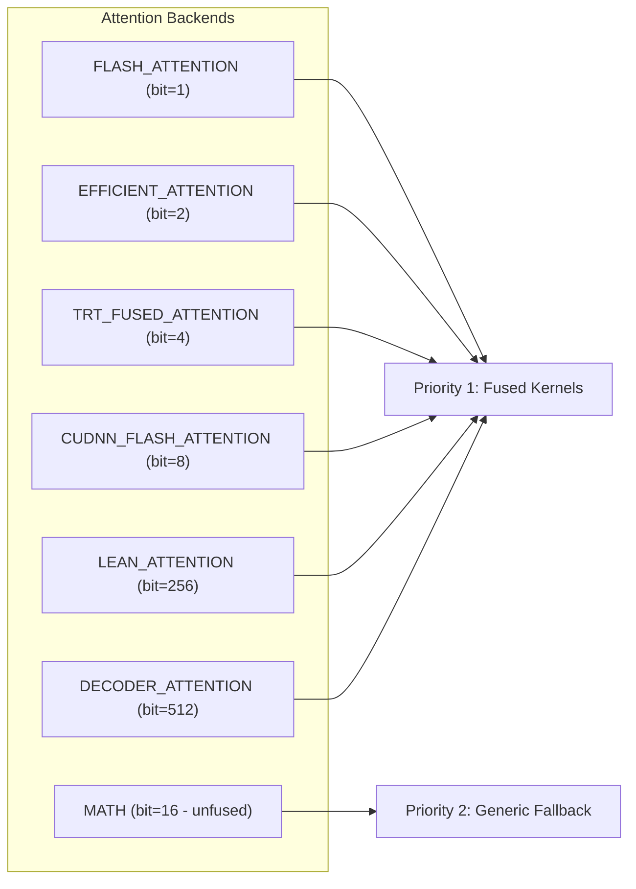

The `AttentionBackend` enum uses bit flags to indicate available kernels. Runtime selects the highest priority kernel enabled and applicable for device and input:

- Flash Attention: high-performance, minimal memory access, tile-based kernels.
- Memory Efficient Attention: Cutlass FMHA optimized for Nvidia GPUs.
- TensorRT Fused Attention: specialized fused kernels for FP16 on CUDA.
- cuDNN Flash Attention: cuDNN’s flash attention kernels for eligible GPUs.
- Math Backend: unfused, less performant but broadly compatible.
- Others: Lean, Decoder Attention, etc.

**Sources:** [onnxruntime/contrib_ops/cpu/bert/attention_common.h:70-115](), [onnxruntime/contrib_ops/cuda/bert/attention_impl.cu:1-55]()

## Kernel Selection Logic (CUDA Operator Example)

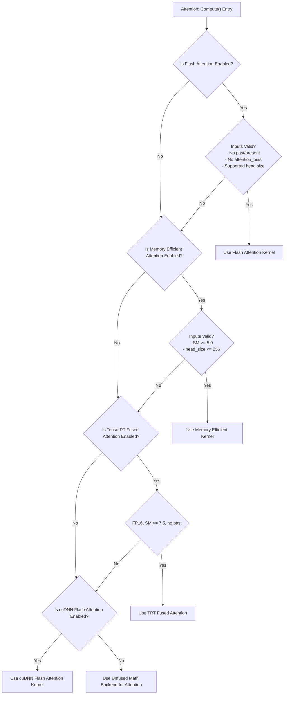

This decision tree ensures the operator picks the best-suited kernel based on runtime conditions and platform support.

**Sources:** [onnxruntime/contrib_ops/cuda/bert/attention.cc:50-191](), [onnxruntime/contrib_ops/cuda/bert/attention_impl.cu:300-415]()

## Key Data Structures

### AttentionParameters

`AttentionParameters` consolidates all validated input/output shapes and runtime configuration for an attention computation:

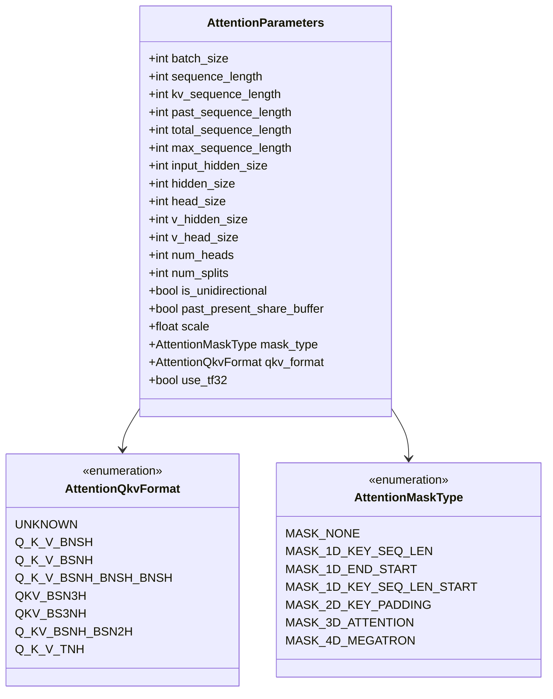

This class is used across CPU and CUDA kernels to propagate runtime information and configure kernel behavior.

**Sources:** [onnxruntime/contrib_ops/cpu/bert/attention_parameters.h:1-50](), [onnxruntime/contrib_ops/cpu/bert/attention_common.h:16-60]()

### AttentionData<T>

`AttentionData<T>` encapsulates pointers to input tensors, weights, intermediate workspaces, and output tensors for a specific attention computation instance:

| Field                      | Description                                          |
|----------------------------|------------------------------------------------------|
| `q, k, v`                  | Query, Key, Value tensors or pre-packed buffers      |
| `gemm_buffer`              | Intermediate GEMM workspace                           |
| `output`                   | Output tensor pointer                                 |
| `mask_index`               | Optional attention mask tensor                        |
| `attention_bias`           | Optional additive attention bias                      |
| `past, present`            | Past and current key/value cache (for autoregressive)|
| `workspace`                | Temporary workspace buffer                            |
| `fused_runner`             | Special fused kernel data structures                  |
| `qkv_format`               | Layout format of Q/K/V tensors                        |
| `cumulated_sequence_length_q_cache` | Cached sequence length prefix sums               |

This struct simplifies passing required memory and metadata to nested kernel calls.

**Sources:** [onnxruntime/contrib_ops/cuda/bert/attention_data.h:1-55](), [onnxruntime/contrib_ops/cuda/bert/attention_impl.h:1-120]()

## Execution Flow

### Attention Operator Compute Flow (CUDA Example)

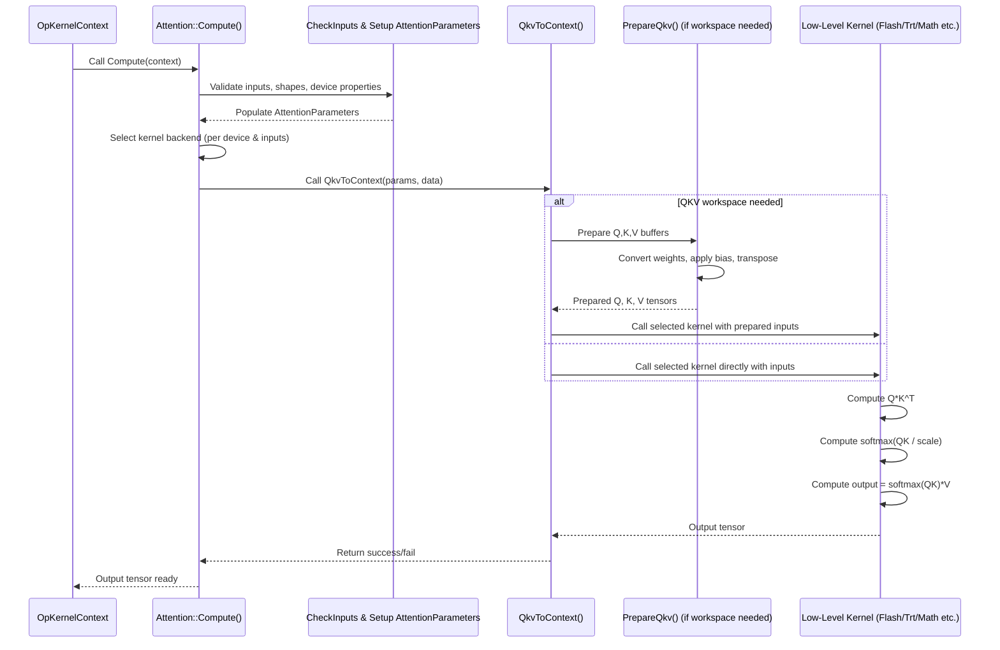

This sequence encapsulates the typical computation: input validation, kernel selection, optional QKV preparation, and the actual attention computation.

**Sources:** [onnxruntime/contrib_ops/cuda/bert/attention.cc:60-250](), [onnxruntime/contrib_ops/cuda/bert/attention_impl.cu:417-582]()

### Flash Attention Execution Path Overview

Flash Attention replaces naive attention computation by calculating attention in tiled blocks with recomputed softmax normalization, drastically reducing memory bandwidth:

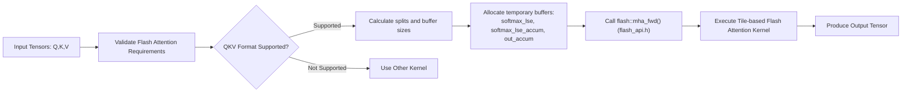

Flash Attention uses specialized kernels that fuse multiple steps and avoid storing the full attention matrix in memory, which is significant for long sequences.

**Sources:** [onnxruntime/contrib_ops/cuda/bert/attention.cc:112-150](), [onnxruntime/contrib_ops/cuda/bert/attention_impl.cu:300-342](), [onnxruntime/contrib_ops/cuda/bert/flash_attention/flash_api.h:1-50]()

### TensorRT Fused Attention Execution Flow

TensorRT fused attention kernels require sequence length offsets and support autoregressive generation with past KV caches:

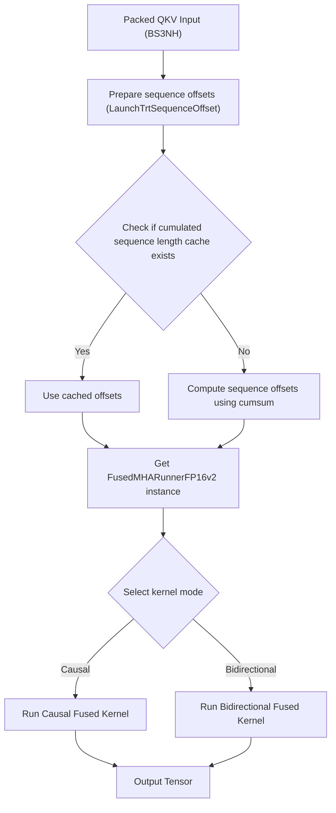

These specialized kernels provide very high performance on supported GPUs for FP16 precision without workspace overhead.

**Sources:** [onnxruntime/contrib_ops/cuda/bert/attention.cc:150-180](), [onnxruntime/contrib_ops/cuda/bert/attention_impl.cu:240-300]()

## Optimization Strategies

### Memory Efficient Attention

Memory Efficient Attention uses tiled attention computation with reduced memory footprint:

- Designed for GPUs with SM >=5.0.
- Supports head sizes up to 256.
- Avoids storing explicit softmax matrices.

This backend is selected when Fuse/Flash kernels are unavailable or unsupported.

**Sources:** [onnxruntime/contrib_ops/cuda/bert/cutlass_fmha/memory_efficient_attention.h:1-50](), [onnxruntime/contrib_ops/cuda/bert/attention_impl.cu:140-160]()

### Past/Present KV Cache Buffer Sharing

`past_present_share_buffer` is an optimization allowing past and present key/value caches to share the same buffer for autoregressive attention:

- Cache tensor shape: `[2, batch_size, num_heads, max_sequence_length, head_size]`.
- New keys/values written in-place at the offset `past_sequence_length`.
- Eliminates extra copy and memory allocation, reducing memory bandwidth.

This is an optional attribute in the attention operators and activated based on operator attributes or runtime environment.

**Sources:** [onnxruntime/contrib_ops/cuda/bert/attention.cc:95-105](), [onnxruntime/contrib_ops/cpu/bert/attention_base.cc:10-50]()

### Weight Prepacking (CPU)

On CPU, attention weight matrices are pre-packed for the GEMM calls using MLAS’s `MlasGemmPackB()`:

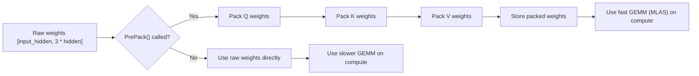

Prepacking significantly speeds up the matrix multiplications on CPU.

**Sources:** [onnxruntime/contrib_ops/cpu/bert/attention.cc:50-160]()

### Kernel Auto-tuning

Some backends implement kernel auto-tuning strategies:

- TensorRT fused kernels (`FusedMHARunnerFP16v2`) select the best kernel variant dynamically based on batch and sequence shapes.
- Cutlass FMHA tiles and kernels are chosen based on head sizes and hardware.
- Flash Attention determines tile splits for optimal GPU utilization.

This dynamic behavior improves runtime performance across various input configurations.

**Sources:** [onnxruntime/contrib_ops/cuda/bert/attention.cc:152-180](), [onnxruntime/contrib_ops/cuda/bert/cutlass_fmha/memory_efficient_attention.h:1-50](), [onnxruntime/contrib_ops/cuda/bert/attention.cc:120-140]()

## Workspace Management

Attention operators require intermediate workspace buffers sized according to batch, sequence length, head sizes, and backend kernel needs:

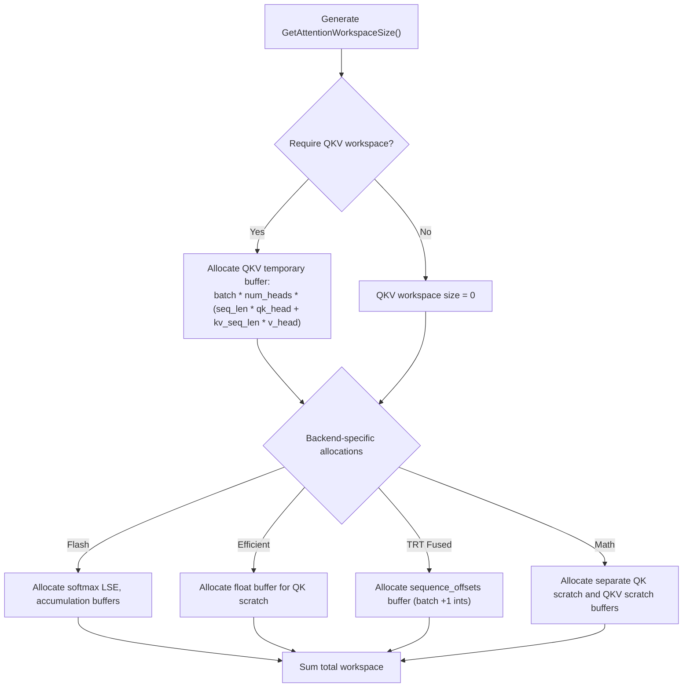

Workspace sizes are carefully computed to minimize allocations and respect alignment constraints.

**Sources:** [onnxruntime/contrib_ops/cuda/bert/attention_impl.cu:100-170](), [onnxruntime/contrib_ops/cuda/bert/attention.cc:190-250]()

## Multi-Head Attention Variants

### GroupQueryAttention

Group Query Attention (GQA) reduces memory usage by having fewer KV heads than Q heads:

- `num_heads` (Q heads) is a multiple of `kv_num_heads` (KV heads).
- Same key-value cache shared among groups of query heads.
- Supports rotary positional embeddings (RoPE), KV cache, quantized KV cache.
- Supports backends: Flash Attention, Memory Efficient Attention, and CUDA fused kernels.

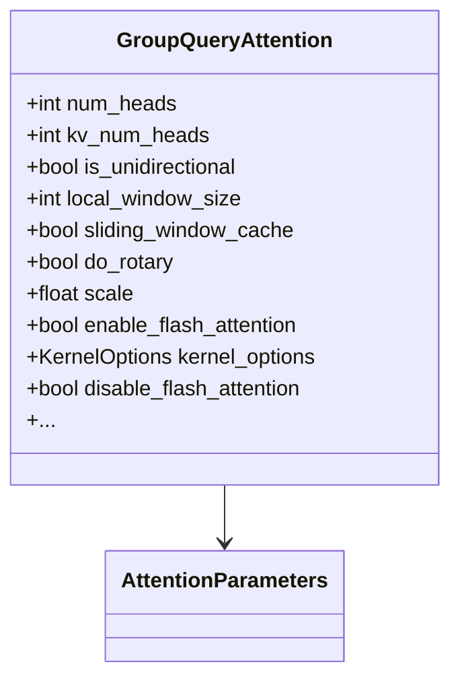

This operator manages the grouping logic and kernel backend dispatch for efficient grouped querying.

**Sources:** [onnxruntime/contrib_ops/cuda/bert/group_query_attention.cc:1-138](), [onnxruntime/core/graph/contrib_ops/bert_defs.cc:230-387]()

### PagedAttention

PagedAttention provides an operator variant optimized for KV cache paging, supporting long-sequence autoregressive generation efficiently by:

- Using a paged KV cache layout to avoid loading all past tokens into memory.
- Allowing fast updates and retrievals for KV caching.
- Providing a specialized single kernel prefill and decode program (similar to Flash Attention structure).

This contributes to scaling large language models efficiently in online serving scenarios.

**Sources:** [onnxruntime/contrib_ops/cuda/bert/paged_attention.cc:1-70](), [docs/contrib_ops/cuda/paged_attention.md](), [onnxruntime/contrib_ops/webgpu/bert/paged_attention.cc:1-90]()

## Flash Attention WebGPU Variant

ONNX Runtime includes a WebGPU implementation of Flash Attention in WGSL:

- Implements tile-based attention kernel optimized for GPU shader execution.
- Uses shader helper programs such as `SplitPackedQKVWithRotaryEmbeddingAndCopyKVProgram`, `CopyKVCacheProgram`, and `FlashAttentionProgram`.
- Manages indirect dispatch buffers to deal with WebGPU workgroup size limits.
- Supports quantized KV cache operations and optimizations tuned for Qualcomm, Apple, Nvidia GPUs.
- Includes detail for managing shared memory limits and split adaptive tile sizes.

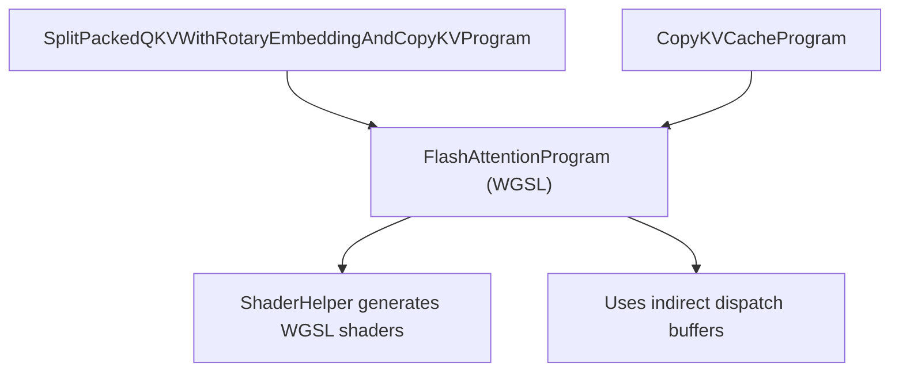

This WebGPU flavor allows browsers and WebAssembly runtimes to perform efficient transformer attention with state-of-the-art techniques ported from CUDA.

**Sources:** [onnxruntime/contrib_ops/webgpu/bert/flash_attention.h:18-147](), [onnxruntime/contrib_ops/webgpu/bert/flash_attention.cc:1-140](), [onnxruntime/contrib_ops/webgpu/bert/attention.cc:10-61]()

---

# Summary Table of Attention Operator Implementations and Backends

| Operator                 | Backends Supported                            | Hardware Unit        | Notes                                                |
|--------------------------|-----------------------------------------------|---------------------|------------------------------------------------------|
| `Attention`              | CUDA (Flash, TRT fused, Memory-Efficient), CPU, WebGPU | CPU/GPU             | Standard self-attention, with past/present KV cache support |
| `MultiHeadAttention`     | CUDA (various fused), CPU                     | CPU/GPU             | Flexible Q/K/V inputs, packed formats                |
| `GroupQueryAttention`    | CUDA (Flash, Memory-Efficient, Fused), CPU   | GPU/CPU             | Multi-query attention with reduced KV cache          |
| `PagedAttention`         | CUDA, WebGPU                                  | GPU                 | Paging for large KV cache, scalable long sequence attention |
| `PackedAttention`        | CUDA, CPU                                    | CPU/GPU             | Padding removed input sequences for efficiency       |
| `QAttention`             | CUDA with quantized kernels                   | GPU                 | INT8 quantized attention                              |

**Sources:** Combined from all above sections and files.

---

This document provides a detailed overview of ONNX Runtime’s attention mechanism implementations, their design, operator variants, backend kernels, key data structures, and execution flow, including modern Flash Attention and WebGPU shader implementations to achieve best-in-class performance for transformer model workloads.

# End of Section 7.5 - Attention Mechanisms

---

**Sources:**  
- [onnxruntime/core/graph/contrib_ops/bert_defs.cc:1-687]()  
- [docs/ContribOperators.md:6-207]()  
- [onnxruntime/contrib_ops/cpu/cpu_contrib_kernels.cc:15-32]()  
- [onnxruntime/contrib_ops/cuda/bert/attention.cc:1-140]()  
- [onnxruntime/contrib_ops/cuda/bert/attention_impl.cu:1-582]()  
- [onnxruntime/contrib_ops/cuda/bert/group_query_attention.cc:1-138]()  
- [onnxruntime/contrib_ops/cuda/bert/paged_attention.cc:1-101]()  
- [onnxruntime/contrib_ops/webgpu/bert/flash_attention.h:18-147]()  
- [onnxruntime/contrib_ops/webgpu/bert/flash_attention.cc:1-140]()  
- [onnxruntime/contrib_ops/webgpu/bert/attention.cc:10-61]()  
- [docs/contrib_ops/cuda/paged_attention.md]()

---

