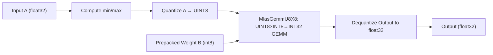
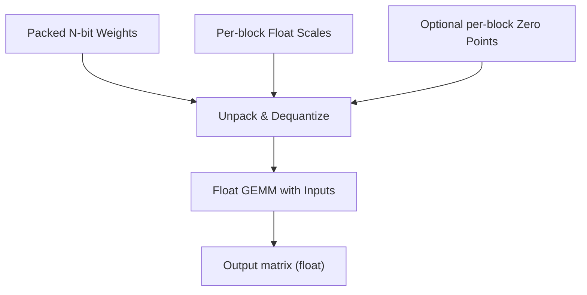
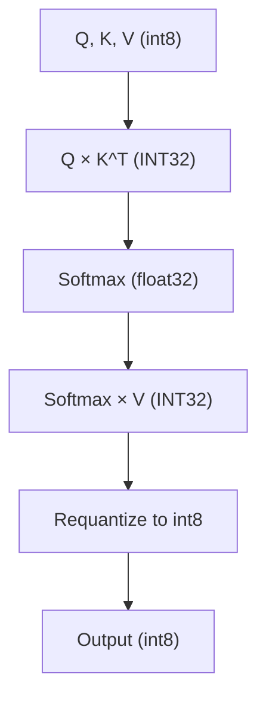
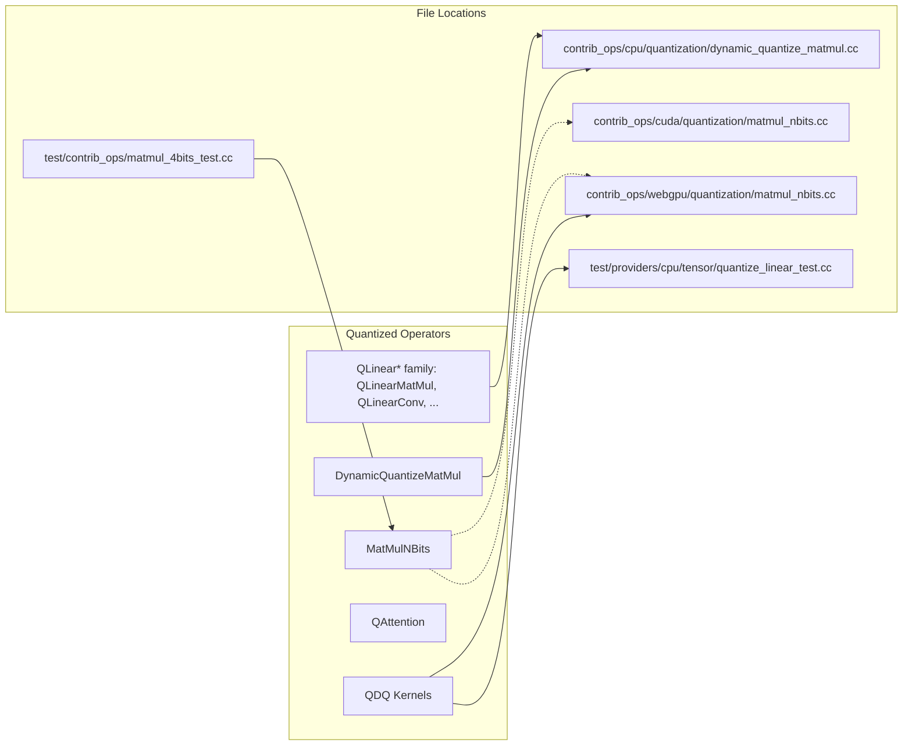
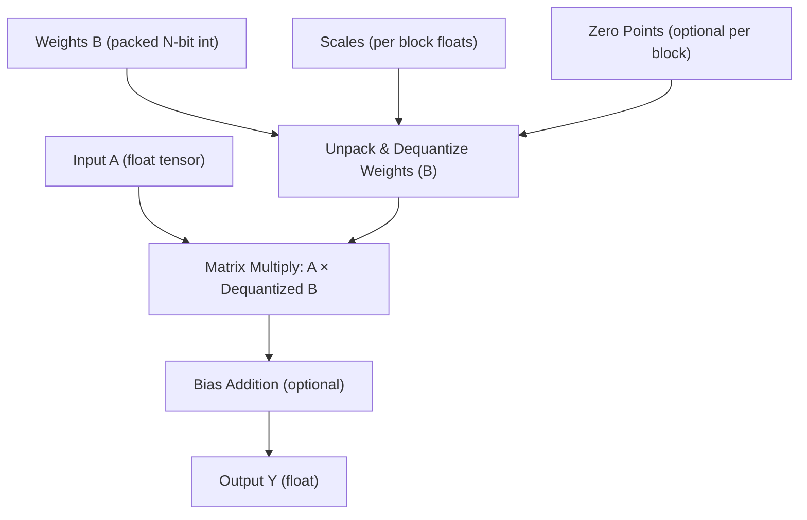

<!-- source: DeepWiki mcp.deepwiki.com · repo microsoft/onnxruntime · page 7.6 Quantization Operators · fetched 2026-10-21 -->

# Quantization Operators

<details>
<summary>Relevant source files</summary>

The following files were used as context for generating this wiki page:

- [docs/annotated_partitioning/future_directions_constrained_env.md](docs/annotated_partitioning/future_directions_constrained_env.md)
- [docs/contrib_ops/cuda/matmul_nbits.md](docs/contrib_ops/cuda/matmul_nbits.md)
- [include/onnxruntime/core/framework/op_kernel.h](include/onnxruntime/core/framework/op_kernel.h)
- [include/onnxruntime/core/framework/workspace_input_shape.h](include/onnxruntime/core/framework/workspace_input_shape.h)
- [include/onnxruntime/core/framework/workspace_requirement.h](include/onnxruntime/core/framework/workspace_requirement.h)
- [include/onnxruntime/ep/adapter/op_kernel.h](include/onnxruntime/ep/adapter/op_kernel.h)
- [onnxruntime/contrib_ops/cpu/quantization/dynamic_quantize_matmul.cc](onnxruntime/contrib_ops/cpu/quantization/dynamic_quantize_matmul.cc)
- [onnxruntime/contrib_ops/cpu/quantization/quant_gemm.cc](onnxruntime/contrib_ops/cpu/quantization/quant_gemm.cc)
- [onnxruntime/contrib_ops/cuda/llm/fpA_intB_gemm/fpA_intB_gemm.h](onnxruntime/contrib_ops/cuda/llm/fpA_intB_gemm/fpA_intB_gemm.h)
- [onnxruntime/contrib_ops/cuda/llm/fpA_intB_gemm/fpA_intB_gemm_template.h](onnxruntime/contrib_ops/cuda/llm/fpA_intB_gemm/fpA_intB_gemm_template.h)
- [onnxruntime/contrib_ops/cuda/llm/fpA_intB_gemv/dispatcher.h](onnxruntime/contrib_ops/cuda/llm/fpA_intB_gemv/dispatcher.h)
- [onnxruntime/contrib_ops/cuda/llm/fpA_intB_gemv/fpA_intB_gemv.cu](onnxruntime/contrib_ops/cuda/llm/fpA_intB_gemv/fpA_intB_gemv.cu)
- [onnxruntime/contrib_ops/cuda/llm/fpA_intB_gemv/fpA_intB_gemv.h](onnxruntime/contrib_ops/cuda/llm/fpA_intB_gemv/fpA_intB_gemv.h)
- [onnxruntime/contrib_ops/cuda/quantization/matmul_nbits.cc](onnxruntime/contrib_ops/cuda/quantization/matmul_nbits.cc)
- [onnxruntime/contrib_ops/cuda/quantization/matmul_nbits.h](onnxruntime/contrib_ops/cuda/quantization/matmul_nbits.h)
- [onnxruntime/contrib_ops/cuda/quantization/matmul_nbits_workspace_estimate.h](onnxruntime/contrib_ops/cuda/quantization/matmul_nbits_workspace_estimate.h)
- [onnxruntime/contrib_ops/webgpu/quantization/dp4a_matmul.wgsl.template](onnxruntime/contrib_ops/webgpu/quantization/dp4a_matmul.wgsl.template)
- [onnxruntime/contrib_ops/webgpu/quantization/dp4a_matmul_common.wgsl.template](onnxruntime/contrib_ops/webgpu/quantization/dp4a_matmul_common.wgsl.template)
- [onnxruntime/contrib_ops/webgpu/quantization/dp4a_matmul_nbits.cc](onnxruntime/contrib_ops/webgpu/quantization/dp4a_matmul_nbits.cc)
- [onnxruntime/contrib_ops/webgpu/quantization/dp4a_matmul_nbits.h](onnxruntime/contrib_ops/webgpu/quantization/dp4a_matmul_nbits.h)
- [onnxruntime/contrib_ops/webgpu/quantization/dp4a_matmul_small_m.wgsl.template](onnxruntime/contrib_ops/webgpu/quantization/dp4a_matmul_small_m.wgsl.template)
- [onnxruntime/contrib_ops/webgpu/quantization/matmul_nbits.cc](onnxruntime/contrib_ops/webgpu/quantization/matmul_nbits.cc)
- [onnxruntime/contrib_ops/webgpu/quantization/matmul_nbits.h](onnxruntime/contrib_ops/webgpu/quantization/matmul_nbits.h)
- [onnxruntime/contrib_ops/webgpu/quantization/matmul_nbits.wgsl.template](onnxruntime/contrib_ops/webgpu/quantization/matmul_nbits.wgsl.template)
- [onnxruntime/contrib_ops/webgpu/quantization/matmul_nbits_wide_tile.wgsl.template](onnxruntime/contrib_ops/webgpu/quantization/matmul_nbits_wide_tile.wgsl.template)
- [onnxruntime/contrib_ops/webgpu/quantization/matmul_nbits_zero_pt.wgsl.template](onnxruntime/contrib_ops/webgpu/quantization/matmul_nbits_zero_pt.wgsl.template)
- [onnxruntime/contrib_ops/webgpu/quantization/subgroup_matrix_matmul_nbits.cc](onnxruntime/contrib_ops/webgpu/quantization/subgroup_matrix_matmul_nbits.cc)
- [onnxruntime/contrib_ops/webgpu/quantization/subgroup_matrix_matmul_nbits.h](onnxruntime/contrib_ops/webgpu/quantization/subgroup_matrix_matmul_nbits.h)
- [onnxruntime/contrib_ops/webgpu/quantization/subgroup_matrix_matmul_nbits_16x16x16_128.wgsl.template](onnxruntime/contrib_ops/webgpu/quantization/subgroup_matrix_matmul_nbits_16x16x16_128.wgsl.template)
- [onnxruntime/contrib_ops/webgpu/quantization/subgroup_matrix_matmul_nbits_8x16x16.wgsl.template](onnxruntime/contrib_ops/webgpu/quantization/subgroup_matrix_matmul_nbits_8x16x16.wgsl.template)
- [onnxruntime/contrib_ops/webgpu/quantization/subgroup_matrix_matmul_nbits_8x8x8.wgsl.template](onnxruntime/contrib_ops/webgpu/quantization/subgroup_matrix_matmul_nbits_8x8x8.wgsl.template)
- [onnxruntime/contrib_ops/webgpu/quantization/subgroup_matrix_matmul_nbits_prepack.wgsl.template](onnxruntime/contrib_ops/webgpu/quantization/subgroup_matrix_matmul_nbits_prepack.wgsl.template)
- [onnxruntime/core/framework/node_shape_resolver.h](onnxruntime/core/framework/node_shape_resolver.h)
- [onnxruntime/core/providers/cpu/quantization/matmul_integer_base.h](onnxruntime/core/providers/cpu/quantization/matmul_integer_base.h)
- [onnxruntime/core/providers/cpu/quantization/quantize_linear.cc](onnxruntime/core/providers/cpu/quantization/quantize_linear.cc)
- [onnxruntime/core/providers/cuda/tensor/eye_like.cc](onnxruntime/core/providers/cuda/tensor/eye_like.cc)
- [onnxruntime/core/providers/cuda/tensor/eye_like.h](onnxruntime/core/providers/cuda/tensor/eye_like.h)
- [onnxruntime/core/providers/cuda/tensor/eye_like_impl.cu](onnxruntime/core/providers/cuda/tensor/eye_like_impl.cu)
- [onnxruntime/core/providers/cuda/tensor/eye_like_impl.h](onnxruntime/core/providers/cuda/tensor/eye_like_impl.h)
- [onnxruntime/core/providers/cuda/tensor/quantize_linear.cc](onnxruntime/core/providers/cuda/tensor/quantize_linear.cc)
- [onnxruntime/core/providers/cuda/tensor/quantize_linear.cu](onnxruntime/core/providers/cuda/tensor/quantize_linear.cu)
- [onnxruntime/core/providers/cuda/tensor/quantize_linear.cuh](onnxruntime/core/providers/cuda/tensor/quantize_linear.cuh)
- [onnxruntime/core/providers/cuda/tensor/quantize_linear.h](onnxruntime/core/providers/cuda/tensor/quantize_linear.h)
- [onnxruntime/core/providers/cuda/tensor/quantize_linear_common.h](onnxruntime/core/providers/cuda/tensor/quantize_linear_common.h)
- [onnxruntime/core/quantization/quantization.h](onnxruntime/core/quantization/quantization.h)
- [onnxruntime/core/util/qmath.h](onnxruntime/core/util/qmath.h)
- [onnxruntime/test/common/quantization_test_utils.h](onnxruntime/test/common/quantization_test_utils.h)
- [onnxruntime/test/contrib_ops/cuda_kernels/fpA_intB_gemm_kernel_test.cc](onnxruntime/test/contrib_ops/cuda_kernels/fpA_intB_gemm_kernel_test.cc)
- [onnxruntime/test/contrib_ops/dynamic_quantize_matmul_test.cc](onnxruntime/test/contrib_ops/dynamic_quantize_matmul_test.cc)
- [onnxruntime/test/contrib_ops/matmul_4bits_test.cc](onnxruntime/test/contrib_ops/matmul_4bits_test.cc)
- [onnxruntime/test/contrib_ops/matmul_integer_to_float_test.cc](onnxruntime/test/contrib_ops/matmul_integer_to_float_test.cc)
- [onnxruntime/test/contrib_ops/qlinear_binary_op_test.cc](onnxruntime/test/contrib_ops/qlinear_binary_op_test.cc)
- [onnxruntime/test/contrib_ops/qlinear_pool_test.cc](onnxruntime/test/contrib_ops/qlinear_pool_test.cc)
- [onnxruntime/test/contrib_ops/quantize_attention_op_test.cc](onnxruntime/test/contrib_ops/quantize_attention_op_test.cc)
- [onnxruntime/test/framework/max_shape_override_test.cc](onnxruntime/test/framework/max_shape_override_test.cc)
- [onnxruntime/test/mlas/unittest/test_dynamic_qgemm.cpp](onnxruntime/test/mlas/unittest/test_dynamic_qgemm.cpp)
- [onnxruntime/test/onnx/microbenchmark/quantize.cc](onnxruntime/test/onnx/microbenchmark/quantize.cc)
- [onnxruntime/test/providers/cpu/math/matmul_integer_test.cc](onnxruntime/test/providers/cpu/math/matmul_integer_test.cc)
- [onnxruntime/test/providers/cpu/math/quantize_linear_matmul_test.cc](onnxruntime/test/providers/cpu/math/quantize_linear_matmul_test.cc)
- [onnxruntime/test/providers/cpu/tensor/quantize_linear_test.cc](onnxruntime/test/providers/cpu/tensor/quantize_linear_test.cc)
- [onnxruntime/test/providers/cuda/test_cases/matmul_nbits_e2e_workspace_test.cc](onnxruntime/test/providers/cuda/test_cases/matmul_nbits_e2e_workspace_test.cc)
- [onnxruntime/test/providers/cuda/test_cases/matmul_nbits_workspace_test.cc](onnxruntime/test/providers/cuda/test_cases/matmul_nbits_workspace_test.cc)
- [onnxruntime/test/python/quantization/test_op_matmulnbits_prepacked_cuda.py](onnxruntime/test/python/quantization/test_op_matmulnbits_prepacked_cuda.py)
- [onnxruntime/test/quantization/quantization_test.cc](onnxruntime/test/quantization/quantization_test.cc)

</details>


## Purpose and Scope

This document details the implementation and data flow of quantization operators in ONNX Runtime, with focus on:

- Quantized operators such as the QLinear* family, QAttention, MatMulNBits, and DynamicQuantizeMatMul
- Support for INT8 and INT4 computations
- QDQ (Quantize-Dequantize) kernels used for quantized graph representation and execution
- Platform-specific kernel optimizations for CPU, CUDA, and WebGPU providers

This is a leaf-level page focusing on detailed technical aspects of quantization operator kernels and their implementations in ONNX Runtime.

---

## Quantized Operators Overview

Quantized operators perform computations on integer representations of data (typically INT8 or INT4), achieving reduced memory use and faster inference compared to full-precision floating-point operators. There are several categories:

- **QLinear Operators**: Perform operations directly on quantized inputs using quantized arithmetic (e.g., QLinearMatMul, QLinearConv).
- **DynamicQuantizeMatMul**: Performs runtime quantization of floating-point inputs followed by integer matrix multiplication.
- **MatMulNBits**: Supports ultra-low bitwidth quantization (2, 4, or 8 bits) for weight matrices in matrix multiplications.
- **QAttention Operators**: Specialized quantized attention implementations.
- **QDQ Kernels**: Kernel implementations for QDQ graph format (quantize-dequantize node pairs representing quantization).

### Key Quantized Operators by Category

| Operator               | Purpose                                  | Input/Output Types                           | Execution Providers         |
|------------------------|------------------------------------------|---------------------------------------------|----------------------------|
| `QLinearMatMul`        | Quantized matrix multiplication          | INT8/UINT8 inputs and outputs                | CPU, CUDA                  |
| `DynamicQuantizeMatMul`| Runtime quantize FP32 input, quantized matmul | FP32 input, FP32 output                      | CPU                        |
| `MatMulNBits`          | Matrix multiplication with N-bit weights | Float inputs, weights quantized to N-bits   | WebGPU, CUDA               |
| `QAttention`           | Quantized multi-head attention            | INT8 inputs/outputs                          | CUDA                       |
| `QuantizeLinear`       | FP32 to quantized integer                 | FP32 input, Int8/Uint8/Int4 output          | CPU, CUDA, WebGPU          |
| `DequantizeLinear`     | Quantized integer to FP32                 | Int8/Uint8/Int4 input, FP32 output          | CPU, CUDA, WebGPU          |

**Sources:**  
[onnxruntime/contrib_ops/webgpu/quantization/matmul_nbits.cc:1-131](),  
[onnxruntime/contrib_ops/cuda/quantization/matmul_nbits.cc:1-159](),  
[onnxruntime/contrib_ops/cpu/quantization/dynamic_quantize_matmul.cc:1-156](),  
[onnxruntime/test/contrib_ops/matmul_4bits_test.cc:1-183]()

---

## QLinear Operators

QLinear operators operate directly on quantized data types and use integer arithmetic:

- Inputs typically are UINT8/INT8 tensors with associated scale and zero point inputs.
- Computations produce INT32 accumulators.
- After accumulation, rescaling and requantization bring outputs back to quantized domain.

Example operators include `QLinearMatMul`, `QLinearConv`, `QLinearAdd`, and `QLinearAveragePool`.

The common pattern in QLinear operators includes:

1. Quantized inputs (`uint8_t`/`int8_t`) with scales and zero points.
2. Integer matrix or convolution computations accumulate to INT32.
3. Output scaling and zero point application.
4. Optionally requantize to INT8 or UINT8 outputs.

This approach avoids dequantizing inputs to FP32 before computation, improving speed and memory usage, especially for INT8.

**Sources:**  
[onnxruntime/contrib_ops/cpu/cpu_contrib_kernels.cc:20-90]()  
[onnxruntime/core/mlas/lib/qgemm.cpp:30-100]()

---

## DynamicQuantizeMatMul Operator

The `DynamicQuantizeMatMul` operator combines runtime quantization of a floating-point input matrix and its multiplication with a pre-quantized weight matrix.

### Workflow

- Finds min and max of input `A` to compute scale and zero_point.
- Quantizes input `A` to UINT8.
- Uses MLAS quantized GEMM kernels (`MlasGemmU8X8`) for multiplication against pre-packed INT8 weights.
- Dequantizes output to FP32.



This operator is implemented primarily in the CPU provider using MLAS and has specialized code handling zero points and scales carefully for accuracy.

**Sources:**  
[onnxruntime/contrib_ops/cpu/quantization/dynamic_quantize_matmul.cc:35-156]()

---

## MatMulNBits Operator

`MatMulNBits` implements matrix multiplication with low-bitwidth quantized weights (2, 4, or 8 bits per weight element).

### Features

- Supports 2-bit, 4-bit (most common), and 8-bit quantization of weights.
- Uses block quantization: weights are quantized and packed in blocks, each with associated scale and optional zero point.
- Performs on-the-fly dequantization during multiplication.
- Implemented for WebGPU and CUDA EPs, with extensive shader code and kernel dispatch.

### Data Layout and Computation Flow

- Weights are stored as packed N-bit values per block.
- Each block has a scale (and optional zero point).
- At runtime, weights are unpacked and dequantized: `(packed_val - zero_point) * scale`
- Dequantized weights are multiplied with FP32 or FP16 inputs in a GEMM operation.



### Implementation Highlights

- `MatMulNBits` kernel classes handle shader compilation and dispatch (e.g., `MatMulNBitsProgram`, `MatMulNBitsWideTileProgram` for WebGPU).
- CUDA implementation supports fpA_intB gemm acceleration with custom kernel paths and prepacking strategies.
- CPU support uses MLAS abstraction for n-bit quantized gemm with specialized dispatchers.

### Shaders and Kernel Code

- WebGPU Shaders (`.wgsl.template` files) implement dequantize and matmul logic tailored for 4/8 bit widths.
- CUDA uses CUTLASS or custom CUDA kernels with workspace estimation and group index validation.
- Prepacking weight data layouts are critical for performance.

**Sources:**  
[onnxruntime/contrib_ops/webgpu/quantization/matmul_nbits.cc:1-131](),  
[onnxruntime/contrib_ops/webgpu/quantization/matmul_nbits.h:10-96](),  
[onnxruntime/contrib_ops/cuda/quantization/matmul_nbits.cc:20-159](),  
[onnxruntime/test/contrib_ops/matmul_4bits_test.cc:40-183]()

---

## QAttention Operators

Quantized attention implementations accelerate transformer workloads by computing attention on INT8 data.

### Operation Flow

- Input queries, keys, and values are quantized (INT8) with associated scales.
- Attention scores are computed via integer GEMMs (`QGemm`).
- Softmax is applied after converting to floating-point (requantize to FP32).
- Attended values are computed by further INT8 GEMMs.
- Final output is often requantized back to INT8.



Quantized attention kernels exist primarily in CUDA EP and are accompanied by fallback CPU or other EP implementations.

**Sources:**  
[onnxruntime/contrib_ops/cuda/quantization/attention_quantization.cc:10-55](),  
[docs/ContribOperators.md:70-90]()

---

## QDQ (Quantize-Dequantize) Kernels

QDQ operators model quantization by inserting explicit quantize and dequantize nodes in the graph, serving as a representational form of quantized models that are easier to optimize and fuse.

- Support fine-grained quantization at graph level.
- QDQ transforms fuse quantize and subsequent dequantize pairs where possible.
- QDQ kernels calculate quantization and dequantization on inputs and outputs.
- QDQ style models are prevalent in PyTorch ONNX export.

**Typical QDQ kernel chain:**

```
FP32_input → QuantizeLinear → UINT8_int8_tensor → DequantizeLinear → FP32_tensor_for_operator
```

- Efficient QDQ kernel implementations exist on CPU, CUDA, and WebGPU.
- QDQ nodes have specialized logic for vectorized operations and data packing/unpacking.

**Sources:**  
[onnxruntime/test/providers/cpu/tensor/quantize_linear_test.cc:20-148](),  
[onnxruntime/contrib_ops/cpu/quantization/quantize_linear.cc:10-150]()

---

## Integration in Codebase

### Relationships Between Natural Language Terms and Code Entities



**Sources:**  
[onnxruntime/contrib_ops/cpu/quantization/dynamic_quantize_matmul.cc:1-156](),  
[onnxruntime/contrib_ops/cuda/quantization/matmul_nbits.cc:1-131](),  
[onnxruntime/contrib_ops/webgpu/quantization/matmul_nbits.cc:1-131](),  
[onnxruntime/test/contrib_ops/matmul_4bits_test.cc:40-183](),  
[onnxruntime/test/providers/cpu/tensor/quantize_linear_test.cc:52-148]()

---

## Detailed Data Flow for MatMulNBits Operator (WebGPU Example)



- `InputB` contains packed N-bit values stored compactly.
- `Unpack` shader unpacks N-bit values, applies per-block scale and zero points to convert to float.
- Multiplication occurs between float input A and dequantized weights.
- Optional bias term added before output.

The WebGPU kernel `MatMulNBits::ComputeInternal()` implements this by compiling and dispatching WGSL shaders that use the packed data to perform efficient matrix multiplication.

**Sources:**  
[onnxruntime/contrib_ops/webgpu/quantization/matmul_nbits.cc:30-131](),  
[onnxruntime/contrib_ops/webgpu/quantization/matmul_nbits.h:15-96]()

---

## Summary

ONNX Runtime's quantization operator suite enables efficient execution of quantized neural networks across hardware providers:

- QLinear* operators provide comprehensive INT8 quantized operations with zero points and scaling.
- `DynamicQuantizeMatMul` enables runtime quantization, useful for models without static quantization parameters.
- `MatMulNBits` extends quantization to very low bitwidths (2-4 bits), leveraging block-wise quantization and hardware acceleration via WebGPU and CUDA.
- Quantized attention operators optimize transformer workloads for INT8 execution especially on CUDA.
- The QDQ kernel implementations support flexible graph transformations and compatibility with quantized frameworks.
- Platform-specific kernels leverage instruction set features like AVX2, AVX-VNNI, NEON dotprod, and tensor cores for performance.

This quantization framework balances performance and accuracy permitting production deployment of highly efficient INT8 and INT4 quantized models.

---

# Appendix: Code Reference Highlights

| Item                          | Description                                         | File and Lines                               |
|-------------------------------|-----------------------------------------------------|----------------------------------------------|
| MatMulNBits WebGPU Kernel      | WebGPU kernel and shader for MatMulNBits operator   | contrib_ops/webgpu/quantization/matmul_nbits.cc [1-131]() |
| MatMulNBits CUDA Kernel        | CUDA kernel logic for MatMulNBits including prepacking, kernel dispatch | contrib_ops/cuda/quantization/matmul_nbits.cc [1-159]() |
| DynamicQuantizeMatMul CPU Kernel | Runtime quantize + GEMM implementation             | contrib_ops/cpu/quantization/dynamic_quantize_matmul.cc [1-156]() |
| MatMulNBits 4-bit Tests        | Unit tests for 4-bit MatMulNBits kernel               | test/contrib_ops/matmul_4bits_test.cc [40-183]() |
| QuantizeLinear Unit Tests      | Tests for QuantizeLinear and DequantizeLinear QDQ    | test/providers/cpu/tensor/quantize_linear_test.cc [52-148]() |

**Sources:** Referenced file citations throughout the page.

---

This concludes section 7.6 "Quantization Operators".

---

