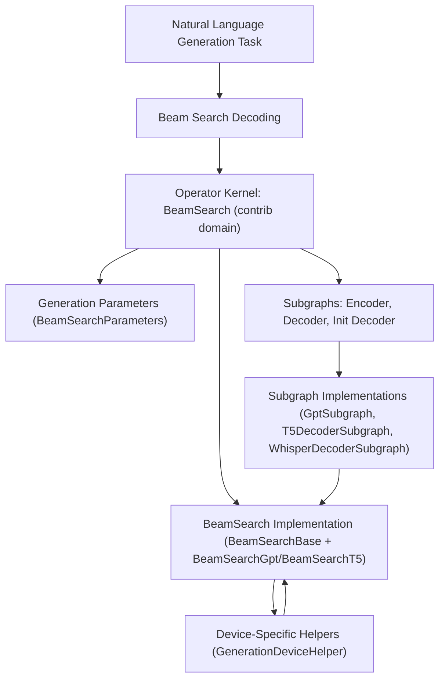

<!-- source: DeepWiki mcp.deepwiki.com · repo microsoft/onnxruntime · page 7.7 Generation and Beam Search Operators · fetched 2026-10-21 -->

# 7.7 Generation and Beam Search Operators

<details>
<summary>Relevant source files</summary>

The following files were used as context for generating this wiki page:

- [onnxruntime/contrib_ops/cpu/transformers/beam_search.cc](onnxruntime/contrib_ops/cpu/transformers/beam_search.cc)
- [onnxruntime/contrib_ops/cpu/transformers/beam_search.h](onnxruntime/contrib_ops/cpu/transformers/beam_search.h)
- [onnxruntime/contrib_ops/cpu/transformers/beam_search_impl_base.h](onnxruntime/contrib_ops/cpu/transformers/beam_search_impl_base.h)
- [onnxruntime/contrib_ops/cpu/transformers/beam_search_impl_gpt.h](onnxruntime/contrib_ops/cpu/transformers/beam_search_impl_gpt.h)
- [onnxruntime/contrib_ops/cpu/transformers/beam_search_impl_t5.h](onnxruntime/contrib_ops/cpu/transformers/beam_search_impl_t5.h)
- [onnxruntime/contrib_ops/cpu/transformers/beam_search_impl_whisper.h](onnxruntime/contrib_ops/cpu/transformers/beam_search_impl_whisper.h)
- [onnxruntime/contrib_ops/cpu/transformers/beam_search_parameters.cc](onnxruntime/contrib_ops/cpu/transformers/beam_search_parameters.cc)
- [onnxruntime/contrib_ops/cpu/transformers/beam_search_parameters.h](onnxruntime/contrib_ops/cpu/transformers/beam_search_parameters.h)
- [onnxruntime/contrib_ops/cpu/transformers/beam_search_scorer.cc](onnxruntime/contrib_ops/cpu/transformers/beam_search_scorer.cc)
- [onnxruntime/contrib_ops/cpu/transformers/beam_search_scorer.h](onnxruntime/contrib_ops/cpu/transformers/beam_search_scorer.h)
- [onnxruntime/contrib_ops/cpu/transformers/generate_impl_base.h](onnxruntime/contrib_ops/cpu/transformers/generate_impl_base.h)
- [onnxruntime/contrib_ops/cpu/transformers/generation_device_helper.cc](onnxruntime/contrib_ops/cpu/transformers/generation_device_helper.cc)
- [onnxruntime/contrib_ops/cpu/transformers/generation_device_helper.h](onnxruntime/contrib_ops/cpu/transformers/generation_device_helper.h)
- [onnxruntime/contrib_ops/cpu/transformers/generation_shared.h](onnxruntime/contrib_ops/cpu/transformers/generation_shared.h)
- [onnxruntime/contrib_ops/cpu/transformers/greedy_search_impl_base.h](onnxruntime/contrib_ops/cpu/transformers/greedy_search_impl_base.h)
- [onnxruntime/contrib_ops/cpu/transformers/greedy_search_impl_gpt.h](onnxruntime/contrib_ops/cpu/transformers/greedy_search_impl_gpt.h)
- [onnxruntime/contrib_ops/cpu/transformers/logits_processor.cc](onnxruntime/contrib_ops/cpu/transformers/logits_processor.cc)
- [onnxruntime/contrib_ops/cpu/transformers/logits_processor.h](onnxruntime/contrib_ops/cpu/transformers/logits_processor.h)
- [onnxruntime/contrib_ops/cpu/transformers/sampling_buffer_element_count.h](onnxruntime/contrib_ops/cpu/transformers/sampling_buffer_element_count.h)
- [onnxruntime/contrib_ops/cpu/transformers/sequences.cc](onnxruntime/contrib_ops/cpu/transformers/sequences.cc)
- [onnxruntime/contrib_ops/cpu/transformers/sequences.h](onnxruntime/contrib_ops/cpu/transformers/sequences.h)
- [onnxruntime/contrib_ops/cpu/transformers/subgraph_base.cc](onnxruntime/contrib_ops/cpu/transformers/subgraph_base.cc)
- [onnxruntime/contrib_ops/cpu/transformers/subgraph_base.h](onnxruntime/contrib_ops/cpu/transformers/subgraph_base.h)
- [onnxruntime/contrib_ops/cpu/transformers/subgraph_gpt.cc](onnxruntime/contrib_ops/cpu/transformers/subgraph_gpt.cc)
- [onnxruntime/contrib_ops/cpu/transformers/subgraph_gpt.h](onnxruntime/contrib_ops/cpu/transformers/subgraph_gpt.h)
- [onnxruntime/contrib_ops/cpu/transformers/subgraph_t5_decoder.cc](onnxruntime/contrib_ops/cpu/transformers/subgraph_t5_decoder.cc)
- [onnxruntime/contrib_ops/cpu/transformers/subgraph_t5_decoder.h](onnxruntime/contrib_ops/cpu/transformers/subgraph_t5_decoder.h)
- [onnxruntime/contrib_ops/cpu/transformers/subgraph_t5_encoder.cc](onnxruntime/contrib_ops/cpu/transformers/subgraph_t5_encoder.cc)
- [onnxruntime/contrib_ops/cpu/transformers/subgraph_t5_encoder.h](onnxruntime/contrib_ops/cpu/transformers/subgraph_t5_encoder.h)
- [onnxruntime/contrib_ops/cpu/transformers/subgraph_whisper_decoder.cc](onnxruntime/contrib_ops/cpu/transformers/subgraph_whisper_decoder.cc)
- [onnxruntime/contrib_ops/cpu/transformers/subgraph_whisper_encoder.cc](onnxruntime/contrib_ops/cpu/transformers/subgraph_whisper_encoder.cc)
- [onnxruntime/contrib_ops/cpu/transformers/subgraph_whisper_encoder.h](onnxruntime/contrib_ops/cpu/transformers/subgraph_whisper_encoder.h)
- [onnxruntime/contrib_ops/cuda/transformers/beam_search.cc](onnxruntime/contrib_ops/cuda/transformers/beam_search.cc)
- [onnxruntime/contrib_ops/cuda/transformers/generation_cuda_impl.cu](onnxruntime/contrib_ops/cuda/transformers/generation_cuda_impl.cu)
- [onnxruntime/contrib_ops/cuda/transformers/generation_cuda_impl.h](onnxruntime/contrib_ops/cuda/transformers/generation_cuda_impl.h)
- [onnxruntime/contrib_ops/cuda/transformers/generation_device_helper.cc](onnxruntime/contrib_ops/cuda/transformers/generation_device_helper.cc)
- [onnxruntime/contrib_ops/cuda/transformers/generation_device_helper.h](onnxruntime/contrib_ops/cuda/transformers/generation_device_helper.h)
- [onnxruntime/test/contrib_ops/beam_search_test.cc](onnxruntime/test/contrib_ops/beam_search_test.cc)
- [onnxruntime/test/contrib_ops/min_length_logits_processor_test.cc](onnxruntime/test/contrib_ops/min_length_logits_processor_test.cc)
- [onnxruntime/test/contrib_ops/sampling_state_test.cc](onnxruntime/test/contrib_ops/sampling_state_test.cc)
- [onnxruntime/test/providers/cuda/test_cases/generation_cuda_impl_test.cc](onnxruntime/test/providers/cuda/test_cases/generation_cuda_impl_test.cc)

</details>


This section covers the implementation details, data flow, and key classes/functions related to the BeamSearch, GreedySearch, and Sampling subgraph operators, including generation device helpers and decoder-masked attention mechanisms employed for large language model (LLM) and Whisper model decoding in ONNX Runtime. These operators facilitate sequence generation tasks by managing beam search, greedy decoding, and sampling methods, supporting various model architectures such as GPT, T5, and Whisper.

---

## Purpose and Scope

The generation operators in ONNX Runtime enable efficient decoding of transformer-based models, supporting beam search and other token selection strategies on CPU and CUDA devices. They handle the orchestration of input/output subgraphs involving encoder-decoder models, apply logits processing to ensure generation constraints (e.g., repetition penalty, minimum length), and optimize beam expansions and caching of past key/value states. Additionally, helpers for device memory management and masked attention mechanisms optimize performance on GPUs.

This document explores how these components are designed and integrated within ONNX Runtime, providing an in-depth explanation of their implementation and usage.

---

## 1. Operator Overview

### 1.1 Generation Operators in ONNX Runtime

- **BeamSearch**: Implements beam search decoding across various model types (GPT, T5, Whisper), supporting multi-beam expansions, sequence scoring, and early stopping.
- **WhisperBeamSearch**: Specialized beam search operator tuned for Whisper speech recognition models.
- **GreedySearch** and **Sampling**: Implement alternative decoding strategies with simpler or stochastic token selection.

Each of these operators is implemented as part of the contrib domain and supports CPU as well as CUDA execution providers, with device-specific optimizations.

---

## 2. Core Classes and Interfaces

### 2.1 Beam Search Base and Model-Specific Implementations

The beam search decoding is implemented in an extensible, templated fashion:

- **`BeamSearchBase<T>`** (template base class): Provides common beam search steps such as managing beam state, invoking decoder subgraphs, and handling output sequence buffers.
- Derived classes specialize for specific models:
  - **`BeamSearchGpt<T>`**: For GPT-2 model variants.
  - **`BeamSearchT5<T>`**: For encoder-decoder T5 models.
  - **`WhisperBeamSearch`**: Decoding logic tuned for Whisper models.

These classes manage execution flow, memory expansions, and interaction with subgraph sessions (encoder and decoder) [onnxruntime/contrib_ops/cpu/transformers/beam_search_impl_gpt.h:16-111](), [onnxruntime/contrib_ops/cpu/transformers/beam_search_impl_t5.h:16-109]().

### 2.2 Greedy Search Implementations

Greedy search variants are similarly implemented, exemplified by:

- **`GreedySearchGpt<T, ParametersT>`**: Implements greedy decoding logic for GPT variants, with facilities to initialize feeds, update inputs for iterations, and manage position IDs [onnxruntime/contrib_ops/cpu/transformers/greedy_search_impl_gpt.h:27-119]().

### 2.3 Generation Device Helpers

The **GenerationDeviceHelper** namespace provides helper functions abstracting device-specific operations, such as:

- Expanding inputs and buffers across beams.
- TopK computations for sorting logits.
- Reordering of past key/value states used in cached attention.
- Initialization of cache indirection buffers for the BeamSearch algorithm.

They have CPU and CUDA implementations, allowing flexible execution depending on the target hardware [onnxruntime/contrib_ops/cpu/transformers/generation_device_helper.cc:21-137](), [onnxruntime/contrib_ops/cuda/transformers/generation_device_helper.cc:49-97]().

---

## 3. Operator and Subgraph Integration

### 3.1 Subgraph Attributes

The BeamSearch operator expects one or more graph attributes embedding subgraphs:

- **`encoder` subgraph**: Used by encoder-decoder models (e.g., T5, Whisper).
- **`decoder` subgraph**: The main decoding graph called iteratively every generation step.
- **`init_decoder` subgraph** (GPT only): Used for first-step initialization.

When constructing the BeamSearch operator, these subgraphs are parsed and instantiated with their own `SessionState` objects and specialized management classes like `GptSubgraph` and `T5DecoderSubgraph` [onnxruntime/contrib_ops/cpu/transformers/beam_search.cc:104-143]().

### 3.2 Subgraph Validation and Parameter Setup

Subgraph interfaces must validate input and output names, shapes, and types.

Example: `T5DecoderSubgraph::Validate` checks the number of inputs/outputs, names such as `"input_ids"`, `"encoder_attention_mask"`, and output `"logits"`, and confirms presence of expected past key/value tensors [onnxruntime/contrib_ops/cpu/transformers/subgraph_t5_decoder.cc:52-126]().

Parameters such as number of layers, vocab size, head sizes, and model types are extracted from the subgraphs to configure the BeamSearch parameters accordingly.

---

## 4. BeamSearch Parameter Handling

### 4.1 Parameter Parsing and Validation

`BeamSearchParameters` encapsulates decoding configuration like batch size, number of beams, max length, token IDs (e.g., EOS, PAD), penalties (length, repetition), and model type (GPT, T5, Whisper).

This class parses from the operator attributes as well as input tensors at runtime and enforces constraints such as valid vocab size, token IDs, maximum sequence length, and beam count [onnxruntime/contrib_ops/cpu/transformers/beam_search_parameters.cc:14-142]().

### 4.2 Whisper-specific Parameters

Special validation is included for Whisper model tokens related to timestamps and logits processing [onnxruntime/contrib_ops/cpu/transformers/beam_search_parameters.cc:67-116]().

---

## 5. Data Flow Diagram: Natural Language Generation to Code Entity Mapping



**Description**: The generation task passes through a beam search decoding algorithm, implemented by the `BeamSearch` operator kernel which reads the generation parameters, corresponding subgraphs (encoder, decoder), and drives low-level beam search implementations specific to the model type. Device helper functions support execution efficiency and memory management.

Sources: [onnxruntime/contrib_ops/cpu/transformers/beam_search.cc:43-143](), [onnxruntime/contrib_ops/cpu/transformers/beam_search_parameters.cc:14-142](), [onnxruntime/contrib_ops/cpu/transformers/subgraph_t5_decoder.cc:52-126](), [onnxruntime/contrib_ops/cpu/transformers/beam_search_impl_gpt.h:16-111](), [onnxruntime/contrib_ops/cpu/transformers/beam_search_impl_t5.h:16-109](), [onnxruntime/contrib_ops/cpu/transformers/generation_device_helper.cc:21-137]()

---

## 6. Key Generation Device Helper Functions and Data Flow

The **GenerationDeviceHelper** namespace exports several function types to perform essential operations abstracted by the BeamSearch implementations. Key functionalities include:

- **`ExpandBuffer<T>`**: Expands a tensor buffer for number of beams by repeating entries (e.g., past states, input ids). Handles shape changes and copying data appropriately, especially for key/value caches [generation_device_helper.cc:67-137]().
- **`TopK`**: Finds top-k elements for logits processing on CPU/CUDA, vital for beam candidate selection [generation_device_helper.cc:23-36](), [generation_device_helper.cc:109-159]() (CUDA).
- **`ReorderPastState`** (CUDA): Rearranges cached key/value states to the appropriate format for decoder masked attention to avoid casting overheads and errors in past state types [generation_device_helper.cc:59-97]() (CUDA).
- **`InitCacheIndir`** (CUDA): Initializes cache indirection buffers with zeros for efficient cache index mapping with masked attention [generation_device_helper.cc:99-107]().

These functions are typically passed into beam search implementations for device-transparent usage.

---

## 7. Beam Search Execution Flow and Subgraph Calls

The beam search classes coordinate the iteration over generated output sequences by:

1. **Initialization**: Prepare inputs for the first decoding step, including expansion of input ids and allocation of output buffers.
2. **Inference Calls**: Execute decoder and encoder subgraphs as required per step, passing updated inputs like past key-value tensors and attention masks.
3. **Logits Processing**: Apply various logit processors (no-repeat n-gram, repetition penalty, token masking, minimum length enforcement, presence penalty, temperature scaling) to score logits before selecting next tokens.
4. **TopK Selection**: Select top beam candidates based on logits and scores.
5. **Sequence Update**: Maintain sequences and beam indices, updating input feeds for subsequent steps.
6. **Termination**: Continue until early stopping or max sequence length is reached.

This process is encapsulated in the method:

- `BeamSearchGpt<T>::Execute(...)`
- `BeamSearchT5<T>::Execute(...)`

which handles the looping over generation steps, calls subgraphs, and manages sequence outputs [beam_search_impl_gpt.h:113-139](), [beam_search_impl_t5.h:111-139]().

---

## 8. Logits Processor Classes

To enforce generation constraints during decoding, ONNX Runtime implements a series of logits processors:

- `MinLengthLogitsProcessor`
- `RepetitionPenaltyLogitsProcessor`
- `NoRepeatNGramLogitsProcessor`
- `VocabMaskLogitsProcessor`
- `PrefixVocabMaskLogitsProcessor`
- `TemperatureLogitsProcessor`
- `PresencePenaltyLogitsProcessor`
- `TimestampLogitsProcessor` (used for Whisper)

Each derives from the interface `ILogitsProcessor<T>` and modifies logits scores in-place based on past sequences, presence masks, and decoding rules [logits_processor.h:48-199]().

---

## 9. CUDA-Specific Generation Optimizations

### 9.1 Kernel Implementations

CUDA device helper files implement low-level CUDA kernels for:

- Initialization of beam scores (`InitKernel`)
- Decoding next tokens (`NextTokenKernel`)
- Processing logits with penalties and masks (`LogitsProcessKernel<T>`)

These kernels operate with CUDA streams and device memory for high throughput [generation_cuda_impl.cu:14-184]().

### 9.2 Device Property Checks and Masked Attention

BeamSearch implementations check CUDA device compute capability to ensure support for features like decoder masked multihead attention (minimum compute capability 5.3 required) [beam_search_impl_gpt.h:50-65](), [beam_search_impl_t5.h:62-80]().

---

## 10. Testing and Validation

Unit tests verify parameter validation, subgraph correctness, and buffer expansions:

- Tests for `BeamSearchParameters` validate vocab size limits, token ID validity (especially Whisper timestamps), and subgraph parameter parsing [beam_search_test.cc:40-130]().
- BeamSearch tests load sample GPT2 beam search ONNX models, ensuring subgraphs are correctly loaded and initialized [beam_search_test.cc:145-175]().

---

## 11. Summary Diagram: System Components Involved in Beam Search Generation

```mermaid
graph TD
  subgraph ONNX_Runtime
    A[Operator Kernel: BeamSearch]
    B[BeamSearchParameters]
    C[Subgraphs]
    D[DecoderSubgraph (GptSubgraph/T5DecoderSubgraph/WhisperDecoder)]
    E[EncoderSubgraph]
    F[GenerationDeviceHelper CPU]
    G[GenerationDeviceHelper CUDA]
    H[BeamSearchBase<template> (BeamSearchGpt, BeamSearchT5, WhisperBeamSearch)]
    I[LogitsProcessor implementations]
    J[FeedsFetchesManager]
  end

  A --> B
  A --> C
  C --> D
  C --> E
  D --> H
  E --> H
  H --> F
  H --> G
  H --> I
  A --> J
  J --> D
  J --> E
```

**Description:** This diagram links the ONNX Runtime layers from the BeamSearch operator harness through parameter and subgraph loading, into the model-specific beam search implementations and device helpers, as well as logits processing components which enforce generation constraints.

Sources: Combination of files listed above, especially beam_search.cc, generation_device_helper.cc/cuda_impl.cu, logarithms_processor.h, beam_search_impl_gpt.h, beam_search_impl_t5.h, and beam_search_test.cc.

---

# Detailed References

| Topic                                | File(s) & Lines                                                    |
|------------------------------------|-------------------------------------------------------------------|
| BeamSearch operator & kernel setup | contrib_ops/cpu/transformers/beam_search.cc:43-143                |
| BeamSearchParameters parsing       | contrib_ops/cpu/transformers/beam_search_parameters.cc:14-142    |
| GPT Beam search implementation     | contrib_ops/cpu/transformers/beam_search_impl_gpt.h:16-111        |
| T5 Beam search implementation      | contrib_ops/cpu/transformers/beam_search_impl_t5.h:16-109         |
| GenerationDeviceHelper CPU          | contrib_ops/cpu/transformers/generation_device_helper.cc:21-137  |
| GenerationDeviceHelper CUDA         | contrib_ops/cuda/transformers/generation_device_helper.cc:49-97  |
| CUDA kernels for logits processing | contrib_ops/cuda/transformers/generation_cuda_impl.cu:14-184      |
| Decoder subgraph validation (T5)   | contrib_ops/cpu/transformers/subgraph_t5_decoder.cc:52-126        |
| Logits Processors                  | contrib_ops/cpu/transformers/logits_processor.h:48-199            |
| BeamSearch unit tests              | test/contrib_ops/beam_search_test.cc:40-175                       |

---

# Conclusion

The Generation and Beam Search operators in ONNX Runtime provide a powerful and flexible framework for running transformer-based sequence decoding efficiently across devices. They integrate subgraph management, detailed parameter validation, logits processing for controlled text generation, and device-accelerated helper primitives while supporting multiple model architectures. Understanding their structure helps users and contributors extend and optimize generation workflows in ONNX Runtime.

---

