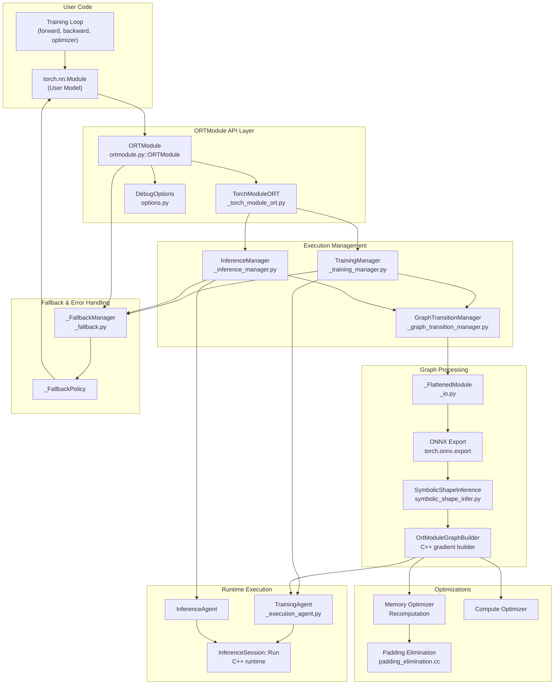
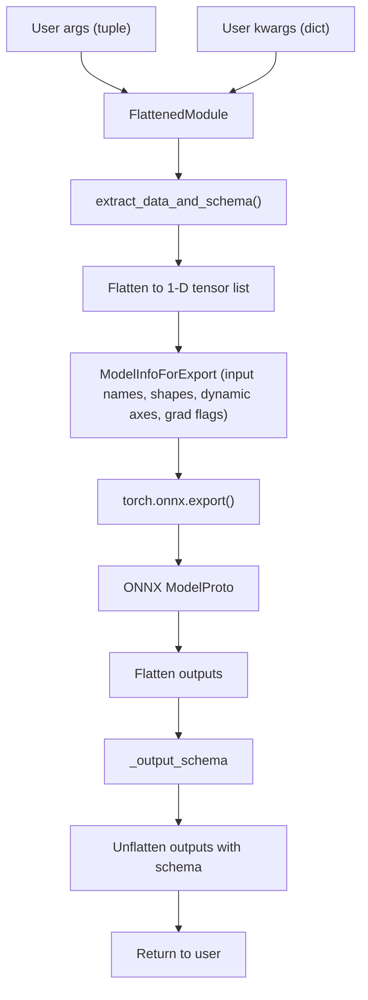
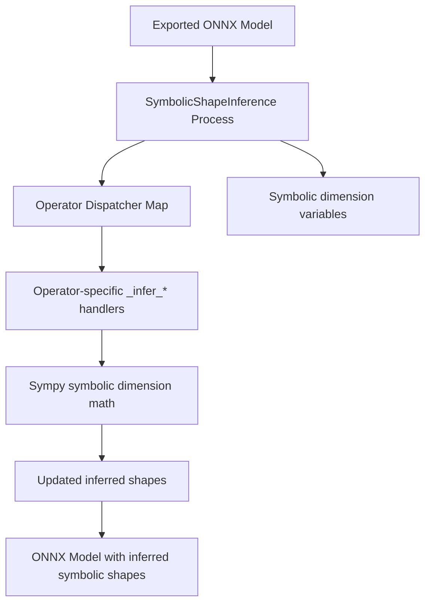
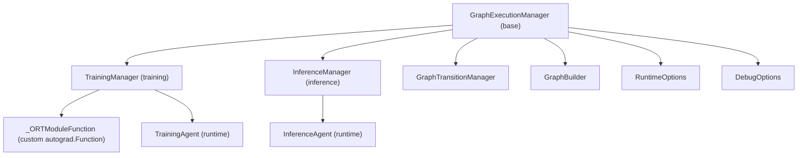
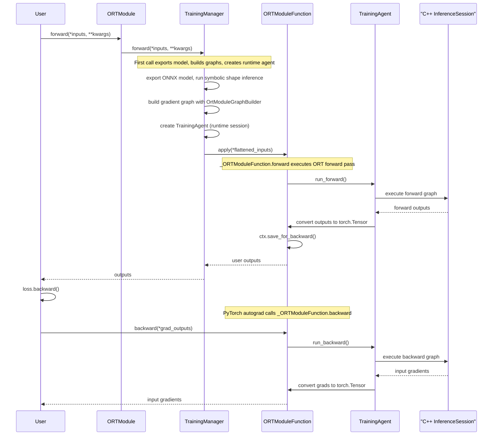
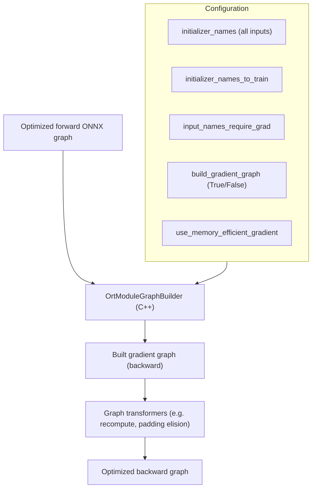
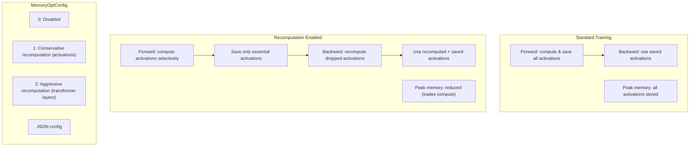
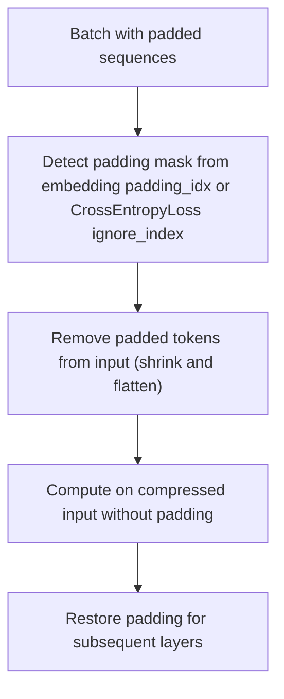
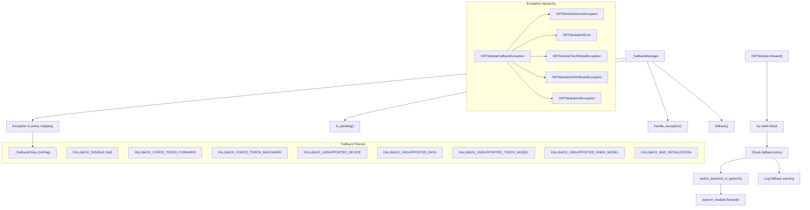

<!-- source: DeepWiki mcp.deepwiki.com · repo microsoft/onnxruntime · page 8 Training System · fetched 2026-10-21 -->

# Training System

<details>
<summary>Relevant source files</summary>

The following files were used as context for generating this wiki page:

- [docs/Memory_Optimizer.md](docs/Memory_Optimizer.md)
- [docs/ORTModule_Training_Guidelines.md](docs/ORTModule_Training_Guidelines.md)
- [onnxruntime/python/tools/symbolic_shape_infer.py](onnxruntime/python/tools/symbolic_shape_infer.py)
- [onnxruntime/test/python/onnxruntime_test_python_symbolic_shape_infer.py](onnxruntime/test/python/onnxruntime_test_python_symbolic_shape_infer.py)
- [orttraining/orttraining/core/optimizer/compute_optimizer/padding_elimination.cc](orttraining/orttraining/core/optimizer/compute_optimizer/padding_elimination.cc)
- [orttraining/orttraining/core/optimizer/compute_optimizer/padding_elimination.h](orttraining/orttraining/core/optimizer/compute_optimizer/padding_elimination.h)
- [orttraining/orttraining/core/optimizer/graph_transformer_config.h](orttraining/orttraining/core/optimizer/graph_transformer_config.h)
- [orttraining/orttraining/python/training/ortmodule/__init__.py](orttraining/orttraining/python/training/ortmodule/__init__.py)
- [orttraining/orttraining/python/training/ortmodule/_custom_gradient_registry.py](orttraining/orttraining/python/training/ortmodule/_custom_gradient_registry.py)
- [orttraining/orttraining/python/training/ortmodule/_custom_op_symbolic_registry.py](orttraining/orttraining/python/training/ortmodule/_custom_op_symbolic_registry.py)
- [orttraining/orttraining/python/training/ortmodule/_fallback.py](orttraining/orttraining/python/training/ortmodule/_fallback.py)
- [orttraining/orttraining/python/training/ortmodule/_fallback_exceptions.py](orttraining/orttraining/python/training/ortmodule/_fallback_exceptions.py)
- [orttraining/orttraining/python/training/ortmodule/_graph_execution_manager.py](orttraining/orttraining/python/training/ortmodule/_graph_execution_manager.py)
- [orttraining/orttraining/python/training/ortmodule/_graph_execution_manager_factory.py](orttraining/orttraining/python/training/ortmodule/_graph_execution_manager_factory.py)
- [orttraining/orttraining/python/training/ortmodule/_inference_manager.py](orttraining/orttraining/python/training/ortmodule/_inference_manager.py)
- [orttraining/orttraining/python/training/ortmodule/_io.py](orttraining/orttraining/python/training/ortmodule/_io.py)
- [orttraining/orttraining/python/training/ortmodule/_logger.py](orttraining/orttraining/python/training/ortmodule/_logger.py)
- [orttraining/orttraining/python/training/ortmodule/_runtime_inspector.py](orttraining/orttraining/python/training/ortmodule/_runtime_inspector.py)
- [orttraining/orttraining/python/training/ortmodule/_torch_module_factory.py](orttraining/orttraining/python/training/ortmodule/_torch_module_factory.py)
- [orttraining/orttraining/python/training/ortmodule/_torch_module_ort.py](orttraining/orttraining/python/training/ortmodule/_torch_module_ort.py)
- [orttraining/orttraining/python/training/ortmodule/_training_manager.py](orttraining/orttraining/python/training/ortmodule/_training_manager.py)
- [orttraining/orttraining/python/training/ortmodule/_utils.py](orttraining/orttraining/python/training/ortmodule/_utils.py)
- [orttraining/orttraining/python/training/ortmodule/options.py](orttraining/orttraining/python/training/ortmodule/options.py)
- [orttraining/orttraining/python/training/ortmodule/ortmodule.py](orttraining/orttraining/python/training/ortmodule/ortmodule.py)
- [orttraining/orttraining/test/python/orttraining_test_ortmodule_api.py](orttraining/orttraining/test/python/orttraining_test_ortmodule_api.py)
- [orttraining/orttraining/test/python/orttraining_test_ortmodule_fallback.py](orttraining/orttraining/test/python/orttraining_test_ortmodule_fallback.py)

</details>


This page provides a high-level overview of the ONNX Runtime training system centered on the `ORTModule` for accelerating PyTorch training. It outlines how `ORTModule` integrates with PyTorch autograd, the on-device training API, gradient computation, graph export, optimizations, and the fallback system. Detailed technical information is available in the linked child pages.

---

## System Overview

The ONNX Runtime (ORT) training system is designed to accelerate PyTorch model training by transparently replacing PyTorch’s native execution with optimized ONNX Runtime backend execution while maintaining full PyTorch API compatibility. The system is composed of several subsystems working closely:

- **ORTModule Wrapper:** The main Python interface (`ORTModule`) that wraps PyTorch models for seamless acceleration.
- **Graph Export Pipeline:** Exports PyTorch models to ONNX format including symbolic shape inference for dynamic dimensions.
- **Graph Execution Managers:** Classes (`TrainingManager`, `InferenceManager`) that manage graph lifecycle and execution.
- **Gradient Graph Builder:** Automatically constructs backward graphs from forward graphs using a C++ graph builder.
- **Training Agent:** The C++ runtime interface managing execution sessions running forward and backward passes.
- **Memory and Compute Optimizations:** Techniques such as activation recomputation and padding elimination to reduce resource usage.
- **Fallback System:** Mechanism to gracefully revert to PyTorch execution on unsupported features or runtime errors.



Sources: [orttraining/orttraining/python/training/ortmodule/ortmodule.py:1-116](), [orttraining/orttraining/python/training/ortmodule/_training_manager.py:1-40](), [orttraining/orttraining/python/training/ortmodule/_graph_execution_manager.py:1-125]()

---

## ORTModule Wrapper

### Purpose

`ORTModule` is the main Python class exposing the training acceleration API. It is a drop-in wrapper over a PyTorch `torch.nn.Module`. It overrides PyTorch’s `forward` and hooks into autograd to run the model's forward and backward computations using the ONNX Runtime backend.

### Initialization Workflow

Upon initialization, `ORTModule`:

- Validates the input module type to ensure compatibility.
- Creates a backend execution manager (`TorchModuleORT`) responsible for model export and runtime execution.
- Registers custom ONNX operators and gradients.
- Patches the forward method to route calls through the ORT inference/training engine.
- Copies custom user-defined methods from the original module into the wrapper.


Sources: [orttraining/orttraining/python/training/ortmodule/ortmodule.py:30-116](), [orttraining/orttraining/python/training/ortmodule/_torch_module_factory.py:1-16]()

### Configuration Options

`ORTModule` supports various debug and execution options primarily via the `DebugOptions` class and environment variables. These include:

| Option                    | Environment Variable           | Description                                      |
|---------------------------|------------------------------|--------------------------------------------------|
| `save_onnx`               | `ORTMODULE_SAVE_ONNX_PATH`    | Save intermediate ONNX models to disk            |
| `log_level`               | `ORTMODULE_LOG_LEVEL`          | Log verbosity (VERBOSE, INFO, WARNING, etc.)     |
| `onnx_prefix`             | -                            | Prefix for saved ONNX model filenames             |
| `ORTMODULE_FALLBACK_POLICY` | `ORTMODULE_FALLBACK_POLICY` | Fallback behavior on errors during execution      |
| `ORTMODULE_FALLBACK_RETRY`  | `ORTMODULE_FALLBACK_RETRY`  | Whether to retry after fallback (default: True)  |

Sources: [orttraining/orttraining/python/training/ortmodule/options.py:20-65](), [docs/ORTModule_Training_Guidelines.md:136-167]()

---

## Graph Export and Input/Output Processing

### Input and Output Flattening

To interface with ONNX export and runtime, inputs and outputs are flattened to 1-D sequences of tensors. This flattening handles arbitrarily nested structures (tuples, lists, dicts) and preserves schema information to restore the original structure after execution.

- `_FlattenedModule` in `_io.py` wraps the original PyTorch module to perform flattening/unflattening.
- `extract_data_and_schema` creates a flat tensor list and a schema describing the nested original structure.
- `ModelInfoForExport` collects metadata including input names, dynamic axes, and gradient requirements.
- Flattened inputs are passed to torch.onnx.export; flattened outputs are unflattened and wrapped with an identity op to enable proper backward graph building.



Sources: [orttraining/orttraining/python/training/ortmodule/_io.py:112-148](), [orttraining/orttraining/python/training/ortmodule/_graph_transition_manager.py:1-146]()

### Symbolic Shape Inference

Post ONNX export, symbolic shape inference is applied to infer dynamic and symbolic tensor shapes, leveraging SymPy for symbolic arithmetic. This enables handling models with dynamic-sized inputs such as variable batch or sequence lengths.

- `SymbolicShapeInference` dispatches operator-specific inference handlers.
- Uses symbolic variables to represent dynamic dimensions and merges compatible dimension variables.
- Supports over 50 operators including standard ONNX, com.microsoft, and org.pytorch.aten custom operators.
- Handles subgraph operators like If, Loop, and Scan.



Sources: [onnxruntime/python/tools/symbolic_shape_infer.py:130-730](), [orttraining/orttraining/test/python/orttraining_test_ortmodule_api.py:1-100]()

---

## Training Execution Architecture

### Graph Execution Managers

The core execution logic resides in the `GraphExecutionManager` abstract base class with specialized subclasses:

- **TrainingManager**: Executes training graphs supporting forward and backward, implementing a custom autograd Function for integration with PyTorch autograd.
- **InferenceManager**: Executes inference graphs supporting forward only.

These managers handle graph export, optimization, session management, and model execution.



Sources: [orttraining/orttraining/python/training/ortmodule/_graph_execution_manager.py:40-556](), [orttraining/orttraining/python/training/ortmodule/_training_manager.py:27-457](), [orttraining/orttraining/python/training/ortmodule/_inference_manager.py:22-199]()

### Training Forward and Backward Flow

Key execution steps in training mode via `TrainingManager` and `_ORTModuleFunction`:



Sources: [orttraining/orttraining/python/training/ortmodule/_training_manager.py:43-457](), [orttraining/orttraining/python/training/ortmodule/_execution_agent.py:1-150]()

---

## Gradient Graph Construction

ORTModule uses a C++ graph builder to convert the optimized training forward graph into a backward graph that computes gradients.



- Inputs include all initializers and user inputs requiring gradients.
- Backward graph is linked to forward via yield operators.
- Supports memory efficient gradient computation by reordering graph execution.
- Applies training graph transformers, e.g. recomputation insertion, padding elimination.

Custom gradients for operators without built-in support are registered via Python decorators. For example, embedding gradient is defined as:

```python
@register_gradient("org.pytorch.aten", "ATen", "embedding", "")
def embedding_gradient():
    return [
        ("Constant", [], ["Const_0"], {"value": {"value": 0, "dtype": "int", "is_tensor": True}}),
        ("Shape", ["I(0)"], ["Shape_X"]),
        ("Gather", ["Shape_X", "Const_0"], ["Gather_X_0"], {"axis": {"value": 0, "dtype": "int"}}),
        (("ATen", "org.pytorch.aten"),
         ["GO(0)", "I(1)", "Gather_X_0", "I(2)", "I(3)", "I(4)"],
         ["GI(0)"],
         {"operator": {"value": "embedding_backward", "dtype": "string"}}),
    ]
```

Here, `"GO(i)"` denotes gradients of forward outputs and `"GI(i)"` denotes gradients of forward inputs.

Sources: [orttraining/orttraining/python/training/ortmodule/_graph_execution_manager.py:275-308](), [orttraining/orttraining/python/training/ortmodule/_custom_gradient_registry.py:1-220](), [orttraining/orttraining/python/training/ortmodule/_training_manager.py:336-369]()

---

## Memory Optimization System

### Activation Recomputation

To reduce peak memory usage, ORTModule supports recomputation of activations during backward pass rather than saving all of them:



- `MemoryObserver` collects data during initial forward to find recomputation candidates.
- Users configure optimization level via `ORTMODULE_MEMORY_OPT_LEVEL` environment variable.
- Recomputation subgraphs are inserted in backward pass.
  
Sources: [orttraining/orttraining/python/training/ortmodule/_runtime_inspector.py:63-397](), [orttraining/orttraining/python/training/ortmodule/options.py:159-281](), [docs/Memory_Optimizer.md:1-180](), [orttraining/orttraining/python/training/ortmodule/_graph_execution_manager.py:256-273]()

### Compute Optimizer: Padding Elimination

To reduce computation wasted on padded inputs (common in NLP), the training system applies a padding elimination optimization:



- Detected by scanning for `ATen::embedding` with `padding_idx` and `SoftmaxCrossEntropyLoss` with `ignore_index`.
- Inserts mask computation and custom operators `PadAndUnflatten` and `ShrinkAndFlatten`.
- Controlled by environment variable `ORTMODULE_ENABLE_COMPUTE_OPTIMIZER`.
- Automatically enabled based on runtime sparsity inspection.

Sources: [orttraining/orttraining/core/optimizer/compute_optimizer/padding_elimination.cc:1-585](), [orttraining/orttraining/core/optimizer/compute_optimizer/padding_elimination.h:1-143](), [orttraining/orttraining/python/training/ortmodule/_graph_execution_manager.py:342-380]()

---

## Fallback System

The fallback system handles cases where ORTModule cannot process the model or encounters runtime errors. It falls back to native PyTorch execution preserving correctness at the cost of performance.



- Fallback policies control behavior on various failure conditions.
- When fallback triggers and `ORTMODULE_FALLBACK_RETRY`=True, ORT tries again on the next call.
- If disabled, fallback is permanent until re-instantiation.
- Exception hierarchy enables fine-grained fallback control.

Sources: [orttraining/orttraining/python/training/ortmodule/_fallback.py:1-180](), [orttraining/orttraining/python/training/ortmodule/_utils.py:351-366](), [orttraining/orttraining/test/python/orttraining_test_ortmodule_fallback.py:28-73]()

---

## Custom Operator Support

Some PyTorch operations do not have direct ONNX equivalents or require specialized handling during ONNX export and training gradient computation. ORTModule supports:

- Custom symbolic exporter functions for PyTorch ops.
- Registration of custom ONNX operators in specific domains like `com.microsoft`.
- Custom gradient definitions for operators without standard ONNX gradients.

### Symbolic Registration

The `CustomOpSymbolicRegistry` class manages operator symbolic functions, which translate PyTorch ops to specific ONNX nodes.

Example: Custom export of `cross_entropy_loss` to `com.microsoft::SoftmaxCrossEntropyLossInternal` operator:

```python
@register_symbolic("cross_entropy_loss", need_node=True)
def cross_entropy_loss(g, node, logits, target, weight, reduction, ignore_index, label_smoothing=0.0):
    output, log_prob = g.op(
        "com.microsoft::SoftmaxCrossEntropyLossInternal",
        logits_casted,
        target,
        weight_casted,
        ignore_index,
        reduction_s=reduction,
        output_type_i=pytorch_type_to_onnx_dtype(output_type.scalarType()),
        outputs=2,
    )
    return output
```

### Gradient Registration

Gradients for these custom operators are registered similarly. For instance, embedding gradient generation:

```python
@register_gradient("org.pytorch.aten", "ATen", "embedding", "")
def embedding_gradient():
    return [
        ("Constant", [], ["Const_0"], {"value": {"value": 0, "dtype": "int", "is_tensor": True}}),
        ("Shape", ["I(0)"], ["Shape_X"]),
        ("Gather", ["Shape_X", "Const_0"], ["Gather_X_0"], {"axis": {"value": 0, "dtype": "int"}}),
        (("ATen", "org.pytorch.aten"),
         ["GO(0)", "I(1)", "Gather_X_0", "I(2)", "I(3)", "I(4)"],
         ["GI(0)"],
         {"operator": {"value": "embedding_backward", "dtype": "string"}}),
    ]
```

Sources: [orttraining/orttraining/python/training/ortmodule/_custom_op_symbolic_registry.py:63-337](), [orttraining/orttraining/python/training/ortmodule/_custom_gradient_registry.py:1-220]()

---

## On-Device Training API and Training Runners

Beyond Python APIs, the training system exposes:

- **`training_api`** C and C++ modules that provide core training runtime functionalities, optimizer interfaces, and checkpoint handling.
- C# bindings enable ORT training integration for .NET environments.
- The legacy `TrainingSession` and associated runners form an older training programming model before `ORTModule`.

See [On-Device Training API and Training Runners](#8.7) for detailed documentation of these components.

---

## Navigation to Detailed Topics

For more comprehensive information and implementation details, consult the child pages:

- [ORTModule Overview](#8.1): Dive into ORTModule’s architecture and PyTorch autograd integration
- [PyTorch Integration](#8.2): Details on FlattenedModule, TorchModuleORT, and custom autograd function export
- [Graph Export and Shape Inference](#8.3): ONNX export internals, symbolic shape inference, and custom symbolic ops
- [Gradient Graph Builder](#8.4): Construction of gradient graphs and training operator definitions
- [Training Optimizations](#8.5): Memory and compute optimizations and graph transformers
- [Fallback System](#8.6): Fallback policies, exception handling, and retry mechanisms
- [On-Device Training API and Training Runners](#8.7): Core runtime training APIs and runners beyond Python

---

This page serves as the high-level roadmap for understanding ONNX Runtime’s training system. Each component plays a crucial role in enabling accelerated, memory-efficient, and robust PyTorch model training with ONNX Runtime.

Sources summary:  
[orttraining/orttraining/python/training/ortmodule/ortmodule.py](),  
[orttraining/orttraining/python/training/ortmodule/_graph_execution_manager.py](),  
[orttraining/orttraining/python/training/ortmodule/_training_manager.py](),  
[orttraining/orttraining/python/training/ortmodule/_inference_manager.py](),  
[orttraining/orttraining/python/training/ortmodule/_io.py](),  
[onnxruntime/python/tools/symbolic_shape_infer.py](),  
[orttraining/orttraining/python/training/ortmodule/_custom_op_symbolic_registry.py](),  
[orttraining/orttraining/python/training/ortmodule/_custom_gradient_registry.py](),  
[orttraining/orttraining/core/optimizer/compute_optimizer/padding_elimination.cc](),  
[orttraining/orttraining/python/training/ortmodule/_fallback.py](),  
[docs/ORTModule_Training_Guidelines.md]()

---

