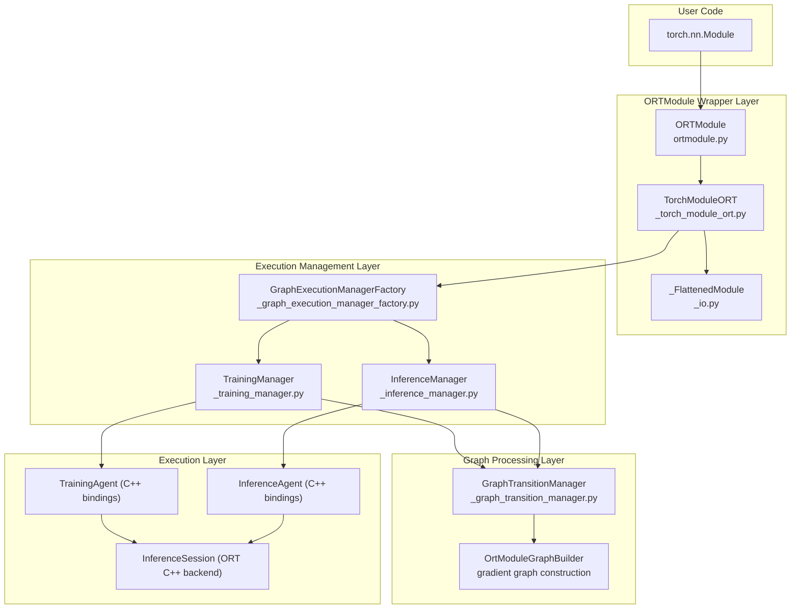
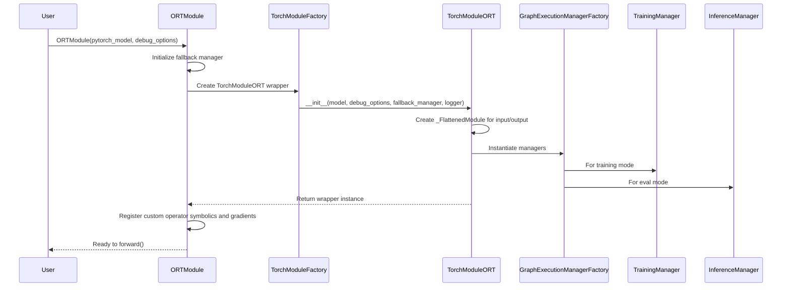
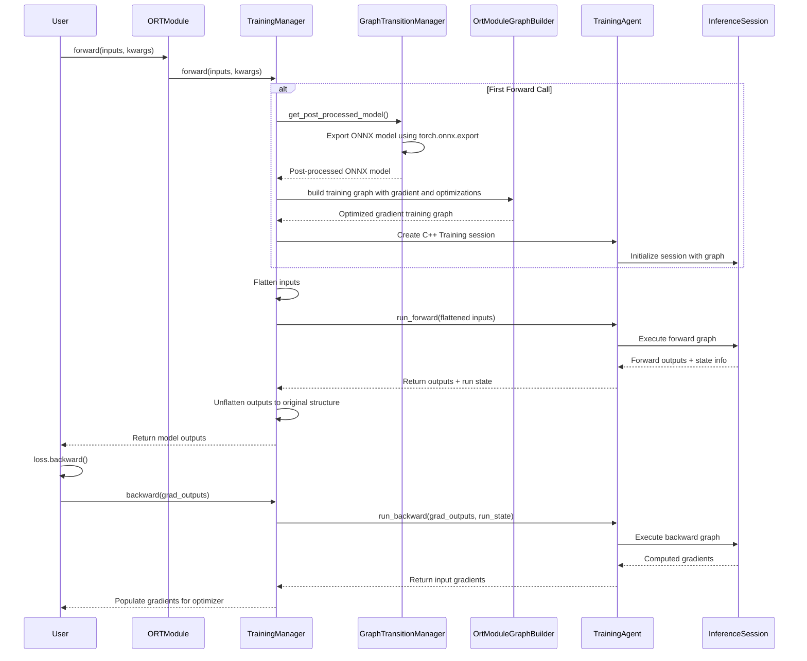
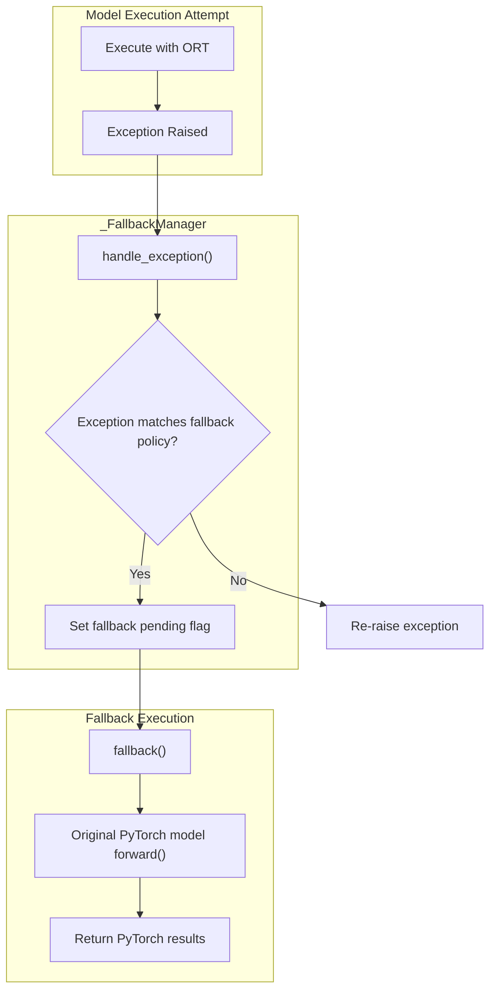
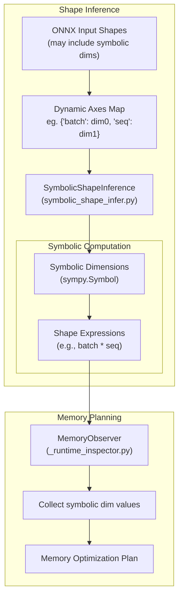

<!-- source: DeepWiki mcp.deepwiki.com · repo microsoft/onnxruntime · page 8.1 ORTModule Overview · fetched 2026-10-21 -->

# ORTModule Overview

<details>
<summary>Relevant source files</summary>

The following files were used as context for generating this wiki page:

- [docs/Memory_Optimizer.md](docs/Memory_Optimizer.md)
- [docs/ORTModule_Training_Guidelines.md](docs/ORTModule_Training_Guidelines.md)
- [onnxruntime/python/tools/symbolic_shape_infer.py](onnxruntime/python/tools/symbolic_shape_infer.py)
- [onnxruntime/test/python/onnxruntime_test_python_symbolic_shape_infer.py](onnxruntime/test/python/onnxruntime_test_python_symbolic_shape_infer.py)
- [orttraining/orttraining/core/optimizer/compute_optimizer/padding_elimination.cc](orttraining/orttraining/core/optimizer/compute_optimizer/padding_elimination.cc)
- [orttraining/orttraining/core/optimizer/compute_optimizer/padding_elimination.h](orttraining/orttraining/core/optimizer/compute_optimizer/padding_elimination.h)
- [orttraining/orttraining/core/optimizer/graph_transformer_config.h](orttraining/orttraining/core/optimizer/graph_transformer_config.h)
- [orttraining/orttraining/python/training/ortmodule/__init__.py](orttraining/orttraining/python/training/ortmodule/__init__.py)
- [orttraining/orttraining/python/training/ortmodule/_custom_gradient_registry.py](orttraining/orttraining/python/training/ortmodule/_custom_gradient_registry.py)
- [orttraining/orttraining/python/training/ortmodule/_custom_op_symbolic_registry.py](orttraining/orttraining/python/training/ortmodule/_custom_op_symbolic_registry.py)
- [orttraining/orttraining/python/training/ortmodule/_fallback.py](orttraining/orttraining/python/training/ortmodule/_fallback.py)
- [orttraining/orttraining/python/training/ortmodule/_fallback_exceptions.py](orttraining/orttraining/python/training/ortmodule/_fallback_exceptions.py)
- [orttraining/orttraining/python/training/ortmodule/_graph_execution_manager.py](orttraining/orttraining/python/training/ortmodule/_graph_execution_manager.py)
- [orttraining/orttraining/python/training/ortmodule/_graph_execution_manager_factory.py](orttraining/orttraining/python/training/ortmodule/_graph_execution_manager_factory.py)
- [orttraining/orttraining/python/training/ortmodule/_inference_manager.py](orttraining/orttraining/python/training/ortmodule/_inference_manager.py)
- [orttraining/orttraining/python/training/ortmodule/_io.py](orttraining/orttraining/python/training/ortmodule/_io.py)
- [orttraining/orttraining/python/training/ortmodule/_logger.py](orttraining/orttraining/python/training/ortmodule/_logger.py)
- [orttraining/orttraining/python/training/ortmodule/_runtime_inspector.py](orttraining/orttraining/python/training/ortmodule/_runtime_inspector.py)
- [orttraining/orttraining/python/training/ortmodule/_torch_module_factory.py](orttraining/orttraining/python/training/ortmodule/_torch_module_factory.py)
- [orttraining/orttraining/python/training/ortmodule/_torch_module_ort.py](orttraining/orttraining/python/training/ortmodule/_torch_module_ort.py)
- [orttraining/orttraining/python/training/ortmodule/_training_manager.py](orttraining/orttraining/python/training/ortmodule/_training_manager.py)
- [orttraining/orttraining/python/training/ortmodule/_utils.py](orttraining/orttraining/python/training/ortmodule/_utils.py)
- [orttraining/orttraining/python/training/ortmodule/options.py](orttraining/orttraining/python/training/ortmodule/options.py)
- [orttraining/orttraining/python/training/ortmodule/ortmodule.py](orttraining/orttraining/python/training/ortmodule/ortmodule.py)
- [orttraining/orttraining/test/python/orttraining_test_ortmodule_api.py](orttraining/orttraining/test/python/orttraining_test_ortmodule_api.py)
- [orttraining/orttraining/test/python/orttraining_test_ortmodule_fallback.py](orttraining/orttraining/test/python/orttraining_test_ortmodule_fallback.py)

</details>


## Purpose

`ORTModule` is a Python wrapper that extends PyTorch's `torch.nn.Module` to accelerate model training by leveraging ONNX Runtime's (ORT) optimized training engine. It transparently replaces PyTorch’s execution backend with ORT while maintaining full compatibility with PyTorch APIs, including autograd.

`ORTModule` enables:
- Drop-in replacement for PyTorch models with minimal code changes.
- Automatic exporting of PyTorch models to ONNX format.
- Construction and execution of gradient graphs for backpropagation.
- Advanced training graph optimizations (memory optimization, compute optimizations, recomputation).
- Graceful fallback to PyTorch execution when unsupported scenarios occur.
- Seamless integration with PyTorch autograd for forward and backward passes.

For detailed info on integration, graph export, and optimizations, see linked detailed wiki pages:
- [PyTorch Integration](#8.2)
- [Graph Export and Shape Inference](#8.3)
- [Gradient Graph Builder](#8.4)
- [Training Optimizations](#8.5)
- [Fallback System](#8.6)

---

## High-Level Architecture

`ORTModule` sits as an intermediate layer between user PyTorch model code and ONNX Runtime training execution infrastructure. It manages lifecycle transitions—ONNX export, graph optimization, session creation—and execution forwarding via ONNX Runtime.

### Component Architecture Diagram



This layered design cleanly separates user-facing API, input/output preprocessing, graph construction and optimization, execution session management, and C++ backend execution.

**Sources:**
- [orttraining/orttraining/python/training/ortmodule/ortmodule.py:30-116]()
- [orttraining/orttraining/python/training/ortmodule/_torch_module_ort.py:1-18]()
- [orttraining/orttraining/python/training/ortmodule/_graph_execution_manager_factory.py:1-26]()
- [orttraining/orttraining/python/training/ortmodule/_training_manager.py:27-40]()
- [orttraining/orttraining/python/training/ortmodule/_inference_manager.py:22-29]()

---

## Key Components

### ORTModule Class Hierarchy

The `ORTModule` class (defined in `ortmodule.py`) inherits from `torch.nn.Module` and wraps the user’s PyTorch model. Internally, it delegates model execution and management to an instance of `TorchModuleORT` (`_torch_module_ort.py`), which handles ONNX export and graph management.

| Component              | File                                     | Responsibility                                                |
|------------------------|------------------------------------------|---------------------------------------------------------------|
| `ORTModule`            | `ortmodule.py:30-116`                    | User-facing module wrapper                                    |
| `TorchModuleORT`       | `_torch_module_ort.py`                   | Internal model wrapper managing export/execution              |
| `_FlattenedModule`     | `_io.py:112-148`                         | Handles flattening/unflattening of nested module inputs/outputs|
| `GraphExecutionManagerFactory` | `_graph_execution_manager_factory.py:15-26`    | Creates training/inference execution managers                  |
| `TrainingManager`      | `_training_manager.py:27-40`             | Manages training mode (forward + backward) execution          |
| `InferenceManager`     | `_inference_manager.py:22-29`            | Manages inference mode (forward only) execution               |
| `GraphTransitionManager` | `_graph_transition_manager.py`          | Handles ONNX model export and post-processing                  |
| `TrainingAgent`        | C++ bindings                             | Runs training sessions (forward & backward passes)            |
| `InferenceAgent`       | C++ bindings                             | Runs inference execution sessions                              |

### Initialization Sequence

Upon constructing `ORTModule`, the following occurs:



The `_FlattenedModule` class is used to flatten nested inputs and outputs into 1D tensor lists to comply with ONNX export/forwarding constraints, then unflatten them back when returning outputs.

**Sources:**
- [orttraining/orttraining/python/training/ortmodule/ortmodule.py:41-116]()
- [orttraining/orttraining/python/training/ortmodule/_torch_module_factory.py:12-16]()
- [orttraining/orttraining/python/training/ortmodule/_graph_execution_manager_factory.py:15-26]()
- [orttraining/orttraining/python/training/ortmodule/_io.py:112-148]()

---

## Training Workflow

### High-Level Training Execution Flow

Training through `ORTModule` involves the following phases:

1. **First Forward Pass - Initialization:**
   - Export PyTorch model to ONNX via `torch.onnx.export` using `GraphTransitionManager`.
   - Build the gradient graph for backpropagation using `OrtModuleGraphBuilder`.
   - Perform graph optimizations including memory and compute optimizations.
   - Create a `TrainingAgent` execution session wrapping the optimized ONNX training graph.

2. **Subsequent Forward Passes:**
   - Flatten user inputs and validate.
   - Run forward pass via ONNX Runtime `TrainingAgent`.
   - Unflatten outputs and return to user.

3. **Backward Pass:**
   - Triggered by PyTorch autograd (`loss.backward()`).
   - Custom `torch.autograd.Function` defined in `TrainingManager` intercepts backward.
   - Runs backward graph via ONNX Runtime to calculate gradients.
   - Outputs gradients mapped back to PyTorch parameters.

### Training Execution Sequence Diagram



This design tightly integrates with PyTorch autograd by substituting `torch.autograd.Function` forward and backward hooks with ORT executions.

**Sources:**
- [orttraining/orttraining/python/training/ortmodule/_training_manager.py:44-94,213-334]()
- [orttraining/orttraining/python/training/ortmodule/_graph_execution_manager.py:174-182]()

---

## Usage Example

### Basic Usage

```python
import torch
from onnxruntime.training.ortmodule import ORTModule

class MyModel(torch.nn.Module):
    def __init__(self):
        super().__init__()
        self.fc1 = torch.nn.Linear(784, 500)
        self.fc2 = torch.nn.Linear(500, 10)
    
    def forward(self, x):
        x = torch.relu(self.fc1(x))
        return self.fc2(x)

model = MyModel()
model = ORTModule(model)  # Wrap the model with ORTModule

optimizer = torch.optim.Adam(model.parameters())
loss_fn = torch.nn.CrossEntropyLoss()

for inputs, labels in dataloader:
    outputs = model(inputs)     # Forward pass via ORT
    loss = loss_fn(outputs, labels)
    loss.backward()             # Backward pass via ORT
    optimizer.step()
    optimizer.zero_grad()
```

### With Debug Options

```python
from onnxruntime.training.ortmodule import ORTModule, DebugOptions, LogLevel

debug_options = DebugOptions(
    save_onnx=True,
    onnx_prefix="my_model",
    log_level=LogLevel.INFO
)

model = ORTModule(torch_model, debug_options)
```

**Sources:**
- [orttraining/orttraining/test/python/orttraining_test_ortmodule_api.py:460-476]()
- [docs/ORTModule_Training_Guidelines.md:27-50]()

---

## Configuration

### Debug Options

`ORTModule` supports debugging/configuration options via `DebugOptions` class, allowing control of logging verbosity, ONNX model saving, etc.

| Option       | Type     | Default  | Description                              |
|--------------|----------|----------|----------------------------------------|
| `save_onnx`  | bool     | False    | Save ONNX models to disk                |
| `onnx_prefix`| string   | ""       | Prefix for saved ONNX model files      |
| `log_level`  | LogLevel | WARNING  | Logging verbosity level                 |

### Environment Variables

Important environment variables for runtime configuration include:

| Variable                      | Description                                            |
|-------------------------------|--------------------------------------------------------|
| `ORTMODULE_FALLBACK_POLICY`   | Controls fallback to PyTorch on exceptions             |
| `ORTMODULE_ONNX_OPSET_VERSION`| ONNX opset version used for export (default: 17)       |
| `ORTMODULE_MEMORY_OPT_LEVEL`  | Memory optimization level (0=off, 1=user, 2=auto)      |
| `ORTMODULE_ENABLE_COMPUTE_OPTIMIZER` | Enables compute optimizer (default: enabled)        |
| `ORTMODULE_LOG_LEVEL`          | Overrides DebugOptions log level                        |
| `ORTMODULE_SAVE_ONNX_PATH`    | Directory path to save ONNX models                      |

Refer to [docs/ORTModule_Training_Guidelines.md](#) for full environment variable listing.

**Sources:**
- [orttraining/orttraining/python/training/ortmodule/__init__.py:122-173]()
- [docs/ORTModule_Training_Guidelines.md:136-247]()
- [orttraining/orttraining/python/training/ortmodule/options.py:20-64,179-442]()

---

## Fallback Mechanism

`ORTModule` contains an extensible fallback system to gracefully revert execution to PyTorch when ONNX Runtime backend cannot handle the model or inputs. This ensures robustness and smooth user experience.

### Fallback Policies and Exceptions

The system maps certain exception types to fallback policies:

| Exception Type                     | Fallback Policy                   | Description                            |
|----------------------------------|---------------------------------|-------------------------------------|
| `ORTModuleDeviceException`       | `FALLBACK_UNSUPPORTED_DEVICE`   | Unsupported or mismatched device     |
| `ORTModuleIOError`               | `FALLBACK_UNSUPPORTED_DATA`     | Unsupported I/O or data types         |
| `ORTModuleTorchModelException`  | `FALLBACK_UNSUPPORTED_TORCH_MODEL` | Non-exportable PyTorch model      |
| `ORTModuleONNXModelException`   | `FALLBACK_UNSUPPORTED_ONNX_MODEL`  | Flawed or unsupported ONNX model  |
| `ORTModuleInitException`         | `FALLBACK_BAD_INITIALIZATION`    | Initialization failures               |

Fallback policies are combined and controlled by the environment or config constants `ORTMODULE_FALLBACK_POLICY` and `ORTMODULE_FALLBACK_RETRY`.

### Fallback Control Flow Diagram



When a fallback-eligible exception occurs during ORT execution, the fallback manager marks fallback pending and subsequent executions use the original PyTorch model methods.

**Sources:**
- [orttraining/orttraining/python/training/ortmodule/_fallback.py:24-173]()
- [orttraining/orttraining/python/training/ortmodule/_training_manager.py:229-334]()
- [orttraining/orttraining/test/python/orttraining_test_ortmodule_fallback.py:28-73]()

---

## Performance Optimization Features

### Symbolic Shape Inference

`ORTModule` leverages symbolic shape inference (via `SymbolicShapeInference` in `symbolic_shape_infer.py`) to handle dynamic input shapes and enable advanced memory planning.



This enables ORT to optimize memory allocations dynamically during training.

**Sources:**
- [onnxruntime/python/tools/symbolic_shape_infer.py:125-266]()
- [orttraining/orttraining/python/training/ortmodule/_runtime_inspector.py:43-61]()
- [orttraining/orttraining/python/training/ortmodule/_graph_execution_manager.py:358-369]()

### Tunable Operations

ORTModule supports online and offline tuning of certain operations via environment variables such as:

| Env Variable               | Description                       |
|----------------------------|---------------------------------|
| `ORTMODULE_ENABLE_TUNING`  | Enable online tuning             |
| `ORTMODULE_MAX_TUNING_DURATION_MS` | Max tuning duration per op  |
| `ORTMODULE_TUNING_RESULTS_PATH`    | Path to store/load tuning data |

Tuning results can be loaded to improve runtime performance on subsequent runs.

**Sources:**
- [orttraining/orttraining/python/training/ortmodule/_graph_execution_manager.py:201-213]()
- [orttraining/orttraining/python/training/ortmodule/_training_manager.py:310-317]()
- [orttraining/orttraining/python/training/ortmodule/_utils.py:474]()

---

## Integration Points

### PyTorch Autograd Integration

`ORTModule` integrates closely with PyTorch's autograd by implementing a custom subclass of `torch.autograd.Function` in `TrainingManager`.

Key integration details:

- The `_ORTModuleFunction` custom autograd function overrides:
  - `forward(ctx, *inputs)` to delegate forward execution to ORT’s `TrainingAgent`.
  - `backward(ctx, *grad_outputs)` to run the backward graph in ORT.
- Tensors from forward pass needed during backward are saved using `ctx.save_for_backward()`.
- Gradient tensors are materialized carefully to avoid PyTorch autograd requirements for dense gradients.
- This integration enables seamless use of ORTModule in PyTorch backward gradients computation.

**Sources:**
- [orttraining/orttraining/python/training/ortmodule/_training_manager.py:96-211]()

### ZeRO Stage 3 Support for DeepSpeed

`ORTModule` includes modifications to support DeepSpeed ZeRO Stage 3:

- Adds a "Pull weight trigger" input to the ONNX model graph to synchronize parameters across partitions.
- Maintains a mapping dictionary `_zero_stage3_param_map` to track the stage3 parameters.
- Uses hooks to enable seamless operation with ZeRO Stage 3's sharded optimizer paradigms.

**Sources:**
- [orttraining/orttraining/python/training/ortmodule/_graph_execution_manager.py:113-122]()
- [orttraining/orttraining/python/training/ortmodule/_graph_execution_manager.py:381-393]()

---

# Summary

`ORTModule` is a powerful integration layer that wraps PyTorch models enabling their training execution to be offloaded to ONNX Runtime, delivering performance gains while preserving user experience and API compatibility. Its architecture spans multiple layers: from user-level wrappers down to C++ ORT backend, with graph building, optimization, and fallback management ensuring flexible, robust, and performant training.

**Comprehensive understanding of `ORTModule` is essential for developers interested in extending or debugging ORT's PyTorch training integration.**

---

# References

- [orttraining/orttraining/python/training/ortmodule/ortmodule.py]()
- [orttraining/orttraining/python/training/ortmodule/_torch_module_ort.py]()
- [orttraining/orttraining/python/training/ortmodule/_training_manager.py]()
- [orttraining/orttraining/python/training/ortmodule/_inference_manager.py]()
- [orttraining/orttraining/python/training/ortmodule/_graph_execution_manager.py]()
- [orttraining/orttraining/python/training/ortmodule/_io.py]()
- [orttraining/orttraining/python/training/ortmodule/_fallback.py]()
- [onnxruntime/python/tools/symbolic_shape_infer.py]()
- [docs/ORTModule_Training_Guidelines.md]()

---

