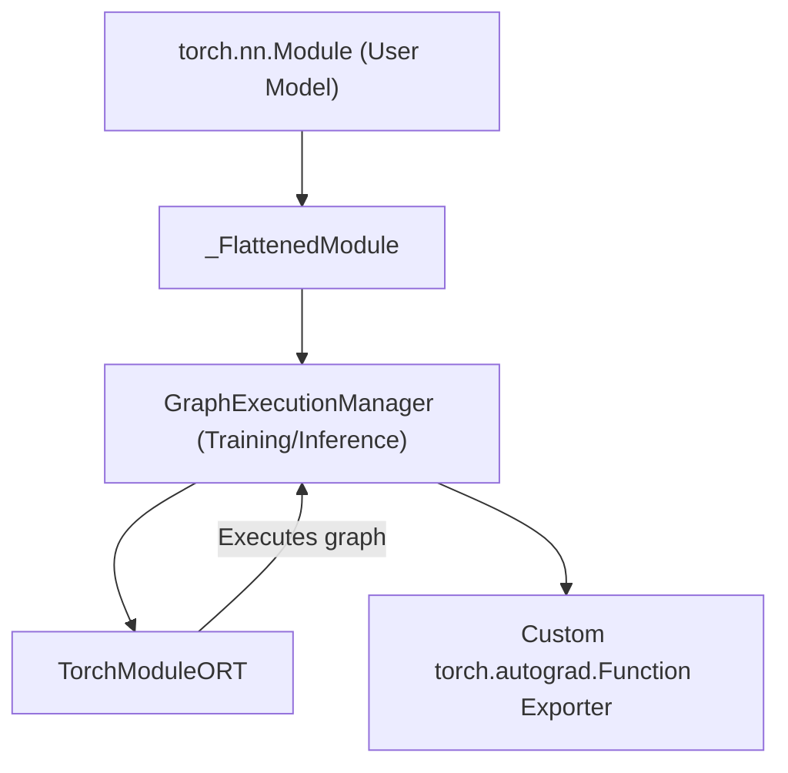
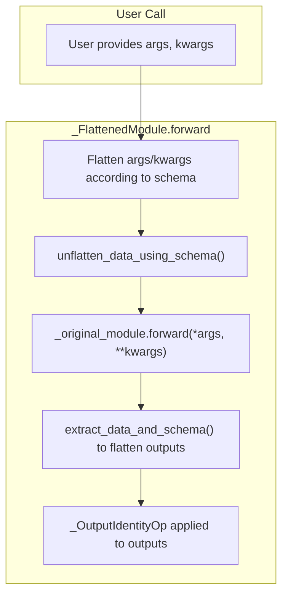
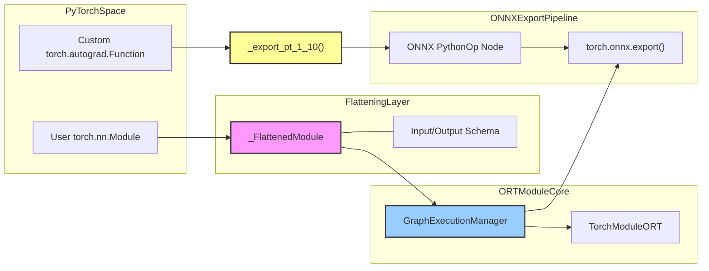

<!-- source: DeepWiki mcp.deepwiki.com · repo microsoft/onnxruntime · page 8.2 PyTorch Integration · fetched 2026-10-21 -->

# PyTorch Integration

Relevant source files

The following files were used as context for generating this wiki page:

- [docs/Memory_Optimizer.md](docs/Memory_Optimizer.md)
- [docs/ORTModule_Training_Guidelines.md](docs/ORTModule_Training_Guidelines.md)
- [onnxruntime/python/tools/symbolic_shape_infer.py](onnxruntime/python/tools/symbolic_shape_infer.py)
- [onnxruntime/test/python/onnxruntime_test_python_symbolic_shape_infer.py](onnxruntime/test/python/onnxruntime_test_python_symbolic_shape_infer.py)
- [orttraining/orttraining/core/framework/torch/custom_function_register.cc](orttraining/orttraining/core/framework/torch/custom_function_register.cc)
- [orttraining/orttraining/core/framework/torch/custom_function_register.h](orttraining/orttraining/core/framework/torch/custom_function_register.h)
- [orttraining/orttraining/core/framework/torch/refcount_tracker.cc](orttraining/orttraining/core/framework/torch/refcount_tracker.cc)
- [orttraining/orttraining/core/framework/torch/torch_proxy.cc](orttraining/orttraining/core/framework/torch/torch_proxy.cc)
- [orttraining/orttraining/core/framework/torch/torch_proxy.h](orttraining/orttraining/core/framework/torch/torch_proxy.h)
- [orttraining/orttraining/core/optimizer/compute_optimizer/padding_elimination.cc](orttraining/orttraining/core/optimizer/compute_optimizer/padding_elimination.cc)
- [orttraining/orttraining/core/optimizer/compute_optimizer/padding_elimination.h](orttraining/orttraining/core/optimizer/compute_optimizer/padding_elimination.h)
- [orttraining/orttraining/core/optimizer/graph_transformer_config.h](orttraining/orttraining/core/optimizer/graph_transformer_config.h)
- [orttraining/orttraining/python/training/ortmodule/__init__.py](orttraining/orttraining/python/training/ortmodule/__init__.py)
- [orttraining/orttraining/python/training/ortmodule/_custom_autograd_function.py](orttraining/orttraining/python/training/ortmodule/_custom_autograd_function.py)
- [orttraining/orttraining/python/training/ortmodule/_custom_autograd_function_exporter.py](orttraining/orttraining/python/training/ortmodule/_custom_autograd_function_exporter.py)
- [orttraining/orttraining/python/training/ortmodule/_custom_gradient_registry.py](orttraining/orttraining/python/training/ortmodule/_custom_gradient_registry.py)
- [orttraining/orttraining/python/training/ortmodule/_custom_op_symbolic_registry.py](orttraining/orttraining/python/training/ortmodule/_custom_op_symbolic_registry.py)
- [orttraining/orttraining/python/training/ortmodule/_fallback.py](orttraining/orttraining/python/training/ortmodule/_fallback.py)
- [orttraining/orttraining/python/training/ortmodule/_fallback_exceptions.py](orttraining/orttraining/python/training/ortmodule/_fallback_exceptions.py)
- [orttraining/orttraining/python/training/ortmodule/_graph_execution_manager.py](orttraining/orttraining/python/training/ortmodule/_graph_execution_manager.py)
- [orttraining/orttraining/python/training/ortmodule/_graph_execution_manager_factory.py](orttraining/orttraining/python/training/ortmodule/_graph_execution_manager_factory.py)
- [orttraining/orttraining/python/training/ortmodule/_inference_manager.py](orttraining/orttraining/python/training/ortmodule/_inference_manager.py)
- [orttraining/orttraining/python/training/ortmodule/_io.py](orttraining/orttraining/python/training/ortmodule/_io.py)
- [orttraining/orttraining/python/training/ortmodule/_logger.py](orttraining/orttraining/python/training/ortmodule/_logger.py)
- [orttraining/orttraining/python/training/ortmodule/_runtime_inspector.py](orttraining/orttraining/python/training/ortmodule/_runtime_inspector.py)
- [orttraining/orttraining/python/training/ortmodule/_torch_module_factory.py](orttraining/orttraining/python/training/ortmodule/_torch_module_factory.py)
- [orttraining/orttraining/python/training/ortmodule/_torch_module_ort.py](orttraining/orttraining/python/training/ortmodule/_torch_module_ort.py)
- [orttraining/orttraining/python/training/ortmodule/_training_manager.py](orttraining/orttraining/python/training/ortmodule/_training_manager.py)
- [orttraining/orttraining/python/training/ortmodule/_utils.py](orttraining/orttraining/python/training/ortmodule/_utils.py)
- [orttraining/orttraining/python/training/ortmodule/_zero_stage3_compatibility.py](orttraining/orttraining/python/training/ortmodule/_zero_stage3_compatibility.py)
- [orttraining/orttraining/python/training/ortmodule/options.py](orttraining/orttraining/python/training/ortmodule/options.py)
- [orttraining/orttraining/python/training/ortmodule/ortmodule.py](orttraining/orttraining/python/training/ortmodule/ortmodule.py)
- [orttraining/orttraining/python/training/ortmodule/torch_cpp_extensions/cpu/torch_interop_utils/torch_interop_utils.cc](orttraining/orttraining/python/training/ortmodule/torch_cpp_extensions/cpu/torch_interop_utils/torch_interop_utils.cc)
- [orttraining/orttraining/python/training/utils/__init__.py](orttraining/orttraining/python/training/utils/__init__.py)
- [orttraining/orttraining/python/training/utils/hooks/_zero_offload_subscriber.py](orttraining/orttraining/python/training/utils/hooks/_zero_offload_subscriber.py)
- [orttraining/orttraining/python/training/utils/torch_profile_utils.py](orttraining/orttraining/python/training/utils/torch_profile_utils.py)
- [orttraining/orttraining/python/training/utils/torch_type_map.py](orttraining/orttraining/python/training/utils/torch_type_map.py)
- [orttraining/orttraining/test/python/_test_helpers.py](orttraining/orttraining/test/python/_test_helpers.py)
- [orttraining/orttraining/test/python/orttraining_test_ortmodule_api.py](orttraining/orttraining/test/python/orttraining_test_ortmodule_api.py)
- [orttraining/orttraining/test/python/orttraining_test_ortmodule_autograd.py](orttraining/orttraining/test/python/orttraining_test_ortmodule_autograd.py)
- [orttraining/orttraining/test/python/orttraining_test_ortmodule_fallback.py](orttraining/orttraining/test/python/orttraining_test_ortmodule_fallback.py)
- [orttraining/orttraining/training_ops/cpu/torch/torch_custom_function_kernel_base.cc](orttraining/orttraining/training_ops/cpu/torch/torch_custom_function_kernel_base.cc)
- [orttraining/orttraining/training_ops/cpu/torch/torch_custom_function_kernel_base.h](orttraining/orttraining/training_ops/cpu/torch/torch_custom_function_kernel_base.h)

This page describes in technical detail the integration layer between PyTorch and ONNX Runtime (ORT) as implemented in ORTModule training system. It covers the flattening strategy for inputs/outputs, the internal `_FlattenedModule`, the role of `TorchModuleORT`, and the mechanism to export custom autograd functions to ONNX `PythonOp`.

This is a leaf page covering core classes and their interactions enabling an efficient and transparent interoperation between PyTorch dynamic autograd and ONNX Runtime static graph execution.

Sources:  
[orttraining/orttraining/python/training/ortmodule/_io.py:112-148]()  
[orttraining/orttraining/python/training/ortmodule/_graph_execution_manager.py:1-159]()  
[orttraining/orttraining/python/training/ortmodule/_custom_autograd_function_exporter.py:1-170]()  
[orttraining/orttraining/python/training/ortmodule/_utils.py:1-158]()

---

## Overview of PyTorch to ORT Integration Layer

The integration layer converts user PyTorch models (`torch.nn.Module`) into a form compatible for ONNX export and subsequent execution by ONNX Runtime. The workflow addresses PyTorch's common pattern of nested inputs/outputs, dynamic shapes, and custom autograd functions.

Key components:  
- `_FlattenedModule`: wraps the original `torch.nn.Module` to present a flattened signature to ONNX export, flattening args/kwargs and outputs into 1D lists of tensors.  
- `TorchModuleORT` (not shown in code excerpts but known): represents the ORT execution wrapper which holds a `GraphExecutionManager` (either for training or inference).  
- Custom autograd function export: Supports exporting specific custom `torch.autograd.Function` subclasses as ONNX `PythonOp` nodes, ensuring that custom backward logic can execute inside ORT.

High-level data/control flow:  

- User model is wrapped with `_FlattenedModule` to flatten inputs/outputs.
- `GraphExecutionManager` manages ONNX export and execution.
- `TorchModuleORT` exposes the final interface for PyTorch integration.
- Custom autograd functions are exported and registered so ORT can run backward inside the graph.

Sources: [orttraining/orttraining/python/training/ortmodule/_io.py:112-148](), [orttraining/orttraining/python/training/ortmodule/_graph_execution_manager.py:1-159](), [orttraining/orttraining/python/training/ortmodule/_custom_autograd_function_exporter.py:1-170]()

---

## FlattenedModule: Flattening Inputs and Outputs for ONNX Export

PyTorch models often have rich, nested input/output types (tuples, lists, dicts, custom classes). ONNX export requires inputs and outputs in flat list form.

The `_FlattenedModule` class wraps the original `torch.nn.Module` to:  
- Flatten the inputs (args and kwargs) into a flat list of tensors for export.  
- Unflatten the flat list back to original structure before calling the user's original `forward`.  
- Flatten outputs to a flat tensor list and insert Identity ops on outputs for ONNX Runtime gradient support.

- The flattening preserves a _schema_ describing the input/output hierarchy, stored as `ORTModelInputOutputSchemaType`.  
- This schema supports reconstructing the original nested data structures from the flat lists.  
- Identity ops on outputs prevent ONNX Runtime from optimizing away passthrough outputs, which breaks gradient graph correctness.

Key functions and members:  
- Constructor saves the original module.  
- `forward(*args)`:  
  - Uses `unflatten_data_using_schema()` on args to recover structured inputs for the original module call.  
  - Runs original module, then flattens outputs via `_extract_schema()`.  
  - Applies `_OutputIdentityOp` to each output tensor.  
  - Returns a flat tensor output list.

Relevant classes and functions:  
- `_OutputIdentityOp` is a custom autograd Function that inserts an Identity node into the ONNX trace preventing passthrough optimization.  
- `extract_data_and_schema()`, `unflatten_data_using_schema()` handle conversion between flat tensor list and structured inputs/outputs.

Sources: [orttraining/orttraining/python/training/ortmodule/_io.py:112-148]()

---

## TorchModuleORT and GraphExecutionManager

`TorchModuleORT` is the main PyTorch-visible class that implements the model execution. Internally, it delegates to a `GraphExecutionManager` instance, which manages ONNX export, optimization, and execution.

`GraphExecutionManager` abstracts the core logic needed to manage ONNX Runtime session lifecycle, caching, fallback, and execution. It has concrete subclasses:  
- `TrainingManager` for training mode (export with gradients and backward graph).  
- `InferenceManager` for inference mode.

Key aspects of `GraphExecutionManager` (partial listing):  
- Accepts a `_FlattenedModule` as input (the original module wrapped with flattening).  
- Maintains the ONNX models and sessions.  
- Handles forward execution via `execution_session_run_forward()` static method.  
- Implements fallback flags and debug options.  
- Loads C++ extensions for ATen Op execution.  
- Manages runtime inspection and memory stats.

Within the training `GraphExecutionManager` (`TrainingManager`):  
- Provides a custom torch.autograd.Function subclass implementation (`_ORTModuleFunction`) which calls ONNX Runtime forward and backward graphs.  
- Saves intermediate states forcaching and materializing gradients.

High level method flow:  
- User calls `TorchModuleORT.forward()` ->  
- Calls `GraphExecutionManager.forward()` ->  
- Uses `execution_session_run_forward()` to run ONNX model via ORT C++ API ->  
- For `TrainingManager`, the backward graph is encoded inside via custom autograd.Function.

Sources: [orttraining/orttraining/python/training/ortmodule/_graph_execution_manager.py:30-159]()

---

## Exporting Custom Autograd Functions to ONNX (`PythonOp`)

Certain PyTorch custom autograd functions (`torch.autograd.Function` subclasses) require exporting into ONNX as `PythonOp` nodes. This allows ORT to delegate these operations' forward/backward runs back to Python code during ORT execution.

The module `_custom_autograd_function_exporter.py` provides:  
- Mechanisms to register and handle special export of `torch.autograd.Function`.  
- A registry `_SpecialCustomFunctionHandler` that maps full qualified names of autograd.Function classes to export handler callbacks.  
- The main export function `_export_pt_1_10()` which exports a `PythonOp` node in the ONNX graph with the Python class information attached.  
- Registering schema supplements like shape inference and alias input functions for the custom operators.

Workflow:  
- During ONNX export of a model with custom autograd functions, the exporter calls `_export_pt_1_10()` for each `PythonOp` node.  
- This function gets the Python class and tries high priority export handlers first (if registered).  
- If no handler is found, it exports a `PythonOp` node via ONNX with the Python object attached.  
- Registration decorators `@register_high_priority_handler` allow clients to add custom export logic per autograd function.

Additional features include:  
- Handling PyTorch exporter changes in symbolic context between versions 1.10, 1.11, and 1.13+.  
- Registering ONNX schema supplements for shape inference and alias mapping using C++ backend registration calls.

This exporter is essential to support advanced PyTorch custom autograd logic inside ORT with gradient correctness and performance.

Sources: [orttraining/orttraining/python/training/ortmodule/_custom_autograd_function_exporter.py:1-170]()

---

## Summary and Relations

| Concept/Component | Description | Key File(s)/Location |
|-|-|-|
| `_FlattenedModule` | Wraps original PyTorch module; flattens inputs/outputs for ONNX export | `_io.py`: 112-148 |
| `GraphExecutionManager` | Core manager for building, exporting, and running ONNX models with ORT backend | `_graph_execution_manager.py`: 1-159 |
| `TrainingManager` / `InferenceManager` | Specializations of GraphExecutionManager for respective modes | `_graph_execution_manager.py` (TrainingManager starts at 27) |
| `TorchModuleORT` | PyTorch visible wrapper to manage ORT execution (internal use) | (referenced but source not shown) |
| Custom Autograd Exporter | Exports `torch.autograd.Function` as ONNX `PythonOp` nodes with special handling | `_custom_autograd_function_exporter.py`: 1-170 |

This diagram links natural terminology with key code entities, clarifying component interaction in the PyTorch-to-ORT integration.

---

## Detailed Technical Notes

- **FlattenedModule's Implementation Details:**  
  Stores the original `torch.nn.Module` in `_original_module`. On forward, it uses stored schemas to unflatten the passed flat input list into the original args and kwargs. Then it calls the original module’s forward method. The output tensors are flattened (extracting tensor data and shape metadata) and cached for ONNX export. Identity op wrappers are applied to outputs to preserve graph structure for gradient building.

- **GraphExecutionManager's Forward Pass:**  
  Example method (from `TrainingManager`) `execution_session_run_forward()` converts PyTorch tensors to ORT OrtValueVector, invokes ORT execution sessions, and retrieves outputs back into PyTorch tensors.  
  Internally manages gradient accumulation cache and partial run states.

- **CustomAutogradFunction Export:**  
  The exporter uses PyTorch internals to retrieve the Python autograd function class instance from the ONNX export node property.  
  It supports high-priority handler functions for known custom autograd ops registered via decorator.  
  Registers shape inference and alias mapping functions for these custom ops in the ONNX runtime for shape and memory correctness.

- **Version Compatibility:**  
  Sympathetic to various PyTorch exporter API changes (symbolic helper context signatures changed across PyTorch versions 1.10-1.13), using conditional wrappers to unify user code.

---

This completes the detailed technical overview of the PyTorch integration components, focusing on the FlattenedModule input/output transformation, the orchestration via GraphExecutionManager and TorchModuleORT, and the custom autograd function export machinery for ORT training.

# END

Sources:  
[orttraining/orttraining/python/training/ortmodule/_io.py:112-148]()  
[orttraining/orttraining/python/training/ortmodule/_graph_execution_manager.py:1-159]()  
[orttraining/orttraining/python/training/ortmodule/_custom_autograd_function_exporter.py:1-170]()  
[orttraining/orttraining/python/training/ortmodule/_utils.py:1-158]()

---

