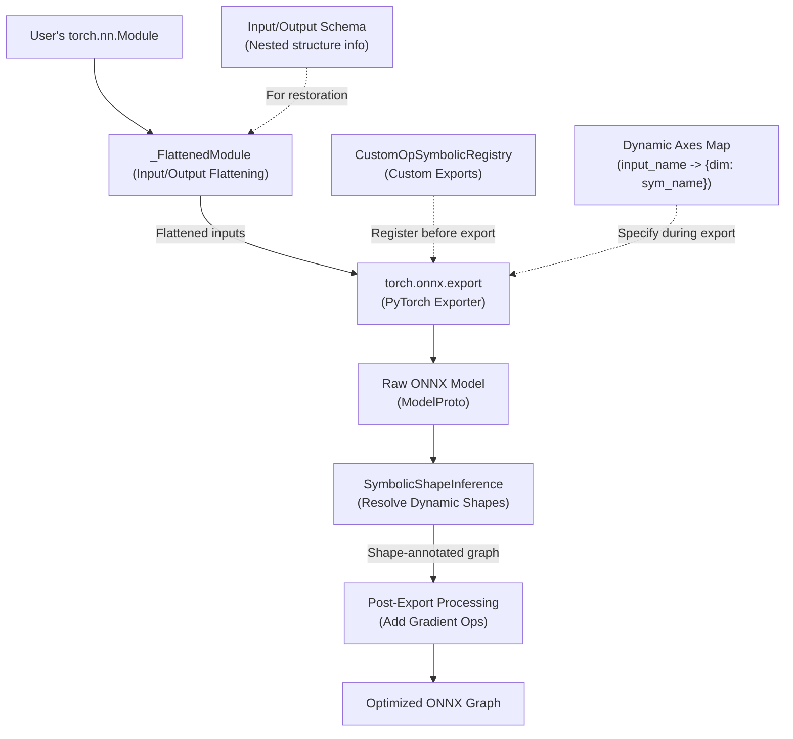
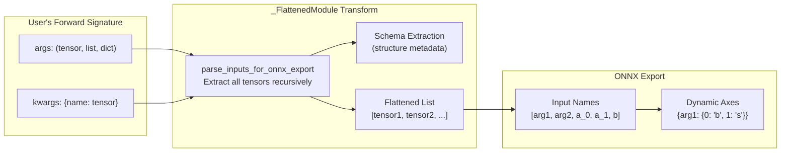
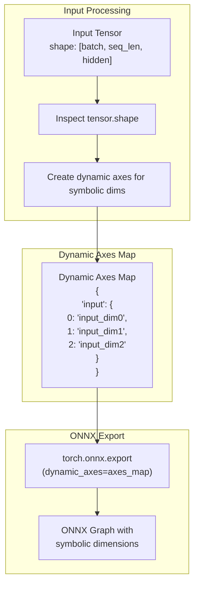
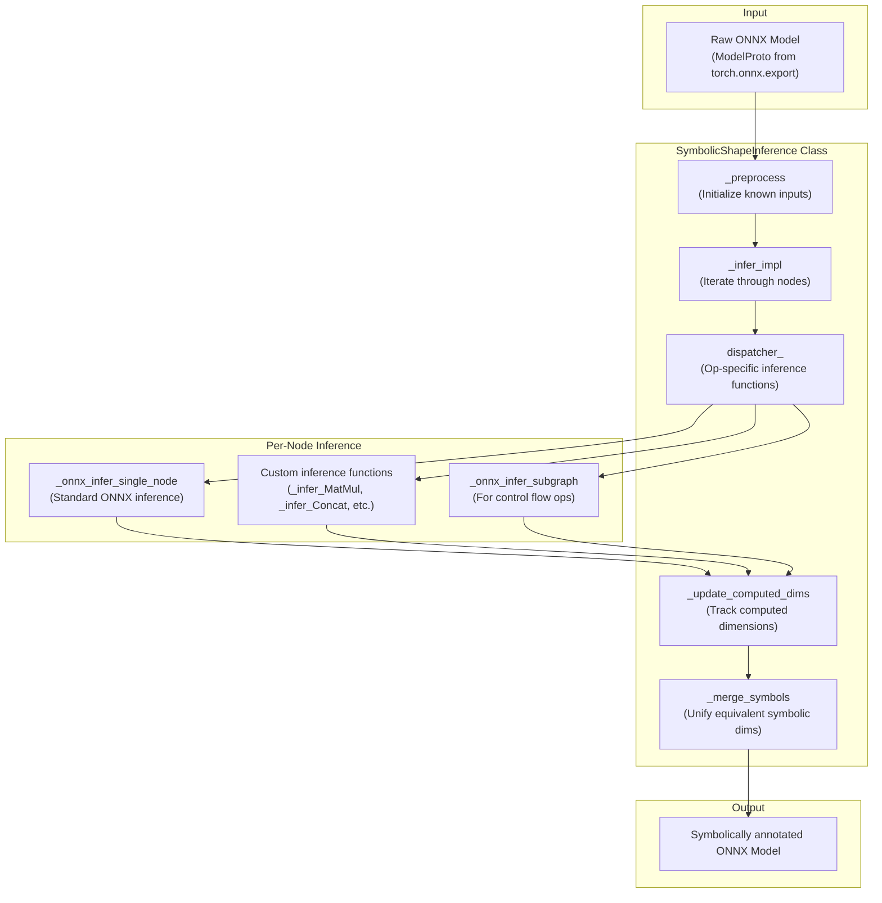
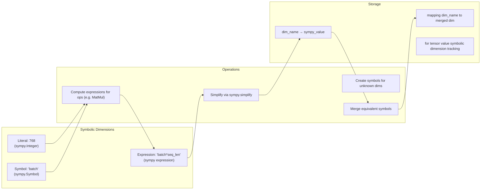
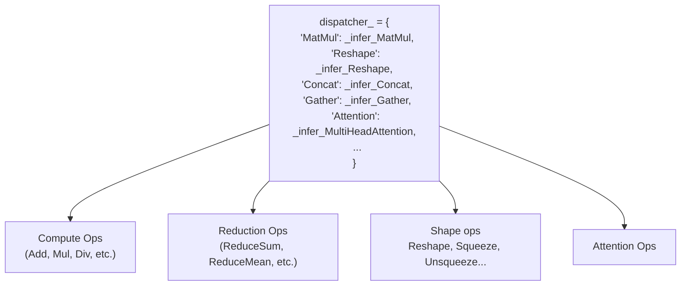
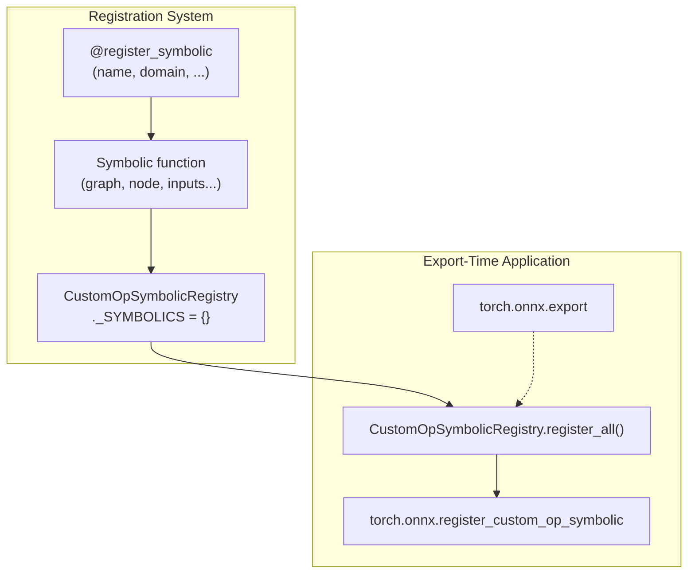
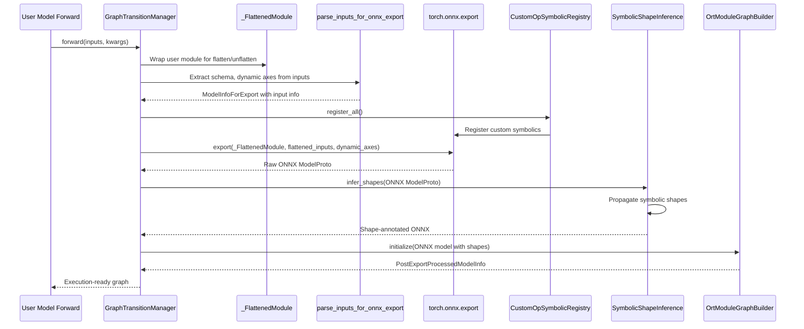
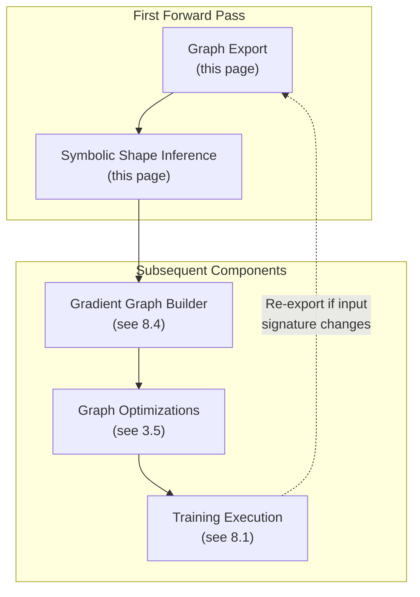

<!-- source: DeepWiki mcp.deepwiki.com · repo microsoft/onnxruntime · page 8.3 Graph Export and Shape Inference · fetched 2026-10-21 -->

# Graph Export and Shape Inference

<details>
<summary>Relevant source files</summary>

The following files were used as context for generating this wiki page:

- [docs/Memory_Optimizer.md](docs/Memory_Optimizer.md)
- [docs/ORTModule_Training_Guidelines.md](docs/ORTModule_Training_Guidelines.md)
- [onnxruntime/python/tools/symbolic_shape_infer.py](onnxruntime/python/tools/symbolic_shape_infer.py)
- [onnxruntime/test/python/onnxruntime_test_python_symbolic_shape_infer.py](onnxruntime/test/python/onnxruntime_test_python_symbolic_shape_infer.py)
- [orttraining/orttraining/core/optimizer/compute_optimizer/padding_elimination.cc](orttraining/orttraining/core/optimizer/compute_optimizer/padding_elimination.cc)
- [orttraining/orttraining/core/optimizer/compute_optimizer/padding_elimination.h](orttraining/orttraining/core/optimizer/compute_optimizer/padding_elimination.h)
- [orttraining/orttraining/core/optimizer/graph_transformer_config.h](orttraining/orttraining/core/optimizer/graph_transformer_config.h)
- [orttraining/orttraining/python/training/ortmodule/__init__.py](orttraining/orttraining/python/training/ortmodule/__init__.py)
- [orttraining/orttraining/python/training/ortmodule/_custom_gradient_registry.py](orttraining/orttraining/python/training/ortmodule/_custom_gradient_registry.py)
- [orttraining/orttraining/python/training/ortmodule/_custom_op_symbolic_registry.py](orttraining/orttraining/python/training/ortmodule/_custom_op_symbolic_registry.py)
- [orttraining/orttraining/python/training/ortmodule/_fallback.py](orttraining/orttraining/python/training/ortmodule/_fallback.py)
- [orttraining/orttraining/python/training/ortmodule/_fallback_exceptions.py](orttraining/orttraining/python/training/ortmodule/_fallback_exceptions.py)
- [orttraining/orttraining/python/training/ortmodule/_graph_execution_manager.py](orttraining/orttraining/python/training/ortmodule/_graph_execution_manager.py)
- [orttraining/orttraining/python/training/ortmodule/_graph_execution_manager_factory.py](orttraining/orttraining/python/training/ortmodule/_graph_execution_manager_factory.py)
- [orttraining/orttraining/python/training/ortmodule/_inference_manager.py](orttraining/orttraining/python/training/ortmodule/_inference_manager.py)
- [orttraining/orttraining/python/training/ortmodule/_io.py](orttraining/orttraining/python/training/ortmodule/_io.py)
- [orttraining/orttraining/python/training/ortmodule/_logger.py](orttraining/orttraining/python/training/ortmodule/_logger.py)
- [orttraining/orttraining/python/training/ortmodule/_runtime_inspector.py](orttraining/orttraining/python/training/ortmodule/_runtime_inspector.py)
- [orttraining/orttraining/python/training/ortmodule/_torch_module_factory.py](orttraining/orttraining/python/training/ortmodule/_torch_module_factory.py)
- [orttraining/orttraining/python/training/ortmodule/_torch_module_ort.py](orttraining/orttraining/python/training/ortmodule/_torch_module_ort.py)
- [orttraining/orttraining/python/training/ortmodule/_training_manager.py](orttraining/orttraining/python/training/ortmodule/_training_manager.py)
- [orttraining/orttraining/python/training/ortmodule/_utils.py](orttraining/orttraining/python/training/ortmodule/_utils.py)
- [orttraining/orttraining/python/training/ortmodule/options.py](orttraining/orttraining/python/training/ortmodule/options.py)
- [orttraining/orttraining/python/training/ortmodule/ortmodule.py](orttraining/orttraining/python/training/ortmodule/ortmodule.py)
- [orttraining/orttraining/test/python/orttraining_test_ortmodule_api.py](orttraining/orttraining/test/python/orttraining_test_ortmodule_api.py)
- [orttraining/orttraining/test/python/orttraining_test_ortmodule_fallback.py](orttraining/orttraining/test/python/orttraining_test_ortmodule_fallback.py)

</details>


This document describes the ONNX export process and symbolic shape inference system used by ORTModule to convert PyTorch models into optimized ONNX graphs with dynamic shape support. This process occurs during the first forward pass of an ORTModule-wrapped model and establishes the computational graph that ONNX Runtime will execute for training.

**Scope**: This page covers the export pipeline from PyTorch to ONNX, input/output schema extraction, symbolic shape inference for dynamic dimensions, and custom operator registration. For information about graph optimization after export, see [Graph Optimizations](#3.5). For the overall training execution flow, see [ORTModule Overview](#8.1).

---

## Export Pipeline Overview

When ORTModule wraps a PyTorch model, the first forward pass triggers a multi-stage export process that converts the dynamic PyTorch graph into a static ONNX representation while preserving information about dynamic dimensions.

### High-Level Export Flow



This flow starts from the user's PyTorch model and applies a flattening transformation to inputs and outputs using the `_FlattenedModule` wrapper. The flattened inputs are then exported to an ONNX model using `torch.onnx.export()`. Before export, dynamic axes for input tensors are analyzed and symbolic dimension names are created to represent dynamic shape parameters such as batch size or sequence length.

Once the raw ONNX model is exported, the `SymbolicShapeInference` module runs shape inference over the graph to propagate and unify symbolic dimension information. Finally, the post-export processing stage (performed by the graph builder) adds gradient graph construction and applies graph optimizations for training.

**Sources:** [orttraining/orttraining/python/training/ortmodule/_graph_transition_manager.py](), [orttraining/orttraining/python/training/ortmodule/_graph_execution_manager.py:135-145]()

---

## Input/Output Flattening and Schema

Before export, ORTModule flattens nested input/output structures into 1-dimensional lists of tensors, while preserving schema information to restore the original structure after execution.

### Flattening Process



The `_FlattenedModule` class wraps the original PyTorch module and implements a forward method that:
- Unflattens the flattened inputs back to the original nested structure before calling the user's original module.
- Flattens the outputs into a list, saving an output schema for later restoration by ONNX Runtime.
- Prepends Identity operators on outputs to prevent ONNX exporter optimizations from removing passthrough outputs.

This flattening ensures that the PyTorch exporter receives inputs/outputs as a simple list of tensors, which it can map cleanly to ONNX initializers and graph inputs/outputs.

**Key Components and Locations:**

| Component              | Purpose                                      | Location                                                |
|------------------------|----------------------------------------------|---------------------------------------------------------|
| `_FlattenedModule`     | Wraps user module, flattens inputs/outputs  | [orttraining/orttraining/python/training/ortmodule/_io.py:112-148]()    |
| `parse_inputs_for_onnx_export` | Recursively flatten nested input structures  | [orttraining/orttraining/python/training/ortmodule/_io.py:239-456]()    |
| `ModelInfoForExport`   | Stores flattened input names, dynamic axes, and schemas | [orttraining/orttraining/python/training/ortmodule/_io.py:150-225]()    |
| `_extract_schema`      | Extracts schema for output flattening/restoration | [orttraining/orttraining/python/training/ortmodule/_io.py:102-109]()    |

**Flattening Example:**

Given a forward signature:
```python
def forward(self, x, data={"a": [tensor1, tensor2], "b": tensor3})
```

The flattening produces:
- Flattened input list: `[x, tensor1, tensor2, tensor3]`
- Input names: `["x", "data_a_0", "data_a_1", "data_b"]`
- Schema stores metadata to reconstruct the nested dictionary and list structure during execution.

**Sources:** [orttraining/orttraining/python/training/ortmodule/_io.py:112-148](), [orttraining/orttraining/python/training/ortmodule/_io.py:239-456]()

---

## Dynamic Axes and Symbolic Dimensions

ORTModule automatically creates symbolic dimension names for each input dimension expected to vary at runtime. This supports training/inference with dynamic batch sizes, sequence lengths, and other tensor dimensions.

### Dynamic Axes Creation Process



For every input tensor fed into the export:
- Each dimension of the tensor is inspected.
- A symbolic name is created with pattern like `{input_name}_dim{dim_idx}` to represent that dimension.
- The dynamic axes map stores mappings `{input_name: {dim_index: symbolic_name}}`.
- These dynamic axes are passed to the PyTorch ONNX exporter so dimension symbols appear in the ONNX graph.

The `ModelInfoForExport` class holds this information for use in export and later restoration.

---

## Symbolic Shape Inference

After PyTorch exports the raw ONNX model, ORTModule runs symbolic shape inference to resolve and propagate symbolic dimensions in the graph, allowing dynamic shape handling and improved graph optimization.

### SymbolicShapeInference Architecture



Key methods in the `SymbolicShapeInference` class include:
- `_preprocess`: Initializes input shapes and symbolic values.
- `_infer_impl`: Loops through all nodes in the graph and applies shape inference.
- Dispatcher dictionary `dispatcher_` maps operator names to custom inference functions.
- `_onnx_infer_single_node`: Calls ONNX shape inference for standard ops.
- `_merge_symbols`: Unifies symbolic dimensions known to be equal.
- `_broadcast_shapes`: Computes shapes for broadcasting ops like Add, Mul, etc.

The inference process outputs an ONNX `ModelProto` with shape and symbolic information on all graph value infos.

**Sources:** [onnxruntime/python/tools/symbolic_shape_infer.py:130-270](), [onnxruntime/python/tools/symbolic_shape_infer.py:460-562]()

---

### Symbolic Expression Handling

The shape inference uses the `sympy` library to represent dimension values symbolically:



The system:
- Converts dimension strings into sympy symbols or integers.
- Computes symbolic expressions during operator inference.
- Maintains maps for merging dimensions known to be equal (such as broadcasted dims).
- Simplifies expressions to normal form to avoid redundancy.

This symbolic system enables robust handling of dynamic shapes with algebraic relations.

**Sources:** [onnxruntime/python/tools/symbolic_shape_infer.py:342-369](), [onnxruntime/python/tools/symbolic_shape_infer.py:447-459]()

---

### Operator-Specific Shape Inference Dispatcher

The class maintains a dispatcher mapping operators to dedicated shape inference methods for accurate symbolic computation:



Common patterns include:
- Broadcasting and elementwise ops handled via `_infer_symbolic_compute_ops`.
- Reduction ops reshape the dimension space by eliminating axes.
- Shape-manipulation ops parse input shape information and produce inferred output shapes.
- Contrib/custom ops like attention mechanisms have specialized inference logic leveraging symbolic shapes.

**Sources:** [onnxruntime/python/tools/symbolic_shape_infer.py:132-241]()

---

## Custom Operator Export

ORTModule provides a robust registration system to register custom symbolic export functions to handle operators not natively supported by PyTorch's ONNX exporter.

### Registration System Overview



**Key Components:**

| Component                 | Purpose                                      | Location                                                |
|---------------------------|----------------------------------------------|---------------------------------------------------------|
| `CustomOpSymbolicRegistry` | Singleton mapping custom op names to symbolic functions | [orttraining/orttraining/python/training/ortmodule/_custom_op_symbolic_registry.py:63-81]() |
| `register_symbolic`       | Decorator to define and register custom symbolic functions | [orttraining/orttraining/python/training/ortmodule/_custom_op_symbolic_registry.py:83-100]() |
| `wrap_custom_export_function` | Wraps export to handle PyTorch version differences  | [orttraining/orttraining/python/training/ortmodule/_custom_op_symbolic_registry.py:20-61]() |

Before export, `register_all()` is called to register all custom symbolic functions with the PyTorch exporter, enabling these operators' correct export as ONNX nodes.

---

### Example Custom Export: `cross_entropy_loss`

The symbolic function for PyTorch's `aten::cross_entropy_loss` exports as a custom operator `com.microsoft::SoftmaxCrossEntropyLossInternal` which ensures:

- Preservation of floating-point precision (fp16 input, fp32 output).
- Support for ignore index and reduction modes.
- Conversion of PyTorch reduction integers to strings expected by ONNX.

This function uses symbolic helper utilities and PyTorch node type information to set correct output types and attributes during export.

```python
@register_symbolic("cross_entropy_loss", need_node=True)
def cross_entropy_loss(g, node, logits, target, weight, reduction, ignore_index, label_smoothing=0.0):
    # Validate label smoothing
    # Handle fp16 cast to fp32 as needed
    # Map reduction integer to string
    # Emit SoftmaxCrossEntropyLossInternal custom operator node
    pass
```

Other notable custom exports handle operations like `embedding` and `prim::ConstantChunk` (PyTorch 1.11+).

**Sources:** [orttraining/orttraining/python/training/ortmodule/_custom_op_symbolic_registry.py:103-156](), [orttraining/orttraining/python/training/ortmodule/_custom_op_symbolic_registry.py:172-188](), [orttraining/orttraining/python/training/ortmodule/_custom_op_symbolic_registry.py:312-336]()

---

## Export Execution Flow

The combined export and shape inference steps happen during the first forward pass of an ORTModule-instrumented model.

### End-to-End Export Pipeline



**Detailed key parts:**

1. **Input Serialization and Flattening:** Nested user inputs are recursively flattened and analyzed for dynamic dimensions.

2. **Custom Symbolic Registration:** Before export, all registered custom symbolic functions are registered to the PyTorch exporter.

3. **PyTorch ONNX Export:** The flattened model is exported producing an ONNX `ModelProto` containing symbolic dimension names from dynamic axes.

4. **Shape Inference:** SymbolicShapeInference propagates and validates shapes across the graph, merging symbolic values.

5. **Graph Builder:** Shape-annotated ONNX model is passed to the graph builder which adds gradient nodes and applies transformations.

**Sources:** [orttraining/orttraining/python/training/ortmodule/_graph_execution_manager.py:135-145](), [orttraining/orttraining/python/training/ortmodule/_graph_transition_manager.py]()

---

## Configuration and Environment Variables

ORTModule exposes environment variables and DebugOptions fields controlling export and shape inference behavior.

| Variable                        | Purpose                                             | Default       |
|--------------------------------|-----------------------------------------------------|---------------|
| `ORTMODULE_ONNX_OPSET_VERSION` | Specifies ONNX opset version used for export       | 17            |
| `ORTMODULE_ALLOW_AUTOGRAD_CHECKPOINT` | Allow export of PythonOp for autograd checkpoint   | 0 (disabled)  |
| `ORTMODULE_ENABLE_CUSTOM_AUTOGRAD`      | Enable custom autograd export                       | 1 (enabled)   |
| `ORTMODULE_SAVE_ONNX_PATH`               | Directory to save exported ONNX models              | Current dir   |

### DebugOptions Usage

```python
from onnxruntime.training.ortmodule import ORTModule, DebugOptions, LogLevel

debug_options = DebugOptions(
    save_onnx=True,           # Save exported ONNX models
    onnx_prefix="my_model",   # Prefix for ONNX filenames
    log_level=LogLevel.INFO   # Set logging verbosity
)

model = ORTModule(pytorch_model, debug_options=debug_options)
```

When enabled, the export process saves models at multiple stages:

- Initial PyTorch export: `{prefix}_torch_exported_training.onnx`
- After shape inference and optimizations: `{prefix}_training_optimized.onnx`
- Final model with gradients incorporated: `{prefix}_training_execution_model.onnx`

**Sources:** [orttraining/orttraining/python/training/ortmodule/options.py:20-65](), [docs/ORTModule_Training_Guidelines.md:140-167]()

---

## Troubleshooting Export Issues

### Shape Inference Failures

**Symptoms:**
- Export succeeds but training crashes with shape errors.
- Some operator shapes missing in ONNX model.

**Typical Causes:**
- Missing or incorrect shape inference logic in custom operators.
- Conflicting symbolic dimensions not being merged.
- Unsupported dynamic shapes in some ops.

**Recommendations:**
- Check saved ONNX models to confirm shape and symbolic annotations.
- Validate dynamic axes are correctly defined for inputs.
- Extend or fix custom symbolic shape inference functions.
- Use `auto_merge=True` option in SymbolicShapeInference to unify dims.

---

### Unsupported Operators During Export

**Symptoms:**
- Export fails with "Could not export operator" error.

**Causes:**
- PyTorch op is not mapped to an ONNX node.
- Custom operator lacking symbolic function.

**Solutions:**
- Register custom symbolic functions with `@register_symbolic`.
- Fallback to ATen ops for unsupported ops.
- Disable custom autograd export (`ORTMODULE_ENABLE_CUSTOM_AUTOGRAD=0`) to inline exports.

---

### Dynamic Shape Constraints

**Symptoms:**
- Model works with certain batch sizes but errors on others.

**Common Issues:**
- Some shapes hard-coded in graph as literals.
- Reshape or view operators fixing shapes statically.
- Operators expecting static dimensions.

**Advice:**
- Use dynamic shapes consistently (e.g., avoid fixed-size `.view()`).
- Ensure all dynamic dimensions are declared in `dynamic_axes`.
- Inspect ONNX model for unexpected constant shapes.

**Sources:** [orttraining/orttraining/test/python/orttraining_test_ortmodule_api.py](), [orttraining/orttraining/test/python/orttraining_test_ortmodule_fallback.py]()

---

## Integration with Training Pipeline

The graph export and shape inference system integrates tightly with other ORTModule components during the ORTModule lifecycle.



**Key Integration Points:**

- The `GraphTransitionManager` manages the entire export lifecycle and caches export results.
- The `OrtModuleGraphBuilder` consumes the shape-inferred model to construct backward/gradient graphs.
- Graph optimization relies on symbolic shape info to safely apply transformations like fusion.
- The `TrainingAgent` executes the optimized ONNX graph for training iterations.

**Cache Invalidation Triggers:**

- Change in input argument structure or types.
- Switching device between CPU and GPU.
- Changing between training and evaluation modes.
- Module parameter updates requiring graph re-export.

**Sources:** [orttraining/orttraining/python/training/ortmodule/_graph_execution_manager.py:246-268](), [orttraining/orttraining/python/training/ortmodule/_training_manager.py:246-268]()

---

# Summary

This page describes the detailed processing of converting dynamic PyTorch models into optimized ONNX graphs with dynamic shape support within ORTModule training system. The export pipeline applies input/output flattening, dynamic axis specification, custom symbolic registration, and symbolic shape inference using `sympy` to create a shape-accurate computational graph. This enables efficient execution and training inside ONNX Runtime with flexibility for varying batch sizes and sequence lengths, as well as smooth integration with graph optimization and training execution components.

---

# References and Sources

- [orttraining/orttraining/python/training/ortmodule/_io.py:112-148]()
- [orttraining/orttraining/python/training/ortmodule/_io.py:239-456]()
- [orttraining/orttraining/python/training/ortmodule/_custom_op_symbolic_registry.py:20-100]()
- [orttraining/orttraining/python/training/ortmodule/_custom_op_symbolic_registry.py:103-156]()
- [orttraining/orttraining/python/training/ortmodule/_graph_execution_manager.py:135-145]()
- [orttraining/orttraining/python/training/ortmodule/_graph_transition_manager.py]()
- [onnxruntime/python/tools/symbolic_shape_infer.py:130-270]()
- [onnxruntime/python/tools/symbolic_shape_infer.py:342-369]()
- [onnxruntime/python/tools/symbolic_shape_infer.py:460-562]()
- [docs/ORTModule_Training_Guidelines.md:140-167]()
- [orttraining/orttraining/test/python/orttraining_test_ortmodule_api.py]()
- [orttraining/orttraining/test/python/orttraining_test_ortmodule_fallback.py]()
- [orttraining/orttraining/python/training/ortmodule/_training_manager.py:246-268]()

---

