<!-- source: DeepWiki mcp.deepwiki.com · repo microsoft/onnxruntime · page 8.4 Gradient Graph Builder · fetched 2026-10-21 -->

# Gradient Graph Builder

<details>
<summary>Relevant source files</summary>

The following files were used as context for generating this wiki page:

- [orttraining/orttraining/core/framework/gradient_graph_builder.cc](orttraining/orttraining/core/framework/gradient_graph_builder.cc)
- [orttraining/orttraining/core/framework/gradient_graph_builder.h](orttraining/orttraining/core/framework/gradient_graph_builder.h)
- [orttraining/orttraining/core/framework/ortmodule_graph_builder.cc](orttraining/orttraining/core/framework/ortmodule_graph_builder.cc)
- [orttraining/orttraining/core/framework/ortmodule_graph_builder.h](orttraining/orttraining/core/framework/ortmodule_graph_builder.h)
- [orttraining/orttraining/core/graph/gradient_builder.cc](orttraining/orttraining/core/graph/gradient_builder.cc)
- [orttraining/orttraining/core/graph/gradient_builder.h](orttraining/orttraining/core/graph/gradient_builder.h)
- [orttraining/orttraining/core/graph/gradient_builder_base.cc](orttraining/orttraining/core/graph/gradient_builder_base.cc)
- [orttraining/orttraining/core/graph/gradient_builder_base.h](orttraining/orttraining/core/graph/gradient_builder_base.h)
- [orttraining/orttraining/core/graph/gradient_builder_registry.cc](orttraining/orttraining/core/graph/gradient_builder_registry.cc)
- [orttraining/orttraining/core/graph/gradient_builder_registry.h](orttraining/orttraining/core/graph/gradient_builder_registry.h)
- [orttraining/orttraining/core/graph/training_op_defs.cc](orttraining/orttraining/core/graph/training_op_defs.cc)
- [orttraining/orttraining/test/gradient/gradient_ops_test.cc](orttraining/orttraining/test/gradient/gradient_ops_test.cc)
- [orttraining/orttraining/test/training_ops/cpu/activation/activation_op_test.cc](orttraining/orttraining/test/training_ops/cpu/activation/activation_op_test.cc)
- [orttraining/orttraining/test/training_ops/cuda/activations_test.cc](orttraining/orttraining/test/training_ops/cuda/activations_test.cc)
- [orttraining/orttraining/training_ops/cpu/cpu_training_kernels.cc](orttraining/orttraining/training_ops/cpu/cpu_training_kernels.cc)
- [orttraining/orttraining/training_ops/cpu/op_gradients.cc](orttraining/orttraining/training_ops/cpu/op_gradients.cc)
- [orttraining/orttraining/training_ops/cpu/op_gradients.h](orttraining/orttraining/training_ops/cpu/op_gradients.h)
- [orttraining/orttraining/training_ops/cuda/activation/activations_grad.cc](orttraining/orttraining/training_ops/cuda/activation/activations_grad.cc)
- [orttraining/orttraining/training_ops/cuda/activation/activations_grad.h](orttraining/orttraining/training_ops/cuda/activation/activations_grad.h)
- [orttraining/orttraining/training_ops/cuda/activation/activations_grad_impl.cu](orttraining/orttraining/training_ops/cuda/activation/activations_grad_impl.cu)
- [orttraining/orttraining/training_ops/cuda/activation/activations_grad_impl.h](orttraining/orttraining/training_ops/cuda/activation/activations_grad_impl.h)
- [orttraining/orttraining/training_ops/cuda/cuda_training_kernels.cc](orttraining/orttraining/training_ops/cuda/cuda_training_kernels.cc)

</details>


The Gradient Graph Builder is the core component responsible for constructing backward computation graphs from forward graphs in ONNX Runtime Training. It analyzes forward operations, queries a registry of gradient builders, and generates corresponding gradient nodes that implement automatic differentiation using the chain rule.

For information about training operators and gradient kernels, see [Element-wise Operations](#7.3). For gradient validation infrastructure, see [Contrib Operators](#7.4).

---

## Architecture Overview

The Gradient Graph Builder system consists of three main layers:

- `GradientGraphBuilder` orchestrator: The main engine driving backward graph construction.
- `GradientBuilderRegistry`: Maps operators to their gradient builder classes.
- Individual gradient builders: Implement specific gradient logic for operators.

### System Architecture Diagram

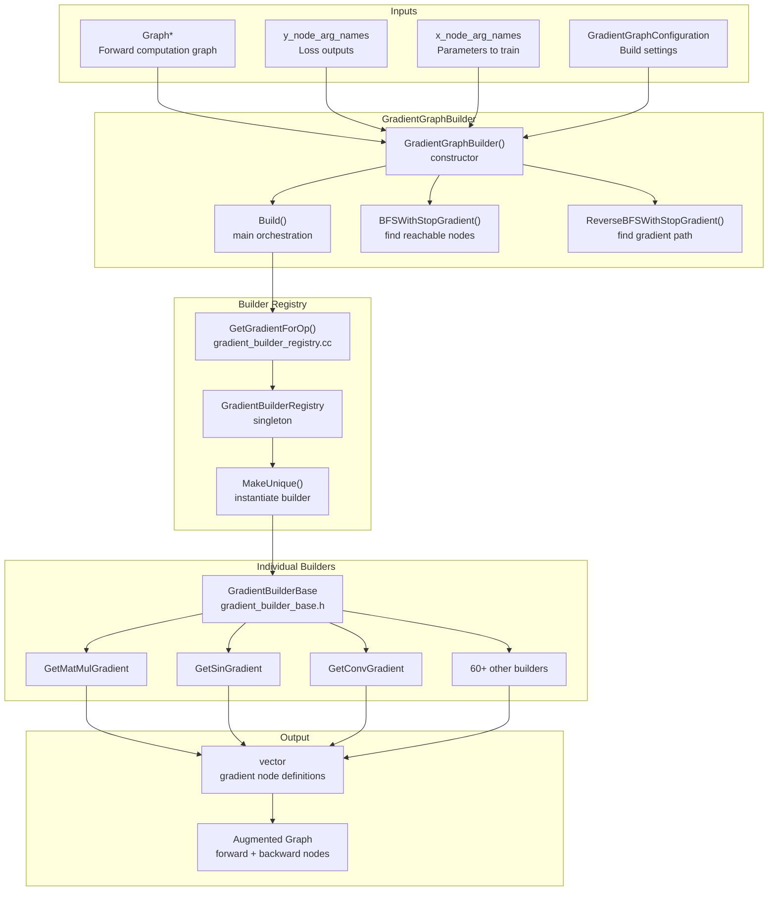

Sources: [orttraining/orttraining/core/framework/gradient_graph_builder.h:84-186](), [orttraining/orttraining/core/graph/gradient_builder_registry.cc:11-33](), [orttraining/orttraining/core/graph/gradient_builder_base.h:45-65]()

---

## GradientGraphBuilder Class

The `GradientGraphBuilder` class manages backward graph construction from a forward graph, initially identifying which graph elements require gradient computations.

### Constructor and Initialization

The constructor initializes internal states and prepares the graph analysis:

```cpp
GradientGraphBuilder(Graph* graph,
                     const std::unordered_set<std::string>& y_node_arg_names,
                     const std::unordered_set<std::string>& x_node_arg_names,
                     const std::string& loss_node_arg_name,
                     const GradientGraphConfiguration& gradient_graph_config,
                     const logging::Logger& logger);
```

### Constructor Workflow

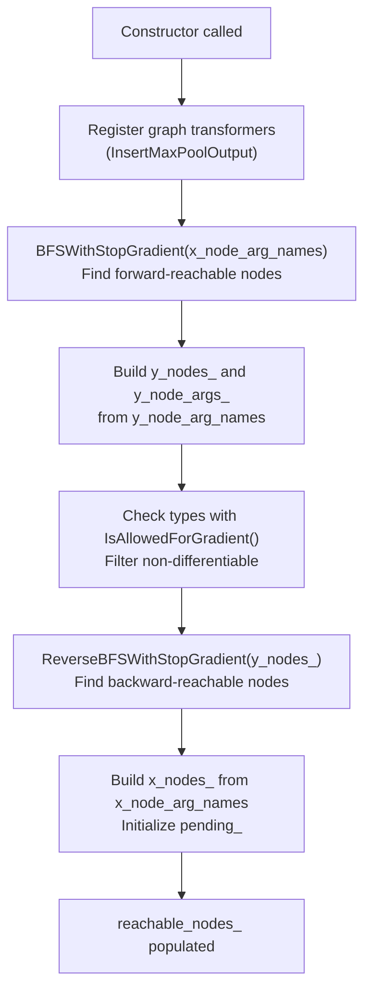

- The graph transformers like `InsertMaxPoolOutput` are registered to assist backward graph construction.
- `BFSWithStopGradient` is used to find all nodes reachable forwards from differentiation inputs.
- The builder filters `y_node_args_` (gradient outputs) and their producer nodes `y_nodes_` based on type support for gradients.
- `ReverseBFSWithStopGradient` is used backward from output nodes to find nodes involved in backward pass.
- `x_nodes_` (consumer nodes of the differentiation inputs) and gradient pending counters are prepared.

Sources: [orttraining/orttraining/core/framework/gradient_graph_builder.cc:61-159]()

---

### Stop Gradient Edges

The system defines a set of edges on specific operators where gradients do not propagate, for example because those inputs are integer indices or non-differentiable parameters.

| Operator                  | Input Index(es) | Reason                                  |
|---------------------------|-----------------|-----------------------------------------|
| `Not`                     | 0               | Non-differentiable                        |
| `And`, `Or`, `Xor`        | 0,1             | Binary logic op inputs                    |
| `Gather`, `GatherElements`, `GatherND` | 1             | Indices are integer; no gradients        |
| `Reshape`, `Expand`       | 1               | Shape inputs; metadata not differentiable |
| `Dropout`                 | 1,2             | Ratio, training flag                      |
| `Slice`                   | 1,2,3,4         | Indexing attributes                      |
| `OneHot`                  | 0,1,2           | Indices, depth, values                   |
| `TopK`                    | 1               | k parameter                             |
| `Clip`                    | 1,2             | Min/max bounds                         |

This list informs `BFSWithStopGradient` and `ReverseBFSWithStopGradient` traversal logic to stop on these edges.

Sources: [orttraining/orttraining/core/framework/gradient_graph_builder.h:28-77]()

---

### Build Method

The core method to build backward graph is `Build()`.

#### Build Process Flow

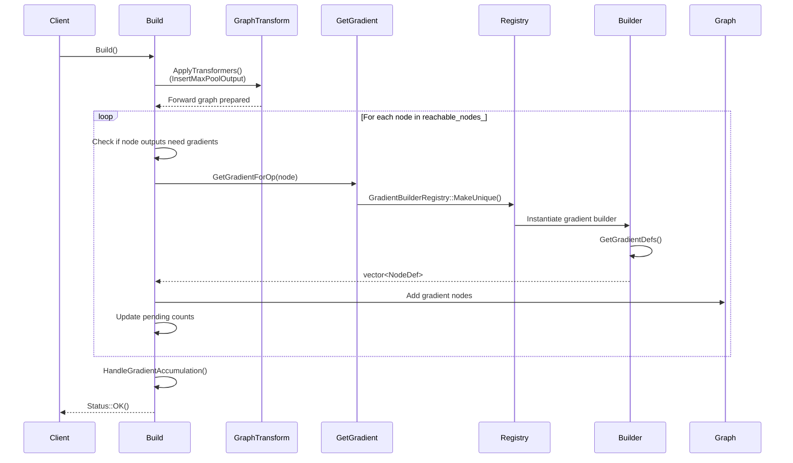

The build method applies graph transformation optimizations, then, for each node on the gradient path:

1. Checks if gradients are needed.
2. Queries gradient builder registry for builder creation.
3. Calls gradient builder to generate gradient nodes as `NodeDef`s.
4. Inserts these nodes into the graph.
5. Handles accumulation of gradients received from multiple paths.

Sources: [orttraining/orttraining/core/framework/gradient_graph_builder.cc:195-456]()

---

### Internal State

Key internal members of `GradientGraphBuilder`:

| Member Variable              | Type                                         | Purpose                                      |
|-----------------------------|----------------------------------------------|----------------------------------------------|
| `y_node_args_`              | `std::unordered_set<const NodeArg*>`         | Output node args representing loss outputs  |
| `x_node_args_`              | `std::unordered_set<const NodeArg*>`         | Input node args for which gradients are computed |
| `y_nodes_`                  | `NodeSet` (ordered set of `const Node*`)     | Nodes producing y_node_args_                  |
| `x_nodes_`                  | `NodeSet`                                    | Nodes consuming x_node_args_                   |
| `reachable_nodes_`          | `NodeSet`                                    | Nodes reachable in backward pass               |
| `pending_`                  | `std::unordered_map<std::string, int>`       | Counts of remaining gradient consumers per tensor |
| `stashed_tensors_`          | `std::unordered_set<std::string>`             | Forward tensors saved for backward computations |
| `gradients_to_accumulate_`  | `std::unordered_map<ArgDef, std::vector<ArgDef>>` | Holds gradient tensor sources pending accumulation |

Sources: [orttraining/orttraining/core/framework/gradient_graph_builder.h:113-152]()

---

### Graph Traversal Methods

Two critical traversals ensure correct nodes are included for backward:

#### BFSWithStopGradient

- Forward BFS starting from `x_node_arg_names`.
- Uses consumers of inputs to traverse forward.
- Skips edges specified in `STOP_GRADIENT_EDGES` to avoid propagating gradients through non-differentiable inputs.
- Returns all reachable nodes along differentiable paths.

#### ReverseBFSWithStopGradient

- Backward BFS starting from output nodes `y_nodes_`.
- Traverses via input edges backward.
- Skips edges in `STOP_GRADIENT_EDGES` in reverse direction.
- Determines nodes involved in backward pass starting from outputs.

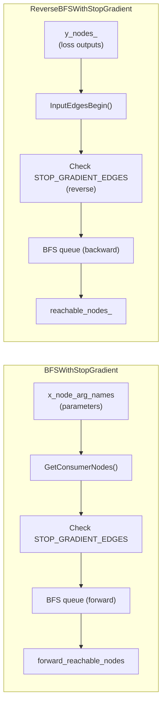

Sources: [orttraining/orttraining/core/framework/gradient_graph_builder.cc:161-240]()

---

## Gradient Builder Registry

Gradient builders are organized in a registry for lookup and creation based on an operator type. This design separates builder implementations and instantiation logic.

### Registry Implementation

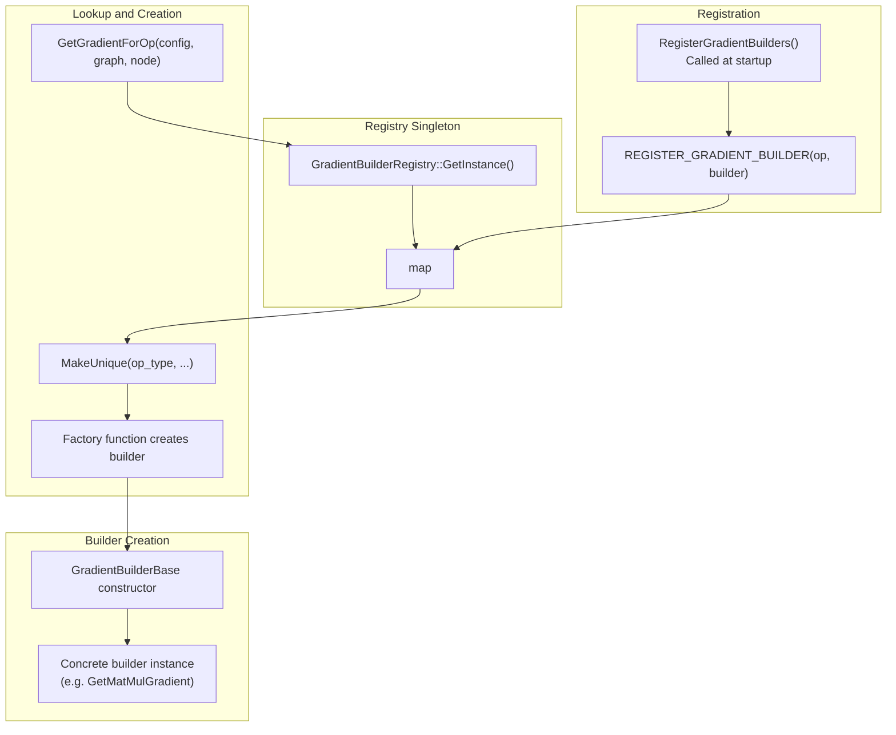

Sources: [orttraining/orttraining/core/graph/gradient_builder_registry.h:1-50](), [orttraining/orttraining/core/graph/gradient_builder_registry.cc:44-133]()

---

### GetGradientForOp Function

The main API for obtaining gradients:

```cpp
GradientDef GetGradientForOp(const GradientGraphConfiguration& gradient_graph_config,
                             Graph* graph,
                             const Node* node,
                             const std::unordered_set<std::string>& output_args_need_grad,
                             const std::unordered_set<std::string>& input_args_need_grad,
                             const logging::Logger& logger,
                             std::unordered_set<std::string>& stashed_tensors,
                             std::unordered_map<std::string, std::vector<int64_t>>& python_op_input_requires_grads);
```

It performs:

- Checking if an external gradient definition exists.
- Falls back to node op type to find gradient builder.
- Creates gradient builder instance.
- Calls `GetGradientDefs()` on the builder.
- Returns the gradient node definitions.

Sources: [orttraining/orttraining/core/graph/gradient_builder_registry.cc:11-33]()

---

### Registered Gradient Builders

The registry includes gradient builders for over 60 operators:

| Category             | Examples                                                                         |
|----------------------|----------------------------------------------------------------------------------|
| **Activation**       | `Relu`, `Sigmoid`, `Tanh`, `Gelu`, `QuickGelu`, `LeakyRelu`                     |
| **Mathematics**      | `Add`, `Sub`, `Mul`, `Div`, `MatMul`, `Gemm`, `Pow`, `Neg`, `Abs`, `Exp`, `Log` |
| **Reduction**        | `ReduceMean`, `ReduceSum`, `ReduceL2`, `ReduceLogSumExp`, `ReduceMax`            |
| **Shape**            | `Reshape`, `Transpose`, `Flatten`, `Squeeze`, `Unsqueeze`, `Expand`, `Tile`      |
| **Tensor ops**       | `Concat`, `Split`, `Slice`, `Gather`, `GatherElements`, `ScatterElements`, etc.  |
| **Convolution**      | `Conv`, `ConvTranspose`                                                          |
| **Pooling**          | `MaxPool`, `AveragePool`, `GlobalAveragePool`, `GlobalMaxPool`                   |
| **Normalization**    | `LayerNormalization`, `BatchNormInternal`                                       |
| **Loss**             | `SoftmaxCrossEntropy`, `SparseSoftmaxCrossEntropy`, `Softmax`, `LogSoftmax`      |
| **Other**            | `Dropout`, `Cast`, `Clip`, `Send`, `Recv`                                       |

Sources: [orttraining/orttraining/core/graph/gradient_builder_registry.cc:44-133]()

---

## GradientBuilderBase Class

All gradient builders derive from `GradientBuilderBase`, which provides common utility methods and the interface to generate gradients.

### Base Class Definition

```cpp
class GradientBuilderBase {
 public:
  GradientBuilderBase(const GradientGraphConfiguration& gradient_graph_config,
                      Graph* graph,
                      const Node* node,
                      const std::unordered_set<std::string>& gradient_inputs,
                      const std::unordered_set<std::string>& gradient_outputs,
                      const logging::Logger& logger,
                      std::unordered_set<std::string>& stashed_tensors,
                      std::unordered_map<std::string, std::vector<int64_t>>& python_op_input_requires_grads);

  GradientDef GetGradientDefs() const;

 protected:
  virtual GradientDef GetGradientDefsImpl() const = 0;

  ArgDef I(size_t i) const;   // i-th input
  ArgDef O(size_t i) const;   // i-th output
  ArgDef GI(size_t i) const;  // gradient of i-th input
  ArgDef GO(size_t i) const;  // gradient of i-th output
  ArgDef IA(const std::string& name) const; // intermediate arg
};
```

### Helper Methods

| Method          | Description                                     | Example                          |
|-----------------|------------------------------------------------|--------------------------------|
| `I(i)`          | Forward node's i-th input argument              | `I(0)` returns ArgDef for input 0 |
| `O(i)`          | Forward node's i-th output argument             | `O(0)` returns ArgDef for output 0 |
| `GI(i)`         | Gradient tensor name of i-th input              | `"input_0_grad"`               |
| `GO(i)`         | Gradient tensor name of i-th output             | `"output_0_grad"`              |
| `IA(name)`      | Generate intermediate argument name, unique     | `"Node123_name"`               |
| `IElemType(i)`  | Element type of i-th input                       | Tensor data type               |
| `OElemType(i)`  | Element type of i-th output                      | Tensor data type               |

Sources: [orttraining/orttraining/core/graph/gradient_builder_base.h:45-260]()

---

## Individual Gradient Builders

Each gradient builder implements `GetGradientDefsImpl` defining backward computation for an operator.

### Implementation Pattern

Gradient builders use this macro to define the function:

```cpp
#define IMPLEMENT_GRADIENT_BUILDER(name) \
  std::vector<NodeDef> name::GetGradientDefsImpl() const
```

### Example: Sin Gradient

The gradient for `y = sin(x)` is `dy/dx = cos(x) * dy`:

```cpp
IMPLEMENT_GRADIENT_BUILDER(GetSinGradient) {
  std::vector<NodeDef> result;
  result.push_back(NodeDef("Cos", {I(0)}, {IA("Cos_O0")}));
  result.push_back(NodeDef("Mul", {GO(0), IA("Cos_O0")}, {GI(0)}));
  return result;
}
```

Diagram:

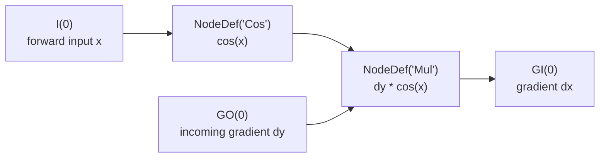

Sources: [orttraining/orttraining/core/graph/gradient_builder.cc:79-84]()

---

### Example: MatMul Gradient

`Y = MatMul(A, B)` gradients:

- `dA = dY * B^T`
- `dB = A^T * dY`

The gradient builder supports 2D and batched inputs, handling dynamic shapes and broadcasting.

Diagram:

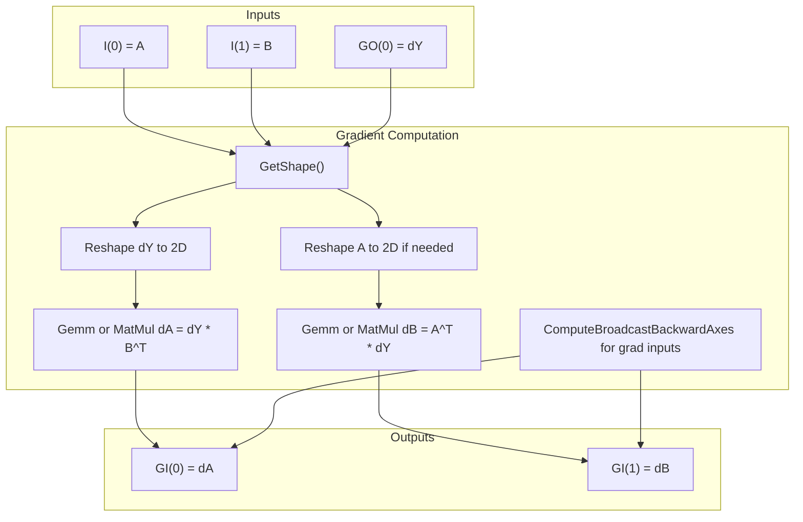

Sources: [orttraining/orttraining/core/graph/gradient_builder.cc:145-341]()

---

### Example: Gemm Gradient

Handles the general matrix multiplication with attributes `transA`, `transB`, `alpha`, and `beta`.

Key points:

- Computes gradients for A, B, and optionally C inputs.
- Handles transpose flags by switching inputs and setting attributes.
- Applies scaling factors `alpha` and `beta`.
- Handles broadcasting and reduce sum for bias gradient.

Sources: [orttraining/orttraining/core/graph/gradient_builder.cc:342-495]()

---

## Gradient Definitions and Node Construction

Gradient builders emit a list of `NodeDef` that define the backward computation nodes added to the graph.

### NodeDef Structure

```cpp
struct NodeDef {
  OpDef op_def;                    // operator metadata (type, domain, version)
  std::vector<ArgDef> input_args;  // input tensors/arguments
  std::vector<ArgDef> output_args; // output tensors/arguments
  NodeAttributes attributes;       // operator attributes
  std::string name;                // node name (optional)
};
```

### ArgDef Structure

Represents a tensor argument:

```cpp
struct ArgDef {
  std::string name;                // argument name
  const ONNX_NAMESPACE::TypeProto* type_proto; // type info, can be nullptr
};
```

### Naming Conventions

- Gradient names are suffixed with `_grad` by `GradientName(name)`.
- Intermediate args are named with unique prefixes using `IA("name_suffix")`.
- For an input at index `i`, gradient tensor is `GI(i)`.
- For an output at index `i`, gradient tensor is `GO(i)`.

Sources: [orttraining/orttraining/core/graph/graph_augmenter.h](), [orttraining/orttraining/core/graph/gradient_builder_base.h:172-190]()

---

### Broadcasting Gradient Handling

Broadcasting in forward operations requires careful reduction of gradients in backward operations.

- `ComputeBroadcastBackwardAxes()` determines axes along which gradients must be reduced.
- The method considers symbolic and concrete shapes.
- Dynamic versions use `BroadcastGradientArgs` operator.

Example: Add operation backward with broadcasting:

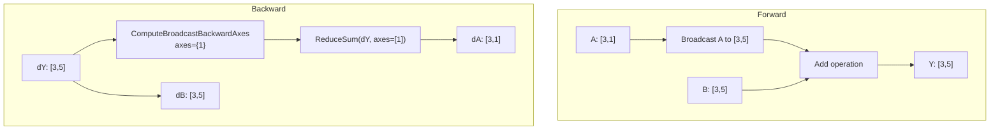

Sources: [orttraining/orttraining/core/graph/gradient_builder_base.cc:35-118](), [orttraining/orttraining/core/graph/gradient_builder.cc:188-315]()

---

## Backward Graph Construction Process

The full gradient graph construction occurs within the `GradientGraphBuilder::Build()` method.

### Build Method Implementation Flow

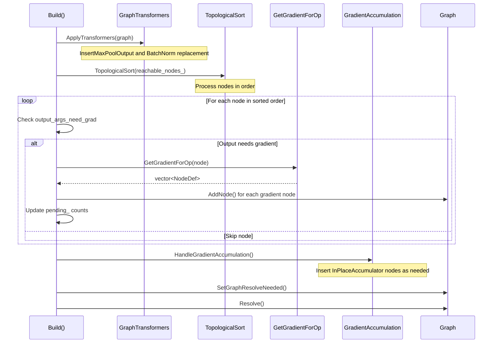

---

### Gradient Accumulation

When multiple backward paths produce gradients for the same forward tensor, these gradients must be accumulated.

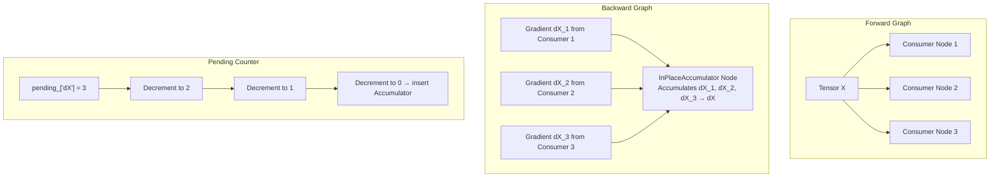

- The pending count tracks how many gradient producers remain for an input.
- When pending count reaches zero, `InPlaceAccumulator` node is inserted.

Sources: [orttraining/orttraining/core/framework/gradient_graph_builder.cc:400-456]()

---

## Testing and Validation

The gradient builder system is extensively validated via unit tests.

### GradientChecker

The `GradientChecker` class numerically verifies gradients produced by the backward graph against finite difference approximations.

API snippet:

```cpp
template <typename X_T, typename Y_T, typename JAC_T>
class GradientChecker {
 public:
  Status ComputeGradientError(
      const OpDef& op_def,
      const std::vector<TensorInfo>& x_infos,
      const std::vector<TensorShape>& y_shapes,
      JAC_T* max_error,
      const std::vector<std::vector<X_T>>& x_datas = {},
      const std::vector<ONNX_NAMESPACE::AttributeProto>& attributes = {},
      bool check_not_have_gradient = true,
      bool check_not_have_shape_inferencing = false,
      std::vector<std::unique_ptr<IExecutionProvider>>* execution_providers = nullptr);
};
```

### Validation Process

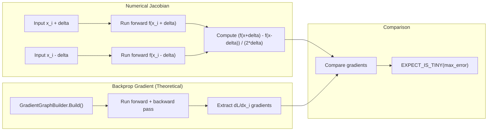

Sources: [orttraining/orttraining/test/gradient/gradient_ops_test.cc]()

---

## Backward Pass Generation Summary

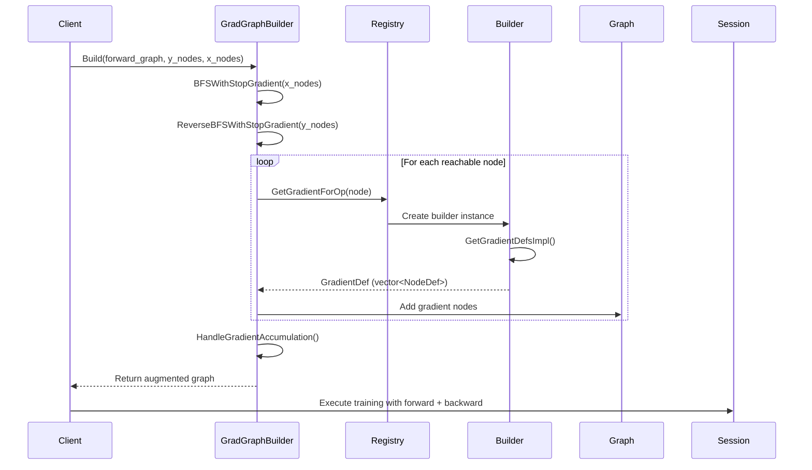

### Key Data Structures

| Term              | Description                                           |
|-------------------|-------------------------------------------------------|
| `GradientDef`     | `std::vector<NodeDef>`, represents gradient subgraph  |
| `NodeDef`         | Defines a node with inputs, outputs, attributes        |
| `ArgDef`          | Tensor argument definition with name and type         |
| `GradientBuilder` | Abstract builder interface to produce gradient nodes   |

Sources: [orttraining/orttraining/core/framework/gradient_graph_builder.cc:160-400](), [orttraining/orttraining/core/graph/gradient_builder_registry.cc:11-33](), [orttraining/orttraining/core/graph/gradient_builder_base.cc:150-200]()

---

# Summary

The Gradient Graph Builder in ONNX Runtime Training automates backward graph construction by:

- Analyzing the forward ONNX computation graph and marking differentiable paths.
- Using BFS traversals respecting stop-grad edges to prune non-differentiable regions.
- Querying a comprehensive registry of gradient builders that encapsulate operator-specific backward logic.
- Constructing gradient nodes using a common framework of argument naming and node definition.
- Handling complexities like broadcasting, gradient accumulation, and dynamic shapes.
- Validating correctness through numerical gradient tests.

This modular, extensible system supports over 60 operator gradients and is key for ONNX Runtime's training capabilities.

---

# References

- [orttraining/orttraining/core/framework/gradient_graph_builder.h]  
- [orttraining/orttraining/core/framework/gradient_graph_builder.cc]  
- [orttraining/orttraining/core/graph/gradient_builder_registry.cc]  
- [orttraining/orttraining/core/graph/gradient_builder_base.h]  
- [orttraining/orttraining/core/graph/gradient_builder_base.cc]  
- [orttraining/orttraining/core/graph/gradient_builder.cc]  
- [orttraining/orttraining/test/gradient/gradient_ops_test.cc]

---

