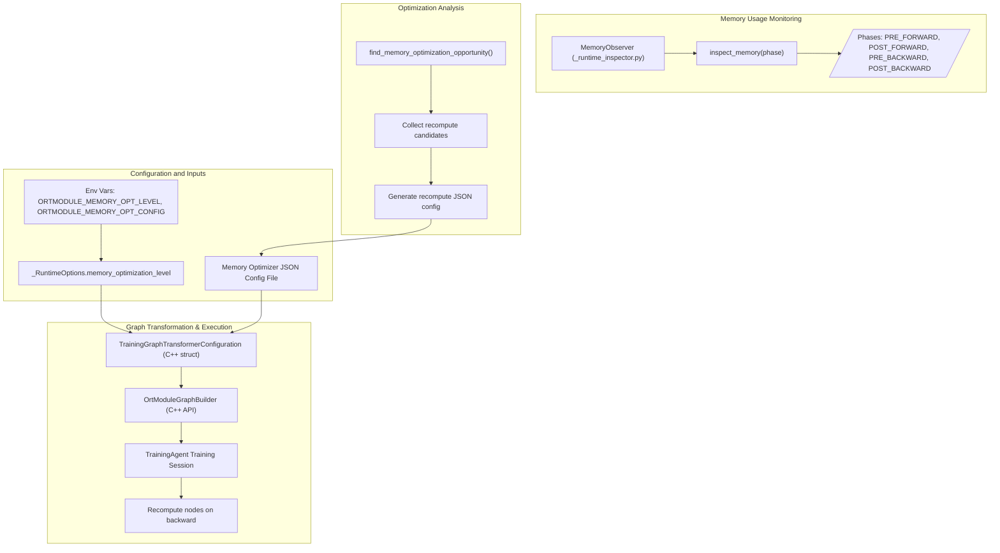
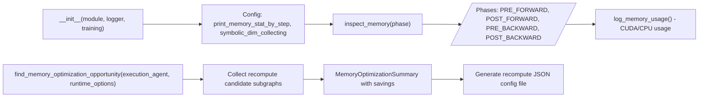
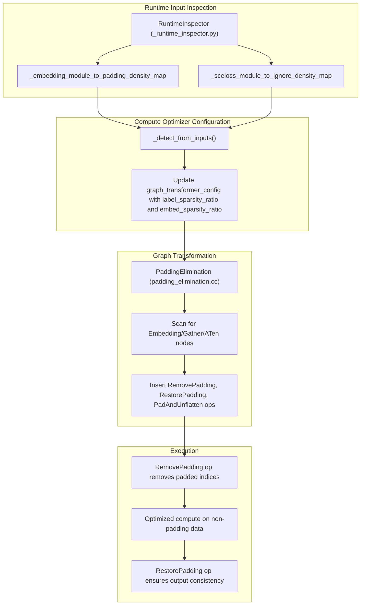
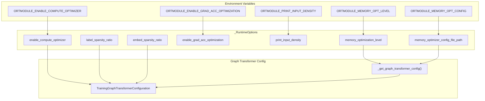
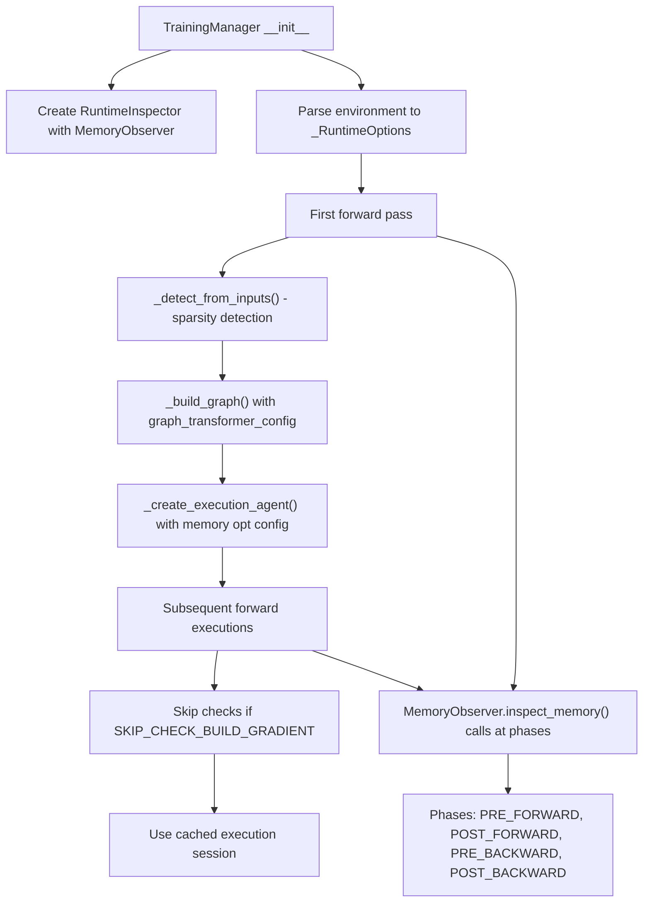

<!-- source: DeepWiki mcp.deepwiki.com · repo microsoft/onnxruntime · page 8.5 Training Optimizations · fetched 2026-10-21 -->

# Training Optimizations

<details>
<summary>Relevant source files</summary>

The following files were used as context for generating this wiki page:

- [docs/Memory_Optimizer.md](docs/Memory_Optimizer.md)
- [docs/ORTModule_Training_Guidelines.md](docs/ORTModule_Training_Guidelines.md)
- [include/onnxruntime/core/optimizer/graph_transformer_utils.h](include/onnxruntime/core/optimizer/graph_transformer_utils.h)
- [onnxruntime/core/graph/extended_graph_edge.h](onnxruntime/core/graph/extended_graph_edge.h)
- [onnxruntime/core/optimizer/graph_transformer_utils.cc](onnxruntime/core/optimizer/graph_transformer_utils.cc)
- [onnxruntime/core/optimizer/qdq_transformer/qdq_final_cleanup.cc](onnxruntime/core/optimizer/qdq_transformer/qdq_final_cleanup.cc)
- [onnxruntime/core/optimizer/qdq_transformer/qdq_final_cleanup.h](onnxruntime/core/optimizer/qdq_transformer/qdq_final_cleanup.h)
- [onnxruntime/core/optimizer/qdq_transformer/qdq_propagation.cc](onnxruntime/core/optimizer/qdq_transformer/qdq_propagation.cc)
- [onnxruntime/core/optimizer/qdq_transformer/qdq_propagation.h](onnxruntime/core/optimizer/qdq_transformer/qdq_propagation.h)
- [onnxruntime/core/optimizer/qdq_transformer/qdq_util.cc](onnxruntime/core/optimizer/qdq_transformer/qdq_util.cc)
- [onnxruntime/core/optimizer/qdq_transformer/qdq_util.h](onnxruntime/core/optimizer/qdq_transformer/qdq_util.h)
- [onnxruntime/core/optimizer/qdq_transformer/selectors_actions/qdq_actions.cc](onnxruntime/core/optimizer/qdq_transformer/selectors_actions/qdq_actions.cc)
- [onnxruntime/core/optimizer/qdq_transformer/selectors_actions/qdq_actions.h](onnxruntime/core/optimizer/qdq_transformer/selectors_actions/qdq_actions.h)
- [onnxruntime/core/optimizer/qdq_transformer/selectors_actions/qdq_selector_action_transformer.cc](onnxruntime/core/optimizer/qdq_transformer/selectors_actions/qdq_selector_action_transformer.cc)
- [onnxruntime/core/optimizer/qdq_transformer/selectors_actions/qdq_selector_action_transformer.h](onnxruntime/core/optimizer/qdq_transformer/selectors_actions/qdq_selector_action_transformer.h)
- [onnxruntime/core/optimizer/qdq_transformer/selectors_actions/qdq_selectors.cc](onnxruntime/core/optimizer/qdq_transformer/selectors_actions/qdq_selectors.cc)
- [onnxruntime/core/optimizer/qdq_transformer/selectors_actions/qdq_selectors.h](onnxruntime/core/optimizer/qdq_transformer/selectors_actions/qdq_selectors.h)
- [onnxruntime/python/tools/symbolic_shape_infer.py](onnxruntime/python/tools/symbolic_shape_infer.py)
- [onnxruntime/test/optimizer/graph_transform_test.cc](onnxruntime/test/optimizer/graph_transform_test.cc)
- [onnxruntime/test/optimizer/graph_transform_utils_test.cc](onnxruntime/test/optimizer/graph_transform_utils_test.cc)
- [onnxruntime/test/optimizer/qdq_matmulnbits_transformer_test.cc](onnxruntime/test/optimizer/qdq_matmulnbits_transformer_test.cc)
- [onnxruntime/test/optimizer/qdq_transformer_test.cc](onnxruntime/test/optimizer/qdq_transformer_test.cc)
- [onnxruntime/test/python/onnxruntime_test_python_symbolic_shape_infer.py](onnxruntime/test/python/onnxruntime_test_python_symbolic_shape_infer.py)
- [orttraining/orttraining/core/optimizer/compute_optimizer/padding_elimination.cc](orttraining/orttraining/core/optimizer/compute_optimizer/padding_elimination.cc)
- [orttraining/orttraining/core/optimizer/compute_optimizer/padding_elimination.h](orttraining/orttraining/core/optimizer/compute_optimizer/padding_elimination.h)
- [orttraining/orttraining/core/optimizer/conv1d_replacement.cc](orttraining/orttraining/core/optimizer/conv1d_replacement.cc)
- [orttraining/orttraining/core/optimizer/conv1d_replacement.h](orttraining/orttraining/core/optimizer/conv1d_replacement.h)
- [orttraining/orttraining/core/optimizer/graph_transformer_config.h](orttraining/orttraining/core/optimizer/graph_transformer_config.h)
- [orttraining/orttraining/core/optimizer/graph_transformer_utils.cc](orttraining/orttraining/core/optimizer/graph_transformer_utils.cc)
- [orttraining/orttraining/python/training/ortmodule/__init__.py](orttraining/orttraining/python/training/ortmodule/__init__.py)
- [orttraining/orttraining/python/training/ortmodule/_custom_gradient_registry.py](orttraining/orttraining/python/training/ortmodule/_custom_gradient_registry.py)
- [orttraining/orttraining/python/training/ortmodule/_custom_op_symbolic_registry.py](orttraining/orttraining/python/training/ortmodule/_custom_op_symbolic_registry.py)
- [orttraining/orttraining/python/training/ortmodule/_fallback.py](orttraining/orttraining/python/training/ortmodule/_fallback.py)
- [orttraining/orttraining/python/training/ortmodule/_fallback_exceptions.py](orttraining/orttraining/python/training/ortmodule/_fallback_exceptions.py)
- [orttraining/orttraining/python/training/ortmodule/_graph_execution_manager.py](orttraining/orttraining/python/training/ortmodule/_graph_execution_manager.py)
- [orttraining/orttraining/python/training/ortmodule/_graph_execution_manager_factory.py](orttraining/orttraining/python/training/ortmodule/_graph_execution_manager_factory.py)
- [orttraining/orttraining/python/training/ortmodule/_inference_manager.py](orttraining/orttraining/python/training/ortmodule/_inference_manager.py)
- [orttraining/orttraining/python/training/ortmodule/_io.py](orttraining/orttraining/python/training/ortmodule/_io.py)
- [orttraining/orttraining/python/training/ortmodule/_logger.py](orttraining/orttraining/python/training/ortmodule/_logger.py)
- [orttraining/orttraining/python/training/ortmodule/_runtime_inspector.py](orttraining/orttraining/python/training/ortmodule/_runtime_inspector.py)
- [orttraining/orttraining/python/training/ortmodule/_torch_module_factory.py](orttraining/orttraining/python/training/ortmodule/_torch_module_factory.py)
- [orttraining/orttraining/python/training/ortmodule/_torch_module_ort.py](orttraining/orttraining/python/training/ortmodule/_torch_module_ort.py)
- [orttraining/orttraining/python/training/ortmodule/_training_manager.py](orttraining/orttraining/python/training/ortmodule/_training_manager.py)
- [orttraining/orttraining/python/training/ortmodule/_utils.py](orttraining/orttraining/python/training/ortmodule/_utils.py)
- [orttraining/orttraining/python/training/ortmodule/options.py](orttraining/orttraining/python/training/ortmodule/options.py)
- [orttraining/orttraining/python/training/ortmodule/ortmodule.py](orttraining/orttraining/python/training/ortmodule/ortmodule.py)
- [orttraining/orttraining/test/optimizer/graph_transform_test.cc](orttraining/orttraining/test/optimizer/graph_transform_test.cc)
- [orttraining/orttraining/test/optimizer/graph_transformer_utils_test.cc](orttraining/orttraining/test/optimizer/graph_transformer_utils_test.cc)
- [orttraining/orttraining/test/python/orttraining_test_ortmodule_api.py](orttraining/orttraining/test/python/orttraining_test_ortmodule_api.py)
- [orttraining/orttraining/test/python/orttraining_test_ortmodule_fallback.py](orttraining/orttraining/test/python/orttraining_test_ortmodule_fallback.py)

</details>


This document details the training-specific optimizations implemented in ORTModule within ONNX Runtime. These optimizations improve training efficiency by reducing memory consumption through activation recomputation, lowering compute costs by eliminating redundant computations on padded inputs, and applying graph-level transformations tailored for training workloads.

For general graph-level optimizations applicable to both training and inference, refer to the [Graph Optimizations](#3.5) section.

## Overview

ORTModule integrates multiple categories of training optimizations aimed at improving scalability and speed when training large models:

- **Memory Optimizations**: Activation recomputation trades additional computations to reduce memory footprint during training.
- **Compute Optimizations**: Skips unnecessary calculations by eliminating padding-based operations, effectively reducing FLOPs.
- **Gradient Accumulation Optimization**: Caches intermediate results to optimize repeated micro-batch training scenarios.

These optimizations are driven by environment variables, runtime options, and automatic runtime inspection of model inputs, and they manifest as graph transformers or runtime execution strategies.

---

## Memory Optimization

Memory optimization in training is focused on reducing the peak memory usage on device by enabling selective activation recomputation during the backward pass instead of storing all intermediate activations.

### Architecture and Data Flow



**Explanation:**

- Environment variables and runtime options configure the memory optimization level and JSON config path.
- The `MemoryObserver` monitors GPU/CPU memory stats at key phases of the forward and backward passes.
- It analyzes the collected memory data to detect graph substructures suitable for recomputation and generates an optimization plan.
- The recomputation configuration is passed to the C++ graph builder (`OrtModuleGraphBuilder`) which constructs the optimized graph.
- During training execution (`TrainingAgent`), the graph uses recompute nodes to trade compute for memory savings.

Sources: [orttraining/orttraining/python/training/ortmodule/_runtime_inspector.py:22-61](), [orttraining/orttraining/python/training/ortmodule/_graph_execution_manager.py:256-273](), [orttraining/orttraining/python/training/ortmodule/options.py:153-339]()


### Memory Optimization Levels

ORTModule supports memory optimization levels controlled by the environment variable `ORTMODULE_MEMORY_OPT_LEVEL` and reflected in the internal `_MemoryOptimizationLevel` enum:

| Level | Description                            | Behavior                                           |
|-------|------------------------------------|---------------------------------------------------|
| 0     | Disabled (default)                   | No memory optimization applied                     |
| 1     | User-controlled recompute            | Recompute activations for subgraphs specified in config file |
| 2     | Automatic (Transformer Layerwise)   | Automatic subgraph identification and recomputation |

This is implemented in the `_RuntimeOptions` class (in Python) used during graph building and execution session creation.

Sources: [orttraining/orttraining/python/training/ortmodule/options.py:420-442](), [docs/Memory_Optimizer.md:20-60]()


### MemoryObserver Class

The `MemoryObserver` tracks memory usage at runtime and performs analysis to find recomputation opportunities:



- **inspect_memory(phase)** is called at key phases of training to collect memory statistics.
- **find_memory_optimization_opportunity** analyzes the computation graph and collected stats to detect recomputation clusters with maximal memory savings.
- The recompute plan is serialized to a JSON config file used by the native optimizer.

Sources: [orttraining/orttraining/python/training/ortmodule/_runtime_inspector.py:63-397](), [orttraining/orttraining/python/training/ortmodule/_training_manager.py:405-426]()


### Activation Recomputation Configuration and Graph Transformation

Activation recomputation is driven by the `TrainingGraphTransformerConfiguration` C++ struct, which holds boolean flags that enable recomputation of specific subgraph patterns:

```cpp
struct TrainingGraphTransformerConfiguration {
  bool attn_dropout_recompute{false};
  bool gelu_recompute{false};
  bool transformer_layer_recompute{false};
};
```

- This configuration is generated based on the `_RuntimeOptions` parsed from environment variables.
- The `OrtModuleGraphBuilder` in C++ uses this config to build an optimized graph applying recompute transformations.
- The memory optimizer JSON config file, if provided, guides subgraph clustering for recomputation.

The final training session (`TrainingAgent`) uses this optimized graph so that during backward pass specified nodes are recomputed instead of cached, reducing memory usage.

Sources: [orttraining/orttraining/python/training/ortmodule/_graph_execution_manager.py:256-273](), [orttraining/orttraining/core/optimizer/graph_transformer_config.h:1-36](), [orttraining/orttraining/python/training/ortmodule/_training_manager.py:430-440]()


### Memory Optimizer Configuration File

The memory optimizer uses a JSON file that specifies recompute clusters and strategy. An example snippet:

```json
{
  "optimization_type": "Recompute",
  "recompute_probe_config": {
    "strategy": "LayerwiseRecompute",
    "selected_subgraphs": [
      {
        "cluster_id": "cluster_0",
        "frequency": 12
      }
    ]
  }
}
```

- The config file path can be specified via the environment variable `ORTMODULE_MEMORY_OPT_CONFIG` or runtime options.
- The recompute clusters represent parts of the computation graph whose intermediate activations can be discarded and later recomputed.

Sources: [docs/Memory_Optimizer.md:100-160](), [orttraining/orttraining/python/training/ortmodule/options.py:300-320]()

---

## Compute Optimization

Compute optimization targets reducing the computational load by skipping portions of input identified as padding or irrelevant, primarily in NLP scenarios with embedding and label sparsity. This is implemented mainly via padding elimination graph transformations.

### Padding Elimination Overview

Padding elimination detects padding tokens in the input data and dynamically removes the corresponding computations from downstream operations, restoring their original shapes afterward.



**Explanation:**

- `RuntimeInspector` collects padding density and label sparsity statistics at runtime.
- From this, the optimizer config updates the `TrainingGraphTransformerConfiguration` with thresholds indicating when padding elimination should activate.
- The `PaddingElimination` C++ graph transformer rewrites the graph by inserting dedicated operators that remove and restore padding dynamically, reducing FLOPs by operating only on relevant data.

Sources: [orttraining/orttraining/python/training/ortmodule/_graph_execution_manager.py:340-380](), [orttraining/orttraining/core/optimizer/compute_optimizer/padding_elimination.cc:1-140]()


### PaddingElimination Transformer Implementation

Key implementation points in `PaddingElimination` (C++):

- Checks for candidate nodes which can benefit from padding elimination, such as `Embedding`, `Gather`, and PyTorch’s ATen embedding op.
- Validates padding threshold based on runtime statistics against configured sparsity ratios.
- Inserts three kinds of operators:
  - `RemovePadding` to filter out padding tokens early
  - `RestorePadding` to restore original padded shapes after downstream ops
  - `PadAndUnflatten` to allow reshape operations compatible with padding removal
- Helper functions like `IsATenEmbedding(const Node& node)` determine node eligibility.
- Uses runtime collected padding density maps to guide graph rewrites.

Sources: [orttraining/orttraining/core/optimizer/compute_optimizer/padding_elimination.cc:36-140](), [orttraining/orttraining/core/optimizer/compute_optimizer/padding_elimination.h]()


### Runtime Detection and Configuration of Compute Optimizer

Several environment variables control the enabling and logging of compute optimization:

| Env Variable                           | Purpose                                   | Default     |
|--------------------------------------|-------------------------------------------|-------------|
| `ORTMODULE_ENABLE_COMPUTE_OPTIMIZER` | Enable compute optimizer                   | Enabled (true) |
| `ORTMODULE_PRINT_INPUT_DENSITY`       | Print sparsity and padding density stats  | Disabled (false) |
| `ORTMODULE_ENABLE_EMBEDDING_SPARSE_OPTIMIZER` | Enable embedding padding elimination     | Enabled     |
| `ORTMODULE_ENABLE_LABEL_SPARSE_OPTIMIZER`     | Enable label sparsity optimization        | Enabled     |

Sparsity detection logic is implemented in `_detect_from_inputs()` in Python. It:

- Uses `RuntimeInspector` to gather input density and padding stats,
- Updates maps `_embedding_module_to_padding_density_map` and `_sceloss_module_to_ignore_density_map`,
- Converts stats to string percent values and sets them in `TrainingGraphTransformerConfiguration`.


Sources: [orttraining/orttraining/python/training/ortmodule/_graph_execution_manager.py:340-380](), [orttraining/orttraining/python/training/ortmodule/options.py:250-280](), [docs/ORTModule_Training_Guidelines.md:199-246]()

---

## Gradient Accumulation Optimization

Gradient accumulation enables training with larger effective batch sizes by accumulating gradients over multiple forward-backward passes. ORTModule optimizes this pattern by caching intermediates and avoiding redundant computations.

### GradientAccumulationManager Components and Flow

```mermaid
graph LR
    Init["initialize(enable, flattened_module, graph_info)"]
    CacheConfig["Configure caching (enable_grad_acc_optimization)"]
    
    UpdateCache["maybe_update_cache_before_run()"]
    ExtractOutputs["extract_outputs_and_maybe_update_cache()"]
    CacheStore["C.OrtValueCache storage"]
    
    ForwardRun["execution_session_run_forward() with cache"]
    BackwardRun["run_backward() reuses cached intermediates"]
    
    Init --> CacheConfig
    CacheConfig --> UpdateCache
    UpdateCache --> ExtractOutputs
    ExtractOutputs --> CacheStore
    CacheStore --> ForwardRun
    ForwardRun --> BackwardRun
```



- Initialization occurs during session creation to enable gradient accumulation caching when the corresponding option is enabled.
- Before each forward run, cache is updated as needed.
- After forward run, outputs are extracted and possibly cached.
- Cached values are passed to the training execution session and used in backward passes to avoid recomputation.

Sources: [orttraining/orttraining/python/training/ortmodule/_training_manager.py:40-94](), [orttraining/orttraining/python/training/ortmodule/_training_manager.py:289-297](), [orttraining/orttraining/python/training/ortmodule/_graph_execution_manager.py:93-94]()


### Configuration

Enable gradient accumulation optimization through:

```python
grad_builder_config.enable_caching = self._runtime_options.enable_grad_acc_optimization
```

The flag `enable_grad_acc_optimization` is set from the environment variable `ORTMODULE_ENABLE_GRAD_ACC_OPTIMIZATION`.

Sources: [orttraining/orttraining/python/training/ortmodule/_graph_execution_manager.py:275-308]()

---

## Configuration and Logging of Optimizations

### Runtime Option Class

`_RuntimeOptions` centralizes environment variable parsing and exposes optimization flags and parameters for graph building.



Key properties affecting training optimizations include:

- `memory_optimization_level` (integer)
- `memory_optimizer_config_file_path` (string)
- `enable_compute_optimizer` (bool)
- `enable_grad_acc_optimization` (bool)
- `print_input_density` (bool)
- `label_sparsity_ratio` (string with module:percent)
- `embed_sparsity_ratio` (string with module:percent)

Sources: [orttraining/orttraining/python/training/ortmodule/options.py:153-442](), [orttraining/orttraining/python/training/ortmodule/_graph_execution_manager.py:256-273]()


### Feature Statistics Logging

After session creation and the first training step, ORTModule logs training optimization statuses with detailed configuration:

```
***** ONNX Runtime Training (ORTModule) is accelerating your model *****

ORTModule is enabled with following features ON/OFF for [training] mode:

| Feature               | Status | Description                                      |
|-----------------------|--------|------------------------------------------------|
| Memory Optimizer      | ON     | Memory Optimization Level: [TRANSFORMER_LAYERWISE_RECOMPUTE] |
| Compute Optimizer     | ON     | Enable/Disable with env ORTMODULE_ENABLE_COMPUTE_OPTIMIZER |
|  - FLOP Reduction     | ON     | Reduce FLOPs by upstream shrinking-sized ops |
|  - Label Sparsity     | ON     | [AUTO ENABLED] Input density: <module>:<value>%  |
|  - Embed Sparsity     | ON     | [AUTO ENABLED] Input density: <module>:<value>%  |
```

This logging assists in verifying which training optimizations are active and their configuration.

Sources: [orttraining/orttraining/python/training/ortmodule/_graph_execution_manager.py:395-556]()


### Memory Efficient Gradient Management

When memory optimization is enabled during training, ORTModule may reorder graph execution for memory efficiency:

```python
use_memory_efficient_topo_sort = (self._export_mode == torch.onnx.TrainingMode.TRAINING) and (
    self._graph_transition_manager._post_export_processed_model_info.is_mem_efficient_grad_management_enabled
    or self._runtime_options.memory_optimizer_is_enabled()
)
session_options.execution_order = (
    onnxruntime.ExecutionOrder.MEMORY_EFFICIENT
    if use_memory_efficient_topo_sort
    else onnxruntime.ExecutionOrder.DEFAULT
)
```

This setting instructs the runtime to use a memory-efficient topological order during graph execution to minimize peak memory usage of intermediate tensors.

Sources: [orttraining/orttraining/python/training/ortmodule/_graph_execution_manager.py:228-238]()

---

## Integration with ORTModule Training Pipeline

The training optimizations tightly integrate with ORTModule's training lifecycle:



- At initialization, runtime inspector and memory observer are created.
- At the first forward pass, input sparsity and memory optimization opportunities are detected.
- The optimized graph is built with configured transformers for recomputation and padding elimination.
- The training session is created with the necessary optimization configurations.
- In subsequent iterations, checks can be skipped for efficiency and cached sessions reused.
- Memory inspection hooks allow detailed memory consumption tracking during training phases.

Sources: [orttraining/orttraining/python/training/ortmodule/_training_manager.py:213-335](), [orttraining/orttraining/python/training/ortmodule/_training_manager.py:96-210]()

---

# Summary

ORTModule implements advanced training optimizations that allow scaling to larger batch sizes and models by trading compute for memory and skipping padded computations. This is achieved through layered architecture involving:

- Runtime memory and runtime input inspection
- Configurable runtime options reflecting environment variables
- C++ graph transformers controlling recomputation, padding elimination, and other fusions
- Optimized training execution sessions integrating recomputation and gradient accumulation caching

Users can tune these optimizations via environment variables and monitor them via detailed logging. This ensures efficient resource utilization and improved training throughput with ONNX Runtime.

---

# References

- Memory Optimizations and MemoryObserver: `orttraining/orttraining/python/training/ortmodule/_runtime_inspector.py`, `orttraining/orttraining/python/training/ortmodule/_graph_execution_manager.py`, `orttraining/orttraining/python/training/ortmodule/options.py`
- Padding Elimination: `orttraining/orttraining/core/optimizer/compute_optimizer/padding_elimination.cc`, `orttraining/orttraining/python/training/ortmodule/_graph_execution_manager.py`
- Gradient Accumulation: `orttraining/orttraining/python/training/ortmodule/_training_manager.py`, `orttraining/orttraining/python/training/ortmodule/_graph_execution_manager.py`
- Runtime Options and Logging: `orttraining/orttraining/python/training/ortmodule/options.py`, `orttraining/orttraining/python/training/ortmodule/_graph_execution_manager.py`
- TrainingManager and Pipeline Integration: `orttraining/orttraining/python/training/ortmodule/_training_manager.py`

---

This completes the detailed documentation of Training Optimizations in ONNX Runtime ORTModule.

---

