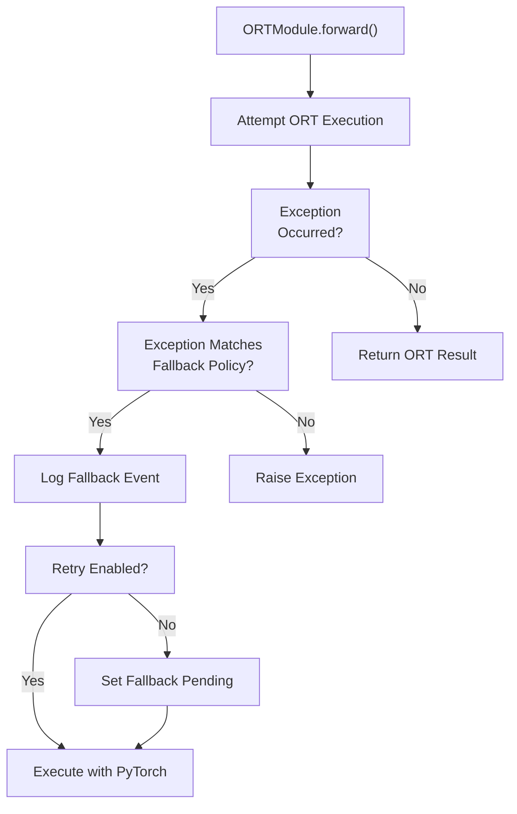
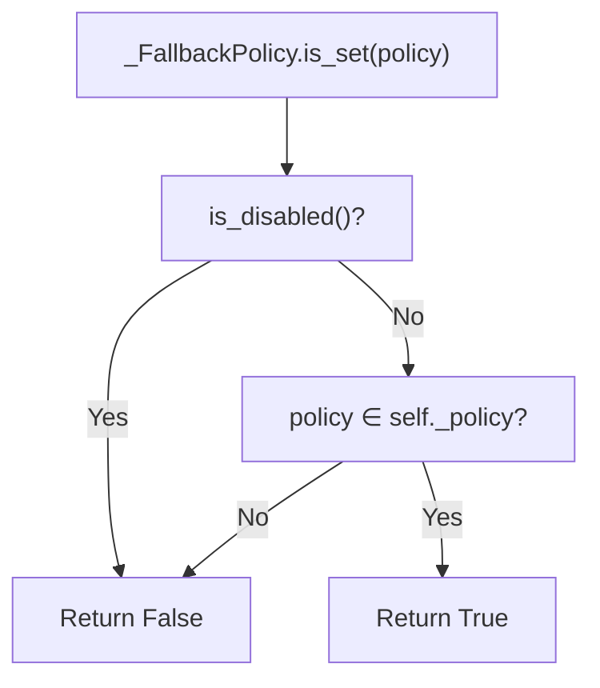
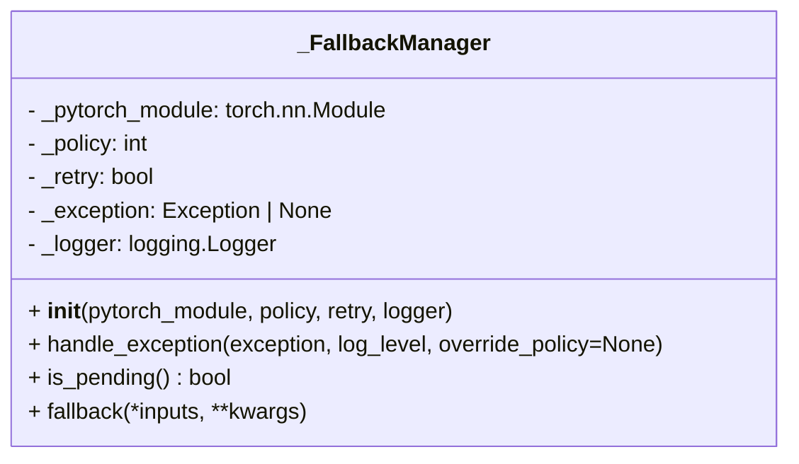
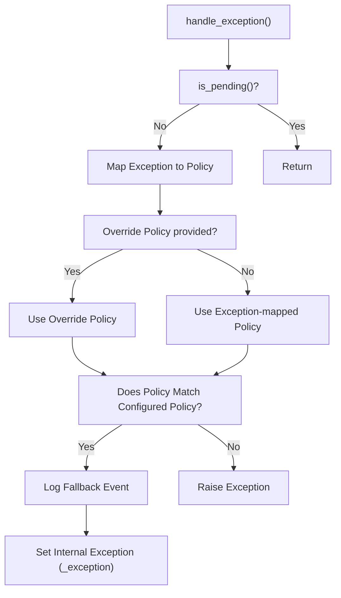
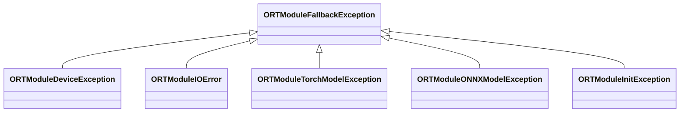
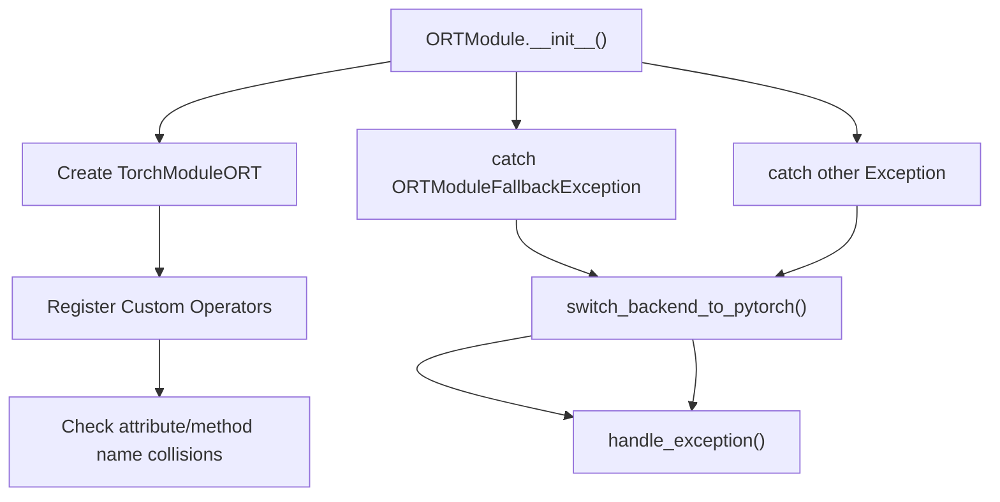
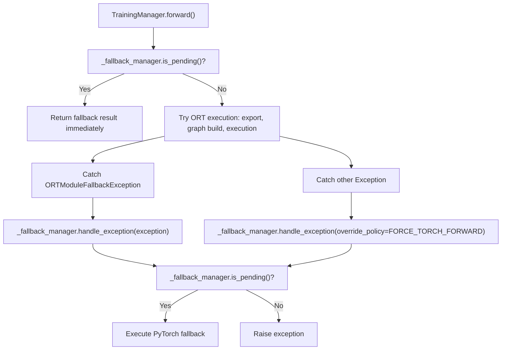
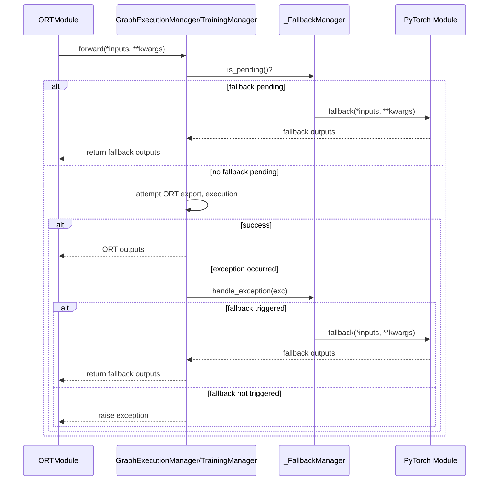

<!-- source: DeepWiki mcp.deepwiki.com · repo microsoft/onnxruntime · page 8.6 Fallback System · fetched 2026-10-21 -->

# Fallback System

<details>
<summary>Relevant source files</summary>

The following files were used as context for generating this wiki page:

- [docs/Memory_Optimizer.md](docs/Memory_Optimizer.md)
- [docs/ORTModule_Training_Guidelines.md](docs/ORTModule_Training_Guidelines.md)
- [onnxruntime/python/tools/symbolic_shape_infer.py](onnxruntime/python/tools/symbolic_shape_infer.py)
- [onnxruntime/test/python/onnxruntime_test_python_symbolic_shape_infer.py](onnxruntime/test/python/onnxruntime_test_python_symbolic_shape_infer.py)
- [orttraining/orttraining/core/optimizer/compute_optimizer/padding_elimination.cc](orttraining/orttraining/core/optimizer/compute_optimizer/padding_elimination.cc)
- [orttraining/orttraining/core/optimizer/compute_optimizer/padding_elimination.h](orttraining/orttraining/core/optimizer/compute_optimizer/padding_elimination.h)
- [orttraining/orttraining/core/optimizer/graph_transformer_config.h](orttraining/orttraining/core/optimizer/graph_transformer_config.h)
- [orttraining/orttraining/python/training/ortmodule/__init__.py](orttraining/orttraining/python/training/ortmodule/__init__.py)
- [orttraining/orttraining/python/training/ortmodule/_custom_gradient_registry.py](orttraining/orttraining/python/training/ortmodule/_custom_gradient_registry.py)
- [orttraining/orttraining/python/training/ortmodule/_custom_op_symbolic_registry.py](orttraining/orttraining/python/training/ortmodule/_custom_op_symbolic_registry.py)
- [orttraining/orttraining/python/training/ortmodule/_fallback.py](orttraining/orttraining/python/training/ortmodule/_fallback.py)
- [orttraining/orttraining/python/training/ortmodule/_fallback_exceptions.py](orttraining/orttraining/python/training/ortmodule/_fallback_exceptions.py)
- [orttraining/orttraining/python/training/ortmodule/_graph_execution_manager.py](orttraining/orttraining/python/training/ortmodule/_graph_execution_manager.py)
- [orttraining/orttraining/python/training/ortmodule/_graph_execution_manager_factory.py](orttraining/orttraining/python/training/ortmodule/_graph_execution_manager_factory.py)
- [orttraining/orttraining/python/training/ortmodule/_inference_manager.py](orttraining/orttraining/python/training/ortmodule/_inference_manager.py)
- [orttraining/orttraining/python/training/ortmodule/_io.py](orttraining/orttraining/python/training/ortmodule/_io.py)
- [orttraining/orttraining/python/training/ortmodule/_logger.py](orttraining/orttraining/python/training/ortmodule/_logger.py)
- [orttraining/orttraining/python/training/ortmodule/_runtime_inspector.py](orttraining/orttraining/python/training/ortmodule/_runtime_inspector.py)
- [orttraining/orttraining/python/training/ortmodule/_torch_module_factory.py](orttraining/orttraining/python/training/ortmodule/_torch_module_factory.py)
- [orttraining/orttraining/python/training/ortmodule/_torch_module_ort.py](orttraining/orttraining/python/training/ortmodule/_torch_module_ort.py)
- [orttraining/orttraining/python/training/ortmodule/_training_manager.py](orttraining/orttraining/python/training/ortmodule/_training_manager.py)
- [orttraining/orttraining/python/training/ortmodule/_utils.py](orttraining/orttraining/python/training/ortmodule/_utils.py)
- [orttraining/orttraining/python/training/ortmodule/options.py](orttraining/orttraining/python/training/ortmodule/options.py)
- [orttraining/orttraining/python/training/ortmodule/ortmodule.py](orttraining/orttraining/python/training/ortmodule/ortmodule.py)
- [orttraining/orttraining/test/python/orttraining_test_ortmodule_api.py](orttraining/orttraining/test/python/orttraining_test_ortmodule_api.py)
- [orttraining/orttraining/test/python/orttraining_test_ortmodule_fallback.py](orttraining/orttraining/test/python/orttraining_test_ortmodule_fallback.py)

</details>


## Purpose and Scope

This document describes the fallback system that enables ORTModule to gracefully revert to PyTorch execution when ONNX Runtime (ORT) cannot handle certain operations or configurations. The fallback mechanism ensures training or inference can continue uninterrupted even when ORTModule encounters unsupported features, allowing for a more robust user experience.

Fallback is critical as a safety net that prevents training or inference interruptions, providing diagnostic information and logging about why ORT execution failed and switched to PyTorch.

For more on ORTModule's general architecture, see [ORTModule Overview](#8.1).


## Overview

The fallback system allows ORTModule to automatically switch from ONNX Runtime execution to native PyTorch execution when one or more of the following occurs:

- **Unsupported Operations**: When operators or patterns are not supported either in the ONNX export or in the ORT execution provider.
- **Unsupported Devices or Data**: When data types or device configurations are incompatible with ORT.
- **Model Export Failures**: Errors during the ONNX model export that prevent ORT from running the model.
- **Runtime Execution Errors**: Failures during ORT graph execution such as kernel failures or environment mismatches.

Fallback policies determine which error types trigger fallback and whether fallback is permanent or allows retries.

### Fallback Execution Flow



This flow demonstrates the core logic where ORT is first attempted. If failures occur and the exceptions match configured fallback policies, execution switches to PyTorch fallback.


**Sources:** [orttraining/orttraining/python/training/ortmodule/_fallback.py:1-175](), [orttraining/orttraining/python/training/ortmodule/_training_manager.py:213-335]()


## Fallback Policies

Fallback behavior is controlled via the `_FallbackPolicy` flags that represent various fallback scenarios. These flags enable fine-grained control over fallback triggers.

### Policy Definitions

| Policy Name                    | Value (bitmask) | Description                                        |
|-------------------------------|-----------------|----------------------------------------------------|
| `FALLBACK_DISABLE`             | 1               | Disable fallback, propagate exceptions instead     |
| `FALLBACK_FORCE_TORCH_FORWARD`| 2               | Fallback trigger during forward execution          |
| `FALLBACK_FORCE_TORCH_BACKWARD`| 4              | Fallback trigger during backward execution         |
| `FALLBACK_UNSUPPORTED_DEVICE` | 8               | Fallback for unsupported devices                    |
| `FALLBACK_UNSUPPORTED_DATA`   | 16              | Fallback for unsupported input/output data types   |
| `FALLBACK_UNSUPPORTED_TORCH_MODEL`| 32          | Fallback for unsupported PyTorch model constructs  |
| `FALLBACK_UNSUPPORTED_ONNX_MODEL`| 64            | Fallback for ONNX export or model incompatibility  |
| `FALLBACK_BAD_INITIALIZATION` | 128             | Fallback for failure during ORTModule initialization|

### Policy Checking Logic



The system first verifies if fallback is disabled. If not disabled, it checks whether the policy includes the supplied bitmask.

**Sources:** [orttraining/orttraining/python/training/ortmodule/_fallback.py:24-54]()


### Exception Type to Policy Mapping

Each specialized fallback exception is automatically mapped to a fallback policy:

| Exception Type                | Default Fallback Policy           |
|------------------------------|----------------------------------|
| `ORTModuleDeviceException`   | `FALLBACK_UNSUPPORTED_DEVICE`    |
| `ORTModuleIOError`           | `FALLBACK_UNSUPPORTED_DATA`      |
| `ORTModuleTorchModelException` | `FALLBACK_UNSUPPORTED_TORCH_MODEL` |
| `ORTModuleONNXModelException` | `FALLBACK_UNSUPPORTED_ONNX_MODEL` |
| `ORTModuleInitException`     | `FALLBACK_BAD_INITIALIZATION`    |
| Other exceptions             | `FALLBACK_FORCE_TORCH_FORWARD`   |


**Sources:** [orttraining/orttraining/python/training/ortmodule/_fallback.py:56-119]()


## FallbackManager Architecture

The `_FallbackManager` is the primary class managing fallback state, policies, logging, and execution redirection. It is instantiated per `ORTModule` and maintains whether fallback is currently active ("pending").

### Class Diagram



### Key Methods

#### handle_exception(exception, log_level, override_policy=None)

This method decides whether an exception thrown in ORT execution should cause fallback or propagate the exception:

- Returns immediately if fallback is already pending.
- Maps exception type to fallback policy.
- If an override policy is specified, it takes precedence.
- If the resulting policy matches the configured fallback policy and fallback is not disabled, logs the fallback and marks fallback as pending with the saved exception.
- Otherwise, re-raises the original exception.

#### Fallback Decision Flowchart



#### fallback(*inputs, **kwargs)

Executes the fallback by invoking the original PyTorch module's forward pass with the given inputs:

- If retry is enabled, clears the fallback internal exception allowing ORT to retry next call.
- Saves and restores random number generator states for reproducibility.
- Returns the PyTorch output to the caller.


**Sources:** [orttraining/orttraining/python/training/ortmodule/_fallback.py:121-175]()


## Exception Types

Fallback recognizes specific ORTModule exceptions, each corresponding to the supported fallback policy scenarios.

### Exception Hierarchy Diagram



These exceptions wrap standard Python errors related to device mismatch, data I/O errors, PyTorch model incompatibility, ONNX export/model issues, and initialization failures.

### Exception Wrapping Utility

To ensure consistent handling, generic exceptions are wrapped into appropriate ORTModule exceptions via:

```python
raise wrap_exception(
    ORTModuleIOError,
    TypeError("Unsupported input tensor type")
)
```

which preserves original error details while enabling fallback categorization.


**Sources:** [orttraining/orttraining/python/training/ortmodule/_fallback_exceptions.py:1-60](), [orttraining/orttraining/python/training/ortmodule/_fallback_exceptions.py:12-28]()


## Integration within ORTModule Execution

Fallback is integrated deeply in ORTModule's execution lifecycle both during model initialization and forward passes for training and inference.

### 1. ORTModule Initialization (ortmodule.py)

During ORTModule construction, if any initialization exception arises (e.g., failure in creating TorchModuleORT, registering custom ops), fallback is triggered:



If fallback occurs, ORTModule switches the backend to pure PyTorch and logs the fallback event.

**Source:** [orttraining/orttraining/python/training/ortmodule/ortmodule.py:41-115]()


### 2. Forward Execution in TrainingManager (Training Mode)

TrainingManager's forward incorporates fallback:

- If fallback is already pending, immediately uses PyTorch fallback.
- Otherwise tries ORT execution which includes ONNX export, graph building, and execution.
- Exceptions caught during ORT execution are passed to `_FallbackManager.handle_exception`.
- If fallback is triggered, executes PyTorch fallback; otherwise re-raises.



**Sources:** [orttraining/orttraining/python/training/ortmodule/_training_manager.py:213-335](), [orttraining/orttraining/python/training/ortmodule/_graph_execution_manager.py:40-175]()


### 3. Forward Execution in InferenceManager (Inference Mode)

InferenceManager has a similar fallback pattern:

- Checks for pending fallback from initialization.
- Attempts ONNX Runtime execution.
- Catches exceptions and calls `_FallbackManager.handle_exception`.
- Executes PyTorch fallback as needed.

**Sources:** [orttraining/orttraining/python/training/ortmodule/_inference_manager.py:72-178]()


## Implementation Details and Data Flow

### FallbackManager Internal Data Flow



This shows how fallback is checked prior to execution, managed centrally by `_FallbackManager`, and how execution switches to PyTorch if needed.


### Exception Mapping and Logging

- When an exception occurs, `_FallbackManager.handle_exception()` determines fallback policy by exception type.
- Logs fallback events including exception info and stack trace at configured log levels.
- Sets internal state `_exception` to mark fallback pending if policy matches.
- Supports optional retry by unsetting fallback pending on next call.

### Retry Behavior

- Controlled by `_retry` flag in `_FallbackManager`.
- If retry enabled, fallback exception state is cleared on fallback execution, allowing subsequent ORT re-attempts.
- Otherwise, fallback is sticky for rest of module lifetime.

---

## Summary

The ORTModule fallback mechanism is a comprehensive system ensuring robust handling of unsupported scenarios during ONNX Runtime training or inference. It uses an extensible policy architecture to handle different error classes gracefully, redirects execution back to PyTorch seamlessly, preserves random states for deterministic behavior, and provides diagnostic logging to aid debugging.

The core class `_FallbackManager` manages fallback state, mappings, and execution. Integration points cover model initialization and all forward pass pathways.

This system protects users from runtime interruptions and allows incremental ORT feature support without breaking pipelines when unsupported operations or conditions arise.

---

**Key Files Reference:**

- Implementation: [orttraining/orttraining/python/training/ortmodule/_fallback.py:1-175]()
- Exception Types: [orttraining/orttraining/python/training/ortmodule/_fallback_exceptions.py:1-60]()
- Training Integration: [orttraining/orttraining/python/training/ortmodule/_training_manager.py:213-335]()
- Inference Integration: [orttraining/orttraining/python/training/ortmodule/_inference_manager.py:72-178]()
- ORTModule Init: [orttraining/orttraining/python/training/ortmodule/ortmodule.py:41-115]()
- Graph Execution Manager: [orttraining/orttraining/python/training/ortmodule/_graph_execution_manager.py:40-175]()

---

