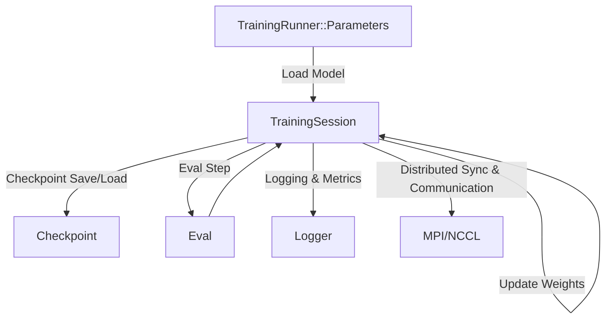
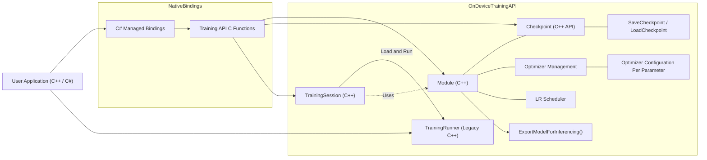

<!-- source: DeepWiki mcp.deepwiki.com · repo microsoft/onnxruntime · page 8.7 On-Device Training API and Training Runners · fetched 2026-10-21 -->

# 8.7 On-Device Training API and Training Runners

<details>
<summary>Relevant source files</summary>

The following files were used as context for generating this wiki page:

- [csharp/src/Microsoft.ML.OnnxRuntime/Training/NativeTrainingMethods.shared.cs](csharp/src/Microsoft.ML.OnnxRuntime/Training/NativeTrainingMethods.shared.cs)
- [orttraining/orttraining/core/graph/pipeline_transformer.cc](orttraining/orttraining/core/graph/pipeline_transformer.cc)
- [orttraining/orttraining/core/graph/pipeline_transformer.h](orttraining/orttraining/core/graph/pipeline_transformer.h)
- [orttraining/orttraining/core/session/training_session.cc](orttraining/orttraining/core/session/training_session.cc)
- [orttraining/orttraining/core/session/training_session.h](orttraining/orttraining/core/session/training_session.h)
- [orttraining/orttraining/models/bert/main.cc](orttraining/orttraining/models/bert/main.cc)
- [orttraining/orttraining/models/gpt2/main.cc](orttraining/orttraining/models/gpt2/main.cc)
- [orttraining/orttraining/models/mnist/main.cc](orttraining/orttraining/models/mnist/main.cc)
- [orttraining/orttraining/models/runner/training_runner.cc](orttraining/orttraining/models/runner/training_runner.cc)
- [orttraining/orttraining/models/runner/training_runner.h](orttraining/orttraining/models/runner/training_runner.h)
- [orttraining/orttraining/test/graph/gradient_graph_builder_test.cc](orttraining/orttraining/test/graph/gradient_graph_builder_test.cc)
- [orttraining/orttraining/test/training_api/common/synthetic_data_loader.cc](orttraining/orttraining/test/training_api/common/synthetic_data_loader.cc)
- [orttraining/orttraining/test/training_api/common/synthetic_data_loader.h](orttraining/orttraining/test/training_api/common/synthetic_data_loader.h)
- [orttraining/orttraining/test/training_api/core/checkpoint_test.cc](orttraining/orttraining/test/training_api/core/checkpoint_test.cc)
- [orttraining/orttraining/test/training_api/core/data_utils.h](orttraining/orttraining/test/training_api/core/data_utils.h)
- [orttraining/orttraining/test/training_api/core/training_api_tests.cc](orttraining/orttraining/test/training_api/core/training_api_tests.cc)
- [orttraining/orttraining/test/training_api/core/training_capi_tests.cc](orttraining/orttraining/test/training_api/core/training_capi_tests.cc)
- [orttraining/orttraining/test/training_api/trainer/trainer.cc](orttraining/orttraining/test/training_api/trainer/trainer.cc)
- [orttraining/orttraining/training_api/checkpoint.cc](orttraining/orttraining/training_api/checkpoint.cc)
- [orttraining/orttraining/training_api/include/onnxruntime_training_c_api.h](orttraining/orttraining/training_api/include/onnxruntime_training_c_api.h)
- [orttraining/orttraining/training_api/include/onnxruntime_training_cxx_api.h](orttraining/orttraining/training_api/include/onnxruntime_training_cxx_api.h)
- [orttraining/orttraining/training_api/include/onnxruntime_training_cxx_inline.h](orttraining/orttraining/training_api/include/onnxruntime_training_cxx_inline.h)
- [orttraining/orttraining/training_api/module.cc](orttraining/orttraining/training_api/module.cc)
- [orttraining/orttraining/training_api/module.h](orttraining/orttraining/training_api/module.h)
- [orttraining/orttraining/training_api/onnxruntime_training_c_api.cc](orttraining/orttraining/training_api/onnxruntime_training_c_api.cc)
- [orttraining/orttraining/training_api/optimizer.cc](orttraining/orttraining/training_api/optimizer.cc)
- [orttraining/orttraining/training_api/optimizer.h](orttraining/orttraining/training_api/optimizer.h)
- [orttraining/orttraining/training_api/ort_training_apis.h](orttraining/orttraining/training_api/ort_training_apis.h)
- [orttraining/orttraining/training_api/training_session.cc](orttraining/orttraining/training_api/training_session.cc)
- [orttraining/orttraining/training_api/utils.cc](orttraining/orttraining/training_api/utils.cc)
- [orttraining/orttraining/training_api/utils.h](orttraining/orttraining/training_api/utils.h)

</details>


This section documents ONNX Runtime's on-device training infrastructure comprising three key components:

1. The **Training API** (`training_api` module) - C and C++ APIs for managing training models, optimizers, checkpoints, and schedulers.
2. **C# training bindings** - .NET interop layer to access training APIs.
3. The **legacy TrainingSession and TrainingRunner** classes - traditional C++ training execution infrastructure and model runner.

These components provide interfaces and implementations to build, optimize, run, and checkpoint training models inside ONNX Runtime on-edge or on-device, including support for distributed training, mixed precision, and pipeline parallelism.

---

## 1. Overview of the On-Device Training API

The on-device training API in ONNX Runtime enables loading training-capable models, managing optimizer states, executing training and evaluation steps, and checkpointing training progress. It exposes both C APIs (for stable ABI) and higher-level C++ wrappers to facilitate integration with client applications.

Key entities in the API include:

- **Module**: Represents a loaded training model and its current parameter/optimizer state.
- **Optimizer**: Logic for applying parameter updates based on gradients.
- **Checkpoint**: Mechanisms to save and restore model and optimizer states.
- **Scheduler**: Learning rate schedulers for training runs.

The API enables export of inference-only optimized models from the training graph, letting users use the same runtime session for both training and inference.

### Data Flow in Training API

```mermaid
graph LR
  A[Load Training Model (Module)] --> B[Initialize Optimizer State]
  B --> C[Run Training Step]
  C --> D[Update Parameters]
  C --> E[Fetch Outputs & Gradients]
  D --> B
  C --> F[Save Checkpoint]
  B --> G[Load Checkpoint]
  G --> B
  F --> H[Export Inference Model]
```

- **Load Training Model**: Module loads and parses the model.
- **Optimizer State**: Optimizer holds states (moments, etc) per parameter, updated during training.
- **Training Step**: Forward + backward pass with optimizer step.
- **Checkpointing**: Save and load model/optimizer state checkpoints.
- **Export Inference Model**: Generate a stripped inference graph without loss or training ops.

Sources: `orttraining/training_api/module.cc:4-156`, `orttraining/training_api/checkpoint.cc:4-154`, `orttraining/training_api/optimizer.cc`(not shown), `orttraining/orttraining/training_api/onnxruntime_training_c_api.cc:4-134`.


---

## 2. The `training_api` C and C++ APIs

### 2.1 Module (C++)

The core API for training model management is exposed by the `Module` class.

- Loads ONNX models including training graphs.
- Manages the set of named parameters and their gradients.
- Provides `ExportModelForInferencing()` to produce a trained inference graph stripped of training specifics.
- Uses internal utilities to prune unused graph nodes and adapt graph inputs/outputs for inference.
- Overloads support to load from model buffers or files.

Key utility functions support graph transformations like removing unused nodes, setting outputs, and mapping parameters to graph inputs.

Internally deals with node args, named parameters, grad inputs, and maintains a mapping through:

- `BuildParameterToInputNodeArgMap()`
- `BuildParameterToGradInputIndexMap()`

Input validation and transformation helper functions ensure the training and evaluation graphs are optimized and correctly configured.

### 2.2 Checkpoint API (`checkpoint.cc`)

Checkpointing stores and loads parameters and optimizer states using a FlatBuffers format.

- Supports external tensor data files for large tensors.
- Implements memory alignment for efficient tensor data writes.
- Converts `OrtValue` tensors from/to flatbuffers.
- Provides utility functions for saving/loading checkpoint data from files and memory buffers.
- Ensures parameters are serialized in a sorted order for deterministic checkpoint files.

### 2.3 Optimizer API

Manages optimizer state configurations per parameter, including support for:

- Multiple momentum keys.
- Mixed precision for moments.
- Distributed optimizer state (ZeRO, NCCL).
- Learning rate control.

### 2.4 C API and Training Session (`onnxruntime_training_c_api.cc`)

Training API functions exposed in C form provide:

- Creating and destroying training sessions.
- Run training and evaluation steps.
- Access output and input counts/names.
- Set and get learning rates.
- Save and load checkpoints.
- Export inference model.
- Register schedulers and optimizer steps.

The `OrtTrainingApis` interface structures these C functions with the stable binary interface expected by .NET and other bindings.

### C# Bindings

Managed bindings under `csharp/src/Microsoft.ML.OnnxRuntime/Training/NativeTrainingMethods.shared.cs` mirror the C API exported functions using P/Invoke delegates within the `OrtTrainingApi` struct.

- Functions are delegated to native pointers fetched from the training API exported table.
- Provides .NET wrappers around training sessions, checkpoints, and optimizers.
- Exposes training step, eval step, lazy gradient reset, parameter copying APIs.

Sources: `orttraining/training_api/module.cc:4-156`, `orttraining/training_api/checkpoint.cc:4-154`, `orttraining/orttraining/training_api/onnxruntime_training_c_api.cc:4-134`, `csharp/src/Microsoft.ML.OnnxRuntime/Training/NativeTrainingMethods.shared.cs:1-109`.

---

## 3. Legacy C++ TrainingSession and TrainingRunner

### 3.1 `TrainingSession` (orttraining/core/session/training_session.h, .cc)

The `TrainingSession` class extends `InferenceSession` to manage training-specific orchestration:

- Handles configuration for loss functions, optimizers, distributed config, and mixed precision.
- Supports weight partition info and optimizer state tracking.
- Methods to load models, configure for training, initialize, and run training or evaluation steps.
- Exposes APIs for retrieving model input/output names and counts, adapted for training graphs.
- Encapsulates logic to setup optimizers, loss functions, and gradient builder configs.

### 3.2 `TrainingRunner` (orttraining/models/runner/training_runner.h, .cc)

Higher-level utility to run a training workflow end-to-end:

- Encapsulates parameters for model paths, optimizers, data directories, batch sizes, and distributed training settings.
- Manages multiple steps: model loading, initialization, training loops, evaluation, checkpointing.
- Supports pipeline parallel size, multi-stage model loading (e.g., after pipeline partitioning).
- Provides fine control over memory allocation and input feeding.
- Integrates DeepSpeed ZeRO stage support and NCCL communications.
- Validates configuration correctness, e.g., gradient accumulation steps.
- Gathers evaluation and performance metrics periodically.
- Can conditionally dump fetches or disable evaluation for perf testing.

### Data Flow for `TrainingRunner`



This legacy runner forms the backbone of on-device training application samples and tests as it coordinates the phases of model loading, forward-backward execution, parameter update, and checkpointing.

Sources: `orttraining/core/session/training_session.h:1-160`, `orttraining/core/session/training_session.cc:1-144`, `orttraining/models/runner/training_runner.h:1-162`, `orttraining/models/runner/training_runner.cc:1-147`.

---

## 4. Integration and Usage

- Users load training models either from files or buffers using the training API or `TrainingSession`.
- The API ensures correct graph transformations for training including adding backward nodes and optimizer subgraphs.
- During training, forward and backward passes produce gradients linked to optimizer nodes that update parameters.
- Training state is regularly checkpointed for fault tolerance and later resumption.
- At any point, an inference-only model optimized for deployment can be exported from the training session or module.
- C# clients use `NativeTrainingMethods` to interop with native training APIs.
- Legacy `TrainingRunner` offers a C++ example of training orchestration.

---

## 5. Key API Class and Function Summary

| Entity                          | Namespace/Module                     | Responsibility                                  |
|--------------------------------|------------------------------------|------------------------------------------------|
| `Module`                       | `onnxruntime::training::api`       | Load training model, manage training graph     |
| `LoadCheckpoint` / `SaveCheckpoint` | `onnxruntime::training::api` | Checkpoint serialization/deserialization        |
| `TrainingSession`              | `onnxruntime::training`             | Manage training session lifecycle               |
| `TrainingRunner`               | `onnxruntime::training`             | High-level training execution runner            |
| `OrtTrainingApi` (C# binding) | `Microsoft.ML.OnnxRuntime`          | P/Invoke bindings to training C API             |
| `CreateTrainingSession`        | `onnxruntime_training_c_api.cc`     | Native C API: create and initialize training session |

---

## 6. Summary Mermaid Diagram: Mapping System Components to Code Entities



---

## References and Sources

- `orttraining/training_api/module.cc` (lines 4-156)
- `orttraining/training_api/checkpoint.cc` (lines 4-154)
- `orttraining/orttraining/training_api/onnxruntime_training_c_api.cc` (lines 4-134)
- `csharp/src/Microsoft.ML.OnnxRuntime/Training/NativeTrainingMethods.shared.cs` (lines 1-109)
- `orttraining/core/session/training_session.h` (lines 1-160)
- `orttraining/core/session/training_session.cc` (lines 1-144)
- `orttraining/models/runner/training_runner.h` (lines 1-162)
- `orttraining/models/runner/training_runner.cc` (lines 1-147)

---

This documentation provides the foundational understanding of how ONNX Runtime supports training workloads with exposed C/C++ and C# APIs, the role of legacy runner components, and their typical usage patterns for on-device training scenarios.

---

