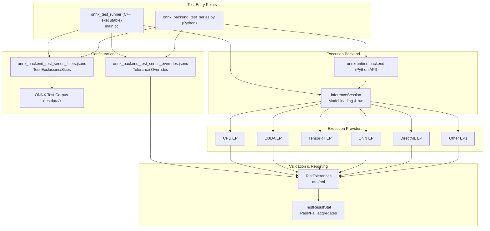
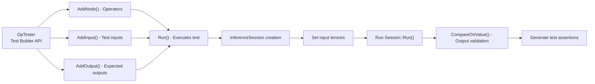
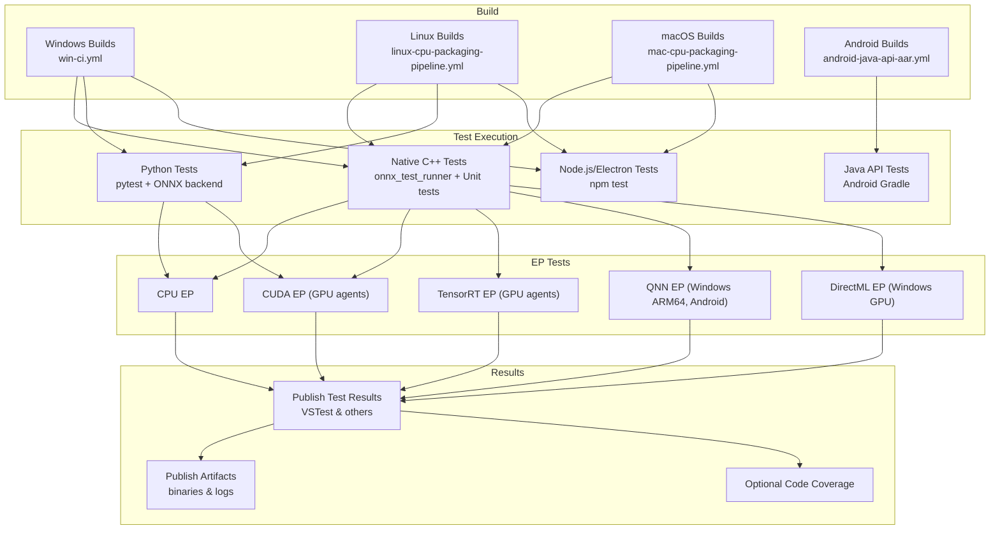

<!-- source: DeepWiki mcp.deepwiki.com · repo microsoft/onnxruntime · page 9 Testing Infrastructure · fetched 2026-10-21 -->

# Testing Infrastructure

<details>
<summary>Relevant source files</summary>

The following files were used as context for generating this wiki page:

- [cmake/patches/onnx/onnx.patch](cmake/patches/onnx/onnx.patch)
- [cmake/vcpkg-ports/onnx/binskim.patch](cmake/vcpkg-ports/onnx/binskim.patch)
- [onnxruntime/python/tools/transformers/requirements.txt](onnxruntime/python/tools/transformers/requirements.txt)
- [onnxruntime/test/onnx/TestCase.cc](onnxruntime/test/onnx/TestCase.cc)
- [onnxruntime/test/onnx/TestCase.h](onnxruntime/test/onnx/TestCase.h)
- [onnxruntime/test/onnx/main.cc](onnxruntime/test/onnx/main.cc)
- [onnxruntime/test/onnx/onnx_model_info.cc](onnxruntime/test/onnx/onnx_model_info.cc)
- [onnxruntime/test/onnx/onnx_model_info.h](onnxruntime/test/onnx/onnx_model_info.h)
- [onnxruntime/test/python/onnx_backend_test_series.py](onnxruntime/test/python/onnx_backend_test_series.py)
- [onnxruntime/test/testdata/onnx_backend_test_series_filters.jsonc](onnxruntime/test/testdata/onnx_backend_test_series_filters.jsonc)
- [tools/ci_build/github/linux/docker/inference/aarch64/python/cpu/scripts/requirements.txt](tools/ci_build/github/linux/docker/inference/aarch64/python/cpu/scripts/requirements.txt)
- [tools/ci_build/github/linux/docker/scripts/lort/requirements.txt](tools/ci_build/github/linux/docker/scripts/lort/requirements.txt)
- [tools/ci_build/github/linux/docker/scripts/manylinux/requirements.txt](tools/ci_build/github/linux/docker/scripts/manylinux/requirements.txt)
- [tools/ci_build/github/linux/docker/scripts/requirements.txt](tools/ci_build/github/linux/docker/scripts/requirements.txt)
- [tools/ci_build/github/linux/python/requirements.txt](tools/ci_build/github/linux/python/requirements.txt)
- [tools/ci_build/github/windows/python/requirements.txt](tools/ci_build/github/windows/python/requirements.txt)
- [tools/ci_build/requirements/pybind/requirements.txt](tools/ci_build/requirements/pybind/requirements.txt)
- [tools/ci_build/requirements/transformers-test/requirements.txt](tools/ci_build/requirements/transformers-test/requirements.txt)

</details>


## Purpose and Scope

This document provides a high-level overview of ONNX Runtime's comprehensive testing infrastructure, which is designed to ensure correctness, compliance, and performance across a diverse array of platforms, execution providers, and operator implementations. The testing infrastructure includes standard compliance validation through ONNX Backend Tests, fine-grained granular testing of components via Unit Tests, performance benchmarking tools, and fully automated testing integrated into the CI/CD pipelines.

Detailed explanations and technical specifics are delegated to dedicated child pages:
- [ONNX Backend Tests](#9.1) — ONNX backend conformance tests and filtering mechanisms.
- [Unit Testing Framework](#9.2) — Operator and transformation unit testing architecture.
- [Performance Testing](#9.3) — Benchmarking infrastructure and performance validation.
- [CI/CD Test Automation](#9.4) — Continuous integration and delivery automation for testing.

This page serves as the parent guide linking these components and outlining their relationships.

---

## Test Categories Overview

ONNX Runtime testing broadly encompasses three major categories:

| Test Category    | Description                                                              | Scope & Coverage                                             | Entry Points                                  |
|------------------|--------------------------------------------------------------------------|--------------------------------------------------------------|-----------------------------------------------|
| **ONNX Backend Tests** | Validates compliance with official ONNX operator specifications; ensures correct model execution aligned with ONNX semantics. | Over 2000+ standardized test cases spanning operators from opsets 7 to 21; exercises multiple execution providers. | `onnx_test_runner` (C++), `onnx_backend_test_series.py` (Python) |
| **Unit Tests**     | Fine-grained tests on individual components such as operators, kernels, graph transformers, and internal utilities. | Includes extensive operator unit tests, graph optimization tests, and framework functionality using `OpTester` and Google Test. | Google Test framework, C++ test executables |
| **Integration and Performance Tests** | End-to-end validation of inference and training workflows; benchmarking EPs for performance metrics. | Tests individual models, integration of providers, and measures latencies, throughput, and scalability. | `onnxruntime_perf_test` tool, specialized benchmarks |

Sources: [onnxruntime/test/onnx/main.cc:1-110](), [onnxruntime/test/python/onnx_backend_test_series.py:1-183]()

---

## ONNX Backend Test Runner Architecture

The ONNX Backend Test Runner serves as the official tool to verify ONNX Runtime's adherence to ONNX operator semantics and model correctness. It executes a large corpus of ONNX standard test models, comparing runtime outputs against reference outputs while respecting configured tolerances and skipping known failures.

### Components Overview



**Diagram: ONNX Backend Test Runner Architecture**

This architecture supports both C++ and Python entry points executing the ONNX Backend Tests. Filters and tolerance overrides allow tailored skipping and relaxed validation across providers or test subsets.

Sources: [onnxruntime/test/onnx/main.cc:44-203](), [onnxruntime/test/python/onnx_backend_test_series.py:24-183]()

---

### C++ ONNX Backend Test Runner (`onnx_test_runner`)

The C++ test runner executable offers an extensive CLI supporting configuration of:

- Number of parallel models run (`-j`)
- Concurrent `Session::Run()` calls (`-c`)
- Test case selection by name (`-n`)
- Execution provider selection (`-e`)
- Custom tolerances (`-t`, `-a`)
- Graph optimization level (`-o`)
- Execution provider specific runtime options (`-i`)

This runner loads the test corpus, applies filters from `onnx_backend_test_series_filters.jsonc` to exclude known failures, and validates output against reference data with per-test configured tolerances from `onnx_backend_test_series_overrides.jsonc`. Usage documentation and runtime help are printed via the `usage()` function in `main.cc`.

Sources: [onnxruntime/test/onnx/main.cc:45-110]()

---

### Python ONNX Backend Test Runner

The Python test runner extends the ONNX backend test infrastructure using the `OrtBackendTest` wrapper class, which adds ONNX Runtime specific overrides and behavior including:

- Custom per-test absolute and relative tolerance application
- Test case inclusion/exclusion applying provider-specific skip logic
- Integration with Python `unittest` framework for discoverability

Filtering uses the same skip lists as C++, with additional runtime checks for available execution providers (e.g., CUDA, QNN). The test cases are automatically created and registered for execution.

Sources: [onnxruntime/test/python/onnx_backend_test_series.py:24-183]()

---

### Test Filtering and Tolerance Overrides

To manage the large ONNX test corpus with many known issues or unsupported features across different providers or builds, filtering is applied via regex patterns stored in JSONC files. Filters can specify:

- Tests currently failing that should be fixed
- Tests permanently skipped due to lack of support
- Provider-specific failing tests
- Opset-specific regex filters

Tolerance overrides allow fine-tuning numerical tolerances for fragile operator tests where higher error bounds are acceptable.

Sources: [onnxruntime/test/testdata/onnx_backend_test_series_filters.jsonc:1-96](), [onnxruntime/test/python/onnx_backend_test_series.py:89-170]()

---

## Unit Testing Framework

Unit tests decode ONNX Runtime internals, covering operators, kernels, graph transformations, and utilities. The primary framework for operator testing is `OpTester`.

### OpTester Framework Flow



**Diagram: OpTester Unit Test Flow**

The framework allows declarative construction of operator tests with inputs, expected outputs, and optional attributes. Running a test executes a `InferenceSession` internally and compares computed outputs using specified tolerances.

Sources: [onnxruntime/test/optimizer/graph_transform_test.cc:84-96]()

---

### Graph Transformation Tests

Graph transformation tests verify the effects of optimization passes on the computation graph structure and semantics.

A typical test:

- Loads a test model graph.
- Counts instances of relevant operators pre-optimization.
- Applies one or more transformers with a manager.
- Verifies changes in operator counts and graph structure post-optimization.
- Optionally runs model to verify output consistency.

Common test patterns include:

| Pattern                     | Purpose                                       | Example                                           |
|-----------------------------|-----------------------------------------------|---------------------------------------------------|
| Operator Count Verification | Validate fusion/elimination of subgraphs      | Assert `CountOpsInGraph(graph)["Identity"] == 0` |
| Graph Checker Functions     | Validate graph invariants                      | `pre_graph_checker()`, `post_graph_checker()`     |
| Execution Comparisons       | Model outputs before/after transformation      | Compare output tensors for equivalence              |
| Initializer Validation      | Check constant folding on initializers         | Verify folded initializer values                    |

Sources: [onnxruntime/test/optimizer/graph_transform_test.cc:107-141]()

---

### ModelTestBuilder API

For more complex graph construction in tests, `ModelTestBuilder` provides a fluent API to declare inputs, initializers, intermediate nodes, and outputs, enabling precise control over the test graph.

Example usage constructs a model with MatMul, Add, and Identity nodes, chaining outputs and inputs:

```cpp
auto build_test_case = [&](ModelTestBuilder& builder) {
  auto* input1_arg = builder.MakeInput<float>({{2, 3, 3, 3}});
  auto* input2_arg = builder.MakeInput<float>({{3, 3}});
  auto* matmul_output = builder.MakeIntermediate();
  auto* initializer_arg = builder.MakeInitializer<float>({}, {0.0f});
  auto* add_out = builder.MakeIntermediate();
  auto* identity_output = builder.MakeOutput();

  builder.AddNode("MatMul", {input1_arg, input2_arg}, {matmul_output});
  builder.AddNode("Add", {matmul_output, initializer_arg}, {add_out});
  builder.AddNode("Identity", {add_out}, {identity_output});
};
```

Such builders enable detached tests on graph optimizers with clearly defined graph states.

Sources: [onnxruntime/test/optimizer/graph_transform_test.cc:265-283]()

---

## CI/CD Test Automation

Testing is deeply integrated into ONNX Runtime's multi-platform continuous integration pipelines to automatically verify code correctness as part of builds.

### CI/CD Pipeline Test Execution Overview



**Diagram: CI/CD Test Execution Pipeline**

This design ensures extensive coverage across platforms, configurations, and execution providers on every pull request and merge.

Sources: [tools/ci_build/github/azure-pipelines/templates/win-ci.yml:1-257](),
[tools/ci_build/github/azure-pipelines/post-merge-jobs.yml:1-323]()

---

### Platform-Specific Testing Highlights

- **Windows:** Tests run with build flags to enable GPU providers, Java API tests, and timeout control. GPU device ID selection allows multi-GPU testing.

- **Linux & macOS:** Runs CPU native tests, Python ONNX backend tests, and JavaScript tests using npm.

- **Android:** Runs on both emulators and physical devices; some EPs like QNN lack emulator support due to hardware constraints.

- **GPU EPs (CUDA, TensorRT):** Multi-GPU job stages test EP internals with CUDA profiling enabled and executors pinned to specific GPU device IDs.

- **QNN EP:** Dedicated build and test lanes on Windows ARM64 and Android with shared/static libs and feature flag variations.

Sources: [tools/ci_build/github/azure-pipelines/templates/win-ci.yml:180-206](),
[tools/ci_build/github/azure-pipelines/templates/c-api-cpu.yml:57-82](),
[tools/ci_build/github/azure-pipelines/templates/android-java-api-aar-test.yml:66-95](),
[tools/ci_build/github/azure-pipelines/post-merge-jobs.yml:222-264](),
[tools/ci_build/github/azure-pipelines/win-qnn-arm64-ci-pipeline.yml:38-101]()

---

### Test Dependencies and Environment

ONNX Runtime tests rely on a rich Python environment with packages pinned for consistency:

| Tool / Package    | Version (Examples) | Usage                  |
|-------------------|-------------------|------------------------|
| numpy             | 2.2.6 / 2.4.2     | Numeric computations   |
| protobuf          | 6.33.6            | ONNX model protobuf    |
| onnx              | 1.22.0            | ONNX Python packages   |
| pytest            | latest            | Python test framework  |
| onnxscript        | 0.6.2             | ONNX scripting support |
| transformers      | (for transformer tests) | HuggingFace APIs      |
| torch             | 2.10.0 (transformers) | ML model testing      |

Sources: [tools/ci_build/github/linux/docker/scripts/requirements.txt:1-15](),
[tools/ci_build/requirements/transformers-test/requirements.txt:1-12]()

---

### Test Artifacts and Reporting

Build pipelines collect and publish:

| Artifact Name            | Content                                       | Purpose                  |
|--------------------------|-----------------------------------------------|--------------------------|
| drop-onnxruntime-win-x64 | Native runtime binaries, test executables     | Binary distribution tests |
| drop-onnxruntime-java-win-x64 | Java API JARs, JNI native libs            | Java integration tests    |
| onnxruntime-android-full-aar | Android AAR packages                        | Android integration & test |
| drop-signed-nuget-CPU     | Signed NuGet packages for .NET binding        | .NET release testing      |
| NPM_packages             | Node.js packages for onnxruntime-web/node     | JavaScript runtime tests  |

Test results are published in VSTest and other CI-native formats, enabling detailed reporting and failure analysis.

Sources: [tools/ci_build/github/azure-pipelines/templates/c-api-cpu.yml:241-267](),
[tools/ci_build/github/azure-pipelines/templates/win-ci.yml:220-257]()

---

## Summary

ONNX Runtime's testing infrastructure is architected to cover compliance, functional unit testing, performance benchmarking, and full CI/CD automation. The ONNX Backend Test Runner provides standard conformance validation with flexible filtering and tolerance control. The Unit Testing framework facilitates detailed validation of operators and optimizations. Performance testing assesses runtime efficiency across providers. Finally, the CI/CD pipelines automate cross-platform builds and tests, enabling continuous quality assurance.

For detailed implementation, usage instructions, and examples, refer to the dedicated child pages covering each testing facet.

---

# Links to Child Pages
- [ONNX Backend Tests](#9.1)
- [Unit Testing Framework](#9.2)
- [Performance Testing](#9.3)
- [CI/CD Test Automation](#9.4)

---

# References

- ONNX Backend Test Runner CLI and logic: `onnxruntime/test/onnx/main.cc` [1-110](), [620-900]()
- ONNX Backend Python runner and filtering: `onnxruntime/test/python/onnx_backend_test_series.py` [10-163]()
- Backend test filters: `onnxruntime/test/testdata/onnx_backend_test_series_filters.jsonc` [1-96]()
- Unit test framework examples: `onnxruntime/test/optimizer/graph_transform_test.cc` [80-150](), [260-290]()
- CI/CD pipeline definitions and test jobs: `tools/ci_build/github/azure-pipelines/templates/win-ci.yml` [1-257](), `post-merge-jobs.yml` [1-323]()
- Python test dependency requirements: `tools/ci_build/github/linux/docker/scripts/requirements.txt` [1-16](), `tools/ci_build/requirements/transformers-test/requirements.txt` [1-12]()

---

