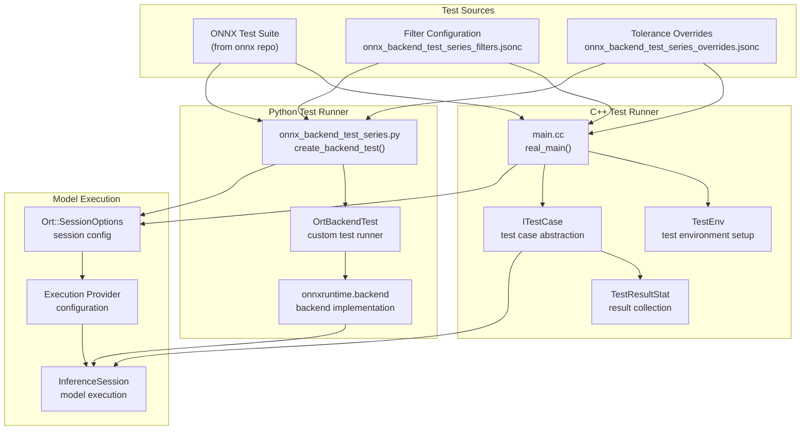
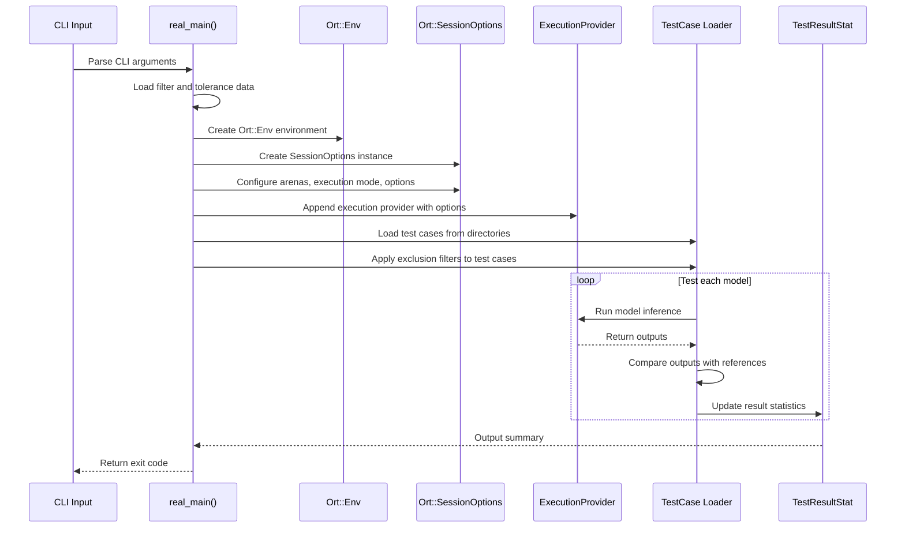
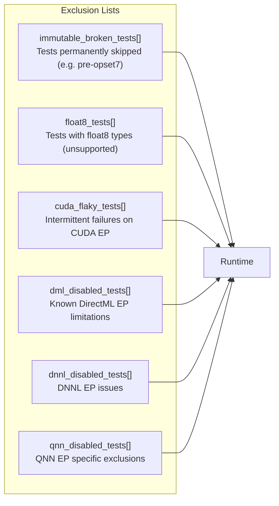
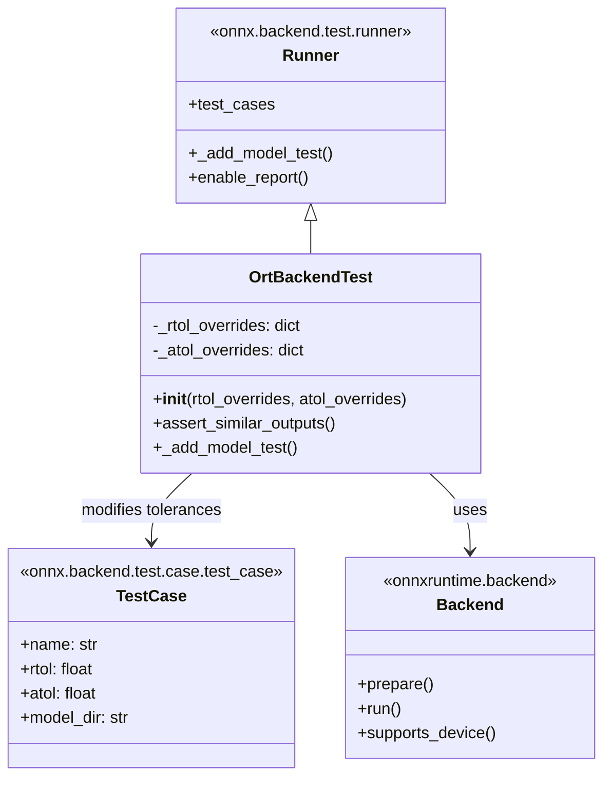
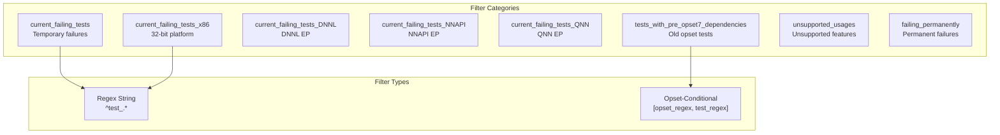
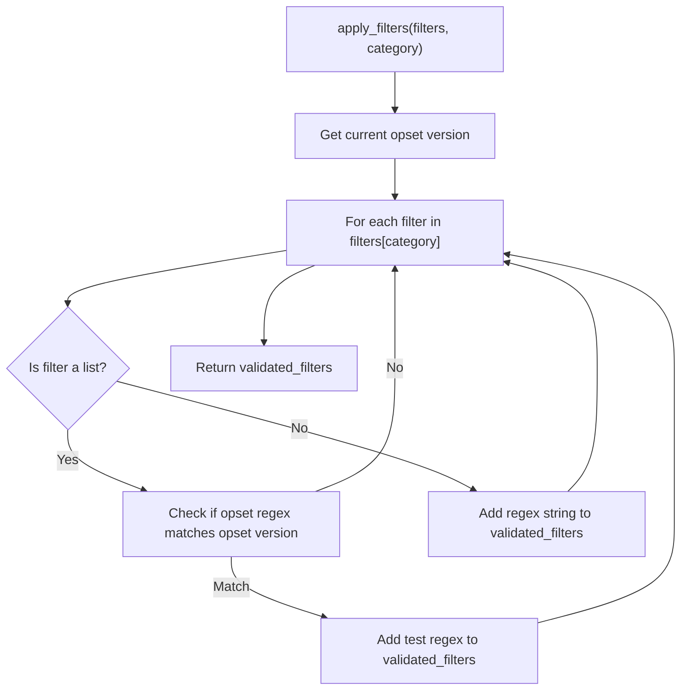
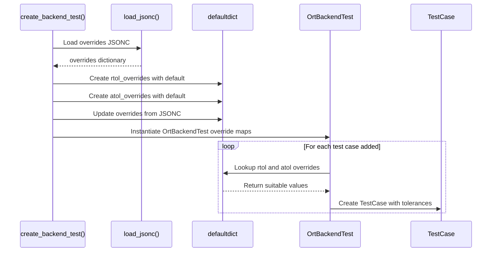
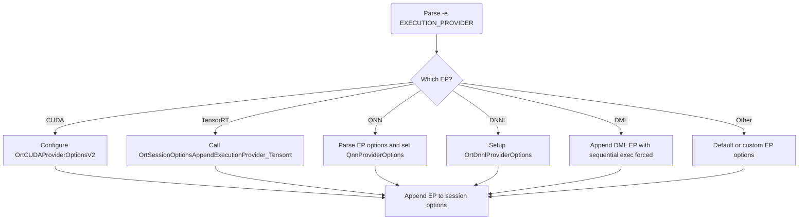
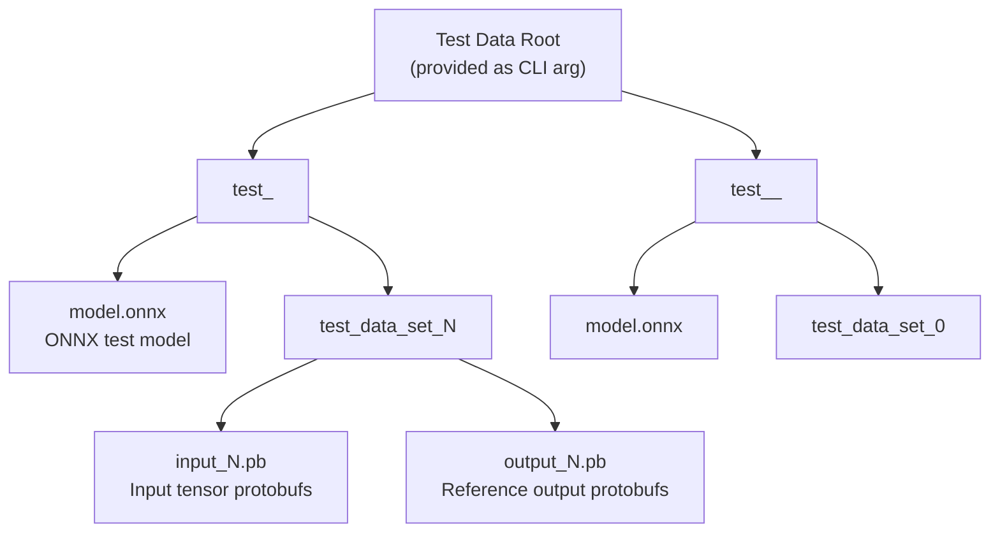
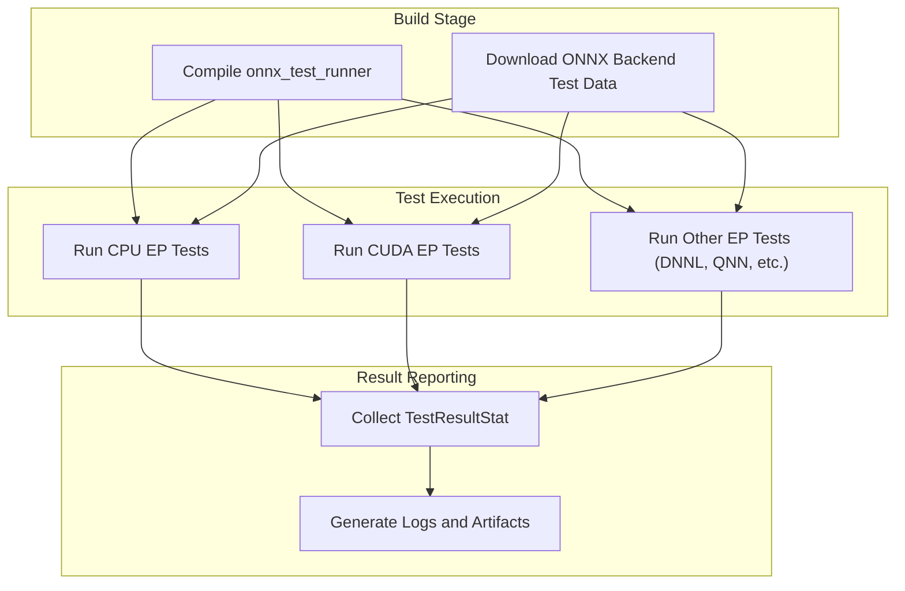

<!-- source: DeepWiki mcp.deepwiki.com · repo microsoft/onnxruntime · page 9.1 ONNX Backend Tests · fetched 2026-10-21 -->

# ONNX Backend Tests

<details>
<summary>Relevant source files</summary>

The following files were used as context for generating this wiki page:

- [cmake/patches/onnx/onnx.patch](cmake/patches/onnx/onnx.patch)
- [cmake/vcpkg-ports/onnx/binskim.patch](cmake/vcpkg-ports/onnx/binskim.patch)
- [onnxruntime/python/tools/transformers/requirements.txt](onnxruntime/python/tools/transformers/requirements.txt)
- [onnxruntime/test/onnx/TestCase.cc](onnxruntime/test/onnx/TestCase.cc)
- [onnxruntime/test/onnx/TestCase.h](onnxruntime/test/onnx/TestCase.h)
- [onnxruntime/test/onnx/main.cc](onnxruntime/test/onnx/main.cc)
- [onnxruntime/test/onnx/onnx_model_info.cc](onnxruntime/test/onnx/onnx_model_info.cc)
- [onnxruntime/test/onnx/onnx_model_info.h](onnxruntime/test/onnx/onnx_model_info.h)
- [onnxruntime/test/python/onnx_backend_test_series.py](onnxruntime/test/python/onnx_backend_test_series.py)
- [onnxruntime/test/testdata/onnx_backend_test_series_filters.jsonc](onnxruntime/test/testdata/onnx_backend_test_series_filters.jsonc)
- [tools/ci_build/github/linux/docker/inference/aarch64/python/cpu/scripts/requirements.txt](tools/ci_build/github/linux/docker/inference/aarch64/python/cpu/scripts/requirements.txt)
- [tools/ci_build/github/linux/docker/scripts/lort/requirements.txt](tools/ci_build/github/linux/docker/scripts/lort/requirements.txt)
- [tools/ci_build/github/linux/docker/scripts/manylinux/requirements.txt](tools/ci_build/github/linux/docker/scripts/manylinux/requirements.txt)
- [tools/ci_build/github/linux/docker/scripts/requirements.txt](tools/ci_build/github/linux/docker/scripts/requirements.txt)
- [tools/ci_build/github/linux/python/requirements.txt](tools/ci_build/github/linux/python/requirements.txt)
- [tools/ci_build/github/windows/python/requirements.txt](tools/ci_build/github/windows/python/requirements.txt)
- [tools/ci_build/requirements/pybind/requirements.txt](tools/ci_build/requirements/pybind/requirements.txt)
- [tools/ci_build/requirements/transformers-test/requirements.txt](tools/ci_build/requirements/transformers-test/requirements.txt)

</details>


## Purpose and Scope

The ONNX Backend Tests system validates that ONNX Runtime correctly implements the ONNX standard by running the official ONNX backend test suite. These compliance tests verify operator behavior, data type support, and model execution correctness across all execution providers against reference implementations. 

This document describes both the C++ and Python test runners, their mechanisms for test filtering including handling of known broken tests, configuration of tolerance thresholds for floating point comparisons, and their execution provider integration. It also explains how the tests are organized, filtered, and reported to ensure continuous conformance.

For general unit testing infrastructure, see [Unit Testing Framework](#9.2). For CI/CD test automation workflows, see [CI/CD Test Automation](#9.4).

---

## Test System Overview

There are two main implementations of the ONNX backend test execution within ONNX Runtime:

- **C++ Test Runner:** A standalone executable (`onnx_test_runner`) providing a full-featured command-line interface for running tests with parallelism, execution provider selection, and fine-grained configuration.

- **Python Test Runner:** A pytest-compatible test runner which uses the official ONNX backend test Python `Runner` but wraps it with ONNX Runtime-specific behavior and tolerance handling.

Both interact with ONNX test data, apply test filters, configure tolerances, and leverage execution providers to validate model correctness.



**Sources:** [onnxruntime/test/onnx/main.cc:1-1023](), [onnxruntime/test/python/onnx_backend_test_series.py:1-216]()

---

## C++ Test Runner

The C++ test runner (`onnx_test_runner`) is an executable program designed to run the ONNX backend tests with extensive command-line options that allow control over execution provider, concurrency, tolerance, and filtering.

### Command-Line Interface

The runner supports many options, including but not limited to:

| Option | Description | Default |
|--------------|------------------------------|---------|
| `-e <EXECUTION_PROVIDER>` | Select execution provider (`cpu`, `cuda`, `dnnl`, `tensorrt`, `qnn`, etc.) | `cpu` |
| `-j [models]` | Number of models to run in parallel | #CPU cores |
| `-c [runs]` | Number of concurrent Session::Run calls per model | #CPU cores |
| `-r [repeat]` | Number of times to repeat tests | 1 |
| `-n [test_case_name]` | Run single test case matching the name | All |
| `-t [rtol]` | Relative tolerance for output comparison | 1e-5 |
| `-a [atol]` | Absolute tolerance for output comparison | 1e-5 |
| `-o [optimization_level]` | Graph optimization level (0, 1, 2, 3, 99) | 99 (all) |
| `-d [device_id]` | Device ID for multi-device setups | 0 |
| `-C [session_config]` | Session configuration key-value pairs | None |
| `-i [ep_options]` | Execution provider specific runtime options | None |
| `-x` | Use parallel executor (default is sequential) | Sequential |

Example help excerpt:

```
-e [EXECUTION_PROVIDER]   : choose execution provider like 'cpu', 'cuda', 'tensorrt', 'qnn', etc.
-j [models]              : number of models to run simultaneously
-c [runs]                : number of Session::Run calls per model concurrently
-n [test_case_name]      : name of single test case to run
-t [rtol]                : relative tolerance for output comparison
-a [atol]                : absolute tolerance for output comparison
...
```  

**Sources:** [onnxruntime/test/onnx/main.cc:45-110]()

---

### Test Execution Flow

The test runner program follows this high-level flow:



This system supports multiple concurrent models executed in parallel with multiple threads per model, facilitating scalability on multicore systems.

**Sources:** [onnxruntime/test/onnx/main.cc:206-453]()

---

### Test Case Exclusions and Filters in C++

The C++ runner maintains several static exclusion lists containing tests known to be broken or unsupported for various reasons across providers or on specific platforms:



At test load time, these filters are applied to prune out known failing or unsupported tests, improving signal quality and avoiding noise in automated systems.

**Sources:** [onnxruntime/test/onnx/main.cc:782-893]()

---

### Tolerance Loading in C++

Test tolerance values for output comparison are loaded either from command line overrides or from a JSONC file:

```cpp
static TestTolerances LoadTestTolerances(bool useCustom, double atol, double rtol) {
    TestTolerances::Map absolute_overrides;
    TestTolerances::Map relative_overrides;

    if (useCustom) {
        return TestTolerances(atol, rtol, absolute_overrides, relative_overrides);
    }

    std::ifstream overrides_ifstream(
        ConcatPathComponent(ORT_TSTR("testdata"), ORT_TSTR("onnx_backend_test_series_overrides.jsonc"))
    );

    // Parse JSON overrides
    const auto overrides_json = nlohmann::json::parse(overrides_ifstream);
    overrides_json["atol_overrides"].get_to(absolute_overrides);
    overrides_json["rtol_overrides"].get_to(relative_overrides);

    return TestTolerances(
        overrides_json["atol_default"],
        overrides_json["rtol_default"],
        absolute_overrides,
        relative_overrides);
}
```

This mechanism supports global defaults and per-test tolerance customization, essential for floating-point and platform-specific behavior variance.

**Sources:** [onnxruntime/test/onnx/main.cc:112-141]()

---

## Python Test Runner

The Python test runner integrates with the ONNX backend test infrastructure enabling tests to be run inside Python using the `unittest` and `pytest` frameworks, enabling easier diagnostics and integration.

### OrtBackendTest Class

`OrtBackendTest` subclasses ONNX's backend test `Runner` and overrides tolerance behavior per test case:



This class keeps per-test-case relative and absolute tolerance maps and injects these values into the test cases when they are added.

**Sources:** [onnxruntime/test/python/onnx_backend_test_series.py:24-72]()

---

### Test Creation and Filtering

The main entry point for Python testing is `create_backend_test()`, which loads tolerance overrides and test filters, excludes unsupported or broken tests, and enables test discovery:

```python
def create_backend_test(test_name=None):
    # Load tolerance overrides from JSONC
    overrides = load_jsonc("onnx_backend_test_series_overrides.jsonc")
    rtol_default = overrides["rtol_default"]
    atol_default = overrides["atol_default"]
    rtol_overrides = collections.defaultdict(lambda: rtol_default)
    rtol_overrides.update(overrides["rtol_overrides"])
    atol_overrides = collections.defaultdict(lambda: atol_default)
    atol_overrides.update(overrides["atol_overrides"])

    backend_test = OrtBackendTest(rtol_overrides, atol_overrides)

    # Exclude unsupported data types e.g. FLOAT16
    backend_test.exclude(r"(FLOAT16)")

    if test_name:
        backend_test.include(test_name + ".*")
    else:
        filters = load_jsonc("onnx_backend_test_series_filters.jsonc")
        current_failing_tests = apply_filters(filters, "current_failing_tests")

        # Add platform and EP-specific filters
        if platform.architecture()[0] == "32bit":
            current_failing_tests += apply_filters(filters, "current_failing_tests_x86")
        if backend.supports_device("DNNL"):
            current_failing_tests += apply_filters(filters, "current_failing_tests_DNNL")
        if backend.supports_device("NNAPI"):
            current_failing_tests += apply_filters(filters, "current_failing_tests_NNAPI")

        # Combine all filters
        combined_filters = current_failing_tests + \
                           apply_filters(filters, "tests_with_pre_opset7_dependencies") + \
                           apply_filters(filters, "unsupported_usages") + \
                           apply_filters(filters, "failing_permanently")

        backend_test.exclude("(" + "|".join(combined_filters) + ")")

    # Register test cases globally for unittest discovery
    globals().update(backend_test.enable_report().test_cases)
```

This logic ensures only valuable and valid tests run per platform and EP.

**Sources:** [onnxruntime/test/python/onnx_backend_test_series.py:107-183]()

---

### Output Comparison

Output validation overrides the standard ONNX backend test comparison by supporting object dtype and nested sequences, with configurable tolerances:

```python
@classmethod
def assert_similar_outputs(cls, ref_outputs, outputs, rtol, atol, model_dir=None):
    def assert_similar_array(ref_output, output):
        np.testing.assert_equal(output.dtype, ref_output.dtype)
        if ref_output.dtype == object:
            # For string or generic object arrays, require exact match
            np.testing.assert_array_equal(output, ref_output)
        else:
            # Numeric tolerance-based comparison
            np.testing.assert_allclose(output, ref_output, rtol=rtol, atol=atol)

    np.testing.assert_equal(len(outputs), len(ref_outputs))
    for i in range(len(outputs)):
        if isinstance(outputs[i], list):
            for j in range(len(outputs[i])):
                assert_similar_array(ref_outputs[i][j], outputs[i][j])
        else:
            assert_similar_array(ref_outputs[i], outputs[i])
```

This enables consistent test evaluation across different tensor types.

**Sources:** [onnxruntime/test/python/onnx_backend_test_series.py:39-58]()

---

## Test Filter Configuration

Both runners rely on JSONC files containing regular expression filters to skip tests which are known to fail temporarily, fail due to platform/EP limitations, or are unsupported.

### Filter File Structure and Types



Each category groups tests to be excluded for different reasons. Filters are specified as either regex strings or pairs of `[opset_regex, test_regex]` to conditionally filter based on ONNX opset version.

**Sources:** [onnxruntime/test/testdata/onnx_backend_test_series_filters.jsonc:1-96]()

---

### Example Filters (Excerpt)

```jsonc
{
  "current_failing_tests": [
    "^test_adagrad",
    "^test_attention_4d_fp16*",
    ["opset10", "^test_mod_float_mixed_sign_example"]
  ],
  "current_failing_tests_DNNL": [
    "^test_range_float_type_positive_delta_expanded",
    "^test_maxpool_2d_ceil"
  ],
  "tests_with_pre_opset7_dependencies": [
    ["opset(1|2|3|4|5|6)", "^test_squeeze"]
  ]
}
```

These filters help skip unstable or unsupported tests specific to execution providers or opset versions.

**Sources:** [onnxruntime/test/testdata/onnx_backend_test_series_filters.jsonc:1-96]()

---

### Filter Application Logic in Python

The method `apply_filters` selects appropriate regex filters based on the category and current opset version:



This ensures only those tests applicable to the current ONNX opset are filtered.

**Sources:** [onnxruntime/test/python/onnx_backend_test_series.py:74-86]()

---

## Tolerance Configuration

To handle numerical differences allowed in test output comparison, ONNX Runtime uses tolerance defaults with per-test case overrides.

### Tolerance JSON Structure

An example `onnx_backend_test_series_overrides.jsonc` layout:

```jsonc
{
  "rtol_default": 1e-3,
  "atol_default": 1e-3,
  "rtol_overrides": {
    "test_operator_foo": 0.01,
    "test_operator_bar": 0.005
  },
  "atol_overrides": {
    "test_operator_foo": 0.001
  }
}
```

Default tolerance values are used globally, but specific tests can loosen these values as necessary.

**Sources:** Referenced but not shown directly in files.

---

### Tolerance Usage in Python

During test creation, tolerance overrides are loaded and applied dynamically to each test case:



This approach supports flexible numeric comparisons depending on test specifics.

**Sources:** [onnxruntime/test/python/onnx_backend_test_series.py:107-117]()

---

## Execution Provider Testing Support

Both C++ and Python runners support multiple execution providers and allow configuration options to customize test runs.

### Execution Provider Configuration in C++

The C++ runner parses an `-e` flag to decide which provider to use, with additional options parsed from the `-i` flag for EP-specific runtime options.

Example provider handling:



Provider options include device IDs, profiling levels, backend paths, precision modes, and others, especially for QNN and SNPE.

**Sources:** [onnxruntime/test/onnx/main.cc:482-774]()

---

### Filter Application for EPs in Python

When running in Python, the runner queries the backend if execution providers are supported and applies relevant additional filters:

```python
if backend.supports_device("DNNL"):
    current_failing_tests += apply_filters(filters, "current_failing_tests_DNNL")

if backend.supports_device("NNAPI"):
    current_failing_tests += apply_filters(filters, "current_failing_tests_NNAPI")
```

This mechanism adapts test selection based on available hardware and software at runtime.

**Sources:** [onnxruntime/test/python/onnx_backend_test_series.py:132-174]()

---

## Test Data Organization

The ONNX backend tests are stored on disk following a well-defined directory and file structure:



- Each `model.onnx` defines the operator graph to test.
- One or more `test_data_set_N` folders contain input and output data pairs.
- Input/output `.pb` files are serialized protobuf representations of tensors.

This structure enables the test runners to load model files and associated data easily.

**Sources:** [onnxruntime/test/onnx/main.cc:447-452]()

---

## CI/CD Integration

The ONNX backend tests are integrated into the main CI/CD pipelines for ONNX Runtime to catch regressions and validate new contributions against the ONNX standard.



Typical invocation in CI:

```bash
./onnx_test_runner -e cuda -j 1 -c 1 -r 1 /path/to/onnx/backend/test/data/node
```

or for Python runner:

```bash
python onnx_backend_test_series.py --verbose --test-name test_specific_operator
```

**Sources:** [onnxruntime/test/onnx/main.cc:206-453](), [onnxruntime/test/python/onnx_backend_test_series.py:185-216]()

---

## Dependencies

The ONNX backend test system requires precise versions of dependencies for compatibility and correctness:

| Package | Version | Purpose |
|---------|---------|---------|
| onnx | 1.22.0+ | ONNX format and backend test framework |
| numpy | 2.2.6 or 2.4.2 (depending on Python version) | Tensor data manipulation and assertions |
| protobuf | 6.33.6 | Serialization of test data inputs/outputs |
| pytest | Latest stable | Python test discovery and execution |
| others | cerberus, sympy, flatbuffers, onnxscript, onnx-ir | Auxiliary tools for test execution |

These versions are consistent across Docker and build configurations.

**Sources:** [tools/ci_build/github/linux/docker/scripts/requirements.txt:1-15](), [tools/ci_build/github/linux/docker/scripts/manylinux/requirements.txt:1-12]()

---

## Usage Examples

### Running All Tests (CPU execution provider):

Using the C++ runner:

```bash
./onnx_test_runner /path/to/onnx/backend/test/data/node
```

Using the Python runner:

```bash
python onnx_backend_test_series.py
```

---

### Running a Specific Test with CUDA EP:

C++ runner:

```bash
./onnx_test_runner -e cuda -n test_conv /path/to/onnx/backend/test/data/node
```

Python runner:

```bash
python onnx_backend_test_series.py -t test_conv
```

---

### Running with Custom Tolerances:

```bash
./onnx_test_runner -t 0.01 -a 0.001 /path/to/onnx/backend/test/data/node
```

---

### Running with QNN EP and Runtime Options:

```bash
./onnx_test_runner -e qnn -i "backend_type|htp profiling_level|detailed" /path/to/onnx/backend/test/data/node
```

This invokes the QNN execution provider with specific backend and profiling configurations.

**Sources:** [onnxruntime/test/onnx/main.cc:45-110](), [onnxruntime/test/python/onnx_backend_test_series.py:185-216]()

---

# Summary

The ONNX backend tests in ONNX Runtime provide a rigorous environment for validating ONNX operator implementations and model execution correctness across a variety of hardware backends and execution providers. The system leverages both a flexible C++ command-line runner and a Python runner for integration with existing test frameworks. Through extensive test filters and configurable tolerances, it adapts dynamically to platform capabilities and known issues, ensuring high reliability and confidence for ONNX users.

---

# References

- C++ code entry point and test infrastructure: `onnxruntime/test/onnx/main.cc` [1-453]()
- Python backend test runner and filters: `onnxruntime/test/python/onnx_backend_test_series.py` [1-216]()
- Filter data: `onnxruntime/test/testdata/onnx_backend_test_series_filters.jsonc` [1-96]()
- Test case abstraction: `onnxruntime/test/onnx/TestCase.cc` [1-177]()
- Test tolerance loading: `onnxruntime/test/onnx/main.cc` [112-141]()
- Requirements: `tools/ci_build/github/linux/docker/scripts/requirements.txt` [1-16]()
- Execution provider configuration: `onnxruntime/test/onnx/main.cc` [482-774]()

---

