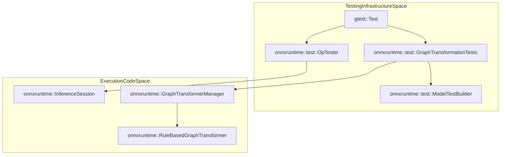
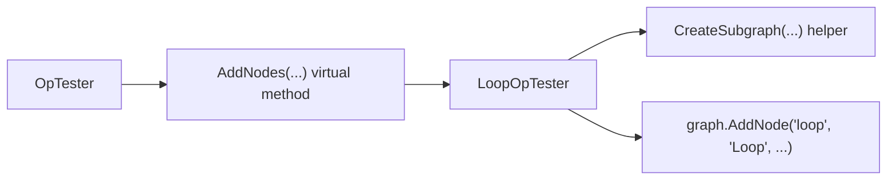
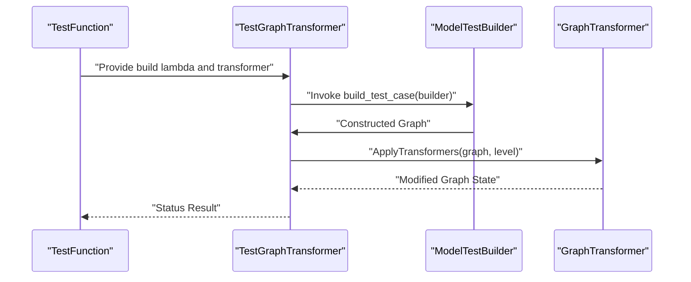
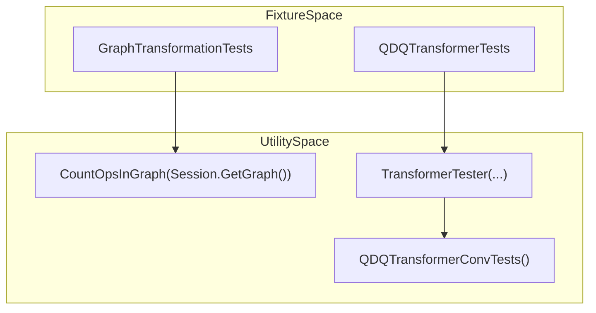
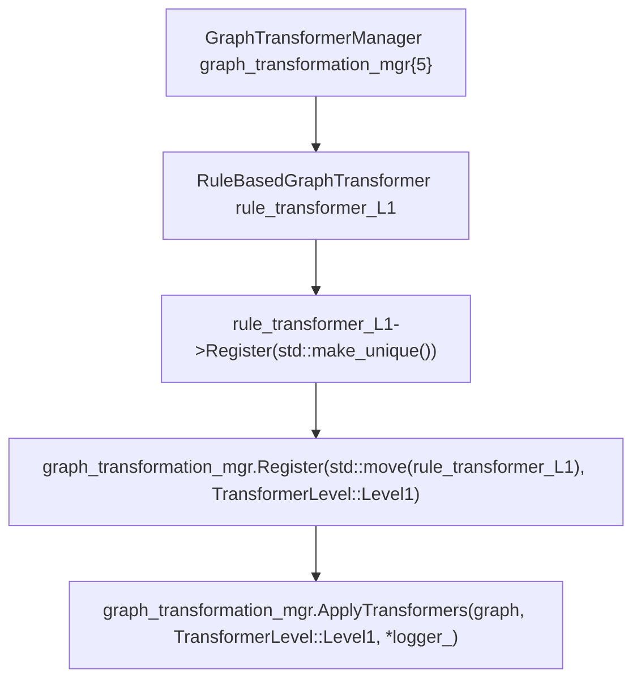

<!-- source: DeepWiki mcp.deepwiki.com · repo microsoft/onnxruntime · page 9.2 Unit Testing Framework · fetched 2026-10-21 -->

# Unit Testing Framework

<details>
<summary>Relevant source files</summary>

The following files were used as context for generating this wiki page:

- [include/onnxruntime/core/optimizer/graph_transformer_utils.h](include/onnxruntime/core/optimizer/graph_transformer_utils.h)
- [onnxruntime/core/framework/ort_value_tensor_slicer.cc](onnxruntime/core/framework/ort_value_tensor_slicer.cc)
- [onnxruntime/core/framework/ort_value_tensor_slicer.h](onnxruntime/core/framework/ort_value_tensor_slicer.h)
- [onnxruntime/core/graph/extended_graph_edge.h](onnxruntime/core/graph/extended_graph_edge.h)
- [onnxruntime/core/optimizer/graph_transformer_utils.cc](onnxruntime/core/optimizer/graph_transformer_utils.cc)
- [onnxruntime/core/optimizer/qdq_transformer/qdq_final_cleanup.cc](onnxruntime/core/optimizer/qdq_transformer/qdq_final_cleanup.cc)
- [onnxruntime/core/optimizer/qdq_transformer/qdq_final_cleanup.h](onnxruntime/core/optimizer/qdq_transformer/qdq_final_cleanup.h)
- [onnxruntime/core/optimizer/qdq_transformer/qdq_propagation.cc](onnxruntime/core/optimizer/qdq_transformer/qdq_propagation.cc)
- [onnxruntime/core/optimizer/qdq_transformer/qdq_propagation.h](onnxruntime/core/optimizer/qdq_transformer/qdq_propagation.h)
- [onnxruntime/core/optimizer/qdq_transformer/qdq_util.cc](onnxruntime/core/optimizer/qdq_transformer/qdq_util.cc)
- [onnxruntime/core/optimizer/qdq_transformer/qdq_util.h](onnxruntime/core/optimizer/qdq_transformer/qdq_util.h)
- [onnxruntime/core/optimizer/qdq_transformer/selectors_actions/qdq_actions.cc](onnxruntime/core/optimizer/qdq_transformer/selectors_actions/qdq_actions.cc)
- [onnxruntime/core/optimizer/qdq_transformer/selectors_actions/qdq_actions.h](onnxruntime/core/optimizer/qdq_transformer/selectors_actions/qdq_actions.h)
- [onnxruntime/core/optimizer/qdq_transformer/selectors_actions/qdq_selector_action_transformer.cc](onnxruntime/core/optimizer/qdq_transformer/selectors_actions/qdq_selector_action_transformer.cc)
- [onnxruntime/core/optimizer/qdq_transformer/selectors_actions/qdq_selector_action_transformer.h](onnxruntime/core/optimizer/qdq_transformer/selectors_actions/qdq_selector_action_transformer.h)
- [onnxruntime/core/optimizer/qdq_transformer/selectors_actions/qdq_selectors.cc](onnxruntime/core/optimizer/qdq_transformer/selectors_actions/qdq_selectors.cc)
- [onnxruntime/core/optimizer/qdq_transformer/selectors_actions/qdq_selectors.h](onnxruntime/core/optimizer/qdq_transformer/selectors_actions/qdq_selectors.h)
- [onnxruntime/core/providers/cpu/controlflow/if.cc](onnxruntime/core/providers/cpu/controlflow/if.cc)
- [onnxruntime/core/providers/cpu/controlflow/if.h](onnxruntime/core/providers/cpu/controlflow/if.h)
- [onnxruntime/core/providers/cpu/controlflow/loop.cc](onnxruntime/core/providers/cpu/controlflow/loop.cc)
- [onnxruntime/core/providers/cpu/controlflow/loop.h](onnxruntime/core/providers/cpu/controlflow/loop.h)
- [onnxruntime/core/providers/cpu/controlflow/scan.h](onnxruntime/core/providers/cpu/controlflow/scan.h)
- [onnxruntime/core/providers/cpu/controlflow/scan_8.cc](onnxruntime/core/providers/cpu/controlflow/scan_8.cc)
- [onnxruntime/core/providers/cpu/controlflow/scan_9.cc](onnxruntime/core/providers/cpu/controlflow/scan_9.cc)
- [onnxruntime/core/providers/cpu/controlflow/scan_utils.cc](onnxruntime/core/providers/cpu/controlflow/scan_utils.cc)
- [onnxruntime/core/providers/cpu/controlflow/scan_utils.h](onnxruntime/core/providers/cpu/controlflow/scan_utils.h)
- [onnxruntime/core/providers/cpu/controlflow/utils.h](onnxruntime/core/providers/cpu/controlflow/utils.h)
- [onnxruntime/core/providers/cuda/controlflow/if.cc](onnxruntime/core/providers/cuda/controlflow/if.cc)
- [onnxruntime/core/providers/cuda/controlflow/loop.cc](onnxruntime/core/providers/cuda/controlflow/loop.cc)
- [onnxruntime/core/providers/cuda/controlflow/scan.cc](onnxruntime/core/providers/cuda/controlflow/scan.cc)
- [onnxruntime/core/providers/cuda/controlflow/scan.h](onnxruntime/core/providers/cuda/controlflow/scan.h)
- [onnxruntime/test/framework/parallel_executor_test.cc](onnxruntime/test/framework/parallel_executor_test.cc)
- [onnxruntime/test/optimizer/graph_transform_test.cc](onnxruntime/test/optimizer/graph_transform_test.cc)
- [onnxruntime/test/optimizer/graph_transform_utils_test.cc](onnxruntime/test/optimizer/graph_transform_utils_test.cc)
- [onnxruntime/test/optimizer/qdq_matmulnbits_transformer_test.cc](onnxruntime/test/optimizer/qdq_matmulnbits_transformer_test.cc)
- [onnxruntime/test/optimizer/qdq_transformer_test.cc](onnxruntime/test/optimizer/qdq_transformer_test.cc)
- [onnxruntime/test/providers/cpu/controlflow/if_test.cc](onnxruntime/test/providers/cpu/controlflow/if_test.cc)
- [onnxruntime/test/providers/cpu/controlflow/loop_test.cc](onnxruntime/test/providers/cpu/controlflow/loop_test.cc)
- [onnxruntime/test/providers/cpu/controlflow/scan_test.cc](onnxruntime/test/providers/cpu/controlflow/scan_test.cc)
- [onnxruntime/test/providers/provider_test_utils.h](onnxruntime/test/providers/provider_test_utils.h)
- [orttraining/orttraining/core/optimizer/conv1d_replacement.cc](orttraining/orttraining/core/optimizer/conv1d_replacement.cc)
- [orttraining/orttraining/core/optimizer/conv1d_replacement.h](orttraining/orttraining/core/optimizer/conv1d_replacement.h)
- [orttraining/orttraining/core/optimizer/graph_transformer_utils.cc](orttraining/orttraining/core/optimizer/graph_transformer_utils.cc)
- [orttraining/orttraining/test/optimizer/graph_transform_test.cc](orttraining/orttraining/test/optimizer/graph_transform_test.cc)
- [orttraining/orttraining/test/optimizer/graph_transformer_utils_test.cc](orttraining/orttraining/test/optimizer/graph_transformer_utils_test.cc)

</details>


## Purpose and Scope

This document details ONNX Runtime's unit testing infrastructure for operator implementations and graph transformations. The framework relies on the **`OpTester`** (`[onnxruntime/test/providers/provider_test_utils.h]()`) and graph transformation testing fixtures (`[onnxruntime/test/optimizer/graph_transform_test_fixture.h]()`) to validate operator correctness, execution provider compliance, and rewrite/fusion rule applications. For ONNX backend compliance tests, refer to [ONNX Backend Tests](#9.1), and for automated testing workflows, see [Performance Testing](#9.3).

## Overview

ONNX Runtime unit tests are structured around Google Test (`gtest`) and integrate specialized test harness classes to verify components across different operational scopes:

| Testing Domain | Key Classes / Functions | Primary Code Entities |
|----------------|-------------------------|-----------------------|
| Operator Kernels | `OpTester`, `LoopOpTester` | `[onnxruntime/test/providers/provider_test_utils.h]()`, `[onnxruntime/test/providers/cpu/controlflow/loop_test.cc:40-81]()` |
| Graph Transformations | `ModelTestBuilder`, `TestGraphTransformer`, `GraphTransformationTests` | `[onnxruntime/test/unittest_util/graph_transform_test_builder.h](), [onnxruntime/test/optimizer/graph_transform_test.cc:137-160]()` |
| QDQ / Quantization Optimizations | `QDQTransformerConvTests`, `NodeGroupSelector` | `[onnxruntime/test/optimizer/qdq_transformer_test.cc:61-120](), [onnxruntime/core/optimizer/qdq_transformer/selectors_actions/qdq_selectors.cc:70-96]()` |



**Sources:** [onnxruntime/test/optimizer/graph_transform_test.cc:137-160](), [onnxruntime/test/providers/cpu/controlflow/loop_test.cc:40-81](), [onnxruntime/test/providers/provider_test_utils.h]()

## OpTester Framework

The **`OpTester`** class is the foundational harness for testing individual operators. It initializes an **`InferenceSession`** under the hood, injects tensors, runs execution, and compares outcomes against expected reference values or auxiliary verification functions.

### Key Characteristics and Subclassing

Operators with control flow or specialized scopes subclass `OpTester`. For example, `LoopOpTester` (`[onnxruntime/test/providers/cpu/controlflow/loop_test.cc:40-81]()`) overrides `AddNodes` to set up subgraphs for the ONNX `Loop` operator:



**Sources:** [onnxruntime/test/providers/cpu/controlflow/loop_test.cc:40-81](), [onnxruntime/test/providers/provider_test_utils.h]()

## Graph Transformation Testing Framework

### ModelTestBuilder and TestGraphTransformer

**`ModelTestBuilder`** offers a fluent API for programmatically assembling an **`onnxruntime::Graph`** without reading disk files. **`TestGraphTransformer`** executes the transformer across specified `TransformerLevel` steps while running pre- and post-condition validations.



**Sources:** [onnxruntime/test/optimizer/graph_transform_test.cc:265-283](), [onnxruntime/test/unittest_util/graph_transform_test_builder.h]()

## Test Fixtures and Base Classes

### GraphTransformationTests and QDQ Transformers

Tests like conversion validation or QDQ transformations inherit from fixtures providing an initialized **`logging::Logger`** (`logger_`) and helper routines such as `CountOpsInGraph` (`[onnxruntime/test/optimizer/graph_transform_test.cc:68-82]()`).



**Sources:** [onnxruntime/test/optimizer/graph_transform_test.cc:137-160](), [onnxruntime/test/optimizer/qdq_transformer_test.cc:61-120]()

## Validation Utilities

### CountOpsInGraph and Graph Checkers

Graph verification leverages operator counting routines and lambda predicates to enforce transformations. For example, `QDQTransformerConvTests` checks whether a `Conv` node has been successfully replaced by `QLinearConv` or remains regular based on data types (`[onnxruntime/test/optimizer/qdq_transformer_test.cc:65-82]()`).

```cpp
auto check_graph = [&](InferenceSessionWrapper& session) {
  const QDQOpKeys qdq_keys = GetQDQOpKeys(use_contrib_qdq);
  auto op_to_count = CountOpsInGraph(session.GetGraph());
  // Checks op_to_count["QLinearConv"] vs op_to_count["Conv"]
};
```

**Sources:** [onnxruntime/test/optimizer/graph_transform_test.cc:68-82](), [onnxruntime/test/optimizer/qdq_transformer_test.cc:61-120]()

## Common Test Patterns

### Pattern 1: Rule-Based Transformer Registration

Unit tests routinely verify discrete rewrite rules using `RuleBasedGraphTransformer` combined with **`GraphTransformerManager`**:



**Sources:** [onnxruntime/test/optimizer/graph_transform_test.cc:137-160](), [orttraining/orttraining/test/optimizer/graph_transform_test.cc:83-88]()

### Pattern 2: Quantization and QDQ Testing

Quantization tests validate that graph selectors (`onnxruntime::QDQ::NodeGroupSelector`) and actions (`onnxruntime::QDQ::SplitReplaceWithQuant`, `onnxruntime::MergeIntoTargetFixed`) operate safely across execution providers (`[onnxruntime/core/optimizer/qdq_transformer/selectors_actions/qdq_selector_action_transformer.cc:24-38]()`).

**Sources:** [onnxruntime/core/optimizer/qdq_transformer/selectors_actions/qdq_selector_action_transformer.cc:24-38](), [onnxruntime/test/optimizer/qdq_transformer_test.cc:61-120]()

## Test Organization

### File System Mapping to Code Objects

| Directory Path | Primary Components / Files | Scope |
|----------------|----------------------------|-------|
| `onnxruntime/test/optimizer/` | `graph_transform_test.cc`, `qdq_transformer_test.cc` | Graph optimizers & rewrite rules |
| `onnxruntime/test/providers/` | `provider_test_utils.h`, `loop_test.cc` | OpTester & execution provider unit tests |
| `orttraining/orttraining/test/optimizer/` | Training transformation tests (`BatchNormReplacement`) | Training-specific graph rewrites |

**Sources:** [onnxruntime/test/optimizer/graph_transform_test.cc:1-160](), [onnxruntime/test/providers/cpu/controlflow/loop_test.cc:40-81](), [orttraining/orttraining/test/optimizer/graph_transform_test.cc:51-93]()

---

