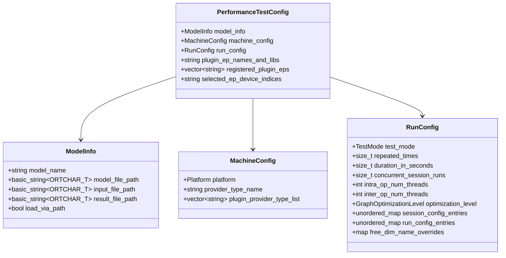
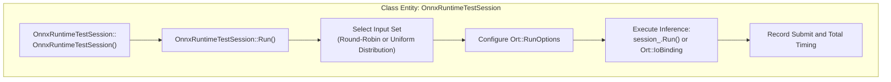
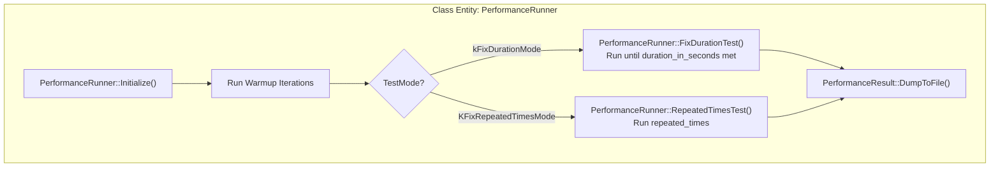

<!-- source: DeepWiki mcp.deepwiki.com · repo microsoft/onnxruntime · page 9.3 Performance Testing · fetched 2026-10-21 -->

# Performance Testing

<details>
<summary>Relevant source files</summary>

The following files were used as context for generating this wiki page:

- [onnxruntime/core/optimizer/layout_transformation/layout_transformation_dev_notes.md](onnxruntime/core/optimizer/layout_transformation/layout_transformation_dev_notes.md)
- [onnxruntime/test/perftest/command_args_parser.cc](onnxruntime/test/perftest/command_args_parser.cc)
- [onnxruntime/test/perftest/common_utils.cc](onnxruntime/test/perftest/common_utils.cc)
- [onnxruntime/test/perftest/main.cc](onnxruntime/test/perftest/main.cc)
- [onnxruntime/test/perftest/ort_test_session.cc](onnxruntime/test/perftest/ort_test_session.cc)
- [onnxruntime/test/perftest/ort_test_session.h](onnxruntime/test/perftest/ort_test_session.h)
- [onnxruntime/test/perftest/performance_runner.cc](onnxruntime/test/perftest/performance_runner.cc)
- [onnxruntime/test/perftest/performance_runner.h](onnxruntime/test/perftest/performance_runner.h)
- [onnxruntime/test/perftest/strings_helper.cc](onnxruntime/test/perftest/strings_helper.cc)
- [onnxruntime/test/perftest/strings_helper.h](onnxruntime/test/perftest/strings_helper.h)
- [onnxruntime/test/perftest/test_configuration.h](onnxruntime/test/perftest/test_configuration.h)
- [onnxruntime/test/perftest/test_session.h](onnxruntime/test/perftest/test_session.h)
- [onnxruntime/test/perftest/utils.h](onnxruntime/test/perftest/utils.h)
- [onnxruntime/test/util/default_providers.cc](onnxruntime/test/util/default_providers.cc)
- [onnxruntime/test/util/include/default_providers.h](onnxruntime/test/util/include/default_providers.h)

</details>


This page documents the performance testing infrastructure in ONNX Runtime, which provides benchmarking tools to measure inference latency, throughput, and resource usage across different execution providers and hardware configurations.

For information about unit testing operators and transformations, see [Unit Testing Framework](#9.2). For ONNX backend compliance testing, see [ONNX Backend Tests](#9.1).

## Purpose and Scope

The performance testing system (`onnxruntime_perf_test`) is a command-line tool defined in `onnxruntime/test/perftest/main.cc` that:
- Measures inference latency and throughput for ONNX models [onnxruntime/test/perftest/performance_runner.cc:163]()
- Benchmarks models across different execution providers (CPU, CUDA, TensorRT, QNN, DML, etc.) [onnxruntime/test/perftest/command_args_parser.cc:60]()
- Supports duration-based or iteration-based test modes [onnxruntime/test/perftest/command_args_parser.cc:59]()
- Collects statistical metrics (percentiles, min/max latencies) [onnxruntime/test/perftest/performance_runner.cc:85]()
- Validates EP-specific runtime configurations [onnxruntime/test/perftest/strings_helper.cc:19]()
- Profiles model execution and session creation time [onnxruntime/test/perftest/performance_runner.cc:158]()

Sources: [onnxruntime/test/perftest/main.cc:26-104](), [onnxruntime/test/perftest/performance_runner.cc:58-156](), [onnxruntime/test/perftest/command_args_parser.cc:51-99]()

## Architecture Overview

The performance testing infrastructure consists of several key components bridging the command-line entry point to execution sessions, configurations, and metric aggregation.

```mermaid
graph TB
    subgraph "Code Entity Space: Entry & Configuration"
        Main["real_main()<br/>onnxruntime/test/perftest/main.cc"]
        CmdParser["CommandLineParser::ParseArguments()<br/>onnxruntime/test/perftest/command_args_parser.cc"]
        PerfConfig["PerformanceTestConfig<br/>onnxruntime/test/perftest/test_configuration.h"]
    end
    
    subgraph "Code Entity Space: Execution & Session"
        PerfRunner["PerformanceRunner<br/>onnxruntime/test/perftest/performance_runner.h"]
        TestSession["TestSession<br/>onnxruntime/test/perftest/test_session.h"]
        OrtTestSession["OnnxRuntimeTestSession<br/>onnxruntime/test/perftest/ort_test_session.cc"]
    end
    
    subgraph "Code Entity Space: Results"
        PerfResult["PerformanceResult<br/>onnxruntime/test/perftest/performance_runner.cc"]
    end
    
    Main -->|Invokes| CmdParser
    CmdParser -->|Populates| PerfConfig
    Main -->|Constructs| PerfRunner
    PerfRunner -->|Instantiates| TestSession
    TestSession <|-- OrtTestSession
    PerfRunner -->|Aggregates| PerfResult
    
    style Main fill:#f9f9f9
    style PerfRunner fill:#f9f9f9
    style OrtTestSession fill:#f9f9f9
```

Sources: [onnxruntime/test/perftest/main.cc:26-104](), [onnxruntime/test/perftest/performance_runner.h:47-63](), [onnxruntime/test/perftest/ort_test_session.h:20-39](), [onnxruntime/test/perftest/test_configuration.h:96-106]()

## Command Line Tool: onnxruntime_perf_test

The `onnxruntime_perf_test` executable is the main performance benchmarking tool. It accepts command-line arguments parsed via Abseil flags in `command_args_parser.cc` to configure the test session, execution provider, and benchmarking parameters.

### Key Command Line Options

| Option | Type | Description |
|--------|------|-------------|
| `-m` | string | Test mode: `duration` or `times` [onnxruntime/test/perftest/command_args_parser.cc:59]() |
| `-t` | size_t | Duration in seconds (for duration mode) [onnxruntime/test/perftest/command_args_parser.cc:62]() |
| `-r` | size_t | Number of repeated runs (for times mode) [onnxruntime/test/perftest/command_args_parser.cc:61]() |
| `-e` | string | Execution provider: `cpu`, `cuda`, `tensorrt`, `dnnl`, `openvino`, `dml`, `qnn`, etc. [onnxruntime/test/perftest/command_args_parser.cc:60]() |
| `-x` | int | Intra-op thread count [onnxruntime/test/perftest/command_args_parser.cc:64]() |
| `-y` | int | Inter-op thread count [onnxruntime/test/perftest/command_args_parser.cc:65]() |
| `-o` | int | Graph optimization level (0-3, 99 for all) [onnxruntime/test/perftest/command_args_parser.cc:68]() |
| `-i` | string | EP-specific runtime configuration key-value pairs [onnxruntime/test/perftest/command_args_parser.cc:73-75]() |
| `-p` | string | Profile name to enable profiling and dump data [onnxruntime/test/perftest/command_args_parser.cc:63]() |
| `-c` | size_t | Number of concurrent session runs [onnxruntime/test/perftest/command_args_parser.cc:66]() |
| `-f` | string | Override free dimension by name [onnxruntime/test/perftest/command_args_parser.cc:51-54]() |
| `-F` | string | Override free dimension by denotation [onnxruntime/test/perftest/command_args_parser.cc:55-58]() |

Sources: [onnxruntime/test/perftest/command_args_parser.cc:51-99]()

## Configuration Structure

The performance test configuration is represented by the `PerformanceTestConfig` struct defined in `onnxruntime/test/perftest/test_configuration.h`, which aggregates model information, machine configuration, and runtime settings.



Sources: [onnxruntime/test/perftest/test_configuration.h:29-106]()

### TestMode Enumeration

The test system supports two primary modes defined in `onnxruntime/test/perftest/test_configuration.h`:

```cpp
enum class TestMode : std::uint8_t {
  kFixDurationMode = 0,
  KFixRepeatedTimesMode
};
```

Sources: [onnxruntime/test/perftest/test_configuration.h:19-22]()

## Test Session Implementation

The `OnnxRuntimeTestSession` class (`onnxruntime/test/perftest/ort_test_session.cc`) inherits from `TestSession` and encapsulates `Ort::Session`, handling input preparation, random or round-robin selection, execution timing, and IO binding.



Sources: [onnxruntime/test/perftest/ort_test_session.cc:44-103](), [onnxruntime/test/perftest/ort_test_session.cc:105-137]()

### Run Method Execution Flow

The `OnnxRuntimeTestSession::Run()` method executes a single iteration:
1. **Input Selection**: Selects test input via round-robin (`use_round_robin_`) or uniform random distribution [onnxruntime/test/perftest/ort_test_session.cc:46-53]().
2. **RunOptions Initialization**: Applies runtime configuration entries [onnxruntime/test/perftest/ort_test_session.cc:57-60]().
3. **Execution Routing**:
   - *CUDA IO Binding Path*: When `CUDA == device_memory_name_`, binds inputs and outputs via `Ort::IoBinding` to device memory, disables EP execution provider synchronization (`kOrtRunOptionsConfigDisableSynchronizeExecutionProviders`), invokes `session_.Run()`, and then explicitly calls `io_binding.SynchronizeOutputs()` [onnxruntime/test/perftest/ort_test_session.cc:63-82]().
   - *Standard Path*: Checks dynamic output shapes and resets unconstrained output buffers if needed before calling `session_.Run()` [onnxruntime/test/perftest/ort_test_session.cc:89-99]().

Sources: [onnxruntime/test/perftest/ort_test_session.cc:44-103]()

## Execution Provider Configuration

Execution provider options are parsed via helper functions in `onnxruntime/test/perftest/strings_helper.cc` (`ParseSessionConfigs`) and configured during session initialization.

### EP Configuration Parsing Examples
- **Dnnl EP**: Parses options like `num_of_threads` [onnxruntime/test/perftest/ort_test_session.cc:156]().
- **OpenVINO EP**: Configures device type, device ID, cache directory, and layout [onnxruntime/test/perftest/command_args_parser.cc:85-92]().
- **QNN EP**: Configures `backend_path`, `backend_type`, `profiling_level`, and `vtcm_mb` [onnxruntime/test/perftest/command_args_parser.cc:94-99]().

Sources: [onnxruntime/test/perftest/strings_helper.cc:19-59](), [onnxruntime/test/perftest/command_args_parser.cc:73-99]()

## Performance Runner Workflow

The `PerformanceRunner` class (`onnxruntime/test/perftest/performance_runner.cc`) controls the test lifecycle, warm-up iterations, duration/repeated execution loops, and statistics aggregation.



Sources: [onnxruntime/test/perftest/performance_runner.cc:163-300]()

### Statistical Metrics Collection

The `PerformanceResult` struct (`onnxruntime/test/perftest/performance_runner.cc`) records latency distributions (`time_costs_total`), submission timings, peak working set size (`peak_workingset_size`), and average CPU usage (`average_CPU_usage`). When execution completes, it computes percentiles (P50, P90, P95, P99, P99.9) and prints/serializes them [onnxruntime/test/perftest/performance_runner.cc:58-114]().

Sources: [onnxruntime/test/perftest/performance_runner.cc:31-156]()

## IO Binding and Memory Management

For GPU-accelerated EPs, `OnnxRuntimeTestSession` supports `Ort::IoBinding` to avoid host-device memory copy overhead during inference benchmarking. 

Sources: [onnxruntime/test/perftest/ort_test_session.cc:63-82](), [onnxruntime/test/perftest/ort_test_session.h:50-89]()

## Profiling and EP Context Compilation

- **Profiling**: Enabled via `-p` option, invoking `session_options.EnableProfiling(...)` to dump performance JSON files [onnxruntime/test/perftest/command_args_parser.cc:63]().
- **EP Context Models**: Supported via `--compile_ep_context`, executing `CompileEpContextModel(...)` in `main.cc` to pre-compile and serialize hardware accelerator contexts before testing [onnxruntime/test/perftest/main.cc:80-92]().

Sources: [onnxruntime/test/perftest/main.cc:80-102](), [onnxruntime/test/perftest/command_args_parser.cc:63]()

---

