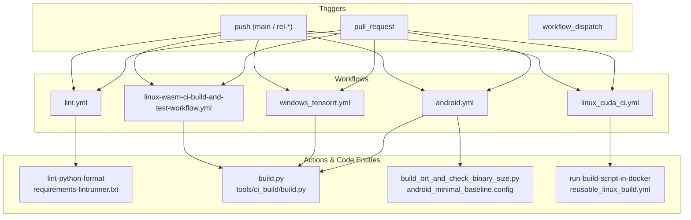
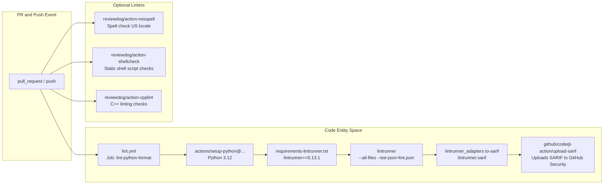
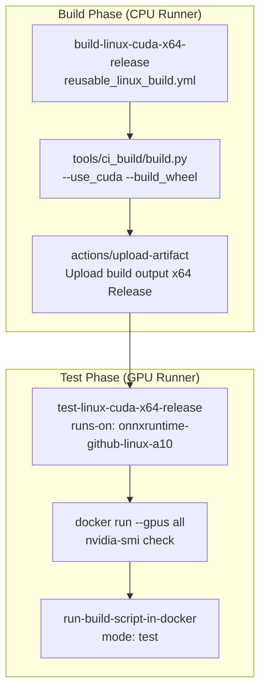
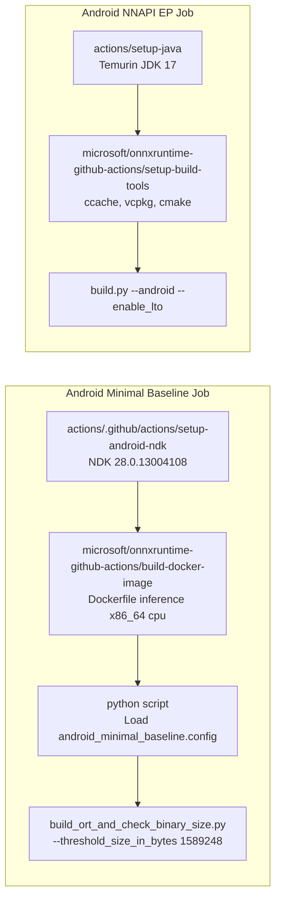

<!-- source: DeepWiki mcp.deepwiki.com · repo microsoft/onnxruntime · page 9.4 CI/CD Test Automation · fetched 2026-10-21 -->

# CI/CD Test Automation

<details>
<summary>Relevant source files</summary>

The following files were used as context for generating this wiki page:

- [.github/actions/locate-vcvarsall-and-setup-env/action.yml](.github/actions/locate-vcvarsall-and-setup-env/action.yml)
- [.github/dependabot.yml](.github/dependabot.yml)
- [.github/workflows/android.yml](.github/workflows/android.yml)
- [.github/workflows/cffconvert.yml](.github/workflows/cffconvert.yml)
- [.github/workflows/codeql.yml](.github/workflows/codeql.yml)
- [.github/workflows/gradle-wrapper-validation.yml](.github/workflows/gradle-wrapper-validation.yml)
- [.github/workflows/lint.yml](.github/workflows/lint.yml)
- [.github/workflows/linux-wasm-ci-build-and-test-workflow.yml](.github/workflows/linux-wasm-ci-build-and-test-workflow.yml)
- [.github/workflows/linux_cuda_ci.yml](.github/workflows/linux_cuda_ci.yml)
- [.github/workflows/linux_cuda_no_cudnn.yml](.github/workflows/linux_cuda_no_cudnn.yml)
- [.github/workflows/linux_cuda_plugin_ci.yml](.github/workflows/linux_cuda_plugin_ci.yml)
- [.github/workflows/linux_minimal_build.yml](.github/workflows/linux_minimal_build.yml)
- [.github/workflows/linux_tensorrt_ci.yml](.github/workflows/linux_tensorrt_ci.yml)
- [.github/workflows/pr_checks.yml](.github/workflows/pr_checks.yml)
- [.github/workflows/publish-c-apidocs.yml](.github/workflows/publish-c-apidocs.yml)
- [.github/workflows/publish-csharp-apidocs.yml](.github/workflows/publish-csharp-apidocs.yml)
- [.github/workflows/publish-java-apidocs.yml](.github/workflows/publish-java-apidocs.yml)
- [.github/workflows/publish-js-apidocs.yml](.github/workflows/publish-js-apidocs.yml)
- [.github/workflows/publish-objectivec-apidocs.yml](.github/workflows/publish-objectivec-apidocs.yml)
- [.github/workflows/publish-python-apidocs.yml](.github/workflows/publish-python-apidocs.yml)
- [.github/workflows/react_native.yml](.github/workflows/react_native.yml)
- [.github/workflows/reusable_linux_build.yml](.github/workflows/reusable_linux_build.yml)
- [.github/workflows/windows-web-ci-workflow.yml](.github/workflows/windows-web-ci-workflow.yml)
- [.github/workflows/windows_cuda.yml](.github/workflows/windows_cuda.yml)
- [.github/workflows/windows_cuda_no_cudnn.yml](.github/workflows/windows_cuda_no_cudnn.yml)
- [.github/workflows/windows_cuda_plugin.yml](.github/workflows/windows_cuda_plugin.yml)
- [.github/workflows/windows_dml.yml](.github/workflows/windows_dml.yml)
- [.github/workflows/windows_openvino.yml](.github/workflows/windows_openvino.yml)
- [.github/workflows/windows_tensorrt.yml](.github/workflows/windows_tensorrt.yml)
- [.github/workflows/windows_webgpu.yml](.github/workflows/windows_webgpu.yml)
- [.github/workflows/windows_x64_debug_build_x64_debug.yml](.github/workflows/windows_x64_debug_build_x64_debug.yml)
- [.github/workflows/windows_x64_release_build_x64_release.yml](.github/workflows/windows_x64_release_build_x64_release.yml)
- [.github/workflows/windows_x64_release_ep_generic_interface_build_x64_release_ep_generic_interface.yml](.github/workflows/windows_x64_release_ep_generic_interface_build_x64_release_ep_generic_interface.yml)
- [.github/workflows/windows_x64_release_vitisai_build_x64_release.yml](.github/workflows/windows_x64_release_vitisai_build_x64_release.yml)
- [.github/workflows/windows_x64_release_xnnpack.yml](.github/workflows/windows_x64_release_xnnpack.yml)
- [.github/workflows/windows_x86.yml](.github/workflows/windows_x86.yml)
- [.lintrunner.toml](.lintrunner.toml)
- [.vscode/settings.json](.vscode/settings.json)
- [csharp/ApiDocs/.gitignore](csharp/ApiDocs/.gitignore)
- [csharp/ApiDocs/ApiDocs.csproj](csharp/ApiDocs/ApiDocs.csproj)
- [csharp/ApiDocs/api/.gitignore](csharp/ApiDocs/api/.gitignore)
- [csharp/ApiDocs/docfx.json](csharp/ApiDocs/docfx.json)
- [csharp/ApiDocs/filterConfig.yml](csharp/ApiDocs/filterConfig.yml)
- [docs/Coding_Conventions_and_Standards.md](docs/Coding_Conventions_and_Standards.md)
- [docs/cmake_guideline.md](docs/cmake_guideline.md)
- [onnxruntime/python/backend/backend.py](onnxruntime/python/backend/backend.py)
- [onnxruntime/python/backend/backend_rep.py](onnxruntime/python/backend/backend_rep.py)
- [onnxruntime/test/python/onnxruntime_test_python_backend.py](onnxruntime/test/python/onnxruntime_test_python_backend.py)
- [onnxruntime/test/python/onnxruntime_test_python_backend_mlops.py](onnxruntime/test/python/onnxruntime_test_python_backend_mlops.py)
- [onnxruntime/test/python/onnxruntime_test_python_cudagraph.py](onnxruntime/test/python/onnxruntime_test_python_cudagraph.py)
- [onnxruntime/test/python/onnxruntime_test_python_keras.py](onnxruntime/test/python/onnxruntime_test_python_keras.py)
- [onnxruntime/test/python/onnxruntime_test_python_mlops.py](onnxruntime/test/python/onnxruntime_test_python_mlops.py)
- [onnxruntime/test/python/onnxruntime_test_python_sparse_matmul.py](onnxruntime/test/python/onnxruntime_test_python_sparse_matmul.py)
- [pyproject.toml](pyproject.toml)
- [requirements-dev.txt](requirements-dev.txt)
- [requirements-lintrunner.txt](requirements-lintrunner.txt)
- [requirements-training.txt](requirements-training.txt)
- [requirements.txt](requirements.txt)
- [tools/ci_build/github/linux/docker/inference/x86_64/python/openvino/Dockerfile](tools/ci_build/github/linux/docker/inference/x86_64/python/openvino/Dockerfile)

</details>


## Purpose and Scope

This page documents the automated testing, linting, PR verification, binary size validation, and CI/CD pipelines used in ONNX Runtime. It covers how GitHub Actions workflows (`.github/workflows/`) orchestrate code quality checks, platform-specific test executions across CPU, GPU, TensorRT, Android, WASM, and WebGPU backends, and how binary size constraints are enforced.

For information about specific test frameworks, see [ONNX Backend Tests](#9.1), [Unit Testing Framework](#9.2), and [Performance Testing](#9.3). For build system orchestration, see [Build Orchestration](#2.1) and [CI/CD Pipelines](#2.4).

## Overview of CI/CD Test Automation

ONNX Runtime relies on automated workflows across GitHub Actions and self-hosted runners to validate every commit and pull request. The automation pipeline executes static linting, full builds with execution providers, unit tests, ONNX compliance backend tests, binary size checks, and API documentation generation.



**CI/CD Automation Architecture and Workflow Mapping**

Sources: [.github/workflows/lint.yml:1-124](), [.github/workflows/android.yml:1-119](), [.github/workflows/linux_cuda_ci.yml:1-54]()

---

## Lint and PR Checks

Code quality and formatting are strictly enforced on pull requests and pushes using GitHub Actions workflows defined in `.github/workflows/lint.yml`.

### Linting Infrastructure

The linting system utilizes `lintrunner` along with specialized adapters configured via `requirements-lintrunner.txt` and `.lintrunner.toml`.



**Lint Workflow and Code Entity Mapping**

### Key Lint Jobs

1. **Optional Lint (`optional-lint`)**: Runs `reviewdog/action-misspell` and `reviewdog/action-shellcheck` on `ubuntu-latest` to verify spellings and shell script syntax [.github/workflows/lint.yml:16-38]().
2. **Python Format (`lint-python-format`)**: Sets up Python 3.12, installs `requirements-dev.txt` and `requirements-lintrunner.txt`, and executes `lintrunner --all-files` [.github/workflows/lint.yml:39-81](). Results are converted to SARIF and uploaded to GitHub Code Scanning [.github/workflows/lint.yml:82-95]().
3. **C++ Lint (`lint-cpp`)**: Generates compile commands using `tools/ci_build/build.py` and runs `cpplint` with custom exclusions [.github/workflows/lint.yml:96-124]().

Sources: [.github/workflows/lint.yml:1-124](), [requirements-lintrunner.txt:1-6]()

---

## Platform-Specific CI Pipelines

ONNX Runtime maintains dedicated CI pipelines for various execution providers and target architectures.

### Linux and Windows CUDA / TensorRT Pipelines

GPU builds are split into separate build and test jobs to optimize runner utilization. For example, `linux_cuda_ci.yml` and `linux_tensorrt_ci.yml` use reusable workflows (`reusable_linux_build.yml`) to compile ONNX Runtime with CUDA/TensorRT support on CPU nodes, then upload the build artifacts for execution on GPU test nodes (`onnxruntime-github-linux-a10`) [.github/workflows/linux_cuda_ci.yml:21-63]().



**Linux CUDA CI Pipeline Flow**

Sources: [.github/workflows/linux_cuda_ci.yml:21-140](), [.github/workflows/linux_tensorrt_ci.yml:21-129]()

### Android and Minimal Build Pipeline

Android workflows (`.github/workflows/android.yml`) validate binary size limits for minimal builds configured via JSON configuration files.



**Android CI Workflow Structure**

Sources: [.github/workflows/android.yml:25-176]()

---

## Binary Size Validation

Binary size validation is integrated into CI pipelines (such as `android.yml` and `binary-size-checks-pipeline.yml`) to prevent regressions in minimal builds and mobile package footprints.

### Binary Size Checking Script

The script `tools/ci_build/github/linux/ort_minimal/build_ort_and_check_binary_size.py` builds the runtime against a specified configuration file (e.g., `tools/ci_build/github/linux/ort_minimal/build_check_binsize_config/android_minimal_baseline.config`) and compares the resulting binary size against a defined threshold [.github/workflows/android.yml:62-117]().

```yaml
# Example check parameters from android.yml
BINARY_SIZE_THRESHOLD_ARGS="--threshold_size_in_bytes 1589248"
```

If the compiled binary exceeds the size threshold, the build fails and reports the deviation, protecting minimal builds from unexpected dependency growth.

Sources: [.github/workflows/android.yml:26-119]()

---

## Test Result Reporting and Artifacts

CI pipelines capture test outcomes, generate documentation, and package binaries for distribution.

### API Documentation Generation Workflows

Automated workflows regularly generate API documentation for C/C++, C#, and Python:
- **C/C++ API Docs**: `.github/workflows/publish-c-apidocs.yml` runs Doxygen [._github/workflows/publish-c-apidocs.yml:1-67]().
- **C# API Docs**: `.github/workflows/publish-csharp-apidocs.yml` restores NuGet packages, runs `docfx metadata`, and builds `ApiDocs.csproj` [.github/workflows/publish-csharp-apidocs.yml:1-74]().
- **Python API Docs**: `.github/workflows/publish-python-apidocs.yml` builds documentation using Sphinx [.github/workflows/publish-python-apidocs.yml:1-72]().

### Build Artifact Management

Build and test jobs upload artifacts using `actions/upload-artifact` or Azure Pipelines artifact tasks. For instance, Windows CUDA and TensorRT pipelines clean intermediate object files and upload `build-artifacts` for downstream verification [.github/workflows/windows_tensorrt.yml:135-154](), [.github/workflows/windows_cuda.yml:129-148]().

Sources: [.github/workflows/publish-c-apidocs.yml:1-66](), [.github/workflows/publish-csharp-apidocs.yml:1-74](), [.github/workflows/publish-python-apidocs.yml:1-72](), [.github/workflows/windows_tensorrt.yml:135-154]()

---

