# Page: Overview

# Overview

<details>
<summary>Relevant source files</summary>

The following files were used as context for generating this wiki page:

- [README.md](README.md)
- [docs/Roadmap.md](docs/Roadmap.md)
- [include/onnxruntime/core/session/onnxruntime_c_api.h](include/onnxruntime/core/session/onnxruntime_c_api.h)
- [include/onnxruntime/core/session/onnxruntime_cxx_api.h](include/onnxruntime/core/session/onnxruntime_cxx_api.h)
- [include/onnxruntime/core/session/onnxruntime_cxx_inline.h](include/onnxruntime/core/session/onnxruntime_cxx_inline.h)
- [include/onnxruntime/core/session/onnxruntime_lite_custom_op.h](include/onnxruntime/core/session/onnxruntime_lite_custom_op.h)
- [java/README.md](java/README.md)
- [java/gradle/wrapper/gradle-wrapper.jar](java/gradle/wrapper/gradle-wrapper.jar)
- [java/gradlew](java/gradlew)
- [java/src/test/java/sample/ScoreMNIST.java](java/src/test/java/sample/ScoreMNIST.java)
- [java/testdata/cnn_mnist_pytorch.onnx](java/testdata/cnn_mnist_pytorch.onnx)
- [java/testdata/lr_mnist_scikit.onnx](java/testdata/lr_mnist_scikit.onnx)
- [onnxruntime/core/framework/session_options.h](onnxruntime/core/framework/session_options.h)
- [onnxruntime/core/session/abi_session_options.cc](onnxruntime/core/session/abi_session_options.cc)
- [onnxruntime/core/session/custom_ops.cc](onnxruntime/core/session/custom_ops.cc)
- [onnxruntime/core/session/inference_session.cc](onnxruntime/core/session/inference_session.cc)
- [onnxruntime/core/session/inference_session.h](onnxruntime/core/session/inference_session.h)
- [onnxruntime/core/session/onnxruntime_c_api.cc](onnxruntime/core/session/onnxruntime_c_api.cc)
- [onnxruntime/core/session/ort_apis.h](onnxruntime/core/session/ort_apis.h)
- [onnxruntime/core/session/standalone_op_invoker.cc](onnxruntime/core/session/standalone_op_invoker.cc)
- [onnxruntime/test/framework/inference_session_test.cc](onnxruntime/test/framework/inference_session_test.cc)
- [onnxruntime/test/shared_lib/custom_op_utils.cc](onnxruntime/test/shared_lib/custom_op_utils.cc)
- [onnxruntime/test/shared_lib/custom_op_utils.h](onnxruntime/test/shared_lib/custom_op_utils.h)
- [onnxruntime/test/shared_lib/test_inference.cc](onnxruntime/test/shared_lib/test_inference.cc)
- [onnxruntime/test/testdata/custom_op_library/cpu/cpu_ops.cc](onnxruntime/test/testdata/custom_op_library/cpu/cpu_ops.cc)
- [onnxruntime/test/testdata/custom_op_library/custom_op_library.cc](onnxruntime/test/testdata/custom_op_library/custom_op_library.cc)
- [onnxruntime/test/testdata/fuse_select_filter.onnx](onnxruntime/test/testdata/fuse_select_filter.onnx)
- [onnxruntime/test/testdata/fuse_select_filter_opset_8.onnx](onnxruntime/test/testdata/fuse_select_filter_opset_8.onnx)
- [onnxruntime/test/testdata/merge.onnx](onnxruntime/test/testdata/merge.onnx)
- [onnxruntime/test/testdata/optional_2.onnx](onnxruntime/test/testdata/optional_2.onnx)
- [onnxruntime/test/testdata/optional_3.onnx](onnxruntime/test/testdata/optional_3.onnx)

</details>


ONNX Runtime is a high-performance inference and training engine for executing ONNX (Open Neural Network Exchange) models. It provides cross-platform acceleration through pluggable execution providers that leverage hardware-specific optimizations (CPU, GPU, NPU) while maintaining a consistent API across languages and deployment targets.

This document presents a high-level architectural overview of the ONNX Runtime codebase. For detailed information about specific subsystems, see the respective child pages:

- Build system and packaging: see [Build System](#2)
- Graph representation and model loading: see [Core Architecture](#3)
- CPU-optimized kernels: see [Low-Level Compute Library](#4)
- API bindings: see [Language Bindings](#5)
- Hardware acceleration: see [Execution Providers](#6)
- Model training: see [Training System](#8)

---

## Architecture Overview

ONNX Runtime is architected with modular subsystems designed to facilitate model loading, graph optimization, execution, and hardware acceleration. The key layers span from the user application APIs down to low-level compute kernels:

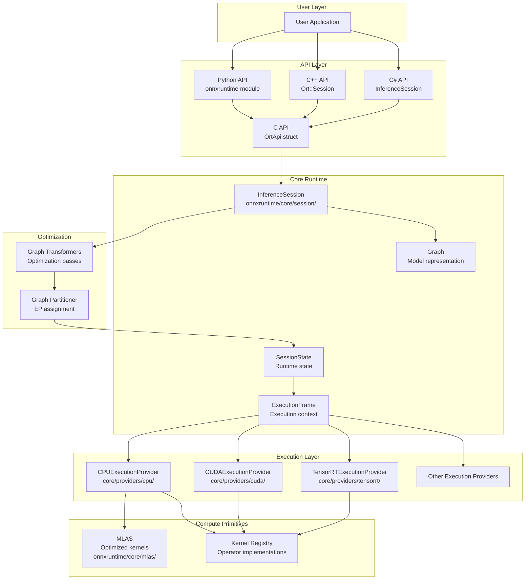

This high-level layout groups the functionality as:

- User-facing APIs in Python, C++, C#, which all marshal requests through the stable C API (`OrtApi`).
- The core runtime (`InferenceSession`) manages model loading, optimization, and execution orchestration.
- Graph Transformers optimize the computation graph before execution.
- The Graph Partitioner splits the graph to assign subgraphs to execution providers (EPs).
- Execution providers implement hardware-aware kernels and resource management.
- MLAS provides optimized math primitives for CPU kernels.
- The kernel registry contains the actual operator implementations used by providers.

**Sources:** [onnxruntime/core/session/inference_session.h:1-66](), [include/onnxruntime/core/session/onnxruntime_c_api.h:1-46](), [cmake/CMakeLists.txt:1-60]()

---

## Core Components

### Session Management

The `InferenceSession` class is the primary interface for loading and running ONNX models. It encapsulates the entire model lifecycle:

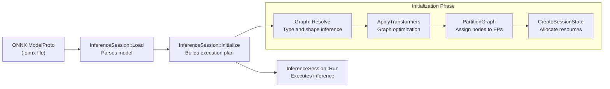

- **LoadModel:** Parses the serialized ONNX model protobuf into an internal `Graph` representation.
- **Initialize:** Performs type inference, applies graph transformers (optimizations), partitions the graph among execution providers, and prepares runtime state (memory allocations, etc.).
- **Run:** Executes the prepared graph according to the configured execution order and providers.

**Key Classes:**
- `InferenceSession` [onnxruntime/core/session/inference_session.h:123-300]() — Session lifecycle management
- `SessionOptions` — Configures optimization levels, execution modes, threading, and EPs
- `SessionState` — Holds runtime information and memory during execution
- `ExecutionFrame` — Execution context used per run

**Sources:** [onnxruntime/core/session/inference_session.cc:1-156](), [onnxruntime/core/session/inference_session.h:123-300]()

---

### Graph Representation

The computational graph is represented in a structured model with nodes and their input/output value metadata:

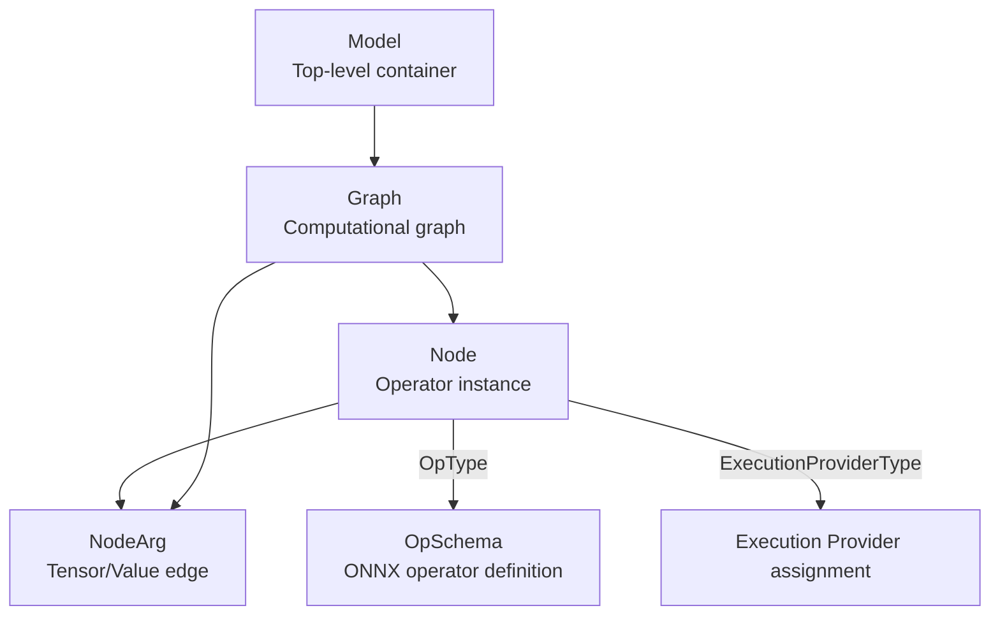

- The `Model` holds the graph and metadata.
- The `Graph` contains the `Node` elements representing operators.
- `NodeArg` objects represent tensor or non-tensor inputs/outputs.
- Each `Node` references its operator schema definition for validation and execution logic.
- Nodes are assigned to execution providers after partitioning.

**Key Classes:**
- `Model` — [onnxruntime/core/graph/model.h]()
- `Graph` — [onnxruntime/core/graph/graph.h]()
- `Node` — [onnxruntime/core/graph/node.h]()
- `NodeArg` — [onnxruntime/core/graph/node_arg.h]()

**Sources:** [onnxruntime/core/graph/model.h](), [onnxruntime/core/graph/graph.h:1-100]()

---

### Execution Providers

Execution providers implement hardware acceleration and platform-specific support. They provide kernels and runtime support through a defined interface.

| Provider                  | Purpose                          | Location                   |
|---------------------------|---------------------------------|----------------------------|
| **CPUExecutionProvider**  | CPU fallback with MLAS kernels  | [core/providers/cpu/]()    |
| **CUDAExecutionProvider** | NVIDIA GPU via CUDA              | [core/providers/cuda/]()   |
| **TensorRTExecutionProvider** | NVIDIA GPU via TensorRT       | [core/providers/tensorrt/]() |
| **DMLExecutionProvider**  | DirectML for Windows             | [core/providers/dml/]()    |
| **CoreMLExecutionProvider**| Apple Neural Engine             | [core/providers/coreml/]() |
| **QNNExecutionProvider**  | Qualcomm NPU                    | [core/providers/qnn/]()    |

- Each provider declares capabilities for nodes they support.
- The graph partitioner assigns subgraphs to providers that can execute those nodes.
- Providers manage device memory and kernel dispatch.

See the [Execution Providers](#6) page for a comprehensive discussion of their design and integration.

**Sources:** [cmake/onnxruntime_providers.cmake:62-114](), [onnxruntime/core/framework/execution_provider.h]()

---

## API Layers

ONNX Runtime offers multi-language APIs built on a stable C API for interoperability and binary compatibility.

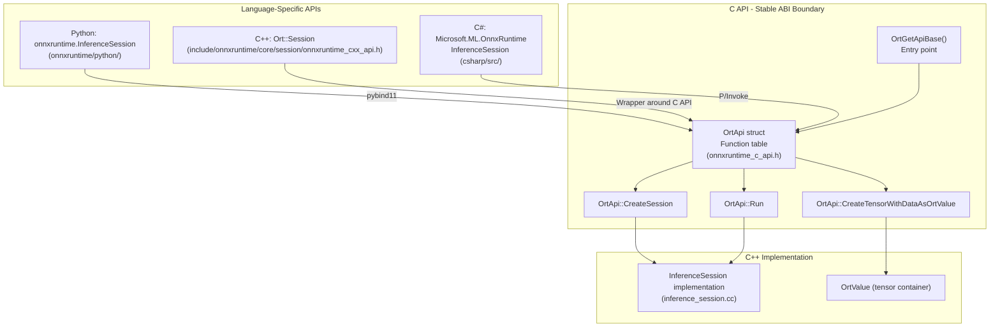

- `OrtGetApiBase()` provides API version negotiation and symbol access.
- The `OrtApi` struct contains function pointers for all runtime APIs, ensuring binary stability.
- C++ APIs wrap the C API, providing RAII patterns, exception handling, and easier usage.
- Python bindings use pybind11 and interact directly with the C API.
- C# API uses P/Invoke for interoperability.

**Sources:** [include/onnxruntime/core/session/onnxruntime_c_api.h:1-46](), [onnxruntime/core/session/onnxruntime_c_api.cc:1-100](), [include/onnxruntime/core/session/onnxruntime_cxx_api.h:1-100]()

---

## Build and Packaging

The build system orchestrates cross-platform compilation, configuration, and packaging:

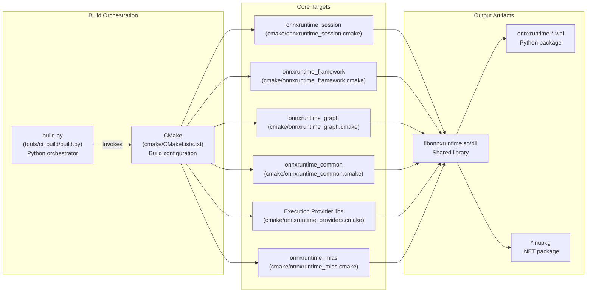

- `build.py` is a Python script that accepts CLI arguments to configure the build, enable providers, and select platforms.
- CMake scripts define modular targets for the runtime and providers.
- Output artifacts include shared libraries, Python wheels, and NuGet packages for integration.
  
**Sources:** [tools/ci_build/build.py:1-100](), [cmake/CMakeLists.txt:1-60](), [cmake/onnxruntime.cmake:1-50]()

---

## Key Data Types

The runtime uses several core types repeatedly throughout models and execution:

| Type                | Purpose                              | Location                           |
|---------------------|------------------------------------|----------------------------------|
| **OrtValue**        | Type-erased container for tensors and ML data | [core/framework/ort_value.h]()     |
| **Tensor**          | Multi-dimensional typed array      | [core/framework/tensor.h]()       |
| **TensorShape**     | Metadata for tensor dimensions     | [core/framework/tensor_shape.h]() |
| **MLDataType**      | Runtime type information           | [core/framework/data_types.h]()   |
| **OrtMemoryInfo**   | Memory location descriptor (e.g. CPU/GPU) | [core/framework/allocator.h]()    |
| **IAllocator**      | Interface for memory allocation    | [core/framework/allocator.h]()    |

These types play foundational roles in managing model inputs, outputs, and intermediate computation data.

**Sources:** [onnxruntime/core/framework/ort_value.h](), [onnxruntime/core/framework/tensor.h]()

---

## Execution Flow

A typical inference workflow involves:

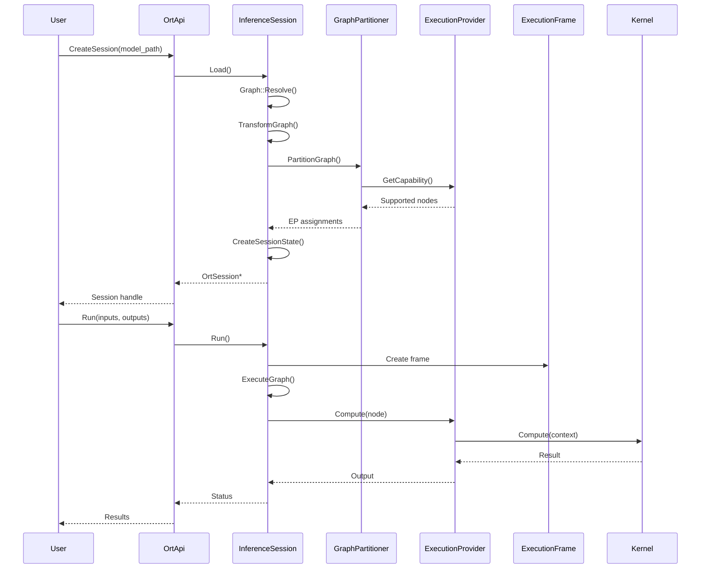

Execution phases:

1. **Load**: User creates a session; runtime loads and parses the model.
2. **Initialize**: The graph is resolved, optimized, partitioned; runtime state is created.
3. **Run**: Given inputs, the runtime executes the graph by invoking kernels through assigned providers, returning outputs to the user.

**Sources:** [onnxruntime/core/session/inference_session.cc:100-500](), [onnxruntime/core/framework/execution_frame.cc]()

---

## Repository Structure

The codebase is organized into directories mapped roughly as follows:

| Directory             | Contents                           |
|-----------------------|----------------------------------|
| `include/onnxruntime/core/session/` | Public C/C++ API headers              |
| `onnxruntime/core/session/`         | Session and API implementation        |
| `onnxruntime/core/framework/`       | Core runtime components and structures|
| `onnxruntime/core/graph/`           | Graph and model representation         |
| `onnxruntime/core/providers/`       | Execution provider implementations    |
| `onnxruntime/core/mlas/`             | MLAS optimized math kernels           |
| `onnxruntime/core/optimizer/`        | Graph optimization passes             |
| `onnxruntime/python/`                | Python bindings (pybind11)             |
| `csharp/src/`                       | C# bindings                          |
| `cmake/`                           | CMake build scripts                   |
| `tools/ci_build/`                  | Build orchestration and CI scripts     |
| `orttraining/`                     | Training API and tooling              |

For a detailed mapping and description of top-level directories, see the child page [Repository Layout](#1.1).

**Sources:** [cmake/CMakeLists.txt:1-100](), [tools/ci_build/build.py:27-28]()

---

## Configuration and Options

Runtime behavior is driven by the `SessionOptions` structure, which configures key aspects:

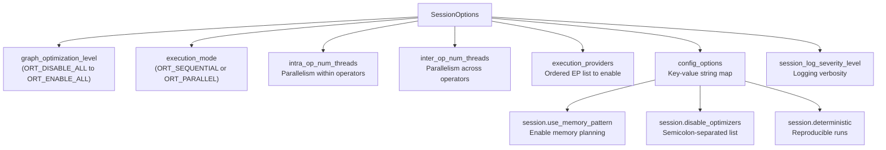

Options specify logging, threading, optimization levels, enabled execution providers, and other advanced tuning parameters.

**Sources:** [onnxruntime/core/framework/session_options.h:1-200](), [include/onnxruntime/core/session/onnxruntime_session_options_config_keys.h]()

---

## Version and Compatibility

The ONNX Runtime C API uses explicit versioning to maintain ABI compatibility:

- The `ORT_API_VERSION` macro defines the API version the header targets. The current version is 31.
- `OrtGetApiBase()` returns a pointer to the API function table (`OrtApi`) for a requested version.
- The `OrtApi` struct provides function pointers serving as a stable ABI boundary.
- New API versions extend interfaces, enabling backward compatibility for clients compiled against older headers.

This versioning scheme ensures that applications built with older ONNX Runtime SDKs continue to function correctly with newer runtime binaries.

**Sources:** [include/onnxruntime/core/session/onnxruntime_c_api.h:37-46](), [onnxruntime/core/session/onnxruntime_c_api.cc:1-100]()

---

This overview introduces the primary architectural components and relationships in ONNX Runtime. For detailed, in-depth information on each subsystem, consult the corresponding child pages in this wiki.

---

# Page: Repository Layout

# Repository Layout

<details>
<summary>Relevant source files</summary>

The following files were used as context for generating this wiki page:

- [README.md](README.md)
- [docs/Roadmap.md](docs/Roadmap.md)
- [java/README.md](java/README.md)
- [java/gradle/wrapper/gradle-wrapper.jar](java/gradle/wrapper/gradle-wrapper.jar)
- [java/gradlew](java/gradlew)
- [java/src/test/java/sample/ScoreMNIST.java](java/src/test/java/sample/ScoreMNIST.java)
- [java/testdata/cnn_mnist_pytorch.onnx](java/testdata/cnn_mnist_pytorch.onnx)
- [java/testdata/lr_mnist_scikit.onnx](java/testdata/lr_mnist_scikit.onnx)
- [js/README.md](js/README.md)
- [js/common/README.md](js/common/README.md)
- [js/node/.gitignore](js/node/.gitignore)
- [js/node/.npmignore](js/node/.npmignore)
- [js/node/README.md](js/node/README.md)
- [js/node/script/install.js](js/node/script/install.js)
- [js/node/script/prepack.ts](js/node/script/prepack.ts)
- [js/react_native/README.md](js/react_native/README.md)
- [js/react_native/app.plugin.js](js/react_native/app.plugin.js)
- [js/react_native/react-native.config.js](js/react_native/react-native.config.js)
- [js/react_native/scripts/bootstrap.js](js/react_native/scripts/bootstrap.js)
- [js/react_native/scripts/prepack.ts](js/react_native/scripts/prepack.ts)
- [js/react_native/unimodule.json](js/react_native/unimodule.json)
- [js/scripts/prepare-onnx-node-tests.ts](js/scripts/prepare-onnx-node-tests.ts)
- [js/scripts/utils.ts](js/scripts/utils.ts)
- [js/web/.gitignore](js/web/.gitignore)
- [js/web/.npmignore](js/web/.npmignore)
- [js/web/README.md](js/web/README.md)
- [js/web/script/prepack.ts](js/web/script/prepack.ts)
- [js/web/script/pull-prebuilt-wasm-artifacts.ts](js/web/script/pull-prebuilt-wasm-artifacts.ts)
- [js/web/types.d.ts](js/web/types.d.ts)
- [requirements-materialize-onnx-node-tests.txt](requirements-materialize-onnx-node-tests.txt)
- [tools/ci_build/github/azure-pipelines/templates/nodejs-artifacts-package-and-publish-steps-posix.yml](tools/ci_build/github/azure-pipelines/templates/nodejs-artifacts-package-and-publish-steps-posix.yml)
- [tools/ci_build/github/azure-pipelines/templates/nodejs-artifacts-package-and-publish-steps-windows.yml](tools/ci_build/github/azure-pipelines/templates/nodejs-artifacts-package-and-publish-steps-windows.yml)

</details>


This page provides a detailed breakdown of the top-level directory structure in the ONNX Runtime repository. Each directory corresponds to a major subsystem or language binding component of ONNX Runtime, and this document describes their roles, key responsibilities, and pointers to relevant code artifacts. This serves as a technical map for developers navigating the codebase.

---

## High-Level Repository Layout Overview

The ONNX Runtime repository is organized into several top-level directories, each embodying a subsystem responsible for a key area of the codebase:

| Directory        | Subsystem / Purpose                                                                                         | Related Wiki Pages            |
|------------------|------------------------------------------------------------------------------------------------------------|------------------------------|
| `onnxruntime/`   | Core ONNX Runtime engine including inference, graph representation, optimizations, kernels, and execution. | Core Architecture, Operators, Execution Providers, etc. |
| `orttraining/`   | ONNX Runtime training subsystem including ORTModule, gradients, training APIs, and graph construction.      | Training System               |
| `js/`            | JavaScript language bindings, including packages for common JS, Node.js, Web, and React Native environments. | Web and JavaScript Runtime, Language Bindings |
| `java/`          | Java language binding for ONNX Runtime via JNI. Includes Java API, Gradle-based build system, JNI glue.    | Language Bindings - Java      |
| `csharp/`        | .NET / C# bindings for ONNX Runtime, including P/Invoke interop and NuGet packaging.                        | Language Bindings - C#        |
| `objectivec/`    | Objective-C / Swift bindings for ONNX Runtime, focusing on iOS/macOS integration and CocoaPods packaging.  | Language Bindings - Objective-C |
| `rust/`          | Rust language bindings allowing safe Rust API access to ONNX Runtime.                                     | Language Bindings - Rust      |
| `go/`            | Go language bindings providing idiomatic Go API for ONNX Runtime.                                          | Language Bindings - Go        |
| `winml/`         | Windows ML (WinML) integration layer providing a WinRT API adapter to ONNX Runtime core.                   | Windows Platform Integration |
| `tools/`         | Various auxiliary tools for building, testing, benchmarking, quantization, and model optimization.         | Python Model Tooling, Testing Infrastructure |
| `cmake/`         | CMake build system files and modules, configuration macros, and common utilities used throughout the build. | Build System, CMake Configuration |

---

## Directory Details

### onnxruntime/

This is the heart of ONNX Runtime containing the C++ core runtime engine, graph system, execution framework, and operator implementations.

- **Contents:**
  - Core runtime code including classes for graph representation (`Graph`, `Node`, `NodeArg`).
  - Session management involving `InferenceSession` and `SessionState`.
  - Execution provider interface implementations for CPU, CUDA, and others.
  - Operator registrations and kernel implementations.
  - Graph transformation and optimization passes.

- **Key code entities:**
  - `InferenceSession` manages model loading, initialization, and execution.
  - Execution Provider interface (`IExecutionProvider`) defines plug-in extensibility.
  - Operator kernel registrations reside under `onnxruntime/core/providers/`.
  
- **Data Flow and Execution:**
  - Model is loaded and parsed into a graph.
  - Graph pass transformations and optimizations are applied.
  - Execution providers compile kernels and execute nodes.
  - Memory allocators and thread pools manage resources efficiently.

---

### orttraining/

Contains components for ONNX Runtime training support.

- **Contents:**
  - Implements `ORTModule` which wraps PyTorch `nn.Module` for ONNX Runtime acceleration.
  - Gradient graph builder and autograd integration.
  - Custom training kernels and operator gradient definitions.
  - Training session management and optimization passes for memory and compute.

- **Key code entities:**
  - `ORTModule` encapsulating PyTorch integration.
  - Gradient graph builder constructs backward graphs.
  - Training session APIs for checkpointing and optimizers.

- **Data Flow:**
  - Forward computation graph exported from PyTorch.
  - Gradient graph automatically generated and compiled.
  - Training loop runs forward and backward passes using ONNX Runtime execution kernels.

---

### js/

JavaScript bindings supporting multiple runtime environments:

- **Subfolders:**
  - `common/` - Contains shared pure TypeScript code usable across Node.js and browsers (e.g., `InferenceSession` interfaces, tensor types).
  - `node/` - Node.js binding that links native ONNX Runtime binaries via N-API.
  - `web/` - WebAssembly and WebGL backends compiled for browsers.
  - `react_native/` - React Native bindings with native modules for mobile.

- **Implementation Highlights:**
  - JavaScript API surface uses TypeScript.
  - `onnxruntime-node` downloads pre-built native binaries and provides idiomatic API for Node.js apps ([js/node/README.md]).
  - `onnxruntime-web` implements WebAssembly compilation of native ONNX Runtime code and exposes it to browsers ([js/web/README.md]).
  - A JavaScript-based installation system downloads platform-specific binaries and WebAssembly artifacts ([js/node/script/install.js], [js/web/script/pull-prebuilt-wasm-artifacts.ts]).

- **Call flow example:**
  ```mermaid
  graph TB
    JS_App[JavaScript App]
    ORM_Pkg[onnxruntime-node Package]
    Native_Bin[ONNXRuntime Native DLL/.so]
    Runtime_API[OrtApi C API]
    
    JS_App -->|Calls| ORM_Pkg
    ORM_Pkg -->|Interop| Native_Bin
    Native_Bin -->|Executes| Runtime_API
  ```

---

### java/

Java API binding for ONNX Runtime managed via JNI:

- **Components:**
  - JNI glue library enabling Java to call ONNX Runtime efficiently.
  - Gradle build scripts manage Java compilation and packaging.
  - Native libraries and JNI are built by main build system and consumed by Gradle tasks.
  - Supports Android usage and telemetry permissions integration.

- **Build system:**
  - CMake builds core `onnxruntime` and `onnxruntime4j_jni`.
  - Gradle builds Java classes and packages them with native libraries.
  - Java API classes reside under `java/src/main/java/ai/onnxruntime/`.

---

### csharp/

.NET bindings providing INFERENCE session abstraction for C#/.NET platforms.

- PInvoke wrappers for `OrtApi`.
- NuGet packaging for distribution.
- Managed lifecycle and exception handling interface for ONNX Runtime.
- Includes documentation, tests, and build scripts.

---

### objectivec/

Objective-C / Swift language binding targeted primarily for Apple platforms:

- Provides CocoaPods packaging.
- Interoperability with native Apple APIs.
- Used for iOS/macOS application integration with ONNX Runtime.

---

### rust/

Rust language binding providing safe idiomatic Rust API on top of ONNX Runtime.

- FFI to native ONNX Runtime.
- Error handling and lifecycle wrappers.
- Minimal overhead with Rust async/await support planned.

---

### go/

Go language binding enabling ONNX Runtime usage from Go applications.

- Uses cgo to bridge native API.
- Provides Go idiomatic API for model inference.

---

### winml/

Windows Machine Learning (WinML) integration layer:

- Provides a WinRT API surface with bindings into ONNX Runtime core.
- Includes adapter layers, image preprocessing helpers.
- Enables Windows-specific features such as telemetry and event tracing (ETW).
- Wraps DirectML operators with shape inference and fusion optimizations.

---

### tools/

A collection of supporting utilities and scripts:

- Python-based model tooling: quantization, transformer model optimizers.
- Test infrastructure for compliance, unit tests, benchmarks.
- CI and CD pipeline scripts.
- Code generation and validation tools.

---

### cmake/

Centralized CMake configuration and modules used by all build targets:

- Defines common build variables and options.
- Provides utility macros for target creation, dependency linking.
- Configures paths for external dependencies.
- Includes platform specific build adjustments.
- Orchestrates the build of core runtime, EPs, language bindings, and tests.

---

## Bridging Natural Language to Code Entities

The following Mermaid diagrams illustrate mappings between subsystem concepts and key code artifacts, assisting developers in navigating from conceptual understanding to actual code locations.

### Diagram 1: ONNX Runtime Core Subsystems to Key Code Artifacts

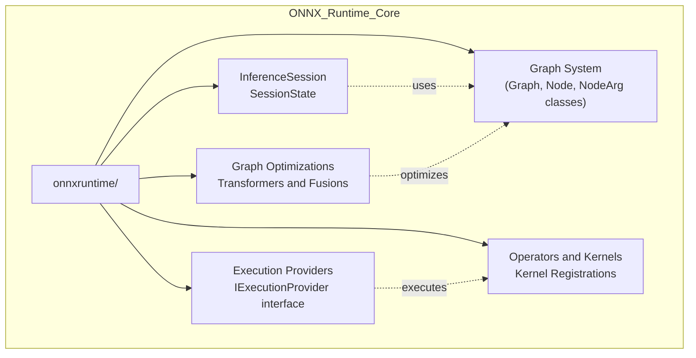

### Code Locations:
- Graph system classes: `onnxruntime/core/graph/graph.h` and related files.
- `InferenceSession` class: `onnxruntime/core/session/inference_session.cc/h`
- Execution Providers: `onnxruntime/core/providers/` subdirectories.
- Operator kernel registration: `onnxruntime/core/providers/cpu/` and other provider folders.
- Graph optimizers: `onnxruntime/core/optimizer/`

---

### Diagram 2: Language Bindings and Platform Interfaces to Code Layout

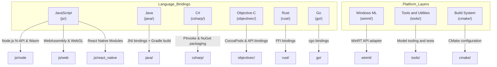

---

## Summary Table of Top-Level Directories and Their Roles

| Directory     | Role & Description                                                                                                     | Wiki Section                   |
|---------------|-----------------------------------------------------------------------------------------------------------------------|-------------------------------|
| `onnxruntime` | Core C++ runtime engine, graph handling, inference logic, execution providers, operators, and optimizations.           | 3. Core Architecture, 6. EPs, 7. Operators |
| `orttraining` | Training subsystem supporting PyTorch integration, autograd, custom kernels, gradient graph construction.             | 8. Training System             |
| `js`          | JavaScript/TypeScript language bindings including Node.js, WebAssembly, WebGL, React Native support for ONNX Runtime. | 10. Web and JavaScript Runtime |
| `java`        | Java binding with JNI glue, Gradle build integration, Android support, native library loading.                         | 5.5 Java and Android Bindings  |
| `csharp`      | .NET binding providing C# API with PInvoke layers, NuGet packaging, and memory management wrappers.                    | 5.3 C# Bindings                |
| `objectivec`  | Objective-C/Swift language binding for Apple platforms, CocoaPods packaging, and iOS/macOS compatibility.               | 5.6 Mobile and other bindings  |
| `rust`        | Rust native binding enabling safe ONNX Runtime calls from Rust applications.                                           | 5.6 Mobile and other bindings  |
| `go`          | Go language binding implemented via cgo for calling native ONNX Runtime APIs.                                         | 5.6 Mobile and other bindings  |
| `winml`       | Windows ML integration providing WinRT-based API surface and DML operator layer.                                      | 12. Windows Platform Integration |
| `tools`       | Collection of Python and other scripts for testing, quantization, benchmarking, and model optimization tooling.        | 11. Python Model Tooling, 9. Testing Infrastructure |
| `cmake`       | CMake build system files, macros, and utilities controlling build configuration and dependency management.             | 2.2 CMake Configuration        |

---

## Concluding Notes

This structured directory layout supports extensibility, multi-language language binding support, and cross-platform compatibility, aligned with ONNX Runtime’s goals of performance and broad hardware coverage. Each directory encapsulates discrete functionality and bridges the rich ONNX Runtime core with varied language ecosystems and target platforms.

---

# References

- `README.md` lines 1-53: Project overview and key concepts.
- `js/README.md` lines 1-201: JavaScript bindings overview and package breakdown.
- `js/web/README.md` lines 1-75: Details on ONNX Runtime Web directory.
- `js/node/README.md` lines 1-58: Node.js binding explanation and installation details.
- `java/README.md` lines 1-74: Java bindings and build system notes.
- `js/node/script/install.js` lines 1-135: Node.js binding installation logic for native binaries.
- `js/web/script/pull-prebuilt-wasm-artifacts.ts` lines 1-195: WASM artifact retrieval script.
- General knowledge from directory naming conventions and standard runtime binding patterns.

Sources:  
`README.md:1-53`  
`js/README.md:1-201`  
`js/web/README.md:1-75`  
`js/node/README.md:1-58`  
`java/README.md:1-74`  
`js/node/script/install.js:1-135`  
`js/web/script/pull-prebuilt-wasm-artifacts.ts:1-195`

---

# Page: Getting Started

# Getting Started

<details>
<summary>Relevant source files</summary>

The following files were used as context for generating this wiki page:

- [.github/dependabot.yml](.github/dependabot.yml)
- [.lintrunner.toml](.lintrunner.toml)
- [.vscode/settings.json](.vscode/settings.json)
- [ThirdPartyNotices.txt](ThirdPartyNotices.txt)
- [cgmanifests/cgmanifest.json](cgmanifests/cgmanifest.json)
- [cmake/CMakeLists.txt](cmake/CMakeLists.txt)
- [cmake/deps.txt](cmake/deps.txt)
- [cmake/external/onnxruntime_external_deps.cmake](cmake/external/onnxruntime_external_deps.cmake)
- [cmake/node_helper.cmake](cmake/node_helper.cmake)
- [cmake/onnxruntime.cmake](cmake/onnxruntime.cmake)
- [cmake/onnxruntime_common.cmake](cmake/onnxruntime_common.cmake)
- [cmake/onnxruntime_framework.cmake](cmake/onnxruntime_framework.cmake)
- [cmake/onnxruntime_graph.cmake](cmake/onnxruntime_graph.cmake)
- [cmake/onnxruntime_optimizer.cmake](cmake/onnxruntime_optimizer.cmake)
- [cmake/onnxruntime_providers.cmake](cmake/onnxruntime_providers.cmake)
- [cmake/onnxruntime_providers_cpu.cmake](cmake/onnxruntime_providers_cpu.cmake)
- [cmake/onnxruntime_providers_webgpu.cmake](cmake/onnxruntime_providers_webgpu.cmake)
- [cmake/onnxruntime_python.cmake](cmake/onnxruntime_python.cmake)
- [cmake/onnxruntime_session.cmake](cmake/onnxruntime_session.cmake)
- [cmake/onnxruntime_training.cmake](cmake/onnxruntime_training.cmake)
- [cmake/onnxruntime_unittests.cmake](cmake/onnxruntime_unittests.cmake)
- [dockerfiles/Dockerfile.cuda](dockerfiles/Dockerfile.cuda)
- [dockerfiles/Dockerfile.migraphx](dockerfiles/Dockerfile.migraphx)
- [dockerfiles/Dockerfile.openvino](dockerfiles/Dockerfile.openvino)
- [dockerfiles/Dockerfile.source](dockerfiles/Dockerfile.source)
- [dockerfiles/Dockerfile.tensorrt](dockerfiles/Dockerfile.tensorrt)
- [dockerfiles/Dockerfile.vitisai](dockerfiles/Dockerfile.vitisai)
- [dockerfiles/README.md](dockerfiles/README.md)
- [dockerfiles/scripts/install_common_deps.sh](dockerfiles/scripts/install_common_deps.sh)
- [docs/BuildWithDawnAgilitySDK.md](docs/BuildWithDawnAgilitySDK.md)
- [docs/Coding_Conventions_and_Standards.md](docs/Coding_Conventions_and_Standards.md)
- [docs/How_To_Update_ONNX_Dev_Notes.md](docs/How_To_Update_ONNX_Dev_Notes.md)
- [docs/cmake_guideline.md](docs/cmake_guideline.md)
- [onnxruntime/python/backend/backend.py](onnxruntime/python/backend/backend.py)
- [onnxruntime/python/backend/backend_rep.py](onnxruntime/python/backend/backend_rep.py)
- [onnxruntime/test/python/onnxruntime_test_python_backend.py](onnxruntime/test/python/onnxruntime_test_python_backend.py)
- [onnxruntime/test/python/onnxruntime_test_python_backend_mlops.py](onnxruntime/test/python/onnxruntime_test_python_backend_mlops.py)
- [onnxruntime/test/python/onnxruntime_test_python_cudagraph.py](onnxruntime/test/python/onnxruntime_test_python_cudagraph.py)
- [onnxruntime/test/python/onnxruntime_test_python_keras.py](onnxruntime/test/python/onnxruntime_test_python_keras.py)
- [onnxruntime/test/python/onnxruntime_test_python_mlops.py](onnxruntime/test/python/onnxruntime_test_python_mlops.py)
- [onnxruntime/test/python/onnxruntime_test_python_sparse_matmul.py](onnxruntime/test/python/onnxruntime_test_python_sparse_matmul.py)
- [pyproject.toml](pyproject.toml)
- [requirements-dev.txt](requirements-dev.txt)
- [requirements-lintrunner.txt](requirements-lintrunner.txt)
- [requirements-training.txt](requirements-training.txt)
- [requirements.txt](requirements.txt)
- [setup.py](setup.py)
- [tools/ci_build/build.py](tools/ci_build/build.py)
- [tools/ci_build/build_args.py](tools/ci_build/build_args.py)
- [tools/ci_build/gen_def.py](tools/ci_build/gen_def.py)
- [tools/ci_build/github/linux/docker/Dockerfile.ubuntu_openvino](tools/ci_build/github/linux/docker/Dockerfile.ubuntu_openvino)
- [tools/ci_build/github/linux/docker/Dockerfile.ubuntu_tensorrt_bin](tools/ci_build/github/linux/docker/Dockerfile.ubuntu_tensorrt_bin)
- [tools/ci_build/github/linux/docker/scripts/install_os_deps.sh](tools/ci_build/github/linux/docker/scripts/install_os_deps.sh)
- [tools/ci_build/github/linux/docker/scripts/install_ubuntu.sh](tools/ci_build/github/linux/docker/scripts/install_ubuntu.sh)
- [tools/ci_build/github/linux/docker/scripts/manylinux/install_shared_deps.sh](tools/ci_build/github/linux/docker/scripts/manylinux/install_shared_deps.sh)
- [tools/python/find_optimizer_opset_version_updates_required.py](tools/python/find_optimizer_opset_version_updates_required.py)

</details>


This page provides a detailed technical guide on how to build, install, and run a first inference using the ONNX Runtime codebase. It covers the build orchestration, pointing to relevant Dockerfiles for containerized environments, and highlights sample usage for running inference. This guide is intended for developers seeking to integrate or contribute to ONNX Runtime and want to quickly set up a working environment for inference tasks.

---

## 1. Building ONNX Runtime

### 1.1 Build System Overview

ONNX Runtime uses a CMake-based build system orchestrated primarily by the Python script `build.py` located in `tools/ci_build/build.py`. This script:

- Checks the Python environment version (requires Python ≥ 3.8).
- Handles platform-specific environment variable settings.
- Runs submodule updates.
- Orchestrates calls to CMake and the underlying compiler toolchain(s).
- Provides many build-time options such as enabling CUDA or other execution providers, static analysis, unit tests, and training support.

The main project CMakeLists is located at `cmake/CMakeLists.txt` and sets compilation standards, compiler flags, and options for execution providers and other features like Python bindings.

### 1.2 Using `build.py` to Build

Invoke the build script from the root repository directory:

```bash
python3 tools/ci_build/build.py --build_dir build --config Release --build_shared_lib --parallel --enable_cpu
```

This is a typical command to build the shared CPU-only ONNX Runtime library.

- `--build_dir` specifies the output directory for intermediate and final build artifacts.
- `--config` specifies build configuration, e.g., Debug or Release.
- `--build_shared_lib` builds a shared library instead of a static one.
- `--parallel` builds using multiple cores.
- `--enable_cpu` enables building the CPU execution provider.

The build script dynamically assembles the CMake command line based on flags provided, supports handling dependencies, and prepares the build environment per platform.

### 1.3 Key Build Options

- `--use_cuda`: Enable building with CUDA execution provider.
- `--enable_training`: Include training components.
- `--enable_python`: Build and install Python bindings.
- `--enable_openvino`, `--enable_tensorrt`, `--enable_coreml`, etc.: Enable respective hardware accelerators.
- `--build_tests`: Build unit and integration tests.

---

## 2. Dockerfiles for Environment Setup

ONNX Runtime provides official Dockerfiles for quick environment setup with prebuilt dependencies and environment configurations tailored to different execution providers.

### 2.1 Available Docker Images

Refer to `dockerfiles/README.md` for a summary of supported Docker images:

| Execution Provider              | Dockerfile               | Notes/Platform                       |
|-------------------------------|-------------------------|------------------------------------|
| CPU (x86_64 and ARM64)         | `Dockerfile.source`      | Supports Python bindings            |
| CUDA                          | `Dockerfile.cuda`        | CUDA 12.x, CuDNN 9.x on Ubuntu 24.04 |
| TensorRT                      | `Dockerfile.tensorrt`    | CUDA 11.8, TensorRT 8.5.1 on Ubuntu 20.04 |
| OpenVINO                      | `Dockerfile.openvino`    | Supports Python and C# bindings    |
| MIGraphX                      | `Dockerfile.migraphx`    |                                   |
| VitisAI                      | `Dockerfile.vitisai`     |                                   |
| NVIDIA Jetson (TX1/TX2/Xavier/Nano) | `Dockerfile.jetson`   | For embedded ARM devices           |

### 2.2 Sample Docker Usage

Build a CPU-based Docker image from the root directory:

```bash
docker build -t onnxruntime-source -f dockerfiles/Dockerfile.source ..
```

Run the built image interactively:

```bash
docker run -it onnxruntime-source
```

For CUDA:

```bash
docker build -t onnxruntime-cuda -f dockerfiles/Dockerfile.cuda --build-arg CUDA_VERSION=12.x --build-arg CUDNN_VERSION=9.x ..
docker run --rm --gpus all -it onnxruntime-cuda
```

This offers a fully contained environment for development, testing, and inference execution.

---

## 3. Installing and Running a First Inference

### 3.1 Python Installation

The Python bindings are built optionally with the `--enable_python` flag. The Python package is managed by `setup.py` in the root directory.

To build and install the Python wheel locally after building with Python enabled:

```bash
pip install .
```

Alternatively, install from PyPI for a prebuilt package:

```bash
pip install onnxruntime
```

### 3.2 Sample Code to Run an Inference

Below is an example using the Python API with `InferenceSession`:

```python
import onnxruntime as ort
import numpy as np

# Load ONNX model
session = ort.InferenceSession("model.onnx")

# Prepare input data (assume single input named 'input')
inputs = {"input": np.random.rand(1, 3, 224, 224).astype(np.float32)}

# Run inference
outputs = session.run(None, inputs)

print("Output:", outputs)
```

### 3.3 C++ Usage

The main API class for inference is `onnxruntime::InferenceSession`. The typical lifecycle is:

1. Construct the environment `onnxruntime::Env`.
2. Create a `InferenceSession` with `SessionOptions`.
3. Initialize the session with `Load` or `Initialize`.
4. Run inference with `Run`.

Detailed documentation for C++ API and examples can be found in the `onnxruntime/` folder and samples.

---

## 4. Implementation and Data Flow Highlights

### 4.1 Build Orchestration (`tools/ci_build/build.py`)

- Starts by checking Python version and resolving pre-requisite executables.
- Pulls git submodules recursively.
- Prepares symlinks or shortcuts for model and test data.
- Resolves and applies environment variables for different platforms.
- Delegates to CMake to generate build system files for the selected generator (e.g., Ninja, MSBuild).
- Invokes the CMake build with requested configurations and parallelism.

### 4.2 CMake Build System (`cmake/CMakeLists.txt`)

- Defines global project settings.
- Sets compiler standards and flags, including platform-specific options.
- Enables/disables build features via options.
- Loads sub-CMake files for providers, tests, and dependencies.
- Generates build targets: static/shared libraries, Python extensions, sample executables, and tests.
- Handles linking and symbol exporting for shared libraries.

### 4.3 Key Classes for Running Inference

- **`onnxruntime::InferenceSession`**: Central class managing model loading, session initialization, and inference execution.
- **`SessionOptions`**: Configures session properties like optimization level, threading, providers.
- **`Env`**: Global runtime environment.
- **`OrtApi` / `OrtSession` (C API)**: Stable API for external language bindings.
  
These classes interact to load an ONNX model protobuf file, optimize the computation graph, select execution providers, allocate input/output tensors, and execute the graph for inference results.

---

## 5. Diagrams

### 5.1 High-Level Build Flow

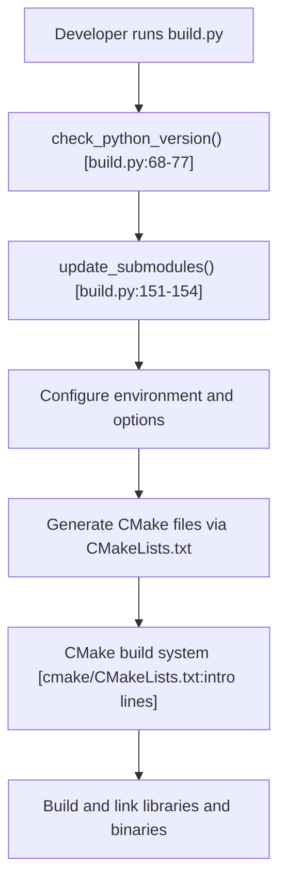

### 5.2 Inference Execution Flow (Python API)

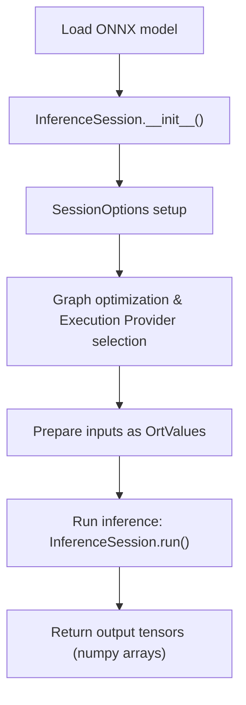

### 5.3 Mapping of Natural Language Concepts to Code Entities for Building ONNX Runtime

```mermaid
graph LR
    "Build Script" -->|"runs"| "tools/ci_build/build.py[build.py:1-197]"
    "CMake Configuration" -->|"defined in"| "cmake/CMakeLists.txt[cmake/CMakeLists.txt:1-118]"
    "Build Options" -->|"parsed by"| "tools/ci_build/build.py[build.py:20-180]"
    "Build Artifacts" -->|"produced by"| "CMake build targets"
    "Execution Providers" -->|"managed by"| "cmake/onnxruntime_providers.cmake"
```

### 5.4 Mapping of Running Inference with Python to Code Entities

```mermaid
graph LR
    "Python API" -->|"uses"| "onnxruntime_pybind11_state (C++ Python bindings) [cmake/onnxruntime_python.cmake:1-152]"
    "InferenceSession" -->|"C++ Class"| "onnxruntime::InferenceSession"
    "SessionOptions" -->|"C++ Class"| "onnxruntime::SessionOptions"
    "Run()" -->|"calls"| "SessionState->Execute()"
    "Input Tensors" -->|"converted to"| "OrtValue"
```

---

## 6. Summary and References

- Building ONNX Runtime is centralized through `tools/ci_build/build.py`, which manages environment, configuration, and orchestration of the CMake build system.
- The core CMakeLists controls the compilation mechanics and inclusion of optional features.
- Dockerfiles in `dockerfiles/` provide pre-configured container environments supporting CPU, CUDA, TensorRT, OpenVINO, and other providers.
- The Python package built by `setup.py` uses pybind11-based bindings that call into the core C++ runtime to load models and run inference.
- Sample inference code is simple using the Python bindings (`InferenceSession`), while C++ allows deeper customization.
- This page serves as the technical onboarding for developers who want to build and execute models with ONNX Runtime.

---

**Sources:**  
- `tools/ci_build/build.py:1-197`  
- `cmake/CMakeLists.txt:1-118`  
- `dockerfiles/README.md:1-153`  
- `setup.py:1-181`  
- `cmake/onnxruntime_python.cmake:1-152`  
- `cmake/onnxruntime_providers.cmake`  
- `cmake/onnxruntime.cmake:1-154`

---

# Page: Build System

# Build System

<details>
<summary>Relevant source files</summary>

The following files were used as context for generating this wiki page:

- [ThirdPartyNotices.txt](ThirdPartyNotices.txt)
- [cgmanifests/cgmanifest.json](cgmanifests/cgmanifest.json)
- [cmake/CMakeLists.txt](cmake/CMakeLists.txt)
- [cmake/deps.txt](cmake/deps.txt)
- [cmake/external/onnxruntime_external_deps.cmake](cmake/external/onnxruntime_external_deps.cmake)
- [cmake/onnxruntime.cmake](cmake/onnxruntime.cmake)
- [cmake/onnxruntime_common.cmake](cmake/onnxruntime_common.cmake)
- [cmake/onnxruntime_framework.cmake](cmake/onnxruntime_framework.cmake)
- [cmake/onnxruntime_graph.cmake](cmake/onnxruntime_graph.cmake)
- [cmake/onnxruntime_optimizer.cmake](cmake/onnxruntime_optimizer.cmake)
- [cmake/onnxruntime_providers.cmake](cmake/onnxruntime_providers.cmake)
- [cmake/onnxruntime_providers_cpu.cmake](cmake/onnxruntime_providers_cpu.cmake)
- [cmake/onnxruntime_providers_webgpu.cmake](cmake/onnxruntime_providers_webgpu.cmake)
- [cmake/onnxruntime_python.cmake](cmake/onnxruntime_python.cmake)
- [cmake/onnxruntime_session.cmake](cmake/onnxruntime_session.cmake)
- [cmake/onnxruntime_training.cmake](cmake/onnxruntime_training.cmake)
- [cmake/onnxruntime_unittests.cmake](cmake/onnxruntime_unittests.cmake)
- [docs/BuildWithDawnAgilitySDK.md](docs/BuildWithDawnAgilitySDK.md)
- [setup.py](setup.py)
- [tools/ci_build/build.py](tools/ci_build/build.py)
- [tools/ci_build/build_args.py](tools/ci_build/build_args.py)
- [tools/ci_build/gen_def.py](tools/ci_build/gen_def.py)

</details>


This document provides a high-level overview of the comprehensive ONNX Runtime build system. It orchestrates the compilation and packaging of the runtime across multiple platforms and configurations, including the core build orchestration with `build.py`, the modular CMake configuration system, external dependency management, and packaging infrastructure for language bindings and platform-specific artifacts.

The build system supports:
- Multiple operating systems (Windows, Linux, macOS, Android, iOS, WebAssembly).
- Diverse execution providers for hardware acceleration (CPU, CUDA, TensorRT, DirectML, CoreML, QNN, WebGPU, etc.).
- Various packaging formats such as Python wheels, NuGet packages, Android AARs, Apple frameworks, and npm bundles.

For detailed information on specific build subsystems, see the following linked child pages:
- [Build Orchestration](#2.1) — Detailed explanation of the `build.py` orchestration script, command line interface, and its role in configuring and launching builds.
- [CMake Configuration](#2.2) — Documentation of the layered CMake build system, core library modules, and integration of execution providers.
- [External Dependencies](#2.3) — Management of third-party libraries and dependencies using `deps.txt`, integration with vcpkg, and key external tools like Protobuf and Flatbuffers.
- [CI/CD Pipelines](#2.4) — Infrastructure for automated builds, linting, tests, and documentation publishing using Azure Pipelines and GitHub Actions.
- [Platform-Specific Packaging](#2.5) — Packaging strategies to generate language-specific and platform-specific artifacts including Python wheels, NuGet packages, Android AARs, Apple pods/xcframeworks, and npm packages.

---

## Build System Architecture

The build system is designed with multiple abstraction layers. At the top level, a Python orchestrator (`build.py`) drives the configuration and execution of the CMake build process. CMake, using modular scripts, sets up compilation for core runtime components, execution providers, language bindings, and tests. The build outputs include shared/static libraries and language-specific packages.

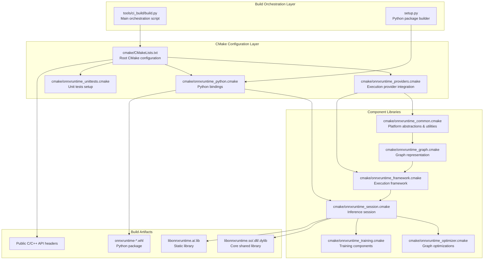

Sources: [tools/ci_build/build.py:1-100](), [cmake/CMakeLists.txt:1-50](), [cmake/onnxruntime_providers.cmake:1-30]()

---

## Core Build Orchestration

The `build.py` script is the primary command-line interface to configure and drive builds for ONNX Runtime. It parses diverse build configurations, applies platform-specific logic, manages external dependencies, invokes CMake with tailored arguments, and initiates compilation.

### Build Configuration Management

`build.py` provides a rich command-line interface exposing options to control platforms, execution providers, build types, and other key settings:

```mermaid
graph TD
    BuildPy["build.py"]

    subgraph "Platform Selection"
        WindowsOpts["--use_winml<br/>--use_dml<br/>--use_gdk"]
        LinuxOpts["--use_cuda<br/>--use_tensorrt<br/>--use_rocm"]
        MobileOpts["--android<br/>--ios<br/>--build_wasm"]
    end
    
    subgraph "Execution Providers"
        GPUProviders["--use_cuda<br/>--use_tensorrt<br/>--use_dml<br/>--use_rocm"]
        HardwareProviders["--use_qnn<br/>--use_coreml<br/>--use_nnapi<br/>--use_webnn"]
        CloudProviders["--use_azure<br/>--use_openvino"]
    end
    
    subgraph "Build Types"
        DebugConfig["--config Debug"]
        Minimal["--minimal_build"]
        Training["--enable_training"]
        SharedLib["--build_shared_lib"]
    end
    
    subgraph "CMake Generation"
        CMakeArgs["generate_build_tree()"]
        VcpkgOpts["generate_vcpkg_install_options()"]
        CrossCompile["Cross-compilation setup"]
    end
    
    BuildPy --> WindowsOpts
    BuildPy --> LinuxOpts
    BuildPy --> MobileOpts
    BuildPy --> GPUProviders
    BuildPy --> HardwareProviders
    BuildPy --> CloudProviders
    BuildPy --> DebugConfig
    BuildPy --> Minimal
    BuildPy --> Training
    BuildPy --> SharedLib
    
    BuildPy --> CMakeArgs
    BuildPy --> VcpkgOpts
    BuildPy --> CrossCompile
```

This orchestration ensures consistent, configurable builds across all targeted environments.

Sources: [tools/ci_build/build.py:30-100](), [tools/ci_build/build.py:344-800]()

### Platform-Specific Build Logic

Within `build.py`, the `generate_build_tree()` function applies platform-specific configurations:

| Platform   | Key Configurations                             | CMake Toolchain               |
|------------|-----------------------------------------------|------------------------------|
| Windows    | MSVC toolchain, DirectML, WinML, CUDA support| Default MSVC toolchain        |
| Linux      | CUDA, TensorRT, ROCm, NCCL, XNNPACK           | GCC/Clang                    |
| macOS/iOS  | CoreML, Metal, Apple framework, VisionOS      | Apple Clang                  |
| Android    | NNAPI, cross-compilation via Android NDK      | Android NDK                  |
| WebAssembly| Emscripten toolchain with SIMD/threading support | Emscripten                   |

The build system integrates `vcpkg` dependency management through `generate_vcpkg_install_options()`, which computes platform-appropriate triplets resolving required third-party dependencies.

Sources: [tools/ci_build/build.py:344-450](), [tools/ci_build/build.py:541-640]()

---

## CMake Component Architecture

The CMake configuration is modular, facilitating maintenance and extensibility. It organizes the build around core runtime libraries, execution providers, language bindings, tests, and training components.

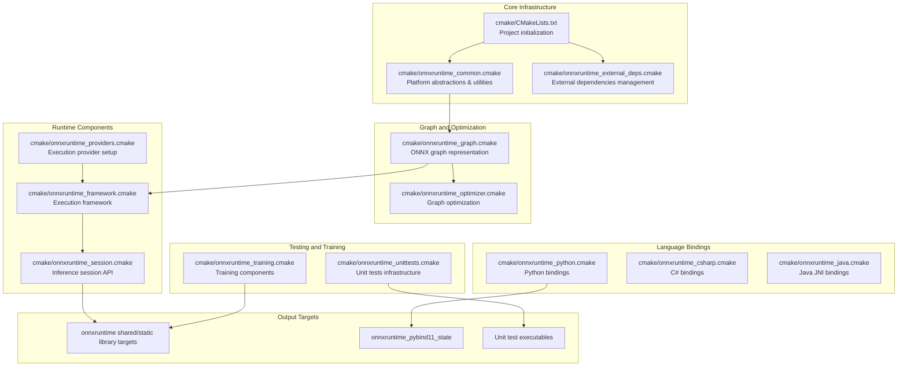

This modularity allows clean separation of concerns from graph management to runtime execution and language bindings.

Sources: [cmake/CMakeLists.txt:1-100](), [cmake/onnxruntime_common.cmake:1-50](), [cmake/onnxruntime_graph.cmake:1-30]()

### Execution Provider Integration

Execution providers that enable hardware acceleration are integrated through `onnxruntime_providers.cmake`. This script conditionally includes provider-specific CMake modules, enabling fine-grained control over which providers get built and linked in.

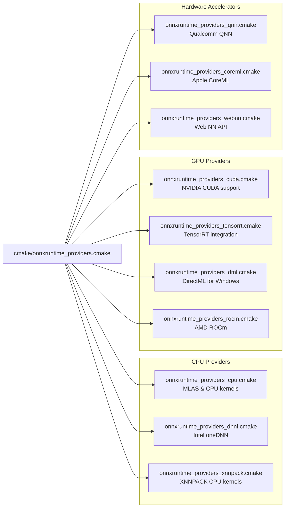

Each provider module declares its source files, dependencies, include directories, and CMake compile definitions conditionally based on build options.

Sources: [cmake/onnxruntime_providers.cmake:60-120](), [cmake/onnxruntime_providers.cmake:140-198]()

---

## Cross-Platform Build Support

### Platform Detection and Configuration

The build system supports various platforms with specific configurations managed mainly in `onnxruntime_common.cmake`. Architecture detection and specialized handling enable builds tailored to platform needs.

| Platform | Architecture Detection & Config | Special Handling                         |
|----------|--------------------------------|----------------------------------------|
| Windows  | `onnxruntime_target_platform`  | ARM64EC support, MSVC options          |
| Linux    | `CMAKE_SYSTEM_PROCESSOR`       | RISC-V/ARM support, thread settings    |
| macOS    | `CMAKE_OSX_ARCHITECTURES`      | Universal binaries, macOS/iOS frameworks |
| Android  | `CMAKE_ANDROID_ARCH_ABI`       | NDK toolchain, API level control       |
| WebAssembly | Emscripten environment detection | SIMD, thread, exceptions configuration |

Sources: [cmake/onnxruntime_common.cmake:69-85](), [cmake/onnxruntime_common.cmake:180-220]()

### Dependency Management with vcpkg

ONNX Runtime's build system optionally integrates `vcpkg` to manage third-party dependencies cross-platform. The `build.py` script generates vcpkg triplets for each target platform to simplify dependency resolution.

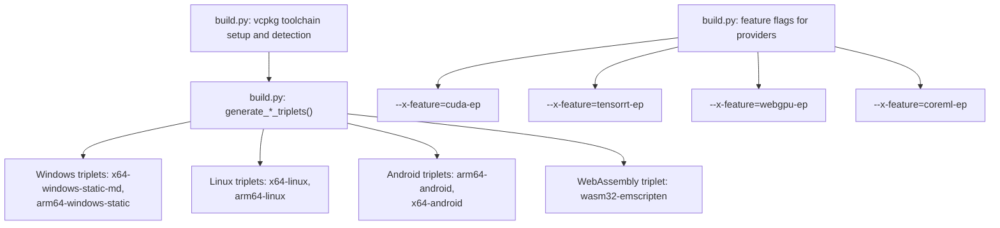

These triplets ensure dependencies are built with the correct settings per CPU architecture and platform.

Sources: [tools/ci_build/build.py:244-290](), [tools/ci_build/build.py:541-580](), [tools/ci_build/build.py:617-640]()

---

## Build Artifacts and Packaging

### Shared Library Generation

The core ONNX Runtime shared library (`onnxruntime.dll`/`libonnxruntime.so`/`libonnxruntime.dylib`) is built via the CMake configuration in `onnxruntime.cmake`. This process involves creating platform-specific symbol export files using the `gen_def.py` Python script to ensure proper linkage and symbol visibility.

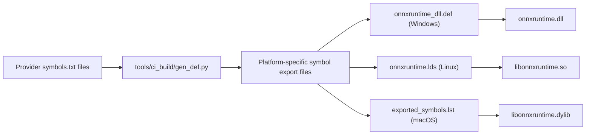

The build system supports both shared and static library outputs with appropriate compile and link flags per platform.

Sources: [tools/ci_build/gen_def.py:6-35](), [cmake/onnxruntime.cmake:60-80](), [cmake/onnxruntime.cmake:148-170]()

### Python Package Building

Python packaging is handled primarily through `setup.py`, which builds platform-specific wheels based on active features and platform detection. The packaging process accounts for dynamic library dependencies, ensures correct RPATH settings, bundles CUDA/cuDNN and other relevant binaries, and applies `auditwheel` for manylinux compatibility on Linux.

| Package Variant                | Platforms                   | Special Handling                       |
|-------------------------------|-----------------------------|--------------------------------------|
| `onnxruntime`                  | All supported platforms      | CPU execution provider only           |
| `onnxruntime-gpu`              | Windows, Linux               | CUDA support with cuDNN dependencies |
| `onnxruntime-openvino`         | Windows, Linux               | OpenVINO execution provider           |
| `onnxruntime-qnn`              | Linux, Android              | Qualcomm QNN support                  |

The packaging infrastructure handles optional dependency delay-loading and generates custom Python C extensions as needed.

Sources: [setup.py:23-50](), [setup.py:130-200](), [setup.py:280-300]()

---

# Summary

ONNX Runtime’s build system is a layered orchestration combining:
- The flexible Python orchestration script `build.py` for configuring platform-specific builds.
- A modular, well-structured CMake build configuration that supports core runtime libraries, execution providers, and bindings.
- External dependencies managed via `deps.txt` and optionally through `vcpkg` triplets.
- Packaging for diverse target platforms and language ecosystems including Python wheels, NuGet, Android packages, and Apple frameworks.
- Automation of cross-platform build details including symbol exporting and linking.

For comprehensive technical details, usage instructions, and build examples, please consult the relevant child pages linked at the beginning.

---

Sources:  
- tools/ci_build/build.py:1-100, 244-290, 344-800  
- cmake/CMakeLists.txt:1-118  
- cmake/onnxruntime_providers.cmake:1-200  
- cmake/onnxruntime_common.cmake:1-153  
- cmake/onnxruntime.cmake:1-154  
- tools/ci_build/gen_def.py:1-40  
- setup.py:1-181

---

# Page: Build Orchestration

# Build Orchestration

<details>
<summary>Relevant source files</summary>

The following files were used as context for generating this wiki page:

- [ThirdPartyNotices.txt](ThirdPartyNotices.txt)
- [cgmanifests/cgmanifest.json](cgmanifests/cgmanifest.json)
- [cmake/CMakeLists.txt](cmake/CMakeLists.txt)
- [cmake/deps.txt](cmake/deps.txt)
- [cmake/external/onnxruntime_external_deps.cmake](cmake/external/onnxruntime_external_deps.cmake)
- [cmake/onnxruntime.cmake](cmake/onnxruntime.cmake)
- [cmake/onnxruntime_common.cmake](cmake/onnxruntime_common.cmake)
- [cmake/onnxruntime_framework.cmake](cmake/onnxruntime_framework.cmake)
- [cmake/onnxruntime_graph.cmake](cmake/onnxruntime_graph.cmake)
- [cmake/onnxruntime_optimizer.cmake](cmake/onnxruntime_optimizer.cmake)
- [cmake/onnxruntime_providers.cmake](cmake/onnxruntime_providers.cmake)
- [cmake/onnxruntime_providers_cpu.cmake](cmake/onnxruntime_providers_cpu.cmake)
- [cmake/onnxruntime_providers_webgpu.cmake](cmake/onnxruntime_providers_webgpu.cmake)
- [cmake/onnxruntime_python.cmake](cmake/onnxruntime_python.cmake)
- [cmake/onnxruntime_session.cmake](cmake/onnxruntime_session.cmake)
- [cmake/onnxruntime_training.cmake](cmake/onnxruntime_training.cmake)
- [cmake/onnxruntime_unittests.cmake](cmake/onnxruntime_unittests.cmake)
- [docs/BuildWithDawnAgilitySDK.md](docs/BuildWithDawnAgilitySDK.md)
- [setup.py](setup.py)
- [tools/ci_build/build.py](tools/ci_build/build.py)
- [tools/ci_build/build_args.py](tools/ci_build/build_args.py)
- [tools/ci_build/gen_def.py](tools/ci_build/gen_def.py)

</details>


## Overview

Build orchestration in ONNX Runtime is managed by the primary script `build.py` located at `tools/ci_build/build.py`. This Python script acts as the centralized entry point for configuring, generating, and executing builds across all supported platforms including Windows, Linux, macOS, Android, iOS, WebAssembly, and embedded targets.

`build.py` simplifies the build process by wrapping CMake invocations and abstracting away platform-specific intricacies. Its responsibilities include:

- Parsing extensive command-line options for fine-grained build configuration.
- Detecting the host and target platform environment.
- Managing external dependencies and submodules.
- Constructing the appropriate CMake command-line invocation with all relevant build definitions.
- Running the CMake build process, optionally running tests, and preparing post-build artifacts.

This script enables consistent, repeatable builds for both local development and CI pipeline environments.

**Related pages for further build system details:**

- [CMake Configuration](#2.2) - Core CMake build system modules and settings  
- [External Dependencies](#2.3) - Dependency management including deps.txt, vcpkg integration  
- [CI/CD Pipelines](#2.4) - Continuous integration and automation  
- [Platform-Specific Packaging](#2.5) - Packaging for Python wheels, NuGet, Android, etc.

**Sources:** [tools/ci_build/build.py:1-1890]()

---

## Build Script Entry Point

The orchestration script is written in Python and requires Python 3.8 or newer ([tools/ci_build/build.py:68-77]()). It uses a modular design with functions and classes to encapsulate build logic.

Key imported modules include:

- `build_args` for command-line parsing ([tools/ci_build/build.py:32]())
- Platform utility functions such as `is_windows()`, `is_linux()`, `is_macOS()`
- Functions for generating platform-specific triplets used by vcpkg
- Custom `run_subprocess()` wrappers for controlled invocation of external commands like CMake and Git

### Selected Key Functions and Classes

| Function / Class          | Description                                    | Location                    |
|--------------------------|------------------------------------------------|-----------------------------|
| `_check_python_version()` | Ensures minimum Python version 3.8 is running | [tools/ci_build/build.py:68-77]()   |
| `parse_arguments()`       | Parses the command-line interface              | [tools/ci_build/build.py:32]()       |
| `generate_build_tree()`   | Main CMake generation orchestrator             | [tools/ci_build/build.py:340-906]()  |
| `update_submodules()`     | Synchronizes Git submodules recursively         | [tools/ci_build/build.py:151-153]()  |
| `setup_test_data()`       | Creates symbolic links or junctions for test models | [tools/ci_build/build.py:156-180]() |
| `run_subprocess()`        | Invokes external commands with environment setup | [tools/ci_build/build.py:109-148]()  |
| `generate_vcpkg_install_options()` | Constructs vcpkg feature flags for dependencies | [tools/ci_build/build.py:242-337]() |

**Sources:** [tools/ci_build/build.py:1-77](), [tools/ci_build/build.py:109-196](), [tools/ci_build/build.py:242-337](), [tools/ci_build/build.py:340-906]()

---

## Build Orchestration Flow

The build process orchestrated by `build.py` can be summarized in the following flow:

```mermaid
graph TB
    User["User executes:<br/>python tools/ci_build/build.py"]
    ParseArgs["parse_arguments()<br/>from build_args module"]
    CheckPython["_check_python_version()<br/>Require Python >= 3.8"]
    PlatformDetect["Platform Detection:<br/>is_windows(), is_linux(), is_macOS()"]
    ConfigBuildDir["get_config_build_dir(build_dir, config)<br/>Returns: build_dir/config"]
    
    subgraph "Dependency Management"
        UpdateSubmodules["update_submodules(source_dir)<br/>git submodule update --init --recursive"]
        VcpkgCheck{"--use_vcpkg flag set?"}
        VcpkgSetup["generate_vcpkg_install_options()<br/>Build --x-feature list"]
        TripletGen["generate_*_triplets()<br/>Windows/Linux/macOS/Android/Emscripten"]
    end
    
    subgraph "CMake Generation"
        GenBuildTree["generate_build_tree(cmake_path, source_dir, build_dir, ...)"]
        BuildCMakeArgs["Construct list of cmake_args<br/>(flags, defines, toolchains)"]
        InvokeCMake["run_subprocess([cmake_path, cmake_dir] + cmake_args)<br/>Generate build files"]
        InvokeBuild["cmake --build / msbuild / make<br/>Compile and link artifacts"]
    end
    
    subgraph "Post-Build"
        SetupTestData["setup_test_data()<br/>Create symlinks/junctions to ONNX models"]
        RunTests{"--skip_tests not set?"}
        ExecuteTests["Run tests via CTest or test binaries"]
        Packaging["invoke setup.py bdist_wheel<br/>Generate Python wheels"]
    end
    
    User --> ParseArgs
    ParseArgs --> CheckPython
    CheckPython --> PlatformDetect
    PlatformDetect --> ConfigBuildDir
    ConfigBuildDir --> UpdateSubmodules
    UpdateSubmodules --> VcpkgCheck
    VcpkgCheck -->|Yes| VcpkgSetup
    VcpkgCheck -->|No| GenBuildTree
    VcpkgSetup --> TripletGen
    TripletGen --> GenBuildTree
    GenBuildTree --> BuildCMakeArgs
    BuildCMakeArgs --> InvokeCMake
    InvokeCMake --> InvokeBuild
    InvokeBuild --> SetupTestData
    SetupTestData --> RunTests
    RunTests -->|Yes| ExecuteTests
    RunTests -->|No| Packaging
    ExecuteTests --> Packaging
```

This pipeline ensures that the build environment is properly initialized before the CMake build is executed, followed by optional testing and packaging.

**Sources:** [tools/ci_build/build.py:68-77](), [tools/ci_build/build.py:104-106](), [tools/ci_build/build.py:151-153](), [tools/ci_build/build.py:156-180](), [tools/ci_build/build.py:242-337](), [tools/ci_build/build.py:340-906]()

---

## Command-Line Argument Parsing

The script accepts a comprehensive set of command-line options parsed in `parse_arguments()` from the `build_args` module ([tools/ci_build/build.py:32]()). These options configure virtually every aspect of the build.

### Example Argument Categories

| Category             | Examples                                                  | Purpose                                |
|----------------------|-----------------------------------------------------------|--------------------------------------|
| Platform Selection   | `--android`, `--ios`, `--build_wasm`                      | Specify build target platform         |
| Execution Providers  | `--use_cuda`, `--use_tensorrt`, `--use_dnnl`, `--use_qnn`| Enable hardware accelerators          |
| Build Configuration | `--config=Release`, `--parallel=8`, `--cmake_generator`   | Build type, concurrency, generator    |
| Feature Flags       | `--enable_pybind`, `--build_shared_lib`, `--minimal_build`| Enable/disable build features          |
| Training Support    | `--enable_training`, `--enable_training_apis`             | Enable ONNX Runtime training modules  |
| Paths & Overrides   | `--cuda_home`, `--tensorrt_home`, `--build_dir`           | Provide custom paths and directories  |

**Sources:** [tools/ci_build/build.py:32]()

### Platform Detection and Configuration

Platform is detected using utility functions imported from the `tools/python/util` module ([tools/ci_build/build.py:33-45]()):

- `is_windows()`
- `is_linux()`
- `is_macOS()`

Example flow of platform-specific configuration:

```mermaid
graph TB
    Start["Platform Detection in main()"]
    CheckLinux["is_linux()"]
    CheckMacOS["is_macOS()"]
    CheckWindows["is_windows()"]
    
    GetLinuxDistro["get_linux_distro()<br/>Parse /etc/os-release"]
    
    subgraph "Linux Configuration"
        LinuxCMake["cmake args:<br/>-DCMAKE_BUILD_TYPE=Release<br/>-DCMAKE_POSITION_INDEPENDENT_CODE=ON"]
        ManylinuxCheck["Check auditwheel platform env var"]
        RPATHSettings["Set RPATH linker flags"]
    end
    
    subgraph "macOS Configuration"
        MacOSCMake["cmake args:<br/>-DCMAKE_OSX_ARCHITECTURES<br/>-DCMAKE_OSX_DEPLOYMENT_TARGET"]
        UniversalBinary["Support universal2 fat binaries"]
        FrameworkBuild["--build_apple_framework option for .framework"]
        iOSCross["iOS and visionOS cross compilation flags"]
    end
    
    subgraph "Windows Configuration"
        WindowsCMake["cmake args:<br/>-G 'Visual Studio 17 2022'<br/>-Denable WinML"]
        MSVCToolset["--msvc_toolset to override toolset version"]
        ARM64Support["ARM64 and ARM64EC architecture support"]
        DMLSupport["Enable DirectML EP with -Donnxruntime_USE_DML=ON"]
    end
    
    Start --> CheckLinux
    Start --> CheckMacOS
    Start --> CheckWindows
    
    CheckLinux --> GetLinuxDistro
    GetLinuxDistro --> LinuxCMake
    LinuxCMake --> ManylinuxCheck
    ManylinuxCheck --> RPATHSettings
    
    CheckMacOS --> MacOSCMake
    MacOSCMake --> UniversalBinary
    UniversalBinary --> FrameworkBuild
    FrameworkBuild --> iOSCross
    
    CheckWindows --> WindowsCMake
    WindowsCMake --> MSVCToolset
    MSVCToolset --> ARM64Support
    ARM64Support --> DMLSupport
```

The `get_linux_distro()` function reads `/etc/os-release` to determine distribution details, important for selecting manylinux wheel tags.

**Sources:** [tools/ci_build/build.py:40-45](), [tools/ci_build/build.py:95-101]()

---

## Build Directory Configuration

Build outputs are organized in hierarchical directories:

```mermaid
graph TB
    BuildRoot["Root Build Directory (--build_dir)"]
    ConfigDir["Configuration Subdirectory<br/>(e.g. Debug, Release)"]

    DebugDir["Debug/"]
    ReleaseDir["Release/"]
    RelWithDebInfoDir["RelWithDebInfo/"]
    VcpkgOverlay["vcpkg overlay triplets directory"]
    OpReduction["op_reduction.generated/ (for reduced op builds)"]
    GeneratedSrc["generated_source.c (symbol export source)"]

    BuildRoot --> ConfigDir
    BuildRoot --> VcpkgOverlay
    BuildRoot --> OpReduction
    ConfigDir --> DebugDir
    ConfigDir --> ReleaseDir
    ConfigDir --> RelWithDebInfoDir
    ConfigDir --> GeneratedSrc
```

The function `get_config_build_dir(build_dir, config)` returns the path for the per-configuration build folder ensuring multiple configurations can coexist without conflicts.

**Sources:** [tools/ci_build/build.py:104-106]()

---

## CMake Generation Process

The core of the build orchestration is the function `generate_build_tree()`, which constructs CMake invocation flags from command-line arguments and invokes CMake to generate build system files.

### CMake Argument Construction Flow

```mermaid
graph TB
    Start["generate_build_tree() called with args"]
    InitArgs["cmake_args initialized with cmake_path and cmake_dir"]
    
    subgraph "Core Build Flags"
        PythonExe["-DPython_EXECUTABLE=<path>"]
        BuildType["-DCMAKE_BUILD_TYPE=<config>"]
        SharedLib["-Donnxruntime_BUILD_SHARED_LIB=ON/OFF"]
        RTTI["-Donnxruntime_DISABLE_RTTI=ON/OFF"]
    end
    
    subgraph "Execution Providers"
        CUDAEP["If --use_cuda:<br/>-Donnxruntime_USE_CUDA=ON,<br/>-DCMAKE_CUDA_COMPILER=<cuda_home>/bin/nvcc"]
        TensorRTEP["If --use_tensorrt:<br/>-Donnxruntime_USE_TENSORRT=ON"]
        DMLEP["If --use_dml:<br/>-Donnxruntime_USE_DML=ON"]
        OtherEPs["Other EP flags:<br/>OpenVINO, QNN, CoreML, NNAPI, ACL..."]
    end
    
    subgraph "Feature Flags"
        MinimalBuild["--minimal_build flag:<br/>-Donnxruntime_MINIMAL_BUILD=ON"]
        Training["--enable_training:<br/>-Donnxruntime_ENABLE_TRAINING=ON"]
        PyBind["--enable_pybind:<br/>-Donnxruntime_ENABLE_PYTHON=ON"]
    end
    
    subgraph "vcpkg Integration"
        VcpkgCheck{"If args.use_vcpkg"}
        VcpkgToolchain["-DCMAKE_TOOLCHAIN_FILE=vcpkg.cmake"]
        VcpkgTriplet["-DVCPKG_TARGET_TRIPLET=<triplet>"]
        VcpkgChainload["Optional chainload toolchain for cross compile"]
    end
    
    ApplyExtraDefs["Add additional cmake_extra_defines flags"]
    InvokeCMake["run_subprocess([cmake] + cmake_args)"]
    GenerateBuildFiles["CMake generates native build files"]
    
    Start --> InitArgs
    InitArgs --> PythonExe --> BuildType --> SharedLib --> RTTI
    RTTI --> CUDAEP --> TensorRTEP --> DMLEP --> OtherEPs
    OtherEPs --> MinimalBuild --> Training --> PyBind
    PyBind --> VcpkgCheck
    VcpkgCheck -->|Yes| VcpkgToolchain --> VcpkgTriplet --> VcpkgChainload
    VcpkgCheck -->|No| ApplyExtraDefs
    VcpkgChainload --> ApplyExtraDefs
    ApplyExtraDefs --> InvokeCMake
    InvokeCMake --> GenerateBuildFiles
```

### Selected Key CMake Definitions

- `-DPython_EXECUTABLE`: Path to Python interpreter used for generation steps
- `-Donnxruntime_BUILD_SHARED_LIB`: Whether to build shared (.dll/.so) or static library
- `-Donnxruntime_DISABLE_RTTI`: Disable runtime type information for minimal builds
- `-Donnxruntime_DISABLE_EXCEPTIONS`: Disable exception support if requested
- `-Donnxruntime_USE_CUDA`: Enable CUDA execution provider integration
- `-Donnxruntime_USE_TENSORRT`: Enable TensorRT execution provider
- `-Donnxruntime_ENABLE_PYTHON`: Enable Python bindings generation
- `-Donnxruntime_MINIMAL_BUILD`: Disable ONNX model format support for minimal binary size
- `-DCMAKE_TOOLCHAIN_FILE`: For cross-compile or vcpkg integration toolchain
- `-DVCPKG_TARGET_TRIPLET`: Specifies platform and architecture for vcpkg builds

Example snippet for CUDA EP configuration:

```python
cmake_args.append("-Donnxruntime_NVCC_THREADS=" + str(nvcc_threads))
cmake_args.append(f"-DCMAKE_CUDA_COMPILER={cuda_home}/bin/nvcc")
add_default_definition(cmake_extra_defines, "onnxruntime_USE_CUDA", "ON")
if args.cuda_version:
    add_default_definition(cmake_extra_defines, "onnxruntime_CUDA_VERSION", args.cuda_version)
```

**Sources:** [tools/ci_build/build.py:340-906](), [tools/ci_build/build.py:423-520]()

---

### NVCC Thread Configuration for CUDA Builds

To mitigate frequent out-of-memory errors during compilation of CUDA kernels, notably flash attention `.cu` files (~48 files), the script dynamically calculates the number of concurrent NVCC compiler threads using `number_of_nvcc_threads()`:

```python
def number_of_nvcc_threads(args):
    if args.nvcc_threads >= 0:
        return args.nvcc_threads
    
    nvcc_threads = 1
    try:
        import psutil
        available_memory = psutil.virtual_memory().available
        
        if available_memory >= 64 * 1024 * 1024 * 1024:  # 64 GB
            nvcc_threads = min(4, int(available_memory / (8 * 4 * 1024 * 1024 * 1024)))
        else:
            memory_per_thread = 4 * 1024 * 1024 * 1024
            fmha_cu_files = 48  # CUDA flash attention kernel files
            fmha_parallel_jobs = min(fmha_cu_files, number_of_parallel_jobs(args))
            nvcc_threads = max(1, int(available_memory / (memory_per_thread * fmha_parallel_jobs)))
    except ImportError:
        pass
    
    return nvcc_threads
```

This logic is vital for reliable building on machines with limited memory, adjusting NVCC concurrency to prevent failures.

**Sources:** [tools/ci_build/build.py:210-238]()

---

## External Dependency Management

### vcpkg Integration

When `--use_vcpkg` is enabled, `build.py` automates configuration of dependencies through [vcpkg](https://github.com/microsoft/vcpkg). This includes:

- Discovering or cloning vcpkg installation  
- Generating platform-specific vcpkg triplets  
- Setting CMake toolchain file and target triplet accordingly  
- Passing required feature flags to vcpkg for optional providers and tests

Diagram:

```mermaid
graph TB
    VcpkgCheck["args.use_vcpkg == True"]
    FindVcpkgExe["Locate vcpkg in PATH or env var"]
    CheckInstallRoot["Check VCPKG_INSTALLATION_ROOT env var"]
    CloneVcpkg["Clone vcpkg repo if not found"]
    
    LocateToolchain["Set vcpkg_toolchain_file path"]
    
    GenOptions["generate_vcpkg_install_options()<br/>Generates --x-feature flags like cuda-ep"]
    
    subgraph "Feature Flags"
        CheckCUDA["if args.use_cuda append '--x-feature=cuda-ep'"]
        CheckTRT["if args.use_tensorrt append '--x-feature=tensorrt-ep'"]
        CheckDML["if args.use_dml append '--x-feature=dml-ep'"]
        CheckOthers["Check others similarly (QNN, OpenVINO, WebGPU, etc.)"]
    end
    
    GenTriplets["Generate platform triplets:<br/>generate_windows_triplets(), etc."]
    
    SetCMakeDefs["Set CMake defs:<br/>-DCMAKE_TOOLCHAIN_FILE, VCPKG_TARGET_TRIPLET"]
    
    VcpkgCheck --> FindVcpkgExe
    FindVcpkgExe -->|Not found| CheckInstallRoot
    FindVcpkgExe -->|Found| LocateToolchain
    CheckInstallRoot -->|Not set| CloneVcpkg
    CheckInstallRoot -->|Set| LocateToolchain
    CloneVcpkg --> LocateToolchain

    LocateToolchain --> GenOptions
    GenOptions --> CheckCUDA --> CheckTRT --> CheckDML --> CheckOthers --> GenTriplets
    GenTriplets --> SetCMakeDefs
```

The function `generate_vcpkg_install_options()` ([tools/ci_build/build.py:242-337]()) collects all features corresponding to enabled providers and testing, producing a list of `--x-feature=...` arguments passed during vcpkg installs.

Platform-specific triplets encode architecture, CRT type (static vs dynamic), RTTI and exception options, build type (Debug/Release), and special compiler flags for sanitizers or minimal builds.

**Sources:** [tools/ci_build/build.py:242-337](), [tools/ci_build/build.py:543-646]()

---

### Git Submodules

`build.py` ensures all git submodules are synchronized and updated recursively before the build proceeds via `update_submodules()` function:

```python
def update_submodules(source_dir):
    run_subprocess(["git", "submodule", "sync", "--recursive"], cwd=source_dir)
    run_subprocess(["git", "submodule", "update", "--init", "--recursive"], cwd=source_dir)
```

Submodules include ONNX, protobuf-mutator, emsdk (for WASM), and others required for the build.

**Sources:** [tools/ci_build/build.py:151-153]()

---

## Cross-Compilation Support

`build.py` supports cross-compilation for multiple architectures and target platforms, including:

```mermaid
graph TB
    subgraph "Host Platforms"
        WinHost["Windows Host"]
        LinuxHost["Linux Host"]
        MacHost["macOS Host"]
    end
    
    subgraph "Target Platforms"
        WinTargets["Windows Targets:<br/>x64, x86, ARM64, ARM64EC"]
        LinuxTargets["Linux Targets:<br/>x64, ARM64, RISC-V"]
        MacTargets["macOS Targets:<br/>x64, ARM64, Universal"]
        MobileTargets["Mobile Targets:<br/>Android, iOS, visionOS"]
        WebTargets["Web Targets:<br/>WebAssembly"]
    end
    
    WinHost --> WinTargets
    WinHost --> MobileTargets
    LinuxHost --> LinuxTargets
    LinuxHost --> MobileTargets
    LinuxHost --> WebTargets
    MacHost --> MacTargets
    MacHost --> MobileTargets
    MacHost --> WebTargets
```

### Cross-Compilation Configurations

- **Android:** Uses NDK toolchain with ABI and API level settings  
- **iOS and visionOS:** Uses Apple toolchains, supports creating Apple frameworks  
- **WebAssembly:** Uses Emscripten SDK with advanced flags for threading and SIMD  
- **RISC-V:** Requires RISC-V toolchain root and QEMU path with a custom CMake toolchain  
- **Windows ARM64 and ARM64EC:** Support for native compilers and SDKs  

Cross-compile builds require special care for host tools that run during the build (like `protoc`). `ONNX_CUSTOM_PROTOC_EXECUTABLE` environment variable is often required to specify host prebuilt protoc binary.

**Sources:** [tools/ci_build/build.py:522-533](), [tools/ci_build/build.py:536-627](), [tools/ci_build/build.py:690-694]()

---

## Subprocess Execution Wrapper

The utility function `run_subprocess()` wraps external command execution including environment variable injection and logging:

```python
def run_subprocess(
    args,
    cwd=None,
    capture_stdout=False,
    dll_path=None,
    shell=False,
    env=None,
    python_path=None,
    cuda_home=None,
):
    if isinstance(args, str):
        raise ValueError("args should be a sequence of strings, not a string")
    my_env = os.environ.copy()
    if dll_path:
        if is_windows():
            my_env["PATH"] = dll_path + os.pathsep + my_env.get("PATH", "")
        else:
            my_env["LD_LIBRARY_PATH"] = dll_path + os.pathsep + my_env.get("LD_LIBRARY_PATH", "")
    if cuda_home:
        my_env["PATH"] = os.path.join(cuda_home, "bin") + os.pathsep + my_env["PATH"]
    if python_path:
        my_env["PYTHONPATH"] = python_path + os.pathsep + my_env.get("PYTHONPATH", "")
    if env:
        my_env.update(env)
    log.info(" ".join(args))
    return run(*args, cwd=cwd, capture_stdout=capture_stdout, shell=shell, env=my_env)
```

This function is used consistently for running:

- `git` commands for submodule management  
- `cmake` to generate build files  
- `cmake --build` or native build tools for compilation  
- Windows junction creation with `mklink`  

**Sources:** [tools/ci_build/build.py:109-148]()

---

## Test Data Setup

After build generation, `setup_test_data()` creates symbolic links (Unix/macOS) or junctions (Windows) to ONNX test models to avoid redundant copies for each build configuration:

```python
def setup_test_data(source_onnx_model_dir, dest_model_dir_name, build_dir, configs):
    if is_windows():
        src_model_dir = os.path.join(build_dir, dest_model_dir_name)
        if os.path.exists(source_onnx_model_dir) and not os.path.exists(src_model_dir):
            run_subprocess(["mklink", "/D", "/J", src_model_dir, source_onnx_model_dir], shell=True)
        
        for config in configs:
            config_build_dir = get_config_build_dir(build_dir, config)
            dest_model_dir = os.path.join(config_build_dir, dest_model_dir_name)
            if not os.path.exists(dest_model_dir):
                run_subprocess(["mklink", "/D", "/J", dest_model_dir, source_onnx_model_dir], shell=True)
    else:
        src_model_dir = os.path.join(build_dir, dest_model_dir_name)
        if os.path.exists(source_onnx_model_dir) and not os.path.exists(src_model_dir):
            os.symlink(source_onnx_model_dir, src_model_dir, target_is_directory=True)
```

This ensures model files are available via relative paths without physical duplication.

Diagram:

```mermaid
graph LR
    SourceDir["source_onnx_model_dir (e.g. /path/to/testdata/models)"]
    BuildRoot["build_dir/models (symlink/junction)"]
    DebugDir["build_dir/Debug/models (symlink/junction)"]
    ReleaseDir["build_dir/Release/models (symlink/junction)"]
    
    SourceDir -->|"symlink/junction"| BuildRoot
    SourceDir -->|"symlink/junction"| DebugDir
    SourceDir -->|"symlink/junction"| ReleaseDir
```

**Sources:** [tools/ci_build/build.py:156-180]()

---

## Development Mode Configuration

The function `use_dev_mode()` determines whether to enable strict development settings such as warnings-as-errors. It returns false for:

- CI build environments (detected by `SYSTEM_COLLECTIONURI` env var)  
- Builds with `--compile_no_warning_as_error`  
- ACL, Mac iOS/tvOS/visionOS builds  
- Builds using QNN provider  

Otherwise, it enables dev mode.

```python
def use_dev_mode(args):
    if args.compile_no_warning_as_error:
        return False
    if args.use_acl:
        return False
    if is_macOS() and (args.ios or args.visionos or args.tvos):
        return False
    if args.use_qnn:
        return True
    SYSTEM_COLLECTIONURI = os.getenv("SYSTEM_COLLECTIONURI")  # noqa: N806
    if SYSTEM_COLLECTIONURI:
        return False
    return True
```

This function ensures the build behaves strictly during local dev but flexibly on CI / unusual platforms.

**Sources:** [tools/ci_build/build.py:182-196]()

---

## Build Workflow Summary

The overall `build.py` orchestration flow is as follows:

1. **Command-Line Parsing and Environment Validation**  
   - Parse build options  
   - Check Python version ≥ 3.8  
   - Detect host OS and platform specifics  

2. **Directory Setup and Git Submodules**  
   - Prepare build directories per configuration  
   - Synchronize git submodules recursively  

3. **Dependency Integration**  
   - Configure vcpkg if enabled (toolchain file, triplet, features)  
   - Generate platform-specific triplets for vcpkg  

4. **Generate CMake Build Files**  
   - Construct detailed CMake argument list reflecting all options  
   - Handle execution providers, minimal builds, training flags, cross-compilation  
   - Invoke CMake to generate native build system files  

5. **Build Execution** (via CMake or native tools)  
   - Compile C++ sources, execution providers, and bindings  
   - Link final libraries and binaries  

6. **Post-Build Setup**  
   - Create symlinks or junctions to test models  
   - Run tests if enabled  
   - Package Python wheels and other distributables  

This architecture delivers a unified, extensible build interface that supports diverse platforms, configurations, and dependencies.

---

This comprehensive build orchestration system embodied in `build.py` ensures consistent, manageable, and automated builds of ONNX Runtime, abstracting away the intricacies of a complex, multi-platform CMake-based build environment.

**Sources:**  
[tools/ci_build/build.py:1-906]()  
[tools/ci_build/build.py:109-148]()  
[tools/ci_build/build.py:156-196]()  
[tools/ci_build/build.py:210-238]()  
[tools/ci_build/build.py:242-337]()  
[tools/ci_build/build.py:340-906]()

---

# Page: CMake Configuration

# CMake Configuration

<details>
<summary>Relevant source files</summary>

The following files were used as context for generating this wiki page:

- [ThirdPartyNotices.txt](ThirdPartyNotices.txt)
- [cgmanifests/cgmanifest.json](cgmanifests/cgmanifest.json)
- [cmake/CMakeLists.txt](cmake/CMakeLists.txt)
- [cmake/deps.txt](cmake/deps.txt)
- [cmake/external/onnxruntime_external_deps.cmake](cmake/external/onnxruntime_external_deps.cmake)
- [cmake/onnxruntime.cmake](cmake/onnxruntime.cmake)
- [cmake/onnxruntime_common.cmake](cmake/onnxruntime_common.cmake)
- [cmake/onnxruntime_cuda_source_filters.cmake](cmake/onnxruntime_cuda_source_filters.cmake)
- [cmake/onnxruntime_framework.cmake](cmake/onnxruntime_framework.cmake)
- [cmake/onnxruntime_graph.cmake](cmake/onnxruntime_graph.cmake)
- [cmake/onnxruntime_optimizer.cmake](cmake/onnxruntime_optimizer.cmake)
- [cmake/onnxruntime_providers.cmake](cmake/onnxruntime_providers.cmake)
- [cmake/onnxruntime_providers_cpu.cmake](cmake/onnxruntime_providers_cpu.cmake)
- [cmake/onnxruntime_providers_cuda.cmake](cmake/onnxruntime_providers_cuda.cmake)
- [cmake/onnxruntime_providers_cuda_plugin.cmake](cmake/onnxruntime_providers_cuda_plugin.cmake)
- [cmake/onnxruntime_providers_webgpu.cmake](cmake/onnxruntime_providers_webgpu.cmake)
- [cmake/onnxruntime_python.cmake](cmake/onnxruntime_python.cmake)
- [cmake/onnxruntime_session.cmake](cmake/onnxruntime_session.cmake)
- [cmake/onnxruntime_training.cmake](cmake/onnxruntime_training.cmake)
- [cmake/onnxruntime_unittests.cmake](cmake/onnxruntime_unittests.cmake)
- [docs/BuildWithDawnAgilitySDK.md](docs/BuildWithDawnAgilitySDK.md)
- [docs/contrib_ops/cuda/moe_qmoe.md](docs/contrib_ops/cuda/moe_qmoe.md)
- [docs/contrib_ops/cuda/qmoe_gemv_experiments.md](docs/contrib_ops/cuda/qmoe_gemv_experiments.md)
- [onnxruntime/contrib_ops/cuda/llm/fpA_intB_gemv/details.h](onnxruntime/contrib_ops/cuda/llm/fpA_intB_gemv/details.h)
- [onnxruntime/contrib_ops/cuda/llm/moe_gemm/moe_gemm_profiler.cc](onnxruntime/contrib_ops/cuda/llm/moe_gemm/moe_gemm_profiler.cc)
- [onnxruntime/contrib_ops/cuda/llm/moe_gemm/moe_gemm_profiler.h](onnxruntime/contrib_ops/cuda/llm/moe_gemm/moe_gemm_profiler.h)
- [onnxruntime/contrib_ops/cuda/llm/moe_gemm/moe_gemv.cu](onnxruntime/contrib_ops/cuda/llm/moe_gemm/moe_gemv.cu)
- [onnxruntime/contrib_ops/cuda/llm/moe_gemm/moe_gemv.h](onnxruntime/contrib_ops/cuda/llm/moe_gemm/moe_gemv.h)
- [onnxruntime/contrib_ops/cuda/llm/moe_gemm/moe_gemv_device.cuh](onnxruntime/contrib_ops/cuda/llm/moe_gemm/moe_gemv_device.cuh)
- [onnxruntime/contrib_ops/cuda/llm/moe_gemm/moe_gemv_fp4.cu](onnxruntime/contrib_ops/cuda/llm/moe_gemm/moe_gemv_fp4.cu)
- [onnxruntime/contrib_ops/cuda/llm/moe_gemm/moe_gemv_fp4.h](onnxruntime/contrib_ops/cuda/llm/moe_gemm/moe_gemv_fp4.h)
- [onnxruntime/contrib_ops/cuda/llm/moe_gemm/moe_kernels.cu](onnxruntime/contrib_ops/cuda/llm/moe_gemm/moe_kernels.cu)
- [onnxruntime/contrib_ops/cuda/llm/moe_gemm/moe_kernels.h](onnxruntime/contrib_ops/cuda/llm/moe_gemm/moe_kernels.h)
- [onnxruntime/contrib_ops/cuda/llm/moe_gemm/moe_util_kernels.h](onnxruntime/contrib_ops/cuda/llm/moe_gemm/moe_util_kernels.h)
- [onnxruntime/contrib_ops/cuda/moe/moe_quantization.cc](onnxruntime/contrib_ops/cuda/moe/moe_quantization.cc)
- [onnxruntime/contrib_ops/cuda/moe/moe_quantization.h](onnxruntime/contrib_ops/cuda/moe/moe_quantization.h)
- [onnxruntime/contrib_ops/cuda/moe/qmoe_kernels.cu](onnxruntime/contrib_ops/cuda/moe/qmoe_kernels.cu)
- [onnxruntime/contrib_ops/cuda/moe/qmoe_kernels.h](onnxruntime/contrib_ops/cuda/moe/qmoe_kernels.h)
- [onnxruntime/python/onnxruntime_pybind_cuda_quant.cc](onnxruntime/python/onnxruntime_pybind_cuda_quant.cc)
- [onnxruntime/python/tools/quantization/__init__.py](onnxruntime/python/tools/quantization/__init__.py)
- [onnxruntime/python/tools/quantization/cuda_quantizer.py](onnxruntime/python/tools/quantization/cuda_quantizer.py)
- [onnxruntime/test/python/transformers/profile_qmoe_gemv.py](onnxruntime/test/python/transformers/profile_qmoe_gemv.py)
- [onnxruntime/test/python/transformers/profile_qmoe_gemv.sh](onnxruntime/test/python/transformers/profile_qmoe_gemv.sh)
- [onnxruntime/test/python/transformers/test_moe_cuda.py](onnxruntime/test/python/transformers/test_moe_cuda.py)
- [onnxruntime/test/python/transformers/test_qmoe_cuda.py](onnxruntime/test/python/transformers/test_qmoe_cuda.py)
- [onnxruntime/test/python/transformers/test_qmoe_fp4_cuda.py](onnxruntime/test/python/transformers/test_qmoe_fp4_cuda.py)
- [onnxruntime/test/python/transformers/test_qmoe_nvfp4_cuda.py](onnxruntime/test/python/transformers/test_qmoe_nvfp4_cuda.py)
- [setup.py](setup.py)
- [tools/ci_build/build.py](tools/ci_build/build.py)
- [tools/ci_build/build_args.py](tools/ci_build/build_args.py)
- [tools/ci_build/gen_def.py](tools/ci_build/gen_def.py)

</details>


## Purpose and Scope

This page details the CMake-based build system for **ONNX Runtime (ORT)**. It covers the organization of CMake files, core runtime modules (common, graph, framework, session), and the integration of various execution providers. The document explains how the build is configured, core CMake targets defined, and how dependencies and platform specifics are handled.

The CMake system translates high-level build options into compiler and linker settings, enabling ORT to target multiple platforms, architectures, and hardware accelerators.

---

## CMake File Organization

The CMake system is modular, with the root `cmake/CMakeLists.txt` including submodules responsible for specific concerns:

- **Core libraries:** common, graph, framework, session, optimizer, MLAS, flatbuffers backend
- **Execution providers:** CPU, CUDA, DML, QNN, OpenVINO, CoreML, WebNN, WebGPU, etc.
- **External dependencies** managed via FetchContent or vcpkg
- **Python bindings** and unit test executables
- **Shared library target** for the overall ONNX Runtime library

### Diagram: CMake Module Organization and Includes

```mermaid
graph TD
    Root["cmake/CMakeLists.txt<br/>project(onnxruntime)<br/>include() directives"]
    
    External["cmake/external/onnxruntime_external_deps.cmake<br/>onnxruntime_fetchcontent_declare()"]
    
    Providers["cmake/onnxruntime_providers.cmake<br/>includes onnxruntime_providers_*.cmake"]
    ProvidersCPU["cmake/onnxruntime_providers_cpu.cmake<br/>onnxruntime_add_static_library(onnxruntime_providers)"]
    ProvidersCUDA["cmake/onnxruntime_providers_cuda.cmake<br/>onnxruntime_add_shared_library(onnxruntime_providers_cuda)"]
    ProvidersDML["cmake/onnxruntime_providers_dml.cmake<br/>onnxruntime_add_static_library(onnxruntime_providers_dml)"]
    ProvidersQNN["cmake/onnxruntime_providers_qnn.cmake<br/>onnxruntime_add_shared_library(onnxruntime_providers_qnn)"]
    
    Common["cmake/onnxruntime_common.cmake<br/>onnxruntime_add_static_library(onnxruntime_common)"]
    Framework["cmake/onnxruntime_framework.cmake<br/>onnxruntime_add_static_library(onnxruntime_framework)"]
    Graph["cmake/onnxruntime_graph.cmake<br/>onnxruntime_add_static_library(onnxruntime_graph)"]
    Session["cmake/onnxruntime_session.cmake<br/>onnxruntime_add_static_library(onnxruntime_session)"]
    Optimizer["cmake/onnxruntime_optimizer.cmake<br/>onnxruntime_add_static_library(onnxruntime_optimizer)"]
    
    MLAS["cmake/onnxruntime_mlas.cmake<br/>onnxruntime_add_static_library(onnxruntime_mlas)"]
    
    Python["cmake/onnxruntime_python.cmake<br/>onnxruntime_add_shared_library_module(onnxruntime_pybind11_state)"]
    Tests["cmake/onnxruntime_unittests.cmake<br/>AddTest() function"]
    
    SharedLib["cmake/onnxruntime.cmake<br/>onnxruntime_add_shared_library(onnxruntime)"]
    
    Root --> External
    Root --> Providers
    Root --> Common
    Root --> Framework
    Root --> Graph
    Root --> Session
    Root --> Optimizer
    Root --> MLAS
    Root --> Python
    Root --> Tests
    Root --> SharedLib
    
    Providers --> ProvidersCPU
    Providers --> ProvidersCUDA
    Providers --> ProvidersDML
    Providers --> ProvidersQNN
```

**Sources:** [cmake/CMakeLists.txt:1-650](), [cmake/onnxruntime_providers.cmake:1-198](), [cmake/onnxruntime_common.cmake:125](), [cmake/onnxruntime_framework.cmake:54](), [cmake/onnxruntime_graph.cmake:97]()

---

## Root CMakeLists.txt Structure

The root `cmake/CMakeLists.txt` provides:

- Minimum CMake version 3.28 and project definition
- Global compiler flags and policies (e.g. disabling C++20 modules)
- Configuration options exposed via `option()` and `cmake_dependent_option()`, e.g., `onnxruntime_USE_CUDA`, `onnxruntime_BUILD_SHARED_LIB`
- Inclusion of platform detection and compiler tweaks
- Inclusion of submodules: dependencies, core libraries, providers, Python bindings, tests
- Final shared library target creation if applicable

Key fragmentation by line numbers:

| Lines         | Purpose                         | Key Notes                                      |
|---------------|--------------------------------|------------------------------------------------|
| 6-11          | Basic project setup            | `project(onnxruntime C CXX ASM)`               |
| 62-253        | Options declarations          | Feature toggles for providers, builds, tests   |
| 258           | Platform detection include     | `include(detect_onnxruntime_target_platform.cmake)` |
| 437           | Global compile flags include   | `include(adjust_global_compile_flags.cmake)`    |
| 570           | External dependency setup      | `include(external/onnxruntime_external_deps.cmake)` |
| 1113-1207     | Core library modules includes | Includes common, graph, framework, session     |
| 1209-1226     | Providers include              | Includes CPU, CUDA, DML, QNN etc. providers    |
| 1353-1359     | Python bindings include        | Conditional on `onnxruntime_ENABLE_PYTHON`      |
| 1413          | Shared library include         | Only if `onnxruntime_BUILD_SHARED_LIB` enabled |

**Sources:** [cmake/CMakeLists.txt:1-60](), [cmake/CMakeLists.txt:62-253](), [cmake/CMakeLists.txt:1113-1226](), [cmake/CMakeLists.txt:1353-1413]()

---

## Build Configuration Flow

The build starts from command-line arguments in the `build.py` orchestrator script, which parses arguments, converts them to `cmake` command-line options, and then invokes CMake.

### Diagram: Build Configuration Data Flow

```mermaid
graph LR
    CLI["Command Line<br/>./build.sh --use_cuda --build_shared_lib --parallel 8"]
    
    ParseArgs["tools/ci_build/build.py<br/>parse_arguments()"]
    
    GenTree["generate_build_tree()<br/>cmake_args construction"]
    
    CMakeInvoke["subprocess.run(cmake with options)"]
    
    CMakeVars["CMake Variables<br/>-Donnxruntime_USE_CUDA=ON<br/>-Donnxruntime_BUILD_SHARED_LIB=ON"]
    
    Includes["Include CMake Modules<br/>onnxruntime_providers, common, session ..."]
    
    Targets["CMake Targets<br/>onnxruntime_providers_cuda, onnxruntime, onnxruntime_pybind11_state"]
    
    CLI --> ParseArgs --> GenTree --> CMakeInvoke --> CMakeVars --> Includes --> Targets
```

Key CMake variables set by `build.py` include:

| Argument                         | CMake Variable                  | Description                     |
|---------------------------------|--------------------------------|---------------------------------|
| `--use_cuda`                    | `onnxruntime_USE_CUDA`          | Enable CUDA execution provider  |
| `--use_dml`                     | `onnxruntime_USE_DML`           | Enable DirectML provider        |
| `--use_tensorrt`                | `onnxruntime_USE_TENSORRT`      | Enable TensorRT provider        |
| `--build_shared_lib`            | `onnxruntime_BUILD_SHARED_LIB`  | Build shared library            |
| `--enable_pybind`               | `onnxruntime_ENABLE_PYTHON`     | Build Python bindings           |
| `--disable_contrib_ops`         | `onnxruntime_DISABLE_CONTRIB_OPS` | Exclude contrib ops             |
| `--enable_training`             | `onnxruntime_ENABLE_TRAINING`  | Enable training APIs            |
| `--use_vcpkg`                   | N/A (used for external deps)   | Use vcpkg package manager       |

Multiple hundreds of options can be enabled/disabled through this mechanism.

**Sources:** [tools/ci_build/build.py:340-862](), [cmake/CMakeLists.txt:121-123](), [cmake/onnxruntime_providers.cmake:120-123]()

---

## Execution Provider Configuration

Execution providers (EPs) enable acceleration on specific hardware. They are configured via dedicated CMake modules and aggregated in `cmake/onnxruntime_providers.cmake`.

### Diagram: EP Configuration Flow

```mermaid
graph TD
    Options["CMake Options<br/>onnxruntime_USE_CUDA, onnxruntime_USE_DML, onnxruntime_USE_QNN ..."]
    
    ProvidersFile["cmake/onnxruntime_providers.cmake<br/>Defines PROVIDERS_* variables"]
    
    CPUProv["cmake/onnxruntime_providers_cpu.cmake<br/>Static lib onnxruntime_providers"]
    CUDAProv["cmake/onnxruntime_providers_cuda.cmake<br/>Shared lib onnxruntime_providers_cuda"]
    DMLProv["cmake/onnxruntime_providers_dml.cmake<br/>Static lib onnxruntime_providers_dml"]
    QNNProv["cmake/onnxruntime_providers_qnn.cmake<br/>Shared lib onnxruntime_providers_qnn"]
    
    LinkTargets["Target Linking<br/>onnxruntime links to providers libraries"]
    
    Options --> ProvidersFile
    ProvidersFile --> CPUProv
    ProvidersFile --> CUDAProv
    ProvidersFile --> DMLProv
    ProvidersFile --> QNNProv
    CPUProv --> LinkTargets
    CUDAProv --> LinkTargets
    DMLProv --> LinkTargets
    QNNProv --> LinkTargets
```

### Provider Module Selection

`cmake/onnxruntime_providers.cmake` sets provider variables conditionally:

```cmake
if(onnxruntime_USE_CUDA)
  set(PROVIDERS_CUDA onnxruntime_providers_cuda)
endif()
if(onnxruntime_USE_DML)
  set(PROVIDERS_DML onnxruntime_providers_dml)
endif()
# ... other providers ...
```

It then includes individual provider CMake modules (`onnxruntime_providers_cuda.cmake`, etc.):

```cmake
include(onnxruntime_providers_cpu.cmake)

if(onnxruntime_USE_CUDA)
  include(onnxruntime_providers_cuda.cmake)
endif()

if(onnxruntime_USE_DML)
  include(onnxruntime_providers_dml.cmake)
endif()

if(onnxruntime_USE_QNN)
  include(onnxruntime_providers_qnn.cmake)
endif()
```

Provider modules gather relevant source files, add targets (static/shared libraries), and specify dependencies.

**Example: CUDA provider** collects `.cu`, `.cc`, `.h` files from `core/providers/cuda/` and contrib ops, then defines a shared library with `onnxruntime_add_shared_library(onnxruntime_providers_cuda ...)`.

**Sources:** [cmake/onnxruntime_providers.cmake:62-198](), [cmake/onnxruntime_providers_cuda.cmake:1-100](), [tools/ci_build/build.py:727-737]()

---

## Core Library Modules

Four main ORT core static library modules are built, each handling key runtime responsibilities:

| Module           | CMake Target                | Responsibilities                                 | Path                    |
|------------------|----------------------------|-------------------------------------------------|-------------------------|
| `onnxruntime_common`   | `onnxruntime_common`          | Common utilities, platform abstractions, logging | `core/common/`, `core/platform/` |
| `onnxruntime_graph`    | `onnxruntime_graph`           | ONNX graph representation, nodes, graph utils   | `core/graph/`            |
| `onnxruntime_framework`| `onnxruntime_framework`       | Kernel framework, operator kernels                | `core/framework/`        |
| `onnxruntime_session`  | `onnxruntime_session`         | Session management: inference, execution, I/O    | `core/session/`          |

### onnxruntime_common

Defined as a static library in [cmake/onnxruntime_common.cmake:125]():

- Source files include common utilities and platform-specific code
- Links to dependencies: SafeInt, GSL, Abseil, date library
- Includes Windows or POSIX specific files based on detected platform

### onnxruntime_graph

Defined at [cmake/onnxruntime_graph.cmake:97]():

- Gathers graph source files recursively
- Depends on `onnxruntime_common`, ONNX protobuf, flatbuffers
- Exposes graph data structures, node argument management

### onnxruntime_framework

Defined at [cmake/onnxruntime_framework.cmake:54]():

- Contains kernel and operator implementation
- Optionally includes training interop sources if enabled
- Depends on common, onnx, flatbuffers, protobuf libraries

### onnxruntime_session

Defined at [cmake/onnxruntime_session.cmake:41]():

- Handles model session lifecycle, I/O binding, execution control
- Includes training API sources if training enabled
- Links to `onnxruntime_lora` for LoRA adapter support

---

## Shared Library Target: `onnxruntime`

The final main shared library is assembled in `cmake/onnxruntime.cmake`. It:

- **Consolidates internal static libraries** into the main target:
  - `onnxruntime_session`
  - `onnxruntime_framework`
  - `onnxruntime_graph`
  - `onnxruntime_common`
  - `onnxruntime_optimizer`
  - `onnxruntime_providers` (CPU static), plus other static providers 
- **Manages exported symbol lists** for Windows `.def` files and Unix linker version scripts
- **Sets platform-specific linker flags** to control symbol visibility and dead code stripping
- **Defines properties** when building Apple frameworks (Info.plist and weak frameworks)

### Symbol Export Generation

A custom Python script (`tools/ci_build/gen_def.py`) generates platform-specific symbol exports:

- Windows `.def` file with `EXPORTS` section
- Linux/macOS linker version script or exported symbols text file

This is added in a custom command as a build dependency to the shared target.

### Linking and Dependencies

Internal static libraries and external dependencies (protobuf, absl, threads, etc.) are linked as private dependencies of `onnxruntime`.

**Sources:** [cmake/onnxruntime.cmake:59-300](), [tools/ci_build/gen_def.py:1-92]()

---

## Python Bindings Target

Python bindings are built as a shared library module `onnxruntime_pybind11_state` in `cmake/onnxruntime_python.cmake`:

- Source files include Python API C++ wrappers under `python/`, optionally training binding files
- Uses pybind11 for C++ to Python binding
- Links core ORT static libraries and required Python/NumPy libraries
- Exports symbols using platform-appropriate mechanisms
- Generates a shared module with extension suffix `.pyd` (Windows) or `.so` (Unix)

**Sources:** [cmake/onnxruntime_python.cmake:7-275]()

---

## Unit Test Executable

`onnxruntime_test_all` defined in `cmake/onnxruntime_unittests.cmake`:

- Collects test source files from `test/` directory including providers, core tests, and training tests if enabled
- Defines an executable target linking against core libraries and gtest/gmock
- Registers tests using CMake's `add_test()`
- Applies compiler flags for warnings and suppressions

**Sources:** [cmake/onnxruntime_unittests.cmake:53-301]()

---

## Reduced Ops Build Support

A specialized build mode reduces build size by removing unused operators.

- The Python build orchestration script generates a reduced set of kernel registration source files
- `substitute_op_reduction_srcs()` in `cmake/onnxruntime_providers.cmake` replaces original provider source files with generated ones under `${CMAKE_BINARY_DIR}/op_reduction.generated`
- `add_op_reduction_include_dirs()` adds the generated include directory early in the include path to take precedence

### Diagram: Reduced Ops Build Flow

```mermaid
graph LR
    OpConfig["--include_ops_by_config<br/>config file defines ops"]

    Script["Python Script<br/>Generates Reduced Sources"]

    Original["Original Source Files<br/>cpu_execution_provider.cc etc."]

    Generated["Reduced Ops Sources<br/>op_reduction.generated/"]

    Substitution["substitute_op_reduction_srcs()"

    "Replace sources for build"]

    Build["Final Build<br/>Smaller binary footprint"]

    OpConfig --> Script
    Script --> Generated
    Original --> Substitution
    Generated --> Substitution
    Substitution --> Build
```

**Sources:** [cmake/onnxruntime_providers.cmake:4-59]()

---

## Compile Flags and Warning Suppression

Global compile flags are set in `adjust_global_compile_flags.cmake` and included in root CMake.

- MSVC disables warnings like `/wd4251` (dll interface), `/wd4201` (nameless struct/union), `/wd4324` (padding), etc.
- GCC/Clang have checks for various warnings; those supported are added globally to reduce noise.
- Special flags are set per platform and compiler type.

**Sources:** [cmake/CMakeLists.txt:437](), [cmake/CMakeLists.txt:579-700]()

---

## Platform-Specific Configuration

### Windows

- Controls MSVC runtime linkage (`MultiThreadedDLL` or static)
- Enables delay loading of DLLs for providers like CUDA, DML
- Supports GDK (gaming) toolchain if enabled
- Enables telemetry and Windows-specific logging

### Linux

- Enables RPATH to find shared libs
- Uses linker version scripts for symbol visibility
- Uses position independent code by default

### Apple (macOS/iOS)

- Uses C++20 standard for compilation (for Darwin)
- Builds optionally as Apple framework with Info.plist and weak frameworks (CoreML, Metal, QuartzCore)
- Handles cross-compilation toolchains for iOS and related platforms

### WebAssembly

- Emscripten toolchain file used
- vcpkg integration for wasm-optimized builds
- Options for SIMD, threads, exceptions control available

### Android

- Android ABI detected and mapped to vcpkg triplets for dependencies
- Triplets like `arm64-android` and `arm-neon-android` are generated for different ABIs

**Sources:** [cmake/CMakeLists.txt:39-60](), [tools/ci_build/build.py:536-658]()

---

## Dependency Management

Dependencies like protobuf, abseil, re2, googletest, flatbuffers, and others are managed via two methods:

- **FetchContent:** Download source code during CMake configuration to build statically; controlled in `cmake/external/onnxruntime_external_deps.cmake`
- **vcpkg:** A binary package manager used optionally, especially in CI or cross-builds; enabled via `--use_vcpkg` argument in `build.py`

Dependencies are specified in `deps.txt` listing library names, URL sources, and SHA1 hashes to ensure reproducible builds.

### Diagram: Dependency Management Flow

```mermaid
graph TD
    Deps["deps.txt<br/>Dependency URLs & SHA1"]

    FetchContent["CMake FetchContent<br/>Source download & build"]
    vcpkg["vcpkg<br/>Binary package manager"]

    Protobuf["protobuf"]
    ONNX["onnx"]
    Abseil["abseil"]
    RE2["re2"]
    GTest["googletest"]
    Eigen["eigen"]

    Deps --> FetchContent
    Deps --> vcpkg

    FetchContent --> Protobuf
    FetchContent --> ONNX
    FetchContent --> Abseil
    FetchContent --> RE2
    FetchContent --> GTest

    vcpkg --> Protobuf
    vcpkg --> ONNX
    vcpkg --> Abseil
    vcpkg --> RE2
    vcpkg --> Eigen
```

**Sources:** [cmake/external/onnxruntime_external_deps.cmake:1-50](), [tools/ci_build/build.py:542-689](), [cmake/deps.txt:1-67]()

---

## Summary

The ONNX Runtime CMake build system is a structured modular system that allows flexible configuration for multiple platforms, device providers, and build features.

- The **root CMakeLists.txt** configures global options and includes submodules.
- **Core libraries** (`common`, `graph`, `framework`, `session`) form the backbone of the runtime.
- **Execution providers** are integrated via conditional includes and define their own targets.
- The final shared library `onnxruntime` links all components.
- Python bindings and unit tests are optional modules.
- Dependency management seamlessly blends `FetchContent` and `vcpkg`.
- Platform-specific nuances are carefully handled.
- Reduced ops builds enable lean binaries by tailoring operator support.

This structure ensures that ONNX Runtime can be efficiently built, optimized, and extended for a wide range of use cases and hardware accelerators.

---

# Appendix: Key File References

| Topic                          | File                                                 | Lines          |
|--------------------------------|------------------------------------------------------|----------------|
| Root CMakeLists.txt             | `cmake/CMakeLists.txt`                               | 1-650          |
| External Dependency Setup       | `cmake/external/onnxruntime_external_deps.cmake`    | 1-50           |
| Providers Aggregation           | `cmake/onnxruntime_providers.cmake`                  | 1-204          |
| Core Common Module              | `cmake/onnxruntime_common.cmake`                     | 4-175          |
| Core Graph Module               | `cmake/onnxruntime_graph.cmake`                      | 1-99           |
| Core Framework Module           | `cmake/onnxruntime_framework.cmake`                  | 1-84           |
| Core Session Module             | `cmake/onnxruntime_session.cmake`                    | 1-42           |
| Shared Library Definition       | `cmake/onnxruntime.cmake`                             | 59-300         |
| Python Bindings Target          | `cmake/onnxruntime_python.cmake`                      | 7-275          |
| Unit Tests                     | `cmake/onnxruntime_unittests.cmake`                   | 53-301         |
| Build Orchestration Script      | `tools/ci_build/build.py`                             | 340-862        |
| Reduced Ops Build Support       | `cmake/onnxruntime_providers.cmake`                   | 4-59           |
| Symbol Export Generation Script | `tools/ci_build/gen_def.py`                           | 1-92           |

**Sources consolidated from above referenced files.**

---

# Page: External Dependencies

# External Dependencies

<details>
<summary>Relevant source files</summary>

The following files were used as context for generating this wiki page:

- [.github/actions/macos-ci-setup/action.yml](.github/actions/macos-ci-setup/action.yml)
- [.github/workflows/ios.yml](.github/workflows/ios.yml)
- [.github/workflows/linux_webgpu.yml](.github/workflows/linux_webgpu.yml)
- [.github/workflows/mac.yml](.github/workflows/mac.yml)
- [.github/workflows/macos-ci-build-and-test-workflow.yml](.github/workflows/macos-ci-build-and-test-workflow.yml)
- [.github/workflows/web.yml](.github/workflows/web.yml)
- [ThirdPartyNotices.txt](ThirdPartyNotices.txt)
- [cgmanifests/cgmanifest.json](cgmanifests/cgmanifest.json)
- [cmake/CMakeLists.txt](cmake/CMakeLists.txt)
- [cmake/CMakePresets.json](cmake/CMakePresets.json)
- [cmake/deps.txt](cmake/deps.txt)
- [cmake/external/onnxruntime_external_deps.cmake](cmake/external/onnxruntime_external_deps.cmake)
- [cmake/onnxruntime.cmake](cmake/onnxruntime.cmake)
- [cmake/onnxruntime_common.cmake](cmake/onnxruntime_common.cmake)
- [cmake/onnxruntime_framework.cmake](cmake/onnxruntime_framework.cmake)
- [cmake/onnxruntime_graph.cmake](cmake/onnxruntime_graph.cmake)
- [cmake/onnxruntime_optimizer.cmake](cmake/onnxruntime_optimizer.cmake)
- [cmake/onnxruntime_providers.cmake](cmake/onnxruntime_providers.cmake)
- [cmake/onnxruntime_providers_cpu.cmake](cmake/onnxruntime_providers_cpu.cmake)
- [cmake/onnxruntime_providers_webgpu.cmake](cmake/onnxruntime_providers_webgpu.cmake)
- [cmake/onnxruntime_python.cmake](cmake/onnxruntime_python.cmake)
- [cmake/onnxruntime_session.cmake](cmake/onnxruntime_session.cmake)
- [cmake/onnxruntime_training.cmake](cmake/onnxruntime_training.cmake)
- [cmake/onnxruntime_unittests.cmake](cmake/onnxruntime_unittests.cmake)
- [cmake/vcpkg-configuration.json](cmake/vcpkg-configuration.json)
- [cmake/vcpkg.json](cmake/vcpkg.json)
- [docs/BuildWithDawnAgilitySDK.md](docs/BuildWithDawnAgilitySDK.md)
- [onnxruntime/core/providers/coreml/model/host_utils.h](onnxruntime/core/providers/coreml/model/host_utils.h)
- [setup.py](setup.py)
- [tools/ci_build/build.py](tools/ci_build/build.py)
- [tools/ci_build/build_args.py](tools/ci_build/build_args.py)
- [tools/ci_build/gen_def.py](tools/ci_build/gen_def.py)
- [tools/ci_build/github/linux/docker/Dockerfile.manylinux2_28_webgpu](tools/ci_build/github/linux/docker/Dockerfile.manylinux2_28_webgpu)

</details>


This document explains ONNX Runtime's external dependency management system, covering the primary mechanisms for managing third-party libraries. It includes a description of the central `deps.txt` configuration, the integration with VCPKG package manager, and key external libraries such as Protocol Buffers, FlatBuffers, and ONNX. The management system ensures consistent downloading, building, patching, and integration of external dependencies across diverse platforms and configurations.

For details on how these dependencies are leveraged in the overall build orchestration, refer to [Build Orchestration](#2.1). For continuous integration and packaging contexts, see [CI/CD Pipelines](#2.4).

---

## Overview

ONNX Runtime manages external dependencies via two main mechanisms:

1. **FetchContent-Based Dependencies:**  
   Declared in the `deps.txt` file, these dependencies are processed using a CMake-based system centered on the [`cmake/external/onnxruntime_external_deps.cmake`](cmake/external/onnxruntime_external_deps.cmake) module. Important foundational libraries such as Protocol Buffers, Abseil, FlatBuffers, ONNX itself, Eigen, and Google Test are handled this way.

2. **VCPKG Package Manager Integration:**  
   Enabled via the CMake option `onnxruntime_USE_VCPKG`, ONNX Runtime supports automatic configuration and installation of dependencies through VCPKG, including execution provider components, platform SDKs, and toolchains. Triplets are dynamically generated based on the target platform and build configuration for consistent builds.

This dual approach balances control over precise dependency versions and patches while supporting easy integration of system-wide or prebuilt libraries in supported environments.

**Key External Libraries Managed:**

- **protobuf** (Protocol Buffers) — for ONNX model serialization/deserialization  
- **flatbuffers** — for efficient memory layout used in some subcomponents  
- **onnx** — ONNX model definitions and operators  
- **absl_cpp** — utility libraries from Abseil used internally  
- **eigen** — linear algebra library used in MLAS and other compute kernels  
- **re2** — regular expressions library used by protobuf  
- **googletest / google_benchmark** — testing and benchmarking frameworks  
- **mimalloc** — optional efficient allocator  
- **pybind11** — for Python bindings generation  
- **cutlass, cudnn_frontend** — NVIDIA CUDA libraries for GPU acceleration  
- **kleidiai, pytorch_cpuinfo** — ARM and CPU optimization libraries  

Sources: [tools/ci_build/build.py:244-341](), [cmake/CMakeLists.txt:62-98](), [cmake/external/onnxruntime_external_deps.cmake:1-153]()

---

## FetchContent Dependency Specification

All core external dependencies are centrally listed in the `deps.txt` file located at `cmake/deps.txt`. This file uses a semicolon-separated CSV format specifying the dependency name, the URL for source or binary downloads, and a SHA1 hash for integrity verification.

### deps.txt Structure

```mermaid
flowchart TB
    A["Line format: <name>;<url>;<sha1>"]
    B["Comments: Lines starting with '#' are ignored"]
    C["Loaded lines are stored as list: ONNXRUNTIME_DEPS_LIST"]
    D["Variables generated:"]
    D --> VE["DEP_URL_<name>"]
    D --> VS["DEP_SHA1_<name>"]
    A --> C
    B --> C
```

This file includes pinned versions of major dependencies like:

| Dependency     | Description                                |
|----------------|--------------------------------------------|
| abseil_cpp     | Abseil C++ utilities                       |
| protobuf       | Protocol Buffers serialization library    |
| onnx           | ONNX model and operator definitions       |
| flatbuffers    | FlatBuffers serialization support         |
| eigen          | Eigen linear algebra                        |
| googletest     | Google Test framework                      |
| google_benchmark | Google Benchmarking                        |
| pybind11       | C++ bindings for Python                    |
| mimalloc       | Memory allocator                           |
| re2            | Regex library used by protobuf             |

### Processing deps.txt

In [`cmake/external/onnxruntime_external_deps.cmake`](cmake/external/onnxruntime_external_deps.cmake), this file is read line-by-line, skipping comments. For each dependency line, it:

- Extracts the name, URL, and SHA1 hash.
- Defines CMake variables `DEP_URL_<name>` and `DEP_SHA1_<name>`.
- If the URL is HTTPS, attempts to locate a local mirror path under `${REPO_ROOT}/mirror/`.
- Falls back to the HTTPS URL if no local mirror is found.

Example snippet:

```cmake
foreach(ONNXRUNTIME_DEP IN LISTS ONNXRUNTIME_DEPS_LIST)
  if(NOT ONNXRUNTIME_DEP MATCHES "^#")
    list(POP_FRONT ONNXRUNTIME_DEP ONNXRUNTIME_DEP_NAME)
    list(POP_FRONT ONNXRUNTIME_DEP ONNXRUNTIME_DEP_URL)
    set(DEP_URL_${ONNXRUNTIME_DEP_NAME} ${ONNXRUNTIME_DEP_URL})
    set(DEP_SHA1_${ONNXRUNTIME_DEP_NAME} ${ONNXRUNTIME_DEP})
    if(ONNXRUNTIME_DEP_URL MATCHES "^https://")
      string(REGEX REPLACE "^https://" "${onnxruntime_CMAKE_DEPS_MIRROR_DIR}/" LOCAL_URL "${ONNXRUNTIME_DEP_URL}")
      if(EXISTS "${LOCAL_URL}")
        cmake_path(ABSOLUTE_PATH LOCAL_URL)
        set(DEP_URL_${ONNXRUNTIME_DEP_NAME} "${LOCAL_URL}")
      endif()
    endif()
  endif()
endforeach()
```

Sources: [cmake/deps.txt:1-67](), [cmake/external/onnxruntime_external_deps.cmake:8-31]()

---

## FetchContent Processing Pipeline

The core dependency downloading and building logic uses CMake's FetchContent module. ONNX Runtime wraps `FetchContent_Declare` and `FetchContent_MakeAvailable` with additional custom logic:

- First attempts to find the package on the host system or via VCPKG (`find_package`).
- If not found, downloads from the URL (or local mirror), verifies SHA1, and builds.
- Supports patching via the `PATCH_COMMAND` argument.
- Discusses platform-specific configurations and compiler flags.

```mermaid
flowchart TB
    subgraph "FetchContent Pipeline"
      D1["Read deps.txt and create DEP_URL/DEP_SHA1 vars"]
      D2["Attempt find_package(<dep>)"]
      D3["If not found: FetchContent_Declare with URL and SHA1"]
      D4["Apply patches via PATCH_COMMAND if defined"]
      D5["FetchContent_MakeAvailable to download, build, and link"]
    end
    D1 --> D2
    D2 -- not found --> D3
    D3 --> D4
    D4 --> D5
```

Key helper functions defined in [`cmake/external/helper_functions.cmake`]():

- `onnxruntime_fetchcontent_declare`: Declares dependencies with optional fallback to Custom FetchContent.
- `onnxruntime_fetchcontent_makeavailable`: Fetches content and makes it available; handles errors robustly.

### Example: Protocol Buffers

protobuf is a critical dependency managed here. Key points:

- Uses prebuilt `protoc` binaries for the build host, which can differ from the target during cross-compilation.
- Supports user override with `ONNX_CUSTOM_PROTOC_EXECUTABLE`.
- Applies patches to fix warnings and Android logging support.
- Configures protobuf's build to disable tests and use external gtest.

```mermaid
flowchart TB
  Custom[User sets ONNX_CUSTOM_PROTOC_EXECUTABLE?] -->|Yes| DisableBuild["protobuf_BUILD_PROTOC_BINARIES=OFF"]
  Custom -->|No| CrossBuild[CMAKE_CROSSCOMPILING?]
  CrossBuild --> HostSystem["Detect host OS/arch"]
  HostSystem -->|macOS| ProtocMac["Download protoc_mac_universal"]
  HostSystem -->|Win64| ProtocWin64["Download protoc_win64"]
  HostSystem -->|Win32| ProtocWin32["Download protoc_win32"]
  HostSystem -->|Linux x64| ProtocLinux64["Download protoc_linux_x64"]
  HostSystem -->|Linux ARM64| ProtocLinuxArm64["Download protoc_linux_aarch64"]
  ProtocMac & ProtocWin64 & ProtocWin32 & ProtocLinux64 & ProtocLinuxArm64 --> DisableBuild
```

Sources: [cmake/external/onnxruntime_external_deps.cmake:114-181](), [cmake/deps.txt:43-49]()

---

## VCPKG Integration

ONNX Runtime optionally supports the [VCPKG](https://github.com/microsoft/vcpkg) package manager as a dependency source, primarily to support easier installation of execution provider dependencies and platform SDKs.

### Configuration via `build.py`

The `tools/ci_build/build.py` script recognizes the `--use_vcpkg` flag and sets:

- `VCPKG_INSTALLATION_ROOT`: either provided or checked out.
- `CMAKE_TOOLCHAIN_FILE`: points to `vcpkg.cmake`.
- Custom feature selection via `--x-feature` flags (e.g., `cuda-ep`, `tensorrt-ep`, `qnn-ep`).
- Overlay triplets for specialized builds like ASAN, static/dynamic runtimes.
- Asset caching integration with Azure or TerrapinRetrievalTool.

The VCPKG integration flow:

```mermaid
flowchart LR
    A["build.py args --use_vcpkg"]
    B["Locate or setup VCPKG_INSTALLATION_ROOT"]
    C["Set CMAKE_TOOLCHAIN_FILE to vcpkg.cmake"]
    D["Select features to enable EP dependencies"]
    E["Generate triplets per platform"]
    F["Call vcpkg install with generated features and triplets"]
    A --> B --> C
    D --> E --> F
    C --> F
```

### Triplet Generation

VCPKG triplets are generated dynamically per platform in `build.py`:

| Platform | Function | Description |
| -------- | -------- | ----------- |
| Windows  | `generate_windows_triplets` | Generates MSVC runtime and architecture triplets, supports static/dynamic linkage, toolset version. |
| Linux    | `generate_linux_triplets`   | Generates typical Linux triplets for x64 and ARM64. |
| macOS    | `generate_macos_triplets`   | Generates universal macOS triplets with deployment target and SDK paths. |
| Android  | `generate_android_triplets` | Generates triplets with android API levels, ABI, and cpp shared options. |
| WASM     | `generate_vcpkg_triplets_for_emscripten` | Emscripten specific triplets for WebAssembly with js and SIMD features. |

The build system automatically picks the default triplets based on platform and architecture. For example, on Windows, a typical triplet is `x64-windows-static-md`.

Sources: [tools/ci_build/build.py:244-341](), [tools/ci_build/build.py:545-691](), [cmake/CMakeLists.txt:62-98]()

---

## Dependency Patching

ONNX Runtime applies patches to upstream dependencies to fix build issues, improve compatibility, or add platform-specific enhancements.

### Patch Application Workflow

- The CMake `Patch` package is located via `find_package(Patch)` (with fallback on Windows).
- Patch commands are applied as `PATCH_COMMAND` in `FetchContent_Declare`.
- Patches are typically `.patch` files in `cmake/patches/`.

```mermaid
flowchart TB
  find_patch["find_package(Patch)"]
  patch_exe["Patch_EXECUTABLE found?"]
  fallback["Use fallback patch executable on Win32"]
  declare_fetch["FetchContent_Declare with PATCH_COMMAND"]
  patch_cmd["Execute: patch --binary --ignore-whitespace -p1 < patch_file"]
  result["Patched source ready for build"]

  find_patch --> patch_exe
  patch_exe -->|No| fallback
  patch_exe & fallback --> declare_fetch
  declare_fetch --> patch_cmd
  patch_cmd --> result
```

### Key Active Patches

| Dependency     | Patch File                                 | Purpose                                | Details                                              |
|----------------|--------------------------------------------|--------------------------------------|-----------------------------------------------------|
| protobuf       | `protobuf_cmake.patch`                     | Fix protobuf build warnings          | Disable blanket warning suppressions; config extra warnings |
| protobuf       | `protobuf_android_log.patch`                | Android platform logging integration | Adds Android logging API for protobuf messages       |
| protobuf       | `protobuf_s390x.patch`                      | IBM s390x architecture support       | Fixes endianness and atomic pointer handling         |
| dawn (WebGPU)  | `dawn_destroy_buffer_on_destructor.patch` | Proper GPU buffer cleanup             | Adds destructor to call `Destroy()` on buffers       |

Sources: [cmake/external/onnxruntime_external_deps.cmake:187-193](), [cmake/patches/protobuf/protobuf_cmake.patch](), [cmake/patches/dawn/dawn_destroy_buffer_on_destructor.patch:1-25]()

---

## Local Mirror Support

To support offline builds, speed CI pipelines, and provide reproducible builds, ONNX Runtime supports a local mirror directory for dependencies.

### Mirror Resolution Algorithm

When a dependency URL is an HTTPS URL, the build system checks if a corresponding local file exists in `${REPO_ROOT}/mirror/`. If it does, the local file path replaces the URL to avoid network download.

```mermaid
flowchart LR
  dep_url["DEP_URL_<name>"]
  https_check{"Is URL HTTPS?"}
  mirror_path["Generate mirror path: ${REPO_ROOT}/mirror/<rest>"]
  exists_check{"Does mirror path exist?"}
  use_local["Use mirror path as URL"]
  use_https["Use original HTTPS URL"]

  dep_url --> https_check
  https_check -- yes --> mirror_path --> exists_check
  https_check -- no --> use_https
  exists_check -- yes --> use_local
  exists_check -- no --> use_https
```

Example mirror directory structure inside project root `/mirror`:

```
mirror/
├── github.com/google/re2/archive/refs/tags/...
├── github.com/google/googletest/archive/refs/tags/...
├── github.com/abseil/abseil-cpp/archive/refs/tags/...
└── github.com/protocolbuffers/protobuf/archive/refs/tags/...
```

This system is critical for environments that lack external internet access and for ensuring consistency across CI machines.

Source: [cmake/external/onnxruntime_external_deps.cmake:21-29](), [cmake/CMakeLists.txt:290-300]()

---

## Platform-Specific Dependencies and Considerations

Some dependencies are included only for certain platforms or configurations:

- **Windows:** `microsoft_wil` for Windows API helpers, DirectX headers.
- **Android/iOS:** CPU information libraries, specific patching for ARM architectures.
- **CoreML support:** Depends on Apple-specific libraries such as `fp16`, `psimd`, and `coremltools`.
- **WebAssembly:** JavaScript engines like `duktape` are included for runtime shader program generation.

Platform support is governed by CMake options and is handled uniformly through the FetchContent pipeline or optionally VCPKG.

Sources: [cmake/external/onnxruntime_external_deps.cmake:530-560](), [cmake/external/onnxruntime_external_deps.cmake:810-840]()

---

## Summary Diagram: System Components vs. Key Dependency Entities

```mermaid
graph TB
  subgraph "Dependency Management System"
    DT["deps.txt"]
    EXC["cmake/external/onnxruntime_external_deps.cmake"]
    CM["CMakeLists.txt"]
    VCPKG["VCPKG Integration (build.py + CMake)"]
  end

  subgraph "Core Libraries"
    AB["abseil_cpp"]
    PB["protobuf"]
    ONNX["onnx"]
    FLAT["flatbuffers"]
    EIGEN["eigen"]
    RE2["re2"]
  end

  subgraph "Testing and Benchmarking"
    GTEST["googletest"]
    GBENCH["google_benchmark"]
  end

  subgraph "Platform-Specific"
    WIN["microsoft_wil"]
    COREML["coremltools"]
    DUKE["duktape"]
  end

  DT --> EXC
  EXC -->|defines vars & invokes| CM
  CM --> VCPKG
  VCPKG --> EXC

  EXC --> AB & PB & ONNX & FLAT & EIGEN & RE2
  EXC --> GTEST & GBENCH
  EXC --> WIN & COREML & DUKE
```

---

## Summary Diagram: From Natural Language Concepts to Code Entities (deps.txt and VCPKG)

```mermaid
flowchart LR
  subgraph "Natural Language"
    N1["External Dependency List (deps.txt)"]
    N2["Dependency Fetch and Build"]
    N3["VCPKG Package Management"]
  end

  subgraph "Code Entities"
    C1["cmake/deps.txt"]
    C2["cmake/external/onnxruntime_external_deps.cmake"]
    C3["tools/ci_build/build.py"]
    C4["cmake/CMakeLists.txt"]
    C5["VCPKG triplet generators (build.py)"]
  end

  N1 --> C1
  N1 --> C2
  N2 --> C2
  N2 --> C4
  N3 --> C3
  N3 --> C5
  C3 --> C4
  C2 --> C4
```

---

# References

- `cmake/deps.txt` — central external dependencies list  
- `cmake/external/onnxruntime_external_deps.cmake` — FetchContent wrappers, dependency configuration  
- `tools/ci_build/build.py` — VCPKG integration, triplet generation, build orchestration  
- `cmake/CMakeLists.txt` — top-level build configurations, patch tooling  
- `cmake/patches/*` — dependency patches

Sources: [cmake/deps.txt:1-67](), [cmake/external/onnxruntime_external_deps.cmake:1-311](), [tools/ci_build/build.py:240-341](), [cmake/CMakeLists.txt:40-98](), [cmake/patches/dawn/dawn_destroy_buffer_on_destructor.patch:1-25]()

---

# Page: CI/CD Pipelines

# CI/CD Pipelines

<details>
<summary>Relevant source files</summary>

The following files were used as context for generating this wiki page:

- [.github/actions/locate-vcvarsall-and-setup-env/action.yml](.github/actions/locate-vcvarsall-and-setup-env/action.yml)
- [.github/workflows/android.yml](.github/workflows/android.yml)
- [.github/workflows/cffconvert.yml](.github/workflows/cffconvert.yml)
- [.github/workflows/codeql.yml](.github/workflows/codeql.yml)
- [.github/workflows/gradle-wrapper-validation.yml](.github/workflows/gradle-wrapper-validation.yml)
- [.github/workflows/lint.yml](.github/workflows/lint.yml)
- [.github/workflows/linux-wasm-ci-build-and-test-workflow.yml](.github/workflows/linux-wasm-ci-build-and-test-workflow.yml)
- [.github/workflows/linux_cuda_ci.yml](.github/workflows/linux_cuda_ci.yml)
- [.github/workflows/linux_cuda_no_cudnn.yml](.github/workflows/linux_cuda_no_cudnn.yml)
- [.github/workflows/linux_cuda_plugin_ci.yml](.github/workflows/linux_cuda_plugin_ci.yml)
- [.github/workflows/linux_minimal_build.yml](.github/workflows/linux_minimal_build.yml)
- [.github/workflows/linux_tensorrt_ci.yml](.github/workflows/linux_tensorrt_ci.yml)
- [.github/workflows/pr_checks.yml](.github/workflows/pr_checks.yml)
- [.github/workflows/publish-c-apidocs.yml](.github/workflows/publish-c-apidocs.yml)
- [.github/workflows/publish-csharp-apidocs.yml](.github/workflows/publish-csharp-apidocs.yml)
- [.github/workflows/publish-java-apidocs.yml](.github/workflows/publish-java-apidocs.yml)
- [.github/workflows/publish-js-apidocs.yml](.github/workflows/publish-js-apidocs.yml)
- [.github/workflows/publish-objectivec-apidocs.yml](.github/workflows/publish-objectivec-apidocs.yml)
- [.github/workflows/publish-python-apidocs.yml](.github/workflows/publish-python-apidocs.yml)
- [.github/workflows/react_native.yml](.github/workflows/react_native.yml)
- [.github/workflows/reusable_linux_build.yml](.github/workflows/reusable_linux_build.yml)
- [.github/workflows/windows-web-ci-workflow.yml](.github/workflows/windows-web-ci-workflow.yml)
- [.github/workflows/windows_cuda.yml](.github/workflows/windows_cuda.yml)
- [.github/workflows/windows_cuda_no_cudnn.yml](.github/workflows/windows_cuda_no_cudnn.yml)
- [.github/workflows/windows_cuda_plugin.yml](.github/workflows/windows_cuda_plugin.yml)
- [.github/workflows/windows_dml.yml](.github/workflows/windows_dml.yml)
- [.github/workflows/windows_openvino.yml](.github/workflows/windows_openvino.yml)
- [.github/workflows/windows_tensorrt.yml](.github/workflows/windows_tensorrt.yml)
- [.github/workflows/windows_webgpu.yml](.github/workflows/windows_webgpu.yml)
- [.github/workflows/windows_x64_debug_build_x64_debug.yml](.github/workflows/windows_x64_debug_build_x64_debug.yml)
- [.github/workflows/windows_x64_release_build_x64_release.yml](.github/workflows/windows_x64_release_build_x64_release.yml)
- [.github/workflows/windows_x64_release_ep_generic_interface_build_x64_release_ep_generic_interface.yml](.github/workflows/windows_x64_release_ep_generic_interface_build_x64_release_ep_generic_interface.yml)
- [.github/workflows/windows_x64_release_vitisai_build_x64_release.yml](.github/workflows/windows_x64_release_vitisai_build_x64_release.yml)
- [.github/workflows/windows_x64_release_xnnpack.yml](.github/workflows/windows_x64_release_xnnpack.yml)
- [.github/workflows/windows_x86.yml](.github/workflows/windows_x86.yml)
- [csharp/ApiDocs/.gitignore](csharp/ApiDocs/.gitignore)
- [csharp/ApiDocs/ApiDocs.csproj](csharp/ApiDocs/ApiDocs.csproj)
- [csharp/ApiDocs/api/.gitignore](csharp/ApiDocs/api/.gitignore)
- [csharp/ApiDocs/docfx.json](csharp/ApiDocs/docfx.json)
- [csharp/ApiDocs/filterConfig.yml](csharp/ApiDocs/filterConfig.yml)
- [csharp/src/Microsoft.ML.OnnxRuntime/targets/netstandard/props.xml](csharp/src/Microsoft.ML.OnnxRuntime/targets/netstandard/props.xml)
- [csharp/src/Microsoft.ML.OnnxRuntime/targets/netstandard/props_qnn.xml](csharp/src/Microsoft.ML.OnnxRuntime/targets/netstandard/props_qnn.xml)
- [csharp/test/Microsoft.ML.OnnxRuntime.EndToEndTests/runtest.bat](csharp/test/Microsoft.ML.OnnxRuntime.EndToEndTests/runtest.bat)
- [csharp/test/Microsoft.ML.OnnxRuntime.EndToEndTests/runtest.sh](csharp/test/Microsoft.ML.OnnxRuntime.EndToEndTests/runtest.sh)
- [tools/ci_build/github/azure-pipelines/c-api-noopenmp-packaging-pipelines.yml](tools/ci_build/github/azure-pipelines/c-api-noopenmp-packaging-pipelines.yml)
- [tools/ci_build/github/azure-pipelines/custom-nuget-packaging-pipeline.yml](tools/ci_build/github/azure-pipelines/custom-nuget-packaging-pipeline.yml)
- [tools/ci_build/github/azure-pipelines/nodejs/templates/test.yml](tools/ci_build/github/azure-pipelines/nodejs/templates/test.yml)
- [tools/ci_build/github/azure-pipelines/nodejs/templates/test_linux.yml](tools/ci_build/github/azure-pipelines/nodejs/templates/test_linux.yml)
- [tools/ci_build/github/azure-pipelines/nodejs/templates/test_macos.yml](tools/ci_build/github/azure-pipelines/nodejs/templates/test_macos.yml)
- [tools/ci_build/github/azure-pipelines/nodejs/templates/test_win.yml](tools/ci_build/github/azure-pipelines/nodejs/templates/test_win.yml)
- [tools/ci_build/github/azure-pipelines/nuget/templates/dml-vs-2022.yml](tools/ci_build/github/azure-pipelines/nuget/templates/dml-vs-2022.yml)
- [tools/ci_build/github/azure-pipelines/nuget/templates/test_linux.yml](tools/ci_build/github/azure-pipelines/nuget/templates/test_linux.yml)
- [tools/ci_build/github/azure-pipelines/nuget/templates/test_macos.yml](tools/ci_build/github/azure-pipelines/nuget/templates/test_macos.yml)
- [tools/ci_build/github/azure-pipelines/nuget/templates/test_win.yml](tools/ci_build/github/azure-pipelines/nuget/templates/test_win.yml)
- [tools/ci_build/github/azure-pipelines/post-merge-jobs.yml](tools/ci_build/github/azure-pipelines/post-merge-jobs.yml)
- [tools/ci_build/github/azure-pipelines/stages/py-cpu-packaging-stage.yml](tools/ci_build/github/azure-pipelines/stages/py-cpu-packaging-stage.yml)
- [tools/ci_build/github/azure-pipelines/templates/android-java-api-aar-test.yml](tools/ci_build/github/azure-pipelines/templates/android-java-api-aar-test.yml)
- [tools/ci_build/github/azure-pipelines/templates/android-java-api-aar.yml](tools/ci_build/github/azure-pipelines/templates/android-java-api-aar.yml)
- [tools/ci_build/github/azure-pipelines/templates/c-api-cpu.yml](tools/ci_build/github/azure-pipelines/templates/c-api-cpu.yml)
- [tools/ci_build/github/azure-pipelines/templates/flex-downloadPipelineArtifact.yml](tools/ci_build/github/azure-pipelines/templates/flex-downloadPipelineArtifact.yml)
- [tools/ci_build/github/azure-pipelines/templates/foundry-local-nuget-packaging.yml](tools/ci_build/github/azure-pipelines/templates/foundry-local-nuget-packaging.yml)
- [tools/ci_build/github/azure-pipelines/templates/jobs/win-ci-vs-2022-job.yml](tools/ci_build/github/azure-pipelines/templates/jobs/win-ci-vs-2022-job.yml)
- [tools/ci_build/github/azure-pipelines/templates/managed-nuget-for-foundry-local.yml](tools/ci_build/github/azure-pipelines/templates/managed-nuget-for-foundry-local.yml)
- [tools/ci_build/github/azure-pipelines/templates/win-ci.yml](tools/ci_build/github/azure-pipelines/templates/win-ci.yml)
- [tools/ci_build/github/azure-pipelines/win-ci-fuzz-testing.yml](tools/ci_build/github/azure-pipelines/win-ci-fuzz-testing.yml)
- [tools/ci_build/github/linux/docker/inference/x86_64/python/openvino/Dockerfile](tools/ci_build/github/linux/docker/inference/x86_64/python/openvino/Dockerfile)
- [tools/ci_build/github/linux/docker/scripts/install_java.sh](tools/ci_build/github/linux/docker/scripts/install_java.sh)
- [tools/ci_build/github/windows/bundle_dlls_gpu.bat](tools/ci_build/github/windows/bundle_dlls_gpu.bat)
- [tools/ci_build/github/windows/extract_nuget_files.ps1](tools/ci_build/github/windows/extract_nuget_files.ps1)
- [tools/ci_build/github/windows/extract_nuget_files_gpu.ps1](tools/ci_build/github/windows/extract_nuget_files_gpu.ps1)
- [tools/nuget/generate_nuspec_for_custom_nuget.py](tools/nuget/generate_nuspec_for_custom_nuget.py)

</details>


This document describes the Continuous Integration and Continuous Deployment (CI/CD) infrastructure used in the ONNX Runtime project. It covers the Azure Pipelines and GitHub Actions configurations, build workflows, linting, testing strategies, artifact generation, and publishing processes to ensure code quality and facilitate consistent releases across multiple platforms.

For detailed information about the core build system, see [Build Orchestration](#2.1). For dependency management, see [External Dependencies](#2.3).

---

## Overview of CI/CD Architecture

ONNX Runtime's CI/CD system is primarily implemented in Azure Pipelines using Microsoft's 1ES (One Engineering System) pipeline templates. It integrates security development lifecycle (SDL) compliance tasks, extensive build/test matrices, artifact packaging, and multi-platform support including Windows, Linux, macOS, Android, and iOS. GitHub Actions workflows supplement this infrastructure with linting and API documentation publishing.

### Pipeline Functional Components and Data Flow

```mermaid
flowchart TD
    subgraph Triggers
        PR["Pull Request"]
        Main["Main Branch"]
        RelBranch["Release Branch"]
        Manual["Manual Trigger"]
    end

    subgraph PipelineFiles["Pipeline YAML Files"]
        CAPIPipeline["c-api-noopenmp-packaging-pipelines.yml"]
        PyPackaging["py-packaging-pipeline.yml"]
        QNNWinPipeline["win-qnn-arm64-ci-pipeline.yml"]
        QNNLinuxPipeline["linux-qnn-ci-pipeline.yml"]
        QNNNuGet["qnn-ep-nuget-packaging-pipeline.yml"]
        CustomNuGet["custom-nuget-packaging-pipeline.yml"]
    end

    subgraph OneES_Template["1ES Pipeline Template (v1/1ES.Official.PipelineTemplate.yml@1esPipelines)"]
        SDLTasks["SDL Compliance Tasks"]
        BinSkim["BinSkim Scanning"]
        CodeQL["CodeQL Analysis"]
        ComponentGov["Component Governance"]
        TSA["Threat Signaling Analysis (TSA)"]
        Policheck["PoliCheck"]
        CodeSignValidation["Code Sign Validation (ESRP)"]
    end

    subgraph PipelineStages
        SetupStage["Setup Stage: Set Variables"]
        BuildStage["Build Stage: Compile & Test"]
        PackageStage["Package Stage: Create Artifacts"]
        SignStage["Sign Stage: ESRP Signing"]
        PublishStage["Publish Stage: Pipeline Artifacts"]
    end

    PR --> CAPIPipeline
    PR --> PyPackaging
    PR --> QNNWinPipeline
    PR --> QNNLinuxPipeline
    Main --> CAPIPipeline
    Main --> PyPackaging
    RelBranch --> QNNNuGet
    Manual --> CustomNuGet

    CAPIPipeline --> OneES_Template
    PyPackaging --> OneES_Template
    QNNNuGet --> OneES_Template
    CustomNuGet --> OneES_Template

    OneES_Template --> SDLTasks
    SDLTasks --> BinSkim & CodeQL & ComponentGov & TSA & Policheck & CodeSignValidation

    OneES_Template --> SetupStage
    SetupStage --> BuildStage
    BuildStage --> PackageStage
    PackageStage --> SignStage
    SignStage --> PublishStage
```

This diagram shows various triggers invoke pipeline YAML workflows, which extend and inject SDL and standardized build/test steps from the OneES pipeline template. These stages execute platform-specific jobs for building, testing, packaging, signing, and publishing ONNX Runtime artifacts.

Sources: [tools/ci_build/github/azure-pipelines/c-api-noopenmp-packaging-pipelines.yml:1-171](), [tools/ci_build/github/azure-pipelines/py-packaging-pipeline.yml:1-94](), [tools/ci_build/github/azure-pipelines/qnn-ep-nuget-packaging-pipeline.yml:1-102]()

---

## Key Pipeline Components

### 1. Pipeline Template Hierarchy and Flow

ONNX Runtime uses a layered template-based pipeline architecture encompassing stages, jobs, and step templates. This modular design facilitates code reuse, consistency, and ease of maintenance.

```mermaid
flowchart TD
    subgraph PipelineYAML["Main Pipeline Files"]
        CAPIPipeline["c-api-noopenmp-packaging-pipelines.yml"]
        PyPipeline["py-packaging-pipeline.yml"]
        QNNPipeline["qnn-ep-nuget-packaging-pipeline.yml"]
    end

    subgraph StageTemplates["Stage Templates (stages/)"]
        SetVarsStage["set_packaging_variables_stage.yml"]
        JavaCudaStage["java-cuda-packaging-stage.yml"]
        NuGetCombineStage["nuget-combine-cuda-stage.yml"]
        NodeJsStage["nodejs-win-packaging-stage.yml"]
        PyCPUStage["py-cpu-packaging-stage.yml"]
    end

    subgraph JobTemplates["Job Templates (templates/)"]
        CAPICPUTemplate["c-api-cpu.yml"]
        WinCITemplate["win-ci.yml"]
        QNNWinTemplate["qnn-ep-win.yml"]
        AndroidAARTemplate["android-java-api-aar.yml"]
        PyLinuxTemplate["py-linux.yml"]
        PyMacOSTemplate["py-macos.yml"]
        PyWinQNNTemplate["py-win-x64-qnn.yml"]
    end

    subgraph StepTemplates["Step Templates (templates/)"]
        SetVersionStep["set-version-number-variables-step.yml"]
        SetupBuildTools["setup-build-tools.yml"]
        WinESRPDLL["win-esrp-dll.yml"]
        ESRPNuGet["esrp_nuget.yml"]
        DownloadQNN["jobs/download_win_qnn_sdk.yml"]
        GetDockerImage["get-docker-image-steps.yml"]
    end

    CAPIPipeline --> SetVarsStage
    CAPIPipeline --> CAPICPUTemplate
    CAPIPipeline --> JavaCudaStage
    CAPIPipeline --> NuGetCombineStage
    CAPIPipeline --> NodeJsStage

    PyPipeline --> PyCPUStage
    PyCPUStage --> PyLinuxTemplate
    PyCPUStage --> PyMacOSTemplate
    PyCPUStage --> PyWinQNNTemplate

    QNNPipeline --> SetVarsStage
    QNNPipeline --> QNNWinTemplate

    CAPICPUTemplate --> WinCITemplate
    CAPICPUTemplate --> AndroidAARTemplate

    WinCITemplate --> SetVersionStep
    WinCITemplate --> SetupBuildTools
    WinCITemplate --> WinESRPDLL

    QNNWinTemplate --> DownloadQNN
    QNNWinTemplate --> WinESRPDLL
    QNNWinTemplate --> ESRPNuGet

    PyLinuxTemplate --> GetDockerImage
    AndroidAARTemplate --> GetDockerImage
```

The pipeline YAML files include stages templates, which orchestrate jobs via job templates. Job templates perform actions using step templates, such as setting version variables, downloading SDKs, building and signing binaries.

Sources: [tools/ci_build/github/azure-pipelines/c-api-noopenmp-packaging-pipelines.yml:121-184](), [tools/ci_build/github/azure-pipelines/templates/c-api-cpu.yml:56-214](), [tools/ci_build/github/azure-pipelines/stages/py-cpu-packaging-stage.yml:64-109](), [tools/ci_build/github/azure-pipelines/templates/qnn-ep-win.yml:20-80]()

---

### 2. Pipeline Parameters and Configuration

The pipelines are extensively parameterized to support diverse build and test scenarios across platforms, architectures, and providers.

| Parameter Group  | Example Parameters                                      | Purpose                                           |
|------------------|---------------------------------------------------------|--------------------------------------------------|
| Build Config     | `IsReleaseBuild` (bool), `build_config` (string)        | Define release/debug mode and build config       |
| Platform        | `buildArch` (x64, arm64, arm64ec), `msbuildPlatform`     | Target CPU architecture                           |
| Tests           | `RunOnnxRuntimeTests` (bool), `UseIncreasedTimeoutForTests` | Control test execution and timeout behavior      |
| Package Suffixes | `PreReleaseVersionSuffixString` (`rc`, `none`), `PreReleaseVersionSuffixNumber` | Version suffixes for pre-release packages        |
| SDK Versions    | `QnnSdk` (e.g. 2.42.0), `CudaVersion` (12.8, 13.0)       | SDK versioning for external dependencies         |
| Debugging       | `SpecificArtifact`, `BuildId`                            | Use specific artifacts or debug build ids         |
| Build Flags     | `AdditionalBuildFlag`, `buildparameter`                  | Extra flags passed through build.py               |

These parameters are defined in pipeline YAML files such as `c-api-noopenmp-packaging-pipelines.yml` and passed down through template stages and jobs.

Sources: [tools/ci_build/github/azure-pipelines/c-api-noopenmp-packaging-pipelines.yml:1-66](), [tools/ci_build/github/azure-pipelines/templates/win-ci.yml:1-92](), [tools/ci_build/github/azure-pipelines/qnn-ep-nuget-packaging-pipeline.yml:1-47]()

---

### 3. Build Matrices

The CI/CD system defines various build matrices for exercising combinations of platforms, architectures, execution providers, and language bindings.

#### Python Packaging Matrix (Partial)

```yaml
strategy:
  matrix:
    Python311:
      PythonVersion: '3.11'
    Python312:
      PythonVersion: '3.12'
    Python313:
      PythonVersion: '3.13'
    Python314:
      PythonVersion: '3.14'
```
(Wheels are built across multiple platforms per Python version.)

#### Platform and Architecture Matrix (Partial)

| Platform | Architecture    | Execution Providers                | Build Config      |
|----------|-----------------|----------------------------------|-------------------|
| Windows  | x64, arm64, arm64ec | CPU, DirectML, CUDA, QNN, WebGPU | RelWithDebInfo    |
| Linux    | x64, aarch64        | CPU, CUDA, TensorRT, QNN         | Release           |
| macOS    | x64, arm64          | CPU, CoreML                     | Release           |
| Android  | arm64-v8a, x86_64   | CPU, NNAPI, QNN                | Release           |
| iOS      | arm64               | CPU, CoreML                   | Release           |

#### QNN Execution Provider Build Variants

```yaml
strategy:
  matrix:
    SHARED_LIB:
      buildParameter: '--client_package_build'
    STATIC_LIB:
      buildParameter: ''
    SHARED_LIB_GENERIC_INTERFACE:
      buildParameter: '--enable_generic_interface'
```

Sources: [tools/ci_build/github/azure-pipelines/py-packaging-pipeline.yml:94](), [tools/ci_build/github/azure-pipelines/c-api-noopenmp-packaging-pipelines.yml:121-184](), [tools/ci_build/github/azure-pipelines/win-qnn-arm64-ci-pipeline.yml:38-66]()

---

## Main Pipeline Types

### 1. C/C++ API Packaging Pipeline

The core pipeline orchestrates builds and packaging for the C API across platforms, producing artifacts like native binaries, Python wheels, NuGet packages, Java packages, and Node.js bindings.

#### Stage Dependencies and Parallelism

```mermaid
flowchart TD
    Setup["Setup Stage: Set Version Variables"]
    LinuxCPU["Linux_C_API_Packaging_CPU"]
    MacOS["MacOS_C_API_Packaging_CPU"]
    AndroidFull["Android_Java_API_AAR_Packaging_Full"]
    AndroidQNN["Android_Java_API_AAR_Packaging_QNN"]
    iOS["iOS_Full_xcframework"]
    WinX64["Windows_Packaging_CPU_x64"]
    WinARM64["Windows_Packaging_CPU_arm64"]
    WinNodeX64["Windows_Nodejs_Packaging_x64"]
    WinNodeARM64["Windows_Nodejs_Packaging_arm64"]

    JarPackaging["Jar_Packaging"]
    NuGetCPU["NuGet_Packaging_CPU"]
    NodejsPackaging["Nodejs_Packaging"]

    JavaCudaStage["Java CUDA Packaging"]
    NuGetCombineCuda["NuGet Combine CUDA"]

    Setup --> LinuxCPU & MacOS & AndroidFull & AndroidQNN & WinX64 & WinARM64 & WinNodeX64 & WinNodeARM64

    LinuxCPU & MacOS & WinX64 --> JarPackaging
    LinuxCPU & MacOS & WinX64 & WinARM64 & AndroidFull & iOS --> NuGetCPU
    WinNodeX64 & WinNodeARM64 & LinuxCPU & MacOS --> NodejsPackaging
    LinuxCPU --> JavaCudaStage & NuGetCombineCuda
```

This structure enables parallel execution of platform-specific builds and subsequent packaging jobs.

Sources: [tools/ci_build/github/azure-pipelines/c-api-noopenmp-packaging-pipelines.yml:120-184]()

#### Example Windows Build Command

```bash
build.py --skip_submodule_sync --build_shared_lib --enable_onnx_tests \
         --enable_wcos --use_telemetry --use_dml --use_webgpu --build_nodejs \
         --cmake_generator "Visual Studio 17 2022"
```

#### Android and iOS Builds

- Android AAR is built inside a Docker container using `build_aar_and_copy_artifacts.sh` configured by `build_settings.json`.
- iOS xcframework is built using `build_apple_framework.py` with platform-specific settings.

Sources: [tools/ci_build/github/azure-pipelines/templates/c-api-cpu.yml:56-214](), [tools/ci_build/github/azure-pipelines/templates/android-java-api-aar.yml:90-149](), [tools/ci_build/github/azure-pipelines/templates/c-api-cpu.yml:111-140]()

---

### 2. Python Packaging Pipeline

Builds Python wheels for multiple Python versions, CPU and specialized EPs (QNN), and platforms.

#### Pipeline Matrix for Python Wheel Builds

An example matrix runs builds for Python 3.11 through 3.14 on Windows, Linux, and macOS CPU platforms, plus on Windows ARM64/ARM64EC QNN variants.

#### Windows Python Build Steps

- Install Python packages for build dependencies.
- Build with `build.py` using flags including `--enable_pybind` and `--build_wheel`.
- Sign `.pyd` files using ESRP (`win-esrp-dll.yml`).
- Package with `setup.py bdist_wheel`.
- Publish artifacts via `1ES.PublishPipelineArtifact@1`.

#### Linux Python Build Steps

- Prepare Docker image (`get-docker-image-steps.yml`).
- Build inside container using scripts like `build_python_wheel.sh`.
- Publish the resulting wheel.

#### QNN-Specific Python Builds

- Download QNN SDK from Azure Blob Storage.
- Build with QNN EP enabled and `--qnn_home` pointing to SDK root.
- Produce wheels with QNN-specific suffixes.

Sources: [tools/ci_build/github/azure-pipelines/py-packaging-pipeline.yml:94](), [tools/ci_build/github/azure-pipelines/stages/py-cpu-packaging-stage.yml:64-109](), [tools/ci_build/github/azure-pipelines/templates/py-win-x64-qnn.yml:47-132](), [tools/ci_build/github/azure-pipelines/templates/py-win-arm64-qnn.yml:55-130]()

---

### 3. QNN Execution Provider Pipelines

Dedicated pipelines build, test, and package the Qualcomm Neural Network (QNN) EP across Windows ARM64, Linux, and Android platforms.

#### QNN SDK Download

- Windows and Linux pipelines download the QNN SDK from HTTPS URLs using `azcopy`.
- SDK versioning is specified and validated via parameters.

#### Build Matrix

```mermaid
flowchart TD
    subgraph WinARM64CI["Windows ARM64 QNN Pipeline"]
        BuildVariants["Matrix: SHARED_LIB, STATIC_LIB, SHARED_LIB_GENERIC_INTERFACE"]
    end

    subgraph LinuxCI["Linux QNN Pipeline"]
        BuildVariantsLinux["Matrix: SHARED_LIB, STATIC_LIB"]
    end

    subgraph AndroidCI["Android ARM64-v8a QNN Pipeline"]
        CrossCompile["Cross-compile for Android x86_64"]
    end

    WinARM64CI --> Testing
    LinuxCI --> Testing
    AndroidCI --> Testing

    subgraph Testing["QNN EP Test Steps"]
        UnitTests["Unit Tests (build.py --test)"]
        ONNXTests["ONNX Backend Tests (onnx_test_runner)"]
        Float32Tests["Float32 Model Tests"]
        QDQTests["QDQ Model Tests"]
        ContextCacheTests["Context Cache Rebuild Tests"]
    end
```

#### Build Command Examples

- Windows ARM64 Shared Library build:

```bash
build.py --config Release --build_dir build --cmake_generator "Visual Studio 17 2022" \
         --build_shared_lib --use_vcpkg --use_vcpkg_ms_internal_asset_cache \
         --use_qnn shared_lib --qnn_home $(QnnSDKRootDir) --update --build --parallel
```

- Linux build (shared or static):

```bash
python3 tools/ci_build/build.py --build_dir build --config Release --use_binskim_compliant_compile_flags \
         --build_java --build_shared_lib --use_qnn static_lib --qnn_home $(QnnSDKRootDir) \
         --cmake_generator Ninja --update --build --parallel --use_vcpkg --use_vcpkg_ms_internal_asset_cache
```

Sources: [tools/ci_build/github/azure-pipelines/win-qnn-arm64-ci-pipeline.yml:38-116](), [tools/ci_build/github/azure-pipelines/linux-qnn-ci-pipeline.yml:38-119](), [tools/ci_build/github/azure-pipelines/android-arm64-v8a-QNN-crosscompile-ci-pipeline.yml:37-105]()

---

### 4. NuGet Packaging and Testing Pipelines

NuGet packages combine native binaries from multiple platform builds and wrap them with managed C# bindings. The pipeline also executes end-to-end tests for the packages.

#### NuGet Packaging Workflow

```mermaid
flowchart TD
    subgraph Artifacts["Downloaded Pipeline Artifacts"]
        WinX64["onnxruntime-win-x64"]
        WinARM64["onnxruntime-win-arm64"]
        LinuxX64["onnxruntime-linux-x64"]
        LinuxARM64["onnxruntime-linux-aarch64"]
        MacOSX["onnxruntime-osx"]
        AndroidAAR["onnxruntime-android-*-aar"]
        iOSXCF["onnxruntime-ios-*-xcframework"]
    end

    subgraph NuGetJob["NuGet_Packaging_CPU job"]
        DownloadArtifacts["Download Artifacts"]
        ExtractNativeFiles["extract_nuget_files.ps1"]
        RestoreCSharp["MSBuild Restore OnnxRuntime.CSharp.sln"]
        BuildCSharp["MSBuild Build with OrtPackageId"]
        SignCSharp["Sign DLLs (win-esrp-dll.yml)"]
        CreateNuGetPackage["MSBuild -t:CreatePackage"]
        SignNuGetPackage["ESRP NuGet Sign (esrp_nuget.yml)"]
    end

    subgraph TestJobs["NuGet Testing Jobs"]
        WinTest["NuGet_Test_Win (test_win.yml)"]
        LinuxTest["NuGet_Test_Linux (test_linux.yml)"]
        MacTest["NuGet_Test_MacOS (test_macos.yml)"]
    end

    Artifacts --> DownloadArtifacts
    DownloadArtifacts --> ExtractNativeFiles --> RestoreCSharp --> BuildCSharp --> SignCSharp
    SignCSharp --> CreateNuGetPackage --> SignNuGetPackage
    SignNuGetPackage --> WinTest & LinuxTest & MacTest
```

#### Sample Commands

- Restore:

```bash
MSBuild OnnxRuntime.CSharp.sln -t:restore -p:OrtPackageId=$(OrtPackageId)
```

- Build:

```bash
MSBuild OnnxRuntime.CSharp.sln -p:OnnxRuntimeBuildDirectory="$(Build.BinariesDirectory)" \
        -p:OrtPackageId=$(OrtPackageId) -p:IsReleaseBuild=true \
        -p:ReleaseVersionSuffix=$(ReleaseVersionSuffix) -p:PackageVersion=$(OnnxRuntimeVersion)
```

- Package:

```bash
MSBuild OnnxRuntime.CSharp.proj -t:CreatePackage -p:OnnxRuntimeBuildDirectory="$(Build.BinariesDirectory)" \
        -p:OrtPackageId=$(OrtPackageId) -p:IsReleaseBuild=true -p:ReleaseVersionSuffix=$(ReleaseVersionSuffix) \
        -p:CurrentTime=$(BuildTime) -p:CurrentDate=$(BuildDate)
```

#### NuGet Testing

- Windows runs `test\Microsoft.ML.OnnxRuntime.EndToEndTests\runtest.bat` for .NET 8.0 and .NET Framework 4.6.2.
- Linux and macOS run the appropriate shell scripts to validate packages.

Sources: [tools/ci_build/github/azure-pipelines/templates/c-api-cpu.yml:216-379](), [tools/ci_build/github/azure-pipelines/nuget/templates/test_win.yml:16-95](), [tools/ci_build/github/azure-pipelines/nuget/templates/test_linux.yml:13-110](), [tools/ci_build/github/azure-pipelines/nuget/templates/test_macos.yml:4-51]()

---

## Build and Test Process

### 1. Build Process and Toolchain Setup

The build orchestration script `tools/ci_build/build.py` is invoked with parameters to generate CMake configurations and launch platform-specific build tools (MSBuild, Ninja, etc.).

#### Windows Build Process

```mermaid
flowchart TD
    subgraph EnvSetup["Environment Setup"]
        InstallPython["Install Python (UsePythonVersion@0)"]
        InstallJava["Install Java (JavaToolInstaller@0)"]
        InstallNode["Install Node.js (NodeTool@0)"]
        SetupVS["Setup Visual Studio (setup-build-tools.yml)"]
        DownloadDeps["Download CUDA, TensorRT, QNN SDK"]
    end

    subgraph BuildPhase["Build Phase"]
        GenerateCMake["Run build.py with flags"]
        Compile["Compile with MSBuild / VSBuild"]
    end

    subgraph TestPhase["Test Phase"]
        RunUnitTests["Execute unit tests"]
        RunONNXTests["Run onnx_test_runner"]
        RunPythonTests["Run onnx_backend_test_series.py"]
    end

    subgraph PackagePhase["Package Phase"]
        SignBinaries["ESRP sign native binaries"]
        BuildWheel["Create Python wheel"]
        CreateNuGet["Create NuGet package"]
        PublishArtifacts["Publish artifacts"]
    end

    EnvSetup --> GenerateCMake
    GenerateCMake --> Compile
    Compile --> RunUnitTests --> RunONNXTests --> RunPythonTests
    RunPythonTests --> SignBinaries
    SignBinaries --> BuildWheel & CreateNuGet
    BuildWheel & CreateNuGet --> PublishArtifacts
```

##### Example Windows build.py command

```bash
python.exe tools\ci_build\build.py --config RelWithDebInfo --build_dir $(Build.BinariesDirectory) \
  --skip_submodule_sync --build_csharp --parallel --use_binskim_compliant_compile_flags \
  --cmake_generator "Visual Studio 17 2022" --build_shared_lib --enable_onnx_tests --use_cuda \
  --cuda_home=$(Agent.TempDirectory)\v12.8
```

Sources: [tools/ci_build/github/azure-pipelines/templates/win-ci.yml:150-218](), [tools/ci_build/github/azure-pipelines/templates/jobs/win-ci-vs-2022-job.yml:88-205]()

---

### 2. Linux Build Process with Docker

```mermaid
flowchart TD
    subgraph DockerSetup["Create and Build Docker Image"]
        CreateDockerfile["Generate Dockerfile"]
        BuildImage["Build Docker Image"]
    end

    subgraph BuildInContainer["Inside Docker Container"]
        InstallDeps["Install dependencies (apt-get/yum)"]
        GenerateCMake["Run build.py with Ninja generator"]
        NinjaBuild["Compile with ninja"]
        RunTests["Run ctest"]
    end

    subgraph PackageInContainer["Package Wheels, AARs"]
        CreateWheel["Create Python wheel"]
        CreateAAR["Build Android AAR"]
        CopyArtifacts["Copy artifacts to host mounts"]
    end

    subgraph HostPublish["Publish artifacts"]
        PublishArtifacts["Publish via 1ES.PublishPipelineArtifact"]
    end

    CreateDockerfile --> BuildImage --> InstallDeps --> GenerateCMake --> NinjaBuild --> RunTests
    RunTests --> CreateWheel & CreateAAR
    CreateWheel & CreateAAR --> CopyArtifacts --> PublishArtifacts
```

##### Sample Linux build command

```bash
python3 tools/ci_build/build.py --build_dir build --config Release \
  --use_binskim_compliant_compile_flags --build_java --build_shared_lib \
  --use_qnn static_lib --qnn_home $(QnnSDKRootDir) --cmake_generator Ninja --update --build --parallel \
  --use_vcpkg --use_vcpkg_ms_internal_asset_cache
```

Sources: [tools/ci_build/github/azure-pipelines/linux-qnn-ci-pipeline.yml:50-86](), [tools/ci_build/github/azure-pipelines/templates/py-linux.yml:55-90]()

---

## Testing Automation

### Test Executors and Locations

Testing is automated and integrated into CI pipelines, using binaries and scripts invoked by the build orchestrator or pipeline jobs.

| Test Type             | Executor                             | Command Example                               | Test Data Location                                               |
|-----------------------|------------------------------------|-----------------------------------------------|-----------------------------------------------------------------|
| Unit Tests            | `build.py --test`                   | `build.py --config Release --test`             | N/A                                                             |
| ONNX Backend Tests    | `onnx_test_runner`                  | `onnx_test_runner -e qnn -i "backend_path\|QnnCpu.dll" ...` | `cmake/external/onnx/onnx/backend/test/data/node`               |
| Float32 Model Tests   | `onnx_test_runner`                  | `onnx_test_runner -e qnn /data/float32_models` | `/data/float32_models` or `C:\data\float32_models`               |
| QDQ Model Tests       | `onnx_test_runner`                  | `onnx_test_runner -e qnn -i "backend_path\|QnnHtp.dll" /data/qdq_models` | `/data/qdq_models` or `C:\data\qdq_models`                       |
| Context Cache Tests   | `onnx_test_runner` with `-f` flag  | `onnx_test_runner -e qnn -f /data/qdq_models/mobilenetv2-1.0` | Model-specific directories                                      |
| Python Backend Tests  | `onnx_backend_test_series.py`      | `python onnx_backend_test_series.py`            | Filters in `onnx_backend_test_series_filters.jsonc`             |
| C# E2E Tests          | `runtest.bat` / `runtest.sh`       | `runtest.bat $(NuGetArtifactPath) net8.0 x64`  | Various pre-staged model files                                  |
| Android Emulator Tests| `gradlew connectedDebugAndroidTest`| Run via Android Emulator                         | Android test directory                                          |
| Performance Tests     | `onnxruntime_perf_test`             | `onnxruntime_perf_test -e CUDA <model>`         | Model Zoo                                                       |

---

### Sample Test Commands for QNN EP

**Windows QNN Tests**:

```powershell
.\onnx_test_runner -j 1 -v -e qnn -i "backend_path|$(QnnSDKRootDir)\lib\aarch64-windows-msvc\QnnCpu.dll" cmake/external/onnx/onnx/backend/test/data/node
.\onnx_test_runner -j 1 -v -e qnn -i "backend_path|$(QnnSDKRootDir)\lib\aarch64-windows-msvc\QnnCpu.dll" C:\data\float32_models
.\onnx_test_runner -j 1 -v -e qnn -i "backend_path|$(QnnSDKRootDir)\lib\aarch64-windows-msvc\QnnHtp.dll" C:\data\qdq_models
```

**Linux QNN Tests**:

```bash
./build/Release/onnx_test_runner -e qnn -j 1 -i "backend_path|$(QnnSDKRootDir)/lib/x86_64-linux-clang/libQnnCpu.so" cmake/external/onnx/onnx/backend/test/data/node
./build/Release/onnx_test_runner -e qnn -j 1 -i "backend_path|$(QnnSDKRootDir)/lib/x86_64-linux-clang/libQnnCpu.so" /data/float32_models
./build/Release/onnx_test_runner -e qnn -j 1 -i "backend_path|$(QnnSDKRootDir)/lib/x86_64-linux-clang/libQnnHtp.so" /data/qdq_models
./build/Release/onnx_test_runner -e qnn -f -j 1 -i "backend_path|$(QnnSDKRootDir)/lib/x86_64-linux-clang/libQnnHtp.so" /data/qdq_models/mobilenetv2-1.0_add_transpose_quant
```

Sources: [tools/ci_build/github/azure-pipelines/win-qnn-arm64-ci-pipeline.yml:91-117](), [tools/ci_build/github/azure-pipelines/linux-qnn-ci-pipeline.yml:75-119](), [tools/ci_build/github/azure-pipelines/templates/android-java-api-aar-test.yml:29-115](), [tools/ci_build/build.py:206-241]()

---

## Binary Size Validation

ONNX Runtime CI builds include binary size checks to prevent bloat in Android minimal builds via a dedicated pipeline.

### Binary Size Check Pipeline Flow

```mermaid
flowchart TD
    ConfigRead["Read Config File: android_minimal_baseline.config"]
    DockerSetup["Android Docker Setup<br/>use-android-ndk.yml + get-docker-image-steps.yml"]
    ExtractVars["Extract Variables<br/>PythonScript@0"]
    BuildMinimal["Minimal Build<br/>build.py --minimal_build --disable_exceptions --disable_rtti"]
    CheckSize["Check Binary Size<br/>Threshold: 1,306,224 bytes"]
    OptionalDebugBuild["Optional Debug Build<br/>--minimal_build --add_debug_info"]

    ConfigRead --> ExtractVars
    DockerSetup --> BuildMinimal
    ExtractVars --> BuildMinimal
    BuildMinimal --> CheckSize
    CheckSize --> OptionalDebugBuild
```

The config file contains flags disabling exceptions and RTTI to minimize binary size.

Sources: [tools/ci_build/github/azure-pipelines/binary-size-checks-pipeline.yml:1-13](), [tools/ci_build/github/azure-pipelines/templates/android-binary-size-check-stage.yml:1-128]()

---

## Packaging and Distribution

### 1. Produced Package Types and Artifact Publishing

ONNX Runtime produces several package types grouped by language and platform and publishes them via 1ES pipeline artifacts and feeds.

```mermaid
flowchart TD
    subgraph PackageTypes["Package Types"]
        PythonWheel["Python Wheel<br/>setup.py bdist_wheel"]
        NuGetNative["NuGet Native<br/>MSBuild -t:CreatePackage"]
        NuGetManaged["NuGet Managed<br/>C# wrappers"]
        AndroidAAR["Android AAR<br/>build_aar_and_copy_artifacts.sh"]
        iOSXCF["iOS xcframework<br/>build_apple_framework.py"]
        JavaJAR["Java JAR<br/>Maven packaging"]
        NPM["NPM Package<br/>pack-npm-packages.ps1"]
        CAPIArchive["C API Archive<br/>c-api-artifacts-package-and-publish-steps"]
    end

    subgraph PublishTasks["Publish Tasks"]
        PipelineArtifact["1ES.PublishPipelineArtifact@1"]
        NuGetFeedPublish["Publish NuGet to PublicPackages/ORT-Nightly"]
    end

    subgraph Distribution["Distribution Channels"]
        PipelineArtifacts["Azure Pipeline Artifacts"]
        NuGetFeeds["NuGet Internal feed"]
        ExternalPublishing["External (PyPI, NuGet.org, Maven Central, NPM)"]
    end

    PythonWheel --> PipelineArtifact
    NuGetNative --> PipelineArtifact & NuGetFeedPublish
    NuGetManaged --> PipelineArtifact & NuGetFeedPublish
    AndroidAAR --> PipelineArtifact
    iOSXCF --> PipelineArtifact
    JavaJAR --> PipelineArtifact
    NPM --> PipelineArtifact
    CAPIArchive --> PipelineArtifact

    PipelineArtifact --> PipelineArtifacts
    NuGetFeedPublish --> NuGetFeeds
    PipelineArtifacts & NuGetFeeds --> ExternalPublishing
```

### NPM Packaging

The NPM package aggregates native bindings for different platforms:

- Windows x64 and arm64: `onnxruntime.dll`, `onnxruntime_binding.node`, DirectML/DX dlls.
- Linux x64/arm64: `.so` files, `onnxruntime_binding.node`.
- macOS arm64: `.dylib` and bindings.

Packaging is performed by `pack-npm-packages.ps1` for Windows.

Sources: [tools/ci_build/github/azure-pipelines/templates/c-api-cpu.yml:263-436]()

---

### 2. Code Signing

Code signing is integrated via ESRP (Enterprise Security and Risk Profiling) in the pipelines to ensure authenticity and integrity.

| Package Type  | Signing Process                      | Files Signed                  |
|---------------|------------------------------------|------------------------------|
| NuGet Packages| ESRP NuGet signing via `esrp_nuget.yml`| `.nupkg` files               |
| Windows DLLs  | ESRP DLL signing via `win-esrp-dll.yml`| `.dll`, `.pyd` files          |
| Java JARs    | GPG signing                         | `.jar` files                 |
| Python Wheels | ESRP signing of native `.pyd` files | `.pyd` files                 |

Sources: [tools/ci_build/github/azure-pipelines/templates/c-api-cpu.yml:384-390](), [tools/ci_build/github/azure-pipelines/templates/py-win-x64-qnn.yml:102-108]()

---

## Special Pipeline Configurations

### Custom NuGet Packaging Pipeline

This pipeline creates specialized NuGet packages combining platform-specific builds and execution providers, including CUDA, QNN, and CPU builds.

```mermaid
flowchart TD
    WinCUDA["Windows CUDA Build Stage"]
    WinQNN["Windows QNN Build Stage"]
    MacOS["MacOS CPU Build Stage"]
    NuGetPackaging["NuGet Packaging Stage"]
    PublishCustom["Publish Custom NuGet Package Stage"]

    WinCUDA --> NuGetPackaging
    WinQNN --> NuGetPackaging
    MacOS --> NuGetPackaging
    NuGetPackaging --> PublishCustom
```

Sources: [tools/ci_build/github/azure-pipelines/custom-nuget-packaging-pipeline.yml:1-151]()

---

### Fuzz Testing Pipeline

This pipeline is dedicated to security testing using fuzzing:

```mermaid
flowchart TD
    SetupEnv["Setup Environment"]
    BuildFuzzing["Build with fuzzing enabled"]
    RunFuzzTests["Run fuzz tests"]

    SetupEnv --> BuildFuzzing --> RunFuzzTests
```

Sources: [tools/ci_build/github/azure-pipelines/win-ci-fuzz-testing.yml:1-68]()

---

## CI/CD Infrastructure Components

### 1. Agent Pools

The CI/CD system uses dedicated agent pools optimized for build purpose, platform, and environment:

| Agent Pool                          | Purpose                                  | Examples                       |
|-----------------------------------|------------------------------------------|-------------------------------|
| onnxruntime-Win-CPU-2022           | Windows CPU builds                        | Windows C# builds, NuGet       |
| onnxruntime-Win2022-GPU-A10        | Windows GPU builds                        | CUDA, TensorRT                |
| onnxruntime-Ubuntu2404-AMD-CPU     | Linux CPU builds                         | Linux python wheel builds      |
| onnxruntime-QNNEP-Windows-2022-CPU | Windows QNN builds                       | QNN EP builds Windows          |
| onnxruntime-qnn-windows-vs-2022-arm64 | Windows ARM64 QNN builds               | QNN EP ARM64 Windows           |
| onnxruntime-qnn-ubuntu-2204-cpu    | Linux QNN builds                        | QNN EP Linux                   |

Sources: [tools/ci_build/github/azure-pipelines/templates/c-api-cpu.yml:181-183](), [tools/ci_build/github/azure-pipelines/templates/qnn-ep-win.yml:19-20]()

---

### 2. External Dependencies

Dependencies are handled as part of the pipeline:

| Dependency   | Purpose               | Management             |
|--------------|-----------------------|-----------------------|
| CUDA         | GPU execution         | Downloaded during build|
| TensorRT     | GPU acceleration      | Downloaded during build|
| QNN SDK      | Qualcomm NPU support  | Download from Azure Blob Storage|
| Android SDK/NDK| Android builds      | Pre-installed or installed on agents|
| Python       | Build and test scripts| Installed during pipeline|
| Java JDK     | Java builds           | Installed on-demand    |
| Node.js      | JavaScript builds     | Installed on-demand    |

Sources: [tools/ci_build/github/azure-pipelines/templates/jobs/download_win_qnn_sdk.yml:1-27](), [tools/ci_build/github/azure-pipelines/templates/jobs/download_linux_qnn_sdk.yml:1-45]()

---

## Release Process

Releases are coordinated by the packaging pipelines with versioning, signing, testing, and publication.

### Version Number Setup and Release Flow

```mermaid
flowchart TD
    ReadVersion["Read VERSION_NUMBER file (set_packaging_variables_stage.yml)"]
    SetVars["Set Pipeline Variables (OnnxRuntimeVersion, ReleaseVersionSuffix)"]
    BuildRelease["Build Release Packages (build.py release builds)"]
    PackageArtifacts["Create wheels, NuGet, AAR, xcframework"]
    SignPackages["Sign Windows DLLs (win-esrp-dll.yml), NuGet (esrp_nuget.yml), Java (GPG)"]
    TestPackages["Test Packages (NuGet tests, Python import & inference)"]
    PublishArtifacts["Publish Artifacts to Pipelines and Feeds"]

    ReadVersion --> SetVars --> BuildRelease --> PackageArtifacts --> SignPackages --> TestPackages --> PublishArtifacts
```

### Version Extraction Example

**Windows batch snippet** to extract NuGet package version from filename:

```cmd
FOR /R %%i IN (Microsoft.ML.OnnxRuntime.Managed*.nupkg) DO (
  SET filename=%%~ni
  SET ortversion=!filename:~33!
  echo ##vso[task.setvariable variable=NuGetPackageVersionNumber;]!ortversion!
)
```

Sources: [tools/ci_build/github/azure-pipelines/stages/set_packaging_variables_stage.yml:1-66](), [tools/ci_build/github/azure-pipelines/nuget/templates/get-nuget-package-version-as-variable.yml:1-42]()

---

## Integration with Azure Kusto Dashboard for Binary Sizes

Binary size statistics are collected and published to an internal Azure Kusto dashboard using Python ingestion code:

```python
from azure.kusto.ingest import QueuedIngestClient, IngestionProperties

# Read the CSV binary size data
binary_size_data = pandas.read_csv(size_data_file)

# Define ingestion properties and send data
ingestion_properties = IngestionProperties(database=database, table=table, data_format=DataFormat.CSV)
ingest_client.ingest_from_dataframe(binary_size_data, ingestion_properties=ingestion_properties)
```

This allows long-term size tracking and trend analysis for essential binaries.

Sources: [tools/ci_build/github/windows/post_binary_sizes_to_dashboard.py:1-99]()

---

## Conclusion

The ONNX Runtime CI/CD pipeline system forms a comprehensive infrastructure to automate building, testing, packaging, signing, and publishing of ONNX Runtime artifacts. It employs a modular hierarchical YAML template design with parameterization to handle a wide matrix of platforms, configurations, and execution providers. Security and compliance are integrated, including SDL tasks and ESRP signing.

This system enables consistent, repeatable, and high quality releases for multiple language bindings and platforms while supporting advanced features like QNN and CUDA execution providers.

---

# Legend of Files Referenced

- `tools/ci_build/github/azure-pipelines/c-api-noopenmp-packaging-pipelines.yml`
- `tools/ci_build/github/azure-pipelines/templates/c-api-cpu.yml`
- `tools/ci_build/github/azure-pipelines/templates/win-ci.yml`
- `tools/ci_build/github/azure-pipelines/stages/py-cpu-packaging-stage.yml`
- `tools/ci_build/github/azure-pipelines/qnn-ep-nuget-packaging-pipeline.yml`
- `tools/ci_build/github/azure-pipelines/templates/qnn-ep-win.yml`
- `tools/ci_build/github/azure-pipelines/templates/android-java-api-aar.yml`
- `tools/ci_build/github/azure-pipelines/linux-qnn-ci-pipeline.yml`
- `.github/workflows/lint.yml`
- `.github/workflows/publish-python-apidocs.yml`
- `.github/workflows/publish-csharp-apidocs.yml`
- `tools/ci_build/build.py`
- `tools/ci_build/github/windows/post_binary_sizes_to_dashboard.py`

Sources: All cited within respective sections.

---

# Page: Platform-Specific Packaging

# Platform-Specific Packaging

<details>
<summary>Relevant source files</summary>

The following files were used as context for generating this wiki page:

- [cmake/external/dml.cmake](cmake/external/dml.cmake)
- [csharp/CONTRIBUTING.md](csharp/CONTRIBUTING.md)
- [csharp/NuGet.CSharp.config](csharp/NuGet.CSharp.config)
- [csharp/OnnxRuntime.CSharp.proj](csharp/OnnxRuntime.CSharp.proj)
- [csharp/sample/InferenceSample/Microsoft.ML.OnnxRuntime.InferenceSample/InferenceSampleApi.cs](csharp/sample/InferenceSample/Microsoft.ML.OnnxRuntime.InferenceSample/InferenceSampleApi.cs)
- [csharp/src/Microsoft.ML.OnnxRuntime/InferenceSession.shared.cs](csharp/src/Microsoft.ML.OnnxRuntime/InferenceSession.shared.cs)
- [csharp/src/Microsoft.ML.OnnxRuntime/Microsoft.ML.OnnxRuntime.csproj](csharp/src/Microsoft.ML.OnnxRuntime/Microsoft.ML.OnnxRuntime.csproj)
- [csharp/src/Microsoft.ML.OnnxRuntime/NativeMethods.shared.cs](csharp/src/Microsoft.ML.OnnxRuntime/NativeMethods.shared.cs)
- [csharp/src/Microsoft.ML.OnnxRuntime/NativeOnnxValueHelper.shared.cs](csharp/src/Microsoft.ML.OnnxRuntime/NativeOnnxValueHelper.shared.cs)
- [csharp/src/Microsoft.ML.OnnxRuntime/OrtAllocator.shared.cs](csharp/src/Microsoft.ML.OnnxRuntime/OrtAllocator.shared.cs)
- [csharp/src/Microsoft.ML.OnnxRuntime/OrtEnv.shared.cs](csharp/src/Microsoft.ML.OnnxRuntime/OrtEnv.shared.cs)
- [csharp/src/Microsoft.ML.OnnxRuntime/OrtEpDevice.shared.cs](csharp/src/Microsoft.ML.OnnxRuntime/OrtEpDevice.shared.cs)
- [csharp/src/Microsoft.ML.OnnxRuntime/OrtHardwareDevice.shared.cs](csharp/src/Microsoft.ML.OnnxRuntime/OrtHardwareDevice.shared.cs)
- [csharp/src/Microsoft.ML.OnnxRuntime/OrtIoBinding.shared.cs](csharp/src/Microsoft.ML.OnnxRuntime/OrtIoBinding.shared.cs)
- [csharp/src/Microsoft.ML.OnnxRuntime/OrtKeyValuePairs.shared.cs](csharp/src/Microsoft.ML.OnnxRuntime/OrtKeyValuePairs.shared.cs)
- [csharp/src/Microsoft.ML.OnnxRuntime/OrtLoraAdapter.shared.cs](csharp/src/Microsoft.ML.OnnxRuntime/OrtLoraAdapter.shared.cs)
- [csharp/src/Microsoft.ML.OnnxRuntime/OrtValue.shared.cs](csharp/src/Microsoft.ML.OnnxRuntime/OrtValue.shared.cs)
- [csharp/src/Microsoft.ML.OnnxRuntime/ProviderOptions.shared.cs](csharp/src/Microsoft.ML.OnnxRuntime/ProviderOptions.shared.cs)
- [csharp/src/Microsoft.ML.OnnxRuntime/SessionOptions.shared.cs](csharp/src/Microsoft.ML.OnnxRuntime/SessionOptions.shared.cs)
- [csharp/src/Microsoft.ML.OnnxRuntime/ShapeUtils.shared.cs](csharp/src/Microsoft.ML.OnnxRuntime/ShapeUtils.shared.cs)
- [csharp/src/Microsoft.ML.OnnxRuntime/Tensors/ArrayUtilities.shared.cs](csharp/src/Microsoft.ML.OnnxRuntime/Tensors/ArrayUtilities.shared.cs)
- [csharp/src/Microsoft.ML.OnnxRuntime/Tensors/Tensor.shared.cs](csharp/src/Microsoft.ML.OnnxRuntime/Tensors/Tensor.shared.cs)
- [csharp/test/Microsoft.ML.OnnxRuntime.Tests.Common/CudaPluginEpTests.cs](csharp/test/Microsoft.ML.OnnxRuntime.Tests.Common/CudaPluginEpTests.cs)
- [csharp/test/Microsoft.ML.OnnxRuntime.Tests.Common/EpCompatibilityTests.cs](csharp/test/Microsoft.ML.OnnxRuntime.Tests.Common/EpCompatibilityTests.cs)
- [csharp/test/Microsoft.ML.OnnxRuntime.Tests.Common/InferenceTest.cs](csharp/test/Microsoft.ML.OnnxRuntime.Tests.Common/InferenceTest.cs)
- [csharp/test/Microsoft.ML.OnnxRuntime.Tests.Common/Microsoft.ML.OnnxRuntime.Tests.Common.csproj](csharp/test/Microsoft.ML.OnnxRuntime.Tests.Common/Microsoft.ML.OnnxRuntime.Tests.Common.csproj)
- [csharp/test/Microsoft.ML.OnnxRuntime.Tests.Common/OrtAutoEpTests.cs](csharp/test/Microsoft.ML.OnnxRuntime.Tests.Common/OrtAutoEpTests.cs)
- [csharp/test/Microsoft.ML.OnnxRuntime.Tests.Common/OrtEnvTests.cs](csharp/test/Microsoft.ML.OnnxRuntime.Tests.Common/OrtEnvTests.cs)
- [csharp/test/Microsoft.ML.OnnxRuntime.Tests.Common/OrtIoBindingAllocationTest.cs](csharp/test/Microsoft.ML.OnnxRuntime.Tests.Common/OrtIoBindingAllocationTest.cs)
- [csharp/test/Microsoft.ML.OnnxRuntime.Tests.Common/OrtValueTests.cs](csharp/test/Microsoft.ML.OnnxRuntime.Tests.Common/OrtValueTests.cs)
- [csharp/test/Microsoft.ML.OnnxRuntime.Tests.Common/Tensors/ArrayTensorExtensionsTests.cs](csharp/test/Microsoft.ML.OnnxRuntime.Tests.Common/Tensors/ArrayTensorExtensionsTests.cs)
- [csharp/test/Microsoft.ML.OnnxRuntime.Tests.Common/Tensors/NativeMemory.cs](csharp/test/Microsoft.ML.OnnxRuntime.Tests.Common/Tensors/NativeMemory.cs)
- [csharp/test/Microsoft.ML.OnnxRuntime.Tests.Common/Tensors/TensorTests.cs](csharp/test/Microsoft.ML.OnnxRuntime.Tests.Common/Tensors/TensorTests.cs)
- [csharp/test/Microsoft.ML.OnnxRuntime.Tests.Common/TestDataLoader.cs](csharp/test/Microsoft.ML.OnnxRuntime.Tests.Common/TestDataLoader.cs)
- [csharp/test/Microsoft.ML.OnnxRuntime.Tests.NetCoreApp/InferenceTest.netcore.cs](csharp/test/Microsoft.ML.OnnxRuntime.Tests.NetCoreApp/InferenceTest.netcore.cs)
- [csharp/test/Microsoft.ML.OnnxRuntime.Tests.NetCoreApp/Microsoft.ML.OnnxRuntime.Tests.NetCoreApp.csproj](csharp/test/Microsoft.ML.OnnxRuntime.Tests.NetCoreApp/Microsoft.ML.OnnxRuntime.Tests.NetCoreApp.csproj)
- [onnxruntime/core/providers/dml/DmlExecutionProvider/src/ApiTraits.cpp](onnxruntime/core/providers/dml/DmlExecutionProvider/src/ApiTraits.cpp)
- [onnxruntime/core/providers/dml/DmlExecutionProvider/src/External/DirectMLHelpers/DmlGraphDeserialization.h](onnxruntime/core/providers/dml/DmlExecutionProvider/src/External/DirectMLHelpers/DmlGraphDeserialization.h)
- [onnxruntime/core/providers/dml/DmlExecutionProvider/src/External/DirectMLHelpers/GeneratedSchemaTypes.h](onnxruntime/core/providers/dml/DmlExecutionProvider/src/External/DirectMLHelpers/GeneratedSchemaTypes.h)
- [onnxruntime/core/providers/dml/DmlExecutionProvider/src/External/DirectMLHelpers/SchemaHelpers.h](onnxruntime/core/providers/dml/DmlExecutionProvider/src/External/DirectMLHelpers/SchemaHelpers.h)
- [onnxruntime/test/framework/hardware_device_compatibility_test.cc](onnxruntime/test/framework/hardware_device_compatibility_test.cc)
- [onnxruntime/test/platform/apple/apple_package_test/Podfile.template](onnxruntime/test/platform/apple/apple_package_test/Podfile.template)
- [onnxruntime/test/platform/apple/apple_package_test/apple_package_test.xcodeproj/project.pbxproj](onnxruntime/test/platform/apple/apple_package_test/apple_package_test.xcodeproj/project.pbxproj)
- [onnxruntime/test/python/onnxruntime_test_python_ep_compatibility.py](onnxruntime/test/python/onnxruntime_test_python_ep_compatibility.py)
- [packages.config](packages.config)
- [tools/ci_build/github/Doxyfile_csharp.cfg](tools/ci_build/github/Doxyfile_csharp.cfg)
- [tools/ci_build/github/apple/assemble_apple_packaging_artifacts.sh](tools/ci_build/github/apple/assemble_apple_packaging_artifacts.sh)
- [tools/ci_build/github/apple/build_and_assemble_apple_pods.py](tools/ci_build/github/apple/build_and_assemble_apple_pods.py)
- [tools/ci_build/github/apple/build_apple_framework.py](tools/ci_build/github/apple/build_apple_framework.py)
- [tools/ci_build/github/apple/c/assemble_c_pod_package.py](tools/ci_build/github/apple/c/assemble_c_pod_package.py)
- [tools/ci_build/github/apple/default_full_apple_framework_build_settings.json](tools/ci_build/github/apple/default_full_apple_framework_build_settings.json)
- [tools/ci_build/github/apple/default_full_ios_framework_build_settings.json](tools/ci_build/github/apple/default_full_ios_framework_build_settings.json)
- [tools/ci_build/github/apple/framework_info.json.template](tools/ci_build/github/apple/framework_info.json.template)
- [tools/ci_build/github/apple/objectivec/assemble_objc_pod_package.py](tools/ci_build/github/apple/objectivec/assemble_objc_pod_package.py)
- [tools/ci_build/github/apple/objectivec/objc.podspec.template](tools/ci_build/github/apple/objectivec/objc.podspec.template)
- [tools/ci_build/github/apple/package_assembly_utils.py](tools/ci_build/github/apple/package_assembly_utils.py)
- [tools/ci_build/github/apple/test_apple_packages.py](tools/ci_build/github/apple/test_apple_packages.py)
- [tools/ci_build/github/azure-pipelines/c-api-noopenmp-packaging-pipelines-cuda13.yml](tools/ci_build/github/azure-pipelines/c-api-noopenmp-packaging-pipelines-cuda13.yml)
- [tools/ci_build/github/azure-pipelines/c-api-noopenmp-test-pipelines.yml](tools/ci_build/github/azure-pipelines/c-api-noopenmp-test-pipelines.yml)
- [tools/ci_build/github/azure-pipelines/dml-nuget-packaging.yml](tools/ci_build/github/azure-pipelines/dml-nuget-packaging.yml)
- [tools/ci_build/github/azure-pipelines/jar_package_testing.yml](tools/ci_build/github/azure-pipelines/jar_package_testing.yml)
- [tools/ci_build/github/azure-pipelines/mac-ios-packaging-pipeline.yml](tools/ci_build/github/azure-pipelines/mac-ios-packaging-pipeline.yml)
- [tools/ci_build/github/azure-pipelines/py-cuda-packaging-pipeline.yml](tools/ci_build/github/azure-pipelines/py-cuda-packaging-pipeline.yml)
- [tools/ci_build/github/azure-pipelines/py-cuda13-packaging-pipeline.yml](tools/ci_build/github/azure-pipelines/py-cuda13-packaging-pipeline.yml)
- [tools/ci_build/github/azure-pipelines/py-dml-packaging-pipeline.yml](tools/ci_build/github/azure-pipelines/py-dml-packaging-pipeline.yml)
- [tools/ci_build/github/azure-pipelines/py-webgpu-packaging-pipeline.yml](tools/ci_build/github/azure-pipelines/py-webgpu-packaging-pipeline.yml)
- [tools/ci_build/github/azure-pipelines/stages/nuget-combine-cuda-stage.yml](tools/ci_build/github/azure-pipelines/stages/nuget-combine-cuda-stage.yml)
- [tools/ci_build/github/azure-pipelines/stages/nuget-cuda-packaging-stage.yml](tools/ci_build/github/azure-pipelines/stages/nuget-cuda-packaging-stage.yml)
- [tools/ci_build/github/azure-pipelines/stages/nuget-linux-cuda-packaging-stage.yml](tools/ci_build/github/azure-pipelines/stages/nuget-linux-cuda-packaging-stage.yml)
- [tools/ci_build/github/azure-pipelines/stages/nuget-win-cuda-packaging-stage.yml](tools/ci_build/github/azure-pipelines/stages/nuget-win-cuda-packaging-stage.yml)
- [tools/ci_build/github/azure-pipelines/stages/py-gpu-packaging-stage.yml](tools/ci_build/github/azure-pipelines/stages/py-gpu-packaging-stage.yml)
- [tools/ci_build/github/azure-pipelines/stages/py-linux-gpu-stage.yml](tools/ci_build/github/azure-pipelines/stages/py-linux-gpu-stage.yml)
- [tools/ci_build/github/azure-pipelines/stages/py-linux-webgpu-stage.yml](tools/ci_build/github/azure-pipelines/stages/py-linux-webgpu-stage.yml)
- [tools/ci_build/github/azure-pipelines/stages/py-webgpu-packaging-stage.yml](tools/ci_build/github/azure-pipelines/stages/py-webgpu-packaging-stage.yml)
- [tools/ci_build/github/azure-pipelines/stages/py-win-gpu-stage.yml](tools/ci_build/github/azure-pipelines/stages/py-win-gpu-stage.yml)
- [tools/ci_build/github/azure-pipelines/stages/py-win-webgpu-stage.yml](tools/ci_build/github/azure-pipelines/stages/py-win-webgpu-stage.yml)
- [tools/ci_build/github/azure-pipelines/stages/set_packaging_variables_stage.yml](tools/ci_build/github/azure-pipelines/stages/set_packaging_variables_stage.yml)
- [tools/ci_build/github/azure-pipelines/templates/c-api-linux-cpu.yml](tools/ci_build/github/azure-pipelines/templates/c-api-linux-cpu.yml)
- [tools/ci_build/github/azure-pipelines/templates/download_maven_for_tests.yml](tools/ci_build/github/azure-pipelines/templates/download_maven_for_tests.yml)
- [tools/ci_build/github/azure-pipelines/templates/esrp_nuget.yml](tools/ci_build/github/azure-pipelines/templates/esrp_nuget.yml)
- [tools/ci_build/github/azure-pipelines/templates/final-jar-testing-gpu.yml](tools/ci_build/github/azure-pipelines/templates/final-jar-testing-gpu.yml)
- [tools/ci_build/github/azure-pipelines/templates/final-jar-testing-linux.yml](tools/ci_build/github/azure-pipelines/templates/final-jar-testing-linux.yml)
- [tools/ci_build/github/azure-pipelines/templates/final-jar-testing-win.yml](tools/ci_build/github/azure-pipelines/templates/final-jar-testing-win.yml)
- [tools/ci_build/github/azure-pipelines/templates/jobs/checkout-and-git-redirect.yml](tools/ci_build/github/azure-pipelines/templates/jobs/checkout-and-git-redirect.yml)
- [tools/ci_build/github/azure-pipelines/templates/mac-cpu-packaging-pipeline.yml](tools/ci_build/github/azure-pipelines/templates/mac-cpu-packaging-pipeline.yml)
- [tools/ci_build/github/azure-pipelines/templates/mac-cpu-packaging-steps.yml](tools/ci_build/github/azure-pipelines/templates/mac-cpu-packaging-steps.yml)
- [tools/ci_build/github/azure-pipelines/templates/mac-cpu-packing-jobs.yml](tools/ci_build/github/azure-pipelines/templates/mac-cpu-packing-jobs.yml)
- [tools/ci_build/github/azure-pipelines/templates/mac-esrp-dylib.yml](tools/ci_build/github/azure-pipelines/templates/mac-esrp-dylib.yml)
- [tools/ci_build/github/azure-pipelines/templates/py-linux.yml](tools/ci_build/github/azure-pipelines/templates/py-linux.yml)
- [tools/ci_build/github/azure-pipelines/templates/py-macos.yml](tools/ci_build/github/azure-pipelines/templates/py-macos.yml)
- [tools/ci_build/github/azure-pipelines/templates/py-packaging-linux-test-cpu.yml](tools/ci_build/github/azure-pipelines/templates/py-packaging-linux-test-cpu.yml)
- [tools/ci_build/github/azure-pipelines/templates/py-packaging-linux-test-cuda.yml](tools/ci_build/github/azure-pipelines/templates/py-packaging-linux-test-cuda.yml)
- [tools/ci_build/github/azure-pipelines/templates/setup-feeds-and-python-steps.yml](tools/ci_build/github/azure-pipelines/templates/setup-feeds-and-python-steps.yml)
- [tools/ci_build/github/azure-pipelines/templates/stages/mac-ios-packaging-build-stage.yml](tools/ci_build/github/azure-pipelines/templates/stages/mac-ios-packaging-build-stage.yml)
- [tools/ci_build/github/azure-pipelines/templates/win-esrp-dll.yml](tools/ci_build/github/azure-pipelines/templates/win-esrp-dll.yml)
- [tools/ci_build/github/linux/build_cuda_c_api_package.sh](tools/ci_build/github/linux/build_cuda_c_api_package.sh)
- [tools/ci_build/github/linux/build_linux_python_package.sh](tools/ci_build/github/linux/build_linux_python_package.sh)
- [tools/ci_build/github/linux/build_nodejs_package.sh](tools/ci_build/github/linux/build_nodejs_package.sh)
- [tools/ci_build/github/linux/build_tensorrt_c_api_package.sh](tools/ci_build/github/linux/build_tensorrt_c_api_package.sh)
- [tools/ci_build/github/linux/java_linux_final_test.sh](tools/ci_build/github/linux/java_linux_final_test.sh)
- [tools/ci_build/github/linux/run_python_dockerbuild.sh](tools/ci_build/github/linux/run_python_dockerbuild.sh)
- [tools/ci_build/github/windows/jar_packaging.py](tools/ci_build/github/windows/jar_packaging.py)
- [tools/ci_build/github/windows/jar_packaging_test.py](tools/ci_build/github/windows/jar_packaging_test.py)
- [tools/nuget/generate_nuspec_for_native_nuget.py](tools/nuget/generate_nuspec_for_native_nuget.py)
- [tools/python/run_packaging_pipelines.py](tools/python/run_packaging_pipelines.py)

</details>


## Purpose and Scope

This document explains the platform-specific packaging system within ONNX Runtime and details how distributable packages are generated for various runtime environments. It covers the creation and distribution of Python wheels, NuGet packages, Android AAR files, Apple iOS/macOS pods and xcframeworks, npm packages for Node.js, and Java JARs. 

This page assumes familiarity with the ONNX Runtime build process (see [Build System](#2)) and language binding APIs (see [Language Bindings](#5)). It complements information about the CI/CD pipelines that orchestrate automated builds and packaging ([CI/CD Pipelines](#2.4)).

---

## Package Types Overview

ONNX Runtime produces platform- and language-specific packages that bundle the built native libraries and language bindings. Below is a high-level diagram that illustrates the flow from build artifacts to final distributed packages.

```mermaid
graph TB
    subgraph "Build Artifacts"
        BuildDir["Build Binaries Directory\n$(Build.BinariesDirectory)"]
        NativeLibs["Native Libraries\nlibonnxruntime.so/dll/dylib"]
        Headers["C/C++ Headers\nonnxruntime_c_api.h"]
        JavaBindings["Java Bindings\nlibonnxruntime4j_jni.so"]
        PythonBindings["Python Bindings\nonnxruntime_pybind11_state.pyd"]
    end

    subgraph "Package Generators"
        PyWheelGen["Python Wheel Generator\nsetup.py bdist_wheel"]
        NuGetGen["NuGet Package Generator\nOnnxRuntime.CSharp.proj"]
        AARBuilder["Android AAR Builder\nbuild_aar_and_copy_artifacts.sh"]
        NodePackager["Node.js Packager\npack-npm-packages.ps1"]
        JarPackager["Java JAR Packager\njar-packaging.yml"]
        XCFrameworkBuilder["Apple XCFramework Builder\nbuild_apple_framework.py"]
    end

    subgraph "Distributable Packages"
        PyWheels["Python Wheels\nonnxruntime-*.whl"]
        NuGetPackages["NuGet Packages\nMicrosoft.ML.OnnxRuntime.*.nupkg"]
        AndroidAAR["Android AAR\nonnxruntime-android-*.aar"]
        NpmPackages["Node.js Package\nonnxruntime-node-*.tgz"]
        JavaJars["Java JAR\nonnxruntime-*.jar"]
        AppleXCFrameworks["iOS/macOS xcframeworks\nonnxruntime.xcframework"]
    end

    BuildDir --> NativeLibs
    BuildDir --> Headers
    BuildDir --> JavaBindings
    BuildDir --> PythonBindings

    NativeLibs --> PyWheelGen
    PythonBindings --> PyWheelGen

    NativeLibs --> NuGetGen
    Headers --> NuGetGen

    NativeLibs --> AARBuilder
    JavaBindings --> AARBuilder

    NativeLibs --> NodePackager
    NativeLibs --> JarPackager
    JavaBindings --> JarPackager

    NativeLibs --> XCFrameworkBuilder

    PyWheelGen --> PyWheels
    NuGetGen --> NuGetPackages
    AARBuilder --> AndroidAAR
    NodePackager --> NpmPackages
    JarPackager --> JavaJars
    XCFrameworkBuilder --> AppleXCFrameworks
```

**Supported package types:**

| Package Type         | Platforms                              | Execution Providers                                    | CI Pipeline Stage(s)                             |
|----------------------|--------------------------------------|--------------------------------------------------------|-------------------------------------------------|
| Python Wheel         | Linux, Windows, macOS                 | CPU, CUDA, TensorRT, DirectML, QNN                      | `py-cpu-packaging-stage.yml`, `py-gpu-packaging-stage.yml` |
| NuGet (native + managed) | Windows, Linux, macOS, Android, iOS | CPU, CUDA, TensorRT, DirectML, QNN                      | `NuGet_Packaging_CPU`, `NuGet_Packaging_GPU`, QNN, DML pipeline stages |
| Android AAR          | Android (arm64-v8a, armeabi-v7a, x86, x86_64) | CPU, NNAPI, QNN                                       | `Android_Java_API_AAR_*`                         |
| iOS/macOS xcframework| iOS device & simulator, macOS catalyst | CPU, CoreML                                          | `iOS_Full_xcframework`                           |
| Node.js (npm package)| Windows, Linux, macOS                 | CPU, CUDA, TensorRT, DirectML, WebGPU                  | `Nodejs_Packaging`                               |
| Java JAR             | Windows, Linux, macOS                 | CPU, CUDA, TensorRT                                   | `Jar_Packaging`                                  |

---

## Python Wheel Packaging

Python wheels are the primary distribution format for ONNX Runtime Python bindings, supporting multiple Python versions, platforms, and execution providers.

### Package Generation Architecture

```mermaid
graph TB
    subgraph "Build Stage"
        BuildPy["build.py\n--enable_pybind\n--build_wheel"]
        CMakeBuild["CMake Build\nNative binaries and Python bindings"]
        PythonBindings["pybind11 Bindings\nonnxruntime_pybind11_state"]
    end

    subgraph "Wheel Generation"
        SetupPy["setup.py\nbdist_wheel command"]
        WheelConfig["Wheel Customization\n--wheel_name_suffix, --cuda_version"]
        NightlyFlag["Nightly Build\n--nightly_build flag"]
    end

    subgraph "Platform Specific Builds"
        LinuxBuilder["Linux Docker Builder\nbuild_linux_python_package.sh"]
        WindowsBuilder["Windows Build Scripts"]
        MacOSBuilder["macOS Build (py-macos.yml)"]
    end

    subgraph "Output Artifacts"
        CPUWheel["onnxruntime-*.whl\nCPU-only builds"]
        GPUWheel["onnxruntime_gpu-*.whl\nCUDA + TensorRT builds"]
        DMLWheel["onnxruntime_directml-*.whl\nDirectML builds"]
        QNNWheel["onnxruntime_qnn-*.whl\nQNN builds"]
    end

    BuildPy --> CMakeBuild
    CMakeBuild --> PythonBindings
    PythonBindings --> SetupPy
    SetupPy --> WheelConfig
    WheelConfig --> NightlyFlag

    NightlyFlag --> LinuxBuilder
    NightlyFlag --> WindowsBuilder
    NightlyFlag --> MacOSBuilder

    LinuxBuilder --> CPUWheel
    LinuxBuilder --> GPUWheel
    WindowsBuilder --> CPUWheel
    WindowsBuilder --> GPUWheel
    WindowsBuilder --> DMLWheel
    WindowsBuilder --> QNNWheel
    MacOSBuilder --> CPUWheel
```

### Linux Python Wheel Packaging

Linux wheels are built in manylinux Docker containers to ensure broad compatibility. Multiple official Python versions are supported.

**Multi-Python and architecture builds:**

- Python versions: 3.11, 3.12, 3.13 (including free-threaded variants), 3.14
- Architectures: x64, ARM64

**Build flow:**

- Docker image `onnxruntimecpubuildpython{arch}` used with appropriate tools installed.
- Loop over Python runtimes to run `build.py` with `--enable_pybind` and `--build_wheel`.
- Wheels generated by `setup.py bdist_wheel` inside container.
- Wheels saved to artifact staging for publishing.

The relevant orchestration is in [tools/ci_build/github/linux/build_linux_python_package.sh:1-119]().

GPU wheels add CUDA and TensorRT parameters including architecture lists, CUDA home paths, and specific driver versions.

### Windows Python Wheel Packaging

Windows wheels are built using Visual Studio 2022 with ESRP signing for authenticity.

- Build configuration flags include `--use_cuda`, `--use_tensorrt`, `--use_dml`, `--use_qnn` for GPU EPs.
- MSBuild compiles the solution targeting x64 and ARM64.
- ESRP (Enterprise Software Release Process) signs the binary `.pyd` files before wheel packaging.
- Wheels built with `setup.py bdist_wheel` include EP-specific suffixes in the filename (`_gpu`, `_qnn`, `_directml`).
- The multi-stage build, test, and publishing pipeline is automated in [tools/ci_build/github/azure-pipelines/stages/py-win-gpu-stage.yml:44-230]().

### Wheel Naming and Versioning

Python wheels follow PEP 427 conventions with ONNX Runtime-specific suffixes:

```
onnxruntime[_suffix]-{version}[+dev-{date}-{time}-{commit}]-{python_tag}-{abi_tag}-{platform_tag}.whl
```

Examples:

| Wheel Name                                         | Description           |
|---------------------------------------------------|-----------------------|
| `onnxruntime-1.17.0-cp312-cp312-linux_x86_64.whl` | CPU-only Linux wheel   |
| `onnxruntime_gpu-1.17.0-cp312-cp312-win_amd64.whl`| GPU-enabled Windows    |
| `onnxruntime_directml-1.17.0-cp313-cp313-win_amd64.whl` | DirectML Windows   |
| `onnxruntime_qnn-1.17.0-cp311-cp311-win_arm64.whl`| QNN Windows ARM64     |

The `setup.py` accepts options to customize suffixes, nightly build flags, CUDA versions ([tools/ci_build/github/azure-pipelines/templates/py-win-arm64-qnn.yml:99-124]()).

---

## NuGet Package Packaging

NuGet packages bundle native ONNX Runtime libraries and C# bindings for .NET developers.

### Architecture

```mermaid
graph TB
    subgraph "Platform Artifacts"
        WinX64["Windows x64\nonnxruntime-win-x64"]
        WinARM64["Windows ARM64\nonnxruntime-win-arm64"]
        LinuxX64["Linux x64\nonnxruntime-linux-x64"]
        LinuxARM64["Linux ARM64\nonnxruntime-linux-aarch64"]
        OSX["macOS Universal\nonnxruntime-osx"]
        AndroidAAR["Android AAR\nonnxruntime-android-full-aar"]
        iOSXCF["iOS xcframework\nonnxruntime-ios-full-xcframework"]
    end
    
    subgraph "C# Build and Signing"
        CSharpProject["OnnxRuntime.CSharp.sln\nMSBuild@1"]
        ExtractScript["extract_nuget_files.ps1\nExtract native binaries"]
        ESRPSigning["ESRP Code Signing\nwin-esrp-dll.yml"]
    end
    
    subgraph "NuGet Pack Generation"
        CreatePackageTarget["MSBuild Target\n-t:CreatePackage"]
        NativePackages["Native NuGet\nMicrosoft.ML.OnnxRuntime.*.nupkg"]
        ManagedPackages["Managed NuGet\nMicrosoft.ML.OnnxRuntime.Managed.nupkg"]
        PropsFiles["MSBuild Prop Files\nprops.xml, props_qnn.xml"]
    end
    
    subgraph "Package Variants"
        NuGetCPU["CPU only\nall platforms"]
        NuGetGPU["GPU packages\nCUDA + TensorRT"]
        NuGetDML["DirectML"]
        NuGetQNN["QNN"]
    end
    
    WinX64 --> ExtractScript
    WinARM64 --> ExtractScript
    LinuxX64 --> ExtractScript
    LinuxARM64 --> ExtractScript
    OSX --> ExtractScript
    AndroidAAR --> ExtractScript
    iOSXCF --> ExtractScript
    
    ExtractScript --> CSharpProject
    CSharpProject --> ESRPSigning
    ESRPSigning --> CreatePackageTarget
    
    CreatePackageTarget --> NativePackages
    CreatePackageTarget --> ManagedPackages
    
    NativePackages --> NuGetCPU
    NativePackages --> NuGetGPU
    NativePackages --> NuGetDML
    NativePackages --> NuGetQNN
    
    ManagedPackages --> NuGetCPU
    ManagedPackages --> NuGetGPU
    ManagedPackages --> NuGetDML
    ManagedPackages --> NuGetQNN
```

### CPU NuGet Package Generation

- Aggregates platform-specific build artifacts across Windows (x64, ARM64, ARM64X), Linux (x64, ARM64), macOS, Android AAR, and iOS xcframework.
- Extracts native binaries with PowerShell script `extract_nuget_files.ps1`.
- Builds and packages managed C# bindings with multi-target frameworks (netstandard2.0, android, ios, maccatalyst).
- Signs managed DLLs using ESRP.
- Generates `.nuspec` and MSBuild props files for native integration.
- Creates native, managed, and symbols NuGet packages.

Refer to the pipeline in [tools/ci_build/github/azure-pipelines/templates/c-api-cpu.yml:234-397]().

### GPU NuGet Package Generation

- Bundles CUDA and TensorRT providers for Windows/Linux using separate build artifacts.
- Packages are built using the `Microsoft.ML.OnnxRuntime.Gpu` NuGet ID.
- Native packages contain combined DLLs for CUDA and TensorRT EPs.
- Managed NuGet depends on the native GPU package.
- Windows artifacts merged with `bundle_dlls_gpu.bat` ([tools/ci_build/github/azure-pipelines/stages/nuget-win-cuda-packaging-stage.yml:153-169]()).
- Linux GPU packages similarly combined by `extract_and_bundle_gpu_package.sh` ([tools/ci_build/github/azure-pipelines/stages/nuget-linux-cuda-packaging-stage.yml:130-223]()).

### QNN NuGet Package Generation

- Targets Windows ARM64X devices with Qualcomm Neural Network SDK.
- QNN SDK downloaded via Azure blob storage during the pipeline.
- Builds are done with `--use_qnn` and builds `OnnxRuntime.DesktopOnly.CSharp.sln`.
- NuGet package named `Microsoft.ML.OnnxRuntime.QNN`.
- Special MSBuild props file (`props_qnn.xml`) includes QNN DLLs in `runtimes/win-arm64/native/`.
- QNN DLLs excluded from ESRP code signing validation.

See [tools/ci_build/github/azure-pipelines/templates/qnn-ep-win.yml:14-138]() and [csharp/src/Microsoft.ML.OnnxRuntime/targets/netstandard/props_qnn.xml:1-73]().

### DirectML NuGet Package Generation

- Supports Windows GPU acceleration using DirectML.
- Uses vcpkg to manage DirectML dependencies for x64 builds.
- Enables link-time optimization by default for `RelWithDebInfo` builds.
- NuGet package ID: `Microsoft.ML.OnnxRuntime.DirectML`.

Pipeline reference is [tools/ci_build/github/azure-pipelines/nuget/templates/dml-vs-2022.yml:1-131]().

---

## Mobile Package Packaging

Mobile packaging formats support Android and iOS platforms including their respective native packaging formats.

### Android AAR Packaging

Android Archive (AAR) package contains native libraries for all Android ABIs plus Java bindings.

```mermaid
graph TB
    subgraph "Build Inputs"
        BuildSettingsFile["build_settings.json\n(e.g. default_full_aar_build_settings.json)"]
        IncludeOpsCfg["include_ops_and_types.config\n(Optional operator filtering)"]
    end

    subgraph "Docker Build and Orchestration"
        DockerImage["Docker image onnxruntimecpubuildcentos8x64_packaging"]
        BuildScript["build_aar_and_copy_artifacts.sh"]
    end

    subgraph "ABI Compilation"
        ABI_ARM64["arm64-v8a\n--android_abi=arm64-v8a"]
        ABI_ARMv7["armeabi-v7a\n--android_abi=armeabi-v7a"]
        ABI_x86["x86\n--android_abi=x86"]
        ABI_x86_64["x86_64\n--android_abi=x86_64"]
    end
    
    subgraph "Java Bindings"
        JavaSrc["Java Source Code ai.onnxruntime.*"]
        JNI["JNI Bridge libonnxruntime4j_jni.so"]
        GradleBuild["Gradle Assemble"]
    end

    subgraph "AAR Assembly"
        AndroidManifest["AndroidManifest.xml"]
        NativeLibs["jniLibs/<ABI>/\nNative libs per ABI"]
        ClassesJar["classes.jar\nJava bytecode"]
        AARFile["onnxruntime-android-*.aar"]
    end

    subgraph "Publishing"
        MavenMetadata["pom.xml\nMaven metadata"]
        JarSigning["jar-maven-signing-linux.yml\nGPG Signing"]
    end

    BuildSettingsFile --> BuildScript
    IncludeOpsCfg --> BuildScript
    DockerImage --> BuildScript

    BuildScript --> ABI_ARM64
    BuildScript --> ABI_ARMv7
    BuildScript --> ABI_x86
    BuildScript --> ABI_x86_64

    ABI_ARM64 --> JNI
    ABI_ARMv7 --> JNI
    ABI_x86 --> JNI
    ABI_x86_64 --> JNI

    JNI --> NativeLibs
    JavaSrc --> GradleBuild
    GradleBuild --> ClassesJar

    NativeLibs --> AARFile
    ClassesJar --> AARFile
    AndroidManifest --> AARFile

    AARFile --> MavenMetadata
    AARFile --> JarSigning
```

- Docker container provides Android SDK and NDK along with build environment.
- JSON build setting files specify build variants (full, QNN).
- Multi-ABI native builds produce `.so` libraries.
- Java bindings compiled and assembled using Gradle.
- Final AARs packaged with Android manifest and manifest files.
- Maven metadata and GPG signing enable publishing to Maven Central.

See [tools/ci_build/github/azure-pipelines/templates/android-java-api-aar.yml:63-151]().

**AAR Testing**

- CPU packages tested with Android emulators (x86_64 system images).
- QNN and WebGPU AARs tested on physical ARM64-v8a devices.
- Tests run with Gradle tasks `connectedDebugAndroidTest`.

Samples in [tools/ci_build/github/azure-pipelines/templates/android-java-api-aar-test.yml:29-115]().

**QNN Variant**

- QNN SDK downloaded during CI from Azure.
- Mounted into the Docker container.
- Different build settings JSON `default_qnn_aar_build_settings.json`.
- Packaged as `onnxruntime-android-qnn` AAR.
- Includes QNN runtime JAR dependencies.

### iOS/macOS xcframework Packaging

iOS and macOS Catalyst packages are built as universal xcframeworks supporting multiple platforms and architectures.

```mermaid
graph TB
    subgraph "Build Environment"
        MacPool["macOS Pool (AcesShared)"]
        XcodeSetup["Xcode 16.4"]
    end
    subgraph "Framework Generation"
        PythonScript["build_apple_framework.py\npython3 tooling script"]
        MultipleFrameworks["Multiple sysroot/arch frameworks\n(e.g. ios-arm64, ios-x86_64-simulator)"]
    end
    subgraph "XCFramework Assembly"
        XCFramework["onnxruntime.xcframework\nUniversal Apple framework"]
    end
    subgraph "Testing"
        TestScript["test_apple_packages.py\nTest framework correctness"]
    end
    subgraph "Packaging"
        ZipArtifact["Zip archive\nOnnxRuntime iOS xcframework"]
    end

    MacPool --> XcodeSetup
    XcodeSetup --> PythonScript
    PythonScript --> MultipleFrameworks
    MultipleFrameworks --> XCFramework
    XCFramework --> TestScript
    TestScript --> ZipArtifact
```

- Built on macOS hosted CI pool with configured Xcode.
- Python script drives building multiple architecture-specific frameworks.
- Frameworks combined into an `.xcframework` bundle.
- Testing ensures proper APIs and runtime correctness.
- Results packaged into ZIP for artifact upload.

Build and test details: [tools/ci_build/github/azure-pipelines/templates/c-api-cpu.yml:103-151]().

---

## Node.js Package Packaging

ONNX Runtime provides npm packages with native Node.js bindings to support multiple platforms and EPs.

### Node.js Packaging Architecture

```mermaid
graph TB
    subgraph "Platform Binaries"
        WindowsX64["Windows x64\ndrop-onnxruntime-nodejs-win-x64"]
        WindowsARM64["Windows ARM64\n...-win-arm64"]
        LinuxX64["Linux x64\n...-linux-x64"]
        LinuxARM64["Linux ARM64\n...-linux-aarch64"]
        MacOSARM64["macOS ARM64\n...-osx-arm64"]
    end

    subgraph "Binary Layout"
        BinDir["js/node/bin/napi-v6/\nPlatform-specific binaries"]
        WindowsSubdir["win32/x64/ or win32/arm64/\nDLLs and .node files"]
        LinuxSubdir["linux/x64/ or linux/arm64/\nlibonnxruntime.so and .node"]
        MacOSSubdir["darwin/arm64/\nlibonnxruntime.dylib and .node"]
    end

    subgraph "Packaging"
        NpmInstall["npm ci\nInstall dependencies"]
        PackScript["pack-npm-packages.ps1\nPackage script"]
    end

    subgraph "Packages"
        CommonTS["onnxruntime-common-*.tgz\nTypeScript shared code"]
        NodeJSNative["onnxruntime-node-*.tgz\nNative bindings"]
    end

    subgraph "Version Control"
        DevMode["Development Mode\nNODEJS_DEP_PACKAGE_VERSIONS\nCurrent + nightly"]
        ReleaseMode["Release Mode\nVERSION_NUMBER only"]
    end

    WindowsX64 --> WindowsSubdir
    WindowsARM64 --> WindowsSubdir
    LinuxX64 --> LinuxSubdir
    LinuxARM64 --> LinuxSubdir
    MacOSARM64 --> MacOSSubdir

    WindowsSubdir --> BinDir
    LinuxSubdir --> BinDir
    MacOSSubdir --> BinDir

    BinDir --> NpmInstall
    NpmInstall --> PackScript
    PackScript --> DevMode
    PackScript --> ReleaseMode

    DevMode --> CommonTS
    DevMode --> NodeJSNative
    ReleaseMode --> CommonTS
    ReleaseMode --> NodeJSNative
```

- Binaries from all platforms mapped into `js/node/bin/napi-v6` folder tree.
- Installed dependencies and packaging done with npm commands and PowerShell scripts.
- Development builds have multiple package versions (current + latest nightly), release builds use fixed version.
- Two npm packages: common TypeScript code and platform native bindings.

Node.js packaging pipeline is detailed in [tools/ci_build/github/azure-pipelines/templates/c-api-cpu.yml:399-461]().

**Windows Node.js Build**

Uses Visual Studio 2022 with specific flags:

```
--skip_submodule_sync --build_shared_lib --enable_onnx_tests 
--enable_wcos --use_telemetry --use_dml --use_webgpu --build_nodejs 
--cmake_generator "Visual Studio 17 2022" --enable_generic_interface
```

Enables DirectML and WebGPU EPs with provider bridge pattern.

---

## Java JAR Packaging

Java packages bundle ONNX Runtime native libraries and Java bytecode into JAR files for cross-platform use.

### Java JAR Packaging Flow

```mermaid
graph TB
    subgraph "Native Artifacts"
        WinJava["Windows x64\nonnxruntime.dll + onnxruntime4j_jni.dll"]
        LinuxJava["Linux x64\nlibonnxruntime.so + libonnxruntime4j_jni.so"]
        LinuxARMJava["Linux ARM64\nlibonnxruntime.so + libonnxruntime4j_jni.so"]
        MacOSJava["macOS ARM64\nlibonnxruntime.dylib + libonnxruntime4j_jni.dylib"]
    end

    subgraph "Source & Build"
        JavaSource["Java Source\nai.onnxruntime.*"]
        MavenBuild["Maven Build\npom.xml"]
    end

    subgraph "Jar Assembly"
        JarYaml["jar-packaging.yml\nMerge native libs + classes"]
        NativeResources["native/\nPlatform native libraries"]
        CompiledJavaClasses["ai/onnxruntime/*.class"]
    end

    subgraph "Variants & Publishing"
        CPUJar["CPU-only JAR"]
        GPUJar["GPU-enabled JAR"]
        MavenMetadata["pom.xml metadata"]
        GPGSign["jar-maven-signing-linux.yml"]
        MavenDeploy["Maven deploy pipeline"]
    end

    WinJava --> JarYaml
    LinuxJava --> JarYaml
    LinuxARMJava --> JarYaml
    MacOSJava --> JarYaml

    JarYaml --> NativeResources
    JavaSource --> MavenBuild
    MavenBuild --> CompiledJavaClasses

    NativeResources --> CPUJar
    CompiledJavaClasses --> CPUJar
    NativeResources --> GPUJar
    CompiledJavaClasses --> GPUJar

    CPUJar --> MavenMetadata
    GPUJar --> MavenMetadata
    MavenMetadata --> GPGSign
    GPGSign --> MavenDeploy
```

- Native libraries for Windows, Linux, and macOS aggregated.
- Java source code compiled using Maven.
- `jar-packaging.yml` consolidates native libraries and compiled classes.
- Separate JARs for CPU-only and GPU-enabled builds.
- GPG signing for release to Maven Central.

See packaging at [tools/ci_build/github/azure-pipelines/templates/c-api-cpu.yml:194-232]() and GPU JARs at [tools/ci_build/github/azure-pipelines/stages/java-cuda-packaging-stage.yml:1-31]().

---

## Code Signing and Validation

Code signing (ESRP) and security validation (BinSkim) are integral to release builds.

### ESRP Signing Overview

```mermaid
graph TB
    subgraph "Signing Tasks"
        NativeDLLSign["Native DLLs\nPattern: *.dll, *.exe, *.pyd\nwin-esrp-dll.yml"]
        ManagedAssemblySign["Managed Assemblies\nMicrosoft.ML.OnnxRuntime.dll"]
        NuGetPackageSign["NuGet packages\nPattern: *.nupkg\nesrp_nuget.yml"]
    end

    subgraph "Security Validation"
        BinSkimScan["BinSkim\nBuffer Security, CFG, ASLR, DEP"]
        CodeSignValidation["Code Sign Validation\nEnforce signing"]
    end

    subgraph "Exclusions"
        QNNExclusions["QNN DLLs\nExcluded from signing validation"]
        ThirdPartyLibs["Third-party Libraries\nExcluded"]
    end

    NativeDLLSign --> BinSkimScan
    ManagedAssemblySign --> BinSkimScan
    NuGetPackageSign --> CodeSignValidation

    QNNExclusions --> CodeSignValidation
    ThirdPartyLibs --> CodeSignValidation
```

- ESRP template `win-esrp-dll.yml` signs native DLLs and native Python `.pyd` files.
- Managed assemblies signed as part of the build.
- NuGet packages signed after packaging.
- QNN DLLs (`QnnCpu.dll`, `QnnGpu.dll`, etc.) are excluded from validation to avoid build breaks.
- BinSkim performs security scans on binaries for various mitigations.

References: [tools/ci_build/github/azure-pipelines/templates/win-ci.yml:263-270](), [tools/ci_build/github/azure-pipelines/qnn-ep-nuget-packaging-pipeline.yml:79-82](), [tools/ci_build/github/azure-pipelines/templates/py-win-arm64-qnn.yml:92-117]().

---

## Package Testing and Validation

Before distribution, packages undergo extensive integration and system testing.

### NuGet Testing Flow

```mermaid
graph TB
    subgraph "Testing Stages"
        WinNuGetTest["NuGet_Test_Win_*\nWindows packaging tests"]
        LinuxNuGetTest["NuGet_Test_Linux_*\nLinux packaging tests"]
    end

    subgraph "Artifacts for Testing"
        NuGetPackages["Downloaded NuGet Packages\nSigned artifacts"]
        TestData["Test datasets\nModels and op libraries"]
    end

    subgraph "Test Execution on Windows"
        Net8Tests[".NET 8.0 tests\nruntest.bat"]
        Net462Tests[".NET Framework 4.6.2 tests\nruntest.bat"]
        ModelLink["Model folder\nC:\\local\\models"]
    end

    subgraph "Test Execution on Linux"
        DockerContainer["Linux docker container\nonnxruntimepackagestest"]
        TestScript["runtest.sh\nEnd-to-end tests"]
    end

    subgraph "GPU Tests"
        GpuLibraries["CUDA, TensorRT, cuDNN libs"]
        GpuTestCases["GPU-specific tests\nEnvironment var: ONNXRUNTIME_TEST_GPU_DEVICE_ID"]
    end

    NuGetPackages --> WinNuGetTest
    NuGetPackages --> LinuxNuGetTest
    TestData --> LinuxNuGetTest

    WinNuGetTest --> Net8Tests
    WinNuGetTest --> Net462Tests
    WinNuGetTest --> ModelLink

    LinuxNuGetTest --> DockerContainer
    DockerContainer --> TestScript

    GpuLibraries --> WinNuGetTest
    GpuLibraries --> LinuxNuGetTest
    WinNuGetTest --> GpuTestCases
    LinuxNuGetTest --> GpuTestCases
```

- Windows tests run via `runtest.bat` for both .NET 8.0 and .NET Framework 4.6.2.
- Linux tests run inside a GPU-enabled Docker container.
- GPU tests exercised on both platforms by setting GPU device environment variables.

Similar test integration exists for Python wheels ([tools/ci_build/github/azure-pipelines/stages/py-win-gpu-stage.yml:184-230]()) and Android AARs ([tools/ci_build/github/azure-pipelines/templates/android-java-api-aar-test.yml:56-115]()).

---

## Artifact Collection and Distribution

Multi-platform artifacts are consolidated to produce final packages.

```mermaid
graph TB
    subgraph "Pipeline Stages"
        SetupVars["Setup Stage\nSet_Variables, ReleaseVersionSuffix"]
        WindowsPackaging["Windows Packaging Stages\nx64, ARM64"]
        LinuxPackaging["Linux C API Packaging\nx64, ARM64"]
        MacPackaging["macOS C API Packaging\nUniversal binaries"]
        AndroidPackaging["Android Java API AAR Packaging\nFull and QNN"]
        iOSPackaging["iOS Full xcframework Packaging"]
    end

    subgraph "Artifact Downloads"
        DownloadWinX64["DownloadPipelineArtifact@2\nonnxruntime-win-x64"]
        DownloadWinARM64["DownloadPipelineArtifact@2\nonnxruntime-win-arm64"]
        DownloadLinuxX64["DownloadPipelineArtifact@2\nonnxruntime-linux-x64"]
        DownloadLinuxARM64["DownloadPipelineArtifact@2\nonnxruntime-linux-aarch64"]
        DownloadMacOS["DownloadPipelineArtifact@2\nonnxruntime-osx"]
        DownloadAndroid["DownloadPipelineArtifact@2\nonnxruntime-android-full-aar"]
        DownloadiOS["DownloadPipelineArtifact@2\nonnxruntime-ios-full-xcframework"]
    end

    subgraph "Package Assembly"
        ExtractScript["PowerShell extract_nuget_files.ps1\nReconstruct build directory"]
        CSharpBuild["MSBuild C# Solution\nMulti-target build"]
        PackageCreate["MSBuild CreatePackage\nGenerate .nupkg files"]
    end

    subgraph "Final Package Outputs"
        NativeNuGet["Native NuGet Package\nPlatform-specific binaries"]
        ManagedNuGet["Managed NuGet Package\nC# APIs"]
        SymbolsNuGet["Symbols Package\n*.snupkg"]
    end

    SetupVars --> WindowsPackaging
    SetupVars --> LinuxPackaging
    SetupVars --> MacPackaging
    SetupVars --> AndroidPackaging
    SetupVars --> iOSPackaging

    WindowsPackaging --> DownloadWinX64
    WindowsPackaging --> DownloadWinARM64
    LinuxPackaging --> DownloadLinuxX64
    LinuxPackaging --> DownloadLinuxARM64
    MacPackaging --> DownloadMacOS
    AndroidPackaging --> DownloadAndroid
    iOSPackaging --> DownloadiOS

    DownloadWinX64 --> ExtractScript
    DownloadWinARM64 --> ExtractScript
    DownloadLinuxX64 --> ExtractScript
    DownloadLinuxARM64 --> ExtractScript
    DownloadMacOS --> ExtractScript
    DownloadAndroid --> ExtractScript
    DownloadiOS --> ExtractScript

    ExtractScript --> CSharpBuild
    CSharpBuild --> PackageCreate

    PackageCreate --> NativeNuGet
    PackageCreate --> ManagedNuGet
    PackageCreate --> SymbolsNuGet
```

- The multi-stage pipelines depend on artifact outputs from platform-specific builds.
- Artifacts are downloaded and extracted.
- C# solutions restore dependencies, build managed binaries, and generate NuGet packages.
- Separate packages for native libraries (platform-specific) and managed assemblies.
- Final `.nupkg` files published to feeds.

Dependency manifests in pipelines control the sequence and artifact retrieval [tools/ci_build/github/azure-pipelines/templates/c-api-cpu.yml:235-243]().

---

## Build Configuration Matrix

Package generation supports configurable parameters across platforms and execution providers.

### Common Build Flags

Example from Linux Python packaging script [tools/ci_build/github/linux/build_linux_python_package.sh:43-51]().

```bash
BUILD_ARGS=(
  "--build_dir" "/build"
  "--config" "$BUILD_CONFIG"  # Release, Debug, RelWithDebInfo
  "--update" "--build"
  "--skip_submodule_sync"
  "--parallel"
  "--use_binskim_compliant_compile_flags"
  "--build_wheel"
  "--use_vcpkg"
  "--use_vcpkg_ms_internal_asset_cache"
)

if [ "$BUILD_CONFIG" != "Debug" ]; then
    BUILD_ARGS+=("--enable_lto")  # Link-Time Optimization
fi
```

### CUDA Architecture Selection

From [tools/ci_build/github/linux/build_cuda_c_api_package.sh:4-21]():

```bash
if [ "$CUDA_VERSION" == "12.8" ]; then
    CUDA_ARCHS="60-real;70-real;75-real;80-real;90a-real;90-virtual"
elif [ "$CUDA_VERSION" == "13.0" ]; then
    CUDA_ARCHS="75-real;80-real;86-real;89-real;90-real;100-real;120-real;120-virtual"
fi
```

Build commands pass appropriate CUDA home and cudnn paths and specify CUDA archs.

### QNN Build Configuration

Conditional based on device type ([tools/ci_build/github/linux/build_linux_python_package.sh:90-93]()):

```bash
if [ "$BUILD_DEVICE" == "NPU" ]; then
    BUILD_ARGS+=("--build_shared_lib" "--use_qnn" "--qnn_home=/qnn_sdk")
fi
```

### Execution Provider Support Matrix

| EP        | Windows (x64, ARM64) | Linux (x64, ARM64) | macOS (ARM64) | Android (all ABIs) | iOS (ARM64) |
|-----------|----------------------|--------------------|---------------|--------------------|-------------|
| CPU       | ✓                    | ✓                  | ✓             | ✓                  | ✓           |
| CUDA      | ✓                    | ✓                  | -             | -                  | -           |
| TensorRT  | ✓                    | ✓                  | -             | -                  | -           |
| DirectML  | ✓                    | -                  | -             | -                  | -           |
| QNN       | ✓                    | ✓                  | -             | ✓                  | -           |
| CoreML    | -                    | -                  | ✓             | -                  | ✓           |
| NNAPI     | -                    | -                  | -             | ✓                  | -           |
| WebGPU    | ✓                    | ✓                  | -             | -                  | -           |

---

## Custom Package Generation

For advanced use cases, ONNX Runtime supports custom NuGet packages targeting selected platform/EP combinations.

### NuGet Nuspec Generation Script

- `generate_nuspec_for_custom_nuget.py` generates customized `.nuspec` files.
- Scans platform build output directories for native binaries and generates `<files>` sections filtered by execution provider.
- Supports multiple platform binaries including Windows (x64, ARM64), macOS ARM64, Linux (x64, ARM64).
- Excludes certain unwanted binaries like PDBs or specific EP DLLs.
- Produces MSBuild props files for runtime selection.
- Integrated in pipelines with `foundry-local-nuget-packaging.yml`.

Example usage snippet in pipeline [tools/ci_build/github/azure-pipelines/custom-nuget-packaging-pipeline.yml:124-139]().

---

# References for Implementation

| Section                    | Files and Lines                                                                                           |
|----------------------------|---------------------------------------------------------------------------------------------------------|
| NuGet Package Generation   | `tools/nuget/generate_nuspec_for_native_nuget.py:1-148`, `csharp/OnnxRuntime.CSharp.proj:1-115`          |
| Python Packaging           | `tools/ci_build/github/linux/build_linux_python_package.sh:1-119`, `tools/ci_build/github/azure-pipelines/stages/py-win-gpu-stage.yml:44-239` |
| Android AAR Packaging      | `tools/ci_build/github/azure-pipelines/templates/android-java-api-aar.yml:1-152`                         |
| iOS xcframework Packaging  | `tools/ci_build/github/azure-pipelines/templates/c-api-cpu.yml:100-151`                                  |
| Node.js Packaging          | `tools/ci_build/github/azure-pipelines/templates/c-api-cpu.yml:399-676`                                  |
| Java JAR Packaging         | `tools/ci_build/github/azure-pipelines/templates/c-api-cpu.yml:194-232`                                  |
| ESRP Signing and Validation| `tools/ci_build/github/azure-pipelines/templates/win-ci.yml:260-280`, `tools/ci_build/github/azure-pipelines/qnn-ep-nuget-packaging-pipeline.yml:75-85`|
| Package Testing            | `tools/ci_build/github/azure-pipelines/nuget/templates/test_win.yml:1-102`, `tools/ci_build/github/azure-pipelines/nuget/templates/test_linux.yml:1-111`|
| Artifact Consolidation     | `tools/ci_build/github/azure-pipelines/templates/c-api-cpu.yml:230-260`, `tools/ci_build/github/azure-pipelines/stages/nuget-win-cuda-packaging-stage.yml:110-201`|
| Build Configuration        | `tools/ci_build/github/linux/build_linux_python_package.sh:40-60`, `tools/ci_build/github/linux/build_cuda_c_api_package.sh:1-22` |
| Custom NuGet Packaging     | `tools/nuget/generate_nuspec_for_custom_nuget.py:1-135`, `tools/ci_build/github/azure-pipelines/custom-nuget-packaging-pipeline.yml:1-146` |

---

This concludes the detailed documentation on platform-specific packaging in ONNX Runtime.

---

# Page: Core Architecture

# Core Architecture

<details>
<summary>Relevant source files</summary>

The following files were used as context for generating this wiki page:

- [include/onnxruntime/core/common/exceptions.h](include/onnxruntime/core/common/exceptions.h)
- [include/onnxruntime/core/framework/sparse_tensor.h](include/onnxruntime/core/framework/sparse_tensor.h)
- [include/onnxruntime/core/graph/graph.h](include/onnxruntime/core/graph/graph.h)
- [include/onnxruntime/core/graph/graph_nodes.h](include/onnxruntime/core/graph/graph_nodes.h)
- [include/onnxruntime/core/graph/model_saving_options.h](include/onnxruntime/core/graph/model_saving_options.h)
- [include/onnxruntime/core/session/onnxruntime_c_api.h](include/onnxruntime/core/session/onnxruntime_c_api.h)
- [include/onnxruntime/core/session/onnxruntime_cxx_api.h](include/onnxruntime/core/session/onnxruntime_cxx_api.h)
- [include/onnxruntime/core/session/onnxruntime_cxx_inline.h](include/onnxruntime/core/session/onnxruntime_cxx_inline.h)
- [include/onnxruntime/core/session/onnxruntime_lite_custom_op.h](include/onnxruntime/core/session/onnxruntime_lite_custom_op.h)
- [onnxruntime/core/flatbuffers/flatbuffers_utils.cc](onnxruntime/core/flatbuffers/flatbuffers_utils.cc)
- [onnxruntime/core/flatbuffers/flatbuffers_utils.h](onnxruntime/core/flatbuffers/flatbuffers_utils.h)
- [onnxruntime/core/framework/prepacked_weights_container.cc](onnxruntime/core/framework/prepacked_weights_container.cc)
- [onnxruntime/core/framework/prepacked_weights_container.h](onnxruntime/core/framework/prepacked_weights_container.h)
- [onnxruntime/core/framework/session_options.h](onnxruntime/core/framework/session_options.h)
- [onnxruntime/core/framework/session_state_utils.cc](onnxruntime/core/framework/session_state_utils.cc)
- [onnxruntime/core/framework/sparse_tensor.cc](onnxruntime/core/framework/sparse_tensor.cc)
- [onnxruntime/core/framework/tensor_external_data_info.cc](onnxruntime/core/framework/tensor_external_data_info.cc)
- [onnxruntime/core/framework/tensor_external_data_info.h](onnxruntime/core/framework/tensor_external_data_info.h)
- [onnxruntime/core/framework/tensorprotoutils.cc](onnxruntime/core/framework/tensorprotoutils.cc)
- [onnxruntime/core/framework/tensorprotoutils.h](onnxruntime/core/framework/tensorprotoutils.h)
- [onnxruntime/core/graph/function_utils.cc](onnxruntime/core/graph/function_utils.cc)
- [onnxruntime/core/graph/function_utils.h](onnxruntime/core/graph/function_utils.h)
- [onnxruntime/core/graph/graph.cc](onnxruntime/core/graph/graph.cc)
- [onnxruntime/core/graph/graph_flatbuffers_utils.cc](onnxruntime/core/graph/graph_flatbuffers_utils.cc)
- [onnxruntime/core/graph/graph_flatbuffers_utils.h](onnxruntime/core/graph/graph_flatbuffers_utils.h)
- [onnxruntime/core/graph/model.cc](onnxruntime/core/graph/model.cc)
- [onnxruntime/core/graph/model.h](onnxruntime/core/graph/model.h)
- [onnxruntime/core/graph/model_helpers.cc](onnxruntime/core/graph/model_helpers.cc)
- [onnxruntime/core/graph/model_helpers.h](onnxruntime/core/graph/model_helpers.h)
- [onnxruntime/core/session/abi_session_options.cc](onnxruntime/core/session/abi_session_options.cc)
- [onnxruntime/core/session/custom_ops.cc](onnxruntime/core/session/custom_ops.cc)
- [onnxruntime/core/session/inference_session.cc](onnxruntime/core/session/inference_session.cc)
- [onnxruntime/core/session/inference_session.h](onnxruntime/core/session/inference_session.h)
- [onnxruntime/core/session/onnxruntime_c_api.cc](onnxruntime/core/session/onnxruntime_c_api.cc)
- [onnxruntime/core/session/ort_apis.h](onnxruntime/core/session/ort_apis.h)
- [onnxruntime/core/session/standalone_op_invoker.cc](onnxruntime/core/session/standalone_op_invoker.cc)
- [onnxruntime/test/framework/function_test.cc](onnxruntime/test/framework/function_test.cc)
- [onnxruntime/test/framework/inference_session_test.cc](onnxruntime/test/framework/inference_session_test.cc)
- [onnxruntime/test/framework/ort_model_only_test.cc](onnxruntime/test/framework/ort_model_only_test.cc)
- [onnxruntime/test/framework/save_model_with_external_initializers.cc](onnxruntime/test/framework/save_model_with_external_initializers.cc)
- [onnxruntime/test/framework/sparse_kernels_test.cc](onnxruntime/test/framework/sparse_kernels_test.cc)
- [onnxruntime/test/framework/tensorutils_test.cc](onnxruntime/test/framework/tensorutils_test.cc)
- [onnxruntime/test/ir/graph_test.cc](onnxruntime/test/ir/graph_test.cc)
- [onnxruntime/test/optimizer/layout_transformation_potentially_added_ops_test.cc](onnxruntime/test/optimizer/layout_transformation_potentially_added_ops_test.cc)
- [onnxruntime/test/shared_lib/custom_op_utils.cc](onnxruntime/test/shared_lib/custom_op_utils.cc)
- [onnxruntime/test/shared_lib/custom_op_utils.h](onnxruntime/test/shared_lib/custom_op_utils.h)
- [onnxruntime/test/shared_lib/test_inference.cc](onnxruntime/test/shared_lib/test_inference.cc)
- [onnxruntime/test/testdata/custom_op_library/cpu/cpu_ops.cc](onnxruntime/test/testdata/custom_op_library/cpu/cpu_ops.cc)
- [onnxruntime/test/testdata/custom_op_library/custom_op_library.cc](onnxruntime/test/testdata/custom_op_library/custom_op_library.cc)
- [onnxruntime/test/testdata/function_with_variadics.onnx](onnxruntime/test/testdata/function_with_variadics.onnx)
- [onnxruntime/test/testdata/fuse_select_filter.onnx](onnxruntime/test/testdata/fuse_select_filter.onnx)
- [onnxruntime/test/testdata/fuse_select_filter_opset_8.onnx](onnxruntime/test/testdata/fuse_select_filter_opset_8.onnx)
- [onnxruntime/test/testdata/merge.onnx](onnxruntime/test/testdata/merge.onnx)
- [onnxruntime/test/testdata/optional_2.onnx](onnxruntime/test/testdata/optional_2.onnx)
- [onnxruntime/test/testdata/optional_3.onnx](onnxruntime/test/testdata/optional_3.onnx)
- [orttraining/orttraining/test/gradient/gradient_checker.cc](orttraining/orttraining/test/gradient/gradient_checker.cc)
- [orttraining/orttraining/test/gradient/gradient_checker.h](orttraining/orttraining/test/gradient/gradient_checker.h)
- [orttraining/orttraining/test/gradient/gradient_op_test_utils.cc](orttraining/orttraining/test/gradient/gradient_op_test_utils.cc)
- [tools/python/sparsify_initializers.py](tools/python/sparsify_initializers.py)

</details>


## Purpose and Scope

This document describes the core runtime architecture of ONNX Runtime, detailing how models are loaded, represented internally as computation graphs, configured via sessions, and prepared for execution. The core architecture consists of several interrelated subsystems:

- Graph representation: modeling computational graphs with `Model`, `Graph`, `Node`, and `NodeArg` classes.
- Model loading and serialization: parsing ONNX protobuf and ORT FlatBuffers formats into internal representations.
- Inference session lifecycle: how `InferenceSession` orchestrates model loading, graph optimization, execution provider registration, and runtime execution.
- Graph optimization pipeline: advanced graph transformation and partitioning before execution.

This page provides a high-level overview of these parts and links to detailed child pages for each subsystem.

## Architecture Overview

At a high level, the runtime architecture revolves around the `InferenceSession` object which manages model loading from files or memory buffers, graph representation, graph optimization, execution provider registration, and session execution.

```mermaid
graph TB
    subgraph "Model Loading & Representation"
        ModelFile["Model File (.onnx or .ort)"]
        ModelProto["ONNX_NAMESPACE::ModelProto"]
        Model["onnxruntime::Model"]
        Graph["onnxruntime::Graph"]
        Nodes["onnxruntime::Node"]
        NodeArgs["onnxruntime::NodeArg"]
    end
    
    subgraph "Session and Execution"
        SessionOptions["SessionOptions"]
        InferenceSession["onnxruntime::InferenceSession"]
        SessionState["onnxruntime::SessionState"]
    end
    
    subgraph "Graph Optimization"
        GraphTransformerMgr["GraphTransformerMgr"]
        Level1["Level 1: Basic Optimizations"]
        Level2["Level 2: Extended Optimizations"]
        Level3["Level 3: Layout Transformations"]
    end
    
    ModelFile --> ModelProto
    ModelProto --> Model
    Model --> Graph
    Graph --> Nodes
    Graph --> NodeArgs
    
    SessionOptions --> InferenceSession
    Model --> InferenceSession
    InferenceSession --> SessionState
    
    Graph --> GraphTransformerMgr
    GraphTransformerMgr --> Level1
    GraphTransformerMgr --> Level2
    GraphTransformerMgr --> Level3
    
    GraphTransformerMgr --> SessionState

    style InferenceSession fill:#f9f9f9,stroke:#333,stroke-width:2px
    style Graph fill:#f9f9f9,stroke:#333,stroke-width:2px
    style Model fill:#f9f9f9,stroke:#333,stroke-width:2px
```

This architecture supports flexible runtime graph optimization, partitioning across execution providers, and efficient inference execution.

Sources: [onnxruntime/core/session/inference_session.h:122-165](), [onnxruntime/core/graph/graph.h:64-68](), [onnxruntime/core/graph/model.h:85-179]()

---

## Model and Graph Representation

### Model Class

The `Model` class encapsulates the complete representation of an ONNX model within the runtime. It contains:

- The computation graph (`Graph` instance).
- Model metadata such as producer name, version, domain.
- Operator set imports and model-local functions.
- IR version.

Models can be loaded via:

- ONNX protobuf (`.onnx`) files.
- ORT FlatBuffers (`.ort`) format.
- Programmatic in-memory protobuf instances.

After loading, the graph is resolved and type-and-shape inference is performed.

```mermaid
graph LR
    LoadPath["Model::Load() from file path"]
    LoadProto["Model::Load() from ModelProto"]
    LoadBytes["Model::Load() from byte buffer"]
    
    ModelCtor["Model constructor"]
    GraphResolve["Graph::Resolve()"]
    TypeInference["Type and Shape Inference"]
    Validation["Schema Validation"]
    
    LoadPath --> ModelCtor
    LoadProto --> ModelCtor
    LoadBytes --> ModelCtor
    
    ModelCtor --> GraphResolve
    GraphResolve --> TypeInference
    GraphResolve --> Validation
    
    TypeInference --> Ready["Model Ready"]
    Validation --> Ready
```

Sources: [onnxruntime/core/graph/model.cc:76-155](), [onnxruntime/core/graph/model.h:85-179]()

### Graph Structure

The `Graph` class represents the computation graph of the model and contains:

- **Nodes**: Each node is an operator instance with inputs, outputs, and attributes.
- **NodeArgs**: Named values flowing between nodes, representing intermediate tensors or external inputs/outputs.
- **Initializers**: Constant tensors (weights, biases).
- **Graph inputs and outputs**: External interface nodes.

Relation between graph components:

```mermaid
graph TB
    Graph["Graph"]
    Node1["Node (index=1, op_type='Conv')"]
    Node2["Node (index=2, op_type='Relu')"]
    Node3["Node (index=3, op_type='Add')"]
    
    NodeArg1["NodeArg ('X', float[1,3,224,224])"]
    NodeArg2["NodeArg ('conv_output', float[1,64,112,112])"]
    NodeArg3["NodeArg ('relu_output', float[1,64,112,112])"]
    NodeArg4["NodeArg ('Y', float[1,64,112,112])"]
    
    Initializer["Initializer ('W', TensorProto)"]
    
    Graph --> Node1
    Graph --> Node2
    Graph --> Node3
    Graph --> NodeArg1
    Graph --> NodeArg2
    Graph --> NodeArg3
    Graph --> NodeArg4
    Graph --> Initializer
    
    NodeArg1 --> Node1
    Initializer --> Node1
    Node1 --> NodeArg2
    NodeArg2 --> Node2
    Node2 --> NodeArg3
    NodeArg3 --> Node3
    Node3 --> NodeArg4
```

Sources: [onnxruntime/core/graph/graph.h:885-1543](), [onnxruntime/core/graph/graph.cc:1-100]()

### Node and NodeArg Classes

#### Node

The `Node` class represents an individual operator invocation in the graph.

- Attributes:
  - `op_type`: Operator type string (e.g., "Conv", "Add").
  - `domain`: Operator set domain.
  - `since_version`: The opset version of the operator.
  - Input and output `NodeArg` pointers.
  - Operator-specific attributes.
  - May contain subgraphs (for control flow ops).

#### NodeArg

The `NodeArg` class represents a named data value:

- Holds a name and type information in a `TypeProto`.
- The type includes tensor shape and element data type.
- Serves as an edge in the computational graph connecting nodes.

Class structure overview:

```mermaid
graph LR
    subgraph "Node Structure"
        Node["Node"]
        OpType["op_type: string"]
        Domain["domain: string"]
        SinceVersion["since_version: int"]
        Attributes["attributes: NodeAttributes"]
        InputDefs["input_defs: vector<NodeArg*>"]
        OutputDefs["output_defs: vector<NodeArg*>"]
        
        Node --> OpType
        Node --> Domain
        Node --> SinceVersion
        Node --> Attributes
        Node --> InputDefs
        Node --> OutputDefs
    end
    
    subgraph "NodeArg Structure"
        NodeArg["NodeArg"]
        Name["name: string"]
        Type["type: TypeProto"]
        Shape["shape: TensorShapeProto"]
        ElemType["elem_type: TensorProto::DataType"]
        
        NodeArg --> Name
        NodeArg --> Type
        Type --> Shape
        Type --> ElemType
    end
    
    InputDefs --> NodeArg
    OutputDefs --> NodeArg
```

Sources: [onnxruntime/core/graph/graph.h:68-453](), [onnxruntime/core/graph/node_arg.h:23-165](), [onnxruntime/core/graph/graph.cc:187-214]()

---

## InferenceSession Lifecycle

The `InferenceSession` class is the primary runtime interface to load, prepare, and execute a model. It oversees:

- Loading a model from a file or buffer.
- Building and resolving the graph.
- Registering execution providers (e.g. CPU, CUDA).
- Optimizing and partitioning the graph.
- Creating kernels and session state.
- Running inference with input/output data.

```mermaid
stateDiagram-v2
    [*] --> Created: Constructor
    Created --> Loaded: Load() or LoadFromBytes()
    Loaded --> Initialized: Initialize()
    Initialized --> Ready: Execution Ready
    Ready --> Running: Run()
    Running --> Ready: Run Complete
    Ready --> [*]: Destructor
    
    note right of Created
        - SessionOptions applied
        - Execution providers registered
        - Logger & thread pools setup
    end note
    
    note right of Loaded
        - Model Proto parsing
        - Graph constructed & resolved
        - Type and shape inference done
    end note
    
    note right of Initialized
        - Graph optimizations
        - Graph partitioning to EPs
        - Kernels instantiated
        - SessionState created for execution
    end note
```

Sources: [onnxruntime/core/session/inference_session.cc:667-708](), [onnxruntime/core/session/inference_session.h:122-256]()

### Construction Phase

During construction (`InferenceSession::InferenceSession()`), several key initializations happen:

- Validate and finalize `SessionOptions`.
- Configure logging infrastructure.
- Initialize intra-op and inter-op thread pools.
- Setup the `GraphTransformerMgr` for graph optimizations.
- Initialize profiling if enabled.

```mermaid
graph TB
    EnvParam["Environment"]
    SessionOptsParam["SessionOptions"]
    
    Constructor["InferenceSession()"]
    
    FinalizeOpts["FinalizeSessionOptions()"]
    SetupLogging["SetLoggingManager()"]
    InitLogger["InitLogger()"]
    SetupThreadPools["Setup Thread Pools"]
    InitTransformers["Initialize GraphTransformerMgr"]
    
    EnvParam --> Constructor
    SessionOptsParam --> Constructor
    
    Constructor --> FinalizeOpts
    FinalizeOpts --> SetupLogging
    SetupLogging --> InitLogger
    InitLogger --> SetupThreadPools
    SetupThreadPools --> InitTransformers
    
    InitTransformers --> Ready["Ready for Load()"]
```

Sources: [onnxruntime/core/session/inference_session.cc:374-423](), [onnxruntime/core/session/inference_session.cc:667-675]()

### Load Phase

The `Load()` method performs:

- Reads the model file or buffer.
- Determines model format (.onnx protobuf or .ort FlatBuffers).
- Parses the model into internal `Model` and `Graph`.
- Calls `Graph::Resolve()` which performs topological checks, and type and shape inference.

```mermaid
graph TB
    LoadCall["Load(model_uri)"]
    ReadFile["Read model file"]
    ParseFormat["Determine format (.onnx or .ort)"]
    
    subgraph "ONNX Format Path"
        ParseProto["Parse ONNX ModelProto"]
        CreateModel1["Model::Load()"]
    end
    
    subgraph "ORT Format Path"
        ParseFlatbuf["Parse ORT FlatBuffers"]
        CreateModel2["Model::LoadFromOrtFormat()"]
    end
    
    LoadCall --> ReadFile
    ReadFile --> ParseFormat
    
    ParseFormat -->|.onnx| ParseProto
    ParseFormat -->|.ort| ParseFlatbuf
    
    ParseProto --> CreateModel1
    ParseFlatbuf --> CreateModel2
    
    CreateModel1 --> GraphResolved["Graph::Resolve()"]
    CreateModel2 --> GraphResolved
    
    GraphResolved --> TypeInference["Type and Shape Inference"]
    TypeInference --> ValidateGraph["Validate Graph"]
    ValidateGraph --> LoadComplete["model_ member set"]
```

Sources: [onnxruntime/core/session/inference_session.cc:780-838](), [onnxruntime/core/graph/model.cc:228-344]()

### Initialize Phase

The `Initialize()` prepares the loaded model for inference by performing:

| Step | Description                               |
|-------|-----------------------------------------|
| 1     | Register built-in and custom execution providers (`RegisterExecutionProviders()`) |
| 2     | Perform graph optimization passes (`TransformGraph()`) at levels basic, extended, and layout |
| 3     | Partition the graph across execution providers according to node capabilities |
| 4     | Create kernel instances for assigned nodes (`CreateKernels()`) |
| 5     | Create and initialize `SessionState` to hold allocators, executors, and runtime info |
| 6     | Finalize session state and prepare memory patterns for execution |

```mermaid
graph TB
    InitCall["Initialize()"]
    
    RegEPs["Register Execution Providers"]
    TransformGraph["Graph Optimizations"]
    OptLevel["Apply Optimization Levels"]
    
    Partition["Partition Graph Among EPs"]
    AssignNodes["Assign Nodes to EPs"]
    
    CreateKernels["Create Kernel Instances"]
    LookupKernel["Kernel Registry Lookup"]
    
    InitState["Initialize SessionState"]
    CreateExecutor["Setup Execution Infrastructure"]
    SetupMemory["Memory Pattern Setup"]
    
    InitCall --> RegEPs
    RegEPs --> TransformGraph
    TransformGraph --> OptLevel
    OptLevel --> Partition
    Partition --> AssignNodes
    AssignNodes --> CreateKernels
    CreateKernels --> LookupKernel
    LookupKernel --> InitState
    InitState --> CreateExecutor
    CreateExecutor --> SetupMemory
    SetupMemory --> InitComplete["Initialization Complete"]
```

Sources: [onnxruntime/core/session/inference_session.cc:1184-1453](), [onnxruntime/core/session/inference_session.cc:1591-1795]()

### Run Phase

The `Run()` method executes inference given input feeds and requested outputs:

1. Validates input names and types against graph input metadata.
2. Prepares `OrtValue`s for inputs.
3. Creates an execution frame for the run.
4. Executes the graph via the runtime `IExecutor`.
5. Collects output `OrtValue`s into fetches for caller consumption.

```mermaid
graph LR
    RunCall["Run(feeds, output_names)"]
    ValidateInputs["ValidateInputs()"]
    CreateFrame["Create ExecutionFrame"]
    ExecuteGraph["IExecutor::Execute()"]
    PopulateOutputs["Populate Output OrtValue vector"]
    
    RunCall --> ValidateInputs
    ValidateInputs --> CreateFrame
    CreateFrame --> ExecuteGraph
    ExecuteGraph --> PopulateOutputs
    PopulateOutputs --> Return["Return results"]
```

Sources: [onnxruntime/core/session/inference_session.cc:2196-2443]()

---

## Session Configuration

`SessionOptions` controls session-level configuration parameters that affect graph loading, optimization, execution, and memory management.

| Option                  | Type                   | Purpose |
|-------------------------|------------------------|---------|
| `execution_mode`        | `ExecutionMode` (sequential/parallel) | How nodes execute concurrently |
| `execution_order`        | `ExecutionOrder` (topological, dependency-based) | Node scheduling strategy |
| `graph_optimization_level` | `GraphOptimizationLevel` enum | Optimization aggressiveness (disable/basic/extended/layout/all) |
| `intra_op_num_threads`  | `int`                  | Thread count inside operators |
| `inter_op_num_threads`  | `int`                  | Threads for parallel node execution |
| `enable_profiling`      | `bool`                 | Collect runtime profiling information |
| `enable_mem_pattern`    | `bool`                 | Use memory pattern optimization for allocations |
| `enable_cpu_mem_arena`  | `bool`                 | Use arena allocator for CPU memory allocations |
| `config_options`        | `ConfigOptions` (key-value strings) | Various runtime tunables |

### Graph Optimization Levels

```mermaid
graph TB
    DisableAll["ORT_DISABLE_ALL<br/>No optimizations"]
    Basic["ORT_ENABLE_BASIC<br/>Level 1"]
    Extended["ORT_ENABLE_EXTENDED<br/>Level 1 + 2"]
    Layout["ORT_ENABLE_LAYOUT<br/>Level 1 + 2 + 3"]
    All["ORT_ENABLE_ALL<br/>All optimizations"]
    
    DisableAll --> Basic
    Basic --> Extended
    Extended --> Layout
    Layout --> All
    
    BasicOpts["- Constant folding<br/>- Redundant node removal<br/>- Identity elimination"]
    ExtendedOpts["- Operator fusion (GEMM, Conv)<br/>- Attention fusion passes"]
    LayoutOpts["- Layout transformations<br/>- Channel-last optimization"]
    
    Basic -.-> BasicOpts
    Extended -.-> ExtendedOpts
    Layout -.-> LayoutOpts
```

### Configuration via C API

SessionOptions can be configured via the C API (`onnxruntime_c_api.h`) by:

- Creating session options with `OrtApi::CreateSessionOptions`.
- Setting optimization level via `OrtApi::SetSessionGraphOptimizationLevel`.
- Adjusting intra/inter op thread counts.
- Adding execution providers with `OrtApi::SessionOptionsAppendExecutionProvider_*`.
- Setting runtime config entries via `OrtApi::AddSessionConfigEntry`.

Example snippet:

```cpp
OrtSessionOptions* options;
OrtApi::CreateSessionOptions(&options);
OrtApi::SetSessionGraphOptimizationLevel(options, ORT_ENABLE_EXTENDED);
OrtApi::SetIntraOpNumThreads(options, 4);
OrtApi::SetInterOpNumThreads(options, 2);
OrtApi::SessionOptionsAppendExecutionProvider_CUDA(options, cuda_options);
OrtApi::AddSessionConfigEntry(options, "key", "value");
```

Sources: [onnxruntime/core/framework/session_options.h:43-189](), [include/onnxruntime/core/session/onnxruntime_c_api.h:427-438](), [onnxruntime/core/session/onnxruntime_c_api.cc:199-246]()

---

## Graph Optimization Pipeline

The graph optimization pipeline in ONNX Runtime is implemented by the `GraphTransformerMgr`, which applies a series of `GraphTransformer` passes grouped in three levels reflecting optimization aggressiveness.

```mermaid
graph TB
    subgraph "Input Graph"
        OrigGraph["Original Graph from Model"]
    end
    
    subgraph "Level 1: Basic Optimizations"
        ConstantFolding["Constant Folding"]
        CommonSubexpr["Common Subexpression Elimination"]
        IdentityElim["Identity Elimination"]
    end
    
    subgraph "Level 2: Extended Optimizations"
        ConvFusion["Conv + Activation Fusion"]
        GemmFusion["MatMul + Add → Gemm Fusion"]
        AttentionFusion["Attention Fusion"]
        LayerNormFusion["LayerNorm Fusion"]
    end
    
    subgraph "Level 3: Layout Optimizations"
        NCHWTransform["NCHW (CPU) Layout Transformation"]
        NHWCTransform["NHWC (GPU) Layout Transformation"]
    end
    
    OrigGraph --> ConstantFolding
    ConstantFolding --> CommonSubexpr
    CommonSubexpr --> IdentityElim
    
    IdentityElim --> ConvFusion
    ConvFusion --> GemmFusion
    GemmFusion --> AttentionFusion
    AttentionFusion --> LayerNormFusion
    
    LayerNormFusion --> NCHWTransform
    NCHWTransform --> NHWCTransform
    
    NHWCTransform --> OptGraph["Optimized Graph Ready for Partitioning"]
```

### Transformer Levels

- **Level 1: Basic**  
  Cleanup passes such as constant folding, removing no-op identity nodes, and eliminating redundant computations.

- **Level 2: Extended**  
  Fusions of common operator patterns, e.g. Conv + Relu, MatMul + Add into Gemm, attention mechanisms, and layer norm.

- **Level 3: Layout**  
  Graph layout transformations for improved memory access patterns and compatibility with hardware accelerators.

### Fusion Example: MatMul + Add → Gemm

```mermaid
graph LR
    subgraph "Before Fusion"
        MatMul["MatMul(A, B) → temp"]
        Add["Add(temp, C) → output"]
        MatMul --> Add
    end
    
    subgraph "After Fusion"
        Gemm["Gemm(A, B, C) → output"]
    end
    
    Add -.->|Apply GemmFusion| Gemm
    
    subgraph "Benefits"
        Benefit1["Fewer kernel launches"]
        Benefit2["Improved cache locality"]
        Benefit3["Reduced memory allocation overhead"]
    end
    
    Gemm -.-> Benefit1
    Gemm -.-> Benefit2
    Gemm -.-> Benefit3
```

Sources: [onnxruntime/core/session/inference_session.cc:1591-1795](), [onnxruntime/core/optimizer/graph_transformer_mgr.h:1-59](), [onnxruntime/core/optimizer/conv_activation_fusion.h](), [onnxruntime/core/optimizer/gemm_activation_fusion.h](), [onnxruntime/core/optimizer/attention_fusion.h]()

---

## Graph Partitioning

After graph optimization, the runtime partitions the graph across registered execution providers based on their capability to execute specific nodes or subgraphs.

```mermaid
graph TB
    OptimizedGraph["Optimized Graph"]
    
    QueryCapabilities["Query EP capabilities - IExecutionProvider::GetCapability()"]
    
    subgraph "Partitioning"
        EP1Check["CUDA EP supports node?"]
        EP2Check["CPU EP supports node?"]
        AssignNode["Assign node to EP"]
    end
    
    subgraph "Result"
        CUDASubgraph["CUDA Subgraph (nodes 1,2,5)"]
        CPUSubgraph["CPU Subgraph (nodes 3,4,6)"]
        MemcpyNodes["Memcpy nodes for EP interface"]
    end
    
    OptimizedGraph --> QueryCapabilities
    QueryCapabilities --> EP1Check
    EP1Check -->|Yes| AssignNode
    EP1Check -->|No| EP2Check
    EP2Check --> AssignNode
    
    AssignNode --> CUDASubgraph
    AssignNode --> CPUSubgraph
    AssignNode --> MemcpyNodes
```

Key points:

- The partitioner queries each execution provider’s capabilities in order.
- Nodes or subgraphs that an EP can fully handle are assigned to that EP.
- Memory copy nodes are inserted when data crosses EP boundaries.
- Nodes unsupported by accelerated EPs fallback to the CPU EP.

Sources: [onnxruntime/core/framework/graph_partitioner.cc](), [onnxruntime/core/session/inference_session.cc:1697-1795]()

---

## Data Flow Summary

The overall flow from model to executable runtime:

```mermaid
graph TB
    ModelFile["Model File (.onnx or .ort)"]
    
    subgraph "Load Phase"
        ParseModel["Parse file to ModelProto / ORT format"]
        CreateGraph["Create Graph and populate Nodes/NodeArgs"]
        ResolveGraph["Graph::Resolve() with type and shape inference"]
    end
    
    subgraph "Initialize Phase"
        RegisterEPs["Register Execution Providers"]
        OptimizeGraph["Apply Graph Optimizations (Level 1-3)"]
        PartitionGraph["Partition Graph to EPs"]
        CreateKernels["Create Operator Kernels"]
        SetupSessionState["Initialize SessionState and Executors"]
    end
    
    subgraph "Run Phase"
        PrepareInputs["Prepare input OrtValues"]
        ExecuteGraph["Execute graph via IExecutor"]
        ExtractOutputs["Collect and return outputs"]
    end
    
    ModelFile --> ParseModel
    ParseModel --> CreateGraph
    CreateGraph --> ResolveGraph
    ResolveGraph --> RegisterEPs
    RegisterEPs --> OptimizeGraph
    OptimizeGraph --> PartitionGraph
    PartitionGraph --> CreateKernels
    CreateKernels --> SetupSessionState
    SetupSessionState --> Ready["Session ready to run"]
    Ready --> PrepareInputs
    PrepareInputs --> ExecuteGraph
    ExecuteGraph --> ExtractOutputs
    ExtractOutputs --> Return["Return outputs to caller"]
```

---

## Summary of Key Code Entities and Their Roles

| Component              | Code Entity (class/file)                       | Responsibility                                      |
| ---------------------- | --------------------------------------------- | ------------------------------------------------- |
| Model & Graph          | `onnxruntime::Model` ([model.h])               | Holds model metadata and computation graph         |
|                        | `onnxruntime::Graph` ([graph.h])               | Manages nodes, NodeArgs, graph topologies           |
|                        | `onnxruntime::Node` ([graph.h])                 | Operator invocation with inputs, outputs, attributes |
|                        | `onnxruntime::NodeArg` ([node_arg.h])          | Named tensor inputs/outputs with type info          |
| Inference Session      | `onnxruntime::InferenceSession` ([inference_session.h]) | Manages model loading, optimization, partitioning, and execution |
| Session Configuration  | `onnxruntime::SessionOptions` ([session_options.h]) | Defines runtime parameters for sessions              |
| Graph Optimization     | `onnxruntime::GraphTransformerMgr` ([graph_transformer_mgr.h]) | Implements multi-level graph transformation pipeline |
| Execution Providers    | `onnxruntime::IExecutionProvider` ([execution_provider.h]) | Defines hardware backend interface                   |
| Session Execution State| `onnxruntime::SessionState` ([session_state.h]) | Holds runtime data structures and execution framework |

---

For detailed information on each topic, see the child pages:

- [Graph System](#3.1)
- [Model Loading and Serialization](#3.2)
- [Inference Session](#3.3)
- [Session Configuration](#3.4)
- [Graph Optimizations](#3.5)
- [Execution Framework and Memory](#3.6)

---

Sources:  
[onnxruntime/core/session/inference_session.h:122-165](),  
[onnxruntime/core/session/inference_session.cc:374-838,1184-1795,2196-2443](),  
[onnxruntime/core/graph/graph.h:64-453,885-1543](),  
[onnxruntime/core/graph/graph.cc:1-100,187-214](),  
[onnxruntime/core/graph/model.h:85-179](),  
[onnxruntime/core/graph/model.cc:76-155,228-344](),  
[onnxruntime/core/framework/session_options.h:43-189](),  
[include/onnxruntime/core/session/onnxruntime_c_api.h:1-4985](),  
[onnxruntime/core/framework/graph_partitioner.cc](),  
[onnxruntime/core/optimizer/graph_transformer_mgr.h:1-59](),  
[onnxruntime/core/optimizer/conv_activation_fusion.h](),  
[onnxruntime/core/optimizer/gemm_activation_fusion.h](),  
[onnxruntime/core/optimizer/attention_fusion.h]()

---

# Page: Graph System

# Graph System

<details>
<summary>Relevant source files</summary>

The following files were used as context for generating this wiki page:

- [cmake/external/eigen.cmake](cmake/external/eigen.cmake)
- [cmake/patches/eigen/s390x-build-werror.patch](cmake/patches/eigen/s390x-build-werror.patch)
- [include/onnxruntime/core/common/exceptions.h](include/onnxruntime/core/common/exceptions.h)
- [include/onnxruntime/core/framework/sparse_tensor.h](include/onnxruntime/core/framework/sparse_tensor.h)
- [include/onnxruntime/core/graph/graph.h](include/onnxruntime/core/graph/graph.h)
- [include/onnxruntime/core/graph/graph_nodes.h](include/onnxruntime/core/graph/graph_nodes.h)
- [include/onnxruntime/core/graph/model_saving_options.h](include/onnxruntime/core/graph/model_saving_options.h)
- [onnxruntime/core/flatbuffers/flatbuffers_utils.cc](onnxruntime/core/flatbuffers/flatbuffers_utils.cc)
- [onnxruntime/core/flatbuffers/flatbuffers_utils.h](onnxruntime/core/flatbuffers/flatbuffers_utils.h)
- [onnxruntime/core/framework/prepacked_weights_container.cc](onnxruntime/core/framework/prepacked_weights_container.cc)
- [onnxruntime/core/framework/prepacked_weights_container.h](onnxruntime/core/framework/prepacked_weights_container.h)
- [onnxruntime/core/framework/session_state_utils.cc](onnxruntime/core/framework/session_state_utils.cc)
- [onnxruntime/core/framework/sparse_tensor.cc](onnxruntime/core/framework/sparse_tensor.cc)
- [onnxruntime/core/framework/tensor_external_data_info.cc](onnxruntime/core/framework/tensor_external_data_info.cc)
- [onnxruntime/core/framework/tensor_external_data_info.h](onnxruntime/core/framework/tensor_external_data_info.h)
- [onnxruntime/core/framework/tensorprotoutils.cc](onnxruntime/core/framework/tensorprotoutils.cc)
- [onnxruntime/core/framework/tensorprotoutils.h](onnxruntime/core/framework/tensorprotoutils.h)
- [onnxruntime/core/graph/function_utils.cc](onnxruntime/core/graph/function_utils.cc)
- [onnxruntime/core/graph/function_utils.h](onnxruntime/core/graph/function_utils.h)
- [onnxruntime/core/graph/graph.cc](onnxruntime/core/graph/graph.cc)
- [onnxruntime/core/graph/graph_flatbuffers_utils.cc](onnxruntime/core/graph/graph_flatbuffers_utils.cc)
- [onnxruntime/core/graph/graph_flatbuffers_utils.h](onnxruntime/core/graph/graph_flatbuffers_utils.h)
- [onnxruntime/core/graph/graph_utils.cc](onnxruntime/core/graph/graph_utils.cc)
- [onnxruntime/core/graph/graph_utils.h](onnxruntime/core/graph/graph_utils.h)
- [onnxruntime/core/graph/model.cc](onnxruntime/core/graph/model.cc)
- [onnxruntime/core/graph/model.h](onnxruntime/core/graph/model.h)
- [onnxruntime/core/graph/model_helpers.cc](onnxruntime/core/graph/model_helpers.cc)
- [onnxruntime/core/graph/model_helpers.h](onnxruntime/core/graph/model_helpers.h)
- [onnxruntime/core/mlas/lib/s390x/Quantize.cpp](onnxruntime/core/mlas/lib/s390x/Quantize.cpp)
- [onnxruntime/core/optimizer/attention_fusion.cc](onnxruntime/core/optimizer/attention_fusion.cc)
- [onnxruntime/core/optimizer/attention_fusion_helper.h](onnxruntime/core/optimizer/attention_fusion_helper.h)
- [onnxruntime/core/optimizer/gelu_fusion.cc](onnxruntime/core/optimizer/gelu_fusion.cc)
- [onnxruntime/core/optimizer/gemm_activation_fusion.cc](onnxruntime/core/optimizer/gemm_activation_fusion.cc)
- [onnxruntime/core/optimizer/matmul_add_fusion.cc](onnxruntime/core/optimizer/matmul_add_fusion.cc)
- [onnxruntime/core/optimizer/reshape_fusion.cc](onnxruntime/core/optimizer/reshape_fusion.cc)
- [onnxruntime/core/optimizer/reshape_fusion.h](onnxruntime/core/optimizer/reshape_fusion.h)
- [onnxruntime/core/optimizer/utils.cc](onnxruntime/core/optimizer/utils.cc)
- [onnxruntime/core/optimizer/utils.h](onnxruntime/core/optimizer/utils.h)
- [onnxruntime/test/framework/function_test.cc](onnxruntime/test/framework/function_test.cc)
- [onnxruntime/test/framework/ort_model_only_test.cc](onnxruntime/test/framework/ort_model_only_test.cc)
- [onnxruntime/test/framework/save_model_with_external_initializers.cc](onnxruntime/test/framework/save_model_with_external_initializers.cc)
- [onnxruntime/test/framework/sparse_kernels_test.cc](onnxruntime/test/framework/sparse_kernels_test.cc)
- [onnxruntime/test/framework/tensorutils_test.cc](onnxruntime/test/framework/tensorutils_test.cc)
- [onnxruntime/test/ir/graph_test.cc](onnxruntime/test/ir/graph_test.cc)
- [onnxruntime/test/optimizer/layout_transformation_potentially_added_ops_test.cc](onnxruntime/test/optimizer/layout_transformation_potentially_added_ops_test.cc)
- [onnxruntime/test/testdata/function_with_variadics.onnx](onnxruntime/test/testdata/function_with_variadics.onnx)
- [onnxruntime/test/testdata/transform/fusion/attention_distilbert.onnx](onnxruntime/test/testdata/transform/fusion/attention_distilbert.onnx)
- [onnxruntime/test/testdata/transform/fusion/attention_gen.py](onnxruntime/test/testdata/transform/fusion/attention_gen.py)
- [onnxruntime/test/testdata/transform/fusion/attention_mask_no_cast.onnx](onnxruntime/test/testdata/transform/fusion/attention_mask_no_cast.onnx)
- [onnxruntime/test/testdata/transform/fusion/gelu_gen.py](onnxruntime/test/testdata/transform/fusion/gelu_gen.py)
- [onnxruntime/test/testdata/transform/fusion/gpt2_past_mask_one_layer.onnx](onnxruntime/test/testdata/transform/fusion/gpt2_past_mask_one_layer.onnx)
- [onnxruntime/test/testdata/transform/fusion/reshape_fusion_concat_subgraph.onnx](onnxruntime/test/testdata/transform/fusion/reshape_fusion_concat_subgraph.onnx)
- [onnxruntime/test/testdata/transform/fusion/reshape_fusion_concat_subgraph_div.onnx](onnxruntime/test/testdata/transform/fusion/reshape_fusion_concat_subgraph_div.onnx)
- [onnxruntime/test/testdata/transform/fusion/reshape_fusion_concat_subgraph_mul.onnx](onnxruntime/test/testdata/transform/fusion/reshape_fusion_concat_subgraph_mul.onnx)
- [onnxruntime/test/testdata/transform/fusion/reshape_fusion_concat_subgraph_multiple_outputs.onnx](onnxruntime/test/testdata/transform/fusion/reshape_fusion_concat_subgraph_multiple_outputs.onnx)
- [onnxruntime/test/testdata/transform/fusion/reshape_fusion_concat_subgraph_not_triggered.onnx](onnxruntime/test/testdata/transform/fusion/reshape_fusion_concat_subgraph_not_triggered.onnx)
- [onnxruntime/test/testdata/transform/fusion/reshape_fusion_distillbert.onnx](onnxruntime/test/testdata/transform/fusion/reshape_fusion_distillbert.onnx)
- [onnxruntime/test/testdata/transform/fusion/reshape_fusion_gen.py](onnxruntime/test/testdata/transform/fusion/reshape_fusion_gen.py)
- [onnxruntime/test/testdata/transform/fusion/reshape_fusion_with_slice1.onnx](onnxruntime/test/testdata/transform/fusion/reshape_fusion_with_slice1.onnx)
- [onnxruntime/test/testdata/transform/matmul_add_fusion/matmul_add_missing_shape.onnx](onnxruntime/test/testdata/transform/matmul_add_fusion/matmul_add_missing_shape.onnx)
- [orttraining/orttraining/test/gradient/gradient_checker.cc](orttraining/orttraining/test/gradient/gradient_checker.cc)
- [orttraining/orttraining/test/gradient/gradient_checker.h](orttraining/orttraining/test/gradient/gradient_checker.h)
- [orttraining/orttraining/test/gradient/gradient_op_test_utils.cc](orttraining/orttraining/test/gradient/gradient_op_test_utils.cc)
- [tools/python/sparsify_initializers.py](tools/python/sparsify_initializers.py)

</details>


The Graph System is the core data structure layer in ONNX Runtime that represents machine learning models as computational graphs. It provides classes for models (`Model`), graphs (`Graph`), nodes (`Node`), and tensor arguments (`NodeArg`), along with mechanisms for managing relationships between these entities, resolving operator schemas, and maintaining type/shape information.

For information about loading models into the graph system, see [Model Loading and Serialization](#3.2). For graph transformation and optimization, see [Graph Optimizations](#3.5).

## Core Class Hierarchy

The Graph System is built around a containment hierarchy where a `Model` contains a main `Graph`, which contains multiple `Node` instances, and each `Node` references `NodeArg` instances for its inputs and outputs.

**Class Hierarchy Diagram**

```mermaid
graph TB
    Model["Model"]
    Graph["Graph"]
    Node["Node"]
    NodeArg["NodeArg"]
    Function["Function"]
    FunctionImpl["FunctionImpl"]
    
    Model -->|"contains main"| Graph
    Model -->|"model_local_functions_"| Function
    Graph -->|"nodes_"| Node
    Graph -->|"node_args_"| NodeArg
    Graph -->|"name_to_initial_tensor_"| NodeArg
    Node -->|"definitions_.input_defs"| NodeArg
    Node -->|"definitions_.output_defs"| NodeArg
    Node -->|"attr_to_subgraph_map_"| Graph
    Function -->|implemented by| FunctionImpl
    FunctionImpl -->|"function_body_graph_"| Graph
```

Sources: [include/onnxruntime/core/graph/graph.h:1-1500](), [onnxruntime/core/graph/model.h:1-387](), [include/onnxruntime/core/graph/function.h:1-31]()

## NodeArg: Tensor Value Representation

`NodeArg` represents a value (typically a tensor) in the computational graph. It stores the name, type, and shape information for inputs, outputs, and intermediate values.

### NodeArg Structure

| Member | Type | Purpose |
|--------|------|---------|
| `node_arg_info_` | `NodeArgInfo` | Stores name, type, and documentation |
| `type_` | `DataType` | Cached pointer to the data type |
| `exists_` | `bool` | Whether this argument actually exists (false for optional args) |

**Key Methods:**

- `NodeArg(const std::string& name, const TypeProto* p_node_arg_type)` - Constructor [onnxruntime/core/graph/graph.cc:187-202]()
- `const std::string& Name()` - Returns the NodeArg name [onnxruntime/core/graph/graph.cc:216-218]()
- `DataType Type()` - Returns the data type [onnxruntime/core/graph/graph.cc:220-222]()
- `const TypeProto* TypeAsProto()` - Returns type as protobuf [onnxruntime/core/graph/graph.cc:224-229]()
- `const TensorShapeProto* Shape()` - Returns shape information [onnxruntime/core/graph/graph.cc:231-269]()
- `UpdateTypeAndShape()` - Updates type/shape during graph resolution [onnxruntime/core/graph/graph.cc:388-504]()

### Type and Shape Information

NodeArgs support multiple type cases through the `TypeProto` message:
- **Tensor types**: Standard dense tensors with element type and shape
- **Sparse tensor types**: Sparse representation (if not disabled)
- **Sequence types**: Sequences of values
- **Map types**: Key-value mappings
- **Optional types**: Optional values that may or may not exist

Sources: [include/onnxruntime/core/graph/graph.h:187-230](), [onnxruntime/core/graph/graph.cc:187-524]()

## Node: Operation Representation

`Node` represents an operator instance in the graph. Each node has an operator type, inputs, outputs, attributes, and relationships to other nodes.

### Node Structure

```mermaid
classDiagram
    class Node {
        -NodeIndex index_
        -string name_
        -string op_type_
        -string domain_
        -int since_version_
        -NodeAttributes attributes_
        -Definitions definitions_
        -Relationships relationships_
        -Graph* graph_
        +Index() NodeIndex
        +Name() string
        +OpType() string
        +InputDefs() vector~NodeArg*~
        +OutputDefs() vector~NodeArg*~
        +GetAttributes() NodeAttributes
    }
    
    class Definitions {
        +vector~NodeArg*~ input_defs
        +vector~int~ input_arg_count
        +vector~NodeArg*~ output_defs
        +vector~NodeArg*~ implicit_input_defs
    }
    
    class Relationships {
        +EdgeSet input_edges
        +EdgeSet output_edges
        +set~string~ control_inputs
    }
    
    class EdgeEnd {
        -Node* node_
        -int src_arg_index_
        -int dst_arg_index_
        +GetNode() Node
        +GetSrcArgIndex() int
        +GetDstArgIndex() int
    }
    
    Node *-- Definitions
    Node *-- Relationships
    Relationships o-- EdgeEnd
```

Sources: [include/onnxruntime/core/graph/graph.h:68-690](), [onnxruntime/core/graph/graph.cc:530-1000]()

### Node Types

Nodes have a `Type` enum indicating whether they are primitive operators or fused functions:

| Node Type | Value | Description |
|-----------|-------|-------------|
| `Primitive` | 0 | Standard ONNX operator |
| `Fused` | 1 | Fused subgraph represented as a function |

[include/onnxruntime/core/graph/graph.h:71-74]()

### Node Definitions

The `Node::Definitions` inner class tracks the node's inputs and outputs:

- **`input_defs`**: Explicit input NodeArgs
- **`input_arg_count`**: Number of inputs for each operator parameter (for variadic inputs)
- **`output_defs`**: Output NodeArgs
- **`implicit_input_defs`**: Implicit inputs from outer scope (for subgraphs)

[include/onnxruntime/core/graph/graph.h:509-537]()

### Node Attributes

Nodes store attributes in a `NodeAttributes` map (string to `AttributeProto`). Attributes can contain:
- Scalars: float, int, string
- Tensors: `TensorProto`
- Graphs: `GraphProto` (for control flow operators)
- Lists: floats, ints, strings, tensors, graphs

Attributes are added via `AddAttribute()` methods and accessed via `GetAttributes()` [include/onnxruntime/core/graph/graph.h:350-394]().

Sources: [include/onnxruntime/core/graph/graph.h:350-444](), [onnxruntime/core/graph/graph.cc:655-697]()

## Node Relationships and Edges

Nodes are connected through edges that represent data flow in the computational graph. The `Node::Relationships` structure tracks these connections.

### Edge Representation

```mermaid
graph LR
    NodeA["NodeA:MatMul"]
    NodeB["NodeB:Add"]
    NodeC["NodeC:Relu"]
    
    NodeA -->|"EdgeEnd src=0 dst=0"| NodeB
    NodeB -->|"EdgeEnd src=0 dst=0"| NodeC
    
    subgraph "NodeB_Relationships"
        InputEdges["input_edges"]
        OutputEdges["output_edges"]
    end
```

Sources: [include/onnxruntime/core/graph/graph.h:101-132](), [onnxruntime/core/graph/graph.cc:530-567]()

### EdgeEnd Structure

The `Node::EdgeEnd` class represents one end of an edge:

- **`node_`**: Pointer to the connected node
- **`src_arg_index_`**: Index in the source node's output definitions
- **`dst_arg_index_`**: Index in the destination node's input definitions

For control edges (without data flow), both indices are set to `INT_MAX` [onnxruntime/core/graph/graph.cc:536-538]().

### Edge Iteration

Nodes provide iterators for traversing connected nodes:

| Iterator Method | Purpose |
|----------------|---------|
| `InputNodesBegin()` / `InputNodesEnd()` | Iterate over nodes providing inputs |
| `OutputNodesBegin()` / `OutputNodesEnd()` | Iterate over nodes consuming outputs |
| `InputEdgesBegin()` / `InputEdgesEnd()` | Iterate over input edges with full edge info |
| `OutputEdgesBegin()` / `OutputEdgesEnd()` | Iterate over output edges with full edge info |

[include/onnxruntime/core/graph/graph.h:314-339]()

Sources: [include/onnxruntime/core/graph/graph.h:275-349](), [onnxruntime/core/graph/graph.cc:540-583]()

## Graph: Computational Graph Container

`Graph` represents a computational graph containing nodes, edges, initializers, and metadata. It manages the graph structure and provides methods for construction, traversal, and validation.

### Graph Structure

**Graph Components Diagram**

```mermaid
graph TB
    subgraph "GraphDataMembers"
        Nodes["nodes_ InlinedVector<Node>"]
        NodeArgs["node_args_ unordered_map<string,NodeArg>"]
        GraphInputs["graph_inputs_ vector<NodeArg*>"]
        GraphOutputs["graph_outputs_ vector<NodeArg*>"]
        Initializers["name_to_initial_tensor_"]
        DomainVersion["domain_to_version_"]
    end
    
    Nodes -->|contains| Node["Node instances"]
    NodeArgs -->|references| NodeArg["NodeArg instances"]
    GraphInputs -->|points to| NodeArgs
    GraphOutputs -->|points to| NodeArgs
    Initializers -->|values for| NodeArgs
```

Sources: [include/onnxruntime/core/graph/graph.h:692-1600](), [onnxruntime/core/graph/graph.cc:1000-3000]()

### Key Graph Methods

| Method | Purpose |
|--------|---------|
| `AddNode()` | Creates and adds a new node to the graph |
| `RemoveNode()` | Removes a node and updates edges |
| `AddEdge()` | Creates an edge between two nodes |
| `RemoveEdge()` | Removes an edge between nodes |
| `GetOrCreateNodeArg()` | Gets or creates a NodeArg by name |
| `AddInitializedTensor()` | Adds a constant initializer |
| `SetInputs()` / `SetOutputs()` | Sets graph inputs/outputs |
| `Resolve()` | Validates and resolves the graph |

[include/onnxruntime/core/graph/graph.h:800-1200]()

### Graph Resolution

The `Graph::Resolve()` method performs critical validation and setup:

1. **Node validation**: Checks each node against its operator schema
2. **Type inference**: Infers output types and shapes for each node
3. **Edge validation**: Verifies all edges connect valid inputs/outputs
4. **Initializer handling**: Processes constant initializers
5. **Subgraph resolution**: Recursively resolves nested subgraphs

```mermaid
sequenceDiagram
    participant Client
    participant Graph
    participant Node
    participant OpSchema
    participant TypeInference
    
    Client->>Graph: Resolve()
    Graph->>Graph: VerifyNodeAndOpMatch()
    loop For each Node
        Graph->>Node: Get op_type and domain
        Graph->>OpSchema: GetSchema(op_type, version, domain)
        OpSchema-->>Graph: Schema or nullptr
        Graph->>Node: Verify inputs/outputs match schema
        Graph->>TypeInference: InferOutputTypes()
        TypeInference->>Node: Update output NodeArgs
    end
    Graph->>Graph: BuildConnections()
    Graph->>Graph: ResolveSubgraphs()
    Graph-->>Client: Status
```

Sources: [onnxruntime/core/graph/graph.cc:2800-3500]()

### Subgraphs

Nodes can contain subgraphs for control flow operators (If, Loop, Scan):

- Subgraphs are stored in `Node::attr_to_subgraph_map_` (attribute name → Graph*)
- Subgraphs have a parent graph pointer (`parent_graph_`)
- Subgraphs can access outer scope values via implicit inputs
- Subgraphs are recursively resolved during graph resolution

[include/onnxruntime/core/graph/graph.h:426-456](), [onnxruntime/core/graph/graph.cc:980-989]()

Sources: [include/onnxruntime/core/graph/graph.h:692-1600](), [onnxruntime/core/graph/graph.cc:2000-4000]()

## Model: Top-Level Container

`Model` is the top-level container that wraps a `Graph` along with model-level metadata, opset imports, and model-local functions.

### Model Structure

**Model Composition**

```mermaid
graph TB
    Model["Model"]
    ModelProto["model_proto_ ModelProto"]
    MainGraph["graph_ unique_ptr<Graph>"]
    Metadata["model_metadata_ ModelMetaData"]
    Functions["model_local_functions_"]
    
    Model --> ModelProto
    Model --> MainGraph
    Model --> Metadata
    Model --> Functions
    MainGraph -->|contains| Graph
```

Sources: [include/onnxruntime/core/graph/model.h:57-400](), [onnxruntime/core/graph/model.cc:1-600]()

### Model Properties

| Property | Accessor | Description |
|----------|----------|-------------|
| IR Version | `IrVersion()` | ONNX IR version used |
| Producer Name | `ProducerName()` | Name of the tool that produced the model |
| Producer Version | `ProducerVersion()` | Version of the producer |
| Domain | `Domain()` | Model domain |
| Model Version | `ModelVersion()` | Model version number |
| Doc String | `DocString()` | Model documentation |
| Metadata | `MetaData()` | Custom metadata key-value pairs |
| Main Graph | `MainGraph()` | The primary computational graph |

[onnxruntime/core/graph/model.h:117-199]()

### Model Construction

Models can be constructed in several ways:

1. **From ModelProto**: Load from a protobuf message
2. **From scratch**: Create a new model with a graph name
3. **From file**: Use static `Model::Load()` methods

Sources: [include/onnxruntime/core/graph/model.h:65-111](), [onnxruntime/core/graph/model.cc:76-283]()

### Opset Imports

Models track domain-to-version mappings for operator resolution:

- Stored in `model_proto_.opset_import()`
- Each opset import specifies a domain and version number
- Used to resolve which operator schema version to use
- Passed to the main graph during construction

Sources: [include/onnxruntime/core/graph/model.h:57-400](), [onnxruntime/core/graph/model.cc:155-283]()

## Functions and Function Bodies

Functions represent callable subgraphs that can be used as operators. ONNX Runtime supports both ONNX-defined functions and model-local functions.

### Function Interface

The `Function` abstract class provides access to the function body:

```cpp
class Function {
public:
  virtual ~Function() = default;
  virtual const onnxruntime::Graph& Body() const = 0;
  virtual onnxruntime::Graph& MutableBody() = 0;
};
```

[include/onnxruntime/core/graph/function.h:16-31]()

### FunctionImpl

`FunctionImpl` is the concrete implementation that stores a function body as a `Graph`:

```mermaid
classDiagram
    class Function {
        <<interface>>
        +Body() Graph
        +MutableBody() Graph
    }
    
    class FunctionImpl {
        -GraphProto function_storage_proto_
        -Graph function_body_graph_
        +FunctionImpl(Graph&, IndexedSubGraph&)
        +FunctionImpl(Graph&, FunctionProto&)
        +Body() Graph
        +MutableBody() Graph
    }
    
    Function <|-- FunctionImpl
    FunctionImpl *-- Graph
```

Sources: [onnxruntime/core/graph/function_impl.h:1-50](), [onnxruntime/core/graph/function.cc:1-108]()

### Model-Local Functions

Models can define custom functions that are used by nodes in the graph:

- Stored in `model_proto_.functions()`
- Mapped by function identifier (domain:name)
- Available to all graphs in the model
- Resolved during graph resolution

Sources: [include/onnxruntime/core/graph/function.h:1-31](), [onnxruntime/core/graph/function_impl.h:1-50](), [onnxruntime/core/graph/model.cc:45-147]()

## Graph Construction and Initialization Flow

**Graph Lifecycle Diagram**

```mermaid
sequenceDiagram
    participant Client
    participant Model as Model::Load()
    participant ModelCtor as Model Constructor
    participant Graph as Graph Constructor
    participant Resolve as Graph::Resolve()
    participant Schema as SchemaRegistry
    
    Client->>Model: Load(model_path)
    Model->>Model: Parse ModelProto from file
    Model->>ModelCtor: new Model(ModelProto)
    ModelCtor->>ModelCtor: Extract opset_import
    ModelCtor->>Graph: new Graph(model, graph_proto, domain_to_version)
    Graph->>Graph: Create NodeArgs from value_info
    Graph->>Graph: Create Nodes from NodeProto
    Graph->>Resolve: graph.Resolve()
    Resolve->>Schema: GetSchema(op_type, version, domain)
    Schema-->>Resolve: OpSchema
    Resolve-->>Client: Status::OK()
```

Sources: [onnxruntime/core/graph/model.cc:155-496](), [onnxruntime/core/graph/graph.cc:2000-3500]()

### Graph Construction Steps

1. **Parse model file**: Load protobuf or ORT format [onnxruntime/core/graph/model.cc:437-450]()
2. **Extract opsets**: Build domain-to-version map [onnxruntime/core/graph/model.cc:207-235]()
3. **Process functions**: Register model-local functions [onnxruntime/core/graph/model.cc:257-277]()
4. **Create graph**: Construct Graph from GraphProto [onnxruntime/core/graph/graph.cc:1100-1300]()
5. **Add nodes**: Create Node instances from NodeProto [onnxruntime/core/graph/graph.cc:1400-1600]()
6. **Resolve graph**: Validate and infer types/shapes [onnxruntime/core/graph/graph.cc:2800-3500]()

Sources: [onnxruntime/core/graph/model.cc:437-496](), [onnxruntime/core/graph/graph.cc:1100-3500](), [onnxruntime/test/ir/graph_test.cc:533-650]()

---

# Page: Model Loading and Serialization

# Model Loading and Serialization

<details>
<summary>Relevant source files</summary>

The following files were used as context for generating this wiki page:

- [include/onnxruntime/core/common/exceptions.h](include/onnxruntime/core/common/exceptions.h)
- [include/onnxruntime/core/framework/sparse_tensor.h](include/onnxruntime/core/framework/sparse_tensor.h)
- [include/onnxruntime/core/graph/graph.h](include/onnxruntime/core/graph/graph.h)
- [include/onnxruntime/core/graph/graph_nodes.h](include/onnxruntime/core/graph/graph_nodes.h)
- [include/onnxruntime/core/graph/model_saving_options.h](include/onnxruntime/core/graph/model_saving_options.h)
- [onnxruntime/core/flatbuffers/flatbuffers_utils.cc](onnxruntime/core/flatbuffers/flatbuffers_utils.cc)
- [onnxruntime/core/flatbuffers/flatbuffers_utils.h](onnxruntime/core/flatbuffers/flatbuffers_utils.h)
- [onnxruntime/core/framework/prepacked_weights_container.cc](onnxruntime/core/framework/prepacked_weights_container.cc)
- [onnxruntime/core/framework/prepacked_weights_container.h](onnxruntime/core/framework/prepacked_weights_container.h)
- [onnxruntime/core/framework/session_state_utils.cc](onnxruntime/core/framework/session_state_utils.cc)
- [onnxruntime/core/framework/sparse_tensor.cc](onnxruntime/core/framework/sparse_tensor.cc)
- [onnxruntime/core/framework/tensor_external_data_info.cc](onnxruntime/core/framework/tensor_external_data_info.cc)
- [onnxruntime/core/framework/tensor_external_data_info.h](onnxruntime/core/framework/tensor_external_data_info.h)
- [onnxruntime/core/framework/tensorprotoutils.cc](onnxruntime/core/framework/tensorprotoutils.cc)
- [onnxruntime/core/framework/tensorprotoutils.h](onnxruntime/core/framework/tensorprotoutils.h)
- [onnxruntime/core/graph/function_utils.cc](onnxruntime/core/graph/function_utils.cc)
- [onnxruntime/core/graph/function_utils.h](onnxruntime/core/graph/function_utils.h)
- [onnxruntime/core/graph/graph.cc](onnxruntime/core/graph/graph.cc)
- [onnxruntime/core/graph/graph_flatbuffers_utils.cc](onnxruntime/core/graph/graph_flatbuffers_utils.cc)
- [onnxruntime/core/graph/graph_flatbuffers_utils.h](onnxruntime/core/graph/graph_flatbuffers_utils.h)
- [onnxruntime/core/graph/model.cc](onnxruntime/core/graph/model.cc)
- [onnxruntime/core/graph/model.h](onnxruntime/core/graph/model.h)
- [onnxruntime/core/graph/model_helpers.cc](onnxruntime/core/graph/model_helpers.cc)
- [onnxruntime/core/graph/model_helpers.h](onnxruntime/core/graph/model_helpers.h)
- [onnxruntime/test/framework/function_test.cc](onnxruntime/test/framework/function_test.cc)
- [onnxruntime/test/framework/ort_model_only_test.cc](onnxruntime/test/framework/ort_model_only_test.cc)
- [onnxruntime/test/framework/save_model_with_external_initializers.cc](onnxruntime/test/framework/save_model_with_external_initializers.cc)
- [onnxruntime/test/framework/sparse_kernels_test.cc](onnxruntime/test/framework/sparse_kernels_test.cc)
- [onnxruntime/test/framework/tensorutils_test.cc](onnxruntime/test/framework/tensorutils_test.cc)
- [onnxruntime/test/ir/graph_test.cc](onnxruntime/test/ir/graph_test.cc)
- [onnxruntime/test/optimizer/layout_transformation_potentially_added_ops_test.cc](onnxruntime/test/optimizer/layout_transformation_potentially_added_ops_test.cc)
- [onnxruntime/test/testdata/function_with_variadics.onnx](onnxruntime/test/testdata/function_with_variadics.onnx)
- [orttraining/orttraining/test/gradient/gradient_checker.cc](orttraining/orttraining/test/gradient/gradient_checker.cc)
- [orttraining/orttraining/test/gradient/gradient_checker.h](orttraining/orttraining/test/gradient/gradient_checker.h)
- [orttraining/orttraining/test/gradient/gradient_op_test_utils.cc](orttraining/orttraining/test/gradient/gradient_op_test_utils.cc)
- [tools/python/sparsify_initializers.py](tools/python/sparsify_initializers.py)

</details>


## Purpose and Scope

This page documents how ONNX Runtime loads and serializes machine learning models. It covers the `Model` class, which represents the in-memory model structure, and the mechanisms for reading models from disk (or other sources) and writing them back. The loading process supports two model formats: ONNX protobuf format (.onnx files) and ORT flatbuffer format (.ort files). Serialization includes converting models between formats and handling large initializer tensors through external data storage.

For information about the `Graph` class and its internal representation, see [Graph System](#3.1). For details about how models are optimized after loading, see [Session Configuration](#3.4).

Sources: [onnxruntime/core/graph/model.h:1-310](), [onnxruntime/core/graph/model.cc:1-551]()

---

## Model Formats

ONNX Runtime supports two serialization formats:

| Format | File Extension | Encoding | Primary Use Case | Build Support |
|--------|---------------|----------|------------------|---------------|
| **ONNX** | .onnx | Protobuf | Model interchange, full build | All builds |
| **ORT** | .ort | Flatbuffers | Optimized models, minimal build | All builds |

**ONNX Format**: Uses protobuf encoding defined by the ONNX specification. This is the standard format for model interchange between frameworks and tools. It supports all ONNX features including subgraphs, functions, and external data.

**ORT Format**: Uses flatbuffers for efficient zero-copy loading. This format is primarily used for saving optimized models and enables faster loading in production scenarios, especially in minimal builds where memory and startup time are critical.

Sources: [onnxruntime/core/graph/model.h:1-310](), [onnxruntime/core/graph/model.cc:1-551]()

---

## Model Class Architecture

```mermaid
classDiagram
    class Model {
        -ModelProto model_proto_
        -unique_ptr~Graph~ graph_
        -ModelMetaData model_metadata_
        -PathString model_path_
        -NodeHashMap~string,FunctionProto*~ model_local_functions_
        -NodeHashMap~string,FunctionTemplate~ model_local_function_templates_maps_
        -CheckLoadCancellationFn check_load_cancellation_fn_
        +Load(PathString)$ Status
        +Load(ModelProto)$ Status
        +LoadFromBytes(int,void*)$ Status
        +LoadFromOrtFormat(fbs_Model)$ Status
        +Save(PathString)$ Status
        +SaveWithExternalInitializers()$ Status
        +ToProto() ModelProto
        +ToGraphProtoWithExternalInitializers() ModelProto
        +MainGraph() Graph&
        +IrVersion() Version
        +MetaData() ModelMetaData&
        +ProducerName() string
        +ProducerVersion() string
        +Domain() string
        +ModelVersion() Version
    }
    
    class Graph {
        -GraphProto* graph_proto_
        -Model& owning_model_
        -DomainToVersionMap domain_to_version_
        -GraphNodes graph_nodes_
        -NodeArgMap node_args_
        -InitializerNameToIndexMap name_to_initial_tensor_
        +Resolve() Status
        +ToGraphProto() GraphProto
        +LoadFromOrtFormat(fbs_Graph) Status
        +SaveToOrtFormat(FlatBufferBuilder) Status
        +GetNodeArg(string) NodeArg*
        +GetNode(NodeIndex) Node*
        +AddNode() Node&
        +AddInitializedTensor() void
    }
    
    class ModelProto {
        <<ONNX_NAMESPACE>>
        +ir_version int64
        +producer_name string
        +producer_version string
        +domain string
        +model_version int64
        +doc_string string
        +opset_import OperatorSetIdProto[]
        +graph GraphProto
        +functions FunctionProto[]
        +metadata_props StringStringEntryProto[]
    }
    
    class GraphProto {
        <<ONNX_NAMESPACE>>
        +name string
        +node NodeProto[]
        +initializer TensorProto[]
        +sparse_initializer SparseTensorProto[]
        +input ValueInfoProto[]
        +output ValueInfoProto[]
        +value_info ValueInfoProto[]
    }
    
    class fbs_Model {
        <<flatbuffers>>
        +ir_version int64
        +graph fbs_Graph
        +opset_import fbs_OperatorSetId[]
        +producer_name string
        +model_version int64
    }
    
    class fbs_Graph {
        <<flatbuffers>>
        +initializers fbs_Tensor[]
        +node_args fbs_ValueInfo[]
        +nodes fbs_Node[]
        +node_edges fbs_NodeEdge[]
        +inputs string[]
        +outputs string[]
    }
    
    Model "1" *-- "1" Graph : owns
    Model "1" -- "1" ModelProto : serializes_to_from
    Model "1" -- "1" fbs_Model : serializes_to_from
    Graph "1" -- "1" GraphProto : serializes_to_from
    Graph "1" -- "1" fbs_Graph : serializes_to_from
```

**Model and Graph Class Relationships**

The `Model` class owns a single `Graph` instance and manages serialization to/from both ONNX protobuf (`ModelProto`) and ORT flatbuffers (`fbs::Model`) formats. The `Graph` similarly manages its own serialization.

Sources: [onnxruntime/core/graph/model.h:60-310](), [include/onnxruntime/core/graph/graph.h:692-1100](), [onnxruntime/core/flatbuffers/schema/ort.fbs]()

---

## Loading Models from ONNX Format

```mermaid
graph TD
    A["Model::Load(PathString)"] --> B["Load(istream,ModelProto*)"]
    A2["Model::Load(ModelProto)"] --> C
    A3["Model::LoadFromBytes(int,void*)"] --> B2["LoadFromBytes(count,pBytes,ModelProto&)"]
    
    B --> B3["ParseFromZeroCopyStream()"]
    B2 --> B3
    B3 --> C["Model(ModelProto&&)"]
    
    C --> D["Check has_graph()"]
    D --> E["Check opset_import_size() > 0"]
    E --> F["Check ir_version <= IR_VERSION"]
    F --> G["Extract metadata_props"]
    G --> H["Build domain_to_version map"]
    H --> H1["Handle kOnnxDomainAlias"]
    H1 --> I["Process functions()"]
    I --> I1["CreateSchema() for each function"]
    I1 --> I2["Create FunctionTemplate"]
    I2 --> J["new Graph(model,graph_proto,domain_to_version)"]
    J --> K["MainGraph().Resolve()"]
    K --> L["Model ready"]
    
    D -.->|"!has_graph()"| ERR1["Throw: No graph in ModelProto"]
    E -.->|"opset_import_size==0"| ERR2["Throw: Missing opset"]
    F -.->|"ir_version > IR_VERSION"| ERR3["Throw: Unsupported IR version"]
```

**ONNX Model Loading Flow**

The loading process validates the ModelProto, builds domain-to-version mappings, processes function definitions, creates the Graph instance, and finally resolves the graph to complete type/shape inference.

Sources: [onnxruntime/core/graph/model.cc:437-451](), [onnxruntime/core/graph/model.cc:161-283](), [onnxruntime/core/graph/model.cc:491-496]()

### Entry Points

The `Model` class provides multiple static loading methods:

1. **From File Path**
   ```cpp
   Status Model::Load(const PathString& file_path,
                      std::shared_ptr<Model>& p_model,
                      const IOnnxRuntimeOpSchemaRegistryList* local_registries,
                      const logging::Logger& logger,
                      const ModelOptions& options)
   ```
   [onnxruntime/core/graph/model.cc:527-575]()

2. **From ModelProto** (protobuf object)
   ```cpp
   Status Model::Load(const ModelProto& model_proto,
                      std::shared_ptr<Model>& p_model,
                      const IOnnxRuntimeOpSchemaRegistryList* local_registries,
                      const logging::Logger& logger,
                      const ModelOptions& options)
   ```
   [onnxruntime/core/graph/model.cc:453-496]()

3. **From Byte Buffer**
   ```cpp
   Status Model::LoadFromBytes(int count, void* pBytes,
                                std::shared_ptr<Model>& p_model,
                                const IOnnxRuntimeOpSchemaRegistryList* local_registries,
                                const logging::Logger& logger,
                                const ModelOptions& options)
   ```
   [onnxruntime/core/graph/model.cc:652-703]()

4. **From File Descriptor**
   ```cpp
   Status Model::Load(int fd,
                      std::shared_ptr<Model>& p_model,
                      const IOnnxRuntimeOpSchemaRegistryList* local_registries,
                      const logging::Logger& logger,
                      const ModelOptions& options)
   ```
   [onnxruntime/core/graph/model.cc:577-650]()

Sources: [onnxruntime/core/graph/model.h:242-309](), [onnxruntime/core/graph/model.cc:437-703]()

### Model Constructor Validation

When a `Model` is constructed from a `ModelProto`, the constructor performs validation and initialization:

```cpp
Model::Model(ModelProto&& model_proto, const PathString& model_path,
             const IOnnxRuntimeOpSchemaRegistryList* local_registries,
             const logging::Logger& logger, const ModelOptions& options)
```

**Validation Steps**:

1. **Check for Graph**: Verify `utils::HasGraph(model_proto)` is true
   [onnxruntime/core/graph/model.cc:165-167]()

2. **Validate Opset Imports**: Ensure `model_proto.opset_import_size() > 0`
   [onnxruntime/core/graph/model.cc:169-173]()

3. **Check IR Version**: Verify `model_proto.ir_version() <= ONNX_NAMESPACE::Version::IR_VERSION`
   [onnxruntime/core/graph/model.cc:179-183]()

4. **Extract Metadata**: Load `metadata_props` into `model_metadata_` map
   [onnxruntime/core/graph/model.cc:186-188]()

5. **Build Schema Registry**: Register custom op schemas from `local_registries`
   [onnxruntime/core/graph/model.cc:190-195]()

6. **Process Opset Imports**: Build `domain_to_version` map, handle `kOnnxDomainAlias` → `kOnnxDomain` normalization
   [onnxruntime/core/graph/model.cc:208-235]()

7. **Process Local Functions**: For each function in `model_proto.functions()`:
   - Store pointer in `model_local_functions_` map
   - Call `function_utils::CreateSchema()` to build OpSchema
   - Wrap in `FunctionTemplate` and store in `model_local_function_templates_maps_`
   [onnxruntime/core/graph/model.cc:257-277]()

8. **Create Graph**: Construct `Graph` instance with domain-to-version map
   ```cpp
   graph_.reset(new Graph(*this, model_proto_.mutable_graph(), 
                         domain_to_version, IrVersion(), 
                         schema_registry, logger, 
                         options.strict_shape_type_inference));
   ```
   [onnxruntime/core/graph/model.cc:281-282]()

Sources: [onnxruntime/core/graph/model.cc:161-283]()

### Graph Resolution

After the `Model` object is constructed, `Graph::Resolve()` must be called to complete initialization:

```cpp
Graph::ResolveOptions resolve_options;
resolve_options.no_proto_sync_required = true;
ORT_RETURN_IF_ERROR(model->MainGraph().Resolve(resolve_options));
```

This performs:
- Type and shape inference
- Node validation against operator schemas
- Subgraph resolution (recursive)
- Function body instantiation

Sources: [onnxruntime/core/graph/model.cc:491-493]()

---

## Loading Models from ORT Format

```mermaid
graph TD
    A["Load .ort file"] --> B["flatbuffers::GetRoot~fbs_Model~()"]
    B --> C["Model::LoadFromOrtFormat(fbs_model)"]
    
    C --> D["fbs_utils::LoadStringFromOrtFormat(ir_version)"]
    D --> E["fbs_utils::LoadStringFromOrtFormat(producer_name)"]
    E --> F["Load domain, model_version, doc_string"]
    F --> G["graph_->LoadFromOrtFormat(fbs_model->graph())"]
    
    G --> H["Load graph name, doc_string"]
    H --> I["For each fbs_node_arg in node_args()"]
    I --> J["NodeArg ctor from fbs::ValueInfo"]
    J --> K["node_args_.insert(name,NodeArg)"]
    
    K --> L["For each fbs_tensor in initializers()"]
    L --> M["LoadInitializerOrtFormat(fbs_tensor)"]
    M --> N{"external_data_offset >= 0?"}
    N -->|Yes| O["external_data_reader(offset,buffer)"]
    N -->|No| P["Copy from raw_data()"]
    O --> Q["Store in name_to_initial_tensor_"]
    P --> Q
    
    Q --> R["For each fbs_node in nodes()"]
    R --> S["Node::LoadFromOrtFormat(fbs_node)"]
    S --> T["LoadNodeArgsFromOrtFormat(inputs,outputs)"]
    T --> U["LoadAttributeOrtFormat(fbs_attr)"]
    U --> V["graph_nodes_.push_back(node)"]
    
    V --> W["For each fbs_node_edge in node_edges()"]
    W --> X["Node::LoadEdgesFromOrtFormat(fbs_node_edge)"]
    X --> Y["Populate input_edges, output_edges"]
    Y --> Z["Model ready"]
```

**ORT Format Loading Process**

ORT format uses flatbuffers for efficient deserialization. The `LoadFromOrtFormat` methods reconstruct the Model, Graph, and Node structures from the flatbuffer schema, with support for external data storage via callback functions.

Sources: [onnxruntime/core/graph/model.cc:752-815](), [onnxruntime/core/graph/graph.cc:5371-5552](), [onnxruntime/core/graph/graph.cc:787-862](), [onnxruntime/core/graph/graph_flatbuffers_utils.cc:237-476]()

### ORT Format Structure

The ORT format uses FlatBuffers for serialization. Key structures:

- `fbs::Model`: Root structure containing IR version, graph, and metadata
- `fbs::Graph`: Contains nodes, node args, initializers, and edges
- `fbs::Node`: Node definition with inputs, outputs, and attributes
- `fbs::NodeEdge`: Graph connectivity information
- `fbs::Tensor`: Initializer data (inline or external reference)

Sources: [onnxruntime/core/flatbuffers/schema/ort.fbs](), [onnxruntime/core/graph/graph_flatbuffers_utils.h:1-152]()

### Loading from ORT Format

**Model Level Loading**:
```cpp
Status Model::LoadFromOrtFormat(const fbs::Model& fbs_model,
                                const OrtFormatLoadOptions& load_options,
                                const logging::Logger& logger)
```
[onnxruntime/core/graph/model.cc:752-815]()

**Graph Level Loading**:
```cpp
Status Graph::LoadFromOrtFormat(const fbs::Graph& fbs_graph,
                                const OrtFormatLoadOptions& load_options,
                                const logging::Logger& logger)
```
[onnxruntime/core/graph/graph.cc:5371-5552]()

**Node Level Loading**:
```cpp
Status Node::LoadFromOrtFormat(const fbs::Node& fbs_node,
                               const OrtFormatLoadOptions& load_options,
                               const logging::Logger& logger)
```
[onnxruntime/core/graph/graph.cc:787-862]()

Sources: [onnxruntime/core/graph/graph.cc:5371-5552](), [onnxruntime/core/graph/graph.cc:787-862]()

---

## Serializing Models to ONNX Format

### Converting to ModelProto

The `Model::ToProto()` method creates a protobuf representation:

```cpp
ModelProto Model::ToProto() const {
  ModelProto result(model_proto_);
  
  // Sync metadata back to protobuf
  result.clear_metadata_props();
  for (const auto& metadata : model_metadata_) {
    auto* prop = result.add_metadata_props();
    prop->set_key(metadata.first);
    prop->set_value(metadata.second);
  }
  
  // Convert graph to protobuf
  const auto& graph = *graph_;
  *(result.mutable_graph()) = graph.ToGraphProto();
  return result;
}
```

[onnxruntime/core/graph/model.cc:377-396]()

### Saving to File

```cpp
Status Model::Save(Model& model, const PathString& file_path) {
  auto model_proto = model.ToProto();
  return Model::Save(model_proto, file_path);
}
```

This writes the serialized protobuf to disk using:
- Google protobuf serialization for .onnx files
- Zero-copy output streams for efficiency

Sources: [onnxruntime/core/graph/model.cc:377-396](), [onnxruntime/core/graph/model.cc:705-750]()

---

## Serializing Models to ORT Format

```mermaid
graph TD
    A["Model::SaveToOrtFormat()"] --> B["flatbuffers::FlatBufferBuilder builder"]
    B --> C["Graph::SaveToOrtFormat(builder,fbs_graph)"]
    
    C --> D["For each NodeArg in inputs/outputs"]
    D --> E["SaveNodeArgToOrtFormat() → fbs::ValueInfo"]
    E --> F["builder.CreateVector(node_args)"]
    
    F --> G["For each initializer TensorProto"]
    G --> H["UnpackInitializerData(tensor,path,bytes)"]
    H --> I{"bytes.size() >= kMinimumSizeForExternalData?"}
    I -->|Yes| J["external_writer(data_type,bytes,offset)"]
    I -->|No| K["builder.CreateVector(raw_data)"]
    
    J --> L["fbs::TensorBuilder.add_external_data_offset()"]
    K --> L
    L --> M["fbs_tensor = tb.Finish()"]
    
    M --> N["For each Node"]
    N --> O["Node::SaveToOrtFormat(builder,fbs_node)"]
    O --> P["SaveAttributeOrtFormat(attr,fbs_attr)"]
    P --> Q{"attr has subgraph?"}
    Q -->|Yes| R["subgraph->SaveToOrtFormat() recursively"]
    Q -->|No| S["fbs::NodeBuilder.add_attributes()"]
    R --> S
    
    S --> T["For each Node edge"]
    T --> U["Node::SaveEdgesToOrtFormat(builder)"]
    U --> V["fbs::CreateNodeEdgeDirect(input_edges,output_edges)"]
    
    V --> W["fbs::CreateGraphDirect(builder,...)"]
    W --> X["Model::SaveToOrtFormat(builder,fbs_model)"]
    X --> Y["builder.Finish(fbs_model)"]
    Y --> Z["Write buffer to .ort file"]
```

**ORT Format Serialization Process**

The serialization process uses `flatbuffers::FlatBufferBuilder` to construct the binary representation. Large initializers (>= 64 bytes) can be written to external storage via the `ExternalDataWriter` callback, with offsets recorded in `fbs::Tensor`.

Sources: [onnxruntime/core/graph/graph.cc:4918-5157](), [onnxruntime/core/graph/graph.cc:698-767](), [onnxruntime/core/graph/graph_flatbuffers_utils.cc:29-92](), [onnxruntime/core/graph/graph_flatbuffers_utils.cc:135-200]()

### Graph Serialization to ORT Format

The `Graph::SaveToOrtFormat()` method orchestrates flatbuffer creation:

```cpp
Status Graph::SaveToOrtFormat(flatbuffers::FlatBufferBuilder& builder,
                               flatbuffers::Offset<fbs::Graph>& fbs_graph,
                               const ExternalDataWriter& external_data_writer) const
```

Key steps:
1. Serialize all `NodeArg` instances (inputs, outputs, value_info)
2. Serialize all initializers (with optional external storage)
3. Serialize all nodes and their attributes
4. Serialize node connectivity (edges)
5. Build the final `fbs::Graph` structure

[onnxruntime/core/graph/graph.cc:4918-5157]()

### Node Serialization

Each node is converted to `fbs::Node`:

```cpp
Status Node::SaveToOrtFormat(flatbuffers::FlatBufferBuilder& builder,
                             flatbuffers::Offset<fbs::Node>& fbs_node) const
```

This serializes:
- Node name, op_type, domain, and version
- Input and output NodeArg names
- Node attributes (including subgraphs)
- Execution provider type

[onnxruntime/core/graph/graph.cc:698-767]()

Sources: [onnxruntime/core/graph/graph.cc:698-767](), [onnxruntime/core/graph/graph.cc:4918-5157]()

---

## External Data Handling

Large initializers can be stored externally to avoid bloating the model file. This is critical for models with large weight tensors.

### External Data in ONNX Format

When saving with external initializers:

```cpp
Status Model::SaveWithExternalInitializers(
    Model& model,
    const std::filesystem::path& file_path,
    const std::filesystem::path& external_file_path,
    const ModelSavingOptions& save_options)
```

The `ModelSavingOptions` controls:
- `size_threshold`: Minimum size (in bytes) for external storage
- `align_offset`: Alignment for mmap support
- `align_threshold`: When to apply alignment

Tensors larger than the threshold are written to the external file, and the `TensorProto` includes `external_data` metadata with:
- Location (file path)
- Offset (byte position in file)
- Length (number of bytes)

Sources: [onnxruntime/core/graph/model.cc:398-416]()

### External Data in ORT Format

For ORT format, external data handling uses a delegate pattern:

```cpp
using ExternalDataWriter = 
    std::function<Status(int32_t data_type, 
                        gsl::span<const uint8_t> bytes, 
                        uint64_t& offset)>;
```

The writer is called for each initializer >= `kMinimumSizeForExternalData` (64 bytes). The writer:
1. Receives the tensor data as bytes
2. Writes to external storage (file or buffer)
3. Returns the offset where data was written

The `fbs::Tensor` stores this offset in the `external_data_offset` field.

[onnxruntime/core/graph/graph_flatbuffers_utils.h:44-62](), [onnxruntime/core/graph/graph_flatbuffers_utils.cc:29-92]()

### Loading External Data

When loading, the inverse delegate is used:

```cpp
using ExternalDataReader = 
    std::function<Status(uint64_t offset, 
                        gsl::span<uint8_t> output_buffer)>;
```

The reader is called when a tensor has `external_data_offset >= 0`, providing a pre-allocated buffer to fill.

Sources: [onnxruntime/core/graph/graph_flatbuffers_utils.h:44-62](), [onnxruntime/core/graph/graph_flatbuffers_utils.cc:237-476]()

---

## Model Options and Configuration

### ModelOptions

The `ModelOptions` structure controls model loading behavior:

```cpp
struct ModelOptions {
  bool allow_released_opsets_only;
  bool strict_shape_type_inference;
  CheckLoadCancellationFn check_load_cancellation_fn;
};
```

- `allow_released_opsets_only`: Only allow officially released ONNX opset versions
- `strict_shape_type_inference`: Strict validation during shape/type inference
- `check_load_cancellation_fn`: Callback to check if loading should be cancelled

[onnxruntime/core/graph/model.h:34-55]()

### OrtFormatLoadOptions

For ORT format loading, additional options control behavior:

```cpp
struct OrtFormatLoadOptions {
  bool use_ort_model_bytes_directly;
  bool use_ort_model_bytes_for_initializers;
  // ...
};
```

These options enable zero-copy loading where the flatbuffer is used directly without copying data.

Sources: [onnxruntime/core/graph/model.h:34-55](), [include/onnxruntime/core/graph/ort_format_load_options.h]()

---

## Model Metadata

The `Model` class maintains metadata separate from the graph structure:

```cpp
using ModelMetaData = std::unordered_map<std::string, std::string>;

class Model {
  ModelMetaData model_metadata_;
  
  const ModelMetaData& MetaData() const noexcept;
  ModelMetaData& MetaData() noexcept;
};
```

Metadata includes:
- Producer name and version
- Model version and domain
- Custom key-value pairs
- Documentation strings

This metadata is synchronized with `ModelProto::metadata_props` during serialization.

Sources: [onnxruntime/core/graph/model.h:30](), [onnxruntime/core/graph/model.cc:360-366]()

---

## Initializer Handling

### Initializer Storage Mechanisms

Initializers (constant weight tensors) can be stored and loaded in multiple ways:

| Storage Method | Format | When Used | Access |
|----------------|--------|-----------|--------|
| **Inline Data** | `TensorProto` typed fields (`float_data`, `int32_data`) | Small tensors | Direct field access |
| **Raw Data** | `TensorProto::raw_data` bytes | Medium tensors | Deserialize from bytes |
| **External Data** | `TensorProto::external_data` reference | Large tensors (ONNX) | Read from file with offset/length |
| **External Offset** | `fbs::Tensor::external_data_offset` | Large tensors (ORT) | Read from file at offset |
| **OrtValue Cache** | Deserialized `OrtValue` | Runtime | Pre-loaded in `SessionState` |

```mermaid
graph TD
    A["TensorProto/fbs::Tensor"] --> B{"Storage Type"}
    
    B -->|"Inline typed_data"| C["TensorProto::float_data()"]
    B -->|"Inline raw_data"| D["TensorProto::raw_data()"]
    B -->|"External file"| E["TensorProto::external_data()"]
    B -->|"External offset"| F["fbs::Tensor::external_data_offset()"]
    
    C --> G["utils::UnpackInitializerData()"]
    D --> G
    E --> H["Read from external file"]
    F --> I["external_data_reader(offset,buffer)"]
    
    G --> J["Create OrtValue"]
    H --> J
    I --> J
    
    J --> K["Store in SessionState::initialized_tensors_"]
    K --> L["Access during inference"]
```

**Initializer Loading and Storage Flow**

The `Graph` class maintains initializers in two representations:
- `name_to_initial_tensor_`: Maps name → `TensorProto` from the model
- `SessionState::initialized_tensors_`: Maps index → deserialized `OrtValue` for runtime use

Sources: [onnxruntime/core/graph/graph.cc:1-6500](), [onnxruntime/core/framework/tensorprotoutils.h](), [onnxruntime/core/graph/graph_flatbuffers_utils.cc:237-476]()

### Adding Initializers to Graph

In a full build, initializers can be added or replaced in a graph:

**Add TensorProto Initializer**:
```cpp
void Graph::AddInitializedTensor(const TensorProto& tensor_proto);
```
This adds the tensor to `graph_proto_->initializers` and updates internal maps. Used when constructing or modifying graphs programmatically.
[include/onnxruntime/core/graph/graph.h:753]()

**Add Pre-Deserialized OrtValue**:
```cpp
Status Graph::AddInitializedOrtValue(
    const TensorProto& tensor_proto,
    const OrtValue& ort_value_initializer);
```
This method optimizes loading by accepting an already-deserialized `OrtValue`. The `TensorProto` may reference external data, but the `OrtValue` contains the actual tensor. This avoids re-deserializing data that's already in memory.
[include/onnxruntime/core/graph/graph.h:764-765]()

**Replace Initializer**:
```cpp
Status Graph::ReplaceInitializedTensor(
    const TensorProto& new_initializer, 
    const OrtValue& ort_value);
```
Replaces an existing initializer with a new one. Validates that type and shape match the original. Used for weight updates or quantization.
[include/onnxruntime/core/graph/graph.h:727-734]()

**Inject External Initializers**:
```cpp
Status Graph::InjectExternalInitializedTensors(
    const InlinedHashMap<std::string, OrtValue>& external_initializers);
```
Allows providing externally-loaded initializers by name, useful for loading large models where initializers are managed separately.
[include/onnxruntime/core/graph/graph.h:740-741]()

Sources: [include/onnxruntime/core/graph/graph.h:752-766]()

---

## Function Templates and Local Functions

Models can include custom function definitions (model-local functions) that define reusable sub-graphs:

```cpp
class Model {
  // Map: function_id -> FunctionProto*
  NodeHashMap<std::string, const FunctionProto*> model_local_functions_;
  
  // Map: function_id -> FunctionTemplate (schema + proto)
  NodeHashMap<std::string, std::unique_ptr<FunctionTemplate>> 
      model_local_function_templates_maps_;
};
```

**Function Loading Process**:

1. **Extract Function Protos**: From `ModelProto::functions()`, each `FunctionProto` is stored by identifier
   ```cpp
   auto func_id = function_utils::GetFunctionIdentifier(func.domain(), func.name());
   model_local_functions_.insert_or_assign(func_id, &func);
   ```
   [onnxruntime/core/graph/model.cc:257-260]()

2. **Create OpSchema**: For each function, call `function_utils::CreateSchema()` to build an `OpSchema` that describes inputs, outputs, and type constraints
   [onnxruntime/core/graph/model.cc:264-270]()

3. **Wrap in FunctionTemplate**: Create `FunctionTemplate` containing both the schema and the original proto
   ```cpp
   auto func_template_ptr = std::make_unique<FunctionTemplate>();
   func_template_ptr->op_schema_ = std::move(func_schema_ptr);
   func_template_ptr->onnx_func_proto_ = &func;
   ```
   [onnxruntime/core/graph/model.cc:271-273]()

4. **Register for Use**: Store in `model_local_function_templates_maps_` for lookup during graph resolution
   [onnxruntime/core/graph/model.cc:274-276]()

**Function Body Instantiation**:

When a `Node` references a function op:
- During `Graph::Resolve()`, the function body is retrieved
- A `FunctionImpl` instance is created containing a sub-`Graph`
- The function body graph is populated from the `FunctionProto` nodes
- Inputs/outputs are mapped from the calling node to the function parameters

The `FunctionImpl` class provides access to the function body:

```cpp
class FunctionImpl : public Function {
  Graph function_body_graph_;
  
  const Graph& Body() const override;
  Graph& MutableBody() override;
};
```

Sources: [onnxruntime/core/graph/model.cc:257-277](), [onnxruntime/core/graph/function_impl.h:1-50](), [onnxruntime/core/graph/function.cc:23-96]()

---

## Sparse Tensor Support

Both ONNX and ORT formats support sparse tensors for initializers:

### SparseTensorProto Structure
- `values`: Dense tensor of non-zero values
- `indices`: Tensor indicating positions of values
- `dims`: Shape of the full tensor

### Serialization
```cpp
Status SaveSparseInitializerOrtFormat(
    flatbuffers::FlatBufferBuilder& builder,
    const SparseTensorProto& initializer,
    const std::filesystem::path& model_path,
    flatbuffers::Offset<fbs::SparseTensor>& fbs_sparse_tensor);
```

### Loading
```cpp
Status LoadSparseInitializerOrtFormat(
    const fbs::SparseTensor& fbs_sparse_tensor,
    SparseTensorProto& initializer,
    const OrtFormatLoadOptions& load_options);
```

Sparse tensors are primarily used when models have large, mostly-zero weight tensors.

Sources: [onnxruntime/core/graph/graph_flatbuffers_utils.cc:94-121](), [onnxruntime/test/ir/graph_test.cc:218-285]()

---

## Key Classes and Relationships

```mermaid
classDiagram
    class Model {
        +Load()$ Status
        +Save()$ Status
        +ToProto() ModelProto
        +MainGraph() Graph&
        +LoadFromOrtFormat() Status
        +SaveToOrtFormat() Status
        -model_proto_ ModelProto
        -graph_ unique_ptr~Graph~
        -model_metadata_ ModelMetaData
    }
    
    class Graph {
        +Resolve() Status
        +ToGraphProto() GraphProto
        +LoadFromOrtFormat() Status
        +SaveToOrtFormat() Status
        +AddNode() Node&
        +GetNodeArg() NodeArg*
        -graph_proto_ GraphProto*
        -nodes_ GraphNodes
    }
    
    class Node {
        +ToProto() NodeProto
        +LoadFromOrtFormat() Status
        +SaveToOrtFormat() Status
        +InputDefs() vector~NodeArg*~
        +OutputDefs() vector~NodeArg*~
        -attributes_ NodeAttributes
        -subgraphs_ vector~unique_ptr~Graph~~
    }
    
    class NodeArg {
        +Name() string
        +Type() DataType
        +Shape() TensorShapeProto*
        -node_arg_info_ NodeArgInfo
    }
    
    class FunctionImpl {
        +Body() Graph&
        -function_body_graph_ Graph
    }
    
    Model "1" *-- "1" Graph
    Graph "1" *-- "many" Node
    Node "1" --> "many" NodeArg : inputs/outputs
    Node "1" o-- "0..many" Graph : subgraphs
    Node "1" --> "0..1" FunctionImpl : function body
    FunctionImpl "1" *-- "1" Graph
```

**Core Model Loading Classes**

Sources: [include/onnxruntime/core/graph/graph.h:68-690](), [onnxruntime/core/graph/model.h:57-310](), [onnxruntime/core/graph/function_impl.h:1-50]()

---

## Code Examples and Usage Patterns

### Loading an ONNX Model

```cpp
// From file path
auto logger = DefaultLoggingManager().CreateLogger("model_loader");
std::shared_ptr<Model> model;
Status status = Model::Load(
    ORT_TSTR("model.onnx"),
    model,
    nullptr,  // no custom registries
    *logger);

// Resolve the graph
if (status.IsOK()) {
    status = model->MainGraph().Resolve();
}
```

### Loading an ORT Format Model

```cpp
// ORT format models can be loaded the same way
// File extension determines format
Status status = Model::Load(
    ORT_TSTR("model.ort"),
    model,
    nullptr,
    *logger);
```

### Saving with External Initializers

```cpp
ModelSavingOptions save_options;
save_options.initializer_size_threshold = 1024;  // 1KB threshold
save_options.align_offset = true;
save_options.align_threshold = 4096;

Status status = Model::SaveWithExternalInitializers(
    *model,
    "output.onnx",
    "output.onnx.data",
    save_options);
```

Sources: [onnxruntime/test/framework/ort_model_only_test.cc:215-243](), [onnxruntime/test/ir/graph_test.cc:287-331]()

---

# Page: Inference Session

# Inference Session

<details>
<summary>Relevant source files</summary>

The following files were used as context for generating this wiki page:

- [include/onnxruntime/core/framework/provider_shutdown.h](include/onnxruntime/core/framework/provider_shutdown.h)
- [include/onnxruntime/core/session/environment.h](include/onnxruntime/core/session/environment.h)
- [include/onnxruntime/core/session/onnxruntime_c_api.h](include/onnxruntime/core/session/onnxruntime_c_api.h)
- [include/onnxruntime/core/session/onnxruntime_cxx_api.h](include/onnxruntime/core/session/onnxruntime_cxx_api.h)
- [include/onnxruntime/core/session/onnxruntime_cxx_inline.h](include/onnxruntime/core/session/onnxruntime_cxx_inline.h)
- [include/onnxruntime/core/session/onnxruntime_lite_custom_op.h](include/onnxruntime/core/session/onnxruntime_lite_custom_op.h)
- [onnxruntime/core/framework/session_options.h](onnxruntime/core/framework/session_options.h)
- [onnxruntime/core/providers/dnnl/dnnl_provider_factory.cc](onnxruntime/core/providers/dnnl/dnnl_provider_factory.cc)
- [onnxruntime/core/session/abi_session_options.cc](onnxruntime/core/session/abi_session_options.cc)
- [onnxruntime/core/session/custom_ops.cc](onnxruntime/core/session/custom_ops.cc)
- [onnxruntime/core/session/environment.cc](onnxruntime/core/session/environment.cc)
- [onnxruntime/core/session/inference_session.cc](onnxruntime/core/session/inference_session.cc)
- [onnxruntime/core/session/inference_session.h](onnxruntime/core/session/inference_session.h)
- [onnxruntime/core/session/onnxruntime_c_api.cc](onnxruntime/core/session/onnxruntime_c_api.cc)
- [onnxruntime/core/session/ort_apis.h](onnxruntime/core/session/ort_apis.h)
- [onnxruntime/core/session/ort_env.cc](onnxruntime/core/session/ort_env.cc)
- [onnxruntime/core/session/ort_env.h](onnxruntime/core/session/ort_env.h)
- [onnxruntime/core/session/standalone_op_invoker.cc](onnxruntime/core/session/standalone_op_invoker.cc)
- [onnxruntime/test/framework/inference_session_test.cc](onnxruntime/test/framework/inference_session_test.cc)
- [onnxruntime/test/shared_lib/custom_op_utils.cc](onnxruntime/test/shared_lib/custom_op_utils.cc)
- [onnxruntime/test/shared_lib/custom_op_utils.h](onnxruntime/test/shared_lib/custom_op_utils.h)
- [onnxruntime/test/shared_lib/test_inference.cc](onnxruntime/test/shared_lib/test_inference.cc)
- [onnxruntime/test/testdata/custom_op_library/cpu/cpu_ops.cc](onnxruntime/test/testdata/custom_op_library/cpu/cpu_ops.cc)
- [onnxruntime/test/testdata/custom_op_library/custom_op_library.cc](onnxruntime/test/testdata/custom_op_library/custom_op_library.cc)
- [onnxruntime/test/testdata/fuse_select_filter.onnx](onnxruntime/test/testdata/fuse_select_filter.onnx)
- [onnxruntime/test/testdata/fuse_select_filter_opset_8.onnx](onnxruntime/test/testdata/fuse_select_filter_opset_8.onnx)
- [onnxruntime/test/testdata/merge.onnx](onnxruntime/test/testdata/merge.onnx)
- [onnxruntime/test/testdata/optional_2.onnx](onnxruntime/test/testdata/optional_2.onnx)
- [onnxruntime/test/testdata/optional_3.onnx](onnxruntime/test/testdata/optional_3.onnx)

</details>


The `InferenceSession` class [onnxruntime/core/session/inference_session.h:121-446]() is the core runtime API in ONNX Runtime responsible for managing the entire lifecycle of model inference. It encapsulates the model loading, graph optimization, execution provider registration, session initialization, and actual inference execution phases. The class maintains the model graph, execution state, session options, execution providers, and kernel registries.

This page provides detailed insight into the internal workings of the `InferenceSession`, its lifecycle, how it interfaces with the environment, registration of execution providers, and the execution flow of running a model.

This page corresponds to section 3.3 of the Core Architecture documentation.

---

## Overview of InferenceSession

The `InferenceSession` class is the main engine that runs ONNX models. It acts as a controller that parses or loads the model, applies graph optimizations, partitions the graph for different execution providers, creates kernels for compute nodes, manages thread pools, and finally executes the model given input data to produce outputs.

From the user-facing side, the session is typically created and managed through language API wrappers built on top of the C API (such as `Ort::Session` in C++). Internally, `InferenceSession` governs all runtime aspects.

---

## InferenceSession Class Structure

The key data members and components in `InferenceSession` include:

- **SessionOptions**: Configuration for the session (graph optimization level, threading, memory management, etc.).
- **Environment**: Global runtime environment containing logging and threading infrastructure.
- **Model**: The in-memory representation of the ONNX model, including the graph.
- **SessionState**: Contains the compiled kernels, execution plans, and OrtValue mapping.
- **ExecutionProviders**: Manages a list of registered execution providers, which provide hardware-specific implementations.
- **KernelRegistryManager**: Manages kernel lookup and registrations.
- **InsertCastTransformer**: A special transformer to insert cast nodes during graph optimization.

### UML Diagram: InferenceSession Core Components and Relationships

```mermaid
classDiagram
    class InferenceSession {
        +InferenceSession(SessionOptions, Environment)
        +Load(model_uri) Status
        +Load(model_data, size) Status  
        +Initialize() Status
        +Run(RunOptions, feeds, output_names, fetches) Status
        +NewIOBinding(IOBinding**) Status
        +RegisterExecutionProvider(IExecutionProvider) Status
        -session_options_ SessionOptions
        -session_logger_ Logger*
        -model_ shared_ptr~Model~
        -session_state_ SessionState
        -execution_providers_ ExecutionProviders
        -insert_cast_transformer_ InsertCastTransformer
        -kernel_registry_manager_ KernelRegistryManager
    }

    class SessionState {
        +GetKernel(node_index) OpKernel*
        +GetExecutionPlan() SequentialExecutionPlan*
        +GetOrtValueNameIdxMap() OrtValueNameIdxMap
        +GetInputDefList() InputDefList
        +GetOutputDefList() OutputDefList
    }

    class ExecutionProviders {
        +Get(provider_type) IExecutionProvider*
        +GetDefaultCpuExecutionProvider() CPUExecutionProvider*
        +Empty() bool
    }

    class SequentialExecutionPlan {
        +execution_plan vector~NodeExecutionPlan~
    }

    InferenceSession --> SessionState
    InferenceSession --> ExecutionProviders
    SessionState --> SequentialExecutionPlan
```

---

## Session Lifecycle and Execution Flow

`InferenceSession` manages its internal state through five main lifecycle phases:

1. **Construction**: Instantiation with session options and environment. Thread pools and logging are set up.
2. **Execution Provider Registration**: Register hardware-specific execution providers.
3. **Model Loading**: Parsing of ONNX/ORT format protobuf model from file or serialized data.
4. **Initialization**: Graph optimization, partitioning, kernel creation, and session state setup.
5. **Inference Execution**: Input validation, graph execution through the proper executor, and output extraction.

### Sequence Diagram: InferenceSession Lifecycle

```mermaid
sequenceDiagram
    participant Client
    participant InferenceSession  
    participant FinalizeSessionOptions
    participant Model
    participant TransformGraph
    participant GraphPartitioner
    participant SessionState

    Note over Client,SessionState: Phase 1: Construction
    Client->>+InferenceSession: InferenceSession(session_options, env)
    InferenceSession->>+FinalizeSessionOptions: FinalizeSessionOptions()
    FinalizeSessionOptions-->>-InferenceSession: finalized options
    InferenceSession->>InferenceSession: SetLoggingManager()
    InferenceSession->>InferenceSession: CreateThreadPools()
    InferenceSession-->>-Client: 

    Note over Client,SessionState: Phase 2: Execution Provider Registration
    Client->>InferenceSession: RegisterExecutionProvider(ep)
    InferenceSession->>InferenceSession: execution_providers_.Add(ep)
    
    Note over Client,SessionState: Phase 3: Model Loading  
    Client->>+InferenceSession: Load(model_uri)
    InferenceSession->>+Model: Model::Load()
    Model->>Model: LoadFromModelProto()
    Model-->>-InferenceSession: model_
    InferenceSession-->>-Client: Status::OK()

    Note over Client,SessionState: Phase 4: Initialization
    Client->>+InferenceSession: Initialize()
    InferenceSession->>+TransformGraph: TransformGraph()
    TransformGraph->>TransformGraph: ApplyTransformers()
    TransformGraph-->>-InferenceSession: 
    InferenceSession->>+GraphPartitioner: PartitionOnnxFormatModel()
    GraphPartitioner->>GraphPartitioner: Partition by EP capability
    GraphPartitioner-->>-InferenceSession: 
    InferenceSession->>+SessionState: CreateSessionState()
    SessionState->>SessionState: CreateKernels()
    SessionState->>SessionState: CreateExecutionPlan()
    SessionState-->>-InferenceSession: session_state_
    InferenceSession-->>-Client: Status::OK()

    Note over Client,SessionState: Phase 5: Inference Execution
    Client->>+InferenceSession: Run(feeds, output_names, fetches)
    InferenceSession->>InferenceSession: ValidateInputs()
    InferenceSession->>SessionState: Execute()
    SessionState->>SessionState: ExecuteGraph()
    SessionState-->>InferenceSession: 
    InferenceSession-->>-Client: Status::OK()
```

### Phase Details

| Phase | Main Function(s) | Description | Code Location |
|-------|------------------|-------------|---------------|
| Construction | `InferenceSession::ConstructorCommon()` | Finalizes session options with environment overrides, sets up thread pools, logging, and default providers. | [inference_session.cc:367-600]() |
| Execution Provider Registration | `RegisterExecutionProvider()` | Adds new EP to the session, respecting priority order. | [inference_session.cc:1940-1998]() |
| Model Loading | `InferenceSession::Load()` | Loads model protobuf, creates Model instance, sets model metadata. | [inference_session.cc:789-893]() |
| Initialization | `InferenceSession::Initialize()` | Applies graph optimizations, partitions graph based on EPs, creates kernels, compiles execution plan, sets up session state. | [inference_session.cc:1355-1527]() |
| Inference Execution | `InferenceSession::Run()` | Validates inputs, manages OrtValue bindings, launches executor to run the graph, extracts outputs. | [inference_session.cc:2031-2080]() |

---

## Core Runtime APIs for InferenceSession

### C API Functions

`InferenceSession` is wrapped by the C API in `OrtSession` handles. Key functions are exposed in `OrtApis`:

```mermaid
graph TD
    OrtApiBase["OrtApiBase*<br/>OrtGetApiBase()"] --> OrtApi["OrtApi*<br/>GetApi(ORT_API_VERSION)"]
    
    OrtApi --> CreateSession["CreateSession()<br/>Load model from file"]
    OrtApi --> CreateSessionFromArray["CreateSessionFromArray()<br/>Load from memory"]
    
    OrtEnv["OrtEnv*"] --> CreateSession
    OrtSessionOptions["OrtSessionOptions*"] --> CreateSession
    ModelPath["ORTCHAR_T* model_path"] --> CreateSession
    
    CreateSession --> OrtSession["OrtSession*<br/>Opaque handle"]
    CreateSessionFromArray --> OrtSession
    
    OrtSession --> SessionGetInputCount["SessionGetInputCount()"]
    OrtSession --> SessionGetInputName["SessionGetInputName()"]
    OrtSession --> SessionGetInputTypeInfo["SessionGetInputTypeInfo()"]
    
    OrtSession --> Run["Run()<br/>Execute inference"]
    OrtRunOptions["OrtRunOptions*"] --> Run
    InputNames["const char** input_names"] --> Run
    InputValues["const OrtValue** inputs"] --> Run  
    Run --> OutputValues["OrtValue** outputs"]
    
    OrtSession --> ReleaseSession["ReleaseSession()<br/>Destroy session"]
```

Important functions with relative code locations:

| Function | Description | Implementation Location |
|----------|-------------|-------------------------|
| `CreateSession` | Loads model from serialized file or memory to create a session | [onnxruntime_c_api.cc:1008-1057]() |
| `Run` | Execute graph inference with inputs and output fetching | [onnxruntime_c_api.cc:1069-1136]() |
| `SessionGetInputCount` / `SessionGetOutputCount` | Query number of model inputs/outputs | Wrapper calls on `session_state_.GetInputDefList().size()` |

### C++ API Wrapper

The `Ort::Session` class wraps the C API with RAII, exceptions, and easier management.

```cpp
// Initialize ONNX Runtime environment and session options
Ort::Env env(ORT_LOGGING_LEVEL_WARNING, "test");
Ort::SessionOptions session_options;
session_options.SetIntraOpNumThreads(1);
session_options.SetGraphOptimizationLevel(GraphOptimizationLevel::ORT_ENABLE_EXTENDED);

// Create session from model file
Ort::Session session(env, model_path, session_options);

// Query input count and names
size_t num_inputs = session.GetInputCount();
Ort::AllocatedStringPtr input_name = session.GetInputNameAllocated(0, allocator);
Ort::TypeInfo type_info = session.GetInputTypeInfo(0);

// Prepare input/output arrays for inference
std::vector<const char*> input_names = {"input"};
std::vector<const char*> output_names = {"output"};
std::vector<Ort::Value> input_tensors = {std::move(input_tensor)};

// Run inference
std::vector<Ort::Value> output_tensors = session.Run(Ort::RunOptions{nullptr},
                                                    input_names.data(), input_tensors.data(), 1,
                                                    output_names.data(), 1);
```

This layer forwards calls to the C API and throws on errors.

---

## Session Configuration: SessionOptions

Configuration details for an `InferenceSession` come from the `SessionOptions` object [onnxruntime/core/framework/session_options.h:87-180](), which controls:

- Execution mode (sequential or parallel)
- Graph optimization level
- Threading policies (intra-op, inter-op)
- Memory management strategies (arena allocators, memory pattern optimizations)
- Profiling options
- ConfigOptions dictionary for arbitrary key-value strings

### SessionOptions Structure and Key Fields

```mermaid
graph TD
    SessionOptions["SessionOptions"] --> ExecutionMode["execution_mode<br/>ExecutionMode"]
    SessionOptions --> OptLevel["graph_optimization_level<br/>GraphOptimizationLevel"]
    SessionOptions --> ThreadConfig["Thread Pool Configuration"]
    SessionOptions --> MemoryConfig["Memory Management"]
    SessionOptions --> ConfigOptions["config_options<br/>ConfigOptions"]
    
    ExecutionMode --> Sequential["ORT_SEQUENTIAL<br/>Single-threaded execution"]
    ExecutionMode --> Parallel["ORT_PARALLEL<br/>Multi-threaded execution"]
    
    OptLevel --> DisableAll["ORT_DISABLE_ALL"]
    OptLevel --> EnableBasic["ORT_ENABLE_BASIC"]
    OptLevel --> EnableExtended["ORT_ENABLE_EXTENDED"]
    OptLevel --> EnableAll["ORT_ENABLE_ALL"]
    
    ThreadConfig --> use_per_session_threads["use_per_session_threads<br/>bool"]
    ThreadConfig --> intra_op_param["intra_op_param<br/>OrtThreadPoolParams"]
    ThreadConfig --> inter_op_param["inter_op_param<br/>OrtThreadPoolParams"]
    
    intra_op_param --> thread_pool_size["thread_pool_size<br/>int (0=auto)"]
    intra_op_param --> allow_spinning["allow_spinning<br/>bool"]
    
    MemoryConfig --> enable_mem_pattern["enable_mem_pattern<br/>bool"]
    MemoryConfig --> enable_cpu_mem_arena["enable_cpu_mem_arena<br/>bool"]
    MemoryConfig --> enable_mem_reuse["enable_mem_reuse<br/>bool"]
    
    ConfigOptions --> AddConfigEntry["AddConfigEntry(key, value)"]
    ConfigOptions --> GetConfigOrDefault["GetConfigOrDefault(key, default)"]
```

### SessionOptions Flags and Defaults

| Category | Field | Type | Default | Description |
|----------|--------|------|---------|-------------|
| **Execution** | `execution_mode` | `ExecutionMode` enum | `ORT_SEQUENTIAL` | Controls single-threaded vs multi-threaded node execution |
| | `use_per_session_threads` | `bool` | `true` | Whether to create dedicated thread pools per session or share global ones from Environment |
| | `intra_op_param.thread_pool_size` | `int` | 0 (auto) | Threads for intra-operator parallelism |
| | `inter_op_param.thread_pool_size` | `int` | 0 (auto) | Threads for parallel node execution (inter-op) |
| **Optimization** | `graph_optimization_level` | `GraphOptimizationLevel` | `ORT_ENABLE_ALL` | Graph transformation level (disable, basic, extended, all) |
| | `optimized_model_filepath` | `PathString` | Empty | If set, session saves optimized model file after initialization |
| **Memory** | `enable_mem_pattern` | `bool` | `true` | Enables recording memory allocation patterns for reuse to improve performance |
| | `enable_cpu_mem_arena` | `bool` | `true` | Enables a best-fit with coalescing allocators for CPU to reduce fragmentation |
| | `enable_mem_reuse` | `bool` | `true` | Enables reusing tensor buffers when safe to lower peak memory usage |
| **Profiling** | `enable_profiling` | `bool` | `false` | Enable session profiling |
| | `profile_file_prefix` | `PathString` | `"onnxruntime_profile_"` | Profiling output file prefix |

---

## Thread Pool Creation and Management

The `InferenceSession` creates or assigns thread pools during construction based on `SessionOptions` and environment.

### Thread Pool Decision Flow

```mermaid
graph TD
    ConstructorCommon["ConstructorCommon()"] --> CheckThreadPolicy["use_per_session_threads?"]
    
    CheckThreadPolicy -->|true| CreatePools["Create per-session pools"]
    CheckThreadPolicy -->|false| UseEnvPools["Use Environment pools"]
    
    CreatePools --> IntraOp["concurrency::CreateThreadPool()"]
    IntraOp --> thread_pool_["thread_pool_<br/>ThreadPool*"]
    
    CreatePools --> InterOp["concurrency::CreateThreadPool()"]
    InterOp --> inter_op_thread_pool_["inter_op_thread_pool_<br/>ThreadPool*"]
    
    UseEnvPools --> GetEnvIntra["env.GetIntraOpThreadPool()"]
    GetEnvIntra --> intra_op_thread_pool_from_env_["intra_op_thread_pool_from_env_<br/>ThreadPool*"]
    
    UseEnvPools --> GetEnvInter["env.GetInterOpThreadPool()"]
    GetEnvInter --> inter_op_thread_pool_from_env_["inter_op_thread_pool_from_env_<br/>ThreadPool*"]
```

### Details

- **Intra-op Thread Pool**: Used for parallelization inside one operator (e.g., matrix multiply).
- **Inter-op Thread Pool**: Used for parallelizing nodes independently when execution mode is `ORT_PARALLEL`.
- The thread pool parameters (`thread_pool_size`, `allow_spinning`, and custom creation functions) are used during pool construction.
- If `use_per_session_threads` is false, session uses the global pools from the `Environment` instance.

---

## Memory Management Strategies

Memory management in `InferenceSession` is carefully designed to optimize performance and resource usage.

```mermaid
graph TD
    SessionOptions["SessionOptions"] --> enable_mem_pattern["enable_mem_pattern"]
    SessionOptions --> enable_cpu_mem_arena["enable_cpu_mem_arena"]
    SessionOptions --> enable_mem_reuse["enable_mem_reuse"]
    
    enable_mem_pattern --> MemoryPatternGroup["MemoryPatternGroup"]
    MemoryPatternGroup --> CachePatterns["Cache allocation patterns<br/>for fixed input shapes"]
    
    enable_cpu_mem_arena --> BFCArena["BFCArena allocator"]
    BFCArena --> ArenaAlloc["Large block pre-allocation<br/>Best-fit with coalescing"]
    
    enable_mem_reuse --> OrtValuePatternPlanner["OrtValuePatternPlanner"]
    OrtValuePatternPlanner --> BufferReuse["Reuse tensor buffers<br/>across nodes"]
    
    CachePatterns --> FastPath["Fast inference path"]
    ArenaAlloc --> ReducedOverhead["Reduced malloc overhead"]
    BufferReuse --> LowerPeakMemory["Lower peak memory"]
```

### Features:

- **Memory Pattern Caching** (`MemoryPatternGroup`):
  - On first run with particular input shapes, records memory allocation patterns into a cache.
  - Subsequent runs with matching shapes reuse these allocation plans for faster inference.
  
- **CPU Memory Arena** (`BFCArena`):
  - Uses a best-fit with coalescing (BFC) algorithm to allocate large contiguous memory blocks.
  - Reduces fragmentation and reduces overhead from multiple small allocations.
  
- **Buffer Reuse** (`OrtValuePatternPlanner`):
  - Exploits non-overlapping tensor lifetimes to reuse buffers and reduce peak memory.

### Allocators:

- **Execution Providers** register preferred allocators during initialization.
- CPU EP typically registers allocator(s) for CPU memory and potentially the arena allocator if enabled.
- GPU EPs register device allocators and pinned host memory allocators to optimize transfers.

---

## Execution Providers Integration

`InferenceSession` manages the relationship and registration of execution providers (EPs), which provide kernels optimized for specific hardware.

### EP Registration Flow

```mermaid
sequenceDiagram
    participant Session as InferenceSession
    participant Registry as ExecutionProviders
    participant Provider as IExecutionProvider
    participant Graph as GraphViewer
    participant Optimizer as GraphOptimizer

    Session->>Registry: RegisterExecutionProvider(provider)
    Registry->>Registry: Add to providers list
    
    Session->>Session: Initialize()
    Session->>Optimizer: TransformGraph()
    Optimizer->>Provider: GetCapability(graph)
    Provider->>Provider: Analyze graph nodes
    Provider-->>Optimizer: ComputeCapability list
    
    Optimizer->>Graph: PartitionGraph(capabilities)
    Graph->>Graph: Assign nodes to providers
    Graph-->>Session: Optimized graph
    
    Session->>Provider: Compile(partitioned_nodes)
    Provider->>Provider: Create kernels
    Provider-->>Session: Compiled kernels
```

### Key Points:

- Providers are registered in order of preference; this order influences node assignment.
- Each provider reports `ComputeCapability`, the subset of nodes they can execute.
- Graph partitioner assigns nodes to providers aiming to maximize EP usage.
- Nodes without assigned providers fall back to CPU provider.
- After graph partitioning, providers create kernels for their assigned nodes.
- `InferenceSession` stores these kernels for runtime execution lookup.

---

## Inference Execution Flow

The `Run()` method of `InferenceSession` manages input validation, execution path selection, kernel invocation, and output extraction.

### Execution Architecture Diagram

```mermaid
graph TD
    Run["InferenceSession::Run()"] --> CheckRunArgs["utils::CheckRunArgs()<br/>Validate inputs"]
    
    CheckRunArgs --> CreateFeedsManager["FeedsFetchesManager::Create()<br/>Input/output binding"]
    CreateFeedsManager --> ExecutionFrame["ExecutionFrame creation"]
    
    ExecutionFrame --> CheckMemPattern["Memory pattern check"]
    CheckMemPattern -->|Pattern exists| UsePattern["Use cached pattern<br/>Fast path"]
    CheckMemPattern -->|No pattern| ExecutorPath["Normal execution path"]
    
    ExecutorPath --> SelectExecutor["Select executor by execution_mode"]
    SelectExecutor -->|ORT_SEQUENTIAL| SeqExecutor["SequentialExecutor::Execute()"]
    SelectExecutor -->|ORT_PARALLEL| ParExecutor["ParallelExecutor::Execute()"]
    
    SeqExecutor --> ExecuteGraph["ExecuteGraphImpl()"]
    ParExecutor --> ExecuteGraph
    UsePattern --> ExecuteGraph
    
    ExecuteGraph --> IterateNodes["Iterate execution plan nodes"]
    IterateNodes --> GetKernel["SessionState::GetKernel(node_index)"]
    GetKernel --> CreateKernelContext["OpKernelContextInternal creation"]
    CreateKernelContext --> ComputeKernel["OpKernel::Compute(context)"]
    ComputeKernel --> NextNode["Next node in plan"]
    NextNode -->|More nodes| IterateNodes
    NextNode -->|Done| ExtractOutputs["Extract outputs to vector<OrtValue>"]
    
    ExtractOutputs --> Return["Return Status"]
```

### Execution Components:

- **FeedsFetchesManager**: Prepares mapping of input/output names to OrtValue indices for fast lookup.
- **ExecutionFrame**: Holds OrtValues for runtime storage and enables kernel context creation.
- **SequentialExecutor / ParallelExecutor**: Executes graph nodes according to execution mode.
- **OpKernelContextInternal**: Created for each kernel execution, provides kernel access to inputs and outputs.
- **OpKernel**: Represents a compute node for which `Compute()` is called.

### Kernel Invocation Loop

```mermaid
sequenceDiagram
    participant Executor
    participant SessionState  
    participant KernelRegistry
    participant OpKernel
    participant OpKernelContextInternal

    Executor->>+SessionState: GetKernel(node_index)
    SessionState->>+KernelRegistry: FindKernel()
    KernelRegistry-->>-SessionState: OpKernel*
    SessionState-->>-Executor: OpKernel*

    Executor->>+OpKernelContextInternal: new OpKernelContextInternal(execution_frame, op_kernel, stream, logger)
    OpKernelContextInternal->>OpKernelContextInternal: SetupInputs()
    OpKernelContextInternal->>OpKernelContextInternal: SetupOutputs()
    OpKernelContextInternal-->>-Executor: context

    Executor->>+OpKernel: Compute(context)
    OpKernel->>OpKernel: Device-specific computation
    OpKernel->>+OpKernelContextInternal: GetInput(index)
    OpKernelContextInternal-->>-OpKernel: Tensor*
    OpKernel->>+OpKernelContextInternal: Output(index, shape)
    OpKernelContextInternal-->>-OpKernel: Tensor*
    OpKernel-->>-Executor: Status

    Executor->>Executor: Check status and continue
```

---

## IOBinding: Explicit Input and Output Binding

`IOBinding` [onnxruntime/core/session/IOBinding.h]() allows advanced users to explicitly bind inputs and outputs to specific devices or memory locations.

### Example Usage

```cpp
IOBinding* io_binding;
session.NewIOBinding(&io_binding);

// Bind input tensor already on GPU device memory
OrtMemoryInfo gpu_mem_info("Cuda", OrtDeviceAllocator, 0, OrtMemTypeDefault);
io_binding->BindInput("input_name", input_gpu_ort_value);

// Bind output to GPU device memory
io_binding->BindOutput("output_name", gpu_mem_info);

// Run the inference with the specified bindings
session.Run(*io_binding);

// Access outputs
auto output_names = io_binding->GetOutputNames();
auto output_values = io_binding->GetOutputValues();
```

This allows zero-copy input feeding and output retrieval on devices, improving performance when integrating with external memory sources or accelerators.

---

# Summary

- `InferenceSession` orchestrates the entire model execution lifecycle in ONNX Runtime.
- Lifecycle phases include construction, provider registration, model loading, initialization, and inference run.
- The session options control threading, memory, and optimization settings.
- Multiple execution providers can be registered and graph partitioned accordingly.
- The runtime execution uses executors that invoke kernels based on the compiled execution plan.
- Advanced features such as memory pattern caching and explicit device binding are supported.

---

## Sources

- [onnxruntime/core/session/inference_session.h:121-446]()
- [onnxruntime/core/session/inference_session.cc:367-600]()
- [onnxruntime/core/session/inference_session.cc:789-893]()
- [onnxruntime/core/session/inference_session.cc:1355-1527]()
- [onnxruntime/core/session/inference_session.cc:1940-1998]()
- [onnxruntime/core/session/inference_session.cc:2031-2080]()
- [onnxruntime/core/session/onnxruntime_c_api.h:869-1520]()
- [onnxruntime/core/session/onnxruntime_c_api.cc:1008-1136]()
- [include/onnxruntime/core/session/onnxruntime_cxx_api.h:1925-2000]()
- [onnxruntime/core/framework/session_options.h:87-180]()
- [onnxruntime/core/session/abi_session_options.cc:86-147]()
- [onnxruntime/core/session/IOBinding.h]()

---

# Page: Session Configuration

# Session Configuration

<details>
<summary>Relevant source files</summary>

The following files were used as context for generating this wiki page:

- [docs/NotesOnThreading.md](docs/NotesOnThreading.md)
- [include/onnxruntime/core/platform/Barrier.h](include/onnxruntime/core/platform/Barrier.h)
- [include/onnxruntime/core/platform/EigenNonBlockingThreadPool.h](include/onnxruntime/core/platform/EigenNonBlockingThreadPool.h)
- [include/onnxruntime/core/platform/threadpool.h](include/onnxruntime/core/platform/threadpool.h)
- [include/onnxruntime/core/session/onnxruntime_c_api.h](include/onnxruntime/core/session/onnxruntime_c_api.h)
- [include/onnxruntime/core/session/onnxruntime_cxx_api.h](include/onnxruntime/core/session/onnxruntime_cxx_api.h)
- [include/onnxruntime/core/session/onnxruntime_cxx_inline.h](include/onnxruntime/core/session/onnxruntime_cxx_inline.h)
- [include/onnxruntime/core/session/onnxruntime_lite_custom_op.h](include/onnxruntime/core/session/onnxruntime_lite_custom_op.h)
- [onnxruntime/core/common/threadpool.cc](onnxruntime/core/common/threadpool.cc)
- [onnxruntime/core/framework/session_options.h](onnxruntime/core/framework/session_options.h)
- [onnxruntime/core/platform/env.cc](onnxruntime/core/platform/env.cc)
- [onnxruntime/core/platform/env.h](onnxruntime/core/platform/env.h)
- [onnxruntime/core/platform/posix/env.cc](onnxruntime/core/platform/posix/env.cc)
- [onnxruntime/core/platform/windows/env.cc](onnxruntime/core/platform/windows/env.cc)
- [onnxruntime/core/platform/windows/env.h](onnxruntime/core/platform/windows/env.h)
- [onnxruntime/core/platform/windows/stacktrace.cc](onnxruntime/core/platform/windows/stacktrace.cc)
- [onnxruntime/core/session/abi_session_options.cc](onnxruntime/core/session/abi_session_options.cc)
- [onnxruntime/core/session/custom_ops.cc](onnxruntime/core/session/custom_ops.cc)
- [onnxruntime/core/session/inference_session.cc](onnxruntime/core/session/inference_session.cc)
- [onnxruntime/core/session/inference_session.h](onnxruntime/core/session/inference_session.h)
- [onnxruntime/core/session/onnxruntime_c_api.cc](onnxruntime/core/session/onnxruntime_c_api.cc)
- [onnxruntime/core/session/ort_apis.h](onnxruntime/core/session/ort_apis.h)
- [onnxruntime/core/session/standalone_op_invoker.cc](onnxruntime/core/session/standalone_op_invoker.cc)
- [onnxruntime/core/util/thread_utils.cc](onnxruntime/core/util/thread_utils.cc)
- [onnxruntime/core/util/thread_utils.h](onnxruntime/core/util/thread_utils.h)
- [onnxruntime/test/framework/inference_session_test.cc](onnxruntime/test/framework/inference_session_test.cc)
- [onnxruntime/test/global_thread_pools/test_main.cc](onnxruntime/test/global_thread_pools/test_main.cc)
- [onnxruntime/test/perftest/posix/utils.cc](onnxruntime/test/perftest/posix/utils.cc)
- [onnxruntime/test/platform/barrier_test.cc](onnxruntime/test/platform/barrier_test.cc)
- [onnxruntime/test/platform/env_test.cc](onnxruntime/test/platform/env_test.cc)
- [onnxruntime/test/platform/file_io_test.cc](onnxruntime/test/platform/file_io_test.cc)
- [onnxruntime/test/platform/threadpool_test.cc](onnxruntime/test/platform/threadpool_test.cc)
- [onnxruntime/test/shared_lib/custom_op_utils.cc](onnxruntime/test/shared_lib/custom_op_utils.cc)
- [onnxruntime/test/shared_lib/custom_op_utils.h](onnxruntime/test/shared_lib/custom_op_utils.h)
- [onnxruntime/test/shared_lib/test_inference.cc](onnxruntime/test/shared_lib/test_inference.cc)
- [onnxruntime/test/testdata/custom_op_library/cpu/cpu_ops.cc](onnxruntime/test/testdata/custom_op_library/cpu/cpu_ops.cc)
- [onnxruntime/test/testdata/custom_op_library/custom_op_library.cc](onnxruntime/test/testdata/custom_op_library/custom_op_library.cc)
- [onnxruntime/test/testdata/fuse_select_filter.onnx](onnxruntime/test/testdata/fuse_select_filter.onnx)
- [onnxruntime/test/testdata/fuse_select_filter_opset_8.onnx](onnxruntime/test/testdata/fuse_select_filter_opset_8.onnx)
- [onnxruntime/test/testdata/merge.onnx](onnxruntime/test/testdata/merge.onnx)
- [onnxruntime/test/testdata/optional_2.onnx](onnxruntime/test/testdata/optional_2.onnx)
- [onnxruntime/test/testdata/optional_3.onnx](onnxruntime/test/testdata/optional_3.onnx)
- [orttraining/orttraining/core/graph/training_op_defs.h](orttraining/orttraining/core/graph/training_op_defs.h)
- [tools/python/benchmark_mmap_ort.py](tools/python/benchmark_mmap_ort.py)

</details>


## Purpose and Scope

This document describes how to configure ONNX Runtime sessions using `SessionOptions` and `RunOptions`. `SessionOptions` controls session-level settings such as graph optimization, threading, memory management, and execution provider registration within `onnxruntime::InferenceSession`. `RunOptions` provides per-inference-run configuration for logging, tagging, and runtime control.

For information about the `InferenceSession` lifecycle and execution flow, see [Inference Session](#3.3). For execution provider registration details, see [Execution Provider Interface](#6.1). For graph optimization specifics, see [Graph Optimizations](#3.5).

Sources: `[include/onnxruntime/core/session/onnxruntime_c_api.h:306-310]`, `[onnxruntime/core/session/inference_session.h:123-183]`, `[onnxruntime/core/session/ort_apis.h:59-78]()`

## SessionOptions and RunOptions Overview

`SessionOptions` configures the `onnxruntime::InferenceSession` during initialization. It determines how the model is loaded, optimized, and prepared for execution. `RunOptions` provides transient configuration for individual `Run()` calls without affecting the persistent session state.

The following diagram bridges natural language configuration concepts to code entities (`InferenceSession`, `SessionOptions`, `OrtSessionOptions`, `OrtRunOptions`, and API functions like `OrtApis::CreateSessionOptions`):

```mermaid
graph TB
    User["User Application"]
    SessionOpts["OrtSessionOptions<br/>(SessionOptions)"]
    Session["onnxruntime::InferenceSession<br/>(OrtSession)"]
    RunOpts["OrtRunOptions<br/>(RunOptions)"]
    
    User -->|"OrtApis::CreateSessionOptions()"| SessionOpts
    SessionOpts -->|"SetSessionExecutionMode()<br/>SetGraphOptimizationLevel()<br/>SetIntraOpNumThreads()<br/>AddSessionConfigEntry()"| SessionOpts
    User -->|"OrtApis::CreateSession(env, model, options)"| Session
    SessionOpts -->|"Session initialization"| Session
    
    User -->|"CreateRunOptions()"| RunOpts
    RunOpts -->|"RunOptionsSetRunTag()<br/>RunOptionsSetTerminate()<br/>AddRunConfigEntry()"| RunOpts
    User -->|"OrtApis::Run(run_options, feeds, outputs)"| Session
    RunOpts -->|"Per-run config"| Session
```

Sources: `[include/onnxruntime/core/session/onnxruntime_c_api.h:306-310]`, `[onnxruntime/core/session/inference_session.h:166-184]`, `[onnxruntime/core/session/ort_apis.h:53-78]()`

## Configuration Structure

The internal structure of `SessionOptions` aggregates execution settings, thread pool parameters, memory management flags, logging options, profiling configurations, config option key-value pairs, and execution provider factories:

```mermaid
graph TB
    SessionOptions["SessionOptions"]
    ExecutionSettings["Execution Settings<br/>execution_mode<br/>execution_order<br/>graph_optimization_level"]
    ThreadPools["Thread Pool Settings<br/>intra_op_param<br/>inter_op_param<br/>use_per_session_threads"]
    MemorySettings["Memory Settings<br/>enable_mem_pattern<br/>enable_mem_reuse<br/>enable_cpu_mem_arena"]
    LoggingSettings["Logging Settings<br/>session_logid<br/>session_log_severity_level<br/>session_log_verbosity_level<br/>user_logging_function"]
    ProfilingSettings["Profiling Settings<br/>enable_profiling<br/>profile_file_prefix"]
    ConfigOptions["ConfigOptions<br/>Key-Value Pairs<br/>configurations"]
    EPFactories["Execution Provider<br/>Factories<br/>provider_factories"]
    CustomOps["Custom Operators<br/>custom_op_domains_"]
    
    SessionOptions --> ExecutionSettings
    SessionOptions --> ThreadPools
    SessionOptions --> MemorySettings
    SessionOptions --> LoggingSettings
    SessionOptions --> ProfilingSettings
    SessionOptions --> ConfigOptions
    SessionOptions --> EPFactories
    SessionOptions --> CustomOps
```

Sources: `[onnxruntime/core/session/inference_session.h:123-184]`, `[onnxruntime/core/session/ort_apis.h:59-78]()`

## Core Configuration Settings

### Execution Mode

The execution mode determines how nodes in the graph are scheduled for execution:

| Mode | Value | Description |
|------|-------|-------------|
| `ORT_SEQUENTIAL` | 0 | Nodes execute one at a time in topological order |
| `ORT_PARALLEL` | 1 | Independent nodes execute concurrently using inter-op thread pool |

Set via `OrtApi::SetSessionExecutionMode()`:

```c
OrtSessionOptions* options;
OrtApi->CreateSessionOptions(&options);
OrtApi->SetSessionExecutionMode(options, ORT_PARALLEL);
```

Sources: `[include/onnxruntime/core/session/onnxruntime_c_api.h:431-434]`, `[onnxruntime/core/session/ort_apis.h:61-68]()`

### Graph Optimization Level

Controls which graph transformations are applied during session initialization:

| Level | Value | Optimizations Applied |
|-------|-------|----------------------|
| `ORT_DISABLE_ALL` | 0 | No optimizations |
| `ORT_ENABLE_BASIC` | 1 | Basic optimizations (constant folding, redundant node elimination) |
| `ORT_ENABLE_EXTENDED` | 2 | Extended optimizations (node fusion, layout transformations) |
| `ORT_ENABLE_LAYOUT` | 3 | Layout optimizations (NHWC transformations) |
| `ORT_ENABLE_ALL` | 99 | All available optimizations |

Set via `OrtApi::SetSessionGraphOptimizationLevel()`:

```c
OrtApi->SetSessionGraphOptimizationLevel(options, ORT_ENABLE_EXTENDED);
```

Sources: `[include/onnxruntime/core/session/onnxruntime_c_api.h:418-429]`, `[onnxruntime/core/session/ort_apis.h:74-75]()`

### Threading Configuration

ONNX Runtime uses two types of thread pools for parallel execution:

```mermaid
graph TB
    InferenceSession["onnxruntime::InferenceSession"]
    IntraOpPool["Intra-Op Thread Pool<br/>OrtThreadPoolParams<br/>intra_op_param"]
    InterOpPool["Inter-Op Thread Pool<br/>OrtThreadPoolParams<br/>inter_op_param"]
    
    InferenceSession --> IntraOpPool
    InferenceSession --> InterOpPool
    
    IntraOpPool -->|"Parallelizes within<br/>single operator"| IntraOp["Matrix Multiply<br/>Convolution<br/>Other compute-intensive ops"]
    InterOpPool -->|"Parallelizes across<br/>independent operators"| InterOp["Graph nodes with<br/>no dependencies"]
    
    SessionOpts["SessionOptions"]
    SessionOpts -->|"use_per_session_threads"| ThreadChoice["Thread Pool Source"]
    ThreadChoice -->|"true"| PerSession["Create new thread pools<br/>per session"]
    ThreadChoice -->|"false"| Global["Use global thread pools<br/>from Environment"]
```

**Thread Pool Parameters:**

| Parameter | Type | Description |
|-----------|------|-------------|
| `thread_pool_size` | int | Number of threads (0 = auto-detect) |
| `auto_set_affinity` | bool | Automatically bind threads to CPU core allocations via `Env::Thread` |
| `allow_spinning` | bool | Enable busy-waiting for better latency |
| `stack_size` | uint32_t | Stack size per thread |

Set via `OrtApi::SetIntraOpNumThreads()` and `OrtApi::SetInterOpNumThreads()`:

```c
OrtApi->SetIntraOpNumThreads(options, 4);  // 4 intra-op threads
OrtApi->SetInterOpNumThreads(options, 2);  // 2 inter-op threads
```

Sources: `[onnxruntime/core/session/inference_session.cc:1-156]`, `[include/onnxruntime/core/session/onnxruntime_c_api.h:932-1006]`, `[onnxruntime/core/platform/windows/env.cc:67-121]()`

### Memory Management

ONNX Runtime provides several memory optimization features:

| Setting | API Function | Default | Description |
|---------|-------------|---------|-------------|
| CPU Memory Arena | `EnableCpuMemArena()` / `DisableCpuMemArena()` | Enabled | Pre-allocates memory pools via `BFC Arena` to reduce allocation overhead |
| Memory Pattern | `EnableMemPattern()` / `DisableMemPattern()` | Enabled | Traces memory allocation patterns for reuse across runs |
| Memory Reuse | N/A (internal) | Enabled | Reuses tensor buffers when shapes match |

**Memory Pattern Flow:**

```mermaid
sequenceDiagram
    participant User
    participant Session as InferenceSession
    participant Planner as OrtValuePatternPlanner
    participant Allocator
    
    User->>Session: Run() with new input shape
    Session->>Planner: Check if pattern exists
    alt Pattern exists
        Planner->>Allocator: Allocate single chunk
        Allocator-->>Session: Memory block
        Session->>Session: Map tensors to offsets
    else No pattern
        Session->>Allocator: Allocate per tensor
        Session->>Planner: Record allocations
        Planner->>Planner: Create pattern
    end
    Session-->>User: Inference complete
```

Sources: `[onnxruntime/core/session/onnxruntime_c_api.cc:19-42]`, `[onnxruntime/core/session/inference_session.cc:1-100]`, `[onnxruntime/core/session/ort_apis.h:65-70]()`

### Logging Configuration

Configure session-specific logging behavior:

| Setting | API Function | Description |
|---------|-------------|-------------|
| Log ID | `SetSessionLogId()` | Identifier prefix for log messages |
| Severity Level | `SetSessionLogSeverityLevel()` | Minimum severity: 0=VERBOSE, 1=INFO, 2=WARNING, 3=ERROR, 4=FATAL |
| Verbosity Level | `SetSessionLogVerbosityLevel()` | Detail level for logging |
| Custom Logger | `CreateEnvWithCustomLogger()` | User-provided logging function |

Sources: `[onnxruntime/core/session/ort_apis.h:36-42]`, `[onnxruntime/core/session/ort_apis.h:71-73]()`

### Profiling Configuration

Enable performance profiling to analyze execution time:

```c
// Enable profiling with custom file prefix
OrtApi->EnableProfiling(options, L"my_profile_");

// Disable profiling
OrtApi->DisableProfiling(options);

// After session runs, retrieve profile file
char* profile_file;
OrtApi->SessionEndProfiling(session, allocator, &profile_file);
```

Sources: `[onnxruntime/core/session/ort_apis.h:63-64]`, `[onnxruntime/core/session/ort_apis.h:94-95]()`

## Execution Provider Configuration

Execution providers (EPs) are registered with the session to enable hardware acceleration:

```mermaid
graph TB
    SessionOptions["SessionOptions"]
    
    SessionOptions -->|"AppendExecutionProvider_CUDA()"| CUDA["CUDA EP<br/>OrtCUDAProviderOptions"]
    SessionOptions -->|"AppendExecutionProvider_TensorRT()"| TRT["TensorRT EP<br/>OrtTensorRTProviderOptions"]
    SessionOptions -->|"AppendExecutionProvider_Dnnl()"| DNNL["DNNL EP<br/>OrtDnnlProviderOptions"]
    SessionOptions -->|"AppendExecutionProvider_OpenVINO()"| OpenVINO["OpenVINO EP<br/>OrtOpenVINOProviderOptions"]
    SessionOptions -->|"SessionOptionsAppendExecutionProvider()"| Generic["Generic EP<br/>Key-Value Options"]
    
    CUDA --> DeviceID["device_id<br/>cudnn_conv_algo_search<br/>gpu_mem_limit<br/>arena_extend_strategy<br/>tunable_op_enable"]
    TRT --> TRTSettings["device_id<br/>trt_max_workspace_size<br/>trt_fp16_enable<br/>trt_int8_enable<br/>trt_engine_cache_enable"]
    Generic --> ProviderOptions["Provider-specific<br/>configuration map"]
```

EP-specific options are exposed through config entries with prefix `ep.<provider_name>.<key>`:

```c
OrtApi->AddSessionConfigEntry(options, "ep.cuda.device_id", "0");
OrtApi->AddSessionConfigEntry(options, "ep.cuda.tunable_op_enable", "1");
```

Sources: `[include/onnxruntime/core/session/onnxruntime_c_api.h:597-683]`, `[onnxruntime/test/shared_lib/test_inference.cc:276-280]()`

## Custom Operators

Register custom operators via custom op domains or shared libraries:

### Custom Op Domain Registration

```mermaid
sequenceDiagram
    participant User
    participant Domain as OrtCustomOpDomain
    participant Options as SessionOptions
    participant Session as InferenceSession
    participant Registry as KernelRegistry
    
    User->>Domain: CreateCustomOpDomain("my.domain")
    User->>Domain: CustomOpDomain_Add(custom_op)
    User->>Options: AddCustomOpDomain(domain)
    Options->>Options: Store in custom_op_domains_
    
    User->>Session: CreateSession(options)
    Session->>Registry: RegisterCustomRegistry(domain)
    Registry->>Registry: Register kernels from domain
```

### Shared Library Registration

```c
void* library_handle;
OrtApi->RegisterCustomOpsLibrary(options, "path/to/custom_ops.dll", &library_handle);
```

Sources: `[onnxruntime/core/session/custom_ops.cc:37-125]`, `[onnxruntime/core/session/ort_apis.h:79-82]()`

## Advanced Configuration (Config Options)

`ConfigOptions` provides a key-value map for advanced settings not exposed as dedicated APIs:

### Common Config Keys

| Key | Type | Description |
|-----|------|-------------|
| `session.disable_prepacking` | "0"/"1" | Disable weight pre-packing optimization |
| `session.use_env_allocators` | "0"/"1" | Use allocators from Environment instead of creating new ones |
| `session.set_denormal_as_zero` | "0"/"1" | Treat denormal floats as zero |
| `session.intra_op.allow_spinning` | "0"/"1" | Allow intra-op threads to busy-wait |
| `session.inter_op.allow_spinning` | "0"/"1" | Allow inter-op threads to busy-wait |
| `ep.context_enable` | "0"/"1" | Enable EP context caching |

Sources: `[onnxruntime/core/session/inference_session.cc:1-156]`, `[onnxruntime/test/shared_lib/test_inference.cc:25-32]()`

## RunOptions

`RunOptions` provides per-inference-run configuration without modifying the session:

```mermaid
graph TB
    RunOptions["OrtRunOptions<br/>(RunOptions)"]
    
    RunOptions --> RunTag["Run Tag<br/>run_tag<br/>Identifier for this run"]
    RunOptions --> LogLevel["Logging<br/>run_log_severity_level<br/>run_log_verbosity_level"]
    RunOptions --> Terminate["Termination<br/>terminate flag<br/>Request early termination"]
    RunOptions --> ConfigOpts["Config Options<br/>run_config_options<br/>Run-specific settings"]
```

### Key RunOptions Features

| Feature | API Function | Description |
|---------|-------------|-------------|
| Run Tag | `RunOptionsSetRunTag()` | Set identifier for logging/profiling |
| Terminate | `RunOptionsSetTerminate()` / `RunOptionsUnsetTerminate()` | Signal graceful termination |
| Log Levels | `RunOptionsSetRunLogSeverityLevel()` | Override session log level for this run |
| Config Entries | `AddRunConfigEntry()` | Pass run-specific configuration |

Sources: `[include/onnxruntime/core/session/onnxruntime_c_api.h:450-480]`, `[onnxruntime/test/shared_lib/test_inference.cc:25-32]()`

## Configuration Flow

The following diagram bridges natural language configuration flow to code entities (`OrtApis::CreateSessionOptions`, `OrtApis::CreateSession`, `InferenceSession::InferenceSession`):

```mermaid
graph TB
    User["User Application"]
    
    User -->|"1. Create"| CreateOpts["OrtApis::CreateSessionOptions()"]
    CreateOpts --> SessionOpts["OrtSessionOptions"]
    
    User -->|"2. Configure"| ConfigAPIs["Configuration APIs"]
    ConfigAPIs --> SetExecMode["SetSessionExecutionMode()"]
    ConfigAPIs --> SetOptLevel["SetSessionGraphOptimizationLevel()"]
    ConfigAPIs --> SetThreads["SetIntraOpNumThreads()<br/>SetInterOpNumThreads()"]
    ConfigAPIs --> AddEP["AppendExecutionProvider_*()"]
    ConfigAPIs --> AddConfig["AddSessionConfigEntry()"]
    
    SetExecMode --> SessionOpts
    SetOptLevel --> SessionOpts
    SetThreads --> SessionOpts
    AddEP --> SessionOpts
    AddConfig --> SessionOpts
    
    User -->|"3. Create Session"| CreateSession["OrtApis::CreateSession(env, model, options)"]
    SessionOpts --> CreateSession
    
    CreateSession --> ISConstructor["onnxruntime::InferenceSession::InferenceSession()"]
    ISConstructor --> Initialize["Initialize()<br/>Load model, optimize, partition"]
    
    Initialize --> SessionReady["Session Ready"]
```

Sources: `[onnxruntime/core/session/inference_session.cc:1-120]`, `[onnxruntime/core/session/ort_apis.h:47-59]()`

## Configuration Best Practices

### Thread Pool Sizing
- Use `SetIntraOpNumThreads(options, 0)` for auto-detection based on available hardware cores.
- Set `SetSessionExecutionMode(options, ORT_SEQUENTIAL)` for low-latency single-request streaming scenarios.

### Memory Optimization
- Enable CPU memory arena via `EnableCpuMemArena()` to reduce kernel allocation latency.
- Enable memory patterns via `EnableMemPattern()` when input shapes remain static across inference iterations.

Sources: `[onnxruntime/core/session/inference_session.cc:1-156]`, `[onnxruntime/core/session/ort_apis.h:65-70]()`

---

# Page: Graph Optimizations

# Graph Optimizations

<details>
<summary>Relevant source files</summary>

The following files were used as context for generating this wiki page:

- [include/onnxruntime/core/optimizer/graph_transformer_utils.h](include/onnxruntime/core/optimizer/graph_transformer_utils.h)
- [onnxruntime/contrib_ops/cpu/fused_activation.cc](onnxruntime/contrib_ops/cpu/fused_activation.cc)
- [onnxruntime/contrib_ops/cpu/nchwc_ops.cc](onnxruntime/contrib_ops/cpu/nchwc_ops.cc)
- [onnxruntime/contrib_ops/cpu/nchwc_ops.h](onnxruntime/contrib_ops/cpu/nchwc_ops.h)
- [onnxruntime/core/framework/kernel_type_str_resolver_utils.cc](onnxruntime/core/framework/kernel_type_str_resolver_utils.cc)
- [onnxruntime/core/graph/contrib_ops/internal_nhwc_onnx_schemas.cc](onnxruntime/core/graph/contrib_ops/internal_nhwc_onnx_schemas.cc)
- [onnxruntime/core/graph/contrib_ops/nchwc_schema_defs.cc](onnxruntime/core/graph/contrib_ops/nchwc_schema_defs.cc)
- [onnxruntime/core/graph/extended_graph_edge.h](onnxruntime/core/graph/extended_graph_edge.h)
- [onnxruntime/core/mlas/lib/activate.cpp](onnxruntime/core/mlas/lib/activate.cpp)
- [onnxruntime/core/mlas/lib/activate_fp16.cpp](onnxruntime/core/mlas/lib/activate_fp16.cpp)
- [onnxruntime/core/mlas/lib/dwconv.cpp](onnxruntime/core/mlas/lib/dwconv.cpp)
- [onnxruntime/core/mlas/lib/fp16_common.h](onnxruntime/core/mlas/lib/fp16_common.h)
- [onnxruntime/core/mlas/lib/hqnbitgemm_kernel_neon_fp16.cpp](onnxruntime/core/mlas/lib/hqnbitgemm_kernel_neon_fp16.cpp)
- [onnxruntime/core/mlas/lib/intrinsics/avx512/gelu_avx512f.cpp](onnxruntime/core/mlas/lib/intrinsics/avx512/gelu_avx512f.cpp)
- [onnxruntime/core/mlas/lib/intrinsics/avx512/reorder_avx512f.cpp](onnxruntime/core/mlas/lib/intrinsics/avx512/reorder_avx512f.cpp)
- [onnxruntime/core/mlas/lib/pooling_fp16.cpp](onnxruntime/core/mlas/lib/pooling_fp16.cpp)
- [onnxruntime/core/mlas/lib/reorder.cpp](onnxruntime/core/mlas/lib/reorder.cpp)
- [onnxruntime/core/mlas/lib/snchwc.cpp](onnxruntime/core/mlas/lib/snchwc.cpp)
- [onnxruntime/core/mlas/lib/softmax.h](onnxruntime/core/mlas/lib/softmax.h)
- [onnxruntime/core/mlas/lib/softmax_kernel_neon.cpp](onnxruntime/core/mlas/lib/softmax_kernel_neon.cpp)
- [onnxruntime/core/mlas/lib/sqnbitgemm_kernel_neon_fp32.cpp](onnxruntime/core/mlas/lib/sqnbitgemm_kernel_neon_fp32.cpp)
- [onnxruntime/core/optimizer/bias_gelu_fusion.cc](onnxruntime/core/optimizer/bias_gelu_fusion.cc)
- [onnxruntime/core/optimizer/bias_skip_layer_norm_fusion.cc](onnxruntime/core/optimizer/bias_skip_layer_norm_fusion.cc)
- [onnxruntime/core/optimizer/bias_skip_layer_norm_fusion.h](onnxruntime/core/optimizer/bias_skip_layer_norm_fusion.h)
- [onnxruntime/core/optimizer/conv_add_fusion.cc](onnxruntime/core/optimizer/conv_add_fusion.cc)
- [onnxruntime/core/optimizer/conv_bn_fusion.cc](onnxruntime/core/optimizer/conv_bn_fusion.cc)
- [onnxruntime/core/optimizer/conv_mul_fusion.cc](onnxruntime/core/optimizer/conv_mul_fusion.cc)
- [onnxruntime/core/optimizer/fast_gelu_fusion.cc](onnxruntime/core/optimizer/fast_gelu_fusion.cc)
- [onnxruntime/core/optimizer/gather_fusion.cc](onnxruntime/core/optimizer/gather_fusion.cc)
- [onnxruntime/core/optimizer/gather_fusion.h](onnxruntime/core/optimizer/gather_fusion.h)
- [onnxruntime/core/optimizer/gelu_fusion.h](onnxruntime/core/optimizer/gelu_fusion.h)
- [onnxruntime/core/optimizer/graph_transformer_utils.cc](onnxruntime/core/optimizer/graph_transformer_utils.cc)
- [onnxruntime/core/optimizer/group_query_attention_fusion.cc](onnxruntime/core/optimizer/group_query_attention_fusion.cc)
- [onnxruntime/core/optimizer/group_query_attention_fusion.h](onnxruntime/core/optimizer/group_query_attention_fusion.h)
- [onnxruntime/core/optimizer/layer_norm_fusion.cc](onnxruntime/core/optimizer/layer_norm_fusion.cc)
- [onnxruntime/core/optimizer/layer_norm_fusion.h](onnxruntime/core/optimizer/layer_norm_fusion.h)
- [onnxruntime/core/optimizer/layout_transformation/layout_transformation.cc](onnxruntime/core/optimizer/layout_transformation/layout_transformation.cc)
- [onnxruntime/core/optimizer/layout_transformation/layout_transformation_potentially_added_ops.h](onnxruntime/core/optimizer/layout_transformation/layout_transformation_potentially_added_ops.h)
- [onnxruntime/core/optimizer/nchwc_transformer.cc](onnxruntime/core/optimizer/nchwc_transformer.cc)
- [onnxruntime/core/optimizer/qdq_transformer/qdq_final_cleanup.cc](onnxruntime/core/optimizer/qdq_transformer/qdq_final_cleanup.cc)
- [onnxruntime/core/optimizer/qdq_transformer/qdq_final_cleanup.h](onnxruntime/core/optimizer/qdq_transformer/qdq_final_cleanup.h)
- [onnxruntime/core/optimizer/qdq_transformer/qdq_propagation.cc](onnxruntime/core/optimizer/qdq_transformer/qdq_propagation.cc)
- [onnxruntime/core/optimizer/qdq_transformer/qdq_propagation.h](onnxruntime/core/optimizer/qdq_transformer/qdq_propagation.h)
- [onnxruntime/core/optimizer/qdq_transformer/qdq_util.cc](onnxruntime/core/optimizer/qdq_transformer/qdq_util.cc)
- [onnxruntime/core/optimizer/qdq_transformer/qdq_util.h](onnxruntime/core/optimizer/qdq_transformer/qdq_util.h)
- [onnxruntime/core/optimizer/qdq_transformer/selectors_actions/qdq_actions.cc](onnxruntime/core/optimizer/qdq_transformer/selectors_actions/qdq_actions.cc)
- [onnxruntime/core/optimizer/qdq_transformer/selectors_actions/qdq_actions.h](onnxruntime/core/optimizer/qdq_transformer/selectors_actions/qdq_actions.h)
- [onnxruntime/core/optimizer/qdq_transformer/selectors_actions/qdq_selector_action_transformer.cc](onnxruntime/core/optimizer/qdq_transformer/selectors_actions/qdq_selector_action_transformer.cc)
- [onnxruntime/core/optimizer/qdq_transformer/selectors_actions/qdq_selector_action_transformer.h](onnxruntime/core/optimizer/qdq_transformer/selectors_actions/qdq_selector_action_transformer.h)
- [onnxruntime/core/optimizer/qdq_transformer/selectors_actions/qdq_selectors.cc](onnxruntime/core/optimizer/qdq_transformer/selectors_actions/qdq_selectors.cc)
- [onnxruntime/core/optimizer/qdq_transformer/selectors_actions/qdq_selectors.h](onnxruntime/core/optimizer/qdq_transformer/selectors_actions/qdq_selectors.h)
- [onnxruntime/core/optimizer/qdq_transformer/where_dummy_dq.cc](onnxruntime/core/optimizer/qdq_transformer/where_dummy_dq.cc)
- [onnxruntime/core/optimizer/qdq_transformer/where_dummy_dq.h](onnxruntime/core/optimizer/qdq_transformer/where_dummy_dq.h)
- [onnxruntime/core/optimizer/transpose_optimization/onnx_transpose_optimization.cc](onnxruntime/core/optimizer/transpose_optimization/onnx_transpose_optimization.cc)
- [onnxruntime/core/optimizer/transpose_optimization/onnx_transpose_optimization.h](onnxruntime/core/optimizer/transpose_optimization/onnx_transpose_optimization.h)
- [onnxruntime/core/optimizer/transpose_optimization/optimizer_api.h](onnxruntime/core/optimizer/transpose_optimization/optimizer_api.h)
- [onnxruntime/core/optimizer/transpose_optimization/ort_optimizer_api_impl.cc](onnxruntime/core/optimizer/transpose_optimization/ort_optimizer_api_impl.cc)
- [onnxruntime/core/optimizer/transpose_optimization/ort_transpose_optimization.cc](onnxruntime/core/optimizer/transpose_optimization/ort_transpose_optimization.cc)
- [onnxruntime/core/optimizer/transpose_optimization/ort_transpose_optimization.h](onnxruntime/core/optimizer/transpose_optimization/ort_transpose_optimization.h)
- [onnxruntime/core/optimizer/transpose_optimizer.cc](onnxruntime/core/optimizer/transpose_optimizer.cc)
- [onnxruntime/core/optimizer/transpose_optimizer.h](onnxruntime/core/optimizer/transpose_optimizer.h)
- [onnxruntime/core/providers/cpu/fp16/fp16_conv.cc](onnxruntime/core/providers/cpu/fp16/fp16_conv.cc)
- [onnxruntime/core/providers/cuda/cuda_nhwc_kernels.cc](onnxruntime/core/providers/cuda/cuda_nhwc_kernels.cc)
- [onnxruntime/core/providers/js/operators/resize.cc](onnxruntime/core/providers/js/operators/resize.cc)
- [onnxruntime/test/framework/kernel_type_str_resolver_utils_test.cc](onnxruntime/test/framework/kernel_type_str_resolver_utils_test.cc)
- [onnxruntime/test/mlas/unittest/test_activation.cpp](onnxruntime/test/mlas/unittest/test_activation.cpp)
- [onnxruntime/test/mlas/unittest/test_conv2d_nchwc.h](onnxruntime/test/mlas/unittest/test_conv2d_nchwc.h)
- [onnxruntime/test/mlas/unittest/test_erf.cpp](onnxruntime/test/mlas/unittest/test_erf.cpp)
- [onnxruntime/test/mlas/unittest/test_fp16_activation.cpp](onnxruntime/test/mlas/unittest/test_fp16_activation.cpp)
- [onnxruntime/test/mlas/unittest/test_pool2d_nchwc.h](onnxruntime/test/mlas/unittest/test_pool2d_nchwc.h)
- [onnxruntime/test/mlas/unittest/test_reorder_input.cpp](onnxruntime/test/mlas/unittest/test_reorder_input.cpp)
- [onnxruntime/test/mlas/unittest/test_reorder_output.cpp](onnxruntime/test/mlas/unittest/test_reorder_output.cpp)
- [onnxruntime/test/mlas/unittest/test_scaleoutput.cpp](onnxruntime/test/mlas/unittest/test_scaleoutput.cpp)
- [onnxruntime/test/optimizer/graph_transform_test.cc](onnxruntime/test/optimizer/graph_transform_test.cc)
- [onnxruntime/test/optimizer/graph_transform_test_layernorm.cc](onnxruntime/test/optimizer/graph_transform_test_layernorm.cc)
- [onnxruntime/test/optimizer/graph_transform_utils_test.cc](onnxruntime/test/optimizer/graph_transform_utils_test.cc)
- [onnxruntime/test/optimizer/nchwc_optimizer_test.cc](onnxruntime/test/optimizer/nchwc_optimizer_test.cc)
- [onnxruntime/test/optimizer/qdq_matmulnbits_transformer_test.cc](onnxruntime/test/optimizer/qdq_matmulnbits_transformer_test.cc)
- [onnxruntime/test/optimizer/qdq_transformer_test.cc](onnxruntime/test/optimizer/qdq_transformer_test.cc)
- [onnxruntime/test/optimizer/transpose_optimizer_test.cc](onnxruntime/test/optimizer/transpose_optimizer_test.cc)
- [onnxruntime/test/testdata/gh_issue_24203.onnx](onnxruntime/test/testdata/gh_issue_24203.onnx)
- [onnxruntime/test/testdata/transform/constant_folding_transpose_empty_initializer.onnx](onnxruntime/test/testdata/transform/constant_folding_transpose_empty_initializer.onnx)
- [onnxruntime/test/testdata/transform/fusion/fast_gelu3_with_casts.onnx](onnxruntime/test/testdata/transform/fusion/fast_gelu3_with_casts.onnx)
- [onnxruntime/test/testdata/transform/fusion/fast_gelu3_with_casts.py](onnxruntime/test/testdata/transform/fusion/fast_gelu3_with_casts.py)
- [onnxruntime/test/testdata/transform/fusion/gelu_opset20.onnx](onnxruntime/test/testdata/transform/fusion/gelu_opset20.onnx)
- [onnxruntime/test/testdata/transform/fusion/gqa_fusion_different_head_sizes.onnx](onnxruntime/test/testdata/transform/fusion/gqa_fusion_different_head_sizes.onnx)
- [onnxruntime/test/testdata/transform/fusion/gqa_fusion_quantized_different_head_sizes.onnx](onnxruntime/test/testdata/transform/fusion/gqa_fusion_quantized_different_head_sizes.onnx)
- [onnxruntime/test/testdata/transform/fusion/gqa_fusion_quantized_simple.onnx](onnxruntime/test/testdata/transform/fusion/gqa_fusion_quantized_simple.onnx)
- [onnxruntime/test/testdata/transform/fusion/layer_norm_fp16.onnx](onnxruntime/test/testdata/transform/fusion/layer_norm_fp16.onnx)
- [onnxruntime/test/testdata/transform/fusion/layer_norm_fp16.py](onnxruntime/test/testdata/transform/fusion/layer_norm_fp16.py)
- [onnxruntime/test/testdata/transform/fusion/layer_norm_fusion_scale_bias.onnx](onnxruntime/test/testdata/transform/fusion/layer_norm_fusion_scale_bias.onnx)
- [onnxruntime/test/testdata/transform/fusion/layer_norm_fusion_scale_bias.py](onnxruntime/test/testdata/transform/fusion/layer_norm_fusion_scale_bias.py)
- [onnxruntime/test/testdata/transform/fusion/layer_norm_t5_gen.py](onnxruntime/test/testdata/transform/fusion/layer_norm_t5_gen.py)
- [onnxruntime/test/testdata/transform/fusion/layer_norm_with_cast_2.onnx](onnxruntime/test/testdata/transform/fusion/layer_norm_with_cast_2.onnx)
- [onnxruntime/test/testdata/transform/fusion/layer_norm_with_cast_2.py](onnxruntime/test/testdata/transform/fusion/layer_norm_with_cast_2.py)
- [onnxruntime/test/testdata/transform/fusion/simplified_layer_norm_with_casts.onnx](onnxruntime/test/testdata/transform/fusion/simplified_layer_norm_with_casts.onnx)
- [onnxruntime/test/testdata/transpose_optimizer_shared_initializers.onnx](onnxruntime/test/testdata/transpose_optimizer_shared_initializers.onnx)
- [onnxruntime/test/testdata/transpose_optimizer_shared_initializers.py](onnxruntime/test/testdata/transpose_optimizer_shared_initializers.py)
- [orttraining/orttraining/core/optimizer/batchnorm_replacement.h](orttraining/orttraining/core/optimizer/batchnorm_replacement.h)
- [orttraining/orttraining/core/optimizer/conv1d_replacement.cc](orttraining/orttraining/core/optimizer/conv1d_replacement.cc)
- [orttraining/orttraining/core/optimizer/conv1d_replacement.h](orttraining/orttraining/core/optimizer/conv1d_replacement.h)
- [orttraining/orttraining/core/optimizer/graph_transformer_utils.cc](orttraining/orttraining/core/optimizer/graph_transformer_utils.cc)
- [orttraining/orttraining/core/optimizer/insert_output_rewriter.cc](orttraining/orttraining/core/optimizer/insert_output_rewriter.cc)
- [orttraining/orttraining/core/optimizer/insert_output_rewriter.h](orttraining/orttraining/core/optimizer/insert_output_rewriter.h)
- [orttraining/orttraining/test/optimizer/graph_transform_test.cc](orttraining/orttraining/test/optimizer/graph_transform_test.cc)
- [orttraining/orttraining/test/optimizer/graph_transformer_utils_test.cc](orttraining/orttraining/test/optimizer/graph_transformer_utils_test.cc)

</details>


## Purpose and Scope

Graph optimizations are transformations applied to the computational graph to improve inference performance, reduce memory usage, and simplify the graph structure. This document covers the graph transformation system in ONNX Runtime, including the transformer architecture, optimization levels, and common transformation patterns.

For information about the Graph data structure itself, see [Graph System](#3.1). For model loading and validation, see [Model Loading and Serialization](#3.2). For how optimizations are configured at the session level, see [Session Configuration](#3.4).

## Transformer Architecture Overview

The graph optimization system is built around the `GraphTransformer` base class and managed by `GraphTransformerManager`. Transformations are organized into discrete levels and applied sequentially during session initialization.

```mermaid
graph TB
    Session["InferenceSession"]
    Manager["GraphTransformerManager"]
    
    subgraph "Transformer Types"
        RuleBased["RuleBasedGraphTransformer"]
        Custom["Custom GraphTransformers"]
        SelectorAction["SelectorActionTransformer"]
    end
    
    subgraph "Rule-Based Components"
        RewriteRule["RewriteRule"]
        Identity["EliminateIdentity"]
        Slice["EliminateSlice"]
        Noop["NoopElimination"]
    end
    
    subgraph "Custom Transformers"
        ConstFold["ConstantFolding"]
        CommonSubexpr["CommonSubexpressionElimination"]
        TransposeOpt["TransposeOptimizer"]
    end
    
    subgraph "Fusion Transformers"
        ConvBN["ConvBNFusion"]
        ConvAdd["ConvAddFusion"]
        MatMulAdd["MatMulAddFusion"]
        ConvAct["ConvActivationFusion"]
    end
    
    Session -->|"TransformGraph()"| Manager
    Manager -->|"ApplyTransformers(level)"| RuleBased
    Manager --> Custom
    Manager --> SelectorAction
    
    RuleBased -->|"contains"| Identity
    RuleBased -->|"contains"| Slice
    RuleBased -->|"contains"| Noop
    
    Custom --> ConstFold
    Custom --> CommonSubexpr
    Custom --> TransposeOpt
    
    SelectorAction --> ConvAct
    Custom --> ConvBN
    Custom --> ConvAdd
    Custom --> MatMulAdd
```

**Transformer Architecture: Core components and their relationships**

Sources: [onnxruntime/core/optimizer/graph_transformer_utils.cc:96-545](), [include/onnxruntime/core/optimizer/graph_transformer_utils.h:1-97]()

## Transformation Levels

Graph transformations are organized into four levels, applied sequentially during session initialization. Each level has specific optimization goals and constraints.

| Level | Name | Focus | Graph State Requirements |
|-------|------|-------|-------------------------|
| **Level 1** | Basic | Simple node eliminations, constant folding, basic fusions | No EP assignment required |
| **Level 2** | Extended | EP-specific fusions, quantization optimizations | Nodes assigned to EPs |
| **Level 3** | Layout | Layout transformations (NHWC, NCHWc) | EP-specific kernel support |
| **Level 4** | Precision | Data type conversions (FP16→FP32 initializers) | Final optimizations |

### Level 1: Basic Optimizations

Level 1 optimizations are applied before execution provider assignment and focus on simplifying the graph structure.

**Key Transformers:**
- **Rule-Based Transformer**: Contains multiple rewrite rules applied pattern-by-pattern
- **ConstantFolding**: Evaluates constant operations at graph build time
- **CommonSubexpressionElimination**: Removes duplicate computations
- **ConstantSharing**: Deduplicates initializers with identical values
- **TransposeOptimizer**: Moves or eliminates Transpose operations

```mermaid
graph LR
    subgraph "Level 1 Rewrite Rules"
        R1["EliminateIdentity"]
        R2["EliminateSlice"]
        R3["UnsqueezeElimination"]
        R4["EliminateDropout"]
        R5["ExpandElimination"]
        R6["CastElimination"]
        R7["NoopElimination"]
        R8["ConvBNFusion"]
        R9["ConvAddFusion"]
    end
    
    Input["Original Graph"] --> R1
    R1 --> R2
    R2 --> R3
    R3 --> R4
    R4 --> R5
    R5 --> R6
    R6 --> R7
    R7 --> R8
    R8 --> R9
    R9 --> Output["Simplified Graph"]
```

**Level 1 Rule Application: Sequential pattern matching and rewriting**

Sources: [onnxruntime/core/optimizer/graph_transformer_utils.cc:117-164](), [onnxruntime/core/optimizer/graph_transformer_utils.cc:229-280]()

### Level 2: Extended Optimizations

Level 2 optimizations are applied after execution provider partitioning and include EP-specific fusions and quantization optimizations.

**Key Transformers:**
- **ConvActivationFusion**: Fuses Conv with activation functions (Relu, Sigmoid, etc.)
- **AttentionFusion**: Fuses MatMul-Add patterns into Attention operators
- **LayerNormFusion**: Recognizes and fuses LayerNorm patterns
- **QDQSelectorActionTransformer**: Applies QDQ (Quantize-Dequantize) transformations
- **GeluFusion**: Fuses GELU activation patterns

Sources: [onnxruntime/core/optimizer/graph_transformer_utils.cc:282-410]()

### Level 3: Layout Optimizations

Level 3 transformations modify tensor layouts for specific hardware optimizations.

**Key Transformers:**
- **NchwcTransformer**: Converts NCHW layout to NCHWc (blocked layout) for CPU
- **NhwcTransformer**: Converts NCHW to NHWC for mobile/ARM processors
- **ConvAddActivationFusion**: Three-way fusion for CPU execution

Sources: [onnxruntime/core/optimizer/graph_transformer_utils.cc:413-437]()

### Level 4: Precision Optimizations

Level 4 handles data type conversions and precision management.

**Key Transformers:**
- **FuseInitializersTransformer**: Converts FP16 initializers to FP32 for nodes requiring FP32

Sources: [onnxruntime/core/optimizer/graph_transformer_utils.cc:439-447]()

## Graph Transformer Base Classes

```mermaid
classDiagram
    class GraphTransformer {
        <<abstract>>
        +string Name()
        +ApplyImpl(Graph, modified, level, logger) Status
        +Apply(Graph, level, logger, modified_count) Status
        #InlinedHashSet~string_view~ compatible_execution_providers_
    }
    
    class RuleBasedGraphTransformer {
        +Register(RewriteRule) Status
        +RulesCount() size_t
        -InlinedVector~RewriteRule~ rules_
    }
    
    class RewriteRule {
        <<abstract>>
        +string Name()
        +SatisfyCondition(Graph, Node, logger) bool
        +Apply(Graph, Node, effect, logger) Status
    }
    
    class SelectorActionTransformer {
        +SelectorActionTransformer(name, registry, context, EPs)
        -SelectorActionRegistry registry_
        -SatApplyContextVariant apply_context_
    }
    
    GraphTransformer <|-- RuleBasedGraphTransformer
    GraphTransformer <|-- SelectorActionTransformer
    RuleBasedGraphTransformer o-- RewriteRule
    
    class EliminateIdentity
    class ConvBNFusion
    class NoopElimination
    
    RewriteRule <|-- EliminateIdentity
    RewriteRule <|-- ConvBNFusion
    RewriteRule <|-- NoopElimination
```

**Class Hierarchy: GraphTransformer inheritance structure**

Sources: [onnxruntime/core/optimizer/graph_transformer.h](), [onnxruntime/core/optimizer/rule_based_graph_transformer.h](), [onnxruntime/core/optimizer/rewrite_rule.h]()

### RewriteRule Interface

`RewriteRule` is the base class for simple pattern-matching transformations:

- `SatisfyCondition()`: Returns true if the pattern matches
- `Apply()`: Performs the transformation when conditions are satisfied

Example rules include `EliminateIdentity`, `EliminateSlice`, and `ConvBNFusion`.

Sources: [onnxruntime/core/optimizer/identity_elimination.cc:12-84](), [onnxruntime/core/optimizer/slice_elimination.cc:10-122]()

### SelectorActionTransformer Framework

The Selector-Action framework provides a more flexible pattern matching and transformation system, particularly useful for complex multi-node patterns.

**Components:**
- **NodeSelector**: Identifies node patterns for optimization
- **Action**: Performs the transformation on selected nodes
- **SelectorActionRegistry**: Maps operations to selector-action pairs

Sources: [onnxruntime/core/optimizer/selectors_actions/selector_action_transformer.h:1-158](), [onnxruntime/core/optimizer/qdq_transformer/selectors_actions/qdq_selector_action_transformer.cc:1-420]()

## Common Optimization Patterns

### Fusion Optimizations

Fusion combines multiple operations into single optimized kernels to reduce memory bandwidth and kernel launch overhead.

#### Conv + BatchNormalization Fusion

Mathematically folds BatchNorm parameters into Conv weights and biases.

```mermaid
graph LR
    subgraph "Before"
        I1["Input"] --> Conv1["Conv<br/>W, B"]
        Conv1 --> BN1["BatchNormalization<br/>scale, bias, mean, var"]
        BN1 --> O1["Output"]
    end
    
    subgraph "After"
        I2["Input"] --> Conv2["Conv<br/>W', B'"]
        Conv2 --> O2["Output"]
    end
```

**Conv-BN Fusion: Eliminating BatchNorm by folding into Conv**

**Transformation Logic:**
1. Compute: `W' = W * scale / sqrt(var + epsilon)`
2. Compute: `B' = (B - mean) * scale / sqrt(var + epsilon) + bias`
3. Replace Conv weights/bias with W', B'
4. Remove BatchNorm node

Sources: [onnxruntime/core/optimizer/conv_bn_fusion.cc:12-186]()

#### Conv + Add Fusion

Adds bias to Conv when Conv has no bias, or combines biases when Conv already has bias.

```mermaid
graph LR
    subgraph "Before"
        I1["Input"] --> Conv1["Conv<br/>W"]
        Bias1["Bias<br/>(initializer)"] --> Add1["Add"]
        Conv1 --> Add1
        Add1 --> O1["Output"]
    end
    
    subgraph "After"
        I2["Input"] --> Conv2["Conv<br/>W, Bias"]
        Conv2 --> O2["Output"]
    end
```

**Conv-Add Fusion: Incorporating Add into Conv bias**

Sources: [onnxruntime/core/optimizer/conv_add_fusion.cc:13-137]()

#### MatMul + Add → Gemm Fusion

Converts MatMul followed by Add into a single Gemm operation with bias.

**Conditions:**
- MatMul inputs must be 2D matrices (or can be reshaped to 2D)
- Add bias shape must broadcast correctly: `(N)`, `(1, N)`, `(M, 1)`, or `(M, N)`
- Both inputs must have same data type (float/float16/bfloat16)

**Special Handling:**
- If MatMul input is >2D, adds Reshape nodes before/after Gemm
- Preserves attention patterns when `preserve_attention_pattern_ = true`

Sources: [onnxruntime/core/optimizer/matmul_add_fusion.cc:70-259]()

#### Conv + Activation Fusion

Fuses convolution with activation functions into a single `FusedConv` operator.

**Supported Activations (CPU/JS/WebGPU):**
- Relu, Sigmoid, Tanh, LeakyRelu
- Clip (with constant min/max)
- HardSigmoid

**Implementation:**
- Converts `Conv → Activation` into `FusedConv` with activation attribute
- Stores activation parameters (e.g., LeakyRelu alpha) as node attributes

Sources: [onnxruntime/core/optimizer/conv_activation_fusion.cc:1-236]()

### Elimination Optimizations

Elimination transformations remove redundant or no-op nodes from the graph.

#### Identity Elimination

Removes Identity nodes when safe to do so.

**Conditions for Removal:**
1. Input has only one consumer (the Identity node)
2. Input is not a graph output
3. OR Identity output is a graph output (special case: update producer's output def)

```mermaid
graph LR
    subgraph "Case 1: Simple Elimination"
        A1["Node A"] -->|"arg"| I1["Identity"]
        I1 --> B1["Node B"]
    end
    
    subgraph "After"
        A2["Node A"] -->|"arg"| B2["Node B"]
    end
```

**Identity Elimination: Removing pass-through nodes**

Sources: [onnxruntime/core/optimizer/identity_elimination.cc:12-84]()

#### Dropout Elimination

Eliminates Dropout nodes during inference when:
- `ratio` attribute is 0.0, OR
- `training_mode` is false, OR
- Optional `mask` output is unused

Sources: [onnxruntime/test/optimizer/graph_transform_test.cc:536-558]()

#### Noop Elimination

Removes arithmetic operations that have no effect:
- `x + 0` → `x`
- `x - 0` → `x`
- `x * 1` → `x`
- `x / 1` → `x`

**Constraints:**
- Constant must broadcast correctly
- Output is not a graph output
- Constant rank must not exceed input rank

Sources: [onnxruntime/test/optimizer/graph_transform_test.cc:233-534]()

### Constant Folding

Evaluates operations with constant inputs at graph build time, replacing them with pre-computed initializers.

**Process:**
1. Identify nodes with all constant inputs
2. Create temporary ORT session to evaluate the node
3. Replace node with initializer containing the result
4. Override node EP assignment to CPU for evaluation

**Special Handling:**
- Works across execution provider boundaries (evaluates on CPU)
- Processes subgraphs recursively
- Skips DequantizeLinear when `skip_dequantize_linear = true`

Sources: [onnxruntime/test/optimizer/graph_transform_test.cc:582-681](), [onnxruntime/core/optimizer/graph_transformer_utils.cc:254-256]()

### Common Subexpression Elimination

Removes duplicate computations by reusing results from identical operations.

**Criteria for Deduplication:**
- Same operator type
- Same inputs (in the same order)
- Same attributes
- **Exception**: Does not merge DequantizeLinear nodes (to support QDQ patterns)

Sources: [onnxruntime/test/optimizer/graph_transform_test.cc:168-209](), [onnxruntime/core/optimizer/graph_transformer_utils.cc:254]()

## QDQ Transformers

QDQ (Quantize-Dequantize) transformers are crucial for optimizing quantized models. They identify patterns of `QuantizeLinear` and `DequantizeLinear` nodes and replace them with fused quantized operations or eliminate redundant QDQ pairs.

The `QDQSelectorActionTransformer` [onnxruntime/core/optimizer/qdq_transformer/selectors_actions/qdq_selector_action_transformer.cc:9-16]() is a key component, using the Selector-Action framework to apply these transformations.

```mermaid
graph TD
    subgraph "QDQ Transformer Pipeline"
        InputGraph["Original Graph (with QDQ pairs)"] --> QDQProp["QDQPropagation"]
        QDQProp --> DoubleQDQ["DoubleQDQPairsRemover"]
        DoubleQDQ --> QDQSelectorAction["QDQSelectorActionTransformer"]
        QDQSelectorAction --> WeightBiasQuant["WeightBiasQuantization"]
        WeightBiasQuant --> WhereDummyDQ["WhereDummyDQ"]
        WhereDummyDQ --> QDQFinalCleanup["QDQFinalCleanup"]
        QDQFinalCleanup --> OutputGraph["Optimized Quantized Graph"]
    end

    subgraph "QDQSelectorActionTransformer Details"
        QDQSelectorAction --> DropQDQNodesRules["DropQDQNodesRules (e.g., Transpose, Reshape)"]
        QDQSelectorAction --> DropDQNodesRules["DropDQNodesRules"]
        QDQSelectorAction --> UnaryNodeGroupRules["UnaryNodeGroup (e.g., Relu, Clip)"]
        QDQSelectorAction --> BinaryNodeGroupRules["BinaryNodeGroup (e.g., Add, Mul)"]
        QDQSelectorAction --> ConvNodeGroupRules["ConvNodeGroup"]
        QDQSelectorAction --> MatMulNBitsFusion["MatMulNBitsFusion"]
        QDQSelectorAction --> SplitQDQRules["SplitQDQRules"]
    end
```

**QDQ Transformer Pipeline: Key stages and `QDQSelectorActionTransformer` components**

Sources: [onnxruntime/core/optimizer/qdq_transformer/qdq_propagation.cc:1-519](), [onnxruntime/core/optimizer/double_qdq_pairs_remover.cc:1-100](), [onnxruntime/core/optimizer/qdq_transformer/weight_bias_quantization.cc:1-265](), [onnxruntime/core/optimizer/qdq_transformer/where_dummy_dq.cc:1-100](), [onnxruntime/core/optimizer/qdq_transformer/qdq_final_cleanup.cc:1-100](), [onnxruntime/core/optimizer/qdq_transformer/selectors_actions/qdq_selector_action_transformer.cc:40-122]()

### QDQ Selector Logic

The `QDQ::NodeGroupSelector` [onnxruntime/core/optimizer/qdq_transformer/selectors_actions/qdq_selectors.h:18-40]() is a base class for identifying patterns of QDQ nodes around a target operation.

**Key Selector Types:**
- `DropQDQNodeGroupSelector`: For operations that don't change data (e.g., `Transpose`, `Reshape`). These can often have their QDQ pairs removed entirely. [onnxruntime/core/optimizer/qdq_transformer/selectors_actions/qdq_selectors.h:49-63]()
- `DropDQNodeGroupSelector`: For operations where only the `DequantizeLinear` can be removed. [onnxruntime/core/optimizer/qdq_transformer/selectors_actions/qdq_selectors.h:66-78]()
- `UnaryNodeGroupSelector`: For unary operations like `Relu` or `Clip`. [onnxruntime/core/optimizer/qdq_transformer/selectors_actions/qdq_selectors.h:81-93]()
- `BinaryNodeGroupSelector`: For binary operations like `Add` or `Mul`. [onnxruntime/core/optimizer/qdq_transformer/selectors_actions/qdq_selectors.h:110-122]()
- `ConvNodeGroupSelector`: Specifically for `Conv` operations, handling multiple inputs (X, W, B). [onnxruntime/core/optimizer/qdq_transformer/selectors_actions/qdq_selectors.h:159-171]()
- `SplitNodeGroupSelector`: For `Split` operations, ensuring consistent quantization parameters across outputs. [onnxruntime/core/optimizer/qdq_transformer/selectors_actions/qdq_selectors.h:143-157]()

These selectors check conditions like data types (e.g., `Is16BitIntType`, `Is4BitIntType`, `Is8BitIntType` [onnxruntime/core/optimizer/qdq_transformer/selectors_actions/qdq_selectors.cc:21-39]()), constant scales/zero points, and whether the target node produces a graph output.

Sources: [onnxruntime/core/optimizer/qdq_transformer/selectors_actions/qdq_selectors.cc:70-96]()

### MatMulNBits Fusion

This fusion pattern targets `MatMul` operations where one of the inputs (typically weights) is quantized to 2, 4, or 8 bits. It replaces the `DequantizeLinear` and `MatMul` with a single `MatMulNBits` operator.

**Pattern:**
`DequantizeLinear` (for N-bit weight) -> `MatMul`

**Conditions:**
- The weight input to `MatMul` is N-bit quantized (INT2, UINT2, INT4, UINT4, INT8, UINT8). [onnxruntime/core/optimizer/qdq_transformer/selectors_actions/qdq_selectors.cc:43-45]()
- The `DequantizeLinear` node's scale and zero point are initializers.
- The `MatMul` operation can be efficiently implemented with N-bit weights.

**Example:**
```mermaid
graph TD
    InputX["Input X (FP32)"] --> MatMul["MatMul"]
    WeightQ["Weight (INT4)"] --> DQ["DequantizeLinear"]
    DQ --> MatMul
    MatMul --> Output["Output (FP32)"]

    subgraph "After MatMulNBits Fusion"
        InputX --> MatMulNBits["MatMulNBits"]
        WeightQ --> MatMulNBits
        MatMulNBits --> Output
    end
```

Sources: [onnxruntime/core/optimizer/matmul_nbits_fusion.h](), [onnxruntime/core/optimizer/graph_transformer_utils.cc:13]()

## Transpose and Layout Optimization

Transpose and layout optimizations aim to reduce the overhead of `Transpose` operations and convert models to more hardware-efficient layouts like NHWC or NCHWc.

### TransposeOptimizer

The `TransposeOptimizer` [onnxruntime/core/optimizer/transpose_optimizer.h]() attempts to eliminate or merge `Transpose` nodes. It works by propagating `Transpose` operations through compatible nodes or by canceling out inverse `Transpose` pairs.

**Key Strategies:**
- **Eliminate `Transpose(Transpose(X, P1), P2)`**: If `P1` and `P2` are inverse permutations, both can be removed.
- **Propagate `Transpose` through element-wise ops**: `Op(Transpose(X, P), Transpose(Y, P))` can become `Transpose(Op(X, Y), P)`.
- **Propagate `Transpose` through `Reshape`, `Squeeze`, `Unsqueeze`**: Adjusts the `perm` attribute of the `Transpose` or the attributes of the other node.
- **Propagate `Transpose` through `Split`, `Concat`**: Adjusts the `axis` attribute of `Split`/`Concat` and the `perm` of `Transpose`. [onnxruntime/test/optimizer/transpose_optimizer_test.cc:96-128]()

The optimization is implemented using the `onnx_transpose_optimization` namespace, which provides helper functions for manipulating permutations and node attributes. [onnxruntime/core/optimizer/transpose_optimization/onnx_transpose_optimization.cc:20-147]()

```mermaid
graph TD
    subgraph "Transpose Optimization Example"
        Input["Input"] --> T1["Transpose (perm=[1,0,2])"]
        T1 --> Add["Add"]
        Input2["Input2"] --> T2["Transpose (perm=[1,0,2])"]
        T2 --> Add
        Add --> T3["Transpose (perm=[1,0,2])"]
        T3 --> Output["Output"]
    end

    subgraph "After Optimization"
        Input --> AddOpt["Add"]
        Input2 --> AddOpt
        AddOpt --> Output
    end
```

**Transpose Optimization: Eliminating redundant Transpose nodes around an Add operation**

Sources: [onnxruntime/core/optimizer/transpose_optimization/onnx_transpose_optimization.cc:20-147](), [onnxruntime/test/optimizer/transpose_optimizer_test.cc:96-128]()

### NCHWc Transformer

The `NchwcTransformer` [onnxruntime/core/optimizer/nchwc_transformer.h]() converts the NCHW (batch, channel, height, width) layout to NCHWc (batch, channel_block, height, width, channel_in_block) for certain CPU operations. This blocked layout can improve cache utilization and vectorization for kernels like `Conv` and `MaxPool`.

**Transformation Process:**
1. **Identify NCHWc-compatible nodes**: `Conv`, `MaxPool`, `Add`, `Mul`, `BatchNormalization`, `Clip`, `Relu`, `LeakyRelu`, `Reshape`, `Resize`, `Transpose`. [onnxruntime/core/optimizer/nchwc_transformer.cc:118-134]()
2. **Insert reorder nodes**: `Transpose` and `Reshape` nodes are inserted to convert NCHW inputs to NCHWc.
3. **Modify node attributes**: Update `Conv` weights to NCHWc layout (e.g., OIHW to OIHWc).
4. **Fuse activations**: Activations like `Relu` or `Clip` can be fused into the NCHWc `Conv` node. [onnxruntime/core/optimizer/nchwc_transformer.cc:138-140]()
5. **Track NCHWc arguments**: The `NchwcArgument` struct tracks the transformed `NodeArg`s and their properties (channels, shape, original uses). [onnxruntime/core/optimizer/nchwc_transformer.cc:28-106]()
6. **Insert reorder back to NCHW**: If an NCHWc output is consumed by a non-NCHWc compatible node or a graph output, reorder nodes are inserted to convert it back to NCHW.

**Conditions for NCHWc conversion:**
- The MLAS library must support NCHWc (checked by `MlasNchwcGetBlockSize()`). [onnxruntime/test/optimizer/nchwc_optimizer_test.cc:177-179]()
- Input/output shapes must be compatible with the blocked layout.

```mermaid
graph TD
    InputNCHW["Input (NCHW)"] --> ReorderToNCHWc["Transpose + Reshape"]
    ReorderToNCHWc --> ConvNCHWc["Conv (NCHWc)"]
    ConvNCHWc --> PoolNCHWc["MaxPool (NCHWc)"]
    PoolNCHWc --> ReorderToNCHW["Reshape + Transpose"]
    ReorderToNCHW --> OutputNCHW["Output (NCHW)"]
```

**NCHWc Transformation: Converting NCHW to NCHWc and back for optimized kernels**

Sources: [onnxruntime/core/optimizer/nchwc_transformer.cc:16-163](), [onnxruntime/test/optimizer/nchwc_optimizer_test.cc:172-185]()

### NHWC Transformer

The `NhwcTransformer` [onnxruntime/core/optimizer/nhwc_transformer.h]() converts NCHW models to NHWC (batch, height, width, channel) layout, primarily for mobile and ARM processors where NHWC is often more efficient.

**Transformation Process:**
- Inserts `Transpose` nodes to convert NCHW inputs to NHWC.
- Modifies `Conv` and other operators to operate on NHWC data.
- Inserts `Transpose` nodes to convert NHWC outputs back to NCHW if required by subsequent nodes or graph outputs.

Sources: [onnxruntime/core/optimizer/graph_transformer_utils.cc:14]()

## GraphTransformerManager

The `GraphTransformerManager` orchestrates transformer registration and application.

```mermaid
sequenceDiagram
    participant Session as InferenceSession
    participant Manager as GraphTransformerManager
    participant Gen as optimizer_utils
    participant Trans as GraphTransformer
    participant Graph as Graph
    
    Session->>Gen: GenerateTransformers(level, options, EP, logger)
    Gen->>Gen: Create level-specific transformers
    Gen-->>Session: InlinedVector<GraphTransformer>
    
    Session->>Manager: Register(transformer, level)
    Manager->>Manager: Store by TransformerLevel
    
    Session->>Manager: ApplyTransformers(graph, level, logger)
    Manager->>Manager: Get transformers for level
    
    loop For each transformer at level
        Manager->>Trans: Apply(graph, level, logger, modified_count)
        Trans->>Graph: Modify nodes/edges
        Trans-->>Manager: Status + modified flag
    end
    
    Manager-->>Session: Status
```

**GraphTransformerManager: Registration and application workflow**

**Key Methods:**
- `Register(transformer, level)`: Registers a transformer for a specific level
- `ApplyTransformers(graph, level, logger)`: Applies all transformers for the given level
- `GetTransformersForLevel(level)`: Retrieves transformers for a specific level (internal)

**Usage Pattern:**
```cpp
GraphTransformerManager manager{max_steps_per_level};
manager.Register(std::make_unique<ConstantFolding>(...), TransformerLevel::Level1);
manager.Register(std::make_unique<ConvBNFusion>(), TransformerLevel::Level1);
manager.ApplyTransformers(graph, TransformerLevel::Level1, logger);
```

Sources: [onnxruntime/core/optimizer/graph_transformer_utils.cc:96-109](), [onnxruntime/test/optimizer/graph_transform_test.cc:115-123]()

## Transformer Generation and Registration

### Full Build (Non-Minimal)

In full builds, transformers are generated dynamically based on configuration.

**Generation Flow:**
```mermaid
graph TD
    Options["SessionOptions"] --> Gen["optimizer_utils::GenerateTransformers()"]
    EP["IExecutionProvider"] --> Gen
    Logger["Logger"] --> Gen
    Disable["rules_and_transformers_to_disable"] --> Gen
    
    Gen --> L1Check{"Level 1?"}
    Gen --> L2Check{"Level 2?"}
    Gen --> L3Check{"Level 3?"}
    
    L1Check -->|Yes| GenRules1["GenerateRewriteRules(Level1)"]
    L1Check -->|Yes| GenCustom1["Create ConstantFolding, CSE, etc."]
    GenRules1 --> RuleTrans1["RuleBasedGraphTransformer"]
    
    L2Check -->|Yes| GenRules2["GenerateRewriteRules(Level2)"]
    L2Check -->|Yes| GenFusions["Create Fusion Transformers"]
    GenFusions --> FusionList["ConvActivation, Attention, LayerNorm, etc."]
    
    L3Check -->|Yes| LayoutTrans["Create NCHWc/NHWC Transformers"]
    
    RuleTrans1 --> Output["InlinedVector<GraphTransformer>"]
    GenCustom1 --> Output
    FusionList --> Output
    LayoutTrans --> Output
```

**Transformer Generation: Dynamic creation based on level and configuration**

**Disabling Transformers:**

Specific transformers can be disabled via the `rules_and_transformers_to_disable` set:

```cpp
InlinedHashSet<std::string> disabled = {"EliminateIdentity", "ConstantFolding"};
auto transformers = optimizer_utils::GenerateTransformers(
    TransformerLevel::Level1, session_options, cpu_ep, logger, disabled);
```

Sources: [onnxruntime/core/optimizer/graph_transformer_utils.cc:201-456](), [onnxruntime/test/optimizer/graph_transform_utils_test.cc:18-71]()

### Minimal Build

In minimal builds (ORT format models), only runtime-applicable transformers are included:

**Supported Transformers:**
- **Level 2**: QDQSelectorActionTransformer, ConvActivationFusion, MatMulNBitsFusion
- **Level 3**: NhwcTransformer (if active)
- QDQFinalCleanupTransformer (if enabled)

**Key Difference:**
- Transformers use `SatApplyContextVariant` to replay saved optimization decisions
- Graph::Resolve() is not available, so transformers must maintain graph validity
- Selector logic was executed during model export; only Action logic runs at runtime

Sources: [onnxruntime/core/optimizer/graph_transformer_utils.cc:462-541]()

## Execution Provider Compatibility

Many transformers are restricted to specific execution providers to ensure correct behavior.

**Compatibility Specification:**
```cpp
// CPU-only transformer
ConvActivationFusion transformer(
    InlinedHashSet<std::string_view>{kCpuExecutionProvider});

// Multi-EP transformer
GeluFusion transformer(
    InlinedHashSet<std::string_view>{
        kCpuExecutionProvider,
        kCudaExecutionProvider,
        kDmlExecutionProvider
    });
```

**Compatibility Check:**
The transformer checks if a node's assigned EP is in the compatible list before transforming:

```cpp
if (!graph_utils::IsSupportedProvider(node, compatible_execution_providers_)) {
    continue; // Skip this node
}
```

Sources: [onnxruntime/core/graph/graph_utils.h:178-182](), [onnxruntime/core/graph/graph_utils.cc:534-538]()

## Graph Modification Utilities

The `graph_utils` namespace provides utilities for safe graph manipulation during transformations.

### Node Removal Functions

| Function | Purpose | Requirements |
|----------|---------|--------------|
| `CanRemoveNode()` | Checks if node removal is safe | Node has single input edge or no edges, single used output, not producing graph output |
| `RemoveNode()` | Removes node and updates edges | Passes `CanRemoveNode()` checks |
| `CanReplaceNodeWithInitializer()` | Checks if node can be replaced with constant | Single used output, name matches if producing graph output |
| `ReplaceNodeWithInitializer()` | Replaces node with initializer | Passes replacement checks |

### Edge Manipulation

```cpp
// Replace downstream inputs
ReplaceDownstreamNodeInput(graph, node, output_idx, replacement, replacement_output_idx);

// Move edges
MoveAllNodeInputEdges(graph, src_node, target_node);
ReplaceNodeInput(node, input_idx, new_node_arg);
```

### Node Fusion

```cpp
// Fuse two nodes (e.g., Conv + BN)
FinalizeNodeFusion(graph, first_node, second_node);

// Fuse multiple nodes with replacement
FinalizeNodeFusion(graph, {node1, node2, node3}, replacement_node);
```

**FinalizeNodeFusion behavior:**
1. Moves output definitions from last node to replacement node
2. Moves input edges from first node to replacement node
3. Removes all original nodes
4. Updates graph structure

Sources: [onnxruntime/core/graph/graph_utils.h:290-394](), [onnxruntime/core/graph/graph_utils.cc:154-208]()

## Optimization in Training

Training graphs have specialized transformations to support gradient computation and memory optimization.

**Training-Specific Transformers:**
- **GeluRecompute**: Recomputes GELU in backward pass to save memory
- **AttentionDropoutRecompute**: Recomputes attention dropout masks
- **TransformerLayerRecompute**: Selective recomputation of transformer layers
- **InsertMaxPoolOutput**: Adds required outputs for gradient computation
- **BatchNormReplacement**: Converts BatchNormalization to BatchNormInternal with training outputs

**Optimization Ordering:**
1. Apply CommonSubexpressionElimination early (before recompute transformations)
2. Apply recompute transformations
3. Apply standard fusions (GeluFusion, LayerNormFusion)
4. Apply compute optimizations (PaddingElimination, UpStreamGather)

Sources: [orttraining/orttraining/core/optimizer/graph_transformer_utils.cc:82-251]()

## Testing Graph Transformations

The codebase provides extensive testing infrastructure for transformers.

**Test Helpers:**
- `GraphTransformationTests`: Test fixture with logger
- `ModelTestBuilder`: Programmatic graph construction
- `TestGraphTransformer()`: Applies transformer and validates results
- `CountOpsInGraph()`: Counts operator types before/after transformation

**Example Test Pattern:**
```cpp
TEST_F(GraphTransformationTests, ConvBNFusion) {
    // Build test graph with Conv → BN pattern
    auto build_test_case = [](ModelTestBuilder& builder) { ... };
    
    // Verify initial state
    auto pre_graph_checker = [](Graph& graph) {
        TEST_RETURN_IF_NOT(CountOpsInGraph(graph)["BatchNormalization"] == 1);
        return Status::OK();
    };
    
    // Verify transformed state
    auto post_graph_checker = [](Graph& graph) {
        TEST_RETURN_IF_NOT(CountOpsInGraph(graph)["BatchNormalization"] == 0);
        TEST_RETURN_IF_NOT(CountOpsInGraph(graph)["Conv"] == 1);
        return Status::OK();
    };
    
    // Apply transformation
    ASSERT_STATUS_OK(TestGraphTransformer(
        build_test_case, opset, logger, 
        std::make_unique<ConvBNFusion>(), 
        TransformerLevel::Level1, 1,
        pre_graph_checker, post_graph_checker));
}
```

Sources: [onnxruntime/test/optimizer/graph_transform_test.cc:107-123](), [orttraining/orttraining/test/optimizer/graph_transform_test.cc:51-93]()

---

# Page: Execution Framework and Memory

# Execution Framework and Memory

<details>
<summary>Relevant source files</summary>

The following files were used as context for generating this wiki page:

- [docs/NotesOnThreading.md](docs/NotesOnThreading.md)
- [include/onnxruntime/core/common/endian.h](include/onnxruntime/core/common/endian.h)
- [include/onnxruntime/core/common/float16.h](include/onnxruntime/core/common/float16.h)
- [include/onnxruntime/core/framework/allocator.h](include/onnxruntime/core/framework/allocator.h)
- [include/onnxruntime/core/framework/data_types.h](include/onnxruntime/core/framework/data_types.h)
- [include/onnxruntime/core/framework/data_types_internal.h](include/onnxruntime/core/framework/data_types_internal.h)
- [include/onnxruntime/core/framework/op_kernel_context.h](include/onnxruntime/core/framework/op_kernel_context.h)
- [include/onnxruntime/core/framework/to_tensor_proto_element_type.h](include/onnxruntime/core/framework/to_tensor_proto_element_type.h)
- [include/onnxruntime/core/platform/Barrier.h](include/onnxruntime/core/platform/Barrier.h)
- [include/onnxruntime/core/platform/EigenNonBlockingThreadPool.h](include/onnxruntime/core/platform/EigenNonBlockingThreadPool.h)
- [include/onnxruntime/core/platform/threadpool.h](include/onnxruntime/core/platform/threadpool.h)
- [include/onnxruntime/core/session/onnxruntime_float16.h](include/onnxruntime/core/session/onnxruntime_float16.h)
- [onnxruntime/contrib_ops/cpu/quantization/dequantize_blockwise_bnb4.h](onnxruntime/contrib_ops/cpu/quantization/dequantize_blockwise_bnb4.h)
- [onnxruntime/core/common/threadpool.cc](onnxruntime/core/common/threadpool.cc)
- [onnxruntime/core/framework/allocation_planner.cc](onnxruntime/core/framework/allocation_planner.cc)
- [onnxruntime/core/framework/allocation_planner.h](onnxruntime/core/framework/allocation_planner.h)
- [onnxruntime/core/framework/allocator.cc](onnxruntime/core/framework/allocator.cc)
- [onnxruntime/core/framework/allocator_stats.h](onnxruntime/core/framework/allocator_stats.h)
- [onnxruntime/core/framework/bfc_arena.cc](onnxruntime/core/framework/bfc_arena.cc)
- [onnxruntime/core/framework/bfc_arena.h](onnxruntime/core/framework/bfc_arena.h)
- [onnxruntime/core/framework/data_types.cc](onnxruntime/core/framework/data_types.cc)
- [onnxruntime/core/framework/element_type_lists.h](onnxruntime/core/framework/element_type_lists.h)
- [onnxruntime/core/framework/execution_frame.cc](onnxruntime/core/framework/execution_frame.cc)
- [onnxruntime/core/framework/execution_frame.h](onnxruntime/core/framework/execution_frame.h)
- [onnxruntime/core/framework/onnxruntime_map_type_info.cc](onnxruntime/core/framework/onnxruntime_map_type_info.cc)
- [onnxruntime/core/framework/onnxruntime_map_type_info.h](onnxruntime/core/framework/onnxruntime_map_type_info.h)
- [onnxruntime/core/framework/onnxruntime_typeinfo.cc](onnxruntime/core/framework/onnxruntime_typeinfo.cc)
- [onnxruntime/core/framework/op_kernel.cc](onnxruntime/core/framework/op_kernel.cc)
- [onnxruntime/core/framework/op_kernel_context_internal.h](onnxruntime/core/framework/op_kernel_context_internal.h)
- [onnxruntime/core/framework/sequential_execution_plan.h](onnxruntime/core/framework/sequential_execution_plan.h)
- [onnxruntime/core/framework/sequential_executor.cc](onnxruntime/core/framework/sequential_executor.cc)
- [onnxruntime/core/framework/session_state.cc](onnxruntime/core/framework/session_state.cc)
- [onnxruntime/core/framework/session_state.h](onnxruntime/core/framework/session_state.h)
- [onnxruntime/core/framework/session_state_utils.h](onnxruntime/core/framework/session_state_utils.h)
- [onnxruntime/core/framework/simple_tensor_allocator.cc](onnxruntime/core/framework/simple_tensor_allocator.cc)
- [onnxruntime/core/framework/simple_tensor_allocator.h](onnxruntime/core/framework/simple_tensor_allocator.h)
- [onnxruntime/core/framework/tensor_allocator.cc](onnxruntime/core/framework/tensor_allocator.cc)
- [onnxruntime/core/framework/tensor_allocator.h](onnxruntime/core/framework/tensor_allocator.h)
- [onnxruntime/core/framework/tensor_allocator_with_mem_pattern.h](onnxruntime/core/framework/tensor_allocator_with_mem_pattern.h)
- [onnxruntime/core/framework/tensor_type_and_shape.cc](onnxruntime/core/framework/tensor_type_and_shape.cc)
- [onnxruntime/core/framework/utils.cc](onnxruntime/core/framework/utils.cc)
- [onnxruntime/core/framework/utils.h](onnxruntime/core/framework/utils.h)
- [onnxruntime/core/optimizer/constant_folding.cc](onnxruntime/core/optimizer/constant_folding.cc)
- [onnxruntime/core/optimizer/optimizer_execution_frame.cc](onnxruntime/core/optimizer/optimizer_execution_frame.cc)
- [onnxruntime/core/optimizer/optimizer_execution_frame.h](onnxruntime/core/optimizer/optimizer_execution_frame.h)
- [onnxruntime/core/platform/env.cc](onnxruntime/core/platform/env.cc)
- [onnxruntime/core/platform/env.h](onnxruntime/core/platform/env.h)
- [onnxruntime/core/platform/posix/env.cc](onnxruntime/core/platform/posix/env.cc)
- [onnxruntime/core/platform/windows/env.cc](onnxruntime/core/platform/windows/env.cc)
- [onnxruntime/core/platform/windows/env.h](onnxruntime/core/platform/windows/env.h)
- [onnxruntime/core/platform/windows/stacktrace.cc](onnxruntime/core/platform/windows/stacktrace.cc)
- [onnxruntime/core/providers/cuda/math/clip.cc](onnxruntime/core/providers/cuda/math/clip.cc)
- [onnxruntime/core/providers/cuda/math/clip.h](onnxruntime/core/providers/cuda/math/clip.h)
- [onnxruntime/core/providers/cuda/math/clip_impl.cu](onnxruntime/core/providers/cuda/math/clip_impl.cu)
- [onnxruntime/core/session/allocator_adapters.cc](onnxruntime/core/session/allocator_adapters.cc)
- [onnxruntime/core/session/allocator_adapters.h](onnxruntime/core/session/allocator_adapters.h)
- [onnxruntime/core/session/default_cpu_allocator_c_api.cc](onnxruntime/core/session/default_cpu_allocator_c_api.cc)
- [onnxruntime/core/util/thread_utils.cc](onnxruntime/core/util/thread_utils.cc)
- [onnxruntime/core/util/thread_utils.h](onnxruntime/core/util/thread_utils.h)
- [onnxruntime/test/framework/allocation_planner_test.cc](onnxruntime/test/framework/allocation_planner_test.cc)
- [onnxruntime/test/framework/bfc_arena_test.cc](onnxruntime/test/framework/bfc_arena_test.cc)
- [onnxruntime/test/framework/data_types_test.cc](onnxruntime/test/framework/data_types_test.cc)
- [onnxruntime/test/framework/execution_frame_test.cc](onnxruntime/test/framework/execution_frame_test.cc)
- [onnxruntime/test/framework/session_state_test.cc](onnxruntime/test/framework/session_state_test.cc)
- [onnxruntime/test/framework/type_info_test.cc](onnxruntime/test/framework/type_info_test.cc)
- [onnxruntime/test/global_thread_pools/test_main.cc](onnxruntime/test/global_thread_pools/test_main.cc)
- [onnxruntime/test/optimizer/optimizer_test.cc](onnxruntime/test/optimizer/optimizer_test.cc)
- [onnxruntime/test/perftest/posix/utils.cc](onnxruntime/test/perftest/posix/utils.cc)
- [onnxruntime/test/platform/barrier_test.cc](onnxruntime/test/platform/barrier_test.cc)
- [onnxruntime/test/platform/env_test.cc](onnxruntime/test/platform/env_test.cc)
- [onnxruntime/test/platform/file_io_test.cc](onnxruntime/test/platform/file_io_test.cc)
- [onnxruntime/test/platform/threadpool_test.cc](onnxruntime/test/platform/threadpool_test.cc)
- [onnxruntime/test/shared_lib/test_allocator.cc](onnxruntime/test/shared_lib/test_allocator.cc)
- [onnxruntime/test/shared_lib/test_nontensor_types.cc](onnxruntime/test/shared_lib/test_nontensor_types.cc)
- [onnxruntime/test/testdata/multi_stream_models/cpu_if.onnx](onnxruntime/test/testdata/multi_stream_models/cpu_if.onnx)
- [onnxruntime/test/util/include/test_allocator.h](onnxruntime/test/util/include/test_allocator.h)
- [onnxruntime/test/util/test_allocator.cc](onnxruntime/test/util/test_allocator.cc)
- [orttraining/orttraining/core/graph/training_op_defs.h](orttraining/orttraining/core/graph/training_op_defs.h)
- [tools/python/benchmark_mmap_ort.py](tools/python/benchmark_mmap_ort.py)

</details>


This page details the core components involved in executing an ONNX Runtime model and managing memory during inference. It covers `SessionState`, the allocation planner, `ExecutionFrame`, the `SequentialExecutor`, memory allocators (including `BFCArena`), data types, and thread pools.

## SessionState

The `SessionState` class [onnxruntime/core/framework/session_state.h:91-104]() is a central component that holds all the necessary information for executing a graph. It is initialized by the `InferenceSession` and contains kernels, allocators, execution providers, and other runtime data.

Key responsibilities of `SessionState` include:
*   **Graph Representation**: It holds a `GraphViewer` [onnxruntime/core/framework/session_state.h:110-110]() that provides a read-only view of the ONNX computation graph.
*   **Execution Providers**: Manages a collection of `ExecutionProviders` [onnxruntime/core/framework/session_state.h:123-123]() which are responsible for executing nodes on specific hardware.
*   **Kernels**: Stores `OpKernel` instances [onnxruntime/core/framework/session_state.h:114-116]() for each node in the graph, mapping node IDs to their corresponding kernel implementations.
*   **Allocators**: Manages `AllocatorPtr` instances [onnxruntime/core/framework/session_state.h:128-131]() for different memory locations (e.g., CPU, GPU). It provides methods to retrieve the appropriate allocator based on `OrtMemoryInfo` or `OrtDevice`.
*   **Initialized Tensors**: Stores pre-initialized tensors (weights) [onnxruntime/core/framework/session_state.h:157-160]() that are part of the model. These are loaded once and reused across multiple inference runs.
*   **OrtValue Name to Index Mapping**: Maintains a map (`OrtValueNameIdxMap`) [onnxruntime/core/framework/session_state.h:146-146]() that translates `NodeArg` names to unique integer indices, which are used internally for efficient access to `OrtValue`s.
*   **Thread Pools**: Holds references to `concurrency::ThreadPool` instances [onnxruntime/core/framework/session_state.h:109-110]() for intra-op and inter-op parallelism.
*   **Memory Pattern Optimization**: Can enable memory pattern optimization (`enable_mem_pattern_`) [onnxruntime/core/framework/session_state.cc:120-121]() for sequential execution, which helps in reusing memory buffers.

```mermaid
classDiagram
    class SessionState {
        +GraphViewer graph_viewer_
        +ExecutionProviders execution_providers_
        +AllocatorMap* allocators_
        +AllocatorMap* initializer_allocators_
        +OrtValueNameIdxMap ort_value_name_idx_map_
        +concurrency::ThreadPool* thread_pool_
        +concurrency::ThreadPool* inter_op_thread_pool_
        +std::vector<std::unique_ptr<OpKernel>> session_kernels_
        +std::unordered_map<int, OrtValue> initialized_tensors_
        +bool enable_mem_pattern_
        +SessionState(...)
        +GetGraphViewer()
        +GetKernel(size_t node_id)
        +GetAllocator(const OrtMemoryInfo& location)
        +GetOrtValueNameIdxMap()
        +AddInitializedTensor(...)
    }

    class GraphViewer {
        -- Read-only view of the ONNX graph
    }

    class ExecutionProviders {
        -- Manages hardware-specific execution logic
    }

    class AllocatorMap {
        -- Maps OrtDevice to AllocatorPtr
    }

    class OrtValueNameIdxMap {
        -- Maps NodeArg names to integer indices
    }

    class OpKernel {
        -- Base class for operator kernels
    }

    class OrtValue {
        -- Represents a tensor or other ONNX value
    }

    class ThreadPool {
        -- Manages threads for parallel execution
    }

    SessionState "1" *-- "1" GraphViewer
    SessionState "1" *-- "1" ExecutionProviders
    SessionState "1" *-- "1" AllocatorMap : "allocators_"
    SessionState "1" *-- "1" OrtValueNameIdxMap
    SessionState "1" *-- "N" OpKernel : "session_kernels_"
    SessionState "1" *-- "N" OrtValue : "initialized_tensors_"
    SessionState "1" *-- "1" ThreadPool : "thread_pool_"
    SessionState "1" *-- "1" ThreadPool : "inter_op_thread_pool_"
```
Sources: [onnxruntime/core/framework/session_state.h:91-104](), [onnxruntime/core/framework/session_state.h:110-110](), [onnxruntime/core/framework/session_state.h:123-123](), [onnxruntime/core/framework/session_state.h:128-131](), [onnxruntime/core/framework/session_state.h:146-146](), [onnxruntime/core/framework/session_state.h:114-116](), [onnxruntime/core/framework/session_state.h:157-160](), [onnxruntime/core/framework/session_state.h:109-110](), [onnxruntime/core/framework/session_state.cc:120-121]()

## Allocation Planner

The allocation planner is responsible for determining how memory should be allocated and reused for intermediate tensors during model execution. This is a crucial optimization, especially for sequential execution, to minimize memory footprint. The `SequentialExecutionPlan` [onnxruntime/core/framework/sequential_execution_plan.h:20-20]() encapsulates the results of this planning.

The `PlannerImpl` class [onnxruntime/core/framework/allocation_planner.cc:134-160]() is the core of the allocation planning logic. It takes a `GraphViewer`, execution providers, kernel information, and the `OrtValueNameIdxMap` as input. Its `CreatePlan` method [onnxruntime/core/framework/allocation_planner.cc:163-166]() generates the `SequentialExecutionPlan`.

The plan includes:
*   **Allocation Plan (`allocation_plan`)**: A vector of `PlannedAllocation` entries, one for each `OrtValue` index. Each entry specifies the `AllocKind` (e.g., `kAllocate`, `kReuse`, `kPreExisting`) and the `OrtMemoryInfo` location.
*   **Execution Plan (`execution_plan`)**: A sequence of `ExecutionStep` objects, which represent the order of operations and memory management actions.

The `AllocKind` enum [onnxruntime/core/framework/allocation_planner.cc:51-77]() defines different strategies for memory handling:
*   `kAllocate`: A new buffer needs to be allocated.
*   `kAllocateStatically`: A new buffer needs to be allocated and will be kept for the entire session.
*   `kPreExisting`: The buffer is already provided (e.g., model input).
*   `kReuse`: The buffer can reuse an existing buffer from a previous operation.
*   `kAllocateOutput`: An output buffer needs to be allocated.
*   `kShare`: The buffer is shared with another `OrtValue`.
*   `kAllocatedExternally`: The buffer is allocated by an external component.

The planner aims to maximize `kReuse` to reduce memory allocations and deallocations.

```mermaid
graph TD
    A[GraphViewer] --> B{PlannerImpl::CreatePlan};
    C[ExecutionProviders] --> B;
    D[KernelCreateInfoMap] --> B;
    E[OrtValueNameIdxMap] --> B;
    B --> F[SequentialExecutionPlan];
    F --> G[Allocation Plan (PlannedAllocation[])];
    F --> H[Execution Plan (ExecutionStep[])];

    subgraph PlannedAllocation
        G1[AllocKind]
        G2[OrtMemoryInfo]
    end

    subgraph ExecutionStep
        H1[NodeIndex]
        H2[Memory Management Actions]
    end
```
Sources: [onnxruntime/core/framework/sequential_execution_plan.h:20-20](), [onnxruntime/core/framework/allocation_planner.cc:134-160](), [onnxruntime/core/framework/allocation_planner.cc:163-166](), [onnxruntime/core/framework/allocation_planner.cc:51-77]()

## Execution Frame

The `ExecutionFrame` [onnxruntime/core/framework/execution_frame.h:28-38]() is responsible for managing the `OrtValue`s (tensors, sequences, etc.) during a single inference run. It acts as a container for all intermediate and output values.

Key aspects of `ExecutionFrame`:
*   **`OrtValue` Storage**: It maintains a vector `all_values_` [onnxruntime/core/framework/execution_frame.h:33-34]() that stores all `OrtValue`s indexed by their `OrtValue` index.
*   **Input/Output Management**: Provides methods like `GetNodeInputOrOutputMLValue` [onnxruntime/core/framework/execution_frame.cc:131-134]() and `GetOrCreateNodeOutputMLValue` [onnxruntime/core/framework/execution_frame.cc:144-146]() to access and allocate `OrtValue`s for node inputs and outputs.
*   **Memory Allocation**: When a node produces an output, the `ExecutionFrame` uses the `SessionState`'s allocators and the `SequentialExecutionPlan` to either allocate new memory or reuse existing buffers for the `OrtValue`.
*   **Shape Inference**: For outputs, it uses the provided `TensorShape` to allocate memory of the correct size. If an output `OrtValue` is pre-allocated by the user, the `ExecutionFrame` checks for shape compatibility and potentially reallocates if shapes differ [onnxruntime/core/framework/execution_frame.cc:156-167]().

```mermaid
classDiagram
    class ExecutionFrame {
        -NodeIndexInfo node_index_info_
        -std::vector<OrtValue> all_values_
        -OrtValueNameIdxMap ort_value_idx_map_
        +ExecutionFrame(...)
        +GetNodeInputOrOutputMLValue(int index) OrtValue*
        +GetOrCreateNodeOutputMLValue(int output_index, int output_arg_index, const TensorShape* shape, OrtValue*& p_ort_value, const Node& node) Status
        +GetAllocator(const OrtDevice& device) AllocatorPtr
    }

    class OrtValue {
        -- Represents a tensor or other ONNX value
    }

    class NodeIndexInfo {
        -- Maps node input/output indices to OrtValue indices
    }

    class OrtValueNameIdxMap {
        -- Maps NodeArg names to integer indices
    }

    class TensorShape {
        -- Represents the shape of a tensor
    }

    class Node {
        -- Represents a node in the ONNX graph
    }

    ExecutionFrame "1" *-- "N" OrtValue : "all_values_"
    ExecutionFrame "1" *-- "1" NodeIndexInfo
    ExecutionFrame "1" *-- "1" OrtValueNameIdxMap
    ExecutionFrame "1" --> "1" SessionState : "uses allocators from"
```
Sources: [onnxruntime/core/framework/execution_frame.h:28-38](), [onnxruntime/core/framework/execution_frame.h:33-34](), [onnxruntime/core/framework/execution_frame.cc:131-134](), [onnxruntime/core/framework/execution_frame.cc:144-146](), [onnxruntime/core/framework/execution_frame.cc:156-167]()

## Sequential Executor

The `SequentialExecutor` [onnxruntime/core/framework/sequential_executor.h:4-4]() is responsible for executing the nodes of the ONNX graph in a predefined sequential order. It iterates through the `ExecutionPlan` generated by the allocation planner.

The `Execute` method [onnxruntime/core/framework/sequential_executor.cc:300-300]() is the entry point for running the model. For each node in the execution plan, it performs the following steps:
1.  **Kernel Retrieval**: Obtains the `OpKernel` associated with the current node from `SessionState`.
2.  **Input/Output Setup**: Prepares the `OpKernelContextInternal` [onnxruntime/core/framework/op_kernel_context_internal.h:20-20]() for the kernel, providing access to input `OrtValue`s and mechanisms to get/create output `OrtValue`s from the `ExecutionFrame`.
3.  **Kernel Execution**: Calls the `Compute` or `ComputeAsync` method of the `OpKernel` to perform the actual computation.
4.  **Memory Management**: After a node's execution, it performs memory release operations as specified by the `ExecutionPlan` to free up intermediate buffers that are no longer needed, enabling reuse.

The `SessionScope` class [onnxruntime/core/framework/sequential_executor.cc:156-179]() is used to manage profiling and debugging information for a session execution.

```mermaid
sequenceDiagram
    participant S as SessionState
    participant E as SequentialExecutor
    participant F as ExecutionFrame
    participant K as OpKernel
    participant P as Allocation Planner

    activate S
    activate E
    activate F
    activate P

    S->P: CreatePlan(Graph, ...)
    P-->S: SequentialExecutionPlan
    S->E: Execute(ExecutionFrame, SequentialExecutionPlan, ...)

    loop For each node in ExecutionPlan
        E->S: GetKernel(node_id)
        S-->E: OpKernel
        E->F: Prepare OpKernelContext(inputs, outputs)
        E->K: Compute(OpKernelContext)
        K-->E: Computation Result
        E->F: Update OrtValues (outputs)
        E->E: Perform Memory Release (based on plan)
    end

    deactivate P
    deactivate F
    deactivate E
    deactivate S
```
Sources: [onnxruntime/core/framework/sequential_executor.h:4-4](), [onnxruntime/core/framework/sequential_executor.cc:300-300](), [onnxruntime/core/framework/op_kernel_context_internal.h:20-20](), [onnxruntime/core/framework/sequential_executor.cc:156-179]()

## Allocators and BFC Arena

ONNX Runtime uses an abstract `Allocator` interface [include/onnxruntime/core/framework/allocator.h:30-30]() to manage memory. Different execution providers implement their own allocators.

The `BFCArena` (Best-Fit Caching Arena) [onnxruntime/core/framework/bfc_arena.h:20-20]() is a common memory allocator implementation used by ONNX Runtime, particularly for CPU and CUDA execution providers. It is designed to reduce memory fragmentation and improve allocation performance by reusing previously allocated blocks.

Key features of `BFCArena`:
*   **Best-Fit Strategy**: When a memory request comes, it searches for the smallest available block that can satisfy the request.
*   **Caching**: It keeps track of freed memory blocks and reuses them for subsequent allocations, avoiding repeated calls to the underlying system allocator (e.g., `malloc` or `cudaMalloc`).
*   **Coalescing**: When blocks are freed, `BFCArena` attempts to merge adjacent free blocks to form larger contiguous blocks, reducing fragmentation.
*   **Debug Features**: Includes options for tracking memory usage, detecting leaks, and logging allocation events [onnxruntime/core/framework/bfc_arena.cc:100-100]().

The `Allocator` interface defines methods like `Alloc` [include/onnxruntime/core/framework/allocator.h:40-40()] and `Free` [include/onnxruntime/core/framework/allocator.h:41-41()] for memory management. `BFCArena` implements these methods efficiently.

```mermaid
classDiagram
    class Allocator {
        <<interface>>
        +Alloc(size_t size) void*
        +Free(void* p) void
        +Info() OrtMemoryInfo
    }

    class BFCArena {
        +BFCArena(...)
        +Alloc(size_t size) void*
        +Free(void* p) void
        +Info() OrtMemoryInfo
        -std::map<size_t, std::set<Chunk*>> free_chunks_
        -std::map<void*, Chunk*> allocated_chunks_
        -size_t total_memory_
        -size_t used_memory_
    }

    class OrtMemoryInfo {
        -- Describes memory location (device type, id, allocator type)
    }

    Allocator <|-- BFCArena
    BFCArena "1" *-- "1" OrtMemoryInfo
```
Sources: [include/onnxruntime/core/framework/allocator.h:30-30](), [onnxruntime/core/framework/bfc_arena.h:20-20](), [include/onnxruntime/core/framework/allocator.h:40-40](), [include/onnxruntime/core/framework/allocator.h:41-41](), [onnxruntime/core/framework/bfc_arena.cc:100-100]()

## Data Types

ONNX Runtime supports a variety of data types for tensors and other values. These are defined in `data_types.h` [include/onnxruntime/core/framework/data_types.h:18-18]() and `data_types_internal.h` [include/onnxruntime/core/framework/data_types_internal.h:18-18]().

Key data type classes:
*   `DataTypeImpl`: Base class for all data types [include/onnxruntime/core/framework/data_types.h:20-20]().
*   `TensorTypeBase`: Base class for tensor types, providing common tensor properties [include/onnxruntime/core/framework/data_types.h:26-26]().
*   `TensorType<T>`: Template for specific tensor types (e.g., `TensorType<float>`, `TensorType<int32_t>`) [include/onnxruntime/core/framework/data_types.h:30-30]().
*   `MLDataType`: A type alias for `const DataTypeImpl*` [include/onnxruntime/core/framework/data_types.h:18-18](), used to represent the type of an `OrtValue`.

The `utils::Get =` functions [onnxruntime/core/framework/data_types.cc:10-10]() provide a way to retrieve `MLDataType` instances for common types.

```mermaid
classDiagram
    class DataTypeImpl {
        <<abstract>>
        +Size() size_t
        +ToString() std::string
    }

    class TensorTypeBase {
        +GetElementType() MLDataType
        +GetShape() const TensorShape*
    }

    class TensorType~T~ {
        +GetElementType() MLDataType
        +GetShape() const TensorShape*
    }

    class MLDataType {
        -- Type alias for const DataTypeImpl*
    }

    DataTypeImpl <|-- TensorTypeBase
    TensorTypeBase <|-- TensorType~T~
```
Sources: [include/onnxruntime/core/framework/data_types.h:18-18](), [include/onnxruntime/core/framework/data_types_internal.h:18-18](), [include/onnxruntime/core/framework/data_types.h:20-20](), [include/onnxruntime/core/framework/data_types.h:26-26](), [include/onnxruntime/core/framework/data_types.h:30-30](), [onnxruntime/core/framework/data_types.cc:10-10]()

## Thread Pools

ONNX Runtime utilizes thread pools for parallel execution, both for operations within a single operator (intra-op parallelism) and for executing multiple independent operators concurrently (inter-op parallelism).

The `concurrency::ThreadPool` class [include/onnxruntime/core/platform/threadpool.h:30-30]() is the primary interface for managing threads. It is built upon a modified Eigen non-blocking thread pool [include/onnxruntime/core/platform/EigenNonBlockingThreadPool.h:12-12]().

Key components and concepts:
*   **`ThreadPool`**: Manages a set of worker threads.
*   **`WorkerLoop`**: The main function executed by each worker thread, which picks tasks from its run queue.
*   **Run Queues**: Each thread has its own queue of tasks. Workers can steal tasks from other threads' queues if their own is empty.
*   **Task Types**:
    *   **One-shot tasks**: Submitted via `Schedule()` for asynchronous work.
    *   **Parallel loop tasks**: Used for parallelizing loops within an operator. These tasks pick off iterations using atomic operations [include/onnxruntime/core/platform/EigenNonBlockingThreadPool.h:97-102]().
    *   **Parallel section tasks**: An extension for amortizing task creation costs over a series of loops [include/onnxruntime/core/platform/EigenNonBlockingThreadPool.h:108-112]().
*   **Revocation**: A mechanism to remove unexecuted tasks from queues, useful for managing captured state in parallel loops [include/onnxruntime/core/platform/EigenNonBlockingThreadPool.h:130-146]().
*   **Thread Options**: Allows configuration of thread properties like stack size and custom thread creation/joining functions [onnxruntime/core/platform/windows/env.cc:88-97]().

The `SessionState` holds two `ThreadPool` instances: `thread_pool_` for intra-op parallelism and `inter_op_thread_pool_` for inter-op parallelism [onnxruntime/core/framework/session_state.h:95-96]().

```mermaid
classDiagram
    class ThreadPool {
        +Schedule(std::function<void()> fn)
        +RunInParallel(std::function<void(int)> fn, int total_iterations, int block_size, ...)
        +Get  NumThreads() int
        +Get  CurrentThreadId() int
    }

    class WorkerLoop {
        -- Main function for worker threads
    }

    class RunQueue {
        -- Queue of tasks for a worker thread
    }

    class SessionState {
        +concurrency::ThreadPool* thread_pool_
        +concurrency::ThreadPool* inter_op_thread_pool_
    }

    ThreadPool "1" *-- "N" WorkerLoop
    WorkerLoop "1" *-- "1" RunQueue
    SessionState "1" --> "1" ThreadPool : "intra-op"
    SessionState "1" --> "1" ThreadPool : "inter-op"
```
Sources: [include/onnxruntime/core/platform/threadpool.h:30-30](), [include/onnxruntime/core/platform/EigenNonBlockingThreadPool.h:12-12](), [include/onnxruntime/core/platform/EigenNonBlockingThreadPool.h:97-102](), [include/onnxruntime/core/platform/EigenNonBlockingThreadPool.h:108-112](), [include/onnxruntime/core/platform/EigenNonBlockingThreadPool.h:130-146](), [onnxruntime/core/platform/windows/env.cc:88-97](), [onnxruntime/core/framework/session_state.h:95-96]()

---

# Page: Low-Level Compute Library

# Low-Level Compute Library

<details>
<summary>Relevant source files</summary>

The following files were used as context for generating this wiki page:

- [cmake/onnxruntime_mlas.cmake](cmake/onnxruntime_mlas.cmake)
- [onnxruntime/core/common/cpuid_info.cc](onnxruntime/core/common/cpuid_info.cc)
- [onnxruntime/core/common/cpuid_info.h](onnxruntime/core/common/cpuid_info.h)
- [onnxruntime/core/mlas/inc/mlas.h](onnxruntime/core/mlas/inc/mlas.h)
- [onnxruntime/core/mlas/lib/amd64/QgemmU8S8KernelAmx.asm](onnxruntime/core/mlas/lib/amd64/QgemmU8S8KernelAmx.asm)
- [onnxruntime/core/mlas/lib/amx_common.h](onnxruntime/core/mlas/lib/amx_common.h)
- [onnxruntime/core/mlas/lib/convolve.cpp](onnxruntime/core/mlas/lib/convolve.cpp)
- [onnxruntime/core/mlas/lib/dgemm.cpp](onnxruntime/core/mlas/lib/dgemm.cpp)
- [onnxruntime/core/mlas/lib/kleidiai/convolve_kleidiai.cpp](onnxruntime/core/mlas/lib/kleidiai/convolve_kleidiai.cpp)
- [onnxruntime/core/mlas/lib/kleidiai/mlasi_kleidiai.h](onnxruntime/core/mlas/lib/kleidiai/mlasi_kleidiai.h)
- [onnxruntime/core/mlas/lib/kleidiai/qgemm_kleidiai.cpp](onnxruntime/core/mlas/lib/kleidiai/qgemm_kleidiai.cpp)
- [onnxruntime/core/mlas/lib/kleidiai/sbgemm_kleidiai.cpp](onnxruntime/core/mlas/lib/kleidiai/sbgemm_kleidiai.cpp)
- [onnxruntime/core/mlas/lib/kleidiai/sgemm_kleidiai.cpp](onnxruntime/core/mlas/lib/kleidiai/sgemm_kleidiai.cpp)
- [onnxruntime/core/mlas/lib/mlasi.h](onnxruntime/core/mlas/lib/mlasi.h)
- [onnxruntime/core/mlas/lib/platform.cpp](onnxruntime/core/mlas/lib/platform.cpp)
- [onnxruntime/core/mlas/lib/qdwconv.cpp](onnxruntime/core/mlas/lib/qdwconv.cpp)
- [onnxruntime/core/mlas/lib/qgemm.cpp](onnxruntime/core/mlas/lib/qgemm.cpp)
- [onnxruntime/core/mlas/lib/qgemm.h](onnxruntime/core/mlas/lib/qgemm.h)
- [onnxruntime/core/mlas/lib/qgemm_kernel_amx.cpp](onnxruntime/core/mlas/lib/qgemm_kernel_amx.cpp)
- [onnxruntime/core/mlas/lib/qgemm_kernel_avx2.cpp](onnxruntime/core/mlas/lib/qgemm_kernel_avx2.cpp)
- [onnxruntime/core/mlas/lib/qgemm_kernel_default.cpp](onnxruntime/core/mlas/lib/qgemm_kernel_default.cpp)
- [onnxruntime/core/mlas/lib/qgemm_kernel_neon.cpp](onnxruntime/core/mlas/lib/qgemm_kernel_neon.cpp)
- [onnxruntime/core/mlas/lib/qgemm_kernel_sdot.cpp](onnxruntime/core/mlas/lib/qgemm_kernel_sdot.cpp)
- [onnxruntime/core/mlas/lib/qgemm_kernel_sse.cpp](onnxruntime/core/mlas/lib/qgemm_kernel_sse.cpp)
- [onnxruntime/core/mlas/lib/qgemm_kernel_sse41.cpp](onnxruntime/core/mlas/lib/qgemm_kernel_sse41.cpp)
- [onnxruntime/core/mlas/lib/qgemm_kernel_udot.cpp](onnxruntime/core/mlas/lib/qgemm_kernel_udot.cpp)
- [onnxruntime/core/mlas/lib/qgemm_kernel_wasmsimd.cpp](onnxruntime/core/mlas/lib/qgemm_kernel_wasmsimd.cpp)
- [onnxruntime/core/mlas/lib/sgemm.cpp](onnxruntime/core/mlas/lib/sgemm.cpp)
- [onnxruntime/core/mlas/lib/x86_64/QgemmU8S8KernelAmx.S](onnxruntime/core/mlas/lib/x86_64/QgemmU8S8KernelAmx.S)
- [onnxruntime/core/mlas/lib/x86_64/QgemmU8S8KernelAmxCommon.S](onnxruntime/core/mlas/lib/x86_64/QgemmU8S8KernelAmxCommon.S)
- [onnxruntime/test/contrib_ops/fused_conv_test.cc](onnxruntime/test/contrib_ops/fused_conv_test.cc)
- [onnxruntime/test/mlas/bench/bench_qgemm.cpp](onnxruntime/test/mlas/bench/bench_qgemm.cpp)
- [onnxruntime/test/mlas/bench/bench_sconv.cpp](onnxruntime/test/mlas/bench/bench_sconv.cpp)
- [onnxruntime/test/mlas/unittest/test_conv2d.h](onnxruntime/test/mlas/unittest/test_conv2d.h)
- [onnxruntime/test/mlas/unittest/test_fgemm.cpp](onnxruntime/test/mlas/unittest/test_fgemm.cpp)
- [onnxruntime/test/mlas/unittest/test_fgemm.h](onnxruntime/test/mlas/unittest/test_fgemm.h)
- [onnxruntime/test/mlas/unittest/test_fgemm_fixture.h](onnxruntime/test/mlas/unittest/test_fgemm_fixture.h)
- [onnxruntime/test/mlas/unittest/test_qgemm.cpp](onnxruntime/test/mlas/unittest/test_qgemm.cpp)
- [onnxruntime/test/mlas/unittest/test_qgemm_fixture.h](onnxruntime/test/mlas/unittest/test_qgemm_fixture.h)

</details>


## Purpose and Scope

This document describes **MLAS (Microsoft Linear Algebra Subprograms)**, the low-level compute library that provides highly optimized implementations of linear algebra operations and convolutions for ONNX Runtime. MLAS serves as the CPU execution backend, delivering hardware-specific kernel implementations for operations like matrix multiplication (GEMM), convolution, pooling, and quantization across multiple CPU architectures.

MLAS operates at the lowest level of the execution stack, directly above the hardware. For higher-level operator implementations that consume MLAS, see [Operators and Kernels](#7). For execution provider integration, see [CPU Execution Provider](#6.2).

**Scope of MLAS**:
- Matrix multiplication kernels (single/double precision, quantized)
- Convolution operations (direct, im2col, depthwise)
- Pooling operations (max, average)
- Activation functions (ReLU, tanh, logistic, ERF)
- Quantization/dequantization primitives
- Platform detection and runtime dispatch
- Architecture-specific assembly/intrinsic implementations

## Architecture Overview

MLAS provides a unified API that dispatches to platform-specific optimized kernels based on runtime CPU feature detection. The library is structured as a single static library with conditional compilation of platform-specific sources.

```mermaid
graph TB
    subgraph "Public API Layer"
        PublicAPI["mlas.h<br/>MlasGemm, MlasConv, etc."]
    end
    
    subgraph "Platform Abstraction"
        Platform["MLAS_PLATFORM<br/>platform.cpp"]
        Dispatch["Function Pointer Tables<br/>GemmFloatKernel, etc."]
        CPUIDInfo["MLAS_CPUIDINFO<br/>Feature Detection"]
    end
    
    subgraph "Operation Implementations"
        SGEMM["sgemm.cpp<br/>Single Precision"]
        DGEMM["dgemm.cpp<br/>Double Precision"]
        QGEMM["qgemm.cpp<br/>Quantized Integer"]
        Conv["convolve.cpp<br/>Convolutions"]
        Pool["pooling.cpp<br/>Pooling Ops"]
        Quant["quantize.cpp<br/>dequantize.cpp"]
        QNBitGemm["qnbitgemm.cpp<br/>N-bit Quantized"]
    end
    
    subgraph "x86/AMD64 Kernels"
        SSE["SSE2/SSE4.1<br/>Baseline x86"]
        AVX["AVX/AVX2<br/>256-bit SIMD"]
        AVX512["AVX512F/VNNI<br/>512-bit SIMD"]
        AMX["AMX<br/>Tile Matrix"]
    end
    
    subgraph "ARM Kernels"
        NEON["NEON<br/>128-bit SIMD"]
        DotProd["DotProd/UDOT/SDOT<br/>Integer dot products"]
        I8MM["i8mm<br/>8-bit matrix multiply"]
        SVE["SVE<br/>Scalable vectors"]
        KleidiAI["KleidiAI<br/>SME/SME2"]
    end
    
    subgraph "Other Platforms"
        Power["Power VSX/MMA"]
        Wasm["WebAssembly SIMD"]
        LoongArch["LoongArch LSX/LASX"]
        RISCV["RISC-V RVV"]
    end
    
    PublicAPI --> Platform
    Platform --> Dispatch
    CPUIDInfo --> Platform
    
    Dispatch --> SGEMM
    Dispatch --> DGEMM
    Dispatch --> QGEMM
    Dispatch --> Conv
    Dispatch --> Pool
    Dispatch --> Quant
    Dispatch --> QNBitGemm
    
    SGEMM --> SSE
    SGEMM --> AVX
    SGEMM --> AVX512
    
    QGEMM --> SSE
    QGEMM --> AVX
    QGEMM --> AMX
    QGEMM --> NEON
    QGEMM --> DotProd
    QGEMM --> KleidiAI
    
    Conv --> NEON
    Conv --> AVX
    Conv --> KleidiAI
    
    Platform --> SSE
    Platform --> AVX
    Platform --> AVX512
    Platform --> AMX
    Platform --> NEON
    Platform --> DotProd
    Platform --> I8MM
    Platform --> SVE
    Platform --> KleidiAI
    Platform --> Power
    Platform --> Wasm
    Platform --> LoongArch
    Platform --> RISCV
```

Sources: [onnxruntime/core/mlas/inc/mlas.h:1-100](), [onnxruntime/core/mlas/lib/platform.cpp:237-255](), [onnxruntime/core/mlas/lib/mlasi.h:1-50](), [cmake/onnxruntime_mlas.cmake:20-70]()

## Platform Detection and Initialization

MLAS uses runtime CPU feature detection to select the best available kernel implementation. The `MLAS_PLATFORM` singleton is initialized on first use and configures function pointers to architecture-specific implementations.

### Platform Detection Flow

```mermaid
graph TD
    Init["MLAS_PLATFORM Constructor<br/>platform.cpp:237"]
    
    CPUIDRead["Read CPUID/HWCAP/AuxV<br/>Detect CPU features"]
    
    X86Check{"x86/AMD64?"}
    ARMCheck{"ARM/ARM64?"}
    RISCVCheck{"RISC-V?"}
    OtherCheck{"Other Platform?"}
    
    X86Init["X86 Initialization<br/>Check SSE/AVX/AVX512/AMX"]
    ARMInit["ARM Initialization<br/>Check NEON/DotProd/i8mm/SVE/SME"]
    RISCVInit["RISC-V Initialization<br/>Check RVV"]
    OtherInit["Power/Wasm/LoongArch<br/>Platform-specific init"]
    
    SetSSE["Set SSE2 kernels<br/>Baseline x86"]
    SetAVX["Set AVX kernels<br/>if AVX available"]
    SetAVX2["Set AVX2/FMA3 kernels<br/>if AVX2 + FMA available"]
    SetAVX512["Set AVX512 kernels<br/>if AVX512F available"]
    SetAMX["Set AMX kernels<br/>if AMX available"]
    
    SetNEON["Set NEON kernels<br/>Baseline ARM64"]
    SetDot["Set DotProd kernels<br/>if ASIMDDP available"]
    SetI8MM["Set i8mm kernels<br/>if HWCAP2_I8MM set"]
    SetSVE["Set SVE kernels<br/>if SVE available"]
    SetSME["Set SME/SME2 kernels<br/>if SME available"]
    SetRVV["Set RVV kernels<br/>if RVV available"]
    
    Init --> CPUIDRead
    CPUIDRead --> X86Check
    X86Check -->|Yes| X86Init
    X86Check -->|No| ARMCheck
    ARMCheck -->|Yes| ARMInit
    ARMCheck -->|No| RISCVCheck
    RISCVCheck -->|Yes| RISCVInit
    RISCVCheck -->|No| OtherCheck
    OtherCheck -->|Yes| OtherInit
    
    X86Init --> SetSSE
    SetSSE --> SetAVX
    SetAVX --> SetAVX2
    SetAVX2 --> SetAVX512
    SetAVX512 --> SetAMX
    
    ARMInit --> SetNEON
    SetNEON --> SetDot
    SetDot --> SetI8MM
    SetI8MM --> SetSVE
    SetSVE --> SetSME
    
    RISCVInit --> SetRVV
```

**Key Detection Mechanisms**:

| Platform | Detection Method | Key Features Checked |
|----------|-----------------|---------------------|
| x86/AMD64 | `__cpuid` / `__cpuidex` | SSE2, SSE4.1, AVX, AVX2, FMA3, AVX512F, AVX512VNNI, AMX |
| ARM64 Linux | `getauxval(AT_HWCAP)` | HWCAP_ASIMDDP, HWCAP2_I8MM, HWCAP_SVE, HWCAP2_SVEI8MM, HWCAP2_BF16, HWCAP_SME, HWCAP_SME2 |
| ARM64 Windows | `IsProcessorFeaturePresent` | PF_ARM_V82_DP_INSTRUCTIONS_AVAILABLE |
| ARM64 macOS | cpuinfo library | Feature detection via cpuinfo |
| Power | `getauxval` / systemcfg | POWER9, POWER10, MMA |
| RISC-V | `getauxval` / `riscv_hwprobe` | RVV |

Sources: [onnxruntime/core/mlas/lib/platform.cpp:68-267](), [onnxruntime/core/common/cpuid_info.cc:141-219](), [onnxruntime/core/mlas/lib/mlasi.h:253-261]()

### MLAS_PLATFORM Structure

The `MLAS_PLATFORM` class holds function pointers to selected kernel implementations. For details, see [MLAS Architecture](#4.1).

Sources: [onnxruntime/core/mlas/lib/mlasi.h:1800-2100](), [onnxruntime/core/mlas/lib/platform.cpp:264-556]()

## Matrix Multiplication (GEMM)

MLAS provides highly optimized General Matrix Multiply (GEMM) implementations for single precision (SGEMM), double precision (DGEMM), and quantized integer formats (QGEMM). For details, see [GEMM Operations](#4.2).

### SGEMM Architecture

Single-precision GEMM is the most commonly used operation. MLAS implements a blocked algorithm with optional matrix packing.

```mermaid
graph LR
    subgraph "SGEMM Entry Point"
        MlasGemm["MlasGemm()<br/>mlas.h:280-291"]
        MlasGemmBatch["MlasGemmBatch()<br/>mlas.h:249"]
    end
    
    subgraph "Operation Dispatch"
        CheckPacked{"B packed?"}
        UnpackedOp["MlasSgemmOperation<br/>sgemm.cpp"]
        PackedOp["MlasSgemmPackedOperation<br/>sgemm.cpp"]
    end
    
    subgraph "Threading"
        ThreadPartition["Partition M and N<br/>across threads"]
        WorkBlock["MLAS_SGEMM_WORK_BLOCK"]
    end
    
    subgraph "Kernel Execution"
        TransposeA["Transpose A if needed<br/>MlasSgemmTransposeA"]
        PackB["Pack B panels<br/>MlasSgemmCopyPackB"]
        KernelLoop["Kernel Loop<br/>Process K in blocks"]
        GemmKernel["Platform Kernel<br/>GemmFloatKernel*"]
    end
    
    MlasGemm --> MlasGemmBatch
    MlasGemmBatch --> CheckPacked
    CheckPacked -->|No| UnpackedOp
    CheckPacked -->|Yes| PackedOp
    
    UnpackedOp --> ThreadPartition
    PackedOp --> ThreadPartition
    ThreadPartition --> WorkBlock
    
    WorkBlock --> TransposeA
    WorkBlock --> PackB
    PackB --> KernelLoop
    KernelLoop --> GemmKernel
```

**Key SGEMM Parameters** [onnxruntime/core/mlas/lib/mlasi.h:326-335]():

| Parameter | Description |
|-----------|-------------|
| `MLAS_SGEMM_STRIDEN` | Default N stride: 128 |
| `MLAS_SGEMM_STRIDEK` | Default K stride: 128 |
| `MLAS_SGEMM_PACKED_STRIDEN` | Packed N stride: 128 |
| `MLAS_SGEMM_PACKED_STRIDEK` | Packed K stride: 256 |
| `MLAS_SGEMM_STRIDEN_THREAD_ALIGN` | Thread alignment: 16 |

Sources: [onnxruntime/core/mlas/lib/sgemm.cpp:1-100](), [onnxruntime/core/mlas/inc/mlas.h:217-292]()

### Platform-Specific GEMM Kernels

Each platform provides assembly/intrinsic implementations of the core GEMM kernel. For details, see [GEMM Operations](#4.2).

Sources: [cmake/onnxruntime_mlas.cmake:191-256](), [onnxruntime/core/mlas/lib/mlasi.h:912-930]()

### Quantized GEMM (QGEMM)

MLAS supports quantized integer matrix multiplication for reduced precision inference. This includes `QGEMM` for 8-bit integers and `QNBitGemm` for N-bit integers (e.g., 4-bit). For details, see [Quantized Operations](#4.3).

```mermaid
graph TB
    subgraph "QGEMM Input Types"
        U8U8["U8 × U8<br/>Unsigned × Unsigned"]
        U8S8["U8 × S8<br/>Unsigned × Signed"]
        S8S8["S8 × S8<br/>Signed × Signed"]
        S8U8["S8 × U8<br/>Signed × Unsigned"]
    end
    
    subgraph "Dispatch Selection"
        Dispatch["MlasGemmQuantGetDispatch()<br/>qgemm.h"]
        U8X8Dispatch["MLAS_GEMM_U8X8_DISPATCH"]
        X8S8Dispatch["MLAS_GEMM_X8S8_DISPATCH"]
    end
    
    subgraph "Kernel Variants"
        SSEKernel["SSE/SSE4.1<br/>int16 accumulation"]
        AVX2Kernel["AVX2<br/>int32 accumulation"]
        AVX512Kernel["AVX512 VNNI<br/>vpdpbusd instruction"]
        AMXKernel["AMX<br/>Tile matrix ops"]
        NEONKernel["NEON<br/>int32 accumulation"]
        UDOTKernel["UDOT/SDOT<br/>Dot product"]
        KleidiAIKernel["KleidiAI<br/>SME IGEMM"]
    end
    
    subgraph "Processing Pipeline"
        FixupZP["Fixup Zero Points<br/>Platform-specific offsets"]
        PackA["Pack Matrix A<br/>MlasGemmQuantCopyPackA"]
        PackB["Pack Matrix B<br/>MlasGemmQuantCopyPackB"]
        ComputeSums["Compute Row/Column Sums<br/>For zero point handling"]
        Kernel["Execute Kernel<br/>MlasGemmQuantKernel"]
    end
    
    U8U8 --> Dispatch
    U8S8 --> Dispatch
    S8S8 --> Dispatch
    
    Dispatch --> U8X8Dispatch
    Dispatch --> X8S8Dispatch
    
    U8X8Dispatch --> FixupZP
    FixupZP --> PackA
    PackA --> PackB
    PackB --> ComputeSums
    ComputeSums --> Kernel
    
    Kernel --> SSEKernel
    Kernel --> AVX2Kernel
    Kernel --> AVX512Kernel
    Kernel --> AMXKernel
    Kernel --> NEONKernel
    Kernel --> UDOTKernel
    Kernel --> KleidiAIKernel
```

**QGEMM Kernel Dispatch Structure** [onnxruntime/core/mlas/lib/qgemm.h:1-50]():

```
MLAS_GEMM_QUANT_DISPATCH {
    Operation: MLAS_GEMM_QUANT_OPERATION*
    PackedOperation: MLAS_GEMM_QUANT_OPERATION*
    PackedK: size_t
    PackedStrideK: size_t
    StrideM: size_t
}
```

**Zero Point Handling**: Quantized GEMM requires careful handling of zero points. For U8×S8:
- Zero point A (input) is subtracted from activations
- Zero point B (weights) is subtracted from weights  
- Result = Σ(A-ZPA)(B-ZPB) = ΣAB - ZPA·ΣB - ZPB·ΣA + ZPA·ZPB·K

Sources: [onnxruntime/core/mlas/lib/qgemm.cpp:1-50](), [onnxruntime/core/mlas/lib/qgemm.h:1-300]()

### QGEMM Platform Implementations

Different platforms provide specialized quantized kernels. For details, see [Quantized Operations](#4.3).

Sources: [onnxruntime/core/mlas/lib/qgemm_kernel_sse.cpp:20-30](), [onnxruntime/core/mlas/lib/qgemm_kernel_avx2.cpp:1-50](), [onnxruntime/core/mlas/lib/qgemm_kernel_neon.cpp:45-60](), [onnxruntime/core/mlas/lib/qgemm_kernel_wasmsimd.cpp:30-45]()

## Convolution Operations

MLAS provides multiple convolution implementations optimized for different problem sizes and layouts. For details, see [Platform Optimizations](#4.4).

```mermaid
graph TB
    subgraph "Convolution Entry"
        MlasConv["MlasConv()<br/>convolve.cpp"]
        PrepareConv["MlasConvPrepare()<br/>Setup parameters"]
    end
    
    subgraph "Implementation Selection"
        CheckType{"Conv Type?"}
        Depthwise["Depthwise<br/>ConvDepthwiseFloat"]
        Pointwise["Pointwise 1×1<br/>ConvPointwiseFloat"]
        Im2Col["Im2Col + GEMM<br/>Generic convolution"]
        Direct["Direct NCHW<br/>ConvNchwFloat"]
        NCHWc["NCHWc Layout<br/>ConvNchwcFloat"]
        KleidiAIConv["KleidiAI Conv<br/>convolve_kleidiai.cpp"]
    end
    
    subgraph "Im2Col Path"
        Im2ColKernel["MlasConvIm2Col()<br/>Image to columns"]
        GemmCall["MlasGemm()<br/>Matrix multiply"]
    end
    
    subgraph "Direct Conv Kernels"
        NCHWKernel["Direct NCHW Kernel<br/>Platform-specific"]
        NCHWcKernel["NCHWc Kernel<br/>Blocked layout"]
    end
    
    MlasConv --> PrepareConv
    PrepareConv --> CheckType
    
    CheckType --> Depthwise
    CheckType --> Pointwise
    CheckType --> Im2Col
    CheckType --> Direct
    CheckType --> NCHWc
    CheckType --> KleidiAIConv
    
    Im2Col --> Im2ColKernel
    Im2ColKernel --> GemmCall
    
    Direct --> NCHWKernel
    NCHWc --> NCHWcKernel
```

### Convolution Implementations

**1. Im2Col + GEMM** [onnxruntime/core/mlas/lib/convolve.cpp:46-90]():
- Converts input image patches to column matrix
- Calls optimized GEMM kernel
- Used for general convolutions
- Formula: `Output = Filter × Im2Col(Input) + Bias`

**2. Direct NCHW Convolution** [cmake/onnxruntime_mlas.cmake:972-976]():
- Processes input in NCHW (batch, channel, height, width) layout
- Uses micro-kernels optimized for small filter sizes
- ARM64 assembly: `aarch64/SconvKernelNeon.S`
- Available on ARM64 with NCHWC support

**3. NCHWc Convolution** [onnxruntime/core/mlas/lib/platform.cpp:592]():
- Uses blocked channel layout for better cache locality
- `NchwcBlockSize` typically 8 or 16
- Optimizes for AVX/AVX512 vector widths

**4. Depthwise Convolution** [onnxruntime/core/mlas/lib/qdwconv.cpp:21-45]():
- Each channel convolved independently
- Lower memory footprint than standard convolution
- Specialized kernels for mobile workloads

**5. KleidiAI Convolution** [onnxruntime/core/mlas/lib/kleidiai/convolve_kleidiai.cpp]():
- Utilizes Arm KleidiAI library for SME/SME2 optimized convolutions.
- Dispatched via `SelectConvRoute` based on convolution parameters.
- Can use IGEMM kernels for specific configurations.

**Platform-Specific Conv Kernels**: For details, see [Platform Optimizations](#4.4).

Sources: [onnxruntime/core/mlas/lib/convolve.cpp:1-100](), [onnxruntime/core/mlas/lib/platform.cpp:567-593](), [cmake/onnxruntime_mlas.cmake:970-995](), [onnxruntime/core/mlas/lib/kleidiai/mlasi_kleidiai.h:122-185]()

### Quantized Depthwise Convolution

MLAS provides specialized kernels for quantized depthwise convolution [onnxruntime/core/mlas/lib/qdwconv.cpp:1-50]():

```mermaid
graph LR
    subgraph "Input Types"
        U8S8["U8 input × S8 filter"]
        U8U8["U8 input × U8 filter"]
        S8S8["S8 input × S8 filter"]
        S8U8["S8 input × U8 filter"]
    end
    
    subgraph "Kernel Selection"
        DepthwiseKernel["Platform Depthwise Kernel"]
        AVX2Kernel["MlasConvDepthwiseKernelAvx2<br/>intrinsics/avx2/qdwconv_avx2.cpp"]
        GenericKernel["MlasConvDepthwiseKernel<br/>Generic C++"]
    end
    
    subgraph "Processing"
        ZeroPointAdjust["Zero Point Adjustment"]
        ChannelLoop["Per-Channel Processing"]
        Accumulate["int32 Accumulation"]
    end
    
    U8S8 --> DepthwiseKernel
    U8U8 --> DepthwiseKernel
    S8S8 --> DepthwiseKernel
    
    DepthwiseKernel --> AVX2Kernel
    DepthwiseKernel --> GenericKernel
    
    AVX2Kernel --> ZeroPointAdjust
    ZeroPointAdjust --> ChannelLoop
    ChannelLoop --> Accumulate
```

Sources: [onnxruntime/core/mlas/lib/qdwconv.cpp:19-100](), [cmake/onnxruntime_mlas.cmake:724]()

## Pooling and Activation Operations

### Pooling Kernels

MLAS provides optimized pooling operations for maximum and average pooling:

```mermaid
graph TB
    subgraph "Pooling Types"
        MaxPool["Maximum Pooling<br/>MlasPoolMaximumFloatKernel"]
        AvgExcl["Average Pooling<br/>Exclude Padding<br/>MlasPoolAverageExcludePadFloatKernel"]
        AvgIncl["Average Pooling<br/>Include Padding<br/>MlasPoolAverageIncludePadFloatKernel"]
    end
    
    subgraph "Platform Dispatch"
        PoolFloatKernel["PoolFloatKernel[] array<br/>3 function pointers"]
    end
    
    subgraph "Platform Implementations"
        SSE2Pool["SSE2<br/>SpoolKernelSse2.asm"]
        AVXPool["AVX<br/>SpoolKernelAvx.asm"]
        AVX512Pool["AVX512<br/>SpoolKernelAvx512F.asm"]
        NEONPool["NEON<br/>Intrinsics/Assembly"]
    end
    
    MaxPool --> PoolFloatKernel
    AvgExcl --> PoolFloatKernel
    AvgIncl --> PoolFloatKernel
    
    PoolFloatKernel --> SSE2Pool
    PoolFloatKernel --> AVXPool
    PoolFloatKernel --> AVX512Pool
    PoolFloatKernel --> NEONPool
```

**Pooling Array Index** [onnxruntime/core/mlas/lib/mlasi.h:160-172]():
```
enum MLAS_POOLING_KIND {
    MlasMaximumPooling,
    MlasAveragePoolingExcludePad,
    MlasAveragePoolingIncludePad,
};
```

**Platform Kernels** [cmake/onnxruntime_mlas.cmake:244-246]():
- `amd64/SpoolKernelSse2.asm` - SSE2 baseline
- `amd64/SpoolKernelAvx.asm` - AVX 8-wide
- `amd64/SpoolKernelAvx512F.asm` - AVX512 16-wide

Sources: [onnxruntime/core/mlas/lib/platform.cpp:282-284](), [cmake/onnxruntime_mlas.cmake:244-246]()

### Activation Functions

MLAS provides vectorized activation function kernels:

| Activation | Kernel Function | Platform Variants |
|------------|-----------------|-------------------|
| Logistic (Sigmoid) | `MlasLogisticKernel` | SSE2, FMA3, ARM NEON |
| Tanh | `MlasTanhKernel` | SSE2, FMA3, ARM NEON |
| ERF | `MlasErfKernel` | SSE2, FMA3, ARM SVE |
| Exponential | `MlasComputeExpF32Kernel` | SSE2, FMA3, AVX512F |
| Softmax | `MlasComputeSoftmaxOutputF32Kernel` | SSE2, AVX, AVX512F, NEON |
| LogSoftmax | `MlasComputeLogSoftmaxOutputF32Kernel` | SSE2, AVX, AVX512F, ARM SVE |

**Activation Kernel Structure** [onnxruntime/core/mlas/lib/mlasi.h:605-644]():

```
typedef void (MLASCALL MLAS_COMPUTE_UNARY_FLOAT_KERNEL)(
    const float* Input,
    float* Output,
    size_t N
);

typedef float (MLASCALL MLAS_COMPUTE_SUMEXP_FLOAT_KERNEL)(
    const float* Input,
    float* Output,
    size_t N,
    const float* NegativeMaximum
);
```

**Example: Logistic Activation Dispatch** [onnxruntime/core/mlas/lib/platform.cpp:286-288]():
```
this->LogisticKernelRoutine = MlasLogisticKernel;        // SSE2 baseline
// If FMA3 available:
this->LogisticKernelRoutine = MlasComputeLogisticF32KernelFma3;
```

Sources: [onnxruntime/core/mlas/lib/platform.cpp:286-410](), [cmake/onnxruntime_mlas.cmake:253-255]()

## Quantization Primitives

MLAS provides kernels for quantizing and dequantizing floating-point tensors to/from integer formats. This includes standard 8-bit quantization and N-bit quantization (e.g., 4-bit). For details, see [Quantized Operations](#4.3).

```mermaid
graph TB
    subgraph "Quantization"
        QuantFloat["Float32 Input"]
        QuantKernel["Quantization Kernel<br/>MlasQuantizeLinear"]
        QuantOutput["Quantized Output<br/>int8/uint8/int16/uint16/int4"]
    end
    
    subgraph "Dequantization"
        DequantInt["Quantized Input"]
        DequantKernel["Dequantization Kernel<br/>MlasDequantizeLinear"]
        DequantOutput["Float32 Output"]
    end
    
    subgraph "Parameters"
        Scale["Scale Factor"]
        ZeroPoint["Zero Point"]
    end
    
    QuantFloat --> QuantKernel
    Scale --> QuantKernel
    ZeroPoint --> QuantKernel
    QuantKernel --> QuantOutput
    
    DequantInt --> DequantKernel
    Scale --> DequantKernel
    ZeroPoint --> DequantKernel
    DequantKernel --> DequantOutput
```

### Quantization Kernel Types

| Data Type | Quantize Kernel | Dequantize Kernel | Platforms |
|-----------|----------------|-------------------|-----------|
| uint8 | `MlasQuantizeLinearU8Kernel` | `MlasDequantizeLinearU8Kernel` | All |
| int8 | `MlasQuantizeLinearS8Kernel` | `MlasDequantizeLinearS8Kernel` | All |
| uint16 | `MlasQuantizeLinearU16Kernel` | - | SSE2+ |
| int16 | `MlasQuantizeLinearS16Kernel` | - | SSE2+ |
| uint4 | `MlasQuantizeLinearU4Kernel` | - | SSE2+ |
| int4 | `MlasQuantizeLinearS4Kernel` | - | SSE2+ |

**Platform Optimizations** [onnxruntime/core/mlas/lib/platform.cpp:296-303]():

| Platform | Kernel | Notes |
|----------|--------|-------|
| Baseline | Generic C++ | Scalar loop |
| AVX2 | `intrinsics/avx2/*` | 8×float32 vectors |
| AVX512F | `intrinsics/avx512/quantize_avx512f.cpp` | 16×float32 vectors |
| Power VSX | `MlasQuantizeLinearS8KernelVSX` | AltiVec intrinsics |

**Quantization Formula**:
```
Quantized = clamp(round(Float / Scale) + ZeroPoint, Min, Max)
Dequantized = (Quantized - ZeroPoint) * Scale
```

Sources: [onnxruntime/core/mlas/lib/quantize.cpp:1-100](), [onnxruntime/core/mlas/lib/dequantize.cpp:1-100](), [onnxruntime/core/mlas/lib/platform.cpp:296-303]()

## Build System Integration

MLAS is built as a static library with platform-specific source compilation controlled by CMake:

```mermaid
graph TB
    subgraph "CMake Entry"
        MLASCMake["onnxruntime_mlas.cmake"]
        AddLibrary["onnxruntime_add_static_library<br/>onnxruntime_mlas"]
    end
    
    subgraph "Common Sources"
        CommonSrc["platform.cpp<br/>sgemm.cpp<br/>qgemm.cpp<br/>convolve.cpp<br/>qnbitgemm.cpp<br/>etc."]
    end
    
    subgraph "Platform Detection"
        DetectArch{"Target Architecture?"}
        DetectOS{"Operating System?"}
    end
    
    subgraph "x86/AMD64 Sources"
        X86ASM["Assembly Files<br/>*.asm"]
        X86AVX["AVX Sources<br/>COMPILE_FLAGS /arch:AVX"]
        X86AVX2["AVX2 Sources<br/>COMPILE_FLAGS /arch:AVX2"]
        X86AVX512["AVX512 Sources<br/>COMPILE_FLAGS -mavx512f"]
        X86AMX["AMX Sources<br/>COMPILE_FLAGS -mshstk"]
    end
    
    subgraph "ARM64 Sources"
        ARM64ASM["Assembly Files<br/>*.S"]
        ARM64NEON["NEON C++ Sources"]
        ARM64DotProd["DotProd Sources<br/>-march=armv8.2-a+dotprod"]
        ARM64I8MM["i8mm Sources<br/>-march=armv8.2-a+i8mm"]
        ARM64FP16["FP16 Sources<br/>-march=armv8.2-a+fp16"]
        ARM64SVE["SVE Sources<br/>-march=armv8-a+sve"]
        ARM64SME["SME Sources<br/>-march=armv9-a+sme"]
        ARM64KleidiAI["KleidiAI Sources<br/>kleidiai/*.cpp"]
    end

    subgraph "RISC-V Sources"
        RISCVRVV["RVV Sources<br/>-march=rv64gcv"]
    end
    
    subgraph "Output"
        MLASLib["libonnxruntime_mlas.a<br/>Static library"]
    end
    
    MLASCMake --> AddLibrary
    AddLibrary --> CommonSrc
    AddLibrary --> DetectArch
    
    DetectArch --> X86ASM
    DetectArch --> ARM64ASM
    DetectArch --> RISCVRVV
    DetectOS --> X86AVX
    DetectOS --> ARM64NEON
    
    X86ASM --> X86AVX
    X86AVX --> X86AVX2
    X86AVX2 --> X86AVX512
    X86AVX512 --> X86AMX
    
    ARM64ASM --> ARM64NEON
    ARM64NEON --> ARM64DotProd
    ARM64DotProd --> ARM64I8MM
    ARM64I8MM --> ARM64FP16
    ARM64FP16 --> ARM64SVE
    ARM64SVE --> ARM64SME
    ARM64SME --> ARM64KleidiAI
    
    X86AMX --> MLASLib
    ARM64KleidiAI --> MLASLib
    RISCVRVV --> MLASLib
    CommonSrc --> MLASLib
```

### Platform-Specific Compilation

**Windows x64** [cmake/onnxruntime_mlas.cmake:191-280]():
- Uses `MASM` for `.asm` files
- Preprocesses ARM64 assembly with `cl.exe` then `armasm64.exe`
- Intrinsic files compiled with `/arch:AVX`, `/arch:AVX2`

**Linux/macOS x64** [cmake/onnxruntime_mlas.cmake:667-818]():
- Uses GAS assembler for `.S` files
- Compile flags: `-msse2`, `-mavx`, `-mavx2 -mfma -mf16c`, `-mavx512f`
- Checks GCC version for AVX-VNNI support (GCC 11+)

**ARM64 Linux/Android** [cmake/onnxruntime_mlas.cmake:104-178]():
- Assembly files: `.S` format
- Conditional compilation based on features:
  - Base: NEON assembly kernels
  - `+dotprod`: UDOT/SDOT kernels
  - `+i8mm`: I8MM kernels
  - `+fp16`: FP16 activation kernels
  - `onnxruntime_USE_KLEIDIAI`: KleidiAI kernels

**WebAssembly** [cmake/onnxruntime_mlas.cmake:345-365]():
- Intrinsic-based implementation in `wasm_simd/*.cpp`
- Supports both SIMD128 and relaxed SIMD

**RISC-V** [cmake/onnxruntime_mlas.cmake:1000-1020]():
- Conditional compilation for RVV (RISC-V Vector Extension) support.

Sources: [cmake/onnxruntime_mlas.cmake:1-900](), [cmake/onnxruntime_mlas.cmake:104-178]()

### Key Build Variables

| Variable | Purpose | Example |
|----------|---------|---------|
| `MLAS_ROOT` | MLAS source root | `${ONNXRUNTIME_ROOT}/core/mlas` |
| `MLAS_SRC_DIR` | Implementation files | `${MLAS_ROOT}/lib` |
| `MLAS_INC_DIR` | Public headers | `${MLAS_ROOT}/inc` |
| `onnxruntime_target_platform` | Windows architecture | `ARM64`, `x64`, `x86` |
| `CMAKE_SYSTEM_PROCESSOR` | Unix architecture | `aarch64`, `x86_64`, `ppc64le` |
| `onnxruntime_USE_KLEIDIAI` | Enable KleidiAI kernels | `ON` |
| `onnxruntime_USE_RVV` | Enable RISC-V Vector Extension | `ON` |

Sources: [cmake/onnxruntime_mlas.cmake:4-7](), [cmake/onnxruntime_mlas.cmake:174-176](), [cmake/onnxruntime_mlas.cmake:1000-1002]()

## Threading and Work Partitioning

MLAS integrates with ONNX Runtime's thread pool for parallel execution:

```mermaid
graph TB
    subgraph "Thread Pool Interface"
        ThreadPool["MLAS_THREADPOOL*<br/>onnxruntime::concurrency::ThreadPool"]
        GetMaxThreads["MlasGetMaximumThreadCount()"]
        TryParallel["MlasTrySimpleParallel()"]
    end
    
    subgraph "Work Partitioning"
        ComputeComplexity["Compute Operation Complexity<br/>M × N × K"]
        TargetThreads["Calculate Target Threads<br/>Complexity / THREAD_COMPLEXITY"]
        PartitionWork["MlasPartitionWork()<br/>Divide M and N ranges"]
    end
    
    subgraph "GEMM Threading Example"
        GemmBatch["MlasGemmBatch()"]
        WorkBlock["MLAS_SGEMM_WORK_BLOCK"]
        ThreadCountM["ThreadCountM"]
        ThreadCountN["ThreadCountN"]
        ThreadLoop["For each thread:<br/>Process M×N tile"]
    end
    
    subgraph "Execution"
        ThreadTask["Thread Task Function<br/>MlasSgemmThreaded()"]
        KernelExec["Execute Kernel<br/>On partition"]
    end
    
    ThreadPool --> GetMaxThreads
    GetMaxThreads --> ComputeComplexity
    ComputeComplexity --> TargetThreads
    TargetThreads --> PartitionWork
    
    PartitionWork --> GemmBatch
    GemmBatch --> WorkBlock
    WorkBlock --> ThreadCountM
    WorkBlock --> ThreadCountN
    
    ThreadCountM --> ThreadLoop
    ThreadCountN --> ThreadLoop
    
    TryParallel --> ThreadLoop
    ThreadLoop --> ThreadTask
    ThreadTask --> KernelExec
```

**Thread Complexity Thresholds** [onnxruntime/core/mlas/lib/mlasi.h:321]():
```
#define MLAS_MAXIMUM_THREAD_COUNT 16
```

**GEMM Threading** [onnxruntime/core/mlas/lib/sgemm.cpp:600-700]():
- Complexity = `M × N × K × BatchSize`
- Thread threshold = `MLAS_SGEMM_THREAD_COMPLEXITY` (typically 50,000)
- Partitions along M or N dimension based on which is larger
- Alignment: `MLAS_SGEMM_STRIDEN_THREAD_ALIGN = 16`

**QGEMM Threading** [onnxruntime/core/mlas/lib/qgemm.cpp:136-202]():
- Complexity = `M × N × K × BatchSize`
- Thread threshold = `MLAS_QGEMM_THREAD_COMPLEXITY`
- Partitions with alignment: `MLAS_QGEMM_STRIDEN_THREAD_ALIGN = 16`

Sources: [onnxruntime/core/mlas/lib/sgemm.cpp:600-700](), [onnxruntime/core/mlas/lib/qgemm.cpp:136-202](), [onnxruntime/core/mlas/lib/mlasi.h:321]()

## Public API Reference

MLAS exposes its functionality through a C API in `mlas.h`:

### Core GEMM Operations

| Function | Purpose | Signature |
|----------|---------|-----------|
| `MlasGemm` | Single precision GEMM | `(TransA, TransB, M, N, K, alpha, A, lda, B, ldb, beta, C, ldc, ThreadPool, BackendConfig)` |
| `MlasGemmBatch` | Batched SGEMM | `(TransA, TransB, M, N, K, Data[], BatchSize, ThreadPool, BackendConfig)` |
| `MlasGemm` (double) | Double precision GEMM | Same as SGEMM with `double*` |
| `MlasGemmBatch` (QGEMM) | Quantized integer GEMM | `(Shape, DataParams[], BatchN, ThreadPool)` |
| `MlasDynamicQGemmBatch` | Dynamic N-bit quantized GEMM | `(Shape, DataParams[], BatchN, ThreadPool, BackendKernelSelectorConfig)` |

**Data Structures** [onnxruntime/core/mlas/inc/mlas.h:218-228]():
```cpp
struct MLAS_SGEMM_DATA_PARAMS {
    const float* A;
    size_t lda;
    const float* B;
    size_t ldb;
    float* C;
    size_t ldc;
    float alpha;
    float beta;
    bool BIsPacked;
};
```

Sources: [onnxruntime/core/mlas/inc/mlas.h:210-525](), [onnxruntime/core/mlas/lib/qgemm.cpp:218-225]()

### Convolution Operations

| Function | Purpose |
|----------|---------|
| `MlasConvPrepare` | Setup convolution parameters |
| `MlasConv` | Execute convolution operation |
| `MlasConvDepthwise` | Depthwise separable convolution |

Sources: [onnxruntime/core/mlas/inc/mlas.h:1200-1400]()

### Quantization Operations

| Function | Purpose | Input → Output |
|----------|---------|----------------|
| `MlasQuantizeLinear` | Quantize float to int | `float* → uint8/int8/int16/uint16*` |
| `MlasDequantizeLinear` | Dequantize int to float | `uint8/int8* → float*` |

Sources: [onnxruntime/core/mlas/inc/mlas.h:1500-1700]()

### Utility Functions

| Function | Purpose |
|----------|---------|
| `MlasGetPreferredBufferAlignment` | Get preferred buffer alignment for platform |
| `MlasPlatformU8S8Overflow` | Check if platform has U8S8 saturation issues (Intel) |
| `MlasIsDynamicQGemmAvailable` | Check if dynamic N-bit QGEMM is available |

Sources: [onnxruntime/core/mlas/inc/mlas.h:137-156](), [onnxruntime/core/mlas/lib/qgemm.cpp:205-214]()

## Integration with CPU Execution Provider

MLAS is primarily consumed by the CPU Execution Provider:

```mermaid
graph TB
    subgraph "Operator Layer"
        GemmOp["Gemm Operator<br/>contrib_ops/cpu/bert/gemm.cc"]
        ConvOp["Conv Operator<br/>providers/cpu/nn/conv.cc"]
        QuantOp["QuantizeLinear Operator"]
    end
    
    subgraph "MLAS API"
        MlasGemm["MlasGemm()"]
        MlasConv["MlasConv()"]
        MlasQuantize["MlasQuantizeLinear()"]
        MlasDynamicQGemm["MlasDynamicQGemmBatch()"]
    end
    
    subgraph "MLAS Platform"
        Dispatch["Platform Dispatch"]
        Kernel["Optimized Kernel"]
    end
    
    GemmOp --> MlasGemm
    ConvOp --> MlasConv
    QuantOp --> MlasQuantize
    GemmOp --> MlasDynamicQGemm
    
    MlasGemm --> Dispatch
    MlasConv --> Dispatch
    MlasQuantize --> Dispatch
    MlasDynamicQGemm --> Dispatch
    
    Dispatch --> Kernel
```

**Key Integration Points**:
1. CPU kernels call MLAS functions directly
2. Thread pool passed from execution provider to MLAS
3. Memory allocated by execution provider, passed to MLAS
4. MLAS provides kernel implementations, operators provide scheduling

Sources: [onnxruntime/core/mlas/inc/mlas.h:1-200]()

---

# Page: MLAS Architecture

# MLAS Architecture

<details>
<summary>Relevant source files</summary>

The following files were used as context for generating this wiki page:

- [cmake/onnxruntime_mlas.cmake](cmake/onnxruntime_mlas.cmake)
- [onnxruntime/core/common/cpuid_info.cc](onnxruntime/core/common/cpuid_info.cc)
- [onnxruntime/core/common/cpuid_info.h](onnxruntime/core/common/cpuid_info.h)
- [onnxruntime/core/mlas/inc/mlas.h](onnxruntime/core/mlas/inc/mlas.h)
- [onnxruntime/core/mlas/lib/amd64/QgemmU8S8KernelAmx.asm](onnxruntime/core/mlas/lib/amd64/QgemmU8S8KernelAmx.asm)
- [onnxruntime/core/mlas/lib/amx_common.h](onnxruntime/core/mlas/lib/amx_common.h)
- [onnxruntime/core/mlas/lib/convolve.cpp](onnxruntime/core/mlas/lib/convolve.cpp)
- [onnxruntime/core/mlas/lib/dgemm.cpp](onnxruntime/core/mlas/lib/dgemm.cpp)
- [onnxruntime/core/mlas/lib/kleidiai/convolve_kleidiai.cpp](onnxruntime/core/mlas/lib/kleidiai/convolve_kleidiai.cpp)
- [onnxruntime/core/mlas/lib/kleidiai/mlasi_kleidiai.h](onnxruntime/core/mlas/lib/kleidiai/mlasi_kleidiai.h)
- [onnxruntime/core/mlas/lib/kleidiai/qgemm_kleidiai.cpp](onnxruntime/core/mlas/lib/kleidiai/qgemm_kleidiai.cpp)
- [onnxruntime/core/mlas/lib/kleidiai/sbgemm_kleidiai.cpp](onnxruntime/core/mlas/lib/kleidiai/sbgemm_kleidiai.cpp)
- [onnxruntime/core/mlas/lib/kleidiai/sgemm_kleidiai.cpp](onnxruntime/core/mlas/lib/kleidiai/sgemm_kleidiai.cpp)
- [onnxruntime/core/mlas/lib/mlasi.h](onnxruntime/core/mlas/lib/mlasi.h)
- [onnxruntime/core/mlas/lib/platform.cpp](onnxruntime/core/mlas/lib/platform.cpp)
- [onnxruntime/core/mlas/lib/qdwconv.cpp](onnxruntime/core/mlas/lib/qdwconv.cpp)
- [onnxruntime/core/mlas/lib/qgemm.cpp](onnxruntime/core/mlas/lib/qgemm.cpp)
- [onnxruntime/core/mlas/lib/qgemm.h](onnxruntime/core/mlas/lib/qgemm.h)
- [onnxruntime/core/mlas/lib/qgemm_kernel_amx.cpp](onnxruntime/core/mlas/lib/qgemm_kernel_amx.cpp)
- [onnxruntime/core/mlas/lib/qgemm_kernel_avx2.cpp](onnxruntime/core/mlas/lib/qgemm_kernel_avx2.cpp)
- [onnxruntime/core/mlas/lib/qgemm_kernel_default.cpp](onnxruntime/core/mlas/lib/qgemm_kernel_default.cpp)
- [onnxruntime/core/mlas/lib/qgemm_kernel_neon.cpp](onnxruntime/core/mlas/lib/qgemm_kernel_neon.cpp)
- [onnxruntime/core/mlas/lib/qgemm_kernel_sdot.cpp](onnxruntime/core/mlas/lib/qgemm_kernel_sdot.cpp)
- [onnxruntime/core/mlas/lib/qgemm_kernel_sse.cpp](onnxruntime/core/mlas/lib/qgemm_kernel_sse.cpp)
- [onnxruntime/core/mlas/lib/qgemm_kernel_sse41.cpp](onnxruntime/core/mlas/lib/qgemm_kernel_sse41.cpp)
- [onnxruntime/core/mlas/lib/qgemm_kernel_udot.cpp](onnxruntime/core/mlas/lib/qgemm_kernel_udot.cpp)
- [onnxruntime/core/mlas/lib/qgemm_kernel_wasmsimd.cpp](onnxruntime/core/mlas/lib/qgemm_kernel_wasmsimd.cpp)
- [onnxruntime/core/mlas/lib/sgemm.cpp](onnxruntime/core/mlas/lib/sgemm.cpp)
- [onnxruntime/core/mlas/lib/x86_64/QgemmU8S8KernelAmx.S](onnxruntime/core/mlas/lib/x86_64/QgemmU8S8KernelAmx.S)
- [onnxruntime/core/mlas/lib/x86_64/QgemmU8S8KernelAmxCommon.S](onnxruntime/core/mlas/lib/x86_64/QgemmU8S8KernelAmxCommon.S)
- [onnxruntime/test/contrib_ops/fused_conv_test.cc](onnxruntime/test/contrib_ops/fused_conv_test.cc)
- [onnxruntime/test/mlas/bench/bench_qgemm.cpp](onnxruntime/test/mlas/bench/bench_qgemm.cpp)
- [onnxruntime/test/mlas/bench/bench_sconv.cpp](onnxruntime/test/mlas/bench/bench_sconv.cpp)
- [onnxruntime/test/mlas/unittest/test_conv2d.h](onnxruntime/test/mlas/unittest/test_conv2d.h)
- [onnxruntime/test/mlas/unittest/test_fgemm.cpp](onnxruntime/test/mlas/unittest/test_fgemm.cpp)
- [onnxruntime/test/mlas/unittest/test_fgemm.h](onnxruntime/test/mlas/unittest/test_fgemm.h)
- [onnxruntime/test/mlas/unittest/test_fgemm_fixture.h](onnxruntime/test/mlas/unittest/test_fgemm_fixture.h)
- [onnxruntime/test/mlas/unittest/test_qgemm.cpp](onnxruntime/test/mlas/unittest/test_qgemm.cpp)
- [onnxruntime/test/mlas/unittest/test_qgemm_fixture.h](onnxruntime/test/mlas/unittest/test_qgemm_fixture.h)

</details>


## Purpose and Scope

MLAS (Microsoft Machine Algebra Subprograms) is a low-level compute library that provides optimized implementations of fundamental linear algebra operations such as matrix multiplication (GEMM), convolution, pooling, and quantization. This document describes the architecture of MLAS, focusing on its platform detection mechanism, kernel dispatch system, and build-time configuration.

For information about specific GEMM operations and optimizations, see [GEMM Operations](#4.2). For quantized operations, see [Quantized Operations](#4.3). For platform-specific kernel implementations, see [Platform Optimizations](#4.4).

## System Overview

MLAS provides a hardware abstraction layer that enables ONNX Runtime to leverage platform-specific optimizations transparently. The library uses runtime CPU feature detection combined with build-time conditional compilation to select the most efficient kernel implementations for the target hardware.

```mermaid
graph TB
    subgraph "ONNX Runtime Core"
        CPUEP["CPU Execution Provider"]
    end
    
    subgraph "MLAS Library"
        Platform["MLAS_PLATFORM<br/>Singleton"]
        PublicAPI["Public API<br/>MlasGemm, MlasConv, etc."]
        
        subgraph "Kernel Dispatch"
            GemmDispatch["GemmFloatKernel<br/>Function Pointer"]
            ConvDispatch["ConvNchwFloatKernel<br/>Function Pointer"]
            QGemmDispatch["GemmU8S8Dispatch<br/>Dispatch Table"]
        end
        
        subgraph "x86 Kernels"
            SSE["MlasGemmFloatKernelSse"]
            AVX["MlasGemmFloatKernelAvx"]
            FMA3["MlasGemmFloatKernelFma3"]
            AVX512["MlasGemmFloatKernelAvx512F"]
        end
        
        subgraph "ARM Kernels"
            NEON["MlasSgemmKernelZero/Add"]
            UDOT["MlasGemmU8X8DispatchUdot"]
            SMMLA["MlasGemmS8S8DispatchSmmla"]
        end
        
        subgraph "External Libraries"
            KleidiAI["KleidiAI<br/>ARM SME/SME2"]
        end
    end
    
    CPUEP --> PublicAPI
    PublicAPI --> Platform
    Platform --> GemmDispatch
    Platform --> ConvDispatch
    Platform --> QGemmDispatch
    
    GemmDispatch -.-> SSE
    GemmDispatch -.-> AVX
    GemmDispatch -.-> FMA3
    GemmDispatch -.-> AVX512
    GemmDispatch -.-> NEON
    
    QGemmDispatch -.-> UDOT
    QGemmDispatch -.-> SMMLA
    
    Platform -.-> KleidiAI
```

**MLAS System Architecture**

Sources: [onnxruntime/core/mlas/lib/mlasi.h:38-40](), [onnxruntime/core/mlas/lib/platform.cpp:18-29](), [onnxruntime/core/mlas/inc/mlas.h:238-249]()

## Platform Abstraction Layer

The `MLAS_PLATFORM` structure serves as the central abstraction layer, containing function pointers to platform-specific kernel implementations and configuration parameters. A single global instance is accessed via `GetMlasPlatform()`.

```mermaid
graph LR
    subgraph "MLAS_PLATFORM Structure"
        direction TB
        
        KernelPtrs["Kernel Function Pointers<br/>GemmFloatKernel<br/>GemmDoubleKernel<br/>ConvNchwFloatKernel<br/>etc."]
        
        DispatchTables["Dispatch Tables<br/>GemmU8S8Dispatch<br/>GemmU8U8Dispatch<br/>ConvSymU8S8Dispatch<br/>QNBitGemmDispatch"]
        
        Config["Configuration<br/>NchwcBlockSize<br/>PreferredBufferAlignment<br/>MaximumThreadCount"]
        
        Flags["Feature Flags<br/>Avx2Supported_<br/>Avx512Supported_<br/>ArmNeonIsQuantActivationsUnsigned"]
        
        Overrides["Override Hooks<br/>MlasGemmBatchOverride<br/>MlasConvPrepareOverride<br/>MlasConvOverride"]
    end
    
    GetMlasPlatform["GetMlasPlatform()"] --> MLAS_PLATFORM
```

**MLAS_PLATFORM Structure Organization**

The structure is initialized once at startup in its constructor, which performs platform detection and sets all function pointers and configuration values.

Sources: [onnxruntime/core/mlas/lib/mlasi.h:3300-3497](), [onnxruntime/core/mlas/lib/platform.cpp:234-850]()

## Platform Detection and Initialization

MLAS uses a multi-stage initialization process that combines compile-time architecture detection with runtime CPU feature detection.

```mermaid
sequenceDiagram
    participant App as "Application"
    participant Platform as "MLAS_PLATFORM"
    participant CPUID as "CPUIDInfo"
    participant Kernel as "Kernel Functions"
    
    App->>Platform: First call to GetMlasPlatform()
    activate Platform
    Note over Platform: Constructor invoked (once)
    
    Platform->>Platform: Set baseline defaults
    Note over Platform: x86: SSE2 kernels<br/>ARM: NEON kernels
    
    Platform->>CPUID: GetCPUIDInfo()
    activate CPUID
    
    alt x86/x64 Platform
        CPUID->>CPUID: __cpuid(1, data)
        CPUID->>CPUID: Check OSXSAVE & AVX bits
        CPUID->>CPUID: _xgetbv(0) for XSAVE state
        CPUID->>CPUID: __cpuid(7, 0, data) for AVX2/AVX512
    else ARM Platform
        CPUID->>CPUID: getauxval(AT_HWCAP) for dot product
        CPUID->>CPUID: getauxval(AT_HWCAP2) for I8MM/SVE
        CPUID->>CPUID: cpuinfo_has_arm_* for detailed features
    end
    
    CPUID-->>Platform: Feature flags
    deactivate CPUID
    
    Platform->>Platform: Upgrade kernel pointers based on features
    Note over Platform: AVX2 available → use FMA3 kernels<br/>AVX512 available → use AVX512F kernels<br/>ARM dot product → use UDOT kernels
    
    alt KleidiAI Available (ARM SME/SME2)
        Platform->>Platform: Set override hooks
        Note over Platform: MlasGemmBatchOverride = ArmKleidiAI::MlasGemmBatch
    end
    
    Platform-->>App: Return platform reference
    deactivate Platform
    
    App->>Kernel: Call MlasGemm(...)
    Kernel->>Platform: GetMlasPlatform().GemmFloatKernel
    Platform-->>Kernel: Selected kernel function
    Kernel->>Kernel: Execute optimized kernel
```

**Platform Initialization Sequence**

The initialization happens lazily on first access to `GetMlasPlatform()`, which returns a static instance constructed once.

Sources: [onnxruntime/core/mlas/lib/platform.cpp:234-850](), [onnxruntime/core/common/cpuid_info.cc:111-184]()

### x86/x64 Platform Detection

On x86/x64 platforms, MLAS uses the CPUID instruction and XGETBV to detect available instruction set extensions:

| Feature Check | CPUID Leaf | Bit Position | Kernel Upgrade |
|--------------|------------|--------------|----------------|
| SSE4.1 | EAX=1, ECX | Bit 19 | `GemmU8S8DispatchSse41` |
| AVX | EAX=1, ECX | Bit 28 | `MlasGemmFloatKernelAvx` |
| AVX2 + FMA3 | EAX=7, EBX | Bit 5 | `MlasGemmFloatKernelFma3` |
| AVX512F | EAX=7, EBX | Bit 16 | `MlasGemmFloatKernelAvx512F` |
| AVX512 Core | EAX=7, EBX | Bits 16,17,28,30,31 | `MlasGemmU8S8KernelAvx512Core` |
| AVX512VNNI | EAX=7, ECX | Bit 11 | `MlasGemmU8S8KernelAvx512Vnni` |
| AVXVNNI | EAX=7,1, EAX | Bit 4 | `MlasGemmU8S8KernelAvxVnni` |
| AMX-TILE | EAX=7, EDX | Bit 24 | `MlasGemmU8S8DispatchAmx` |

Sources: [onnxruntime/core/mlas/lib/platform.cpp:138-233](), [onnxruntime/core/common/cpuid_info.cc:141-184]()

### ARM Platform Detection

On ARM platforms, MLAS uses `getauxval()` (Linux) or `IsProcessorFeaturePresent()` (Windows) to query hardware capabilities:

| Feature | Detection Method | Kernel Upgrade |
|---------|-----------------|----------------|
| NEON Dot Product | `AT_HWCAP & HWCAP_ASIMDDP` | `GemmU8X8DispatchUdot` |
| I8MM | `AT_HWCAP2 & HWCAP2_I8MM` | `GemmS8S8DispatchSmmla` |
| SVE | `AT_HWCAP & HWCAP_SVE` | `MlasSveErfKernel` |
| BF16 | `AT_HWCAP2 & HWCAP2_BF16` | Feature flag set |
| SME/SME2 | `cpuinfo_has_arm_sme2()` | KleidiAI override hooks |

Sources: [onnxruntime/core/mlas/lib/platform.cpp:68-136](), [onnxruntime/core/common/cpuid_info.cc:189-219]()

## Build-Time Configuration

The MLAS build system uses conditional compilation to include only the kernel implementations that are relevant for each target platform. The CMake configuration in `onnxruntime_mlas.cmake` controls which source files are compiled.

```mermaid
graph TB
    subgraph "CMake Configuration"
        MLASCMake["onnxruntime_mlas.cmake"]
    end
    
    subgraph "Platform Detection"
        MSVC{"MSVC Compiler?"}
        TargetPlatform{"Target Platform"}
    end
    
    subgraph "Architecture-Specific Sources"
        x86Sources["x86_64 Sources<br/>SgemmKernelSse2.S<br/>SgemmKernelAvx.S<br/>SgemmKernelFma3.S<br/>SgemmKernelAvx512F.S<br/>qgemm_kernel_avx2.cpp"]
        
        ARMSources["ARM64 Sources<br/>SgemmKernelNeon.S<br/>QgemmU8X8KernelNeon.S<br/>qgemm_kernel_udot.cpp<br/>qgemm_kernel_sdot.cpp"]
        
        PowerSources["POWER Sources<br/>SgemmKernelPower.cpp<br/>SgemmKernelPOWER10.cpp"]
        
        WASMSources["WASM Sources<br/>wasm_simd/*.cpp<br/>qgemm_kernel_wasmsimd.cpp"]
    end
    
    subgraph "Compile Flags"
        SSE2Flag["-msse2"]
        AVXFlag["-mavx"]
        AVX2Flag["-mavx2 -mfma -mf16c"]
        AVX512Flag["-mavx512f"]
        NEONFlags["-march=armv8.2-a+dotprod<br/>-march=armv8.2-a+i8mm<br/>-march=armv8.2-a+fp16"]
    end
    
    subgraph "Output"
        MLASLib["libonnxruntime_mlas.a"]
    end
    
    MLASCMake --> MSVC
    MSVC -->|Yes| Windows["setup_mlas_source_for_windows()"]
    MSVC -->|No| Unix["Platform-specific setup"]
    
    Windows --> TargetPlatform
    Unix --> TargetPlatform
    
    TargetPlatform -->|x86_64| x86Sources
    TargetPlatform -->|ARM64| ARMSources
    TargetPlatform -->|POWER| PowerSources
    TargetPlatform -->|WASM| WASMSources
    
    x86Sources --> SSE2Flag
    x86Sources --> AVXFlag
    x86Sources --> AVX2Flag
    x86Sources --> AVX512Flag
    
    ARMSources --> NEONFlags
    
    SSE2Flag --> MLASLib
    AVXFlag --> MLASLib
    AVX2Flag --> MLASLib
    AVX512Flag --> MLASLib
    NEONFlags --> MLASLib
    PowerSources --> MLASLib
    WASMSources --> MLASLib
```

**Build-Time Kernel Selection**

Sources: [cmake/onnxruntime_mlas.cmake:1-178]()

### Instruction Set Specific Compilation

MLAS compiles the same logical operation multiple times with different compiler flags to generate specialized kernels for each instruction set extension. For example, on x86_64:

```mermaid
graph LR
    subgraph "SGEMM Kernel Compilation"
        Source["SgemmKernel Source"]
        
        SSE2Build["Compile with -msse2<br/>→ SgemmKernelSse2.S"]
        AVXBuild["Compile with -mavx<br/>→ SgemmKernelAvx.S"]
        FMA3Build["Compile with -mavx2 -mfma<br/>→ SgemmKernelFma3.S"]
        AVX512Build["Compile with -mavx512f<br/>→ SgemmKernelAvx512F.S"]
    end
    
    Source --> SSE2Build
    Source --> AVXBuild
    Source --> FMA3Build
    Source --> AVX512Build
    
    SSE2Build --> ObjectFiles["Object Files"]
    AVXBuild --> ObjectFiles
    FMA3Build --> ObjectFiles
    AVX512Build --> ObjectFiles
    
    ObjectFiles --> StaticLib["onnxruntime_mlas.a"]
```

**Multi-ISA Compilation Strategy**

This approach allows the runtime to select the best available kernel without runtime code generation.

Sources: [cmake/onnxruntime_mlas.cmake:104-147]()

### Conditional Features

Several MLAS features are conditionally included based on build flags:

| Build Flag | Effect | Files Affected |
|-----------|--------|----------------|
| `onnxruntime_USE_KLEIDIAI` | Enable KleidiAI integration for ARM SME | `kleidiai/*.cpp` files added |
| `onnxruntime_USE_ARM_NEON_NCHWC` | Enable NCHWC layout optimizations | `sconv_nchw_depthwise_multiplier_1.cpp` |
| `onnxruntime_USE_SVE` | Enable SVE support on ARM | `sve/*.cpp` files with `-march=armv8.2-a+sve+fp16` |
| `onnxruntime_ORT_MINIMAL_BUILD` | Exclude FP4 GEMM kernels | `q4_dq.cpp`, `q4gemm.cpp` not compiled |
| `onnxruntime_ENABLE_WEBASSEMBLY_SIMD` | Enable WASM SIMD kernels | `wasm_simd/*.cpp` files added |

Sources: [cmake/onnxruntime_mlas.cmake:81-86](), [cmake/onnxruntime_mlas.cmake:170-172]()

## Kernel Dispatch Mechanism

MLAS uses two dispatch strategies depending on the operation:

1. **Direct Function Pointer Dispatch**: For operations with a single best implementation per platform (e.g., `GemmFloatKernel`)
2. **Dispatch Table**: For quantized operations where multiple variants exist based on signedness and packing (e.g., `GemmU8S8Dispatch`)

```mermaid
graph TB
    subgraph "Application Call"
        AppCall["MlasGemm(TransA, TransB, M, N, K, Data, ThreadPool)"]
    end
    
    subgraph "Public API Layer"
        GemmFunc["MlasGemmBatch()"]
    end
    
    subgraph "Override Check"
        CheckOverride{"Platform has<br/>MlasGemmBatchOverride?"}
        CallOverride["Call override function<br/>(e.g., KleidiAI)"]
    end
    
    subgraph "Default Path"
        GetPlatform["GetMlasPlatform()"]
        GetKernel["platform.GemmFloatKernel"]
        
        Kernels["Selected Kernel:<br/>MlasGemmFloatKernelSse<br/>MlasGemmFloatKernelAvx<br/>MlasGemmFloatKernelFma3<br/>MlasGemmFloatKernelAvx512F<br/>MlasSgemmKernelZero"]
    end
    
    subgraph "Execution"
        Execute["Execute matrix multiply"]
    end
    
    AppCall --> GemmFunc
    GemmFunc --> CheckOverride
    
    CheckOverride -->|Yes| CallOverride
    CheckOverride -->|No| GetPlatform
    
    CallOverride --> Execute
    
    GetPlatform --> GetKernel
    GetKernel --> Kernels
    Kernels --> Execute
```

**GEMM Dispatch Flow**

Sources: [onnxruntime/core/mlas/lib/sgemm.cpp:134-194]()

### Quantized GEMM Dispatch

For quantized GEMM operations, MLAS uses dispatch tables that select implementations based on the signedness of matrices A and B:

```mermaid
graph TB
    subgraph "Quantized GEMM Call"
        QGemmCall["MlasGemmBatch(Shape, DataParams, BatchSize, ThreadPool)"]
    end
    
    subgraph "Dispatch Selection"
        GetDispatch["MlasGemmQuantGetDispatch(AIsSigned, BIsSigned)"]
        
        DispatchTable["GemmQuantDispatch Table:<br/>- U8S8: &MlasGemmU8X8DispatchSse<br/>- U8S8 AVX2: &MlasGemmU8S8DispatchAvx2<br/>- U8S8 AVX512: &MlasGemmU8S8DispatchAvx512Core<br/>- U8S8 NEON: &MlasGemmU8X8DispatchNeon<br/>- U8S8 UDOT: &MlasGemmU8X8DispatchUdot"]
    end
    
    subgraph "Dispatch Structure"
        DispatchStruct["MLAS_GEMM_U8X8_DISPATCH:<br/>- Operation (function pointer)<br/>- PackedOperation (function pointer)<br/>- PackedK, PackedStrideK<br/>- StrideM"]
    end
    
    subgraph "Kernel Selection"
        SelectKernel{"B is packed?"}
        PackedKernel["dispatch->PackedOperation"]
        UnpackedKernel["dispatch->Operation"]
    end
    
    subgraph "Execution"
        ThreadedExec["MlasGemmQuantThreaded<br/>(per-thread execution)"]
    end
    
    QGemmCall --> GetDispatch
    GetDispatch --> DispatchTable
    DispatchTable --> DispatchStruct
    DispatchStruct --> SelectKernel
    
    SelectKernel -->|Yes| PackedKernel
    SelectKernel -->|No| UnpackedKernel
    
    PackedKernel --> ThreadedExec
    UnpackedKernel --> ThreadedExec
```

**Quantized GEMM Dispatch Mechanism**

The dispatch table approach allows MLAS to support different quantization schemes (U8S8, U8U8, S8S8) with platform-specific optimizations.

Sources: [onnxruntime/core/mlas/lib/qgemm.cpp:105-114](), [onnxruntime/core/mlas/lib/qgemm.h:44-48]()

## Key Data Structures

### MLAS_PLATFORM

The `MLAS_PLATFORM` structure is the central repository for all platform-specific configuration and kernel implementations:

```cpp
// Core kernel function pointers (float/double GEMM)
MLAS_GEMM_FLOAT_KERNEL* GemmFloatKernel;
MLAS_GEMM_DOUBLE_KERNEL* GemmDoubleKernel;

// Quantized GEMM dispatch tables
const MLAS_GEMM_U8X8_DISPATCH* GemmU8S8Dispatch;
const MLAS_GEMM_U8X8_DISPATCH* GemmU8U8Dispatch;

// Convolution kernels
MLAS_CONV_FLOAT_KERNEL* ConvNchwFloatKernel;
MLAS_CONV_FLOAT_KERNEL* ConvNchwcFloatKernel;

// Configuration parameters
uint32_t NchwcBlockSize;              // Block size for NCHWC layout (8 or 16)
size_t PreferredBufferAlignment;      // Alignment for temporary buffers
size_t MaximumThreadCount;            // Max threads for parallel execution

// Feature flags
bool Avx2Supported_;
bool Avx512Supported_;

// Override hooks for external libraries
MLAS_GEMM_BATCH_OVERRIDE* MlasGemmBatchOverride;
MLAS_CONV_PREPARE_FLOAT_OVERRIDE* MlasConvPrepareOverride;
MLAS_CONV_FLOAT_OVERRIDE* MlasConvOverride;
```

Sources: [onnxruntime/core/mlas/lib/mlasi.h:3300-3497]()

### Dispatch Table Structure

For quantized operations, dispatch tables contain operation variants and metadata:

```cpp
struct MLAS_GEMM_U8X8_DISPATCH {
    // Core operation (unpacked B)
    MLAS_GEMM_U8X8_OPERATION* Operation;
    
    // Optimized operation for pre-packed B matrix
    MLAS_GEMM_U8X8_OPERATION* PackedOperation;
    
    // Packing parameters
    size_t PackedK;                    // K dimension alignment for packing
    size_t PackedStrideK;              // Stride for packed K dimension
    
    // Kernel tile size
    size_t StrideM;                    // Rows processed per kernel invocation
};
```

Sources: [onnxruntime/core/mlas/lib/mlasi.h:1400-1440]()

## Platform-Specific Implementations

MLAS provides optimized kernels for multiple platforms. Each platform has a distinct set of capabilities and instruction sets.

### x86/x64 Kernel Hierarchy

```mermaid
graph TB
    subgraph "x86/x64 Instruction Sets"
        SSE2["SSE2 (baseline)<br/>128-bit vectors<br/>2 doubles or 4 floats"]
        AVX["AVX<br/>256-bit vectors<br/>4 doubles or 8 floats"]
        FMA3["AVX2 + FMA3<br/>256-bit vectors + fused multiply-add"]
        AVX512F["AVX512F<br/>512-bit vectors<br/>8 doubles or 16 floats"]
        AVX512Core["AVX512 Core<br/>AVX512BW/DQ/VL extensions"]
        AVX512VNNI["AVX512VNNI<br/>INT8 dot product instructions"]
        AMX["AMX<br/>Tile-based matrix operations"]
    end
    
    SSE2 --> AVX
    AVX --> FMA3
    FMA3 --> AVX512F
    AVX512F --> AVX512Core
    AVX512Core --> AVX512VNNI
    AVX512VNNI --> AMX
    
    subgraph "Kernel Examples"
        SSE2 -.-> SSE2Kernels["MlasGemmFloatKernelSse<br/>MlasGemmDoubleKernelSse<br/>MlasConvNchwFloatKernelSse"]
        FMA3 -.-> FMA3Kernels["MlasGemmFloatKernelFma3<br/>MlasConvNchwFloatKernelFma3<br/>MlasGemmU8S8KernelAvx2"]
        AVX512VNNI -.-> AVX512Kernels["MlasGemmU8S8KernelAvx512Vnni<br/>MlasGemvU8S8KernelAvx512Vnni"]
        AMX -.-> AMXKernels["MlasGemmU8S8DispatchAmx"]
    end
```

**x86/x64 Instruction Set Evolution**

Each instruction set level builds upon the previous, offering increased vector width or new specialized instructions.

Sources: [onnxruntime/core/mlas/lib/platform.cpp:138-233]()

### ARM Kernel Hierarchy

```mermaid
graph TB
    subgraph "ARM Instruction Sets"
        NEON["NEON (baseline)<br/>128-bit vectors<br/>ARMv7/ARMv8"]
        DOTPROD["Dot Product<br/>UDOT/SDOT instructions<br/>ARMv8.2-A"]
        I8MM["I8MM<br/>INT8 matrix multiply<br/>ARMv8.6-A"]
        FP16["FP16<br/>Half-precision floating point<br/>ARMv8.2-A"]
        SVE["SVE<br/>Scalable Vector Extension"]
        SME["SME<br/>Scalable Matrix Extension<br/>ARMv9"]
        SME2["SME2<br/>Enhanced matrix operations<br/>ARMv9"]
    end
    
    NEON --> DOTPROD
    NEON --> FP16
    DOTPROD --> I8MM
    NEON --> SVE
    SME --> SME2
    
    subgraph "Kernel Examples"
        NEON -.-> NEONKernels["MlasSgemmKernelZero/Add<br/>MlasGemmU8X8DispatchNeon<br/>MlasConvNchwFloatKernelNeon"]
        DOTPROD -.-> DotKernels["MlasGemmU8X8DispatchUdot<br/>MlasGemmS8S8DispatchSdot"]
        I8MM -.-> I8MMKernels["MlasGemmS8S8DispatchSmmla<br/>sqnbitgemm_kernel_neon_int8_i8mm"]
        SVE -.-> SVEKernels["MlasSveErfKernel<br/>MlasSveLogisticKernel"]
        SME2 -.-> KleidiAI["ArmKleidiAI::MlasGemmBatch<br/>ArmKleidiAI::MlasConv"]
    end
```

**ARM Instruction Set Evolution**

ARM's evolution focuses on adding specialized matrix/vector instructions and scalable architectures.

Sources: [onnxruntime/core/mlas/lib/platform.cpp:68-136](), [cmake/onnxruntime_mlas.cmake:104-147]()

### KleidiAI Integration

For ARM systems with SME/SME2 support, MLAS integrates the KleidiAI library through override hooks:

```mermaid
graph LR
    subgraph "ONNX Runtime Call"
        MLASCall["MlasGemm(...)"]
    end
    
    subgraph "MLAS Platform Check"
        Platform["GetMlasPlatform()"]
        CheckOverride{"MlasGemmBatchOverride<br/>!= nullptr?"}
    end
    
    subgraph "KleidiAI Path"
        KAIGemm["ArmKleidiAI::MlasGemmBatch"]
        
        SelectKernel{"M == 1?"}
        
        GEMV["kai_matmul_clamp_f32_f32_f32p<br/>GEMV kernel (1xN)"]
        GEMM["kai_matmul_clamp_f32_f32p_f32p<br/>GEMM kernel (MxN)"]
        
        TileLoop["Tile execution loop<br/>with thread parallelism"]
    end
    
    subgraph "Default MLAS Path"
        MLASGemm["Standard MLAS GEMM"]
    end
    
    MLASCall --> Platform
    Platform --> CheckOverride
    
    CheckOverride -->|Yes| KAIGemm
    CheckOverride -->|No| MLASGemm
    
    KAIGemm --> SelectKernel
    SelectKernel -->|Yes| GEMV
    SelectKernel -->|No| GEMM
    
    GEMV --> TileLoop
    GEMM --> TileLoop
```

**KleidiAI Override Mechanism**

When SME2 is available, MLAS defers to KleidiAI for GEMM and convolution operations. The override hooks are set during platform initialization.

Sources: [onnxruntime/core/mlas/lib/qgemm.cpp:206-239](), [onnxruntime/core/mlas/lib/kleidiai/mlasi_kleidiai.h:67-70](), [onnxruntime/core/mlas/lib/kleidiai/sgemm_kleidiai.cpp:33-178]()

## Thread Parallelism

MLAS operations can be parallelized across multiple threads using the ONNX Runtime thread pool. The library partitions work across M and N dimensions to balance load.

```mermaid
graph TB
    subgraph "Single-threaded Call"
        SingleThread["MlasGemm(M, N, K, Data, ThreadPool=nullptr)"]
    end
    
    subgraph "Multi-threaded Call"
        MultiThread["MlasGemm(M, N, K, Data, ThreadPool)"]
    end
    
    subgraph "Work Partitioning"
        CalcThreads["Calculate target thread count<br/>based on M*N*K complexity"]
        
        PartitionStrategy{"Partition strategy"}
        
        PartitionM["Partition along M<br/>(row-wise)"]
        PartitionN["Partition along N<br/>(column-wise)"]
        PartitionBoth["Partition both M and N"]
    end
    
    subgraph "Thread Execution"
        ThreadPool["MlasTrySimpleParallel"]
        WorkBlock["Per-thread work block<br/>RangeStartM, RangeCountM<br/>RangeStartN, RangeCountN"]
        Kernel["Execute kernel on tile"]
    end
    
    SingleThread --> Kernel
    
    MultiThread --> CalcThreads
    CalcThreads --> PartitionStrategy
    
    PartitionStrategy -->|N > M| PartitionN
    PartitionStrategy -->|M >= N| PartitionM
    PartitionStrategy -->|Many threads| PartitionBoth
    
    PartitionM --> ThreadPool
    PartitionN --> ThreadPool
    PartitionBoth --> ThreadPool
    
    ThreadPool --> WorkBlock
    WorkBlock --> Kernel
```

**Thread Parallelism Strategy**

MLAS prefers to partition along the larger dimension (N or M) to minimize synchronization overhead. For quantized GEMM, alignment requirements (e.g., `MLAS_QGEMM_STRIDEN_THREAD_ALIGN = 16`) ensure efficient memory access patterns.

Sources: [onnxruntime/core/mlas/lib/sgemm.cpp:600-750](), [onnxruntime/core/mlas/lib/qgemm.cpp:32-202]()

## Initialization and Singleton Access

MLAS uses the Singleton pattern for the platform abstraction layer. The single instance is initialized on first access through lazy static initialization.

```cpp
// Global accessor function
inline const MLAS_PLATFORM& GetMlasPlatform() {
    static MLAS_PLATFORM platform;  // Constructed once, thread-safe in C++11+
    return platform;
}

// Constructor performs all initialization
MLAS_PLATFORM::MLAS_PLATFORM() {
    // 1. Set baseline defaults
    this->GemmFloatKernel = MlasGemmFloatKernelSse;  // x86 baseline
    
    // 2. Detect CPU features
    unsigned Cpuid1[4];
    __cpuid(1, Cpuid1[0], Cpuid1[1], Cpuid1[2], Cpuid1[3]);
    
    // 3. Upgrade kernel pointers based on available features
    if (has_avx) {
        this->GemmFloatKernel = MlasGemmFloatKernelAvx;
    }
    if (has_avx2) {
        this->GemmFloatKernel = MlasGemmFloatKernelFma3;
        this->GemmU8S8Dispatch = &MlasGemmU8S8DispatchAvx2;
    }
    
    // 4. Set configuration parameters
    this->NchwcBlockSize = 8;
    this->PreferredBufferAlignment = MLAS_DEFAULT_PREFERRED_BUFFER_ALIGNMENT;
}
```

The singleton is accessed throughout MLAS to retrieve the appropriate kernel implementations:

```cpp
void MlasGemm(...) {
    const auto& platform = GetMlasPlatform();
    
    // Use selected kernel
    auto kernel = platform.GemmFloatKernel;
    kernel(A, B, C, ...);
}
```

Sources: [onnxruntime/core/mlas/lib/mlasi.h:3300-3497](), [onnxruntime/core/mlas/lib/platform.cpp:234-850]()

---

# Page: GEMM Operations

# GEMM Operations

<details>
<summary>Relevant source files</summary>

The following files were used as context for generating this wiki page:

- [cmake/onnxruntime_mlas.cmake](cmake/onnxruntime_mlas.cmake)
- [onnxruntime/core/common/cpuid_info.cc](onnxruntime/core/common/cpuid_info.cc)
- [onnxruntime/core/common/cpuid_info.h](onnxruntime/core/common/cpuid_info.h)
- [onnxruntime/core/mlas/inc/mlas.h](onnxruntime/core/mlas/inc/mlas.h)
- [onnxruntime/core/mlas/lib/aarch64/SbgemmKernelNeon.S](onnxruntime/core/mlas/lib/aarch64/SbgemmKernelNeon.S)
- [onnxruntime/core/mlas/lib/amd64/QgemmU8S8KernelAmx.asm](onnxruntime/core/mlas/lib/amd64/QgemmU8S8KernelAmx.asm)
- [onnxruntime/core/mlas/lib/amx_common.h](onnxruntime/core/mlas/lib/amx_common.h)
- [onnxruntime/core/mlas/lib/convolve.cpp](onnxruntime/core/mlas/lib/convolve.cpp)
- [onnxruntime/core/mlas/lib/dgemm.cpp](onnxruntime/core/mlas/lib/dgemm.cpp)
- [onnxruntime/core/mlas/lib/halfgemm.cpp](onnxruntime/core/mlas/lib/halfgemm.cpp)
- [onnxruntime/core/mlas/lib/halfgemm.h](onnxruntime/core/mlas/lib/halfgemm.h)
- [onnxruntime/core/mlas/lib/halfgemm_kernel_neon_fp16.cpp](onnxruntime/core/mlas/lib/halfgemm_kernel_neon_fp16.cpp)
- [onnxruntime/core/mlas/lib/hgemm_kernel_neon.cpp](onnxruntime/core/mlas/lib/hgemm_kernel_neon.cpp)
- [onnxruntime/core/mlas/lib/kleidiai/convolve_kleidiai.cpp](onnxruntime/core/mlas/lib/kleidiai/convolve_kleidiai.cpp)
- [onnxruntime/core/mlas/lib/kleidiai/mlasi_kleidiai.h](onnxruntime/core/mlas/lib/kleidiai/mlasi_kleidiai.h)
- [onnxruntime/core/mlas/lib/kleidiai/qgemm_kleidiai.cpp](onnxruntime/core/mlas/lib/kleidiai/qgemm_kleidiai.cpp)
- [onnxruntime/core/mlas/lib/kleidiai/sbgemm_kleidiai.cpp](onnxruntime/core/mlas/lib/kleidiai/sbgemm_kleidiai.cpp)
- [onnxruntime/core/mlas/lib/kleidiai/sgemm_kleidiai.cpp](onnxruntime/core/mlas/lib/kleidiai/sgemm_kleidiai.cpp)
- [onnxruntime/core/mlas/lib/mlasi.h](onnxruntime/core/mlas/lib/mlasi.h)
- [onnxruntime/core/mlas/lib/platform.cpp](onnxruntime/core/mlas/lib/platform.cpp)
- [onnxruntime/core/mlas/lib/qdwconv.cpp](onnxruntime/core/mlas/lib/qdwconv.cpp)
- [onnxruntime/core/mlas/lib/qgemm.cpp](onnxruntime/core/mlas/lib/qgemm.cpp)
- [onnxruntime/core/mlas/lib/qgemm.h](onnxruntime/core/mlas/lib/qgemm.h)
- [onnxruntime/core/mlas/lib/qgemm_kernel_amx.cpp](onnxruntime/core/mlas/lib/qgemm_kernel_amx.cpp)
- [onnxruntime/core/mlas/lib/qgemm_kernel_avx2.cpp](onnxruntime/core/mlas/lib/qgemm_kernel_avx2.cpp)
- [onnxruntime/core/mlas/lib/qgemm_kernel_default.cpp](onnxruntime/core/mlas/lib/qgemm_kernel_default.cpp)
- [onnxruntime/core/mlas/lib/qgemm_kernel_neon.cpp](onnxruntime/core/mlas/lib/qgemm_kernel_neon.cpp)
- [onnxruntime/core/mlas/lib/qgemm_kernel_sdot.cpp](onnxruntime/core/mlas/lib/qgemm_kernel_sdot.cpp)
- [onnxruntime/core/mlas/lib/qgemm_kernel_sse.cpp](onnxruntime/core/mlas/lib/qgemm_kernel_sse.cpp)
- [onnxruntime/core/mlas/lib/qgemm_kernel_sse41.cpp](onnxruntime/core/mlas/lib/qgemm_kernel_sse41.cpp)
- [onnxruntime/core/mlas/lib/qgemm_kernel_udot.cpp](onnxruntime/core/mlas/lib/qgemm_kernel_udot.cpp)
- [onnxruntime/core/mlas/lib/qgemm_kernel_wasmsimd.cpp](onnxruntime/core/mlas/lib/qgemm_kernel_wasmsimd.cpp)
- [onnxruntime/core/mlas/lib/sbgemm.h](onnxruntime/core/mlas/lib/sbgemm.h)
- [onnxruntime/core/mlas/lib/sbgemm_kernel_neon.cpp](onnxruntime/core/mlas/lib/sbgemm_kernel_neon.cpp)
- [onnxruntime/core/mlas/lib/sgemm.cpp](onnxruntime/core/mlas/lib/sgemm.cpp)
- [onnxruntime/core/mlas/lib/x86_64/QgemmU8S8KernelAmx.S](onnxruntime/core/mlas/lib/x86_64/QgemmU8S8KernelAmx.S)
- [onnxruntime/core/mlas/lib/x86_64/QgemmU8S8KernelAmxCommon.S](onnxruntime/core/mlas/lib/x86_64/QgemmU8S8KernelAmxCommon.S)
- [onnxruntime/core/providers/cpu/math/gemm.cc](onnxruntime/core/providers/cpu/math/gemm.cc)
- [onnxruntime/core/providers/cpu/math/gemm.h](onnxruntime/core/providers/cpu/math/gemm.h)
- [onnxruntime/core/providers/cpu/math/matmul.cc](onnxruntime/core/providers/cpu/math/matmul.cc)
- [onnxruntime/core/providers/cpu/math/matmul.h](onnxruntime/core/providers/cpu/math/matmul.h)
- [onnxruntime/core/providers/webgpu/math/gemm.cc](onnxruntime/core/providers/webgpu/math/gemm.cc)
- [onnxruntime/core/providers/webgpu/math/gemm.h](onnxruntime/core/providers/webgpu/math/gemm.h)
- [onnxruntime/core/providers/webgpu/math/subgroup_matrix_gemm.h](onnxruntime/core/providers/webgpu/math/subgroup_matrix_gemm.h)
- [onnxruntime/test/contrib_ops/fused_conv_test.cc](onnxruntime/test/contrib_ops/fused_conv_test.cc)
- [onnxruntime/test/mlas/bench/bench_hgemm.cpp](onnxruntime/test/mlas/bench/bench_hgemm.cpp)
- [onnxruntime/test/mlas/bench/bench_qgemm.cpp](onnxruntime/test/mlas/bench/bench_qgemm.cpp)
- [onnxruntime/test/mlas/bench/bench_sconv.cpp](onnxruntime/test/mlas/bench/bench_sconv.cpp)
- [onnxruntime/test/mlas/unittest/test_conv2d.h](onnxruntime/test/mlas/unittest/test_conv2d.h)
- [onnxruntime/test/mlas/unittest/test_fgemm.cpp](onnxruntime/test/mlas/unittest/test_fgemm.cpp)
- [onnxruntime/test/mlas/unittest/test_fgemm.h](onnxruntime/test/mlas/unittest/test_fgemm.h)
- [onnxruntime/test/mlas/unittest/test_fgemm_fixture.h](onnxruntime/test/mlas/unittest/test_fgemm_fixture.h)
- [onnxruntime/test/mlas/unittest/test_hgemm_neon.cpp](onnxruntime/test/mlas/unittest/test_hgemm_neon.cpp)
- [onnxruntime/test/mlas/unittest/test_qgemm.cpp](onnxruntime/test/mlas/unittest/test_qgemm.cpp)
- [onnxruntime/test/mlas/unittest/test_qgemm_fixture.h](onnxruntime/test/mlas/unittest/test_qgemm_fixture.h)
- [onnxruntime/test/mlas/unittest/test_sbgemm.cpp](onnxruntime/test/mlas/unittest/test_sbgemm.cpp)
- [onnxruntime/test/mlas/unittest/test_sbgemm.h](onnxruntime/test/mlas/unittest/test_sbgemm.h)
- [onnxruntime/test/providers/cpu/cpu_execution_provider_test.cc](onnxruntime/test/providers/cpu/cpu_execution_provider_test.cc)
- [onnxruntime/test/providers/cpu/math/gemm_test.cc](onnxruntime/test/providers/cpu/math/gemm_test.cc)
- [onnxruntime/test/providers/cpu/math/matmul_fastmath_test.cc](onnxruntime/test/providers/cpu/math/matmul_fastmath_test.cc)
- [onnxruntime/test/providers/cpu/math/matmul_test.cc](onnxruntime/test/providers/cpu/math/matmul_test.cc)
- [onnxruntime/test/providers/webgpu/gemm_large_test.cc](onnxruntime/test/providers/webgpu/gemm_large_test.cc)

</details>


## Purpose and Scope

This page documents the General Matrix Multiply (GEMM) operations implemented in MLAS (Microsoft Linear Algebra Subprograms), specifically focusing on floating-point matrix multiplication. GEMM operations compute `C := alpha * op(A) * op(B) + beta * C` where `op(X)` can be the matrix itself, its transpose, or conjugate transpose.

This page covers single-precision (SGEMM) and double-precision (DGEMM) implementations, blocking strategies, data packing optimizations, and platform-specific kernel dispatch. It also details half-precision (HalfGEMM) and single-byte (SBGEMM) implementations. For quantized integer GEMM operations, see [Quantized Operations](#4.3). For overall MLAS architecture and platform detection, see [MLAS Architecture](#4.1).

Sources: [onnxruntime/core/mlas/inc/mlas.h:210-525](), [onnxruntime/core/mlas/lib/sgemm.cpp:1-16](), [onnxruntime/core/mlas/lib/dgemm.cpp:1-16]()

## GEMM API Structure

### Public API Functions

MLAS provides batched and single GEMM operations through a unified interface. The primary entry point is `MlasGemmBatch`, which processes multiple GEMM operations in a single call for better threading efficiency.

```mermaid
graph TB
    subgraph "Public API"
        MlasGemm["MlasGemm<br/>(single operation)"]
        MlasGemmBatch["MlasGemmBatch<br/>(batched operations)"]
    end
    
    subgraph "Data Structures"
        SGEMM_DATA["MLAS_SGEMM_DATA_PARAMS<br/>alpha, A, lda, B, ldb<br/>beta, C, ldc, BIsPacked"]
        DGEMM_DATA["MLAS_DGEMM_DATA_PARAMS<br/>alpha, A, lda, B, ldb<br/>beta, C, ldc"]
        HALFGEMM_DATA["MLAS_HALFGEMM_DATA_PARAMS<br/>alpha, A, lda, B, ldb<br/>beta, C, ldc, BIsPacked"]
        SBGEMM_DATA["MLAS_SBGEMM_DATA_PARAMS<br/>alpha, A, lda, B, ldb<br/>beta, C, ldc, BIsPacked"]
    end
    
    subgraph "Internal Implementation"
        SgemmOperation["MlasSgemmOperation"]
        DgemmOperation["MlasDgemmOperation"]
        HalfGemmOperation["MlasHalfGemmOperation"]
        SBGemmOperation["MlasSBGemmOperation"]
        ThreadPool["MLAS_THREADPOOL<br/>Thread coordination"]
    end
    
    MlasGemm --> MlasGemmBatch
    MlasGemmBatch --> SGEMM_DATA
    MlasGemmBatch --> DGEMM_DATA
    MlasGemmBatch --> HALFGEMM_DATA
    MlasGemmBatch --> SBGEMM_DATA
    MlasGemmBatch --> SgemmOperation
    MlasGemmBatch --> DgemmOperation
    MlasGemmBatch --> HalfGemmOperation
    MlasGemmBatch --> SBGemmOperation
    SgemmOperation --> ThreadPool
    DgemmOperation --> ThreadPool
    HalfGemmOperation --> ThreadPool
    SBGemmOperation --> ThreadPool
```

**Figure 1: GEMM API Entry Points**

The `MLAS_SGEMM_DATA_PARAMS`, `MLAS_DGEMM_DATA_PARAMS`, `MLAS_HALFGEMM_DATA_PARAMS`, and `MLAS_SBGEMM_DATA_PARAMS` structures supply matrix pointers and scalar multipliers for each GEMM operation. The `BIsPacked` flag indicates whether matrix B has been pre-packed using `MlasGemmPackBSize` and related functions.

Sources: [onnxruntime/core/mlas/inc/mlas.h:218-291](), [onnxruntime/core/mlas/inc/mlas.h:410-473](), [onnxruntime/core/mlas/inc/mlas.h:293-355](), [onnxruntime/core/mlas/inc/mlas.h:357-408]()

## Blocking Strategy and Memory Hierarchy

GEMM implementations use blocking (tiling) to optimize cache utilization. The computation is divided into panels that fit in different cache levels, minimizing memory traffic.

### Blocking Parameters

| Parameter | SGEMM Value | DGEMM Value | HalfGEMM Value | SBGEMM Value | Purpose |
|-----------|-------------|-------------|----------------|--------------|---------|
| `MLAS_SGEMM_STRIDEN` | 128 | 64 | 128 | 128 | Rows of C per outer loop iteration |
| `MLAS_SGEMM_STRIDEK` | 128 | 128 | 128 | 128 | Columns of A / rows of B per panel |
| `MLAS_SGEMM_PACKED_STRIDEN` | 128 | N/A | 128 | 128 | Stride for packed B operations |
| `MLAS_SGEMM_PACKED_STRIDEK` | 256 | N/A | 256 | 256 | K-dimension stride for packed B |
| `MLAS_SGEMM_STRIDEN_THREAD_ALIGN` | 16 | 8 | 16 | 16 | Alignment for thread partitioning |

Sources: [onnxruntime/core/mlas/lib/mlasi.h:327-347]()

```mermaid
graph LR
    subgraph "Matrix A (M x K)"
        A_Panel["Panel<br/>StrideM x StrideK"]
    end
    
    subgraph "Matrix B (K x N)"
        B_Panel["Panel<br/>StrideK x StrideN"]
    end
    
    subgraph "Matrix C (M x N)"
        C_Block["Output Block<br/>StrideM x StrideN"]
    end
    
    subgraph "Memory Levels"
        L1["L1 Cache<br/>Micro-kernel"]
        L2["L2 Cache<br/>Panels"]
        L3["L3 Cache / RAM<br/>Full matrices"]
    end
    
    A_Panel --> C_Block
    B_Panel --> C_Block
    C_Block --> L1
    A_Panel --> L2
    B_Panel --> L2
    L3 --> L2
```

**Figure 2: GEMM Blocking Hierarchy**

Sources: [onnxruntime/core/mlas/lib/mlasi.h:324-348]()

## Kernel Architecture

### Kernel Function Signatures

MLAS defines platform-specific kernel signatures for floating-point GEMM operations:

```mermaid
graph TB
    subgraph "AMD64/x86 Kernels"
        FloatKernelAMD["MLAS_GEMM_FLOAT_KERNEL<br/>(A, B, C, CountK, CountM, CountN,<br/>lda, ldc, alpha, ZeroMode)"]
        DoubleKernelAMD["MLAS_GEMM_DOUBLE_KERNEL<br/>(A, B, C, CountK, CountM, CountN,<br/>lda, ldc, alpha, ZeroMode)"]
        HalfKernelAMD["MLAS_GEMM_HALF_KERNEL<br/>(A, B, C, CountK, CountM, CountN,<br/>lda, ldc, alpha, ZeroMode)"]
        SBGemmKernelAMD["MLAS_SBGEMM_KERNEL<br/>(A, B, C, CountK, CountM, CountN,<br/>lda, ldc, alpha, ZeroMode)"]
    end
    
    subgraph "ARM/Other Kernels"
        FloatKernelARM["MLAS_GEMM_FLOAT_KERNEL<br/>(A, B, C, CountK, CountM, CountN,<br/>lda, ldc, alpha)"]
        DoubleKernelARM["MLAS_GEMM_DOUBLE_KERNEL<br/>(A, B, C, CountK, CountM, CountN,<br/>lda, ldc, alpha)"]
        HalfKernelARM["MLAS_GEMM_HALF_KERNEL<br/>(A, B, C, CountK, CountM, CountN,<br/>lda, ldc, alpha)"]
        SBGemmKernelARM["MLAS_SBGEMM_KERNEL<br/>(A, B, C, CountK, CountM, CountN,<br/>lda, ldc, alpha)"]
    end
    
    subgraph "Specialized Kernels"
        GemvKernel["MLAS_GEMV_FLOAT_KERNEL<br/>Matrix-vector multiply"]
        KernelM1["MLAS_SGEMM_KERNEL_M1_ROUTINE<br/>Single row optimization"]
        TransposePackB["MLAS_SGEMM_TRANSPOSE_PACKB_BLOCK_ROUTINE<br/>B matrix packing"]
    end
    
    FloatKernelAMD -.-> GemvKernel
    FloatKernelARM -.-> GemvKernel
    FloatKernelAMD -.-> KernelM1
    FloatKernelAMD -.-> TransposePackB
```

**Figure 3: GEMM Kernel Function Types**

The difference between AMD64/x86 and ARM kernels lies in the `ZeroMode` parameter: AMD64 kernels explicitly control whether to zero-initialize or accumulate into the output matrix, while ARM kernels always use the `alpha` scalar to control this behavior.

Sources: [onnxruntime/core/mlas/lib/mlasi.h:357-447]()

### Platform Dispatch

The `MLAS_PLATFORM` structure selects the appropriate kernel based on runtime CPU feature detection:

```mermaid
graph TB
    subgraph "Platform Detection"
        PlatformInit["MLAS_PLATFORM<br/>Constructor"]
        CPUID["CPU Feature Detection<br/>AVX, AVX2, AVX512, FMA3, NEON, etc."]
    end
    
    subgraph "x86/AMD64 Kernels"
        SSE["MlasGemmFloatKernelSse<br/>Baseline SSE2"]
        AVX["MlasGemmFloatKernelAvx<br/>AVX extensions"]
        FMA3["MlasGemmFloatKernelFma3<br/>FMA3 + AVX2"]
        AVX512F["MlasGemmFloatKernelAvx512F<br/>AVX-512"]
    end
    
    subgraph "ARM Kernels"
        NEON["MlasSgemmKernelZero/Add<br/>ARM NEON"]
        DOT["NEON with dot product<br/>Enhanced throughput"]
        KLEIDIAI["KleidiAI<br/>SME/SME2"]
    end
    
    subgraph "POWER/Other"
        POWER["MlasSgemmKernel<br/>VSX instructions"]
        POWER10["MlasSgemmKernelPOWER10<br/>MMA instructions"]
    end
    
    PlatformInit --> CPUID
    CPUID --> SSE
    CPUID --> AVX
    CPUID --> FMA3
    CPUID --> AVX512F
    CPUID --> NEON
    CPUID --> DOT
    CPUID --> KLEIDIAI
    CPUID --> POWER
    CPUID --> POWER10
```

**Figure 4: Runtime Kernel Selection**

The platform initialization code in `MLAS_PLATFORM::MLAS_PLATFORM()` performs runtime detection and sets function pointers to the most capable kernel implementation available. The `MLAS_BACKEND_KERNEL_SELECTOR_CONFIG` structure allows for configuration of backend kernel selection, such as enabling/disabling KleidiAI.

Sources: [onnxruntime/core/mlas/lib/platform.cpp:237-556](), [onnxruntime/core/mlas/lib/mlasi.h:912-999](), [onnxruntime/core/mlas/inc/mlas.h:230-234]()

## Matrix Transposition and Packing

### Transpose for Matrix A

When `TransA == CblasTrans`, matrix A is transposed into a local buffer before computation. This improves cache locality by converting row-major to column-major access patterns.

**Key Function:** `MlasSgemmTransposeA` / `MlasDgemmTransposeA`

The transpose operation processes 4 columns at a time (2 for DGEMM), interleaving elements to create a cache-friendly layout:

```
Input A (row-major):    Transposed buffer:
[ A0 A1 A2 A3 ]         [ A0 B0 C0 D0 ]
[ B0 B1 B2 B3 ]   →     [ A1 B1 C1 D1 ]
[ C0 C1 C2 C3 ]         [ A2 B2 C2 D2 ]
[ D0 D1 D2 D3 ]         [ A3 B3 C3 D3 ]
```

Sources: [onnxruntime/core/mlas/lib/sgemm.cpp:95-209](), [onnxruntime/core/mlas/lib/dgemm.cpp:90-204]()

### PackB Optimization

Matrix B can be pre-packed into an optimized layout that eliminates runtime packing overhead. Packed B matrices are reusable across multiple GEMM calls with the same B matrix.

**Key Functions:**
- `MlasGemmPackBSize` - Computes required buffer size
- `MlasSgemmCopyPackB` / `MlasDgemmCopyPackB` / `MlasHalfGemmCopyPackB` / `MlasSBGemmCopyPackB` - Packs matrix B
- `MlasSgemmTransposePackB` - Packs transposed B

```mermaid
graph LR
    subgraph "Unpacked B"
        B_Original["Matrix B<br/>K x N<br/>Standard layout"]
    end
    
    subgraph "Packing Process"
        CopyPackB["MlasSgemmCopyPackB<br/>or<br/>MlasSgemmTransposePackB"]
        BufferAlloc["Packed Buffer<br/>16-element aligned blocks"]
    end
    
    subgraph "Packed B"
        B_Packed["Packed Matrix B<br/>16-column panels<br/>Zero-padded"]
    end
    
    B_Original --> CopyPackB
    CopyPackB --> BufferAlloc
    BufferAlloc --> B_Packed
```

**Figure 5: Matrix B Packing Pipeline**

Packed B matrices store 16 columns (8 for DGEMM) physically contiguous, with zero-padding for partial panels. This layout optimizes SIMD loads in the inner kernel loops.

Sources: [onnxruntime/core/mlas/lib/sgemm.cpp:213-357](), [onnxruntime/core/mlas/lib/dgemm.cpp:207-321](), [onnxruntime/core/mlas/lib/halfgemm.cpp:199-343](), [onnxruntime/core/mlas/lib/sbgemm.cpp:213-357]()

## Threading Model

GEMM operations are parallelized across multiple threads using work partitioning based on computational complexity.

### Thread Count Determination

```mermaid
graph TB
    Input["Input: M, N, K, BatchSize"]
    Complexity["Complexity = M * N * K * BatchSize"]
    TargetThreads["TargetThreadCount =<br/>Complexity / MLAS_SGEMM_THREAD_COMPLEXITY + 1"]
    MaxThreads["MaximumThreadCount =<br/>MlasGetMaximumThreadCount(ThreadPool)"]
    ActualThreads["Actual threads = min(Target, Maximum)"]
    ThreadsPerGemm["ThreadsPerGemm = Actual / BatchSize"]
    
    Input --> Complexity
    Complexity --> TargetThreads
    TargetThreads --> ActualThreads
    MaxThreads --> ActualThreads
    ActualThreads --> ThreadsPerGemm
```

**Figure 6: Thread Count Calculation**

The constant `MLAS_SGEMM_THREAD_COMPLEXITY` (64K for SGEMM, 2M for DGEMM) determines how much work justifies spawning an additional thread.

Sources: [onnxruntime/core/mlas/lib/sgemm.cpp:597-641]()

### Work Partitioning

Work is divided along the M or N dimension depending on matrix shape:

| Condition | Partition Strategy | Thread Assignment |
|-----------|-------------------|-------------------|
| `N > M` | Partition along N | `ThreadCountN = ThreadsPerGemm` |
| `M >= N` | Partition along M | `ThreadCountM = ThreadsPerGemm` |

Each thread processes a rectangular region `[RangeStartM:RangeStartM+RangeCountM, RangeStartN:RangeStartN+RangeCountN]` of the output matrix C.

Sources: [onnxruntime/core/mlas/lib/sgemm.cpp:643-703]()

## Single-Precision GEMM (SGEMM)

### Operation Flow

```mermaid
graph TB
    subgraph "Entry"
        Entry["MlasGemm / MlasGemmBatch"]
        ThreadDecision{"Use threading?"}
    end
    
    subgraph "Single-Threaded"
        SingleThread["MlasSgemmOperation"]
        BetaMul["MlasSgemmMultiplyBeta<br/>if beta != 0"]
    end
    
    subgraph "Multi-Threaded"
        WorkBlock["MLAS_SGEMM_WORK_BLOCK<br/>Thread partition info"]
        ThreadTask["MlasSgemmThreaded<br/>Per-thread task"]
    end
    
    subgraph "Core Computation"
        TransposeA{"TransA?"}
        BufferA["MlasSgemmTransposeA<br/>Copy to buffer"]
        PackedB{"B packed?"}
        ComputePacked["Compute with<br/>packed B kernel"]
        ComputeUnpacked["Compute with<br/>standard kernel"]
    end
    
    Entry --> ThreadDecision
    ThreadDecision -->|"Small"| SingleThread
    ThreadDecision -->|"Large"| WorkBlock
    WorkBlock --> ThreadTask
    SingleThread --> BetaMul
    ThreadTask --> TransposeA
    TransposeA -->|"Yes"| BufferA
    TransposeA -->|"No"| PackedB
    BufferA --> PackedB
    PackedB -->|"Yes"| ComputePacked
    PackedB -->|"No"| ComputeUnpacked
```

**Figure 7: SGEMM Execution Flow**

Sources: [onnxruntime/core/mlas/lib/sgemm.cpp:427-849]()

### Kernel Assembly Files

Platform-specific kernels are implemented in assembly for maximum performance:

| Platform | Assembly File | Description |
|----------|---------------|-------------|
| AMD64 SSE2 | `amd64/SgemmKernelSse2.asm` | Baseline x64 |
| AMD64 AVX | `amd64/SgemmKernelAvx.asm` | AVX optimized |
| AMD64 FMA3 | `amd64/SgemmKernelFma3.asm` | FMA3 + AVX2 |
| AMD64 AVX512F | `amd64/SgemmKernelAvx512F.asm` | AVX-512 |
| ARM64 NEON | `aarch64/SgemmKernelNeon.S` | ARM NEON |
| x86 SSE2 | `x86/SgemmKernelSse2.S` | 32-bit x86 |
| x86 AVX | `x86/SgemmKernelAvx.S` | 32-bit AVX |
| POWER | `power/SgemmKernelPower.cpp` | PowerPC VSX |
| POWER10 | `power/SgemmKernelPOWER10.cpp` | PowerPC MMA |

Sources: [cmake/onnxruntime_mlas.cmake:235-239](), [cmake/onnxruntime_mlas.cmake:471-472](), [cmake/onnxruntime_mlas.cmake:564-565](), [cmake/onnxruntime_mlas.cmake:618-622](), [cmake/onnxruntime_mlas.cmake:680-752]()

## Double-Precision GEMM (DGEMM)

DGEMM follows the same architecture as SGEMM but operates on 64-bit floating-point values. Key differences:

1.  **Smaller blocking parameters** - `MLAS_DGEMM_STRIDEN = 64` (vs. 128 for SGEMM)
2.  **Higher thread complexity threshold** - 2M operations (vs. 64K for SGEMM)
3.  **8-column packing** - Packed B uses 8-column panels instead of 16
4.  **Platform support** - Only available on AMD64, PowerPC, and s390x architectures

```mermaid
graph LR
    subgraph "DGEMM Platforms"
        AMD64["AMD64<br/>SSE2, AVX, FMA3, AVX512F"]
        POWER["PowerPC<br/>VSX, MMA"]
        S390X["IBM s390x<br/>ZVECTOR"]
    end
    
    subgraph "DGEMM Kernels"
        DgemmSSE["MlasGemmDoubleKernelSse"]
        DgemmAVX["MlasGemmDoubleKernelAvx"]
        DgemmFMA3["MlasGemmDoubleKernelFma3"]
        DgemmAVX512["MlasGemmDoubleKernelAvx512F"]
        DgemmPOWER["MlasDgemmKernel"]
        DgemmPOWER10["MlasDgemmKernelPOWER10"]
    end
    
    AMD64 --> DgemmSSE
    AMD64 --> DgemmAVX
    AMD64 --> DgemmFMA3
    AMD64 --> DgemmAVX512
    POWER --> DgemmPOWER
    POWER --> DgemmPOWER10
    S390X --> DgemmPOWER
```

**Figure 8: DGEMM Platform Support**

Sources: [onnxruntime/core/mlas/lib/dgemm.cpp:29-30](), [onnxruntime/core/mlas/inc/mlas.h:86-88](), [onnxruntime/core/mlas/lib/mlasi.h:921-930]()

## Half-Precision GEMM (HalfGEMM)

HalfGEMM operations (`MLFloat16`) are supported on platforms with specific hardware acceleration.

### Operation Flow

The flow is similar to SGEMM, but uses `MLAS_HALFGEMM_DATA_PARAMS` and `MlasHalfGemmOperation`.

Sources: [onnxruntime/core/mlas/lib/halfgemm.cpp:35-40]()

### Platform Support

HalfGEMM acceleration is possible on ARM64 platforms with F16VEC intrinsics or KleidiAI, and on RISCV64.

```mermaid
graph TD
    HalfGemmPossible["MLAS_HALF_GEMM_ACCELERATION_POSSIBLE"]
    HalfGemmPossible --> ARM64_F16VEC["ARM64 with MLAS_F16VEC_INTRINSICS_SUPPORTED"]
    HalfGemmPossible --> ARM64_KLEIDIAI["ARM64 with USE_KLEIDIAI"]
    HalfGemmPossible --> RISCV64["RISCV64"]
```

**Figure 9: HalfGEMM Platform Support**

Sources: [onnxruntime/core/mlas/inc/mlas.h:124-127]()

### Kernel Implementations

Specific kernels are available for ARM64:
- `halfgemm_kernel_neon.cpp`
- `halfgemm_kernel_neon_fp16.cpp`
- KleidiAI provides `hgemm_kleidiai.cpp` for SME/SME2.

Sources: [cmake/onnxruntime_mlas.cmake:110-111](), [cmake/onnxruntime_mlas.cmake:137]()

## Single-Byte GEMM (SBGEMM)

SBGEMM operations perform matrix multiplication with `MLFloat16` inputs and `float` outputs, often used in mixed-precision scenarios.

### Operation Flow

The flow is similar to SGEMM, using `MLAS_SBGEMM_DATA_PARAMS` and `MlasSBGemmOperation`.

Sources: [onnxruntime/core/mlas/lib/sbgemm.cpp:35-40]()

### Platform Support

SBGEMM is available on ARM64 Linux and macOS.

```mermaid
graph TD
    SBGemmAvailable["MLAS_SBGEMM_AVAILABLE"]
    SBGemmAvailable --> ARM64_LINUX["ARM64 Linux"]
    SBGemmAvailable --> ARM64_MACOS["ARM64 macOS"]
```

**Figure 10: SBGEMM Platform Support**

Sources: [onnxruntime/core/mlas/inc/mlas.h:99-105]()

### Kernel Implementations

Specific kernels are available for ARM64:
- `sbgemm_kernel_neon.cpp`
- KleidiAI provides `sbgemm_kleidiai.cpp` for SME/SME2.

Sources: [cmake/onnxruntime_mlas.cmake:116](), [onnxruntime/core/mlas/lib/kleidiai/sbgemm_kleidiai.cpp]()

## Special Optimizations

### Matrix-Vector Multiply (GEMV)

When M=1 (single row output), specialized GEMV kernels provide better performance:

**Key Type:** `MLAS_GEMV_FLOAT_KERNEL`

Available on ARM64 and WebAssembly platforms, these kernels avoid unnecessary register pressure from full GEMM kernels.

Sources: [onnxruntime/core/mlas/lib/mlasi.h:451-459](), [onnxruntime/core/mlas/lib/mlasi.h:1004-1006]()

### Single-Row Kernel (M=1)

AMD64 platforms provide specialized `MLAS_SGEMM_KERNEL_M1_ROUTINE` kernels for single-row output:

- `MlasSgemmKernelM1Avx` - Single row without transpose
- `MlasSgemmKernelM1TransposeBAvx` - Single row with B transposed

These kernels optimize register allocation and instruction scheduling for the M=1 case.

Sources: [onnxruntime/core/mlas/lib/mlasi.h:463-471](), [onnxruntime/core/mlas/lib/mlasi.h:1002-1003]()

### Beta Multiplication

When `beta != 0`, the output matrix C must be scaled before accumulation. The `MlasSgemmMultiplyBeta` function vectorizes this operation:

```
C[i,j] := beta * C[i,j]    for all i,j
```

This is performed as a separate pass before computing the matrix products, processing 4 elements at a time using SIMD instructions.

Sources: [onnxruntime/core/mlas/lib/sgemm.cpp:34-92](), [onnxruntime/core/mlas/lib/dgemm.cpp:32-87]()

## Build Configuration

MLAS GEMM kernels are compiled with platform-specific optimization flags:

```mermaid
graph TB
    subgraph "Compilation Units"
        SGEMM["sgemm.cpp<br/>Main implementation"]
        DGEMM["dgemm.cpp<br/>Double precision"]
        HALFGEMM["halfgemm.cpp<br/>Half precision"]
        SBGEMM["sbgemm.cpp<br/>Single-byte precision"]
        ASM_SSE["Assembly: SSE2"]
        ASM_AVX["Assembly: AVX"]
        ASM_FMA3["Assembly: FMA3/AVX2"]
        ASM_AVX512["Assembly: AVX512F"]
        ASM_NEON["Assembly: NEON"]
    end
    
    subgraph "Compiler Flags"
        FLAG_SSE["-msse2"]
        FLAG_AVX["-mavx"]
        FLAG_AVX2["-mavx2 -mfma -mf16c"]
        FLAG_AVX512["-mavx512f"]
        FLAG_NEON["-mfpu=neon"]
    end
    
    SGEMM --> ASM_SSE
    SGEMM --> ASM_AVX
    SGEMM --> ASM_FMA3
    SGEMM --> ASM_AVX512
    SGEMM --> ASM_NEON
    DGEMM --> ASM_SSE
    DGEMM --> ASM_AVX
    DGEMM --> ASM_FMA3
    DGEMM --> ASM_AVX512
    HALFGEMM --> ASM_NEON
    SBGEMM --> ASM_NEON
    ASM_SSE --> FLAG_SSE
    ASM_AVX --> FLAG_AVX
    ASM_FMA3 --> FLAG_AVX2
    ASM_AVX512 --> FLAG_AVX512
    ASM_NEON --> FLAG_NEON
```

**Figure 11: Platform-Specific Compilation**

The CMake build system (`cmake/onnxruntime_mlas.cmake`) applies instruction set flags to enable specific SIMD features for each compilation unit, allowing runtime dispatch to select the best available implementation. For example, ARM64 NEON kernels are added if `onnxruntime_target_platform` is ARM64.

Sources: [cmake/onnxruntime_mlas.cmake:108-147](), [cmake/onnxruntime_mlas.cmake:680-804]()

## Performance Characteristics

### Cache Blocking Benefits

The blocking strategy ensures:

1.  **L1 Cache** - Inner kernel loop fits micro-panel in L1
2.  **L2 Cache** - K-dimension panel fits in L2
3.  **L3 Cache** - Outer loop panels minimize L3 thrashing

### SIMD Utilization

| Platform | SIMD Width | Elements/Cycle | Register Usage |
|----------|------------|----------------|----------------|
| SSE2 | 128-bit | 4 floats | 8 XMM registers |
| AVX | 256-bit | 8 floats | 8 YMM registers |
| AVX2 + FMA3 | 256-bit | 8 floats + FMA | 16 YMM registers |
| AVX-512 | 512-bit | 16 floats + FMA | 32 ZMM registers |
| ARM NEON | 128-bit | 4 floats | 32 Q registers |
| ARM SME/SME2 | Vector Length Agnostic | Variable | Variable |

FMA (Fused Multiply-Add) instructions compute `a*b+c` in a single operation, doubling throughput for GEMM operations. KleidiAI leverages ARM's Scalable Matrix Extension (SME) and SME2 for highly optimized matrix multiplication.

Sources: [onnxruntime/core/mlas/lib/mlasi.h:912-925](), [onnxruntime/core/mlas/lib/platform.cpp:270-556](), [onnxruntime/core/mlas/lib/kleidiai/mlasi_kleidiai.h]()

---

# Page: Quantized Operations

# Quantized Operations

<details>
<summary>Relevant source files</summary>

The following files were used as context for generating this wiki page:

- [cmake/onnxruntime_mlas.cmake](cmake/onnxruntime_mlas.cmake)
- [onnxruntime/contrib_ops/cpu/quantization/matmul_nbits.cc](onnxruntime/contrib_ops/cpu/quantization/matmul_nbits.cc)
- [onnxruntime/core/common/cpuid_info.cc](onnxruntime/core/common/cpuid_info.cc)
- [onnxruntime/core/common/cpuid_info.h](onnxruntime/core/common/cpuid_info.h)
- [onnxruntime/core/mlas/inc/mlas.h](onnxruntime/core/mlas/inc/mlas.h)
- [onnxruntime/core/mlas/inc/mlas_qnbit.h](onnxruntime/core/mlas/inc/mlas_qnbit.h)
- [onnxruntime/core/mlas/lib/amd64/QgemmU8S8KernelAmx.asm](onnxruntime/core/mlas/lib/amd64/QgemmU8S8KernelAmx.asm)
- [onnxruntime/core/mlas/lib/amx_common.h](onnxruntime/core/mlas/lib/amx_common.h)
- [onnxruntime/core/mlas/lib/convolve.cpp](onnxruntime/core/mlas/lib/convolve.cpp)
- [onnxruntime/core/mlas/lib/dgemm.cpp](onnxruntime/core/mlas/lib/dgemm.cpp)
- [onnxruntime/core/mlas/lib/kleidiai/convolve_kleidiai.cpp](onnxruntime/core/mlas/lib/kleidiai/convolve_kleidiai.cpp)
- [onnxruntime/core/mlas/lib/kleidiai/mlasi_kleidiai.h](onnxruntime/core/mlas/lib/kleidiai/mlasi_kleidiai.h)
- [onnxruntime/core/mlas/lib/kleidiai/qgemm_kleidiai.cpp](onnxruntime/core/mlas/lib/kleidiai/qgemm_kleidiai.cpp)
- [onnxruntime/core/mlas/lib/kleidiai/sbgemm_kleidiai.cpp](onnxruntime/core/mlas/lib/kleidiai/sbgemm_kleidiai.cpp)
- [onnxruntime/core/mlas/lib/kleidiai/sgemm_kleidiai.cpp](onnxruntime/core/mlas/lib/kleidiai/sgemm_kleidiai.cpp)
- [onnxruntime/core/mlas/lib/mlasi.h](onnxruntime/core/mlas/lib/mlasi.h)
- [onnxruntime/core/mlas/lib/platform.cpp](onnxruntime/core/mlas/lib/platform.cpp)
- [onnxruntime/core/mlas/lib/qdwconv.cpp](onnxruntime/core/mlas/lib/qdwconv.cpp)
- [onnxruntime/core/mlas/lib/qgemm.cpp](onnxruntime/core/mlas/lib/qgemm.cpp)
- [onnxruntime/core/mlas/lib/qgemm.h](onnxruntime/core/mlas/lib/qgemm.h)
- [onnxruntime/core/mlas/lib/qgemm_kernel_amx.cpp](onnxruntime/core/mlas/lib/qgemm_kernel_amx.cpp)
- [onnxruntime/core/mlas/lib/qgemm_kernel_avx2.cpp](onnxruntime/core/mlas/lib/qgemm_kernel_avx2.cpp)
- [onnxruntime/core/mlas/lib/qgemm_kernel_default.cpp](onnxruntime/core/mlas/lib/qgemm_kernel_default.cpp)
- [onnxruntime/core/mlas/lib/qgemm_kernel_neon.cpp](onnxruntime/core/mlas/lib/qgemm_kernel_neon.cpp)
- [onnxruntime/core/mlas/lib/qgemm_kernel_sdot.cpp](onnxruntime/core/mlas/lib/qgemm_kernel_sdot.cpp)
- [onnxruntime/core/mlas/lib/qgemm_kernel_sse.cpp](onnxruntime/core/mlas/lib/qgemm_kernel_sse.cpp)
- [onnxruntime/core/mlas/lib/qgemm_kernel_sse41.cpp](onnxruntime/core/mlas/lib/qgemm_kernel_sse41.cpp)
- [onnxruntime/core/mlas/lib/qgemm_kernel_udot.cpp](onnxruntime/core/mlas/lib/qgemm_kernel_udot.cpp)
- [onnxruntime/core/mlas/lib/qgemm_kernel_wasmsimd.cpp](onnxruntime/core/mlas/lib/qgemm_kernel_wasmsimd.cpp)
- [onnxruntime/core/mlas/lib/qnbitgemm.cpp](onnxruntime/core/mlas/lib/qnbitgemm.cpp)
- [onnxruntime/core/mlas/lib/qnbitgemm.h](onnxruntime/core/mlas/lib/qnbitgemm.h)
- [onnxruntime/core/mlas/lib/qnbitgemm_kernel_neon.cpp](onnxruntime/core/mlas/lib/qnbitgemm_kernel_neon.cpp)
- [onnxruntime/core/mlas/lib/qnbitgemm_kernel_neon.h](onnxruntime/core/mlas/lib/qnbitgemm_kernel_neon.h)
- [onnxruntime/core/mlas/lib/riscv64/hqnbitgemm_kernel_rvv.cpp](onnxruntime/core/mlas/lib/riscv64/hqnbitgemm_kernel_rvv.cpp)
- [onnxruntime/core/mlas/lib/riscv64/qnbitgemm_kernel_rvv.cpp](onnxruntime/core/mlas/lib/riscv64/qnbitgemm_kernel_rvv.cpp)
- [onnxruntime/core/mlas/lib/sgemm.cpp](onnxruntime/core/mlas/lib/sgemm.cpp)
- [onnxruntime/core/mlas/lib/sqnbitgemm_kernel_avx2.cpp](onnxruntime/core/mlas/lib/sqnbitgemm_kernel_avx2.cpp)
- [onnxruntime/core/mlas/lib/sqnbitgemm_kernel_avx512.cpp](onnxruntime/core/mlas/lib/sqnbitgemm_kernel_avx512.cpp)
- [onnxruntime/core/mlas/lib/sqnbitgemm_kernel_avx512vnni.cpp](onnxruntime/core/mlas/lib/sqnbitgemm_kernel_avx512vnni.cpp)
- [onnxruntime/core/mlas/lib/sqnbitgemm_kernel_avx512vnni_2bit.cpp](onnxruntime/core/mlas/lib/sqnbitgemm_kernel_avx512vnni_2bit.cpp)
- [onnxruntime/core/mlas/lib/sqnbitgemm_kernel_avx_common.h](onnxruntime/core/mlas/lib/sqnbitgemm_kernel_avx_common.h)
- [onnxruntime/core/mlas/lib/sqnbitgemm_kernel_neon_int8.cpp](onnxruntime/core/mlas/lib/sqnbitgemm_kernel_neon_int8.cpp)
- [onnxruntime/core/mlas/lib/x86_64/QgemmU8S8KernelAmx.S](onnxruntime/core/mlas/lib/x86_64/QgemmU8S8KernelAmx.S)
- [onnxruntime/core/mlas/lib/x86_64/QgemmU8S8KernelAmxCommon.S](onnxruntime/core/mlas/lib/x86_64/QgemmU8S8KernelAmxCommon.S)
- [onnxruntime/test/contrib_ops/fused_conv_test.cc](onnxruntime/test/contrib_ops/fused_conv_test.cc)
- [onnxruntime/test/mlas/bench/bench_qgemm.cpp](onnxruntime/test/mlas/bench/bench_qgemm.cpp)
- [onnxruntime/test/mlas/bench/bench_sconv.cpp](onnxruntime/test/mlas/bench/bench_sconv.cpp)
- [onnxruntime/test/mlas/unittest/test_conv2d.h](onnxruntime/test/mlas/unittest/test_conv2d.h)
- [onnxruntime/test/mlas/unittest/test_fgemm.cpp](onnxruntime/test/mlas/unittest/test_fgemm.cpp)
- [onnxruntime/test/mlas/unittest/test_fgemm.h](onnxruntime/test/mlas/unittest/test_fgemm.h)
- [onnxruntime/test/mlas/unittest/test_fgemm_fixture.h](onnxruntime/test/mlas/unittest/test_fgemm_fixture.h)
- [onnxruntime/test/mlas/unittest/test_qgemm.cpp](onnxruntime/test/mlas/unittest/test_qgemm.cpp)
- [onnxruntime/test/mlas/unittest/test_qgemm_fixture.h](onnxruntime/test/mlas/unittest/test_qgemm_fixture.h)
- [onnxruntime/test/mlas/unittest/test_qnbitgemm_rvv_fp16.cpp](onnxruntime/test/mlas/unittest/test_qnbitgemm_rvv_fp16.cpp)
- [onnxruntime/test/mlas/unittest/test_sq8bitgemm.cpp](onnxruntime/test/mlas/unittest/test_sq8bitgemm.cpp)
- [onnxruntime/test/mlas/unittest/test_sqnbitgemm.cpp](onnxruntime/test/mlas/unittest/test_sqnbitgemm.cpp)

</details>


This document describes the quantized integer matrix operations in MLAS, which provide optimized INT8 and UINT8 computation primitives for reduced memory footprint and accelerated inference. These operations form the foundation for quantized neural network execution in ONNX Runtime.

For general GEMM operations with floating-point data types, see [GEMM Operations](#4.2). For platform-specific SIMD optimizations, see [Platform Optimizations](#4.4). For higher-level quantization operators in ONNX Runtime, see [Quantization Operators](#7.6).

## Purpose and Scope

Quantized operations in MLAS implement:
- **Quantization/Dequantization**: Converting between floating-point and 8-bit integer representations
- **Quantized GEMM (QGEMM)**: Matrix multiplication with INT8/UINT8 inputs and INT32 accumulation
- **Symmetric QGEMM**: Optimized path for symmetric (zero-point = 0) quantization
- **Dynamic Quantization**: Runtime quantization of activations with pre-quantized weights
- **Platform Dispatch**: Hardware-specific implementations for x86, ARM, and WebAssembly
- **QNBitGemm (MatMulNBits)**: Matrix multiplication for N-bit quantized weights (e.g., 2-bit, 4-bit)

Sources: [onnxruntime/core/mlas/inc/mlas.h:502-593](), [onnxruntime/core/mlas/lib/qgemm.h:1-30]()

## Quantization Primitives

### Quantization Formula

MLAS implements the ONNX quantization formula:

```
Output = Saturate(RoundToEven(Input / Scale) + ZeroPoint)
```

The quantization process involves:
1. **Scaling**: Divide input by scale factor
2. **Rounding**: Round to nearest even integer
3. **Zero Point Adjustment**: Add zero point offset
4. **Saturation**: Clamp to INT8 [-128, 127] or UINT8 [0, 255] range

```mermaid
graph TB
    FloatInput["Float Input"]
    Scale["Divide by Scale"]
    Round["Round to Even"]
    AddZP["Add Zero Point"]
    Saturate["Saturate to INT8/UINT8"]
    QuantOutput["Quantized Output"]
    
    FloatInput --> Scale
    Scale --> Round
    Round --> AddZP
    AddZP --> Saturate
    Saturate --> QuantOutput
    
    ScaleParam["Scale Parameter"] -.-> Scale
    ZPParam["Zero Point Parameter"] -.-> AddZP
```

**Diagram: Quantization Pipeline**

Sources: [onnxruntime/core/mlas/lib/quantize.cpp:15-19]()

### Quantization API

The public API provides separate routines for different data types:

| Function | Input Type | Output Type | Purpose |
|----------|------------|-------------|---------|
| `MlasQuantizeLinearU8Kernel` | `float*` | `uint8_t*` | Unsigned 8-bit quantization |
| `MlasQuantizeLinearS8Kernel` | `float*` | `int8_t*` | Signed 8-bit quantization |
| `MlasQuantizeLinearU16Kernel` | `float*` | `uint16_t*` | Unsigned 16-bit quantization |
| `MlasQuantizeLinearS16Kernel` | `float*` | `int16_t*` | Signed 16-bit quantization |
| `MlasDequantizeLinearU8Kernel` | `uint8_t*` | `float*` | Unsigned 8-bit dequantization |
| `MlasDequantizeLinearS8Kernel` | `int8_t*` | `float*` | Signed 8-bit dequantization |

Sources: [onnxruntime/core/mlas/inc/mlas.h:702-772](), [onnxruntime/core/mlas/lib/quantize.cpp:1-19]()

### Vectorized Implementation

Quantization kernels use SIMD intrinsics for performance. The core quantization operation processes 4 elements at a time:

```mermaid
graph LR
    subgraph "Vectorized Quantization 4 floats"
        F0["float[0]"]
        F1["float[1]"]
        F2["float[2]"]
        F3["float[3]"]
        
        Div["Vector Divide by Scale"]
        Clamp["Vector Clamp"]
        Round["Vector Round to Even"]
        AddZP["Vector Add Zero Point"]
        Pack["Pack to INT8/UINT8"]
        
        F0 --> Div
        F1 --> Div
        F2 --> Div
        F3 --> Div
        Div --> Clamp
        Clamp --> Round
        Round --> AddZP
        AddZP --> Pack
        Pack --> Out["4 quantized bytes"]
    end
```

**Diagram: SIMD Quantization Vector Processing**

The implementation uses platform-specific intrinsics:
- **NEON**: `vcvtnq_s32_f32` for rounding, `vaddq_s32` for zero point adjustment
- **SSE2**: `_mm_cvtps_epi32` for rounding, `_mm_add_epi32` for zero point adjustment
- **LSX**: `__lsx_vftint_w_s` for rounding, `__lsx_vadd_w` for zero point adjustment

Sources: [onnxruntime/core/mlas/lib/quantize.cpp:32-83]()

## Quantized GEMM Architecture

### QGEMM Dispatch System

MLAS uses a dispatch table to select optimal QGEMM implementations based on matrix data types (signed vs unsigned):

```mermaid
graph TB
    GemmCall["MlasGemmBatch<br/>MLAS_GEMM_QUANT_SHAPE_PARAMS<br/>MLAS_GEMM_QUANT_DATA_PARAMS"]
    
    GetDispatch["MlasGemmQuantGetDispatch<br/>AIsSigned, BIsSigned"]
    
    U8U8["U8U8 Dispatch<br/>MlasGemmU8U8DispatchAvx2"]
    U8S8["U8S8 Dispatch<br/>MlasGemmU8S8DispatchAvx2"]
    S8S8["S8S8 Dispatch<br/>MlasGemmS8S8DispatchAvx2"]
    S8U8["S8U8 Dispatch<br/>MlasGemmS8U8DispatchAvx2"]
    
    Operation["GemmQuantOperation<br/>or GemmQuantPackedOperation"]
    
    Kernel["Platform Kernel<br/>MlasGemmU8S8KernelAvx2<br/>MlasGemmU8X8KernelNeon<br/>etc"]
    
    GemmCall --> GetDispatch
    GetDispatch --> U8U8
    GetDispatch --> U8S8
    GetDispatch --> S8S8
    GetDispatch --> S8U8
    
    U8U8 --> Operation
    U8S8 --> Operation
    S8S8 --> Operation
    S8U8 --> Operation
    
    Operation --> Kernel
```

**Diagram: QGEMM Dispatch Architecture**

Sources: [onnxruntime/core/mlas/lib/qgemm.cpp:104-115](), [onnxruntime/core/mlas/lib/qgemm.h:30-35]()

### QGEMM Operation Structure

The `MLAS_GEMM_QUANT_SHAPE_PARAMS` structure defines matrix dimensions and data type information:

| Field | Type | Description |
|-------|------|-------------|
| `M` | `size_t` | Number of rows in matrix A and output C |
| `N` | `size_t` | Number of columns in matrix B and output C |
| `K` | `size_t` | Number of columns in A, rows in B |
| `AIsSigned` | `bool` | Whether matrix A is INT8 (true) or UINT8 (false) |
| `BIsSigned` | `bool` | Whether matrix B is INT8 (true) or UINT8 (false) |
| `IsAccumulateMode` | `bool` | Accumulate to C (true) or overwrite C (false) |

The `MLAS_GEMM_QUANT_DATA_PARAMS` structure provides matrix pointers and quantization parameters:

| Field | Type | Description |
|-------|------|-------------|
| `A` | `const uint8_t*` | Pointer to matrix A data |
| `lda` | `size_t` | Leading dimension of A |
| `ZeroPointA` | `uint8_t` | Zero point for A |
| `B` | `const uint8_t*` | Pointer to matrix B data (or packed B) |
| `ldb` | `size_t` | Leading dimension of B |
| `ZeroPointB` | `const uint8_t*` | Zero point(s) for B |
| `PerColumnZeroPoints` | `bool` | Per-column zero points for B |
| `BIsPacked` | `bool` | Whether B is pre-packed |
| `C` | `int32_t*` | Pointer to output matrix C (INT32 accumulation) |
| `ldc` | `size_t` | Leading dimension of C |
| `OutputProcessor` | `MLAS_QGEMM_OUTPUT_PROCESSOR*` | Optional output post-processing |

Sources: [onnxruntime/core/mlas/inc/mlas.h:585-673]()

### Matrix Packing

QGEMM performance is optimized through matrix packing, which reorganizes data for better cache locality and SIMD utilization:

```mermaid
graph TB
    subgraph "Matrix B Packing"
        BRaw["Original Matrix B<br/>K x N layout<br/>ldb stride"]
        
        PackB["MlasGemmQuantCopyPackB<br/>Packs NEON: 8 columns x PackedK rows<br/>Packs AVX2: 16 columns x PackedK rows"]
        
        BPacked["Packed Matrix B<br/>Blocks of PackedStrideK x StrideN<br/>Contiguous layout"]
        
        ColSum["Column Sum Buffer<br/>Sum of each column<br/>INT32[N]"]
        
        BRaw --> PackB
        PackB --> BPacked
        PackB --> ColSum
    end
    
    subgraph "Matrix A Packing On-The-Fly"
        ARaw["Original Matrix A<br/>M x K layout<br/>lda stride"]
        
        PackA["MlasGemmQuantCopyPackA<br/>Packs rows in blocks<br/>StrideM x PackedK"]
        
        APacked["Packed Matrix A<br/>Thread-local buffer"]
        
        RowSum["Row Sum Buffer<br/>Sum of each row<br/>INT32[M]"]
        
        ARaw --> PackA
        PackA --> APacked
        PackA --> RowSum
    end
    
    Compute["MlasGemmQuantKernel<br/>Compute packed A x packed B"]
    
    BPacked --> Compute
    APacked --> Compute
    RowSum --> Compute
    ColSum --> Compute
```

**Diagram: QGEMM Matrix Packing Flow**

The packing process:
1. **Matrix B Pre-packing** (optional): Done once at model load time via `MlasGemmPackBSize` and packing routines
2. **Matrix A On-the-fly Packing**: Done during computation in thread-local buffers
3. **Sum Buffers**: Row and column sums computed during packing, used for zero-point adjustment

Sources: [onnxruntime/core/mlas/lib/qgemm.h:131-153](), [onnxruntime/core/mlas/lib/qgemm.cpp:340-428]()

### Zero Point Adjustment

Quantized GEMM requires adjustment for zero points. Given quantized values `A_q`, `B_q` with zero points `ZP_A`, `ZP_B`:

```
C = (A_q - ZP_A) * (B_q - ZP_B)
  = A_q * B_q - A_q * ZP_B - ZP_A * B_q + ZP_A * ZP_B * K
```

The implementation:
1. Computes `A_q * B_q` in the kernel (INT32 accumulation)
2. Subtracts `A_q * ZP_B` using pre-computed column sums
3. Subtracts `ZP_A * B_q` using pre-computed row sums
4. Adds `ZP_A * ZP_B * K` constant offset

Sources: [onnxruntime/core/mlas/lib/qgemm.h:285-340]()

### Thread Partitioning

QGEMM operations are parallelized across M and N dimensions:

```mermaid
graph TB
    subgraph "Thread Work Distribution"
        WorkBlock["MLAS_GEMM_QUANT_WORK_BLOCK<br/>ThreadCountM x ThreadCountN"]
        
        T0["Thread 0<br/>M[0:m0] x N[0:n0]"]
        T1["Thread 1<br/>M[0:m0] x N[n0:n1]"]
        T2["Thread 2<br/>M[m0:m1] x N[0:n0]"]
        T3["Thread 3<br/>M[m0:m1] x N[n0:n1]"]
        
        WorkBlock --> T0
        WorkBlock --> T1
        WorkBlock --> T2
        WorkBlock --> T3
        
        Partition["MlasPartitionWork<br/>Divides M and N<br/>Aligns to MLAS_QGEMM_STRIDEN_THREAD_ALIGN"]
        
        Partition --> T0
        Partition --> T1
        Partition --> T2
        Partition --> T3
    end
```

**Diagram: QGEMM Thread Partitioning**

The partitioning strategy:
- **Skinny matrices (N > M)**: Partition along N dimension
- **Tall matrices (M > N)**: Partition along M dimension
- **Alignment**: N dimension aligned to `MLAS_QGEMM_STRIDEN_THREAD_ALIGN` (16 elements)

Sources: [onnxruntime/core/mlas/lib/qgemm.cpp:32-115]()

## Platform-Specific Implementations

### x86 Implementations

MLAS provides multiple x86 QGEMM kernels, dispatched based on CPU capabilities:

| Kernel | ISA Requirements | Matrix Layouts | Accumulation Width |
|--------|-----------------|----------------|-------------------|
| `MlasGemmU8S8KernelAvx2` | AVX2, FMA3 | U8 x S8 | 16x6 (16N x 6M) |
| `MlasGemmU8S8KernelAvx512Core` | AVX512BW/DQ/VL | U8 x S8 | 16x6 |
| `MlasGemmU8S8KernelAvx512Vnni` | AVX512VNNI | U8 x S8 | 16x6 |
| `MlasGemmU8S8KernelAvxVnni` | AVXVNNI | U8 x S8 | 16x6 |
| `MlasGemmU8S8KernelAmx` | AMX-INT8 | U8 x S8 | 16x16 (tile) |
| `MlasGemmU8U8KernelAvx2` | AVX2 | U8 x U8 (as S16) | 16x3 |

The AVX2 kernel uses the following micro-kernel structure:

```mermaid
graph LR
    subgraph "AVX2 U8S8 Micro-Kernel 16Nx6M"
        A6Rows["6 rows of A<br/>6 x K UINT8"]
        B16Cols["16 cols of B<br/>K x 16 INT8"]
        
        LoadA["Load A rows<br/>vbroadcastss"]
        LoadB["Load B columns<br/>vmovdqu ymm"]
        
        VPMADDUBSW["vpmaddubsw<br/>Multiply U8xS8<br/>accumulate pairs to INT16"]
        
        VPMADDWD["vpmaddwd<br/>Accumulate INT16 pairs<br/>to INT32"]
        
        Accum["Accumulator Registers<br/>12 ymm (6M x 2 for 16N)"]
        
        A6Rows --> LoadA
        B16Cols --> LoadB
        LoadA --> VPMADDUBSW
        LoadB --> VPMADDUBSW
        VPMADDUBSW --> VPMADDWD
        VPMADDWD --> Accum
    end
```

**Diagram: AVX2 QGEMM Micro-Kernel Operation**

The `vpmaddubsw` instruction is central to x86 quantized operations:
- Multiplies unsigned bytes with signed bytes
- Performs horizontal addition of adjacent pairs
- Outputs INT16 intermediate results
- Followed by `vpmaddwd` to accumulate INT16 pairs to INT32

Sources: [onnxruntime/core/mlas/lib/qgemm_kernel_avx2.cpp:1-19](), [cmake/onnxruntime_mlas.cmake:216-223]()

### ARM NEON Implementations

ARM implementations leverage dot product and i8mm instructions when available:

| Kernel | ISA Requirements | Instructions Used | Matrix Dimensions |
|--------|-----------------|-------------------|-------------------|
| `MlasGemmU8X8KernelNeon` | NEON | `vmull_u8`, `vmlal_u8` | 8x4 micro-kernel |
| `MlasGemmU8X8KernelUdot` | NEON + DotProd | `udot`, `sdot` | 8x4 micro-kernel |
| `MlasGemmS8S8KernelSdot` | NEON + DotProd | `sdot` | 8x4 micro-kernel |
| `MlasGemmU8X8KernelUmmla` | NEON + I8MM | `ummla`, `smmla` | 8x8 micro-kernel |
| `MlasGemmS8S8KernelSmmla` | NEON + I8MM | `smmla` | 8x8 micro-kernel |

The dot product instruction significantly improves performance:

```mermaid
graph TB
    subgraph "NEON Dot Product Kernel"
        A4Elems["4 elements from A<br/>UINT8 or INT8"]
        B4Elems["4 elements from B<br/>UINT8 or INT8"]
        
        LoadA["vld1_u8 load A"]
        LoadB["vld1_u8 load B"]
        
        DotInstr["udot or sdot<br/>Multiply 4 pairs<br/>Accumulate to INT32"]
        
        AccumReg["INT32 Accumulator<br/>v0-v31"]
        
        A4Elems --> LoadA
        B4Elems --> LoadB
        LoadA --> DotInstr
        LoadB --> DotInstr
        DotInstr --> AccumReg
    end
```

**Diagram: ARM NEON Dot Product Micro-Kernel**

The dot product instructions (`udot`, `sdot`) compute:
```
result[i] += a[4*i] * b[4*i] + a[4*i+1] * b[4*i+1] + 
             a[4*i+2] * b[4*i+2] + a[4*i+3] * b[4*i+3]
```

This replaces 4 multiplies and 3 adds with a single instruction.

Sources: [onnxruntime/core/mlas/lib/qgemm_kernel_neon.cpp:1-19](), [onnxruntime/core/mlas/lib/qgemm_kernel_udot.cpp:1-20](), [cmake/onnxruntime_mlas.cmake:95-116]()

### WebAssembly SIMD

The WebAssembly SIMD implementation uses 128-bit vectors:

```mermaid
graph LR
    subgraph "WASM SIMD128 Micro-Kernel"
        A["A matrix rows<br/>UINT8"]
        B["B matrix columns<br/>INT8"]
        
        UnpackA["wasm_i8x16_unpacklo<br/>Interleave bytes"]
        UnpackB["wasm_i8x16_unpacklo<br/>Interleave bytes"]
        
        MulLo["wasm_i16x8_mul<br/>Low 8x INT16"]
        MulHi["wasm_i16x8_mul<br/>High 8x INT16"]
        
        AddPairs["wasm_i32x4_add<br/>Accumulate INT32"]
        
        Accum["v128 Accumulators"]
        
        A --> UnpackA
        B --> UnpackB
        UnpackA --> MulLo
        UnpackA --> MulHi
        UnpackB --> MulLo
        UnpackB --> MulHi
        MulLo --> AddPairs
        MulHi --> AddPairs
        AddPairs --> Accum
    end
```

**Diagram: WebAssembly SIMD QGEMM Processing**

Sources: [onnxruntime/core/mlas/lib/qgemm_kernel_wasmsimd.cpp:1-25](), [cmake/onnxruntime_mlas.cmake:324-330]()

## Symmetric Quantization

### Symmetric QGEMM API

Symmetric quantization (zero point = 0) enables optimized code paths. The `MlasSymmQgemmBatch` API operates on INT8 x INT8 matrices:

```mermaid
graph TB
    ShapeParams["MLAS_GEMM_QUANT_SHAPE_PARAMS<br/>M, N, K dimensions"]
    
    DataParams["MLAS_SYMM_QGEMM_DATA_PARAMS<br/>A INT8*<br/>PackedB INT8*<br/>C INT32*<br/>ColumnSumVector INT32*"]
    
    SymmDispatch["SymmQgemmDispatch<br/>BigOperation vs LitOperation<br/>Based on CPU core type"]
    
    BigCore["Big Core Operation<br/>MlasSymmQgemmS8Operation<br/>Optimized for performance cores"]
    
    LitCore["Little Core Operation<br/>Narrower loads<br/>Optimized for efficiency cores"]
    
    Kernel["Platform Kernel<br/>MlasSymmQGemmKernel<br/>Assembly/intrinsics"]
    
    ShapeParams --> SymmDispatch
    DataParams --> SymmDispatch
    
    SymmDispatch --> BigCore
    SymmDispatch --> LitCore
    
    BigCore --> Kernel
    LitCore --> Kernel
```

**Diagram: Symmetric QGEMM Dispatch Flow**

Key differences from asymmetric QGEMM:
- **No row sum buffer**: Zero point for A is 0, eliminating `RowSum * ZP_B` term
- **Simplified column adjustment**: Only `ColumnSum * ZP_A` term remains, pre-computed
- **Hybrid-aware dispatch**: Different kernels for big (performance) vs little (efficiency) ARM cores

Sources: [onnxruntime/core/mlas/lib/qgemm.cpp:236-331](), [onnxruntime/core/mlas/inc/mlas.h:876-920]()

### Symmetric Quantization Benefits

| Aspect | Asymmetric Quantization | Symmetric Quantization |
|--------|------------------------|------------------------|
| Zero Point | Non-zero (typical: 128 for UINT8) | Zero |
| Range | Asymmetric around zero | Symmetric around zero |
| Memory for Activations | Row sum buffer required | No row sum buffer |
| Computation | More complex adjustment | Simplified adjustment |
| Accuracy | Better for asymmetric distributions | Sufficient for many models |

Sources: [onnxruntime/core/mlas/lib/qgemm.h:172-198]()

## Dynamic Quantization

### Dynamic Quantization Overview

Dynamic quantization quantizes activations at runtime while using pre-quantized weights:

```mermaid
graph TB
    subgraph "Dynamic Quantization Flow"
        FloatA["Float Activation A<br/>M x K"]
        PreQuantB["Pre-quantized Weight B<br/>K x N INT8"]
        PrePackedB["Pre-packed B<br/>With scales and bias"]
        
        QuantizeA["Runtime Quantize A<br/>Compute scale/zero-point<br/>Quantize to INT8"]
        
        QuantA["Quantized A<br/>M x K INT8"]
        
        QGEMM["QGEMM Kernel<br/>INT8 x INT8 -> INT32"]
        
        Dequant["Dequantize Output<br/>Apply scales<br/>Add bias"]
        
        FloatC["Float Output C<br/>M x N"]
        
        FloatA --> QuantizeA
        QuantizeA --> QuantA
        PreQuantB --> PrePackedB
        QuantA --> QGEMM
        PrePackedB --> QGEMM
        QGEMM --> Dequant
        Dequant --> FloatC
    end
```

**Diagram: Dynamic Quantization Execution Flow**

The dynamic quantization API:
- `MlasIsDynamicQGemmAvailable()`: Check if dynamic QGEMM is supported (requires KleidiAI) [onnxruntime/core/mlas/lib/qgemm.cpp:204-215]()
- `MlasDynamicQgemmPackBSize()`: Get packed weight size [onnxruntime/core/mlas/inc/mlas.h:1000]()
- `MlasDynamicQgemmPackB()`: Pre-pack weight matrix with scales and bias [onnxruntime/core/mlas/inc/mlas.h:1008]()
- `MlasDynamicQGemmBatch()`: Execute dynamic quantized GEMM [onnxruntime/core/mlas/lib/qgemm.cpp:217-239]()

Sources: [onnxruntime/core/mlas/lib/qgemm.cpp:204-234](), [onnxruntime/contrib_ops/cpu/quantization/dynamic_quantize_matmul.cc:160-224]()

### KleidiAI Integration

KleidiAI provides optimized implementations for ARM SME/SME2:

```mermaid
graph TB
    subgraph "KleidiAI Dynamic QGEMM"
        CheckSME2["Check for SME2<br/>MLAS_CPUIDINFO::HasArm_SME2"]
        
        PackWeights["kai_rhs_pack_...<br/>Pack INT8 weights<br/>With per-column scales"]
        
        QuantizeActivations["Per-batch quantization<br/>Find min/max<br/>Compute scale"]
        
        PackLHS["kai_lhs_pack_...<br/>Pack quantized activations"]
        
        MatMulKernel["kai_matmul_clamp_...<br/>SME/SME2 matrix multiply"]
        
        Dequantize["Apply output scales<br/>Add bias<br/>Apply clamp"]
        
        CheckSME2 --> PackWeights
        PackWeights --> QuantizeActivations
        QuantizeActivations --> PackLHS
        PackLHS --> MatMulKernel
        MatMulKernel --> Dequantize
    end
```

**Diagram: KleidiAI Dynamic QGEMM Pipeline**

The KleidiAI integration provides:
- **SME tiles**: Use ARM Scalable Matrix Extension for larger tile sizes
- **Dynamic vector length**: Adapts to hardware vector length (128-2048 bits)
- **Symmetric quantization**: Requires zero point = 0 for weights
- **Per-column scales**: Maintains per-column quantization granularity

Sources: [onnxruntime/core/mlas/lib/kleidiai/mlasi_kleidiai.h:106-132](), [onnxruntime/contrib_ops/cpu/quantization/dynamic_quantize_matmul.cc:166-200]()

### Dynamic Quantization Operator

The `DynamicQuantizeMatMul` operator implements dynamic quantization at the ONNX operator level:

```mermaid
graph TB
    InputA["Input A float"]
    InputB["Input B INT8 pre-packed"]
    InputBScale["Input B Scale float"]
    InputBZP["Input B Zero Point UINT8"]
    InputBias["Input Bias optional float"]
    
    CheckSymmetric["Check B is symmetric<br/>Zero point all zeros"]
    
    UseDynamic["Use MlasDynamicQGemmBatch<br/>KleidiAI path"]
    
    UseStandard["Use MlasGemmBatch<br/>Standard QGEMM path"]
    
    Output["Output float"]
    
    InputA --> CheckSymmetric
    InputB --> CheckSymmetric
    InputBScale --> CheckSymmetric
    InputBZP --> CheckSymmetric
    
    CheckSymmetric -->|Symmetric| UseDynamic
    CheckSymmetric -->|Asymmetric| UseStandard
    
    InputBias --> UseDynamic
    InputBias --> UseStandard
    
    UseDynamic --> Output
    UseStandard --> Output
```

**Diagram: DynamicQuantizeMatMul Operator Logic**

Sources: [onnxruntime/contrib_ops/cpu/quantization/dynamic_quantize_matmul.cc:42-158]()

## N-Bit Quantized GEMM (QNBitGemm / MatMulNBits)

The `MatMulNBits` operator (implemented as `QNBitGemm` in MLAS) supports matrix multiplication with N-bit quantized weights, where N can be 2, 4, or 8 bits. This is particularly useful for extreme quantization scenarios, such as LLMs.

### QNBitGemm Overview

The `MatMulNBits` operator takes a floating-point input matrix `A` and an N-bit quantized weight matrix `B`. It performs the matrix multiplication and outputs a floating-point result.

```mermaid
graph TD
    InputA[("Input A (float)")]
    InputB[("Input B (N-bit quantized)")]
    InputScales[("Scales (float)")]
    InputZeroPoints[("Zero Points (N-bit or float, optional)")]
    InputGIdx[("Group Indices (optional)")]
    InputBias[("Bias (float, optional)")]

    MatMulNBitsOp["MatMulNBits Operator"]

    GetComputeType["GetComputeType<T1>(nbits, block_size, accuracy_level)"]
    MlasIsQNBitGemmAvailable["MlasIsQNBitGemmAvailable(nbits, block_size, compute_type)"]
    MlasQNBitGemmBatch["MlasQNBitGemmBatch(...)"]

    OutputC[("Output C (float)")]

    InputA --> MatMulNBitsOp
    InputB --> MatMulNBitsOp
    InputScales --> MatMulNBitsOp
    InputZeroPoints --> MatMulNBitsOp
    InputGIdx --> MatMulNBitsOp
    InputBias --> MatMulNBitsOp

    MatMulNBitsOp --> GetComputeType
    MatMulNBitsOp --> MlasIsQNBitGemmAvailable
    MatMulNBitsOp --> MlasQNBitGemmBatch
    MlasQNBitGemmBatch --> OutputC
```

**Diagram: MatMulNBits Operator Data Flow**

The `MatMulNBits` operator supports:
- **N-bit weights**: Currently 2-bit, 4-bit, and 8-bit are supported. [onnxruntime/contrib_ops/cpu/quantization/matmul_nbits.cc:130]()
- **Block-wise quantization**: Weights are quantized in blocks, with per-block scales and zero points. [onnxruntime/contrib_ops/cpu/quantization/matmul_nbits.cc:104]()
- **Group indices (`g_idx`)**: Allows for more fine-grained quantization groups. [onnxruntime/contrib_ops/cpu/quantization/matmul_nbits.cc:106]()
- **Compute types**: Can perform computation in FP32, FP16, or INT8, depending on hardware support and `accuracy_level` attribute. [onnxruntime/contrib_ops/cpu/quantization/matmul_nbits.cc:51-80]()

Sources: [onnxruntime/contrib_ops/cpu/quantization/matmul_nbits.cc:1-166](), [onnxruntime/core/mlas/inc/mlas_qnbit.h:1-10]()

### QNBitGemm Compute Types

The `MLAS_QNBIT_GEMM_COMPUTE_TYPE` enum defines the internal accumulation precision:

| Compute Type | Input Type | Accumulator Type | Supported N-bits | Description |
|--------------|------------|------------------|------------------|-------------|
| `SQNBIT_CompFp32` | `float` | `float` | 2, 4, 8 | Standard FP32 accumulation. |
| `SQNBIT_CompInt8` | `float` | `int32_t` | 2, 4, 8 | INT8 computation with INT32 accumulation, then dequantized to FP32. |
| `HQNBIT_CompFp16` | `MLFloat16` | `MLFloat16` | 2, 4, 8 | FP16 accumulation (ARM64 only). |
| `HQNBIT_CompInt8` | `MLFloat16` | `int32_t` | 2, 4, 8 | INT8 computation with INT32 accumulation, then dequantized to FP16 (ARM64 only). |

The `GetComputeType` function determines the optimal compute type based on the input data type, `nbits`, `block_size`, and `accuracy_level` attribute. For `float` inputs, it prefers `SQNBIT_CompInt8` if available and `accuracy_level` is `Level4`. For `MLFloat16` inputs (on ARM64), it prefers `HQNBIT_CompInt8` if available.

Sources: [onnxruntime/contrib_ops/cpu/quantization/matmul_nbits.cc:41-80](), [onnxruntime/core/mlas/inc/mlas_qnbit.h:12-20]()

### QNBitGemm Kernels

MLAS provides specialized kernels for `QNBitGemm` across different architectures:

- **x86 (AVX2, AVX512, VNNI)**:
    - `MlasSqnbitGemmKernelAvx2`: For 4-bit weights. [onnxruntime/core/mlas/lib/sqnbitgemm_kernel_avx2.cpp]()
    - `MlasSqnbitGemmKernelAvx512`: For 4-bit weights. [onnxruntime/core/mlas/lib/sqnbitgemm_kernel_avx512.cpp]()
    - `MlasSqnbitGemmKernelAvx512Vnni`: For 4-bit weights. [onnxruntime/core/mlas/lib/sqnbitgemm_kernel_avx512vnni.cpp]()
    - `MlasSqnbitGemmKernelAvx512Vnni2Bit`: For 2-bit weights. [onnxruntime/core/mlas/lib/sqnbitgemm_kernel_avx512vnni_2bit.cpp]()
- **ARM64 (NEON)**:
    - `MlasSqnbitGemmKernelNeon`: For 4-bit weights. [onnxruntime/core/mlas/lib/qnbitgemm_kernel_neon.cpp]()
    - `MlasSqnbitGemmKernelNeonInt8`: For 4-bit weights with INT8 compute. [onnxruntime/core/mlas/lib/sqnbitgemm_kernel_neon_int8.cpp]()
    - `MlasSqnbitGemmKernelNeonInt8_2Bit`: For 2-bit weights with INT8 compute. [cmake/onnxruntime_mlas.cmake:126]()
    - `MlasHqnbitGemmKernelNeonFp16`: For 4-bit weights with FP16 compute. [cmake/onnxruntime_mlas.cmake:128]()
    - `MlasHqnbitGemmKernelNeonFp16_8Bit`: For 8-bit weights with FP16 compute. [cmake/onnxruntime_mlas.cmake:129]()

These kernels handle the unpacking of N-bit weights, multiplication with FP32 or FP16 inputs, and accumulation to the specified compute type.

Sources: [onnxruntime/core/mlas/lib/qnbitgemm.cpp](), [onnxruntime/core/mlas/lib/qnbitgemm_kernel_neon.cpp](), [onnxruntime/core/mlas/lib/sqnbitgemm_kernel_avx512vnni.cpp](), [onnxruntime/core/mlas/lib/sqnbitgemm_kernel_neon_int8.cpp](), [onnxruntime/core/mlas/lib/sqnbitgemm_kernel_avx512.cpp](), [onnxruntime/core/mlas/lib/sqnbitgemm_kernel_avx2.cpp](), [onnxruntime/core/mlas/lib/sqnbitgemm_kernel_avx512vnni_2bit.cpp](), [cmake/onnxruntime_mlas.cmake:114-129]()

## Output Processing

### Output Processor Interface

QGEMM operations output INT32 accumulated values. The `MLAS_QGEMM_OUTPUT_PROCESSOR` interface enables flexible post-processing:

```mermaid
graph TB
    RawOutput["INT32 Accumulated Output<br/>From QGEMM kernel"]
    
    Processor["MLAS_QGEMM_OUTPUT_PROCESSOR::Process"]
    
    ScaleBias["MLAS_QGEMM_SCALE_BIAS_OUTPUT_PROCESSOR<br/>Apply scales and bias<br/>Convert to float"]
    
    Custom["Custom Processor<br/>User-defined quantization<br/>or activation"]
    
    FinalOutput["Final Output<br/>Float or requantized INT8"]
    
    RawOutput --> Processor
    Processor --> ScaleBias
    Processor --> Custom
    ScaleBias --> FinalOutput
    Custom --> FinalOutput
```

**Diagram: QGEMM Output Processing Pipeline**

The `MLAS_QGEMM_SCALE_BIAS_OUTPUT_PROCESSOR` implements the most common post-processing:

```
Output[m, n] = (C[m, n] * Scale[n]) + Bias[n]
```

Where:
- `Scale[n]`: Per-column or per-tensor scale factor
- `Bias[n]`: Optional per-column bias
- Granularity: Per-matrix or per-column quantization

Sources: [onnxruntime/core/mlas/inc/mlas.h:512-576](), [onnxruntime/core/mlas/lib/qgemm.cpp:62-158]()

### Quantization Granularity

| Granularity | Scale/ZeroPoint | Memory | Accuracy | Use Case |
|-------------|----------------|---------|----------|----------|
| Per-Matrix | Single value | Minimal | Lower | Fast inference, large batches |
| Per-Column | N values | N × sizeof(float) | Higher | Convolution filters, attention |
| Per-Row | M values | M × sizeof(float) | Higher | Rare, special cases |
| Per-Channel | C values | C × sizeof(float) | Highest | Grouped convolutions |

Sources: [onnxruntime/core/mlas/inc/mlas.h:502-505]()

## Platform Dispatch Initialization

### Dispatch Table Population

The platform detection system initializes dispatch tables at runtime:

```mermaid
graph TB
    Constructor["MLAS_PLATFORM Constructor<br/>platform.cpp"]
    
    DetectCPU["Detect CPU Features<br/>CPUID / HWCAP / Registry"]
    
    x86Path["x86 Dispatch<br/>SSE2 -> AVX2 -> AVX512"]
    ARMPath["ARM Dispatch<br/>NEON -> DotProd -> I8MM"]
    WASMPath["WASM Dispatch<br/>Scalar -> SIMD128"]
    
    SetU8U8["Set GemmU8U8Dispatch"]
    SetU8S8["Set GemmU8S8Dispatch"]
    SetS8S8["Set GemmS8S8Dispatch"]
    SetSymm["Set SymmQgemmDispatch"]
    SetQNBit["Set QNBitGemmDispatch"]
    
    Constructor --> DetectCPU
    DetectCPU --> x86Path
    DetectCPU --> ARMPath
    DetectCPU --> WASMPath
    
    x86Path --> SetU8U8
    x86Path --> SetU8S8
    ARMPath --> SetU8U8
    ARMPath --> SetU8S8
    ARMPath --> SetS8S8
    ARMPath --> SetSymm
    ARMPath --> SetQNBit
    x86Path --> SetQNBit
```

**Diagram: Quantization Dispatch Table Initialization**

For x86 platforms, the initialization sequence:
1. Default to SSE2 implementation
2. Check AVX and OSXSAVE → upgrade to AVX kernels
3. Check AVX2 and FMA3 → upgrade to AVX2 kernels
4. Check AVX512F and state saving → upgrade to AVX512 kernels
5. Check AVX512VNNI → upgrade to VNNI kernels
6. Check AMX and initialize → upgrade to AMX kernels (requires OS support)

Sources: [onnxruntime/core/mlas/lib/platform.cpp:234-552]()

### ARM Platform Initialization

ARM initialization considers multiple instruction sets:

```mermaid
graph TB
    ARMInit["ARM Initialization"]
    
    CheckDot["Check ASIMD Dot Product<br/>HWCAP_ASIMDDP"]
    CheckI8MM["Check I8MM<br/>HWCAP2_I8MM"]
    CheckHybrid["Check Hybrid Architecture<br/>cpuinfo core count"]
    CheckSVE["Check SVE<br/>HWCAP_SVE"]
    
    NeonDispatch["NEON Dispatch<br/>MlasGemmX8S8DispatchNeon"]
    UdotDispatch["Udot Dispatch<br/>MlasGemmU8X8DispatchUdot"]
    UmmlaDispatch["Ummla Dispatch<br/>MlasGemmU8X8DispatchUmmla"]
    
    BigLitSwitch["Set Big/Little Kernels<br/>SymmQgemmDispatch"]
    QNBitNeonDispatch["QNBit NEON Dispatch<br/>MlasSqnbitGemmKernelNeon"]
    
    ARMInit --> CheckDot
    ARMInit --> CheckI8MM
    ARMInit --> CheckHybrid
    ARMInit --> CheckSVE
    
    CheckDot -->|No| NeonDispatch
    CheckDot -->|Yes| UdotDispatch
    CheckI8MM -->|Yes| UmmlaDispatch
    
    UdotDispatch --> BigLitSwitch
    UmmlaDispatch --> BigLitSwitch
    CheckHybrid --> BigLitSwitch
    
    CheckDot --> QNBitNeonDispatch
    CheckI8MM --> QNBitNeonDispatch
    CheckSVE --> QNBitNeonDispatch
```

**Diagram: ARM QGEMM and QNBitGemm Dispatch Initialization**

Sources: [onnxruntime/core/mlas/lib/platform.cpp:556-650](), [onnxruntime/core/common/cpuid_info.cc:192-206]()

## Testing and Validation

### Unit Test Coverage

QGEMM operations are validated through comprehensive unit tests:

| Test Suite | Coverage | Validation |
|------------|----------|------------|
| `test_qgemm_fixture.h` | All dispatch paths | Correctness vs reference implementation |
| `test_dynamic_qgemm.cpp` | Dynamic quantization | End-to-end accuracy |
| `test_sqnbitgemm.cpp` | N-bit quantization | Correctness for 2-bit, 4-bit, 8-bit |
| `test_transpose.cpp` | Matrix packing | Layout correctness |
| Backend tests | ONNX compliance | Standard conformance |

Dynamic quantization test workflow:
1. Generate random float matrices A and B
2. Quantize B to INT8 with per-column scales
3. Execute dynamic QGEMM
4. Compare against float reference with tolerance

Sources: [onnxruntime/test/mlas/unittest/test_dynamic_qgemm.cpp:10-140](), [onnxruntime/test/mlas/unittest/test_sqnbitgemm.cpp:1-100]()

### Numerical Accuracy

Quantization introduces several sources of error:
- **Quantization error**: Rounding during quantization (bounded by 0.5 * scale)
- **Accumulation error**: Limited INT32 range (2^31 - 1)
- **Dequantization error**: Floating-point multiplication precision

Typical accuracy metrics:
- **INT8 asymmetric**: 1-2% accuracy loss vs FP32
- **INT8 symmetric**: 2-3% accuracy loss vs FP32  
- **Dynamic quantization**: 0.5-1% additional loss from activation quantization
- **N-bit quantization**: Higher accuracy loss, but significantly reduced model size.

Sources: [onnxruntime/core/mlas/lib/quantize.cpp:15-19]()

---

# Page: Platform Optimizations

# Platform Optimizations

<details>
<summary>Relevant source files</summary>

The following files were used as context for generating this wiki page:

- [cmake/onnxruntime_mlas.cmake](cmake/onnxruntime_mlas.cmake)
- [onnxruntime/contrib_ops/cpu/fused_activation.cc](onnxruntime/contrib_ops/cpu/fused_activation.cc)
- [onnxruntime/contrib_ops/cpu/nchwc_ops.cc](onnxruntime/contrib_ops/cpu/nchwc_ops.cc)
- [onnxruntime/contrib_ops/cpu/nchwc_ops.h](onnxruntime/contrib_ops/cpu/nchwc_ops.h)
- [onnxruntime/core/common/cpuid_info.cc](onnxruntime/core/common/cpuid_info.cc)
- [onnxruntime/core/common/cpuid_info.h](onnxruntime/core/common/cpuid_info.h)
- [onnxruntime/core/graph/contrib_ops/nchwc_schema_defs.cc](onnxruntime/core/graph/contrib_ops/nchwc_schema_defs.cc)
- [onnxruntime/core/mlas/inc/mlas.h](onnxruntime/core/mlas/inc/mlas.h)
- [onnxruntime/core/mlas/lib/activate.cpp](onnxruntime/core/mlas/lib/activate.cpp)
- [onnxruntime/core/mlas/lib/activate_fp16.cpp](onnxruntime/core/mlas/lib/activate_fp16.cpp)
- [onnxruntime/core/mlas/lib/amd64/QgemmU8S8KernelAmx.asm](onnxruntime/core/mlas/lib/amd64/QgemmU8S8KernelAmx.asm)
- [onnxruntime/core/mlas/lib/amx_common.h](onnxruntime/core/mlas/lib/amx_common.h)
- [onnxruntime/core/mlas/lib/convolve.cpp](onnxruntime/core/mlas/lib/convolve.cpp)
- [onnxruntime/core/mlas/lib/dgemm.cpp](onnxruntime/core/mlas/lib/dgemm.cpp)
- [onnxruntime/core/mlas/lib/dwconv.cpp](onnxruntime/core/mlas/lib/dwconv.cpp)
- [onnxruntime/core/mlas/lib/fp16_common.h](onnxruntime/core/mlas/lib/fp16_common.h)
- [onnxruntime/core/mlas/lib/hqnbitgemm_kernel_neon_fp16.cpp](onnxruntime/core/mlas/lib/hqnbitgemm_kernel_neon_fp16.cpp)
- [onnxruntime/core/mlas/lib/intrinsics/avx512/gelu_avx512f.cpp](onnxruntime/core/mlas/lib/intrinsics/avx512/gelu_avx512f.cpp)
- [onnxruntime/core/mlas/lib/intrinsics/avx512/reorder_avx512f.cpp](onnxruntime/core/mlas/lib/intrinsics/avx512/reorder_avx512f.cpp)
- [onnxruntime/core/mlas/lib/kleidiai/convolve_kleidiai.cpp](onnxruntime/core/mlas/lib/kleidiai/convolve_kleidiai.cpp)
- [onnxruntime/core/mlas/lib/kleidiai/mlasi_kleidiai.h](onnxruntime/core/mlas/lib/kleidiai/mlasi_kleidiai.h)
- [onnxruntime/core/mlas/lib/kleidiai/qgemm_kleidiai.cpp](onnxruntime/core/mlas/lib/kleidiai/qgemm_kleidiai.cpp)
- [onnxruntime/core/mlas/lib/kleidiai/sbgemm_kleidiai.cpp](onnxruntime/core/mlas/lib/kleidiai/sbgemm_kleidiai.cpp)
- [onnxruntime/core/mlas/lib/kleidiai/sgemm_kleidiai.cpp](onnxruntime/core/mlas/lib/kleidiai/sgemm_kleidiai.cpp)
- [onnxruntime/core/mlas/lib/mlasi.h](onnxruntime/core/mlas/lib/mlasi.h)
- [onnxruntime/core/mlas/lib/platform.cpp](onnxruntime/core/mlas/lib/platform.cpp)
- [onnxruntime/core/mlas/lib/pooling_fp16.cpp](onnxruntime/core/mlas/lib/pooling_fp16.cpp)
- [onnxruntime/core/mlas/lib/qdwconv.cpp](onnxruntime/core/mlas/lib/qdwconv.cpp)
- [onnxruntime/core/mlas/lib/qgemm.cpp](onnxruntime/core/mlas/lib/qgemm.cpp)
- [onnxruntime/core/mlas/lib/qgemm.h](onnxruntime/core/mlas/lib/qgemm.h)
- [onnxruntime/core/mlas/lib/qgemm_kernel_amx.cpp](onnxruntime/core/mlas/lib/qgemm_kernel_amx.cpp)
- [onnxruntime/core/mlas/lib/qgemm_kernel_avx2.cpp](onnxruntime/core/mlas/lib/qgemm_kernel_avx2.cpp)
- [onnxruntime/core/mlas/lib/qgemm_kernel_default.cpp](onnxruntime/core/mlas/lib/qgemm_kernel_default.cpp)
- [onnxruntime/core/mlas/lib/qgemm_kernel_neon.cpp](onnxruntime/core/mlas/lib/qgemm_kernel_neon.cpp)
- [onnxruntime/core/mlas/lib/qgemm_kernel_sdot.cpp](onnxruntime/core/mlas/lib/qgemm_kernel_sdot.cpp)
- [onnxruntime/core/mlas/lib/qgemm_kernel_sse.cpp](onnxruntime/core/mlas/lib/qgemm_kernel_sse.cpp)
- [onnxruntime/core/mlas/lib/qgemm_kernel_sse41.cpp](onnxruntime/core/mlas/lib/qgemm_kernel_sse41.cpp)
- [onnxruntime/core/mlas/lib/qgemm_kernel_udot.cpp](onnxruntime/core/mlas/lib/qgemm_kernel_udot.cpp)
- [onnxruntime/core/mlas/lib/qgemm_kernel_wasmsimd.cpp](onnxruntime/core/mlas/lib/qgemm_kernel_wasmsimd.cpp)
- [onnxruntime/core/mlas/lib/reorder.cpp](onnxruntime/core/mlas/lib/reorder.cpp)
- [onnxruntime/core/mlas/lib/sgemm.cpp](onnxruntime/core/mlas/lib/sgemm.cpp)
- [onnxruntime/core/mlas/lib/snchwc.cpp](onnxruntime/core/mlas/lib/snchwc.cpp)
- [onnxruntime/core/mlas/lib/softmax.h](onnxruntime/core/mlas/lib/softmax.h)
- [onnxruntime/core/mlas/lib/softmax_kernel_neon.cpp](onnxruntime/core/mlas/lib/softmax_kernel_neon.cpp)
- [onnxruntime/core/mlas/lib/sqnbitgemm_kernel_neon_fp32.cpp](onnxruntime/core/mlas/lib/sqnbitgemm_kernel_neon_fp32.cpp)
- [onnxruntime/core/mlas/lib/x86_64/QgemmU8S8KernelAmx.S](onnxruntime/core/mlas/lib/x86_64/QgemmU8S8KernelAmx.S)
- [onnxruntime/core/mlas/lib/x86_64/QgemmU8S8KernelAmxCommon.S](onnxruntime/core/mlas/lib/x86_64/QgemmU8S8KernelAmxCommon.S)
- [onnxruntime/core/optimizer/conv_add_fusion.cc](onnxruntime/core/optimizer/conv_add_fusion.cc)
- [onnxruntime/core/optimizer/conv_bn_fusion.cc](onnxruntime/core/optimizer/conv_bn_fusion.cc)
- [onnxruntime/core/optimizer/conv_mul_fusion.cc](onnxruntime/core/optimizer/conv_mul_fusion.cc)
- [onnxruntime/core/optimizer/nchwc_transformer.cc](onnxruntime/core/optimizer/nchwc_transformer.cc)
- [onnxruntime/core/providers/cpu/fp16/fp16_conv.cc](onnxruntime/core/providers/cpu/fp16/fp16_conv.cc)
- [onnxruntime/test/contrib_ops/fused_conv_test.cc](onnxruntime/test/contrib_ops/fused_conv_test.cc)
- [onnxruntime/test/mlas/bench/bench_qgemm.cpp](onnxruntime/test/mlas/bench/bench_qgemm.cpp)
- [onnxruntime/test/mlas/bench/bench_sconv.cpp](onnxruntime/test/mlas/bench/bench_sconv.cpp)
- [onnxruntime/test/mlas/unittest/test_activation.cpp](onnxruntime/test/mlas/unittest/test_activation.cpp)
- [onnxruntime/test/mlas/unittest/test_conv2d.h](onnxruntime/test/mlas/unittest/test_conv2d.h)
- [onnxruntime/test/mlas/unittest/test_conv2d_nchwc.h](onnxruntime/test/mlas/unittest/test_conv2d_nchwc.h)
- [onnxruntime/test/mlas/unittest/test_erf.cpp](onnxruntime/test/mlas/unittest/test_erf.cpp)
- [onnxruntime/test/mlas/unittest/test_fgemm.cpp](onnxruntime/test/mlas/unittest/test_fgemm.cpp)
- [onnxruntime/test/mlas/unittest/test_fgemm.h](onnxruntime/test/mlas/unittest/test_fgemm.h)
- [onnxruntime/test/mlas/unittest/test_fgemm_fixture.h](onnxruntime/test/mlas/unittest/test_fgemm_fixture.h)
- [onnxruntime/test/mlas/unittest/test_fp16_activation.cpp](onnxruntime/test/mlas/unittest/test_fp16_activation.cpp)
- [onnxruntime/test/mlas/unittest/test_pool2d_nchwc.h](onnxruntime/test/mlas/unittest/test_pool2d_nchwc.h)
- [onnxruntime/test/mlas/unittest/test_qgemm.cpp](onnxruntime/test/mlas/unittest/test_qgemm.cpp)
- [onnxruntime/test/mlas/unittest/test_qgemm_fixture.h](onnxruntime/test/mlas/unittest/test_qgemm_fixture.h)
- [onnxruntime/test/mlas/unittest/test_reorder_input.cpp](onnxruntime/test/mlas/unittest/test_reorder_input.cpp)
- [onnxruntime/test/mlas/unittest/test_reorder_output.cpp](onnxruntime/test/mlas/unittest/test_reorder_output.cpp)
- [onnxruntime/test/mlas/unittest/test_scaleoutput.cpp](onnxruntime/test/mlas/unittest/test_scaleoutput.cpp)
- [onnxruntime/test/optimizer/nchwc_optimizer_test.cc](onnxruntime/test/optimizer/nchwc_optimizer_test.cc)

</details>


## Purpose and Scope

This document describes how MLAS (Microsoft Linear Algebra Subprograms) optimizes computational kernels for different CPU architectures and instruction set extensions. It covers CPU feature detection, runtime kernel dispatch, and the organization of platform-specific implementations.

For information about the overall MLAS architecture and kernel interfaces, see [MLAS Architecture](#4.1). For details on specific operation implementations (GEMM, quantized operations), see [GEMM Operations](#4.2) and [Quantized Operations](#4.3).

## Platform Detection System

MLAS performs runtime detection of CPU capabilities to select the most optimized kernel for the available hardware. The platform initialization occurs in the `MLAS_PLATFORM` constructor, which probes CPU features and configures function pointers to the appropriate kernel implementations.

```mermaid
graph TB
    Init["MLAS_PLATFORM constructor<br/>[onnxruntime/core/mlas/lib/platform.cpp:237-254]()"]
    CPUID["CPUID Detection<br/>CPUIDInfo::GetCPUIDInfo()"]
    
    Init --> CPUID
    
    subgraph "x86_64 Detection"
        X86Init["X86Init()<br/>[onnxruntime/core/mlas/lib/platform.cpp:264-557]()"]
        SSE2["SSE2 Kernels<br/>(baseline)"]
        AVX["AVX Kernels<br/>[onnxruntime/core/mlas/lib/platform.cpp:357-378]()"]
        AVX2["AVX2 + FMA3<br/>[onnxruntime/core/mlas/lib/platform.cpp:391-452]()"]
        AVX512["AVX512F/Core/VNNI<br/>[onnxruntime/core/mlas/lib/platform.cpp:462-510]()"]
        
        X86Init --> SSE2
        X86Init --> AVX
        X86Init --> AVX2
        X86Init --> AVX512
    end
    
    subgraph "ARM64 Detection"
        ARMInit["ArmLinuxInit()/ArmWindowsInit()<br/>[onnxruntime/core/mlas/lib/platform.cpp:560-617]()"]
        NEON["NEON Kernels<br/>(baseline)"]
        DotProd["Dot Product<br/>[onnxruntime/core/mlas/lib/platform.cpp:608-617]()"]
        I8MM["I8MM Extensions<br/>[onnxruntime/core/common/cpuid_info.cc:196]()"]
        SVE["SVE Extensions<br/>[onnxruntime/core/mlas/lib/platform.cpp:632-640]()"]
        
        ARMInit --> NEON
        ARMInit --> DotProd
        ARMInit --> I8MM
        ARMInit --> SVE
    end
    
    CPUID --> X86Init
    CPUID --> ARMInit
    
    Init --> DispatchTable["Kernel Function Pointers<br/>GemmFloatKernel, GemmU8S8Kernel, etc."]
```

**Platform Detection Flow**

Sources: [onnxruntime/core/mlas/lib/platform.cpp:237-656](), [onnxruntime/core/common/cpuid_info.cc:358-387]()

### CPUID Information Structure

The `CPUIDInfo` class provides a unified interface for querying CPU capabilities across platforms:

```mermaid
classDiagram
    class CPUIDInfo {
        +GetCPUIDInfo() CPUIDInfo
        +HasAMX_BF16() bool
        +HasAVX() bool
        +HasAVX2() bool
        +HasAVX512f() bool
        +HasAVX512Skylake() bool
        +HasArmNeonDot() bool
        +HasArmNeon_I8MM() bool
        +HasArmSve() bool
        +HasArm_SME() bool
        +HasArm_SME2() bool
        +GetCurrentCoreIdx() uint32_t
        +GetCurrentUarch() int32_t
        -X86Init()
        -ArmLinuxInit()
        -ArmWindowsInit()
        -has_amx_bf16_ bool
        -has_avx_ bool
        -has_avx2_ bool
        -has_avx512f_ bool
        -has_arm_neon_dot_ bool
        -has_arm_neon_i8mm_ bool
        -has_arm_sve_ bool
        -has_arm_sme_ bool
        -has_arm_sme2_ bool
        -core_uarchs_ vector~uint32_t~
    }
```

**CPU Feature Detection Interface**

Sources: [onnxruntime/core/common/cpuid_info.h:11-174](), [onnxruntime/core/common/cpuid_info.cc:1-388]()

## CPU Instruction Set Detection

### x86_64 Feature Detection

On x86_64 platforms, MLAS uses the CPUID instruction to query available features. The detection checks for progressively more advanced instruction sets:

| Instruction Set | Detection Method | Key Features | Minimum CPU |
|----------------|------------------|--------------|-------------|
| SSE2 | Baseline (always available on x86_64) | 128-bit SIMD | Any x86_64 |
| SSE4.1 | CPUID leaf 1, ECX bit 19 | Additional SIMD instructions | Core 2 Penryn |
| AVX | CPUID leaf 1, ECX bits 27-28 + XGETBV | 256-bit SIMD | Sandy Bridge |
| AVX2 + FMA3 | CPUID leaf 7, EBX bit 5 + CPUID leaf 1, ECX bit 12 | Fused multiply-add | Haswell |
| AVX512F | CPUID leaf 7, EBX bit 16 + XGETBV AVX512 state | 512-bit SIMD | Skylake-X |
| AVX512 Core | AVX512F + AVX512BW/DQ/VL | Full AVX512 support | Skylake-X |
| AVX512 VNNI | AVX512 Core + CPUID leaf 7, ECX bit 11 | Vector neural network instructions | Cascade Lake |
| AVX VNNI | AVX2 + CPUID leaf 7.1, EAX bit 4 | VNNI on 256-bit vectors | Alder Lake |
| AMX | CPUID leaf 7, EDX bits 24-25 + XGETBV XTILE | Matrix multiply instructions | Sapphire Rapids |

Sources: [onnxruntime/core/common/cpuid_info.cc:131-180](), [onnxruntime/core/mlas/lib/platform.cpp:319-557]()

### ARM64 Feature Detection

On ARM64 platforms, feature detection uses different mechanisms depending on the operating system:

**Linux Detection Methods:**
- **Hardware Capabilities**: Reads `AT_HWCAP` and `AT_HWCAP2` via `getauxval()` to detect:
  - `HWCAP_ASIMDDP`: Dot product instructions [onnxruntime/core/common/cpuid_info.cc:29]()
  - `HWCAP2_I8MM`: 8-bit integer matrix multiply instructions [onnxruntime/core/common/cpuid_info.cc:37]()
  - `HWCAP2_SVEI8MM`: SVE with I8MM support [onnxruntime/core/common/cpuid_info.cc:40]()
  - `HWCAP2_BF16`: BFloat16 support [onnxruntime/core/common/cpuid_info.cc:43]()
  - `HWCAP_SVE`: Scalable Vector Extension [onnxruntime/core/common/cpuid_info.cc:32]()
  - `HWCAP_SME`: Scalable Matrix Extension [onnxruntime/core/common/cpuid_info.cc:204]()
  - `HWCAP_SME2`: Scalable Matrix Extension 2 [onnxruntime/core/common/cpuid_info.cc:205]()

**Windows Detection Methods:**
- **Processor Feature**: Uses `IsProcessorFeaturePresent(PF_ARM_V82_DP_INSTRUCTIONS_AVAILABLE)` for basic features [onnxruntime/core/mlas/lib/platform.cpp:79]()
- **Registry MIDR**: Reads MIDR register values from Windows registry to identify core microarchitectures

Sources: [onnxruntime/core/common/cpuid_info.cc:188-235](), [onnxruntime/core/mlas/lib/platform.cpp:560-617]()

### RISC-V Feature Detection

On RISC-V platforms, feature detection is performed by checking hardware capabilities:

**Linux Detection Methods:**
- **Hardware Capabilities**: Reads `AT_HWCAP` via `getauxval()` to detect:
  - `COMPAT_HWCAP_ISA_V`: Vector extension support [onnxruntime/core/mlas/lib/platform.cpp:38-40]()
- **Hardware Probe**: Uses `syscall(__NR_riscv_hwprobe)` to detect:
  - `RISCV_HWPROBE_EXT_ZVFH`: ZVFH extension for half-precision floating point [onnxruntime/core/common/cpuid_info.cc:53-54]()
  - `RISCV_HWPROBE_IMA_V`: Vector extension [onnxruntime/core/common/cpuid_info.cc:56-57]()

Sources: [onnxruntime/core/mlas/lib/platform.cpp:35-41](), [onnxruntime/core/common/cpuid_info.cc:50-58]()

### WebAssembly SIMD Detection

For WebAssembly, MLAS checks for SIMD capabilities during compilation:

- `MLAS_TARGET_WASM_SIMD`: Defined if `__wasm_simd128__` is enabled. [onnxruntime/core/mlas/inc/mlas.h:79-80]()
- `MLAS_TARGET_WASM_RELAXED_SIMD`: Defined if `__wasm_relaxed_simd__` is enabled. [onnxruntime/core/mlas/inc/mlas.h:76-77]()

Sources: [onnxruntime/core/mlas/inc/mlas.h:74-83]()

## Platform-Specific Kernel Implementations

### x86_64 Kernels

MLAS provides a hierarchy of optimized kernels for x86_64, with each tier offering improved performance:

```mermaid
graph LR
    subgraph "GEMM Kernels"
        SSE2_G["MlasGemmFloatKernelSse<br/>[SgemmKernelSse2.asm]()"]
        AVX_G["MlasGemmFloatKernelAvx<br/>[SgemmKernelAvx.asm]()"]
        FMA3_G["MlasGemmFloatKernelFma3<br/>[SgemmKernelFma3.asm]()"]
        AVX512_G["MlasGemmFloatKernelAvx512F<br/>[SgemmKernelAvx512F.asm]()"]
    end
    
    subgraph "Quantized GEMM"
        AVX2_Q["MlasGemmU8S8KernelAvx2<br/>[onnxruntime/core/mlas/lib/qgemm_kernel_avx2.cpp]()"]
        AVX512C_Q["MlasGemmU8S8KernelAvx512Core<br/>[QgemmU8X8KernelAvx512Core.asm]()"]
        AVX512V_Q["MlasGemmU8S8KernelAvx512Vnni<br/>[QgemvU8S8KernelAvx512Vnni.asm]()"]
        AVXVNNI_Q["MlasGemmU8S8KernelAvxVnni<br/>[QgemvU8S8KernelAvxVnni.asm]()"]
        AMX_Q["MlasGemmU8S8KernelAmx<br/>[onnxruntime/core/mlas/lib/qgemm_kernel_amx.cpp]()"]
    end
    
    SSE2_G -->|"AVX available"| AVX_G
    AVX_G -->|"AVX2+FMA3"| FMA3_G
    FMA3_G -->|"AVX512F"| AVX512_G
    
    AVX2_Q -->|"AVX512 Core"| AVX512C_Q
    AVX512C_Q -->|"AVX512 VNNI"| AVX512V_Q
    AVX2_Q -->|"AVX VNNI"| AVXVNNI_Q
    AVX512V_Q -->|"AMX"| AMX_Q
```

**x86_64 Kernel Selection Hierarchy**

The runtime dispatch logic in `MLAS_PLATFORM` constructor assigns function pointers based on detected capabilities:

```mermaid
graph TD
    Start["Platform Initialization"]
    CheckAVX{"AVX + OSXSAVE?<br/>[onnxruntime/core/mlas/lib/platform.cpp:346-349]()"}
    CheckAVX2{"AVX2 + FMA3?<br/>[onnxruntime/core/mlas/lib/platform.cpp:391]()"}
    CheckAVX512{"AVX512F + OS Support?<br/>[onnxruntime/core/mlas/lib/platform.cpp:462]()"}
    CheckVNNI{"AVX512 VNNI?<br/>[onnxruntime/core/mlas/lib/platform.cpp:501-509]()"}
    CheckAMX{"AMX?<br/>[onnxruntime/core/mlas/lib/platform.cpp:511-557]()"}
    
    SetSSE2["Use SSE2 kernels<br/>[onnxruntime/core/mlas/lib/platform.cpp:270-273]()"]
    SetAVX["Use AVX kernels<br/>[onnxruntime/core/mlas/lib/platform.cpp:359-378]()"]
    SetAVX2["Use AVX2+FMA3 kernels<br/>[onnxruntime/core/mlas/lib/platform.cpp:402-422]()"]
    SetAVX512["Use AVX512F kernels<br/>[onnxruntime/core/mlas/lib/platform.cpp:464-479]()"]
    SetAVX512VNNI["Use AVX512 VNNI kernels<br/>[onnxruntime/core/mlas/lib/platform.cpp:504-508]()"]
    SetAMX["Use AMX kernels<br/>[onnxruntime/core/mlas/lib/platform.cpp:511-557]()"]
    
    Start --> CheckAVX
    CheckAVX -->|No| SetSSE2
    CheckAVX -->|Yes| SetAVX
    SetAVX --> CheckAVX2
    CheckAVX2 -->|No| SetAVX
    CheckAVX2 -->|Yes| SetAVX2
    SetAVX2 --> CheckAVX512
    CheckAVX512 -->|No| SetAVX2
    CheckAVX512 -->|Yes| SetAVX512
    SetAVX512 --> CheckVNNI
    CheckVNNI -->|No| SetAVX512
    CheckVNNI -->|Yes| SetAVX512VNNI
    SetAVX512VNNI --> CheckAMX
    CheckAMX -->|No| SetAVX512VNNI
    CheckAMX -->|Yes| SetAMX
```

**x86_64 Runtime Dispatch Logic**

Sources: [onnxruntime/core/mlas/lib/platform.cpp:264-557](), [cmake/onnxruntime_mlas.cmake:191-280]()

### Assembly File Organization (x86_64)

The x86_64 kernels are primarily implemented in assembly for maximum performance:

| Operation | SSE2/AVX | AVX2/FMA3 | AVX512 |
|-----------|----------|-----------|--------|
| SGEMM | [SgemmKernelSse2.asm]() | [SgemmKernelFma3.asm]() | [SgemmKernelAvx512F.asm]() |
| DGEMM | [onnxruntime/core/mlas/lib/dgemm.cpp]() | [DgemmKernelFma3.asm]() | [DgemmKernelAvx512F.asm]() |
| QGEMM U8S8 | N/A | [onnxruntime/core/mlas/lib/qgemm_kernel_avx2.cpp]() | [QgemmU8X8KernelAvx512Core.asm]() |
| Convolution | [SconvKernelSse2.asm]() | [SconvKernelFma3.asm]() | [SconvKernelAvx512F.asm]() |
| Pooling | [SpoolKernelSse2.asm]() | [SpoolKernelAvx.asm]() | [SpoolKernelAvx512F.asm]() |
| Transpose | N/A | [TransKernelFma3.asm]() | [TransKernelAvx512F.asm]() |

Sources: [cmake/onnxruntime_mlas.cmake:220-256]()

### ARM64 Kernels

ARM64 implementations use a combination of assembly and intrinsics:

```mermaid
graph TB
    subgraph "GEMM Kernels"
        NEON_G["MlasSgemmKernelNeon<br/>[SgemmKernelNeon.S]()"]
        UDOT_G["MlasGemmU8X8KernelUdot<br/>[onnxruntime/core/mlas/lib/qgemm_kernel_udot.cpp]()"]
        SDOT_G["MlasGemmS8S8KernelSDot<br/>[QgemmS8S8KernelSdot.S]()"]
    end
    
    subgraph "Extended Precision"
        I8MM_K["Kernel with I8MM<br/>[sqnbitgemm_kernel_neon_int8_i8mm.cpp]()"]
        FP16_K["Half Precision<br/>[HalfGemmKernelNeon.S]()"]
        BF16_K["BFloat16<br/>[SbgemmKernelNeon.S]()"]
    end
    
    subgraph "SVE Kernels"
        SVE_E["SVE Elementwise<br/>[sve/elementwise_sve.cpp]()"]
        SVE_L["SVE Logistic<br/>[onnxruntime/core/mlas/lib/platform.cpp:635]()"]
        SVE_S["SVE Softmax<br/>[onnxruntime/core/mlas/lib/platform.cpp:638-639]()"]
    end
    
    NEON_G -->|"Dot Product"| UDOT_G
    NEON_G -->|"Dot Product"| SDOT_G
    NEON_G -->|"I8MM Extension"| I8MM_K
    NEON_G -->|"FP16 Support"| FP16_K
    NEON_G -->|"BF16 Support"| BF16_K
    NEON_G -->|"SVE Available"| SVE_E
```

**ARM64 Kernel Organization**

Sources: [cmake/onnxruntime_mlas.cmake:456-551](), [onnxruntime/core/mlas/lib/platform.cpp:560-656]()

#### ARM64 Microarchitecture-Specific Optimizations

MLAS detects ARM core microarchitectures and selects optimized kernels for power-efficient cores:

```mermaid
graph LR
    GetCore["GetCurrentCoreIdx()"]
    GetUarch["GetCoreUarch(coreId)"]
    CheckNarrowLD{"Is Cortex-A53/A55?<br/>[onnxruntime/core/common/cpuid_info.h:79-84]()"}
    
    BigCore["Use Standard Kernel<br/>(128-bit loads)"]
    LittleCore["Use Narrow LD Kernel<br/>(optimized for 64-bit path)"]
    
    GetCore --> GetUarch
    GetUarch --> CheckNarrowLD
    CheckNarrowLD -->|"No"| BigCore
    CheckNarrowLD -->|"Yes"| LittleCore
```

**ARM64 Core-Specific Dispatch**

Cores with narrower load/store pipelines (Cortex-A53, Cortex-A55) receive specialized kernels optimized for reduced load width:

Sources: [onnxruntime/core/common/cpuid_info.h:79-101](), [onnxruntime/core/common/cpuid_info.cc:216-222]()

### RISC-V Vector (RVV) Kernels

MLAS provides RVV-optimized kernels for RISC-V architectures:

- **SGEMM**: `MlasSgemmCopyPackBRvv` for packing B matrix [onnxruntime/core/mlas/lib/sgemm.cpp:251-254]()
- **QGEMM**: RVV kernels are dispatched via `MlasGemmQuantGetDispatch` if RVV is enabled.
- **Half-precision GEMM**: `MlasHgemmCopyPackBRvv` for packing B matrix.

Sources: [onnxruntime/core/mlas/lib/sgemm.cpp:251-254]()

### WebAssembly SIMD Kernels

MLAS includes kernels optimized for WebAssembly SIMD128:

- **QGEMM**: `MlasGemmU8X8DispatchWasmSimd` provides optimized kernels for 8-bit integer GEMM. [onnxruntime/core/mlas/lib/qgemm_kernel_wasmsimd.cpp]()
- **Element-wise operations**: SIMD-accelerated element-wise operations.

Sources: [onnxruntime/core/mlas/lib/qgemm_kernel_wasmsimd.cpp]()

### Other Platform Support

**Power (PowerPC):**
- Baseline kernels with VSX (Vector Scalar Extension)
- POWER10-specific optimizations with MMA (Matrix-Multiply Assist)
- Runtime detection via `getauxval(AT_HWCAP2)` on Linux [onnxruntime/core/mlas/lib/platform.cpp:44-58]()

**LoongArch64:**
- LSX (Loongson SIMD Extension) kernels for 128-bit operations
- LASX (Advanced SIMD Extension) kernels for 256-bit operations

**S390x (IBM Z):**
- ZVECTOR instruction support
- Vector extensions for GEMM and quantization

Sources: [cmake/onnxruntime_mlas.cmake:562-858](), [onnxruntime/core/mlas/lib/platform.cpp:562-858]()

## Runtime Dispatch Mechanism

### Dispatch Table Structure

The `MLAS_PLATFORM` structure maintains function pointers to selected kernels:

```mermaid
classDiagram
    class MLAS_PLATFORM {
        +GemmFloatKernel MLAS_GEMM_FLOAT_KERNEL*
        +GemmDoubleKernel MLAS_GEMM_DOUBLE_KERNEL*
        +GemmU8S8Dispatch MLAS_GEMM_U8X8_DISPATCH*
        +GemmU8U8Dispatch MLAS_GEMM_U8X8_DISPATCH*
        +ConvNchwFloatKernel MLAS_CONV_FLOAT_KERNEL*
        +ConvDepthwiseFloatKernel MLAS_CONV_DEPTHWISE_FLOAT_KERNEL*
        +PoolFloatKernel[3] MLAS_POOL_FLOAT_KERNEL*
        +LogisticKernelRoutine MLAS_COMPUTE_UNARY_FLOAT_KERNEL*
        +TanhKernelRoutine MLAS_COMPUTE_UNARY_FLOAT_KERNEL*
        +QNBitGemmDispatch MLAS_SQNBIT_GEMM_DISPATCH*
        +NchwcBlockSize size_t
        +MaximumThreadCount ptrdiff_t
        +Avx2Supported_ bool
        +Avx512Supported_ bool
        +MlasDynamicQGemmBatchOverride MLAS_GEMM_DYN_QUANT_BATCH_OPERATION*
    }
    
    class MLAS_GEMM_U8X8_DISPATCH {
        +Operation MLAS_GEMM_QUANT_OPERATION*
        +PackedOperation MLAS_GEMM_QUANT_OPERATION*
        +PackedK size_t
        +PackedStrideK size_t
        +StrideM size_t
    }
    
    MLAS_PLATFORM --> MLAS_GEMM_U8X8_DISPATCH
```

**Platform Dispatch Structure**

Sources: [onnxruntime/core/mlas/lib/mlasi.h:2170-2386]()

### Kernel Selection Example: QGEMM

The quantized GEMM operation demonstrates the dispatch mechanism:

```mermaid
sequenceDiagram
    participant App as Application
    participant API as MlasGemmBatch
    participant Disp as MlasGemmQuantGetDispatch
    participant Plat as GetMlasPlatform()
    participant Kern as Kernel (Assembly/Intrinsic)
    
    App->>API: MlasGemmBatch(Shape, Data, ...)
    API->>Disp: Get dispatch for (AIsSigned, BIsSigned)
    Disp->>Plat: GetMlasPlatform().GemmU8S8Dispatch
    Plat-->>Disp: Return dispatch table pointer
    Disp-->>API: MLAS_GEMM_U8X8_DISPATCH*
    API->>Kern: dispatch->Operation(Shape, Data, ...)
    Kern-->>API: Process matrix blocks
    API-->>App: Return
```

**QGEMM Dispatch Flow**

The dispatch tables are defined per kernel type and selected based on CPU capabilities:

**SSE (x86_64 baseline):**
- Kernel type: `MLAS_GEMM_U8X8_KERNEL_SSE`
- Packed format: 16-bit intermediate values
- Dispatch: `MlasGemmU8X8DispatchSse`

**AVX2 (x86_64 with AVX2):**
- Kernel type: `MLAS_GEMM_U8X8_KERNEL_AVX2`
- Packed format: Native 8-bit with assembly optimization
- Dispatch: `MlasGemmU8S8DispatchAvx2`

**AVX512 VNNI:**
- Kernel type: `MLAS_GEMM_U8X8_KERNEL_AVX512VNNI`
- Special feature: VPDPBUSD instruction for fused dot-product
- Dispatch: `MlasGemmU8S8DispatchAvx512Vnni`

**ARM NEON (baseline):**
- Kernel type: `MLAS_GEMM_U8X8_KERNEL_NEON`
- Packed format: 8-bit interleaved
- Dispatch: `MlasGemmU8X8DispatchNeon`

**ARM UDOT:**
- Kernel type: `MLAS_GEMM_U8X8_KERNEL_UDOT`
- Special feature: UDOT instruction for 4-way dot product
- Dispatch: `MlasGemmU8X8DispatchUdot`

Sources: [onnxruntime/core/mlas/lib/qgemm.cpp:104-115](), [onnxruntime/core/mlas/lib/qgemm.h:1-30]()

## Build Configuration

### CMake Platform Configuration

The CMake build system configures platform-specific sources based on the target architecture:

```mermaid
graph TD
    CMake["CMakeLists Configuration<br/>[cmake/onnxruntime_mlas.cmake:4-57]()"]
    
    DetectPlatform{"Detect Platform"}
    
    Windows["setup_mlas_source_for_windows()<br/>[cmake/onnxruntime_mlas.cmake:91-281]()"]
    Unix["Unix/Linux Platform<br/>[cmake/onnxruntime_mlas.cmake:368-866]()"]
    
    WinX64["x64: Add AVX/AVX2/AVX512 .asm<br/>[cmake/onnxruntime_mlas.cmake:191-273]()"]
    WinARM64["ARM64: Add NEON .asm<br/>[cmake/onnxruntime_mlas.cmake:110-147]()"]
    
    UnixX64["x86_64: Add .S assembly<br/>[cmake/onnxruntime_mlas.cmake:667-818]()"]
    UnixARM64["ARM64: Add .S assembly<br/>[cmake/onnxruntime_mlas.cmake:456-561]()"]
    UnixPower["Power: Add VSX kernels<br/>[cmake/onnxruntime_mlas.cmake:562-634]()"]
    UnixWasm["WASM: Add SIMD kernels<br/>[cmake/onnxruntime_mlas.cmake:345-365]()"]
    UnixRiscV["RISC-V: Add RVV kernels<br/>[cmake/onnxruntime_mlas.cmake:819-858]()"]
    
    CMake --> DetectPlatform
    DetectPlatform -->|Windows| Windows
    DetectPlatform -->|Unix-like| Unix
    
    Windows --> WinX64
    Windows --> WinARM64
    
    Unix --> UnixX64
    Unix --> UnixARM64
    Unix --> UnixPower
    Unix --> UnixWasm
    Unix --> UnixRiscV
```

**CMake Build Configuration Flow**

Sources: [cmake/onnxruntime_mlas.cmake:1-880]()

### Compiler Flags for Instruction Sets

Platform-specific files are compiled with architecture flags to enable instruction set features:

**x86_64 Compilation Flags:**

| File Pattern | Compiler Flag | Purpose |
|-------------|--------------|---------|
| `intrinsics/avx/*.cpp` | `/arch:AVX` or `-mavx` | Enable AVX instructions |
| `intrinsics/avx2/*.cpp` | `/arch:AVX2` or `-mavx2 -mfma -mf16c` | Enable AVX2 + FMA3 |
| `sqnbitgemm_kernel_avx512*.cpp` | `-mfma -mavx512vnni -mavx512bw -mavx512dq -mavx512vl` | Enable AVX512 Core + VNNI |
| `qgemm_kernel_amx.cpp` | `-mavx2 -mavx512bw -mavx512dq -mavx512vl -mavx512f` | Enable AVX512 for AMX support |

**ARM64 Compilation Flags:**

| File Pattern | Compiler Flag | Purpose |
|-------------|--------------|---------|
| `sqnbitgemm_kernel_neon_int8.cpp` | `-march=armv8.2-a+dotprod` | Enable dot product |
| `sqnbitgemm_kernel_neon_int8_i8mm.cpp` | `-march=armv8.2-a+i8mm` | Enable I8MM |
| `activate_fp16.cpp` | `-march=armv8.2-a+fp16` | Enable FP16 arithmetic |
| `HalfGemmKernelNeon.S` | `-march=armv8.2-a+fp16` | Enable FP16 in assembly |
| `QgemmS8S8KernelSmmla.S` | `-march=armv8.2-a+i8mm` | Enable SMMLA instruction |
| `sve/elementwise_sve.cpp` | `-march=armv8.2-a+sve+fp16` | Enable SVE |

Sources: [cmake/onnxruntime_mlas.cmake:196-804]()

### Optional Feature Integration

MLAS supports optional backend integrations configured at build time:

**KleidiAI Integration (ARM64):**
- Enabled via: `onnxruntime_USE_KLEIDIAI` CMake option [cmake/onnxruntime_mlas.cmake:174]()
- Provides: Optimized SGEMM and dynamic quantized GEMM for ARM SME/SME2 [onnxruntime/core/mlas/lib/kleidiai/sgemm_kleidiai.cpp](), [onnxruntime/core/mlas/lib/kleidiai/qgemm_kleidiai.cpp]()
- Function overrides: `MlasSGemmBatchOverride`, `MlasDynamicQGemmBatchOverride` [onnxruntime/core/mlas/lib/kleidiai/mlasi_kleidiai.h]()
- Source: [cmake/onnxruntime_mlas.cmake:283-323]()

**ARM NEON NCHWc Layout:**
- Enabled via: `onnxruntime_USE_ARM_NEON_NCHWC` CMake option [cmake/onnxruntime_mlas.cmake:170]()
- Provides: Optimized convolution kernels for channel-packed format [onnxruntime/core/mlas/lib/snchwc.cpp]()
- Block size: 8 channels per block
- Source: [cmake/onnxruntime_mlas.cmake:325-343](), [onnxruntime/core/mlas/lib/platform.cpp:573-593]()

Sources: [cmake/onnxruntime_mlas.cmake:142-323](), [onnxruntime/core/mlas/lib/platform.cpp:619-630]()

## NCHWc Kernels

NCHWc (N-Channel-Height-Width-channel-block) is a memory layout optimization for convolutional neural networks, primarily targeting CPU architectures with SIMD capabilities. It reorders data from the standard NCHW layout to group channels into blocks, which can improve cache utilization and SIMD vectorization.

### NCHWc Layout Transformation

The `NchwcTransformer` in ONNX Runtime converts eligible nodes in the computation graph to use the NCHWc layout. This involves:
1. **Identifying eligible nodes**: Typically `Conv`, `Pool`, `Add`, `Mul`, `BatchNormalization`, `Clip`, `LeakyRelu`, `Reshape`, `Transpose`.
2. **Inserting reorder nodes**: If an input to an NCHWc-eligible node is in NCHW format, a reorder node is inserted to convert it to NCHWc. Similarly, if an NCHWc output is consumed by an NCHW-only node, a reorder back to NCHW is inserted.
3. **Transforming node attributes**: For `Conv` nodes, filter weights are reordered from OIHW to OIHWc or OIHWBiBo. Bias tensors are also aligned to the NCHWc block size.
4. **Fusing activations**: Activations like `Clip`, `LeakyRelu`, `HardSigmoid`, `HardSwish` can be fused directly into the NCHWc `Conv` node.

The `NchwcTransformerImpl` class [onnxruntime/core/optimizer/nchwc_transformer.cc:15-16]() manages this transformation.

```mermaid
graph TD
    A[Original NCHW Graph] --> B{NchwcTransformer}
    B --> C{Identify NCHWc-eligible Nodes}
    C --> D{Convert Inputs to NCHWc}
    D --> E{Transform Node Attributes (e.g., Conv weights)}
    E --> F{Fuse Activations}
    F --> G{Convert Outputs back to NCHW (if needed)}
    G --> H[Optimized NCHWc Graph]

    subgraph "NchwcArgument State"
        NA[NchwcArgument<br/>[onnxruntime/core/optimizer/nchwc_transformer.cc:28-105]()]
        NA -- "Tracks original NodeArg" --> NodeArgOriginal
        NA -- "Tracks NCHWc NodeArg" --> NodeArgNchwc
        NA -- "Shape info" --> ShapeInfo
    end

    B -- "Uses" --> NA
```

**NCHWc Transformation Flow**

Sources: [onnxruntime/core/optimizer/nchwc_transformer.cc:1-163](), [onnxruntime/core/graph/contrib_ops/nchwc_schema_defs.cc]()

### NCHWc Kernel Implementations

MLAS provides specific kernels for NCHWc operations, primarily for convolution:

- **`MlasNchwcGetBlockSize()`**: Returns the optimal channel block size for the current platform (e.g., 8 for ARM NEON). [onnxruntime/core/mlas/inc/mlas.h:2400]()
- **`MlasConvNchwc()`**: The main entry point for NCHWc convolution.
- **`MlasConvNchwcDepthwise()`**: Optimized depthwise convolution for NCHWc.
- **`MlasConvNchwcPointwise()`**: Optimized pointwise convolution for NCHWc.

These kernels are implemented in `onnxruntime/core/mlas/lib/snchwc.cpp` and dispatched based on the `MLAS_PLATFORM` configuration.

```mermaid
graph TD
    A[NCHWc Conv Node] --> B{MlasConvNchwc<br/>[onnxruntime/core/mlas/lib/snchwc.cpp]()}
    B --> C{Determine Conv Type}
    C --> D{MlasConvNchwcDepthwise<br/>[onnxruntime/core/mlas/lib/snchwc.cpp]()}
    C --> E{MlasConvNchwcPointwise<br/>[onnxruntime/core/mlas/lib/snchwc.cpp]()}
    C --> F{MlasConvNchwcGeneral<br/>[onnxruntime/core/mlas/lib/snchwc.cpp]()}
    D --> G[Platform-specific Depthwise Kernel]
    E --> H[Platform-specific Pointwise Kernel]
    F --> I[Platform-specific General Conv Kernel]
```

**NCHWc Convolution Dispatch**

Sources: [onnxruntime/core/mlas/lib/snchwc.cpp](), [onnxruntime/core/mlas/inc/mlas.h:2400]()

### NCHWc Operator Schemas

ONNX Runtime defines custom operator schemas for NCHWc operations under the `com.microsoft` domain. These schemas allow the graph transformer to replace standard ONNX operators with their NCHWc counterparts. Examples include:
- `ConvNchwc`
- `PoolNchwc`
- `AddNchwc`
- `MulNchwc`
- `BatchNormalizationNchwc`

These schemas are registered in `onnxruntime/core/graph/contrib_ops/nchwc_schema_defs.cc`.

Sources: [onnxruntime/core/graph/contrib_ops/nchwc_schema_defs.cc]()

## Performance Characteristics

### Register Utilization by Instruction Set

Different instruction sets provide varying degrees of parallelism:

| Architecture | Instruction Set | Vector Width | SIMD Registers | Effective Parallelism |
|-------------|----------------|--------------|----------------|----------------------|
| x86_64 | SSE2 | 128-bit | 16 (xmm0-xmm15) | 4 FP32 or 2 FP64 per register |
| x86_64 | AVX | 256-bit | 16 (ymm0-ymm15) | 8 FP32 or 4 FP64 per register |
| x86_64 | AVX2 + FMA3 | 256-bit | 16 (ymm0-ymm15) | 8 FP32 + fused ops |
| x86_64 | AVX512F | 512-bit | 32 (zmm0-zmm31) | 16 FP32 or 8 FP64 per register |
| ARM64 | NEON | 128-bit | 32 (v0-v31) | 4 FP32 or 2 FP64 per register |
| ARM64 | SVE | 128-2048 bits | 32 (z0-z31) | Variable length vectors |
| RISC-V | RVV | Configurable | 32 (v0-v31) | Variable length vectors |
| WASM | SIMD128 | 128-bit | 16 (v0-v15) | 4 FP32 or 8 Int16 per register |

### Kernel M/N/K Blocking Parameters

Each kernel variant uses different blocking strategies optimized for its instruction set:

**SGEMM Blocking (Float32):**

| Kernel | M Block | N Block | K Block | Notes |
|--------|---------|---------|---------|-------|
| SSE2 | 4 rows | 4 cols | 16 | [onnxruntime/core/mlas/lib/sgemm.cpp:28]() |
| AVX | 6 rows | 8 cols | 16 | [onnxruntime/core/mlas/lib/sgemm.cpp:28]() |
| FMA3 | 6 rows | 16 cols | 16 | [onnxruntime/core/mlas/lib/sgemm.cpp:28]() |
| AVX512F | 12 rows | 16 cols | 16 | [onnxruntime/core/mlas/lib/sgemm.cpp:28]() |
| NEON | 8 rows | 12 cols | 4 | [SgemmKernelNeon.S]() |

**QGEMM Blocking (Int8):**

| Kernel | M Block | N Block | K Block | PackedK |
|--------|---------|---------|---------|---------|
| SSE | 12 rows | 128 cols | 128 | 2 (16-bit intermediate) |
| AVX2 | 12 rows | 128 cols | 256 | 4 (8-bit packed) |
| AVX512 Core | 12 rows | 128 cols | 256 | 4 |
| NEON | 24 rows | 128 cols | 256 | 4 |
| UDOT | 24 rows | 128 cols | 256 | 4 |

Sources: [onnxruntime/core/mlas/lib/mlasi.h:327-348](), [onnxruntime/core/mlas/lib/qgemm_kernel_neon.cpp:53-54](), [onnxruntime/core/mlas/lib/qgemm_kernel_avx2.cpp:274-276]()

---

# Page: Language Bindings

# Language Bindings

<details>
<summary>Relevant source files</summary>

The following files were used as context for generating this wiki page:

- [include/onnxruntime/core/session/onnxruntime_c_api.h](include/onnxruntime/core/session/onnxruntime_c_api.h)
- [include/onnxruntime/core/session/onnxruntime_cxx_api.h](include/onnxruntime/core/session/onnxruntime_cxx_api.h)
- [include/onnxruntime/core/session/onnxruntime_cxx_inline.h](include/onnxruntime/core/session/onnxruntime_cxx_inline.h)
- [include/onnxruntime/core/session/onnxruntime_lite_custom_op.h](include/onnxruntime/core/session/onnxruntime_lite_custom_op.h)
- [onnxruntime/core/framework/session_options.h](onnxruntime/core/framework/session_options.h)
- [onnxruntime/core/session/abi_session_options.cc](onnxruntime/core/session/abi_session_options.cc)
- [onnxruntime/core/session/custom_ops.cc](onnxruntime/core/session/custom_ops.cc)
- [onnxruntime/core/session/inference_session.cc](onnxruntime/core/session/inference_session.cc)
- [onnxruntime/core/session/inference_session.h](onnxruntime/core/session/inference_session.h)
- [onnxruntime/core/session/onnxruntime_c_api.cc](onnxruntime/core/session/onnxruntime_c_api.cc)
- [onnxruntime/core/session/ort_apis.h](onnxruntime/core/session/ort_apis.h)
- [onnxruntime/core/session/standalone_op_invoker.cc](onnxruntime/core/session/standalone_op_invoker.cc)
- [onnxruntime/test/framework/inference_session_test.cc](onnxruntime/test/framework/inference_session_test.cc)
- [onnxruntime/test/shared_lib/custom_op_utils.cc](onnxruntime/test/shared_lib/custom_op_utils.cc)
- [onnxruntime/test/shared_lib/custom_op_utils.h](onnxruntime/test/shared_lib/custom_op_utils.h)
- [onnxruntime/test/shared_lib/test_inference.cc](onnxruntime/test/shared_lib/test_inference.cc)
- [onnxruntime/test/testdata/custom_op_library/cpu/cpu_ops.cc](onnxruntime/test/testdata/custom_op_library/cpu/cpu_ops.cc)
- [onnxruntime/test/testdata/custom_op_library/custom_op_library.cc](onnxruntime/test/testdata/custom_op_library/custom_op_library.cc)
- [onnxruntime/test/testdata/fuse_select_filter.onnx](onnxruntime/test/testdata/fuse_select_filter.onnx)
- [onnxruntime/test/testdata/fuse_select_filter_opset_8.onnx](onnxruntime/test/testdata/fuse_select_filter_opset_8.onnx)
- [onnxruntime/test/testdata/merge.onnx](onnxruntime/test/testdata/merge.onnx)
- [onnxruntime/test/testdata/optional_2.onnx](onnxruntime/test/testdata/optional_2.onnx)
- [onnxruntime/test/testdata/optional_3.onnx](onnxruntime/test/testdata/optional_3.onnx)

</details>


## Purpose and Scope

This document describes ONNX Runtime's language bindings, which provide programmatic interfaces for loading models and running inference from different programming languages. The primary APIs are the C API (the foundational interface), the C++ API (a header-only wrapper), and Python bindings (via pybind11). For information about the training-specific APIs, see [Training System](#8).

The language bindings handle:
- Model loading and session lifecycle management
- Input/output tensor creation and memory management
- Inference execution across different execution providers
- Configuration of session options and runtime parameters
- Advanced features like IOBinding for zero-copy operations

---

## API Architecture Overview

ONNX Runtime uses a layered architecture where the C API forms the stable ABI (Application Binary Interface) foundation, with higher-level language bindings built on top.

```mermaid
graph TB
    subgraph "Application Code"
        PythonApp["Python Application"]
        CppApp["C++ Application"]
        CApp["C Application"]
        CSharpApp["C# Application"]
        JavaApp["Java Application"]
        ObjectiveCApp["Objective-C/Swift Application"]
        RustApp["Rust Application"]
        GoApp["Go Application"]
    end
    
    subgraph "Language Bindings Layer"
        PythonBinding["Python Bindings<br/>onnxruntime_pybind_state.cc<br/>InferenceSession class"]
        CppAPI["C++ API<br/>onnxruntime_cxx_api.h<br/>Ort::Session, Ort::Value"]
        CSharpBinding["C# Bindings<br/>P/Invoke layer"]
        JavaBinding["Java Bindings<br/>JNI layer"]
        ObjectiveCBinding["Objective-C/Swift Pod"]
        RustBinding["Rust Bindings"]
        GoBinding["Go Bindings"]
    end
    
    subgraph "C API Layer"
        OrtApi["OrtApi struct<br/>onnxruntime_c_api.h<br/>Function pointers"]
        OrtApiImpl["C API Implementation<br/>onnxruntime_c_api.cc"]
    end
    
    subgraph "Core Runtime"
        InferenceSession["InferenceSession<br/>C++ class"]
        OrtValue["OrtValue<br/>Tensor representation"]
        SessionState["SessionState<br/>Execution context"]
    end
    
    PythonApp --> PythonBinding
    CppApp --> CppAPI
    CApp --> OrtApi
    CSharpApp --> CSharpBinding
    JavaApp --> JavaBinding
    ObjectiveCApp --> ObjectiveCBinding
    RustApp --> RustBinding
    GoApp --> GoBinding
    
    PythonBinding --> OrtApi
    CppAPI --> OrtApi
    CSharpBinding --> OrtApi
    JavaBinding --> OrtApi
    ObjectiveCBinding --> OrtApi
    RustBinding --> OrtApi
    GoBinding --> OrtApi
    
    OrtApi --> OrtApiImpl
    OrtApiImpl --> InferenceSession
    OrtApiImpl --> OrtValue
    InferenceSession --> SessionState
    
    style OrtApi fill:#f9f,stroke:#333,stroke-width:2px
    style PythonBinding fill:#bbf,stroke:#333,stroke-width:2px
    style CppAPI fill:#bbf,stroke:#333,stroke-width:2px
```

**Sources:** [include/onnxruntime/core/session/onnxruntime_c_api.h:1-913](), [onnxruntime/python/onnxruntime_pybind_state.cc:1-100](), [include/onnxruntime/core/session/onnxruntime_cxx_api.h:1-250]()

---

## C API: Foundation Layer

### API Structure and Versioning

The C API is defined through the `OrtApi` struct, which contains function pointers for all runtime operations. This design ensures ABI stability across versions.

```mermaid
graph LR
    subgraph "API Entry Point"
        OrtGetApiBase["OrtGetApiBase()<br/>Global function"]
        OrtApiBase["OrtApiBase struct<br/>GetApi() method"]
    end
    
    subgraph "Versioned API"
        OrtApi["OrtApi struct<br/>Function pointers<br/>ORT_API_VERSION 31"]
    end
    
    subgraph "Core API Functions"
        CreateEnv["CreateEnv()"]
        CreateSession["CreateSession()"]
        Run["Run()"]
        CreateTensor["CreateTensorWithDataAsOrtValue()"]
        ReleaseSession["ReleaseSession()"]
    end
    
    subgraph "Opaque Types"
        OrtEnv["OrtEnv*<br/>Environment"]
        OrtSession["OrtSession*<br/>Inference session"]
        OrtValue["OrtValue*<br/>Tensor/value"]
        OrtStatus["OrtStatus*<br/>Error status"]
    end
    
    OrtGetApiBase --> OrtApiBase
    OrtApiBase --> OrtApi
    
    OrtApi --> CreateEnv
    OrtApi --> CreateSession
    OrtApi --> Run
    OrtApi --> CreateTensor
    OrtApi --> ReleaseSession
    
    CreateEnv --> OrtEnv
    CreateSession --> OrtSession
    CreateTensor --> OrtValue
    CreateEnv --> OrtStatus
```

**API Version Constant:** The current API version is defined as `ORT_API_VERSION 31` at [include/onnxruntime/core/session/onnxruntime_c_api.h:43]().

**Entry Point:** Applications access the API through `OrtGetApiBase()` at [onnxruntime/core/session/ort_apis.h:6](), which returns an `OrtApiBase` pointer containing a versioned `GetApi()` function.

**Sources:** [include/onnxruntime/core/session/onnxruntime_c_api.h:37-913](), [onnxruntime/core/session/ort_apis.h:1-250]()

### Core C API Types

| Type | Purpose | Lifecycle Management |
|------|---------|---------------------|
| `OrtEnv` | Global environment and logging manager | `CreateEnv()` / `ReleaseEnv()` |
| `OrtSession` | Loaded model and execution context | `CreateSession()` / `ReleaseSession()` |
| `OrtSessionOptions` | Configuration for session creation | `CreateSessionOptions()` / `ReleaseSessionOptions()` |
| `OrtValue` | Input/output tensors and values | `CreateTensorAsOrtValue()` / `ReleaseValue()` |
| `OrtMemoryInfo` | Memory allocation location descriptor | `CreateCpuMemoryInfo()` / `ReleaseMemoryInfo()` |
| `OrtRunOptions` | Per-inference runtime configuration | `CreateRunOptions()` / `ReleaseRunOptions()` |
| `OrtIoBinding` | Pre-bound input/output buffers | `CreateIoBinding()` / `ReleaseIoBinding()` |
| `OrtStatus` | Error status and message | Return value from most API calls / `ReleaseStatus()` |

**Type Definitions:** All opaque types are defined using the `ORT_RUNTIME_CLASS` macro at [include/onnxruntime/core/session/onnxruntime_c_api.h:294-332]().

**Memory Management Pattern:** All `Create*()` functions allocate resources that must be freed with corresponding `Release*()` functions. The `OrtStatus*` return value indicates success (nullptr) or error (non-null pointer that must be released).

**Sources:** [include/onnxruntime/core/session/onnxruntime_c_api.h:294-332](), [onnxruntime/core/session/onnxruntime_c_api.cc:1-100]()

### Session Lifecycle in C API

```mermaid
sequenceDiagram
    participant App as "C Application"
    participant API as "OrtApi"
    participant Impl as "C API Implementation"
    participant Session as "InferenceSession"
    
    App->>API: CreateEnv(log_level, log_id, &env)
    API->>Impl: OrtApis::CreateEnv
    Impl->>Impl: OrtEnv::GetInstance()
    Impl-->>App: OrtStatus* (nullptr = success)
    
    App->>API: CreateSessionOptions(&options)
    API->>Impl: OrtApis::CreateSessionOptions
    Impl-->>App: OrtSessionOptions*
    
    App->>API: SetSessionGraphOptimizationLevel(options, level)
    App->>API: SetIntraOpNumThreads(options, threads)
    
    App->>API: CreateSession(env, model_path, options, &session)
    API->>Impl: OrtApis::CreateSession
    Impl->>Session: new InferenceSession()
    Impl->>Session: Load(model_path)
    Impl->>Session: Initialize()
    Impl-->>App: OrtSession*
    
    App->>API: CreateTensorWithDataAsOrtValue(info, data, shape, type, &input_tensor)
    API->>Impl: CreateTensorImpl
    Impl-->>App: OrtValue*
    
    App->>API: Run(session, run_options, input_names, inputs, output_names, &outputs)
    API->>Impl: OrtApis::Run
    Impl->>Session: InferenceSession::Run()
    Session-->>Impl: std::vector<OrtValue>
    Impl-->>App: OrtValue** (output array)
    
    App->>API: ReleaseValue(input_tensor)
    App->>API: ReleaseValue(outputs[0])
    App->>API: ReleaseSession(session)
    App->>API: ReleaseSessionOptions(options)
    App->>API: ReleaseEnv(env)
```

**Implementation:** Session creation is implemented in [onnxruntime/core/session/onnxruntime_c_api.cc:47-51]() with the `CreateSession` function wrapping the C++ `InferenceSession` class from [onnxruntime/core/session/inference_session.h:171](). The `CreateTensorImpl` function is used for tensor creation [onnxruntime/core/session/onnxruntime_c_api.cc:136-142]().

**Sources:** [onnxruntime/core/session/onnxruntime_c_api.cc:1-300](), [onnxruntime/core/session/ort_apis.h:47-51]()

---

## C++ API: Header-Only Wrapper

The C++ API provides RAII (Resource Acquisition Is Initialization) wrappers around the C API, converting error codes to exceptions and automating memory management.

### Key C++ Wrapper Classes

```mermaid
graph TB
    subgraph "Ort Namespace"
        Env["Ort::Env<br/>RAII wrapper for OrtEnv*<br/>Manages global state"]
        Session["Ort::Session<br/>RAII wrapper for OrtSession*<br/>Loads and runs models"]
        Value["Ort::Value<br/>RAII wrapper for OrtValue*<br/>Tensor operations"]
        SessionOptions["Ort::SessionOptions<br/>RAII wrapper for OrtSessionOptions*"]
        RunOptions["Ort::RunOptions<br/>RAII wrapper for OrtRunOptions*"]
        MemoryInfo["Ort::MemoryInfo<br/>RAII wrapper for OrtMemoryInfo*"]
        IoBinding["Ort::IoBinding<br/>RAII wrapper for OrtIoBinding*"]
        Allocator["Ort::Allocator<br/>Memory allocation interface"]
    end
    
    subgraph "Base Template"
        Base["detail::Base<T><br/>Common RAII pattern<br/>Stores T* p_<br/>Destructor calls Release"]
    end
    
    Env --> Base
    Session --> Base
    Value --> Base
    SessionOptions --> Base
    RunOptions --> Base
    MemoryInfo --> Base
    IoBinding --> Base
```

**Template Base:** All wrapper classes inherit from `detail::Base<T>` which stores the underlying C pointer and calls the appropriate `Release*()` function in the destructor. Defined at [include/onnxruntime/core/session/onnxruntime_cxx_api.h:1-100]().

**Exception Handling:** The `ThrowOnError()` helper function converts `OrtStatus*` into `Ort::Exception`, defined at [include/onnxruntime/core/session/onnxruntime_cxx_inline.h:44-55]().

**Sources:** [include/onnxruntime/core/session/onnxruntime_cxx_api.h:1-500](), [include/onnxruntime/core/session/onnxruntime_cxx_inline.h:1-100]()

### C++ API Usage Pattern

The C++ API eliminates manual memory management:

**Env Creation:** `Ort::Env env(ORT_LOGGING_LEVEL_WARNING, "test");` automatically releases the `OrtEnv*` when `env` goes out of scope. Constructor at [include/onnxruntime/core/session/onnxruntime_cxx_api.h:800-900]().

**Session Creation:** `Ort::Session session(env, model_path, session_options);` throws `Ort::Exception` on error instead of returning status. Constructor at [include/onnxruntime/core/session/onnxruntime_cxx_api.h:1200-1300]().

**Running Inference:**
```cpp
// Input tensor from raw data
Ort::Value input_tensor = Ort::Value::CreateTensor<float>(
    memory_info, input_data, input_size, shape, shape_len);

// Run inference
std::vector<Ort::Value> outputs = session.Run(
    run_options, input_names, &input_tensor, 1, output_names, 1);
```

**Type Safety:** The C++ API includes `TypeToTensorType<T>` template to map C++ types to `ONNXTensorElementDataType` at [include/onnxruntime/core/session/onnxruntime_cxx_inline.h:86-156]().

**Sources:** [include/onnxruntime/core/session/onnxruntime_cxx_api.h:1-2000](), [onnxruntime/test/shared_lib/test_inference.cc:260-335]()

---

## Python Bindings Architecture

### pybind11 Module Structure

Python bindings are implemented using pybind11 to expose C++ functionality. The main module is defined in `onnxruntime_pybind_state.cc`.

```mermaid
graph TB
    subgraph "Python Module: onnxruntime.capi._pybind_state"
        Module["PYBIND11_MODULE(onnxruntime_pybind11_state)<br/>Entry point"]
    end
    
    subgraph "Exposed Classes"
        PySession["PyInferenceSession<br/>Wraps InferenceSession*"]
        PySessionOptions["PySessionOptions<br/>Wraps SessionOptions"]
        PyRunOptions["PyRunOptions<br/>Wraps RunOptions"]
        PyOrtValue["PyOrtValue<br/>OrtValue with numpy integration"]
        PyIoBinding["PyIoBinding<br/>Wraps IOBinding"]
        PyEnv["PyEnv<br/>Wraps OrtEnv"]
    end
    
    subgraph "Helper Functions"
        GetDevice["GetDevice()<br/>Convert device string to OrtDevice"]
        AddTensor["AddTensorAsPyObj()<br/>OrtValue to numpy array"]
        GetPyObj["GetPyObjFromTensor()<br/>Tensor to Python object"]
        CreateOrtValue["CreateOrtValueFromNumpy()<br/>numpy to OrtValue"]
    end
    
    subgraph "C++ Core"
        InferenceSession["InferenceSession C++ class"]
        OrtValue["OrtValue C++ class"]
    end
    
    Module --> PySession
    Module --> PySessionOptions
    Module --> PyRunOptions
    Module --> PyOrtValue
    Module --> PyIoBinding
    Module --> PyEnv
    
    PySession --> InferenceSession
    PyOrtValue --> OrtValue
    
    PySession --> AddTensor
    PySession --> GetPyObj
    PyOrtValue --> CreateOrtValue
    
    GetDevice --> GetPyObj
```

**Module Definition:** The pybind11 module is defined at [onnxruntime/python/onnxruntime_pybind_state.cc:1-100]() using the `PYBIND11_MODULE` macro.

**Sources:** [onnxruntime/python/onnxruntime_pybind_state.cc:1-200](), [onnxruntime/python/onnxruntime_pybind_state_common.h:1-150]()

### InferenceSession Python Class

The high-level Python API is provided by the `InferenceSession` class in `onnxruntime_inference_collection.py`, which wraps the pybind11-exposed `PyInferenceSession`.

**Class Structure:**

| Method | Purpose | Implementation |
|--------|---------|----------------|
| `__init__(model_path, sess_options, providers)` | Load model and create session | [onnxruntime/python/onnxruntime_inference_collection.py:1-100]() |
| `run(output_names, input_feed, run_options)` | Execute inference | Calls `PyInferenceSession.run()` |
| `get_inputs()` | Retrieve input metadata | Returns `NodeArg` information |
| `get_outputs()` | Retrieve output metadata | Returns `NodeArg` information |
| `get_providers()` | List active execution providers | Query session state |
| `set_providers(providers, provider_options)` | Configure execution providers | Must be called before session creation |

**Initialization Flow:**
1. Parse `providers` argument to determine execution provider order
2. Create `SessionOptions` with configuration (graph optimization level, threading, etc.)
3. Append execution providers in specified order
4. Call underlying C++ `InferenceSession` constructor via pybind11
5. Load and initialize model

**Run Method:** The `run()` method at [onnxruntime/python/onnxruntime_inference_collection.py:200-300]() converts Python inputs (numpy arrays, lists) to `OrtValue` objects, executes inference, and converts outputs back to numpy arrays.

**Sources:** [onnxruntime/python/onnxruntime_inference_collection.py:1-500](), [onnxruntime/test/python/onnxruntime_test_python.py:51-150]()

### OrtValue and NumPy Integration

`OrtValue` is the internal representation of tensors and other data types. The Python bindings provide seamless conversion between `OrtValue` and NumPy arrays.

```mermaid
graph LR
    subgraph "Python Space"
        NumpyArray["numpy.ndarray<br/>Python array object"]
        PythonList["Python list/dict<br/>Input data"]
    end
    
    subgraph "Conversion Layer"
        CreateFromNumpy["CreateOrtValueFromNumpy()<br/>Zero-copy if possible"]
        TensorToNumpy["PrimitiveTensorToNumpyOverOrtValue()<br/>Returns view with capsule"]
        StringTensor["StringTensorToNumpyArray()<br/>Copy string data"]
        GetPyObj["GetPyObjFromTensor()<br/>Dispatch by type"]
    end
    
    subgraph "ORT Internal"
        OrtValue["OrtValue<br/>Contains Tensor*"]
        Tensor["Tensor<br/>Data + shape + type"]
        TensorData["Tensor data buffer<br/>CPU or device memory"]
    end
    
    NumpyArray --> CreateFromNumpy
    PythonList --> CreateFromNumpy
    CreateFromNumpy --> OrtValue
    
    OrtValue --> GetPyObj
    GetPyObj --> TensorToNumpy
    GetPyObj --> StringTensor
    TensorToNumpy --> NumpyArray
    StringTensor --> NumpyArray
    
    OrtValue --> Tensor
    Tensor --> TensorData
```

**Zero-Copy Optimization:** For CPU tensors with numeric types, `PrimitiveTensorToNumpyOverOrtValue()` at [onnxruntime/python/onnxruntime_pybind_state.cc:225-244]() creates a NumPy array that references the original `OrtValue` data without copying. A Python capsule with a custom destructor ensures the `OrtValue` remains alive.

**Device Memory Handling:** For GPU tensors, `PrimitiveTensorToNumpyFromDevice()` at [onnxruntime/python/onnxruntime_pybind_state.cc:246-261]() allocates CPU memory and copies data from device using the `DataTransferManager`.

**String Tensors:** String tensors always require copying since they must be converted to Python string objects, handled by `StringTensorToNumpyArray()` at [onnxruntime/python/onnxruntime_pybind_state.cc:214-223]().

**Sources:** [onnxruntime/python/onnxruntime_pybind_state.cc:214-460](), [onnxruntime/python/onnxruntime_pybind_mlvalue.cc:1-200]()

---

## C# Bindings

The C# bindings for ONNX Runtime are provided through a .NET API, typically consumed via NuGet packages. They leverage Platform Invoke (P/Invoke) to call the underlying C API functions.

**High-Level Overview:**
- **NuGet Packages:** Distributed as `Microsoft.ML.OnnxRuntime` and `Microsoft.ML.OnnxRuntime.Gpu` (and other provider-specific packages).
- **P/Invoke Layer:** C# methods are declared with `[DllImport]` attributes to map to the C API functions.
- **`InferenceSession`:** The primary class for loading models and running inference, mirroring the C++ `InferenceSession`.
- **`OrtValue`:** Represents tensors and other ONNX data types, with methods for creating from and converting to .NET types.

For details, see [C# Bindings](#5.3).

---

## IOBinding and Advanced Memory Management

### IOBinding Concept

`IOBinding` allows pre-allocating output buffers and binding inputs/outputs to specific memory locations, enabling zero-copy operations and better control over memory placement.

```mermaid
graph TB
    subgraph "User Code"
        AllocOutput["Allocate output buffer<br/>on target device"]
        CreateValue["Wrap buffer in OrtValue"]
    end
    
    subgraph "IOBinding API"
        CreateBinding["CreateIoBinding(session)<br/>C: OrtIoBinding*<br/>Python: IOBinding"]
        BindInput["BindInput(name, value)<br/>Associate input with tensor"]
        BindOutput["BindOutput(name, value)<br/>Pre-allocate output"]
        BindOutputDevice["BindOutputToDevice(name, mem_info)<br/>Runtime allocation"]
        GetOutputs["GetOutputValues()<br/>Retrieve results"]
    end
    
    subgraph "Session Execution"
        RunWithBinding["Run(run_options, io_binding)<br/>Execute with bound I/O"]
        SessionState["Access pre-bound tensors"]
        WriteOutput["Write to bound output buffer"]
    end
    
    AllocOutput --> CreateValue
    CreateValue --> BindOutput
    
    BindInput --> CreateBinding
    BindOutput --> CreateBinding
    BindOutputDevice --> CreateBinding
    
    CreateBinding --> RunWithBinding
    RunWithBinding --> SessionState
    SessionState --> WriteOutput
    WriteOutput --> GetOutputs
    
    style CreateBinding fill:#f9f,stroke:#333,stroke-width:2px
    style RunWithBinding fill:#f9f,stroke:#333,stroke-width:2px
```

**C API Functions:**
- `OrtApi::CreateIoBinding()` - Create binding object at [onnxruntime/core/session/onnxruntime_c_api.cc:1-100]()
- `OrtApi::BindInput()` - Bind input tensor at [onnxruntime/core/session/onnxruntime_c_api.cc:100-200]()
- `OrtApi::BindOutput()` - Bind pre-allocated output at [onnxruntime/core/session/onnxruntime_c_api.cc:200-300]()
- `OrtApi::BindOutputToDevice()` - Bind to device with runtime allocation at [onnxruntime/core/session/onnxruntime_c_api.cc:300-400]()

**Sources:** [onnxruntime/core/session/onnxruntime_c_api.cc:1-500](), [onnxruntime/core/session/IOBinding.h:1-100](), [onnxruntime/python/onnxruntime_inference_collection.py:500-700]()

### Device Memory Management

ONNX Runtime supports multiple device types for tensor allocation. The `OrtMemoryInfo` struct describes memory location.

**Device Types:**

| Device Type | Constant | Description |
|-------------|----------|-------------|
| CPU | `OrtDevice::CPU` | Host memory |
| CUDA | `OrtDevice::GPU` | NVIDIA GPU memory |
| DML | `OrtDevice::DML` | DirectML (Windows GPU) |
| NPU | `OrtDevice::NPU` | Neural Processing Unit |
| CANN | `OrtDevice::CANN` | Huawei Ascend NPU |

**OrtDevice Structure:** Defined at [include/onnxruntime/core/session/onnxruntime_c_api.h:478-496]() with fields for device type, vendor ID, device ID, and memory type.

**Allocator Selection:** Each execution provider registers allocators for its device type. The `AllocatorManager` selects the appropriate allocator based on `OrtMemoryInfo`. See [onnxruntime/core/framework/allocator.h:1-100]().

**Python Device Specification:** The `get_ort_device_type()` function at [onnxruntime/python/onnxruntime_inference_collection.py:24-40]() converts device strings ("cuda", "cpu", "dml") to `OrtDevice` constants.

**Sources:** [include/onnxruntime/core/session/onnxruntime_c_api.h:463-496](), [onnxruntime/python/onnxruntime_inference_collection.py:24-40]()

### Zero-Copy Operations with IOBinding

IOBinding enables efficient inference pipelines by eliminating unnecessary memory copies.

**Python IOBinding Usage Example Pattern:**

```python
# Create session
session = onnxruntime.InferenceSession("model.onnx", providers=["CUDAExecutionProvider"])

# Create IOBinding
io_binding = session.io_binding()

# Bind input (already on GPU)
input_ortvalue = onnxruntime.OrtValue.ortvalue_from_numpy(input_array, "cuda", 0)
io_binding.bind_input("input_name", input_ortvalue)

# Bind output to device (runtime allocation)
io_binding.bind_output("output_name", "cuda")

# Run inference - no host/device copies
session.run_with_iobinding(io_binding)

# Get outputs (still on GPU)
outputs = io_binding.get_outputs()
```

**Implementation:** The `PyIoBinding` class at [onnxruntime/python/onnxruntime_pybind_state.cc:1-100]() wraps the C++ `IOBinding` class from [onnxruntime/core/session/IOBinding.h:1-100]().

**Memory Copy Elimination:**
1. Input tensors already on device (GPU) can be bound directly without CPU→GPU copy
2. Output buffers allocated on device avoid GPU→CPU copy for subsequent operations
3. Multiple inferences can reuse the same IOBinding, avoiding repeated setup

For details, see [IOBinding and Memory Management](#5.4).

**Sources:** [onnxruntime/python/onnxruntime_inference_collection.py:400-600](), [onnxruntime/test/python/onnxruntime_test_python_iobinding.py:1-100](), [onnxruntime/core/session/IOBinding.h:1-118]()

---

## Java and Android Bindings

ONNX Runtime provides Java bindings, which are particularly useful for Android applications. These bindings use JNI (Java Native Interface) to interact with the underlying C API.

**High-Level Overview:**
- **Java API:** Classes like `OrtEnvironment` and `OrtSession` provide the Java-friendly interface.
- **JNI Layer:** Native methods in Java classes are implemented in C++ code that calls the ONNX Runtime C API.
- **Gradle Build:** Android AAR (Android Archive) packages are built using Gradle, integrating the native libraries.

For details, see [Java and Android Bindings](#5.5).

---

## Mobile and Other Language Bindings

ONNX Runtime extends its reach to mobile platforms and other programming languages to support a wide range of deployment scenarios.

**Objective-C/Swift:**
- **Pod:** An Objective-C/Swift pod is available for iOS and macOS development, providing an API similar to the C++ and C# bindings.
- **React Native:** A React Native module allows JavaScript applications to leverage ONNX Runtime on mobile devices.

**Rust and Go:**
- **Rust Bindings:** Provide a safe, idiomatic Rust interface to the ONNX Runtime C API.
- **Go Bindings:** Offer a Go language interface for integrating ONNX Runtime into Go applications.

These bindings are typically found in their respective language directories within the ONNX Runtime repository, often with samples demonstrating their usage.

For details, see [Mobile and Other Language Bindings](#5.6).

---

## Cross-Language Type Mapping

### Tensor Element Types

The type system must be consistent across C, C++, and Python interfaces.

| ONNX Type | C API Enum | C++ Type | NumPy Type | Code |
|-----------|------------|----------|------------|------|
| `float` | `ONNX_TENSOR_ELEMENT_DATA_TYPE_FLOAT` | `float` | `np.float32` | 1 |
| `double` | `ONNX_TENSOR_ELEMENT_DATA_TYPE_DOUBLE` | `double` | `np.float64` | 11 |
| `int8` | `ONNX_TENSOR_ELEMENT_DATA_TYPE_INT8` | `int8_t` | `np.int8` | 3 |
| `int16` | `ONNX_TENSOR_ELEMENT_DATA_TYPE_INT16` | `int16_t` | `np.int16` | 5 |
| `int32` | `ONNX_TENSOR_ELEMENT_DATA_TYPE_INT32` | `int32_t` | `np.int32` | 6 |
| `int64` | `ONNX_TENSOR_ELEMENT_DATA_TYPE_INT64` | `int64_t` | `np.int64` | 7 |
| `uint8` | `ONNX_TENSOR_ELEMENT_DATA_TYPE_UINT8` | `uint8_t` | `np.uint8` | 2 |
| `float16` | `ONNX_TENSOR_ELEMENT_DATA_TYPE_FLOAT16` | `Ort::Float16_t` | `np.float16` | 10 |
| `bfloat16` | `ONNX_TENSOR_ELEMENT_DATA_TYPE_BFLOAT16` | `Ort::BFloat16_t` | Custom | 16 |
| `string` | `ONNX_TENSOR_ELEMENT_DATA_TYPE_STRING` | `std::string` | `object` | 8 |
| `bool` | `ONNX_TENSOR_ELEMENT_DATA_TYPE_BOOL` | `bool` | `np.bool_` | 9 |

**Type Enum Definition:** `ONNXTensorElementDataType` enum at [include/onnxruntime/core/session/onnxruntime_c_api.h:193-212]().

**C++ Type Traits:** The `TypeToTensorType<T>` template at [include/onnxruntime/core/session/onnxruntime_cxx_inline.h:86-156]() maps C++ types to ONNX type enums.

**NumPy Conversion:** `OnnxRuntimeTensorToNumpyType()` function converts ONNX types to NumPy type codes, used in [onnxruntime/python/onnxruntime_pybind_state.cc:234]().

**Sources:** [include/onnxruntime/core/session/onnxruntime_c_api.h:193-212](), [include/onnxruntime/core/session/onnxruntime_cxx_inline.h:86-156](), [onnxruntime/python/numpy_helper.h:1-19]()

### Non-Tensor Types

ONNX Runtime also supports non-tensor types like sequences and maps (primarily for traditional ML models).

**ONNX Type Enum:** `ONNXType` enum at [include/onnxruntime/core/session/onnxruntime_c_api.h:215-223]() includes:
- `ONNX_TYPE_TENSOR` - Standard tensor
- `ONNX_TYPE_SEQUENCE` - Sequence of tensors (`TensorSeq`)
- `ONNX_TYPE_MAP` - Map types (key-value pairs)
- `ONNX_TYPE_OPTIONAL` - Optional value
- `ONNX_TYPE_SPARSETENSOR` - Sparse tensor format

**Python Handling:** Non-tensor outputs are converted by `AddNonTensorAsPyObj()` at [onnxruntime/python/onnxruntime_pybind_state.cc:415-454](), which dispatches to type-specific converters for maps and sequences.

**Sources:** [include/onnxruntime/core/session/onnxruntime_c_api.h:215-223](), [onnxruntime/python/onnxruntime_pybind_state.cc:415-454]()

---

## Provider Configuration Through APIs

### Provider Options

Each execution provider can be configured through provider-specific options passed at session creation.

**C API Provider Configuration:**
- `OrtApi::SessionOptionsAppendExecutionProvider_CUDA()` - Append CUDA EP with `OrtCUDAProviderOptions` struct
- `OrtApi::SessionOptionsAppendExecutionProvider()` - Generic append with string key-value pairs
- Provider option structs: `OrtCUDAProviderOptions` at [include/onnxruntime/core/session/onnxruntime_c_api.h:601-682](), `OrtTensorRTProviderOptions` at [include/onnxruntime/core/session/onnxruntime_c_api.h:777-799]()

**Python Provider Configuration:**

```python
providers = [
    ("CUDAExecutionProvider", {
        "device_id": 0,
        "gpu_mem_limit": 2 * 1024 * 1024 * 1024,  # 2GB
        "arena_extend_strategy": "kSameAsRequested",
        "cudnn_conv_algo_search": "EXHAUSTIVE",
        "do_copy_in_default_stream": True,
    }),
    "CPUExecutionProvider"  # Fallback
]
session = onnxruntime.InferenceSession("model.onnx", providers=providers)
```

**Provider Options Normalization:** The `check_and_normalize_provider_args()` function at [onnxruntime/python/onnxruntime_inference_collection.py:89-150]() validates and normalizes the `providers` and `provider_options` arguments.

**C++ Provider Configuration:**
```cpp
Ort::SessionOptions session_options;
OrtCUDAProviderOptions cuda_options;
cuda_options.device_id = 0;
cuda_options.gpu_mem_limit = SIZE_MAX;
session_options.AppendExecutionProvider_CUDA(cuda_options);
```

**Sources:** [include/onnxruntime/core/session/onnxruntime_c_api.h:601-833](), [onnxruntime/python/onnxruntime_inference_collection.py:89-200](), [onnxruntime/python/onnxruntime_pybind_state.cc:479-542]()

---

# Page: C/C++ API

# C/C++ API

<details>
<summary>Relevant source files</summary>

The following files were used as context for generating this wiki page:

- [include/onnxruntime/core/session/onnxruntime_c_api.h](include/onnxruntime/core/session/onnxruntime_c_api.h)
- [include/onnxruntime/core/session/onnxruntime_cxx_api.h](include/onnxruntime/core/session/onnxruntime_cxx_api.h)
- [include/onnxruntime/core/session/onnxruntime_cxx_inline.h](include/onnxruntime/core/session/onnxruntime_cxx_inline.h)
- [include/onnxruntime/core/session/onnxruntime_lite_custom_op.h](include/onnxruntime/core/session/onnxruntime_lite_custom_op.h)
- [onnxruntime/core/framework/session_options.h](onnxruntime/core/framework/session_options.h)
- [onnxruntime/core/session/abi_session_options.cc](onnxruntime/core/session/abi_session_options.cc)
- [onnxruntime/core/session/custom_ops.cc](onnxruntime/core/session/custom_ops.cc)
- [onnxruntime/core/session/inference_session.cc](onnxruntime/core/session/inference_session.cc)
- [onnxruntime/core/session/inference_session.h](onnxruntime/core/session/inference_session.h)
- [onnxruntime/core/session/onnxruntime_c_api.cc](onnxruntime/core/session/onnxruntime_c_api.cc)
- [onnxruntime/core/session/ort_apis.h](onnxruntime/core/session/ort_apis.h)
- [onnxruntime/core/session/standalone_op_invoker.cc](onnxruntime/core/session/standalone_op_invoker.cc)
- [onnxruntime/test/framework/inference_session_test.cc](onnxruntime/test/framework/inference_session_test.cc)
- [onnxruntime/test/shared_lib/custom_op_utils.cc](onnxruntime/test/shared_lib/custom_op_utils.cc)
- [onnxruntime/test/shared_lib/custom_op_utils.h](onnxruntime/test/shared_lib/custom_op_utils.h)
- [onnxruntime/test/shared_lib/test_inference.cc](onnxruntime/test/shared_lib/test_inference.cc)
- [onnxruntime/test/testdata/custom_op_library/cpu/cpu_ops.cc](onnxruntime/test/testdata/custom_op_library/cpu/cpu_ops.cc)
- [onnxruntime/test/testdata/custom_op_library/custom_op_library.cc](onnxruntime/test/testdata/custom_op_library/custom_op_library.cc)
- [onnxruntime/test/testdata/fuse_select_filter.onnx](onnxruntime/test/testdata/fuse_select_filter.onnx)
- [onnxruntime/test/testdata/fuse_select_filter_opset_8.onnx](onnxruntime/test/testdata/fuse_select_filter_opset_8.onnx)
- [onnxruntime/test/testdata/merge.onnx](onnxruntime/test/testdata/merge.onnx)
- [onnxruntime/test/testdata/optional_2.onnx](onnxruntime/test/testdata/optional_2.onnx)
- [onnxruntime/test/testdata/optional_3.onnx](onnxruntime/test/testdata/optional_3.onnx)

</details>


This document covers the foundational C and C++ APIs for ONNX Runtime, which provide the core interfaces for model loading, session management, and inference execution. These APIs serve as the base layer for all other language bindings and offer the most direct access to ONNX Runtime's capabilities.

For information about Python bindings, see [Python Bindings](#5.2). For details about the core inference engine implementation, see [Inference Session](#3.3).

## Purpose and Scope

The C/C++ Core APIs provide:
- **C API**: A stable, ABI-compatible interface defined in the `OrtApi` structure
- **C++ API**: Header-only RAII wrappers around the C API with exception handling  
- Foundational interfaces for execution providers and custom operators
- Core memory management through allocator abstraction
- Essential session lifecycle management for model loading and inference
- Base layer that all other language bindings depend on

## API Architecture

The ONNX Runtime C/C++ API follows a layered architecture where the C++ API wraps the stable C API. The entry point is `OrtGetApiBase()` which returns an `OrtApiBase` structure containing the `GetApi()` function to retrieve the versioned `OrtApi` function table.

Core API Architecture

```mermaid
graph TB
    subgraph "User_Application"
        UserCode["User C++ Code"]
        UserCCode["User C Code"]
    end
    
    subgraph "Cpp_API_Layer"
        OrtSession_cpp["Ort::Session<br/>onnxruntime_cxx_api.h"]
        OrtEnv_cpp["Ort::Env<br/>onnxruntime_cxx_api.h"] 
        OrtValue_cpp["Ort::Value<br/>onnxruntime_cxx_api.h"]
        OrtIoBinding_cpp["Ort::IoBinding<br/>onnxruntime_cxx_api.h"]
        BaseTemplate["detail::Base&lt;T&gt;<br/>RAII wrapper template"]
    end
    
    subgraph "C_API_ABI_Stable"
        OrtGetApiBase["OrtGetApiBase()<br/>onnxruntime_c_api.h:888"]
        OrtApiBase["OrtApiBase<br/>GetApi(version)"]
        OrtApi["OrtApi<br/>Function table<br/>onnxruntime_c_api.h:905+"]
        OrtSession["OrtSession*<br/>onnxruntime_c_api.h:296"]
        OrtEnv["OrtEnv*<br/>onnxruntime_c_api.h:294"]
        OrtValue["OrtValue*<br/>onnxruntime_c_api.h:299"]
        OrtIoBinding["OrtIoBinding*<br/>onnxruntime_c_api.h:297"]
    end
    
    subgraph "Core_Implementation"
        InferenceSession["InferenceSession<br/>inference_session.h:123"]
        Environment["Environment<br/>environment.h"]
        OrtValueImpl["OrtValue<br/>ort_value.h"]
        IOBinding["IOBinding<br/>IOBinding.h"]
        SessionState["SessionState<br/>session_state.h"]
    end
    
    UserCode --> OrtSession_cpp
    UserCode --> OrtEnv_cpp
    UserCode --> OrtValue_cpp
    UserCode --> OrtIoBinding_cpp
    UserCCode --> OrtGetApiBase
    
    OrtGetApiBase --> OrtApiBase
    OrtApiBase --> OrtApi
    
    OrtSession_cpp --> BaseTemplate
    OrtEnv_cpp --> BaseTemplate
    OrtValue_cpp --> BaseTemplate
    OrtIoBinding_cpp --> BaseTemplate
    
    BaseTemplate --> OrtSession
    BaseTemplate --> OrtEnv
    BaseTemplate --> OrtValue
    BaseTemplate --> OrtIoBinding
    
    OrtApi --> OrtSession
    OrtApi --> OrtEnv
    OrtApi --> OrtValue
    OrtApi --> OrtIoBinding
    
    OrtSession --> InferenceSession
    OrtEnv --> Environment
    OrtValue --> OrtValueImpl
    OrtIoBinding --> IOBinding
    InferenceSession --> SessionState
```

**Sources:** [include/onnxruntime/core/session/onnxruntime_c_api.h:294-299](), [include/onnxruntime/core/session/onnxruntime_c_api.h:888-905](), [include/onnxruntime/core/session/onnxruntime_cxx_api.h:605-684](), [onnxruntime/core/session/inference_session.h:123]()

## C API Structure

The C API is organized around the `OrtApi` structure containing function pointers for all operations. The structure is defined as `struct OrtApi` starting at [include/onnxruntime/core/session/onnxruntime_c_api.h:905](). Access to the API is through `OrtGetApiBase()` defined at [include/onnxruntime/core/session/onnxruntime_c_api.h:888]().

C API Function Categories

```mermaid
graph TB
    OrtGetApiBase["OrtGetApiBase()<br/>Entry Point"]
    OrtApiBase["OrtApiBase<br/>GetApi(uint32_t version)<br/>GetVersionString()"]
    OrtApi["struct OrtApi<br/>Function Pointer Table"]
    
    subgraph "Function_Categories"
        EnvOps["Environment:<br/>CreateEnv<br/>CreateEnvWithCustomLogger<br/>CreateEnvWithGlobalThreadPools<br/>ReleaseEnv"]
        SessionOps["Session:<br/>CreateSession<br/>CreateSessionFromArray<br/>Run<br/>RunAsync<br/>SessionGetInputCount"]
        ValueOps["Value:<br/>CreateTensorAsOrtValue<br/>CreateTensorWithDataAsOrtValue<br/>GetTensorMutableData<br/>IsTensor"]
        MemOps["Memory:<br/>CreateMemoryInfo<br/>CreateCpuMemoryInfo<br/>CreateAllocator<br/>AllocatorAlloc"]
        IOBindingOps["IOBinding:<br/>CreateIoBinding<br/>BindInput<br/>BindOutput<br/>GetBoundOutputValues"]
        TypeOps["TypeInfo:<br/>GetTensorTypeAndShape<br/>GetValueType<br/>CastTypeInfoToTensorInfo"]
    end
    
    OrtGetApiBase --> OrtApiBase
    OrtApiBase --> OrtApi
    OrtApi --> EnvOps
    OrtApi --> SessionOps  
    OrtApi --> ValueOps
    OrtApi --> MemOps
    OrtApi --> IOBindingOps
    OrtApi --> TypeOps
```

The API version is controlled through `ORT_API_VERSION` (currently 31) defined at [include/onnxruntime/core/session/onnxruntime_c_api.h:43](). Access requires calling `OrtGetApiBase()->GetApi(ORT_API_VERSION)`. All function implementations are in [onnxruntime/core/session/onnxruntime_c_api.cc]() and function declarations are in [onnxruntime/core/session/ort_apis.h]().

**Sources:** [include/onnxruntime/core/session/onnxruntime_c_api.h:43](), [include/onnxruntime/core/session/onnxruntime_c_api.h:888-905](), [onnxruntime/core/session/ort_apis.h:4-99](), [onnxruntime/core/session/onnxruntime_c_api.cc:192-232]()

## C++ API Wrapper Design

The C++ API provides RAII wrappers and exception handling over the C API:

```mermaid
graph TB
    subgraph "C++ Wrapper Classes"
        BaseTemplate["detail::Base<T><br/>RAII wrapper template"]
        Session["Ort::Session<br/>Session management"]
        Env["Ort::Env<br/>Environment management"] 
        Value["Ort::Value<br/>Tensor/value management"]
        Status["Ort::Status<br/>Error handling"]
        Exception["Ort::Exception<br/>C++ exception type"]
    end
    
    subgraph "Key Features"
        RAII["Automatic Resource<br/>Management"]
        ExceptionHandling["Exception<br/>Handling"]
        TypeSafety["Type-safe<br/>Interfaces"]
        MoveSemantics["Move<br/>Semantics"]
    end
    
    BaseTemplate --> Session
    BaseTemplate --> Env
    BaseTemplate --> Value
    
    Session --> RAII
    Status --> ExceptionHandling
    Value --> TypeSafety
    Session --> MoveSemantics
```

All wrapper classes inherit from `detail::Base<T>` which provides automatic cleanup via destructors. The `ORT_CXX_API_THROW` macro is used to throw `Ort::Exception` on errors, or call `abort()` if `ORT_NO_EXCEPTIONS` is defined [include/onnxruntime/core/session/onnxruntime_cxx_api.h:70-81]().

**Sources:** [include/onnxruntime/core/session/onnxruntime_cxx_api.h:54-81](), [include/onnxruntime/core/session/onnxruntime_cxx_inline.h:36-54]()

## Session Lifecycle Workflow

The typical session lifecycle follows this pattern:

```mermaid
sequenceDiagram
    participant App as "Application"
    participant Env as "Ort::Env"
    participant Opts as "Ort::SessionOptions"
    participant Session as "Ort::Session"
    participant InfSess as "InferenceSession"
    
    App->>Env: Create environment
    App->>Opts: Configure session options
    Opts->>Opts: Add execution providers
    App->>Session: Create session with model
    Session->>InfSess: Load and initialize model
    InfSess->>InfSess: Graph optimization
    
    loop "Inference Loop"
        App->>Session: Prepare input tensors
        App->>Session: Run(inputs, outputs)
        Session->>InfSess: Execute model
        InfSess-->>Session: Return outputs
        Session-->>App: Return results
    end
    
    App->>Session: Destroy (automatic)
    Session->>InfSess: Cleanup resources
```

**Sources:** [onnxruntime/core/session/inference_session.cc:368-417](), [onnxruntime/test/shared_lib/test_inference.cc:264-347]()

## Memory Management Model

ONNX Runtime uses an allocator-based memory management system where each tensor has an associated `OrtMemoryInfo` that describes its memory location and allocator type.

Memory Management Architecture

```mermaid
graph TB
    subgraph "C_API_Allocator_Interface"
        OrtAllocator["struct OrtAllocator<br/>onnxruntime_c_api.h:346-412<br/>Alloc(size)<br/>Free(p)<br/>Info()<br/>Reserve(size)"]
        OrtMemoryInfo["OrtMemoryInfo*<br/>Device type + ID<br/>Allocator type<br/>Memory type"]
        AllocatorWithDefaultOptions["AllocatorWithDefaultOptions<br/>GetAllocatorWithDefaultOptions()"]
    end
    
    subgraph "Cpp_Wrapper_Classes"
        OrtAllocatorCpp["Ort::Allocator<br/>AllocatorImpl&lt;T&gt;"]
        OrtMemoryInfoCpp["Ort::MemoryInfo<br/>MemoryInfoImpl&lt;T&gt;"]
        MemAllocation["Ort::MemoryAllocation<br/>RAII wrapper<br/>onnxruntime_cxx_inline.h:182"]
    end
    
    subgraph "Internal_Implementation"
        IAllocator["IAllocator<br/>framework/allocator.h<br/>Virtual interface"]
        CPUAllocator["CPUAllocator"]
        BFCArena["BFCArena<br/>Best-Fit with Coalescing"]
        IAllocatorImplWrappingOrtAllocator["IAllocatorImplWrappingOrtAllocator<br/>Wraps OrtAllocator*"]
    end
    
    subgraph "Memory_Descriptors"
        OrtMemType["OrtMemType<br/>CPU/Default<br/>onnxruntime_c_api.h:466-475"]
        OrtAllocatorType["OrtAllocatorType<br/>Device/Arena/ReadOnly<br/>onnxruntime_c_api.h:456-461"]
        OrtMemoryInfoDeviceType["OrtMemoryInfoDeviceType<br/>CPU/GPU/FPGA/NPU<br/>onnxruntime_c_api.h:485-490"]
    end
    
    OrtAllocatorCpp --> OrtAllocator
    OrtMemoryInfoCpp --> OrtMemoryInfo
    MemAllocation --> OrtAllocator
    
    OrtAllocator --> IAllocatorImplWrappingOrtAllocator
    IAllocatorImplWrappingOrtAllocator --> IAllocator
    IAllocator --> CPUAllocator
    IAllocator --> BFCArena
    
    OrtMemoryInfo --> OrtMemType
    OrtMemoryInfo --> OrtAllocatorType
    OrtMemoryInfo --> OrtMemoryInfoDeviceType
    AllocatorWithDefaultOptions --> OrtAllocator
```

**Key Allocator Functions:**

| Function | Location | Purpose |
|----------|----------|---------|
| `CreateAllocator` | [onnxruntime/core/session/onnxruntime_c_api.cc:258-260]() | Create allocator for a session |
| `GetAllocatorWithDefaultOptions` | [include/onnxruntime/core/session/onnxruntime_cxx_inline.h:254-256]() | Get default CPU allocator |
| `CreateMemoryInfo` | [include/onnxruntime/core/session/onnxruntime_cxx_inline.h:325-327]() | Create memory location descriptor |
| `CreateCpuMemoryInfo` | [include/onnxruntime/core/session/onnxruntime_cxx_inline.h:319-323]() | Create CPU memory info |
| `AllocatorAlloc` | [include/onnxruntime/core/session/onnxruntime_cxx_inline.h:220-224]() | Allocate memory |
| `AllocatorFree` | [include/onnxruntime/core/session/onnxruntime_cxx_inline.h:235-237]() | Free allocated memory |

**Sources:** [include/onnxruntime/core/session/onnxruntime_c_api.h:346-412](), [include/onnxruntime/core/session/onnxruntime_c_api.h:456-490](), [include/onnxruntime/core/session/onnxruntime_cxx_inline.h:182-256](), [onnxruntime/core/session/onnxruntime_c_api.cc:258-260]()

## Core API Types and Operations

### Essential Core Types

| C API Type | C++ Wrapper | Definition Location | Purpose |
|------------|-------------|-------------------|---------|
| `OrtEnv` | `Ort::Env` | [include/onnxruntime/core/session/onnxruntime_c_api.h:294]() | Global environment and threading |
| `OrtSession` | `Ort::Session` | [include/onnxruntime/core/session/onnxruntime_c_api.h:296]() | Model session for inference |
| `OrtValue` | `Ort::Value` | [include/onnxruntime/core/session/onnxruntime_c_api.h:299]() | Tensor and value container |
| `OrtSessionOptions` | `Ort::SessionOptions` | [include/onnxruntime/core/session/onnxruntime_c_api.h:304]() | Session configuration |
| `OrtRunOptions` | `Ort::RunOptions` | [include/onnxruntime/core/session/onnxruntime_c_api.h:298]() | Per-run configuration |
| `OrtMemoryInfo` | `Ort::MemoryInfo` | [include/onnxruntime/core/session/onnxruntime_c_api.h:294]() | Memory location descriptor |
| `OrtAllocator` | `Ort::Allocator` | [include/onnxruntime/core/session/onnxruntime_c_api.h:344]() | Memory allocation interface |
| `OrtStatus` | `Ort::Status` | [include/onnxruntime/core/session/onnxruntime_c_api.h:293]() | Error handling and status |

### Key Operations

**Environment Creation:**
```cpp
// C++ API
Ort::Env env(ORT_LOGGING_LEVEL_WARNING, "test");

// C API  
OrtEnv* env;
OrtGetApiBase()->GetApi(ORT_API_VERSION)->CreateEnv(ORT_LOGGING_LEVEL_WARNING, "test", &env);
```

**Session Creation and Model Loading:**
```cpp
// C++ API
Ort::SessionOptions session_options;
Ort::Session session(env, model_path, session_options);

// C API
OrtSessionOptions* options;
api->CreateSessionOptions(&options);
OrtSession* session;
api->CreateSession(env, model_path, options, &session);
```

**Sources:** [include/onnxruntime/core/session/onnxruntime_c_api.h:293-304](), [onnxruntime/core/session/onnxruntime_c_api.cc:192-232](), [onnxruntime/test/shared_lib/test_inference.cc:275-318]()

## Integration with Execution Providers

Execution providers are registered through session options:

```mermaid
graph LR
    subgraph "EP Registration Flow"
        SessionOpts["SessionOptions<br/>session_options.h:90"]
        EPFactory["EP Factory Functions"]
        EPRegistry["Execution Provider Registry"]
        InferenceSession["InferenceSession<br/>inference_session.h:123"]
    end
    
    subgraph "Available EPs"
        CPU["CPUExecutionProvider"]
        CUDA["CUDAExecutionProvider"] 
        TensorRT["TensorRTExecutionProvider"]
        DML["DMLExecutionProvider"]
    end
    
    SessionOpts --> EPFactory
    EPFactory --> CPU
    EPFactory --> CUDA
    EPFactory --> TensorRT
    EPFactory --> DML
    
    EPFactory --> EPRegistry
    EPRegistry --> InferenceSession
```

**Sources:** [onnxruntime/core/session/inference_session.h:123](), [onnxruntime/core/session/inference_session.cc:237](), [onnxruntime/core/session/abi_session_options.cc:86-105](), [onnxruntime/core/framework/session_options.h:90]()

## Error Handling and Status Management

The APIs use different error handling approaches:

- **C API**: Returns `OrtStatus*` (NULL for success)
- **C++ API**: Throws `Ort::Exception` or uses `Ort::Status`

```cpp
// C++ Exception handling
try {
    Ort::Session session(env, model_path, options);
} catch (const Ort::Exception& e) {
    std::cout << "Error: " << e.what() << std::endl;
}

// C++ Status handling  
Ort::Status status = some_operation();
if (status) {
    // Handle error
}
```

**Sources:** [include/onnxruntime/core/session/onnxruntime_cxx_api.h:54-80](), [include/onnxruntime/core/session/onnxruntime_cxx_inline.h:36-54]()

## Custom Operators Integration

The API supports custom operator registration through `OrtCustomOpDomain`:

```mermaid
graph TB
    subgraph "Custom Op Integration"
        CustomOp["OrtCustomOp<br/>Custom operator definition"]
        Domain["OrtCustomOpDomain<br/>Operator domain"]
        SessionOpts["OrtSessionOptions<br/>Session configuration"]
        KernelRegistry["KernelRegistry<br/>Internal registration"]
    end
    
    CustomOp --> Domain
    Domain --> SessionOpts
    SessionOpts --> KernelRegistry
    
    subgraph "Custom Op Lifecycle"
        CreateKernel["CreateKernel"]
        Compute["Compute"]
        ReleaseKernel["ReleaseKernel"]
    end
    
    KernelRegistry --> CreateKernel
    CreateKernel --> Compute
    Compute --> ReleaseKernel
```

The `OrtCustomOpDomain` allows grouping custom operators under a specific domain. This domain can then be added to `OrtSessionOptions` using `AddCustomOpDomain` [onnxruntime/core/session/ort_apis.h:81](). Alternatively, custom operator libraries can be registered dynamically using `RegisterCustomOpsLibrary` [onnxruntime/core/session/ort_apis.h:82](), which loads a shared library and calls an exported `RegisterCustomOps` function [onnxruntime/core/session/abi_session_options.cc:73-78]().

**Sources:** [onnxruntime/core/session/custom_ops.cc:623-635](), [onnxruntime/test/testdata/custom_op_library/custom_op_library.cc:29-58](), [onnxruntime/core/session/ort_apis.h:81-82](), [onnxruntime/core/session/abi_session_options.cc:73-78]()

---

# Page: Python Bindings

# Python Bindings

<details>
<summary>Relevant source files</summary>

The following files were used as context for generating this wiki page:

- [onnxruntime/core/framework/sparse_utils.cc](onnxruntime/core/framework/sparse_utils.cc)
- [onnxruntime/python/onnxruntime_inference_collection.py](onnxruntime/python/onnxruntime_inference_collection.py)
- [onnxruntime/python/onnxruntime_pybind_iobinding.cc](onnxruntime/python/onnxruntime_pybind_iobinding.cc)
- [onnxruntime/python/onnxruntime_pybind_mlvalue.cc](onnxruntime/python/onnxruntime_pybind_mlvalue.cc)
- [onnxruntime/python/onnxruntime_pybind_mlvalue.h](onnxruntime/python/onnxruntime_pybind_mlvalue.h)
- [onnxruntime/python/onnxruntime_pybind_ortvalue.cc](onnxruntime/python/onnxruntime_pybind_ortvalue.cc)
- [onnxruntime/python/onnxruntime_pybind_sparse_tensor.cc](onnxruntime/python/onnxruntime_pybind_sparse_tensor.cc)
- [onnxruntime/python/onnxruntime_pybind_state.cc](onnxruntime/python/onnxruntime_pybind_state.cc)
- [onnxruntime/python/onnxruntime_pybind_state_common.cc](onnxruntime/python/onnxruntime_pybind_state_common.cc)
- [onnxruntime/python/onnxruntime_pybind_state_common.h](onnxruntime/python/onnxruntime_pybind_state_common.h)
- [onnxruntime/test/python/onnxruntime_test_python.py](onnxruntime/test/python/onnxruntime_test_python.py)
- [onnxruntime/test/python/onnxruntime_test_python_iobinding.py](onnxruntime/test/python/onnxruntime_test_python_iobinding.py)
- [onnxruntime/test/python/onnxruntime_test_python_nv_tensorrt_rtx_ep_tests.py](onnxruntime/test/python/onnxruntime_test_python_nv_tensorrt_rtx_ep_tests.py)
- [orttraining/orttraining/python/orttraining_pybind_state.cc](orttraining/orttraining/python/orttraining_pybind_state.cc)

</details>


## Purpose and Scope

The Python bindings provide a comprehensive interface to ONNX Runtime's C++ inference engine using pybind11. They facilitate model loading, execution, memory management, and interaction with ONNX Runtime in a Python-friendly way. The bindings expose core functionalities including:

- Inference with `InferenceSession`
- Data encapsulation via `OrtValue`
- Zero-copy I/O using `IOBinding`
- Device memory management for various execution providers (CPU, CUDA, ROCm, DirectML, CANN, etc.)
- Execution provider configuration and customization

The implementation is organized across multiple layers:

- **pybind11 C++ Bindings:** Expose core runtime classes and functions (`onnxruntime/python/onnxruntime_pybind_state.cc`)
- **Python Wrappers:** User-friendly Python classes and helpers (`onnxruntime/python/onnxruntime_inference_collection.py`)
- **Data Conversion Helpers:** Manage numpy and tensor transformations (`onnxruntime/python/onnxruntime_pybind_mlvalue.cc`, `onnxruntime/python/onnxruntime_pybind_ortvalue.cc`)
- **I/O Binding:** Zero-copy input/output and memory binding (`onnxruntime/python/onnxruntime_pybind_iobinding.cc`)

This page documents the internal architecture, key components, data flow, and Python-specific features of the bindings.

---

## Architecture Overview

### Layered Binding Architecture

The Python API is layered, decoupling the pybind11 bindings, Python user interface, and lower-level conversion utilities.

```mermaid
graph TB
    subgraph Python_API["Python API Layer"]
        InferenceSession["InferenceSession<br/>(onnxruntime_inference_collection.py:420)"]
        Session["Session base class<br/>(onnxruntime_inference_collection.py:172)"]
        OrtValue_Py["OrtValue<br/>(onnxruntime_inference_collection.py:650)"]
        IOBinding_Py["IOBinding<br/>(onnxruntime_inference_collection.py:875)"]
    end
    
    subgraph Pybind11_Bindings["pybind11 Layer (C++)"]
        PyInferenceSession["PyInferenceSession<br/>(onnxruntime_pybind_state_common.h:272)"]
        OrtValue_Bindings["OrtValue bindings<br/>(onnxruntime_pybind_ortvalue.cc)"]
        SessionIOBinding["SessionIOBinding<br/>(onnxruntime_pybind_iobinding.cc:56)"]
        SessionOptions["PySessionOptions<br/>(onnxruntime_pybind_state_common.h:264)"]
    end
    
    subgraph Helper_Modules["Data Conversion Helpers"]
        CreateGenericMLValue["CreateGenericMLValue()<br/>(onnxruntime_pybind_mlvalue.cc:487)"]
        GetPyObjFromTensor["GetPyObjFromTensor()<br/>(onnxruntime_pybind_state.cc:265)"]
        DeviceMemCpy["Device memcpy functions<br/>(onnxruntime_pybind_mlvalue.cc:190)"]
    end
    
    subgraph Core_Runtime["C++ Core Runtime"]
        InferenceSessionCpp["InferenceSession<br/>(core/session/inference_session.cc)"]
        OrtValueCpp["OrtValue<br/>(core/framework/ort_value.h)"]
        IOBindingCpp["IOBinding<br/>(core/session/IOBinding.h)"]
    end
    
    InferenceSession --> Session
    InferenceSession --> PyInferenceSession
    InferenceSession --> OrtValue_Py
    InferenceSession --> IOBinding_Py
    
    OrtValue_Py --> OrtValue_Bindings
    IOBinding_Py --> SessionIOBinding
    
    PyInferenceSession --> InferenceSessionCpp
    PyInferenceSession --> SessionOptions
    
    OrtValue_Bindings --> CreateGenericMLValue
    OrtValue_Bindings --> GetPyObjFromTensor
    SessionIOBinding --> DeviceMemCpy
    
    CreateGenericMLValue --> OrtValueCpp
    GetPyObjFromTensor --> OrtValueCpp
    SessionIOBinding --> IOBindingCpp
```

**Sources:**

- [onnxruntime/python/onnxruntime_inference_collection.py:172-648]()
- [onnxruntime/python/onnxruntime_pybind_state.cc:1-184]()
- [onnxruntime/python/onnxruntime_pybind_state_common.h:260-320]()
- [onnxruntime/python/onnxruntime_pybind_mlvalue.cc:480-580]()
- [onnxruntime/python/onnxruntime_pybind_ortvalue.cc:20-160]()
- [onnxruntime/python/onnxruntime_pybind_iobinding.cc:50-140]()

---

## Core Components

### InferenceSession and Session Classes

`InferenceSession` is the main Python interface for loading and running ONNX models. It binds to the C++ `onnxruntime::InferenceSession` via the pybind11 wrapper class `PyInferenceSession`.

```mermaid
graph LR
    subgraph PythonLayer
        InferenceSession_Py["InferenceSession (Python)"]
        Session_Base["Session (Python base class)"]
    end
    
    subgraph Pybind11Layer
        PyInferenceSession["PyInferenceSession (C++ pybind11 binding)"]
        C_InferenceSession["C.InferenceSession pybind11 class"]
        SessionOptions["PySessionOptions"]
    end
    
    subgraph CoreRuntime
        InferenceSession_Cpp["onnxruntime::InferenceSession"]
    end
    
    InferenceSession_Py -- inherits --> Session_Base
    InferenceSession_Py -->|calls| C_InferenceSession
    C_InferenceSession --> PyInferenceSession
    PyInferenceSession --> InferenceSession_Cpp
```

- `Session` provides common methods such as `run()`, `run_async()`, and properties like `inputs`, `outputs`.
- `InferenceSession` extends `Session`, exposing model-specific functionality.
- `PyInferenceSession` holds the C++ `InferenceSession` instance and bridges method calls.
- `PySessionOptions` wraps session options including execution provider configurations.

**Sources:**

- [onnxruntime/python/onnxruntime_inference_collection.py:172-419]()
- [onnxruntime/python/onnxruntime_pybind_state_common.h:260-320]()

---

### Session Initialization Flow

The lifecycle to create and initialize an inference session involves processing user parameters, pybind11 instantiation, and C++ core initialization.

```mermaid
sequenceDiagram
    participant User
    participant PyInferenceSession_Pybind11
    participant check_and_normalize
    participant _create_session_wrapper
    participant C_InferenceSession
    participant CoreSessionCpp
    
    User->>PyInferenceSession_Pybind11: InferenceSession(model_path, providers, options)
    PyInferenceSession_Pybind11->>check_and_normalize: check_and_normalize_provider_args()
    check_and_normalize-->>PyInferenceSession_Pybind11: normalized providers, options
    
    PyInferenceSession_Pybind11->>_create_session_wrapper: _create_inference_session()
    _create_session_wrapper->>C_InferenceSession: create C.InferenceSession instance
    C_InferenceSession->>CoreSessionCpp: new InferenceSession()
    CoreSessionCpp-->>C_InferenceSession: session created
    
    C_InferenceSession->>_create_session_wrapper: initialize_session(providers, options)
    _create_session_wrapper-->>PyInferenceSession_Pybind11: session initialized
```

Initialization includes:

- Validation and normalization of execution providers and options in Python (`check_and_normalize_provider_args()`)
- Creation of C++ `InferenceSession` via pybind11 bindings
- Session initialization with provider registration and model loading
- Falling back to CPU provider if initialization or inference fails (optional)

**Sources:**

- [onnxruntime/python/onnxruntime_inference_collection.py:425-619]()
- [onnxruntime/python/onnxruntime_pybind_state_common.cc:112]()
- [onnxruntime/python/onnxruntime_pybind_state.cc:850-920]()

---

### OrtValue: Unified Data Container

`OrtValue` represents data buffers including tensors, sparse tensors, sequences, and maps, enabling data flow between Python and the runtime.

```mermaid
graph TB
    subgraph Python_Factory_Methods
        ortvalue_from_numpy["ortvalue_from_numpy() (C++)"]
        ortvalue_from_shape_and_type["ortvalue_from_shape_and_type() (C++)"]
        ortvalue_from_sparse["ort_value_from_sparse_tensor() (C++)"]
    end
    
    subgraph OrtValue_Core
        OrtValueCpp["OrtValue (core C++ class)"]
    end
    
    subgraph Contained_Types
        Tensor["Tensor"]
        SparseTensor["SparseTensor"]
        TensorSeq["TensorSeq"]
        MapTypes["Map (e.g. MapStringToFloat)"]
    end
    
    subgraph Python_Views
        NumpyArray["numpy.ndarray"]
        PySparseTensor["PySparseTensor wrapper"]
        PythonList["Python list"]
        PythonDict["Python dict"]
    end
    
    ortvalue_from_numpy --> OrtValueCpp
    ortvalue_from_shape_and_type --> OrtValueCpp
    ortvalue_from_sparse --> OrtValueCpp
    
    OrtValueCpp --> Tensor
    OrtValueCpp --> SparseTensor
    OrtValueCpp --> TensorSeq
    OrtValueCpp --> MapTypes
    
    Tensor --> NumpyArray
    SparseTensor --> PySparseTensor
    TensorSeq --> PythonList
    MapTypes --> PythonDict
```

Key factory methods:

- `ortvalue_from_numpy()`: Create OrtValue tensor by copying numpy data to the specified device.
- `ortvalue_from_shape_and_type()`: Allocate uninitialized tensor OrtValue on the specified device and shape.
- `ort_value_from_sparse_tensor()`: Create from sparse tensor representation.

OrtValue supports zero-copy sharing with numpy via carefully managed lifetimes and memory ownership.

**Sources:**

- [onnxruntime/python/onnxruntime_pybind_ortvalue.cc:27-126]()
- [onnxruntime/python/onnxruntime_pybind_mlvalue.cc:50-100]()

---

### IOBinding: Zero-copy Input/Output Binding

The `IOBinding` class allows efficient inference by binding pre-allocated memory buffers directly to model inputs and outputs, avoiding copies.

```mermaid
graph TB
    subgraph Python
        IOBinding_API["IOBinding Python class<br/>(onnxruntime_inference_collection.py)"]
        io_binding_method["session.io_binding()"]
    end
    
    subgraph Pybind11
        SessionIOBinding["SessionIOBinding (pybind11 C++)"]
        bind_input["bind_input()"]
        bind_ortvalue_input["bind_ortvalue_input()"]
        bind_output["bind_output()"]
        bind_ortvalue_output["bind_ortvalue_output()"]
        synchronize_inputs["synchronize_inputs()"]
        synchronize_outputs["synchronize_outputs()"]
        get_outputs["get_outputs()"]
        copy_outputs_to_cpu["copy_outputs_to_cpu()"]
    end
    
    subgraph Core
        IOBinding_Core["IOBinding (C++ core class)"]
    end
    
    io_binding_method --> IOBinding_API
    IOBinding_API --> SessionIOBinding
    
    SessionIOBinding --> bind_input
    SessionIOBinding --> bind_ortvalue_input
    SessionIOBinding --> bind_output
    SessionIOBinding --> bind_ortvalue_output
    SessionIOBinding --> synchronize_inputs
    SessionIOBinding --> synchronize_outputs
    SessionIOBinding --> get_outputs
    SessionIOBinding --> copy_outputs_to_cpu
    
    bind_input --> IOBinding_Core
    bind_ortvalue_input --> IOBinding_Core
    bind_output --> IOBinding_Core
    bind_ortvalue_output --> IOBinding_Core
```

Functions include:

- Binding tensor inputs via numpy arrays or OrtValues
- Binding outputs to specific devices and memory
- Synchronization of input/output device streams
- Retrieving result tensors as OrtValue vectors or numpy arrays

**Sources:**

- [onnxruntime/python/onnxruntime_pybind_iobinding.cc:24-112]()
- [onnxruntime/python/onnxruntime_inference_collection.py:880-900]()

---

### SessionOptions and RunOptions

`SessionOptions` configure session behavior during creation:

- Control graph optimization level, threading, memory management
- Define execution providers and their options
- Enable debug/logging features

`RunOptions` configure per-run attributes:

- Run tag and log severity
- Active LoRA adapters
- Terminate flag support

**Sources:**

- [onnxruntime/python/onnxruntime_inference_collection.py:180-185]()
- [onnxruntime/python/onnxruntime_pybind_state_common.h:260-290]()

---

## Data Type Conversions

### Numpy to OrtValue Tensor Conversion

```mermaid
graph TB
    NumpyArray["numpy.ndarray (Python)"]
    
    CreateGenericMLValue["CreateGenericMLValue()<br/>(onnxruntime_pybind_mlvalue.cc:487)"]
    GetNumpyType["GetNumpyArrayType(PyArray_TYPE)"]
    MapType["NumpyTypeToOnnxRuntimeTensorType()"]
    AllocateTensor["Tensor::Tensor() alloc on device"]
    
    subgraph MemCopyToDevice[Device-specific memcpy]
        CpuToCpu[CpuToCpuMemCpy()]
        CpuToCuda[CpuToCudaMemCpy()]
        CpuToRocm[CpuToRocmMemCpy()]
        CpuToDml[CpuToDmlMemCpy()]
        CpuToCann[CpuToCannMemCpy()]
    end
    
    OrtValueOut["OrtValue (Tensor on device)"]
    
    NumpyArray --> CreateGenericMLValue
    CreateGenericMLValue --> GetNumpyType
    CreateGenericMLValue --> MapType
    CreateGenericMLValue --> AllocateTensor
    AllocateTensor --> MemCopyToDevice
    
    MemCopyToDevice --> OrtValueOut
```

Conversion steps:

- Extract numpy dtype and shape
- Map numpy dtype to ONNX Runtime MLDataType
- Allocate tensor memory on target device using appropriate allocator
- Copy data from numpy buffer to tensor memory (device-specific memcpy)

Supported numpy to ONNX mappings include standard numeric types and some ONNX-specific types like BFloat16.

**Sources:**

- [onnxruntime/python/onnxruntime_pybind_mlvalue.cc:487-580]()
- [onnxruntime/python/onnxruntime_pybind_mlvalue.cc:140-143]()

---

### OrtValue Tensor to Numpy Conversion

```mermaid
graph TB
    OrtValueIn["OrtValue (Tensor)"]
    
    GetPyObjFromTensor["GetPyObjFromTensor() dispatcher"]
    
    CPU_Path["CPU numeric or string tensor"]
    Device_Path["Tensor on non-CPU device"]
    
    StringTensorToNumpy["StringTensorToNumpyArray()"]
    PrimitiveTensorToNumpyOver["PrimitiveTensorToNumpyOverOrtValue() (zero-copy)"]
    PrimitiveTensorToNumpyFromDevice["PrimitiveTensorToNumpyFromDevice() (copy)"]
    
    DataTransferMgr["DataTransferManager"]
    MemCpyFuncs["Device-specific MemCpy functions"]
    
    NumpyOut["numpy.ndarray (Python)"]
    
    OrtValueIn --> GetPyObjFromTensor
    
    GetPyObjFromTensor -->|string tensor| StringTensorToNumpy --> NumpyOut
    GetPyObjFromTensor -->|CPU tensor| PrimitiveTensorToNumpyOver --> NumpyOut
    GetPyObjFromTensor -->|device tensor| PrimitiveTensorToNumpyFromDevice
    
    PrimitiveTensorToNumpyFromDevice --> DataTransferMgr
    PrimitiveTensorToNumpyFromDevice --> MemCpyFuncs
    PrimitiveTensorToNumpyFromDevice --> NumpyOut
```

- String tensors are always copied into Python Unicode arrays.
- CPU tensors provide zero-copy views to avoid copying.
- Non-CPU tensors are copied via device-specific transfer to CPU before conversion.

**Sources:**

- [onnxruntime/python/onnxruntime_pybind_state.cc:214-327]()
- [onnxruntime/python/onnxruntime_pybind_mlvalue.cc:214-260]()

---

### String Tensor Handling

String tensors use a distinct conversion path because of Python Unicode requirements. They are always converted to Python Unicode objects and copied from runtime memory. Attempts to bind string tensors via raw pointer binding are rejected.

**Sources:**

- [onnxruntime/python/onnxruntime_pybind_state.cc:214-223]()
- [onnxruntime/python/onnxruntime_pybind_mlvalue.cc:214-223]()

---

## Device Management

### OrtDevice Types, Vendors, and Allocators

```mermaid
graph TB
    subgraph OrtDevice_Types
        CPU["OrtDevice::CPU (type=0)"]
        GPU["OrtDevice::GPU (type=1)"]
        NPU["OrtDevice::NPU (type=3)"]
    end
    
    subgraph Vendors
        NVIDIA["NVIDIA (vendor id 0x10DE)"]
        AMD["AMD (vendor id 0x1002)"]
        MICROSOFT["MICROSOFT (vendor id 0x1414)"]
        HUAWEI["HUAWEI (vendor id 0x19E5)"]
    end
    
    subgraph Allocators
        GetAllocator["CPU Allocator (GetAllocator())"]
        GetCudaAllocator["CUDA Allocator (GetCudaAllocator())"]
        GetRocmAllocator["ROCm Allocator (GetMIGraphXAllocator())"]
        GetDmlAllocator["DirectML Allocator (GetDmlAllocator())"]
        GetCannAllocator["CANN Allocator (GetCannAllocator())"]
        GetSharedAllocator["Shared Allocator from Environment (GetSharedAllocator())"]
    end
    
    subgraph MemcpyToHostFuncs
        CudaToCpu["CudaToCpuMemCpy()"]
        RocmToCpu["RocmToCpuMemCpy()"]
        DmlToCpu["DmlToCpuMemCpy()"]
        CannToCpu["CannToCpuMemCpy()"]
    end
    
    CPU --> GetAllocator
    GPU --> NVIDIA
    GPU --> AMD
    GPU --> MICROSOFT
    NPU --> HUAWEI
    
    NVIDIA --> GetCudaAllocator
    AMD --> GetRocmAllocator
    MICROSOFT --> GetDmlAllocator
    HUAWEI --> GetCannAllocator
    
    GetCudaAllocator --> CudaToCpu
    GetRocmAllocator --> RocmToCpu
    GetDmlAllocator --> DmlToCpu
    GetCannAllocator --> CannToCpu
```

- Devices have type and vendor attributes.
- Allocators are device- and vendor-specific.
- Memory copy functions exist to transfer data device↔host.

Device lookup and validation code ensures that device IDs correspond to physical devices on the system.

**Sources:**

- [onnxruntime/python/onnxruntime_pybind_state.cc:329-361]()
- [onnxruntime/python/onnxruntime_pybind_mlvalue.cc:145-484]()

---

### Device Memory Copy Implementations

Each supported device type provides memcpy implementations using vendor APIs:

| Device       | Host→Device               | Device→Host               | Device Validation                 |
|--------------|--------------------------|--------------------------|---------------------------------|
| CUDA (NVIDIA)| `CpuToCudaMemCpy()`       | `CudaToCpuMemCpy()`       | `IsCudaDeviceIdValid()`          |
| ROCm (AMD)   | `CpuToRocmMemCpy()`       | `RocmToCpuMemCpy()`       | `IsRocmDeviceIdValid()`          |
| DirectML     | `CpuToDmlMemCpy()`        | `DmlToCpuMemCpy()`        | Uses DML EP device               |
| CANN (Huawei)| `CpuToCannMemCpy()`       | `CannToCpuMemCpy()`       | `IsCannDeviceIdValid()`          |

These implementations use asynchronous memory copy APIs (e.g., `cudaMemcpyAsync`, `hipMemcpyAsync`, or D3D12 copy commands) and synchronize as needed.

**Sources:**

- [onnxruntime/python/onnxruntime_pybind_mlvalue.cc:190-484]()

---

### Plugin Execution Provider Data Transfer

Plugin execution providers (custom shared libraries) can register their own allocators and data transfer mechanisms via environment registration. The Python layer queries these to get shared allocators or data transfer functions for device type combinations.

```mermaid
graph LR
    GetSharedAllocator["GetSharedAllocator()"] --> Environment["Environment::GetRegisteredSharedAllocator()"]
    CreateDataTransferMemCpy["CreateDataTransferMemCpy()"] --> DataTransferManager["DataTransferManager::GetDataTransfer()"]
    DataTransferManager --> IDataTransfer["IDataTransfer::CopyTensor()"]
```

This enables extending device support dynamically without recompiling ONNX Runtime core.

**Sources:**

- [onnxruntime/python/onnxruntime_pybind_mlvalue.cc:102-138]()

---

## Execution Provider Configuration and Management

### Provider Registration and Initialization Flow

```mermaid
sequenceDiagram
    participant User
    participant InferenceSession_Py
    participant check_and_normalize
    participant RegisterEPCustomOps
    participant C_InferenceSession
    participant CoreSessionCpp
    
    User->>InferenceSession_Py: InferenceSession(model, providers)
    InferenceSession_Py->>check_and_normalize: check_and_normalize_provider_args()
    check_and_normalize-->>InferenceSession_Py: normalized providers/options
    InferenceSession_Py->>RegisterEPCustomOps: _register_ep_custom_ops()
    RegisterEPCustomOps->>C_InferenceSession: register_tensorrt_plugins_as_custom_ops()
    C_InferenceSession-->>RegisterEPCustomOps: success
    InferenceSession_Py->>C_InferenceSession: C.InferenceSession(session_options, model_bytes)
    C_InferenceSession->>CoreSessionCpp: new InferenceSession()
    CoreSessionCpp-->>C_InferenceSession: instance
    InferenceSession_Py->>C_InferenceSession: initialize_session(providers, provider_options)
    C_InferenceSession->>CoreSessionCpp: RegisterExecutionProviders()
    CoreSessionCpp-->>C_InferenceSession: success
    C_InferenceSession-->>InferenceSession_Py: initialized session
```

- User specifies providers on session creation.
- Providers and options are normalized.
- Any EP-specific custom ops (e.g. TensorRT plugins) are registered.
- The pybind11 C++ session is created and initialized with providers.

**Sources:**

- [onnxruntime/python/onnxruntime_inference_collection.py:89-169]()
- [onnxruntime/python/onnxruntime_inference_collection.py:502-648]()
- [onnxruntime/python/onnxruntime_pybind_state.cc:534-1150]()

---

### Provider Options Configuration

Each execution provider may support specific configuration options passed as dictionaries. The `CreateExecutionProviderFactoryInstance()` function in C++ processes these options into provider-specific structures.

**Examples:**

| Provider | Common Options                       | Extra Options                                          |
|----------|-----------------------------------|-------------------------------------------------------|
| TensorRT | `device_id` (int), workspace size | `trt_fp16_enable`, `trt_int8_enable`, caching options|
| CUDA     | `device_id`, `gpu_mem_limit`       | `arena_extend_strategy`, `cudnn_conv_algo_search`, CUDA graph options |

Managed options allow tuning provider behavior including precision, memory limits, algorithm selections, and caching.

**Sources:**

- [onnxruntime/python/onnxruntime_pybind_state.cc:610-1150]()
- [onnxruntime/test/python/onnxruntime_test_python.py:263-453]()

---

### Runtime Provider Switching

Python API provides `set_providers()` to change execution providers after session creation:

```mermaid
graph TB
    User["User calls session.set_providers(providers)"]
    _reset_session["_reset_session()"]
    CleanupRef["Clear metadata references"]
    _create_session["_create_inference_session()"]
    NewSession["New C.InferenceSession instance"]
    InitializeSession["initialize_session()"]
    
    User --> _reset_session
    _reset_session --> CleanupRef
    _reset_session --> _create_session
    _create_session --> NewSession
    NewSession --> InitializeSession
```

- The underlying C++ session is recreated with new providers.
- References to metadata are cleared.
- User must reuse the new `InferenceSession` object from the binding.

**Sources:**

- [onnxruntime/python/onnxruntime_inference_collection.py:222-243]()
- [onnxruntime/python/onnxruntime_inference_collection.py:599-619]()

---

## Advanced Features

### Sparse Tensor Support

ONNX Runtime Python binding supports sparse tensor types (COO, CSR, BlockSparse) using `SparseTensor` and `PySparseTensor` classes.

```mermaid
graph TB
    subgraph SparseTensorFactoryMethods (Python)
        coo_factory["SparseTensor.sparse_coo_from_numpy()"]
        csr_factory["SparseTensor.sparse_csr_from_numpy()"]
        blocksparse_factory["SparseTensor.blocksparse_from_numpy()"]
    end
    
    subgraph PySparseTensor (Wrapper Class)
        PySparseTensor["PySparseTensor: holds OrtValue or numpy arrays"]
        CooView["PySparseCooView (indices)"]
        CsrView["PySparseCsrView (inner, outer)"]
        BlockSparseView["PySparseBlockSparseView (indices)"]
    end
    
    subgraph CoreSparseTensor
        CoreSparse["SparseTensor in C++ core"]
    end
    
    coo_factory --> PySparseTensor
    csr_factory --> PySparseTensor
    blocksparse_factory --> PySparseTensor
    
    PySparseTensor --> CooView
    PySparseTensor --> CsrView
    PySparseTensor --> BlockSparseView
    PySparseTensor --> CoreSparse
```

- Factory methods create Python sparse tensor views backed by numpy arrays for inputs or OrtValue for outputs.
- PySparseTensor instances keep references to memory backing to control lifetimes.
- Sparse tensor views provide access to indices and value tensors.

**Sources:**

- [onnxruntime/python/onnxruntime_pybind_state_common.h:334-414]()
- [onnxruntime/python/onnxruntime_pybind_sparse_tensor.cc:60-283]()
- [onnxruntime/test/python/onnxruntime_test_python_sparse_matmul.py:16-424]()

---

### Asynchronous Execution

`run_async()` allows running inference asynchronously in a dedicated thread separate from ORT thread pools.

```mermaid
sequenceDiagram
    participant PythonThread
    participant PybindRunAsync
    participant AsyncResource
    participant ORTThreadPool
    participant AsyncCallback
    
    PythonThread->>PybindRunAsync: run_async(outputs, inputs, callback, user_data)
    PybindRunAsync->>AsyncResource: Allocate and store params
    PybindRunAsync->>ORTThreadPool: InferenceSession::RunAsync()
    PybindRunAsync-->>PythonThread: return immediately
    
    ORTThreadPool->>ORTThreadPool: Perform inference
    ORTThreadPool->>AsyncCallback: Invoke callback(user_data, outputs, status)
    AsyncCallback->>AsyncCallback: Acquire GIL
    AsyncCallback->>AsyncCallback: Convert outputs to Python objects
    AsyncCallback->>PythonThread: callback(results, user_data, error_msg)
    AsyncCallback->>AsyncCallback: Release GIL
```

- `run_async()` creates an `AsyncResource` holding callback and inputs.
- C++ runtime executes inference asynchronously.
- Callback is called with results or error on Python thread after acquiring GIL.

**Sources:**

- [onnxruntime/python/onnxruntime_inference_collection.py:298-326]()
- [onnxruntime/python/onnxruntime_pybind_state.cc:160-184]()

---

### LoRA Adapter Support

LoRA (Low-Rank Adaptation) model adapters are supported via the `AdapterFormat` class in Python.

| Method              | Purpose                              |
|---------------------|------------------------------------|
| `read_adapter()`    | Load adapter parameters from file   |
| `export_adapter()`  | Save adapter parameters to file     |
| `set_parameters()`  | Set adapter parameters from dict    |
| `get_parameters()`  | Retrieve adapter parameters          |
| `set_adapter_version()` / `get_adapter_version()` | Manage adapter versioning    |
| `set_model_version()` / `get_model_version()`   | Manage model compatibility  |

- LoRA adapters can be activated in `RunOptions.active_adapters`.
- They are automatically appended as inputs during inference.

**Sources:**

- [onnxruntime/python/onnxruntime_inference_collection.py:43-87]()
- [onnxruntime/python/onnxruntime_pybind_state.cc:186-202]()

---

### DLPack Interoperability

When compiled with `ENABLE_DLPACK`, ONNX Runtime supports zero-copy tensor exchange with frameworks like PyTorch via DLPack.

```mermaid
graph LR
    OrtValue["OrtValue"]
    ToDlpack["ToDlpack() (creates DLManagedTensor)"]
    PyCapsule["PyCapsule (DLPack tensor)"]
    External_PyCapsule["External Framework DLPack PyCapsule"]
    FromDlpack["FromDlpack() (consumes DLManagedTensor)"]
    New_OrtValue["OrtValue"]
    
    OrtValue --> ToDlpack --> PyCapsule
    External_PyCapsule --> FromDlpack --> New_OrtValue
```

- `ToDlpack()` exports ONNX Runtime tensor as DLPack PyCapsule.
- `FromDlpack()` imports DLPack tensor to OrtValue.
- Capsule destructor ensures proper memory cleanup.

**Sources:**

- [onnxruntime/python/onnxruntime_pybind_state_common.cc:58-90]()

---

### Fallback Mechanism

The Python `InferenceSession` supports a fallback mechanism when inference provider failures occur.

Flow:

1. Attempt session creation/inference with requested providers.
2. On failure with `EPFail` error and enabled fallback, automatically fall back to CPU or alternative providers.
3. Fallback providers depend on the initial provider (e.g. TensorRT → CUDA + CPU).
4. Session is recreated with fallback providers, and fallback disabled for subsequent calls.

This helps gracefully handle unsupported operators or provider crashes in multi-EP scenarios.

**Sources:**

- [onnxruntime/python/onnxruntime_inference_collection.py:244-257]()
- [onnxruntime/python/onnxruntime_inference_collection.py:484-500]()
- [onnxruntime/python/onnxruntime_inference_collection.py:502-552]()

---

### Tunable Operator Support

For GPU execution providers, ONNX Runtime supports operator tuning to optimize performance.

- `get_tuning_results()`: Retrieve current tuning cache entries.
- `set_tuning_results()`: Load tuning cache from prior runs for faster startup.

Tuning results include metadata: provider name, op signatures, selected parameters, and validators.

**Sources:**

- [onnxruntime/python/onnxruntime_inference_collection.py:400-404]()
- [onnxruntime/test/python/onnxruntime_test_python.py:598-664]()

---

# Summary

The Python bindings for ONNX Runtime provide a rich, performant interface to load, configure, and run ONNX models. With robust support for multiple hardware devices, zero-copy data sharing, asynchronous execution, and fine-tuned execution provider configuration, they enable seamless integration within Python ML workflows.

The binding architecture leverages pybind11 for native interop, layered abstractions for ease-of-use, and extensive device and memory management to maximize efficiency and flexibility.

---

# References

| Topic                      | Source File & Lines                                      |
|----------------------------|---------------------------------------------------------|
| Pybind11 bindings          | `onnxruntime/python/onnxruntime_pybind_state.cc:1-184` |
| Python API classes          | `onnxruntime/python/onnxruntime_inference_collection.py:172-648` |
| OrtValue conversion        | `onnxruntime/python/onnxruntime_pybind_ortvalue.cc:27-126` |
| Data conversion helpers    | `onnxruntime/python/onnxruntime_pybind_mlvalue.cc:480-580` |
| IOBinding                  | `onnxruntime/python/onnxruntime_pybind_iobinding.cc:24-112` |
| Execution provider config  | `onnxruntime/python/onnxruntime_pybind_state.cc:534-1150` |
| Async run                  | `onnxruntime/python/onnxruntime_pybind_state.cc:160-184` |
| Sparse tensor support      | `onnxruntime/python/onnxruntime_pybind_state_common.h:334-414`<br/>`onnxruntime/python/onnxruntime_pybind_sparse_tensor.cc:60-283` |
| DLPack integration         | `onnxruntime/python/onnxruntime_pybind_state_common.cc:58-90` |
| Tests & tuning             | `onnxruntime/test/python/onnxruntime_test_python.py:263-664` |

---

# Page: C# Bindings

# C# Bindings

<details>
<summary>Relevant source files</summary>

The following files were used as context for generating this wiki page:

- [cmake/external/dml.cmake](cmake/external/dml.cmake)
- [csharp/CONTRIBUTING.md](csharp/CONTRIBUTING.md)
- [csharp/NuGet.CSharp.config](csharp/NuGet.CSharp.config)
- [csharp/OnnxRuntime.CSharp.proj](csharp/OnnxRuntime.CSharp.proj)
- [csharp/sample/InferenceSample/Microsoft.ML.OnnxRuntime.InferenceSample/InferenceSampleApi.cs](csharp/sample/InferenceSample/Microsoft.ML.OnnxRuntime.InferenceSample/InferenceSampleApi.cs)
- [csharp/src/Microsoft.ML.OnnxRuntime/InferenceSession.shared.cs](csharp/src/Microsoft.ML.OnnxRuntime/InferenceSession.shared.cs)
- [csharp/src/Microsoft.ML.OnnxRuntime/Microsoft.ML.OnnxRuntime.csproj](csharp/src/Microsoft.ML.OnnxRuntime/Microsoft.ML.OnnxRuntime.csproj)
- [csharp/src/Microsoft.ML.OnnxRuntime/NativeMethods.shared.cs](csharp/src/Microsoft.ML.OnnxRuntime/NativeMethods.shared.cs)
- [csharp/src/Microsoft.ML.OnnxRuntime/NativeOnnxValueHelper.shared.cs](csharp/src/Microsoft.ML.OnnxRuntime/NativeOnnxValueHelper.shared.cs)
- [csharp/src/Microsoft.ML.OnnxRuntime/OrtAllocator.shared.cs](csharp/src/Microsoft.ML.OnnxRuntime/OrtAllocator.shared.cs)
- [csharp/src/Microsoft.ML.OnnxRuntime/OrtEnv.shared.cs](csharp/src/Microsoft.ML.OnnxRuntime/OrtEnv.shared.cs)
- [csharp/src/Microsoft.ML.OnnxRuntime/OrtEpDevice.shared.cs](csharp/src/Microsoft.ML.OnnxRuntime/OrtEpDevice.shared.cs)
- [csharp/src/Microsoft.ML.OnnxRuntime/OrtHardwareDevice.shared.cs](csharp/src/Microsoft.ML.OnnxRuntime/OrtHardwareDevice.shared.cs)
- [csharp/src/Microsoft.ML.OnnxRuntime/OrtIoBinding.shared.cs](csharp/src/Microsoft.ML.OnnxRuntime/OrtIoBinding.shared.cs)
- [csharp/src/Microsoft.ML.OnnxRuntime/OrtKeyValuePairs.shared.cs](csharp/src/Microsoft.ML.OnnxRuntime/OrtKeyValuePairs.shared.cs)
- [csharp/src/Microsoft.ML.OnnxRuntime/OrtLoraAdapter.shared.cs](csharp/src/Microsoft.ML.OnnxRuntime/OrtLoraAdapter.shared.cs)
- [csharp/src/Microsoft.ML.OnnxRuntime/OrtValue.shared.cs](csharp/src/Microsoft.ML.OnnxRuntime/OrtValue.shared.cs)
- [csharp/src/Microsoft.ML.OnnxRuntime/ProviderOptions.shared.cs](csharp/src/Microsoft.ML.OnnxRuntime/ProviderOptions.shared.cs)
- [csharp/src/Microsoft.ML.OnnxRuntime/SessionOptions.shared.cs](csharp/src/Microsoft.ML.OnnxRuntime/SessionOptions.shared.cs)
- [csharp/src/Microsoft.ML.OnnxRuntime/ShapeUtils.shared.cs](csharp/src/Microsoft.ML.OnnxRuntime/ShapeUtils.shared.cs)
- [csharp/src/Microsoft.ML.OnnxRuntime/Tensors/ArrayUtilities.shared.cs](csharp/src/Microsoft.ML.OnnxRuntime/Tensors/ArrayUtilities.shared.cs)
- [csharp/src/Microsoft.ML.OnnxRuntime/Tensors/Tensor.shared.cs](csharp/src/Microsoft.ML.OnnxRuntime/Tensors/Tensor.shared.cs)
- [csharp/test/Microsoft.ML.OnnxRuntime.Tests.Common/CudaPluginEpTests.cs](csharp/test/Microsoft.ML.OnnxRuntime.Tests.Common/CudaPluginEpTests.cs)
- [csharp/test/Microsoft.ML.OnnxRuntime.Tests.Common/EpCompatibilityTests.cs](csharp/test/Microsoft.ML.OnnxRuntime.Tests.Common/EpCompatibilityTests.cs)
- [csharp/test/Microsoft.ML.OnnxRuntime.Tests.Common/InferenceTest.cs](csharp/test/Microsoft.ML.OnnxRuntime.Tests.Common/InferenceTest.cs)
- [csharp/test/Microsoft.ML.OnnxRuntime.Tests.Common/Microsoft.ML.OnnxRuntime.Tests.Common.csproj](csharp/test/Microsoft.ML.OnnxRuntime.Tests.Common/Microsoft.ML.OnnxRuntime.Tests.Common.csproj)
- [csharp/test/Microsoft.ML.OnnxRuntime.Tests.Common/OrtAutoEpTests.cs](csharp/test/Microsoft.ML.OnnxRuntime.Tests.Common/OrtAutoEpTests.cs)
- [csharp/test/Microsoft.ML.OnnxRuntime.Tests.Common/OrtEnvTests.cs](csharp/test/Microsoft.ML.OnnxRuntime.Tests.Common/OrtEnvTests.cs)
- [csharp/test/Microsoft.ML.OnnxRuntime.Tests.Common/OrtIoBindingAllocationTest.cs](csharp/test/Microsoft.ML.OnnxRuntime.Tests.Common/OrtIoBindingAllocationTest.cs)
- [csharp/test/Microsoft.ML.OnnxRuntime.Tests.Common/OrtValueTests.cs](csharp/test/Microsoft.ML.OnnxRuntime.Tests.Common/OrtValueTests.cs)
- [csharp/test/Microsoft.ML.OnnxRuntime.Tests.Common/Tensors/ArrayTensorExtensionsTests.cs](csharp/test/Microsoft.ML.OnnxRuntime.Tests.Common/Tensors/ArrayTensorExtensionsTests.cs)
- [csharp/test/Microsoft.ML.OnnxRuntime.Tests.Common/Tensors/NativeMemory.cs](csharp/test/Microsoft.ML.OnnxRuntime.Tests.Common/Tensors/NativeMemory.cs)
- [csharp/test/Microsoft.ML.OnnxRuntime.Tests.Common/Tensors/TensorTests.cs](csharp/test/Microsoft.ML.OnnxRuntime.Tests.Common/Tensors/TensorTests.cs)
- [csharp/test/Microsoft.ML.OnnxRuntime.Tests.Common/TestDataLoader.cs](csharp/test/Microsoft.ML.OnnxRuntime.Tests.Common/TestDataLoader.cs)
- [csharp/test/Microsoft.ML.OnnxRuntime.Tests.NetCoreApp/InferenceTest.netcore.cs](csharp/test/Microsoft.ML.OnnxRuntime.Tests.NetCoreApp/InferenceTest.netcore.cs)
- [csharp/test/Microsoft.ML.OnnxRuntime.Tests.NetCoreApp/Microsoft.ML.OnnxRuntime.Tests.NetCoreApp.csproj](csharp/test/Microsoft.ML.OnnxRuntime.Tests.NetCoreApp/Microsoft.ML.OnnxRuntime.Tests.NetCoreApp.csproj)
- [onnxruntime/core/providers/dml/DmlExecutionProvider/src/ApiTraits.cpp](onnxruntime/core/providers/dml/DmlExecutionProvider/src/ApiTraits.cpp)
- [onnxruntime/core/providers/dml/DmlExecutionProvider/src/External/DirectMLHelpers/DmlGraphDeserialization.h](onnxruntime/core/providers/dml/DmlExecutionProvider/src/External/DirectMLHelpers/DmlGraphDeserialization.h)
- [onnxruntime/core/providers/dml/DmlExecutionProvider/src/External/DirectMLHelpers/GeneratedSchemaTypes.h](onnxruntime/core/providers/dml/DmlExecutionProvider/src/External/DirectMLHelpers/GeneratedSchemaTypes.h)
- [onnxruntime/core/providers/dml/DmlExecutionProvider/src/External/DirectMLHelpers/SchemaHelpers.h](onnxruntime/core/providers/dml/DmlExecutionProvider/src/External/DirectMLHelpers/SchemaHelpers.h)
- [onnxruntime/test/framework/hardware_device_compatibility_test.cc](onnxruntime/test/framework/hardware_device_compatibility_test.cc)
- [onnxruntime/test/python/onnxruntime_test_python_ep_compatibility.py](onnxruntime/test/python/onnxruntime_test_python_ep_compatibility.py)
- [packages.config](packages.config)
- [tools/ci_build/github/Doxyfile_csharp.cfg](tools/ci_build/github/Doxyfile_csharp.cfg)
- [tools/nuget/generate_nuspec_for_native_nuget.py](tools/nuget/generate_nuspec_for_native_nuget.py)

</details>


## Purpose and Scope

This document describes the C# API for ONNX Runtime, providing .NET developers with managed access to the ONNX Runtime inference engine. The C# bindings are built on top of the C API via Platform Invocation Services (P/Invoke) and distributed as NuGet packages under the name `Microsoft.ML.OnnxRuntime`.

The bindings expose a strongly-typed, object-oriented interface aligned with .NET conventions, while maintaining compatibility and performance aligned with the underlying native C API. Details on the native C API layer that these bindings wrap are covered in [C/C++ API](#5.1). For advanced memory management with zero-copy GPU execution, refer to [IOBinding and Memory Management](#5.4).

**Sources:** This page consolidates information primarily from `csharp/src/Microsoft.ML.OnnxRuntime/InferenceSession.shared.cs` (lines 1–163), `.../NativeMethods.shared.cs` (lines 1–173), `.../SessionOptions.shared.cs` (lines 1–172), project files, and the NuGet packaging script.

---

## Architecture Overview

The C# bindings employ a layered architecture bridging high-level managed .NET code to the native ONNX Runtime library:

```mermaid
graph TB
    subgraph "Application Layer"
        UserApp["User Application<br/>.NET/C# code"]
    end
    
    subgraph "Managed Bindings Layer"
        InferenceSession["InferenceSession<br/>Model management and inference"]
        SessionOptions["SessionOptions<br/>Runtime configuration"]
        OrtValue["OrtValue<br/>Native value wrapper"]
        NamedOnnxValue["NamedOnnxValue<br/>Named input/output binding"]
        DisposableNamedOnnxValue["DisposableNamedOnnxValue<br/>Managed output tensor lifecycle"]
        DenseTensor["DenseTensor<T><br/>Strongly-typed tensor wrapper"]
    end
    
    subgraph "Interop Layer (P/Invoke)"
        NativeMethods["NativeMethods<br/>P/Invoke C API declarations"]
        NativeApiStatus["NativeApiStatus<br/>Error handling wrappers"]
        NativeLib["NativeLib<br/>Native library loader"]
        OrtHandles["SafeHandle wrappers<br/>Native pointer management"]
    end
    
    subgraph "Native C API"
        OrtApi["OrtApi struct<br/>Function pointers to C API"]
        OrtGetApiBase["OrtGetApiBase() entry point"]
    end
    
    subgraph "Native Runtime"
        CoreRuntime["ONNX Runtime Core<br/>Native InferenceSession implementation"]
    end
    
    UserApp --> InferenceSession
    UserApp --> SessionOptions
    InferenceSession --> OrtValue
    InferenceSession --> NamedOnnxValue
    NamedOnnxValue --> DisposableNamedOnnxValue
    DisposableNamedOnnxValue --> DenseTensor
    
    InferenceSession --> NativeMethods
    SessionOptions --> NativeMethods
    OrtValue --> NativeMethods
    
    NativeMethods --> OrtHandles
    NativeMethods --> NativeApiStatus
    NativeMethods --> NativeLib
    
    NativeLib --> OrtGetApiBase
    OrtHandles --> OrtApi
    NativeApiStatus --> OrtApi
    
    OrtApi --> CoreRuntime
    
    class InferenceSession,NativeMethods,OrtApi fill:#f9f9f9,stroke:#333,stroke-width:2px
```

| Component | Description | Located In |
|---|---|---|
| `InferenceSession` | Main model loading and inference interface | `Microsoft.ML.OnnxRuntime/InferenceSession.shared.cs` |
| `SessionOptions` | Configuration for graph optimization, execution providers | `SessionOptions.shared.cs` |
| `NativeMethods` | P/Invoke declarations mapping .NET to native C API calls | `NativeMethods.shared.cs` |
| `OrtValue` | Managed wrapper of native OrtValue* | `OrtValue.shared.cs` |
| `NamedOnnxValue` | Associates tensor data with input/output names | Managed binding layers |
| `SafeHandle` classes | Manage native handles with safe disposal | `OrtHandles` in interop layer |
| `NativeLib` | Manages loading of native runtime libraries | interop layer code |
| `OrtApi` | Native function pointer VTable | native C API |

**Sources:** `InferenceSession.shared.cs:1-163`, `NativeMethods.shared.cs:1-173`, `SessionOptions.shared.cs:1-172`, project files

---

## P/Invoke Layer

The P/Invoke layer forms the essential bridge between managed C# and the native ONNX Runtime C API.

```mermaid
graph LR
    subgraph "Managed C# Context"
        NativeMethods["NativeMethods class<br/>Static P/Invoke declarations"]
        ManagedApi["Usage in InferenceSession, SessionOptions"]
    end
    
    subgraph "Platform Invoke Marshalling"
        DllImportAttrs["[DllImport] Attributes<br/>Specifies native library and function signatures"]
        MarshalAsAttrs["[MarshalAs] Attributes<br/>Define marshaling details"]
        SafeHandles["SafeHandle derived classes<br/>For native pointer lifetime"]
    end
    
    subgraph "Native Library Symbols"
        OrtGetApiBase["OrtGetApiBase()"]
        OrtApiStruct["OrtApi Function Pointers"]
        NativeImplementation["Platform-specific .dll/.so/.dylib"]
    end

    ManagedApi --> NativeMethods
    NativeMethods --> DllImportAttrs
    NativeMethods --> MarshalAsAttrs
    NativeMethods --> SafeHandles
    
    DllImportAttrs --> OrtGetApiBase
    SafeHandles --> OrtApiStruct
    OrtApiStruct --> NativeImplementation

    class NativeMethods fill:#f9f9f9,stroke:#333,stroke-width:2px
```

### Key Details

- The `NativeMethods` class declares all native API functions using `[DllImport]` attributes targeting the platform-specific ONNX Runtime dynamic library.
- The `OrtGetApiBase()` function imported from native library returns a pointer to the `OrtApi` struct, which contains function pointers for runtime operations (e.g., `OrtCreateSession`, `OrtRun`).
- Native API calls typically return `IntPtr` representing `OrtStatus*`. If the status is not `null` (non-zero), `NativeApiStatus` utility methods wrap this information into managed exceptions (`OnnxRuntimeException`).
- SafeHandle subclasses encapsulate native pointers (e.g., `SafeOrtSession`, `SafeOrtValue`). This pattern ensures deterministic and safe release of native resources when disposed or finalized.
- The interop asynchronously invokes native C functions with appropriate marshaling for structures, arrays, and strings.

### SafeHandle Example Types

| SafeHandle Type | Native Pointer Type | Release Function |
|---|---|---|
| `SafeOrtSession` | `OrtSession*` | `OrtReleaseSession` |
| `SafeOrtSessionOptions` | `OrtSessionOptions*` | `OrtReleaseSessionOptions` |
| `SafeOrtValue` | `OrtValue*` | `OrtReleaseValue` |
| `SafeOrtMemoryInfo` | `OrtMemoryInfo*` | `OrtReleaseMemoryInfo` |
| `SafeOrtAllocator` | `OrtAllocator*` | `OrtReleaseAllocator` |

**Sources:** `NativeMethods.shared.cs:1-173` and inferred P/Invoke usage patterns.

---

## InferenceSession Class

The `InferenceSession` class is the central API for model loading and inference execution in .NET applications.

```mermaid
graph TB
    subgraph "InferenceSession Lifecycle"
        Construction["Constructor<br/>Load model from path or byte[]"]
        CreateNativeSession["Native call: OrtCreateSession() / OrtCreateSessionFromArray()"]
        QueryMetadata["Fetch input/output/initializer metadata"]
        CacheMetadata["Cache metadata for validation"]
        RunInference["Run(input tensors)<br/>Call OrtRun()"]
        DisposeSession["Dispose<br/>Release native session"]
    end
    
    subgraph "Configuration Options"
        SessionOptionsAPI["SessionOptions<br/>Graph optimization, EPs, threading"]
    end

    subgraph "Inputs and Outputs"
        NamedOnnxValueCollection["IReadOnlyCollection<NamedOnnxValue> inputs"]
        RunOptionsAPI["RunOptions<br/>Optional per-execution configuration"]
        DisposableNamedOnnxValueCollection["IDisposableReadOnlyCollection<DisposableNamedOnnxValue> output results"]
    end

    Construction -->|uses| SessionOptionsAPI
    Construction --> CreateNativeSession
    CreateNativeSession --> QueryMetadata
    QueryMetadata --> CacheMetadata
    CacheMetadata --> RunInference
    RunInference --> DisposableNamedOnnxValueCollection
    DisposableNamedOnnxValueCollection -. disposed by .-> DisposeSession
    RunInference --> DisposeSession

    RunInference -->|inputs| NamedOnnxValueCollection
    RunInference --> RunOptionsAPI

    class Construction,RunInference,DisposeSession fill:#f9f9f9,stroke:#333,stroke-width:2px
```

### Construction

- Supports various constructors:
  - `InferenceSession(string modelPath)` - load from filesystem path
  - `InferenceSession(byte[] modelData)` - load from model bytes
  - Overloads accepting `SessionOptions` for graph optimization and EP configuration
  - Overloads accepting `PrePackedWeightsContainer` to share pre-packed initializers between sessions
- Internally calls `OrtCreateSession()` or `OrtCreateSessionFromArray()` to create the native `OrtSession` handle.
- Queries model metadata (input names, output names, shapes, types) and caches it for efficient validation and binding.

### Inference Execution

- The primary method:
  
  ```csharp
  IDisposableReadOnlyCollection<DisposableNamedOnnxValue> Run(IReadOnlyCollection<NamedOnnxValue> inputs);
  ```
  
- Accepts named tensor inputs as `NamedOnnxValue` instances.
- Optionally accepts output names and `RunOptions` for fine-grained control.
- Marshals input tensors to native `OrtValue*` pointers.
- Calls `OrtRun()` native function to execute inference.
- Wraps returned output native pointers into managed `DisposableNamedOnnxValue` collection, which manages native memory lifecycle.
- The output collection must be disposed after use to free native memory.

### Metadata

- Provides properties:
  - `InputMetadata` of type `IReadOnlyDictionary<string, NodeMetadata>`
  - `OutputMetadata` similarly
  - `ModelMetadata` exposing producer name, domain, description

### Lifetime Management

- Implements `IDisposable`.
- Ensures native `OrtSession` is freed via SafeHandle and `Dispose` pattern.
- Supports finalizers for safety to avoid memory leaks.

**Sources:** `InferenceSession.shared.cs:1-163`, `Microsoft.ML.OnnxRuntime.Tests.NetCoreApp/InferenceTest.netcore.cs` test examples

---

## SessionOptions Configuration

`SessionOptions` enables detailed runtime configuration for the inference session.

```mermaid
graph TB
    subgraph "SessionOptions API"
        SessionOptions["SessionOptions"]
        
        GraphOptLevel["GraphOptimizationLevel enum<br/>0=Disable,1=Basic,2=Extended,99=All"]
        
        AppendEP["AppendExecutionProvider Methods:<br/>CUDA, TensorRT, DML, CPU, etc."]
        
        ThreadSettings["Threading Settings:<br/>IntraOpNumThreads, InterOpNumThreads, ExecutionMode"]
        
        MemorySettings["EnableMemPattern, EnableCpuMemArena"]
        
        LoggingSettings["LogId, LogVerbosityLevel, LogSeverityLevel"]
    end

    SessionOptions --> GraphOptLevel
    SessionOptions --> AppendEP
    SessionOptions --> ThreadSettings
    SessionOptions --> MemorySettings
    SessionOptions --> LoggingSettings

    style SessionOptions fill:#f9f9f9,stroke:#333,stroke-width:2px
```

### Optimization Level

| Enum Value | Description |
|------------|-------------|
| `ORT_DISABLE_ALL` (0) | Disable graph optimizations |
| `ORT_ENABLE_BASIC` (1) | Constant folding, etc. |
| `ORT_ENABLE_EXTENDED` (2) | Additional fuse ops (Conv+Relu) |
| `ORT_ENABLE_ALL` (99) | Layout optimization, full |

### Execution Provider Methods

- `AppendExecutionProvider_CUDA(int deviceId)`
- `AppendExecutionProvider_Tensorrt(TensorrtExecutionProviderOptions)`
- `AppendExecutionProvider_DML(int deviceId)`
- `AppendExecutionProvider_CPU()`
- others as applicable

Each method appends a corresponding provider to the native session options by calling native API functions.

### Threading Control

- `IntraOpNumThreads` — controls intra-operator thread pool size.
- `InterOpNumThreads` — controls inter-operator parallelism.
- `ExecutionMode` — sequential or parallel execution.

### Memory and Logging

- `EnableMemPattern` enables memory pattern optimizations.
- `EnableCpuMemArena` enables a CPU memory arena for efficient allocation.
- Logging identifiers and verbosity can be customized.

**Sources:** `SessionOptions.shared.cs:1-172`, test files

---

## Data Types and Tensor Management

The bindings integrate with .NET's `System.Numerics.Tensors` for strongly-typed tensors, wrapped in the `OrtValue` class.

```mermaid
graph TB
    NamedOnnxValue["NamedOnnxValue<br/>Name + Tensor"]
    DisposableNamedOnnxValue["DisposableNamedOnnxValue<br/>Output tensor + ownership"]
    OrtValue["OrtValue<br/>Native OrtValue* wrapper"]
    TensorT["Tensor<T><br/>Generic tensor (System.Numerics.Tensors)"]
    DenseTensorT["DenseTensor<T><br/>Contiguous memory tensors"]

    NamedOnnxValue --> DisposableNamedOnnxValue
    DisposableNamedOnnxValue --> OrtValue
    OrtValue --> TensorT
    TensorT --> DenseTensorT
```

### NamedOnnxValue

- Associates a tensor with the expected input/output name.
- Used for input binding and output retrieval.
- Can be created from existing tensors or from raw arrays.

### OrtValue

- Managed wrapper around native `OrtValue*`.
- Encapsulates tensor data, sequences, maps, or other ONNX types.
- Provides methods for querying type info and tensor shape.
- Supports zero-copy tensor construction with native buffers.

### DenseTensor<T>

- Part of .NET's `System.Numerics.Tensors`.
- Strongly-typed, multi-dimensional tensor structure.
- Provides zero-copy access to underlying buffer via `GetArrayDataAsSpan()`.
- Supports element-wise access and advanced tensor operations.

**Supported Types:** `float`, `double`, `int`, `long`, `short`, `byte`, `bool`, `string`

**Sources:** `OrtValue.shared.cs:1-162`, test and example code

---

## Memory Management

The C# bindings follow .NET best practices using `IDisposable` and `SafeHandle` for deterministic native memory management.

```mermaid
graph TB
    CreateInstance["Create instance (e.g., InferenceSession)"]
    NormalUsage["Use Run() and other methods"]
    DisposeCall["Call Dispose() explicitly or via using"]
    Finalizer["Finalizer (~InferenceSession) for GC safety"]
    NativeRelease["Calls native OrtRelease* functions via SafeHandle"]

    CreateInstance --> NormalUsage
    NormalUsage --> DisposeCall
    NormalUsage --> Finalizer
    DisposeCall --> NativeRelease
    Finalizer --> NativeRelease

    subgraph SafeHandle Pattern
      SafeHandleBase["SafeHandleZeroOrMinusOneIsInvalid"]
      OverrideRelease["Override ReleaseHandle() to call OrtRelease*"]
      CriticalFinalizer["Ensures cleanup on abnormal termination"]
    end

    DisposeCall --> SafeHandleBase
    Finalizer --> SafeHandleBase
    SafeHandleBase --> OverrideRelease
    SafeHandleBase --> CriticalFinalizer
```

### Output Memory Ownership

- Input tensors are owned by the caller (app), ONNX Runtime does not claim ownership.
- Output tensors are allocated by ONNX Runtime and wrapped in `DisposableNamedOnnxValue`.
- The caller must dispose output collections to free native resources.
- The output collection implements `IDisposableReadOnlyCollection<T>` for easy lifetime management.

### Recommended Usage Pattern

```csharp
using var session = new InferenceSession("model.onnx");
using var results = session.Run(inputs);
// Use the results here
// Automatic disposal of native resources on exiting using blocks
```

Alternatively, manual disposal with try/finally can be used for finer control.

**Sources:** Typical .NET `IDisposable` pattern and `SafeHandle` usage, `InferenceSession.shared.cs`

---

## NuGet Package Structure

The C# bindings are distributed as multiple NuGet packages, organized by required native runtimes and execution providers.

```mermaid
graph TB
    BasePkg["Microsoft.ML.OnnxRuntime<br/>CPU only, cross-platform"] 
    GpuPkg["Microsoft.ML.OnnxRuntime.Gpu<br/>CUDA + cuDNN + CPU"]
    DirectMLPkg["Microsoft.ML.OnnxRuntime.DirectML<br/>Windows GPU (DirectML)"]
    ManagedPkg["Microsoft.ML.OnnxRuntime.Managed<br/>Managed wrappers only, no native libs"]

    ManagedAssembly["Microsoft.ML.OnnxRuntime.dll<br/>Managed C# API assembly"]
    NativeWin["runtimes/win-x64/native/onnxruntime.dll"]
    NativeLinux["runtimes/linux-x64/native/libonnxruntime.so"]
    NativeOSX["runtimes/osx-x64/native/libonnxruntime.dylib"]
    CudaNative["runtimes/win/onnxruntime_providers_cuda.dll"]

    BasePkg --> ManagedAssembly
    BasePkg --> NativeWin
    BasePkg --> NativeLinux
    BasePkg --> NativeOSX
    
    GpuPkg --> ManagedAssembly
    GpuPkg --> NativeWin
    GpuPkg --> CudaNative
    
    DirectMLPkg --> ManagedAssembly
    DirectMLPkg --> NativeWin

    ManagedPkg --> ManagedAssembly
```

### Package Details

| Package | Contains | Execution Providers | Description |
|---------|----------|---------------------|-------------|
| `Microsoft.ML.OnnxRuntime` | CPU-only native libs + managed DLL | CPU | Cross-platform CPU inference |
| `Microsoft.ML.OnnxRuntime.Gpu` | CUDA and cuDNN native libs + managed DLL | CPU + CUDA | GPU acceleration NVIDIA GPUs |
| `Microsoft.ML.OnnxRuntime.DirectML` | DirectML native libs + managed DLL | CPU + DirectML | Windows GPU support (broad GPU coverage) |
| `Microsoft.ML.OnnxRuntime.Managed` | Managed DLL only, no native libs | None | Custom native runtime loading scenarios |

### Runtime Folder Convention

- Native libraries are in `runtimes/{rid}/native/` folders inside the NuGet package.
- RIDs (Runtime Identifiers) examples:
  - `win-x64`, `win-x86`
  - `linux-x64`
  - `osx-x64` (Intel), `osx-arm64` (Apple Silicon)

### Native Library Loading

- The runtime dynamically loads the appropriate native library based on OS and architecture detected via `RuntimeInformation`.
- Native library paths can be overridden through environment variables or explicit configuration.
- Loading logic is centralized in the `NativeLib` internal class.

**Sources:** NuGet packaging script `tools/nuget/generate_nuspec_for_native_nuget.py`, project files `csharp/*.csproj`

---

## Common Usage Patterns

### Basic Inference Example

```csharp
using var session = new InferenceSession("model.onnx");

var inputTensor = new DenseTensor<float>(new float[] { /* data */ }, new[] { 1, 3, 224, 224 });
var inputs = new List<NamedOnnxValue>
{
    NamedOnnxValue.CreateFromTensor("input_0", inputTensor)
};

using var results = session.Run(inputs);
var outputTensor = results.First().AsTensor<float>();
```

### Configuring Execution Providers and Options

```csharp
var options = new SessionOptions();
options.GraphOptimizationLevel = GraphOptimizationLevel.ORT_ENABLE_ALL;
options.AppendExecutionProvider_CUDA(0); // Use CUDA device id 0

using var session = new InferenceSession("model.onnx", options);
```

### Querying Model Metadata

```csharp
using var session = new InferenceSession("model.onnx");

foreach(var input in session.InputMetadata)
{
    Console.WriteLine($"Input: {input.Key}");
    Console.WriteLine($"  Type: {input.Value.ElementType}");
    Console.WriteLine($"  Dimensions: {string.Join(",", input.Value.Dimensions)}");
}
```

### Memory Management Pattern

```csharp
// Nested using pattern ensures proper disposal
using var session = new InferenceSession("model.onnx");
using var results = session.Run(inputs);
// Process results here...
```

### Reusing Session

```csharp
using var session = new InferenceSession("model.onnx");

for (int i = 0; i < 10; i++)
{
    var inputs = PrepareInputsForIteration(i);
    using var results = session.Run(inputs);
    ProcessResults(results);
}
```

**Sources:** Test files `Microsoft.ML.OnnxRuntime.Tests.NetCoreApp/InferenceTest.netcore.cs`

---

## Error Handling

The C# bindings translate native ONNX Runtime status codes into .NET exceptions (`OnnxRuntimeException`), facilitating idiomatic error handling.

```mermaid
graph TB
    NativeCall["Call native API<br/>e.g. OrtRun()"]
    ReturnStatus["Returns IntPtr OrtStatus*"]
    CheckStatus["NativeApiStatus.VerifySuccess<br/>Throws if status != null"]
    Exception["Throw OnnxRuntimeException<br/>with native error message"]
    CatchInApp["Catch OnnxRuntimeException<br/>Handle errors"]
end

NativeCall --> ReturnStatus
ReturnStatus --> CheckStatus
CheckStatus -->|Error| Exception
Exception --> CatchInApp
```

### Exception Scenarios

| Situation | Cause | Exception |
|-----------|-------|-----------|
| Model loading failure | Invalid or incompatible model | `OnnxRuntimeException` with details |
| Execution provider initialization failure | Missing native libs or unsupported hardware | `OnnxRuntimeException` |
| Shape or type mismatch at runtime | Input tensors incompatible | `OnnxRuntimeException` |
| Out of memory | GPU or system resource exhaustion | `OnnxRuntimeException` |

Example error handling snippet:

```csharp
try
{
    using var session = new InferenceSession("model.onnx");
    using var results = session.Run(inputs);
}
catch (OnnxRuntimeException e)
{
    Console.WriteLine($"ONNX Runtime error: {e.Message}");
    // Optional: fallback or retry logic
}
```

**Sources:** General native status checking patterns in `NativeApiStatus`, `InferenceSession.shared.cs`

---

## Platform Considerations

| Platform | Native Library | Remarks |
|----------|----------------|---------|
| Windows  | `onnxruntime.dll` + providers | Supports DirectML, CUDA, TensorRT |
| Linux    | `libonnxruntime.so` + providers | Requires glibc 2.27 or newer; supports CUDA |
| macOS    | `libonnxruntime.dylib` | Supports x64 and ARM64 (Apple Silicon); CoreML provider available |
| Mobile   | Android AAR, iOS libraries | Support via Xamarin / .NET MAUI, with platform-specific native libs |

- DirectML backend package is preferred on Windows for broad GPU hardware support.
- CUDA backend requires NVIDIA drivers and toolkit installed.

**Sources:** `csharp/src/Microsoft.ML.OnnxRuntime/Microsoft.ML.OnnxRuntime.csproj` (lines 1-137), packaging scripts.

---

## Performance Optimization

- Enable graph optimization level `ORT_ENABLE_ALL` for best fusion and layout optimizations.
- Tune thread pool parameters (`IntraOpNumThreads`, `InterOpNumThreads`) to leverage hardware parallelism.
- Use `SessionOptions` to enable memory pattern optimizations and CPU memory arena for allocation speed-ups.
- Choose appropriate execution providers: TensorRT for NVIDIA GPUs with maximum performance; DirectML for Windows GPU support; CPU otherwise.
- Pin input memory and use zero-copy APIs (`OrtValue.CreateTensorWithDataAsOrtValue()`) when possible to minimize copies.
- Reuse sessions and pre-allocate input/output tensors for repeated inferences.

**Sources:** Inferred from typical usage patterns and `SessionOptions` API.

---

## Summary

The ONNX Runtime C# bindings provide a comprehensive, idiomatic .NET API to leverage ONNX models efficiently across various platforms and hardware accelerators. Key points include:

- Layered architecture: Managed API → P/Invoke interop → Native C API
- Primary `InferenceSession` class for model loading and inference
- `SessionOptions` for detailed runtime configuration including execution provider selection
- Strongly-typed tensor support coupled with native memory management via `OrtValue` and `SafeHandle`
- Distributed as NuGet packages with platform-specific native runtime libraries
- Robust error handling translating native failures into .NET exceptions
- Adherence to .NET resource management best practices using `IDisposable`

These bindings enable developers to write high-performance machine learning applications on the .NET platform with the power and flexibility of ONNX Runtime.

**Sources:** Aggregated from all referenced files and diagrams above.

---

# Page: IOBinding and Memory Management

# IOBinding and Memory Management

<details>
<summary>Relevant source files</summary>

The following files were used as context for generating this wiki page:

- [include/onnxruntime/core/framework/allocator.h](include/onnxruntime/core/framework/allocator.h)
- [onnxruntime/core/framework/allocator.cc](onnxruntime/core/framework/allocator.cc)
- [onnxruntime/core/framework/allocator_stats.h](onnxruntime/core/framework/allocator_stats.h)
- [onnxruntime/core/framework/bfc_arena.cc](onnxruntime/core/framework/bfc_arena.cc)
- [onnxruntime/core/framework/bfc_arena.h](onnxruntime/core/framework/bfc_arena.h)
- [onnxruntime/core/framework/sparse_utils.cc](onnxruntime/core/framework/sparse_utils.cc)
- [onnxruntime/core/session/allocator_adapters.cc](onnxruntime/core/session/allocator_adapters.cc)
- [onnxruntime/core/session/allocator_adapters.h](onnxruntime/core/session/allocator_adapters.h)
- [onnxruntime/core/session/default_cpu_allocator_c_api.cc](onnxruntime/core/session/default_cpu_allocator_c_api.cc)
- [onnxruntime/python/onnxruntime_inference_collection.py](onnxruntime/python/onnxruntime_inference_collection.py)
- [onnxruntime/python/onnxruntime_pybind_iobinding.cc](onnxruntime/python/onnxruntime_pybind_iobinding.cc)
- [onnxruntime/python/onnxruntime_pybind_mlvalue.cc](onnxruntime/python/onnxruntime_pybind_mlvalue.cc)
- [onnxruntime/python/onnxruntime_pybind_mlvalue.h](onnxruntime/python/onnxruntime_pybind_mlvalue.h)
- [onnxruntime/python/onnxruntime_pybind_ortvalue.cc](onnxruntime/python/onnxruntime_pybind_ortvalue.cc)
- [onnxruntime/python/onnxruntime_pybind_sparse_tensor.cc](onnxruntime/python/onnxruntime_pybind_sparse_tensor.cc)
- [onnxruntime/python/onnxruntime_pybind_state.cc](onnxruntime/python/onnxruntime_pybind_state.cc)
- [onnxruntime/python/onnxruntime_pybind_state_common.cc](onnxruntime/python/onnxruntime_pybind_state_common.cc)
- [onnxruntime/python/onnxruntime_pybind_state_common.h](onnxruntime/python/onnxruntime_pybind_state_common.h)
- [onnxruntime/test/framework/bfc_arena_test.cc](onnxruntime/test/framework/bfc_arena_test.cc)
- [onnxruntime/test/python/onnxruntime_test_python.py](onnxruntime/test/python/onnxruntime_test_python.py)
- [onnxruntime/test/python/onnxruntime_test_python_iobinding.py](onnxruntime/test/python/onnxruntime_test_python_iobinding.py)
- [onnxruntime/test/python/onnxruntime_test_python_nv_tensorrt_rtx_ep_tests.py](onnxruntime/test/python/onnxruntime_test_python_nv_tensorrt_rtx_ep_tests.py)
- [onnxruntime/test/shared_lib/test_allocator.cc](onnxruntime/test/shared_lib/test_allocator.cc)
- [onnxruntime/test/util/include/test_allocator.h](onnxruntime/test/util/include/test_allocator.h)
- [onnxruntime/test/util/test_allocator.cc](onnxruntime/test/util/test_allocator.cc)
- [orttraining/orttraining/python/orttraining_pybind_state.cc](orttraining/orttraining/python/orttraining_pybind_state.cc)

</details>


This document describes ONNX Runtime's IOBinding API and memory management infrastructure. IOBinding enables efficient, zero-copy model execution by allowing users to explicitly control where inputs and outputs are allocated, eliminating unnecessary data transfers between CPU and GPU memory. This is particularly valuable for GPU-accelerated inference workflows.

For information about the core InferenceSession API and basic model execution, see [Inference Session](#3.3). For details on execution providers and hardware acceleration, see [Execution Providers](#6).

## Overview

ONNX Runtime provides two primary mechanisms for model execution:
1. **Standard Run API**: Automatically manages memory allocation and data transfer
2. **IOBinding API**: Provides explicit control over input/output memory locations

The IOBinding API is designed for scenarios where:
- Inputs already reside in GPU memory
- Outputs should be written directly to GPU memory
- Multiple inference calls reuse the same memory buffers
- Minimizing CPU-GPU data transfers is critical for performance

```mermaid
graph TB
    subgraph "Standard Run Flow"
        UserCPU["User CPU Data<br/>(numpy array)"]
        CopyToGPU["Automatic Copy<br/>to GPU"]
        Execute1["Execute Model<br/>on GPU"]
        CopyToCPU["Automatic Copy<br/>to CPU"]
        ResultCPU["Result CPU Data"]
        
        UserCPU --> CopyToGPU
        CopyToGPU --> Execute1
        Execute1 --> CopyToCPU
        CopyToCPU --> ResultCPU
    end
    
    subgraph "IOBinding Flow"
        GPUInput["User GPU Buffer<br/>(pre-allocated)"]
        BindInput["BindInput()<br/>Zero-copy reference"]
        BindOutput["BindOutput()<br/>Pre-allocated buffer"]
        Execute2["Execute Model<br/>on GPU"]
        GPUOutput["Result GPU Buffer<br/>(no copy)"]
        
        GPUInput --> BindInput
        BindInput --> Execute2
        BindOutput --> Execute2
        Execute2 --> GPUOutput
    end
```

Sources: [onnxruntime/python/onnxruntime_pybind_iobinding.cc:1-200](), [onnxruntime/core/session/inference_session.cc:1-100]()

## OrtValue: The Fundamental Data Container

`OrtValue` is ONNX Runtime's unified container for all data types (tensors, sequences, maps, sparse tensors). It encapsulates both the data and metadata about its location and type.

### OrtValue Structure

| Component | Purpose | Key Classes |
|-----------|---------|-------------|
| **Data Storage** | Raw memory buffer | `Tensor`, `SparseTensor`, `TensorSeq` |
| **Memory Info** | Location descriptor | `OrtMemoryInfo` |
| **Data Type** | Type metadata | `MLDataType`, `DataTypeImpl` |
| **Allocator** | Memory management | `IAllocator`, `AllocatorPtr` |

```mermaid
graph TB
    OrtValue["OrtValue<br/>Core Data Container"]
    
    subgraph "Contents"
        Tensor["Tensor<br/>Dense array data"]
        SparseTensor["SparseTensor<br/>Sparse matrix data"]
        TensorSeq["TensorSeq<br/>Sequence of tensors"]
        Maps["Maps/Other<br/>ML types"]
    end
    
    subgraph "Metadata"
        MemInfo["OrtMemoryInfo<br/>Device: CPU/GPU/NPU<br/>Allocator type<br/>Device ID"]
        DataType["MLDataType<br/>Element type<br/>Shape info"]
        Allocator["AllocatorPtr<br/>Memory mgmt"]
    end
    
    OrtValue --> Tensor
    OrtValue --> SparseTensor
    OrtValue --> TensorSeq
    OrtValue --> Maps
    
    Tensor --> MemInfo
    Tensor --> DataType
    Tensor --> Allocator
```

Sources: [onnxruntime/python/onnxruntime_pybind_mlvalue.cc:1-100](), [include/onnxruntime/core/session/onnxruntime_c_api.h:296-302]()

### Creating OrtValues

OrtValues can be created in several ways depending on memory ownership:

```mermaid
graph LR
    subgraph "Creation Methods"
        CreateTensor["CreateTensorAsOrtValue<br/>Allocates new memory"]
        CreateWithData["CreateTensorWithDataAsOrtValue<br/>Uses existing memory<br/>(tensor does not own)"]
        CreateWithDeleter["CreateTensorWithDataAndDeleterAsOrtValue<br/>Uses existing memory<br/>(tensor owns via custom deleter)"]
    end
    
    subgraph "Memory Ownership"
        OwnedMem["OrtValue owns memory<br/>Freed when OrtValue destroyed"]
        UnownedMem["OrtValue references memory<br/>User manages lifetime"]
        DeleterMem["OrtValue owns via deleter<br/>Custom cleanup function"]
    end
    
    CreateTensor --> OwnedMem
    CreateWithData --> UnownedMem
    CreateWithDeleter --> DeleterMem
```

Sources: [onnxruntime/core/session/onnxruntime_c_api.cc:327-363](), [onnxruntime/python/onnxruntime_pybind_ortvalue.cc:22-50]()

## Memory Management Architecture

ONNX Runtime's memory management system provides flexibility across different hardware backends while maintaining efficiency.

### Memory Info Hierarchy

```mermaid
graph TB
    MemInfo["OrtMemoryInfo<br/>Memory Location Descriptor"]
    
    subgraph "Device Properties"
        DeviceType["Device Type<br/>CPU/GPU/NPU/FPGA"]
        DeviceID["Device ID<br/>Which GPU (0,1,2...)"]
        Vendor["Vendor ID<br/>NVIDIA/AMD/Huawei"]
        MemType["Memory Type<br/>Default/Pinned/Shared"]
    end
    
    subgraph "Allocator Properties"
        AllocType["Allocator Type<br/>Device/Arena/ReadOnly"]
        AllocName["Allocator Name<br/>'Cpu'/'Cuda'/'Dml'"]
    end
    
    MemInfo --> DeviceType
    MemInfo --> DeviceID
    MemInfo --> Vendor
    MemInfo --> MemType
    MemInfo --> AllocType
    MemInfo --> AllocName
```

**Key Functions**:
- `CreateCpuMemoryInfo()`: Creates memory info for CPU [onnxruntime_cxx_inline.h:320-324]()
- `CreateMemoryInfo()`: Creates memory info with specific parameters [onnxruntime_cxx_inline.h:326-328]()
- `CompareMemoryInfo()`: Checks if two memory locations match [onnxruntime_cxx_inline.h:313-316]()

Sources: [include/onnxruntime/core/session/onnxruntime_c_api.h:473-500](), [include/onnxruntime/core/session/onnxruntime_cxx_inline.h:264-318]()

### Allocator Types

ONNX Runtime supports multiple allocator implementations optimized for different use cases:

| Allocator Type | Description | Use Case |
|----------------|-------------|----------|
| **CPUAllocator** | Standard CPU memory allocation | Default for CPU execution |
| **ArenaAllocator** | Pooled memory with arena strategy | Reduces allocation overhead |
| **BFCAllocator** | Best-Fit with Coalescing | GPU memory management |
| **DeviceAllocator** | Device-specific allocation | GPU, NPU hardware |
| **IAllocatorImplWrappingOrtAllocator** | Wraps OrtAllocator for internal use | Bridge between C API and internal |

```mermaid
graph TB
    IAllocator["IAllocator<br/>Abstract Interface"]
    
    subgraph "CPU Allocators"
        CPUAlloc["CPUAllocator<br/>malloc/free based"]
        ArenaAlloc["ArenaAllocator<br/>Pre-allocated pool"]
    end
    
    subgraph "GPU Allocators"
        CUDAAlloc["CUDAAllocator<br/>cudaMalloc/cudaFree"]
        BFCAlloc["BFCAllocator<br/>Best-Fit Coalescing"]
    end
    
    subgraph "C API Bridge"
        OrtAllocator["OrtAllocator<br/>C API struct"]
        WrapperAlloc["IAllocatorImplWrappingOrtAllocator<br/>C++ wrapper"]
    end
    
    IAllocator --> CPUAlloc
    IAllocator --> ArenaAlloc
    IAllocator --> CUDAAlloc
    IAllocator --> BFCAlloc
    IAllocator --> WrapperAlloc
    
    WrapperAlloc --> OrtAllocator
```

Sources: [include/onnxruntime/core/session/onnxruntime_c_api.h:355-421](), [onnxruntime/core/session/onnxruntime_c_api.cc:134-196]()

### Allocator Interface

The `OrtAllocator` struct provides a function pointer interface for memory operations:

```mermaid
graph LR
    OrtAllocator["OrtAllocator Struct"]
    
    subgraph "Core Operations"
        Alloc["Alloc(size)<br/>Allocate memory"]
        Free["Free(ptr)<br/>Deallocate memory"]
        Info["Info()<br/>Get OrtMemoryInfo"]
    end
    
    subgraph "Extended Operations"
        Reserve["Reserve(size)<br/>Session init allocation"]
        GetStats["GetStats()<br/>Allocator statistics"]
        AllocOnStream["AllocOnStream(size, stream)<br/>Stream-aware allocation"]
    end
    
    OrtAllocator --> Alloc
    OrtAllocator --> Free
    OrtAllocator --> Info
    OrtAllocator --> Reserve
    OrtAllocator --> GetStats
    OrtAllocator --> AllocOnStream
```

**Key Features**:
- **Reserve()**: Separate allocation for session initialization (v1.18+) [include/onnxruntime/core/framework/allocator.h:101-103]()
- **GetStats()**: Query allocator statistics (limit, in-use, peak usage) [include/onnxruntime/core/framework/allocator.h:9-10]()
- **AllocOnStream()**: Stream-aware allocation for async operations [include/onnxruntime/core/framework/allocator.h:121-141]()

Sources: [include/onnxruntime/core/session/onnxruntime_c_api.h:355-421]()

## IOBinding API

The IOBinding API provides explicit control over input and output memory locations across C, C++, and Python interfaces.

### C API

```mermaid
graph TB
    Session["OrtSession"]
    IOBinding["OrtIoBinding"]
    
    subgraph "Creation"
        CreateBinding["CreateIoBinding()<br/>Create binding object"]
    end
    
    subgraph "Input Binding"
        BindInput["BindInput(name, value)<br/>Bind input to OrtValue"]
    end
    
    subgraph "Output Binding"
        BindOutput["BindOutput(name, value)<br/>Bind to pre-allocated buffer"]
        BindOutputDevice["BindOutputToDevice(name, mem_info)<br/>Let ORT allocate on device"]
    end
    
    subgraph "Execution"
        RunWithBinding["RunWithBinding(binding)<br/>Execute with bound I/O"]
    end
    
    subgraph "Retrieval"
        GetOutputNames["GetBoundOutputNames()<br/>Query output names"]
        GetOutputValues["GetBoundOutputValues()<br/>Get output OrtValues"]
    end
    
    subgraph "Cleanup"
        ClearInputs["ClearBoundInputs()<br/>Unbind inputs"]
        ClearOutputs["ClearBoundOutputs()<br/>Unbind outputs"]
    end
    
    Session --> CreateBinding
    CreateBinding --> IOBinding
    IOBinding --> BindInput
    IOBinding --> BindOutput
    IOBinding --> BindOutputDevice
    IOBinding --> RunWithBinding
    IOBinding --> GetOutputNames
    IOBinding --> GetOutputValues
    IOBinding --> ClearInputs
    IOBinding --> ClearOutputs
```

Sources: [include/onnxruntime/core/session/onnxruntime_c_api.h:300](), [onnxruntime/core/session/ort_apis.h:177-185]()

### C++ API

The C++ API provides RAII wrappers around the C API:

| Class | Purpose |
|-------|---------|
| `Ort::IoBinding` | Mutable IOBinding with full API |
| `Ort::ConstIoBinding` | Const-only view (GetOutputNames, GetOutputValues) |

**Key Methods**:
```mermaid
graph LR
    IoBinding["Ort::IoBinding"]
    
    subgraph "Input Methods"
        BindInput["BindInput(name, value)"]
        SyncInputs["SynchronizeInputs()<br/>Ensure data ready"]
        ClearInputs["ClearBoundInputs()"]
    end
    
    subgraph "Output Methods"
        BindOutput["BindOutput(name, value)"]
        BindOutputDev["BindOutput(name, mem_info)"]
        ClearOutputs["ClearBoundOutputs()"]
    end
    
    subgraph "Query Methods"
        GetNames["GetOutputNames()"]
        GetValues["GetOutputValues()"]
    end
    
    IoBinding --> BindInput
    IoBinding --> SyncInputs
    IoBinding --> ClearInputs
    IoBinding --> BindOutput
    IoBinding --> BindOutputDev
    IoBinding --> ClearOutputs
    IoBinding --> GetNames
    IoBinding --> GetValues
```

Sources: [include/onnxruntime/core/session/onnxruntime_cxx_api.h:1437-1505](), [include/onnxruntime/core/session/onnxruntime_cxx_inline.h:360-382]()

### Python API

The Python API exposes IOBinding through the `InferenceSession.io_binding()` method:

```mermaid
graph TB
    PySession["onnxruntime.InferenceSession"]
    PyIOBinding["onnxruntime.IOBinding"]
    
    subgraph "Creation"
        CreateBinding["io_binding()<br/>Returns IOBinding instance"]
    end
    
    subgraph "Input Binding"
        BindInputPy["bind_input(name, device_type, device_id,<br/>               element_type, shape, buffer_ptr)<br/>Bind to raw memory pointer"]
        BindOrtValue["bind_ortvalue_input(name, ortvalue)<br/>Bind to OrtValue object"]
    end
    
    subgraph "Output Binding"
        BindOutputPy["bind_output(name, device_type, device_id,<br/>               element_type, shape, buffer_ptr)<br/>Bind to pre-allocated buffer"]
        BindOutputDev["bind_output(name, device_type)<br/>Let runtime allocate"]
        BindOrtValueOut["bind_ortvalue_output(name, ortvalue)<br/>Bind to OrtValue"]
    end
    
    subgraph "Execution"
        RunBinding["run_with_iobinding(iobinding)<br/>Execute with IOBinding"]
    end
    
    subgraph "Result Access"
        CopyOut["copy_outputs_to_cpu()<br/>Copy results to CPU"]
        GetOutputs["get_outputs()<br/>Get list of OrtValues"]
    end
    
    PySession --> CreateBinding
    CreateBinding --> PyIOBinding
    PyIOBinding --> BindInputPy
    PyIOBinding --> BindOrtValue
    PyIOBinding --> BindOutputPy
    PyIOBinding --> BindOutputDev
    PyIOBinding --> BindOrtValueOut
    PySession --> RunBinding
    PyIOBinding --> CopyOut
    PyIOBinding --> GetOutputs
```

Sources: [onnxruntime/python/onnxruntime_inference_collection.py:1-194](), [onnxruntime/python/onnxruntime_pybind_iobinding.cc:1-200]()

## Zero-Copy GPU Execution Workflow

IOBinding enables zero-copy execution by eliminating intermediate CPU transfers:

```mermaid
sequenceDiagram
    participant App as Application
    participant Session as InferenceSession
    participant IOBinding as IOBinding
    participant GPU as GPU Memory
    participant EP as CUDA EP

    Note over App,EP: Setup Phase
    App->>Session: Create session with CUDA EP
    App->>Session: io_binding()
    Session->>IOBinding: Create IOBinding object
    
    Note over App,EP: Pre-allocate GPU Buffers
    App->>GPU: Allocate input buffer (cudaMalloc)
    App->>GPU: Allocate output buffer (cudaMalloc)
    App->>GPU: Copy input data to GPU
    
    Note over App,EP: Bind Memory
    App->>IOBinding: bind_input(name, device='cuda', buffer_ptr)
    IOBinding->>IOBinding: Create OrtValue referencing GPU buffer
    App->>IOBinding: bind_output(name, device='cuda', buffer_ptr)
    IOBinding->>IOBinding: Create OrtValue referencing GPU buffer
    
    Note over App,EP: Execute
    App->>Session: run_with_iobinding(io_binding)
    Session->>EP: Execute on GPU
    EP->>GPU: Read from input buffer (zero-copy)
    EP->>GPU: Compute
    EP->>GPU: Write to output buffer (zero-copy)
    Session->>App: Return (outputs in bound buffers)
    
    Note over App,EP: Access Results
    App->>GPU: Use output buffer directly
    Note over App: No CPU transfer needed!
```

**Key Performance Benefits**:
1. **Zero Memory Copies**: Data never leaves GPU memory
2. **Buffer Reuse**: Same buffers across multiple inferences
3. **Reduced Latency**: No synchronization for CPU transfers
4. **Memory Efficiency**: No duplicate allocations

Sources: [onnxruntime/python/onnxruntime_pybind_iobinding.cc:1-100](), [onnxruntime/test/python/onnxruntime_test_python_iobinding.py:1-100]()

## Device-Specific Memory Management

### CUDA Memory Management

CUDA execution uses specialized allocators for GPU memory:

```mermaid
graph TB
    CUDAAlloc["CUDAAllocator"]
    
    subgraph "Memory Types"
        DeviceMem["Device Memory<br/>cudaMalloc<br/>OrtMemTypeDefault"]
        PinnedMem["Pinned Memory<br/>cudaMallocHost<br/>OrtMemTypeCPUOutput"]
        InputMem["Input Staging<br/>OrtMemTypeCPUInput"]
    end
    
    subgraph "Configuration"
        MemLimit["gpu_mem_limit<br/>Max GPU memory"]
        ArenaStrategy["arena_extend_strategy<br/>Growth policy"]
        DefaultStream["do_copy_in_default_stream<br/>Stream policy"]
    end
    
    CUDAAlloc --> DeviceMem
    CUDAAlloc --> PinnedMem
    CUDAAlloc --> InputMem
    CUDAAlloc --> MemLimit
    CUDAAlloc --> ArenaStrategy
    CUDAAlloc --> DefaultStream
```

**CUDA Provider Options** [onnxruntime_pybind_state_common.h:116-118]():
- `device_id`: Which GPU to use (default: 0) [onnxruntime/python/onnxruntime_pybind_state_common.cc:18]()
- `gpu_mem_limit`: Maximum memory (default: SIZE_MAX) [onnxruntime/python/onnxruntime_pybind_state_common.cc:20]()
- `arena_extend_strategy`: How arena grows (0=NextPowerOfTwo, 1=SameAsRequested) [onnxruntime/python/onnxruntime_pybind_state_common.cc:34]()
- `do_copy_in_default_stream`: Stream synchronization policy [onnxruntime/python/onnxruntime_pybind_state_common.cc:26]()
- `user_compute_stream`: Custom CUDA stream for execution

Sources: [onnxruntime/python/onnxruntime_pybind_state_common.h:116-118](), [onnxruntime/python/onnxruntime_pybind_state.cc:479-498]()

### DML (DirectML) Memory Management

DirectML execution on Windows uses D3D12 resources:

```mermaid
graph TB
    DMLAlloc["DML GPU Allocator"]
    
    subgraph "D3D12 Resources"
        DefaultResource["D3D12_RESOURCE_STATE_COMMON<br/>Default heap"]
        UploadHeap["D3D12_HEAP_TYPE_UPLOAD<br/>CPU → GPU staging"]
        ReadbackHeap["D3D12_HEAP_TYPE_READBACK<br/>GPU → CPU staging"]
    end
    
    subgraph "Operations"
        Upload["UploadDataToDml()<br/>CPU to GPU copy"]
        Download["DownloadDataFromDml()<br/>GPU to CPU copy"]
        CreateBuffer["CreateD3D12ResourceOfByteSize()<br/>Allocate GPU buffer"]
    end
    
    DMLAlloc --> DefaultResource
    DMLAlloc --> UploadHeap
    DMLAlloc --> ReadbackHeap
    DMLAlloc --> Upload
    DMLAlloc --> Download
    DMLAlloc --> CreateBuffer
```

**DML IOBinding Integration**:
- `CreateGPUAllocationFromD3DResource()`: Wrap D3D12 resource as OrtValue [onnxruntime/test/shared_lib/test_inference.cc:239]()
- `FreeGPUAllocation()`: Release wrapped resource
- Uses command lists for asynchronous operations [onnxruntime/test/shared_lib/test_inference.cc:148-226]()

Sources: [onnxruntime/test/shared_lib/test_inference.cc:77-260](), [onnxruntime/python/onnxruntime_pybind_mlvalue.cc:26-39]()

## Memory Optimization Strategies

### Arena Allocators

Arena allocators pre-allocate large memory pools to reduce allocation overhead:

```mermaid
graph LR
    subgraph "Arena Configuration"
        InitSize["Initial Size<br/>First allocation"]
        MaxSize["Max Size<br/>Memory limit"]
        ExtendStrategy["Extend Strategy<br/>Growth policy"]
    end
    
    subgraph "Arena Operations"
        Reserve["Reserve()<br/>Pre-allocate pool"]
        Alloc["Alloc()<br/>Fast allocation from pool"]
        Free["Free()<br/>Return to pool (no actual free)"]
        Reset["Reset()<br/>Clear all (end of session)"]
    end
    
    subgraph "Benefits"
        Perf["Reduced malloc/free calls"]
        Frag["Less memory fragmentation"]
        Reuse["Memory reuse across ops"]
    end
    
    InitSize --> Reserve
    ExtendStrategy --> Alloc
    MaxSize --> Alloc
    Alloc --> Perf
    Free --> Reuse
    Reset --> Frag
```

**Configuration via SessionOptions**:
- `enable_cpu_mem_arena`: Enable/disable CPU arena [onnxruntime/core/session/ort_apis.h:67-68]()
- `OrtArenaCfg`: Configure arena parameters [include/onnxruntime/core/framework/allocator.h:18-71]()

Sources: [include/onnxruntime/core/framework/allocator.h:18-71](), [onnxruntime/core/session/ort_apis.h:65-68]()

### BFC (Best-Fit with Coalescing) Allocator

Used primarily for GPU memory management:

```mermaid
graph TB
    BFC["BFCAllocator<br/>GPU Memory Management"]
    
    subgraph "Memory Blocks"
        FreeBlocks["Free Block List<br/>Available memory"]
        UsedBlocks["Used Block List<br/>Allocated memory"]
    end
    
    subgraph "Allocation Strategy"
        BestFit["Best-Fit Search<br/>Find smallest suitable block"]
        Split["Split Block<br/>If block too large"]
        Coalesce["Coalesce<br/>Merge adjacent free blocks"]
    end
    
    subgraph "Statistics"
        Peak["Peak Memory Usage"]
        Current["Current In-Use"]
        Allocations["Total Allocations"]
    end
    
    BFC --> FreeBlocks
    BFC --> UsedBlocks
    BFC --> BestFit
    BFC --> Split
    BFC --> Coalesce
    BFC --> Peak
    BFC --> Current
    BFC --> Allocations
```

**Key Features**:
- Reduces fragmentation through coalescing [onnxruntime/core/framework/bfc_arena.cc:78-81]()
- Tracks allocation statistics [onnxruntime/core/framework/allocator_stats.h:9-10]()
- Supports arena extension strategies [onnxruntime/core/framework/bfc_arena.cc:10-16]()

Sources: [onnxruntime/core/framework/bfc_arena.cc:10-16](), [onnxruntime/core/framework/bfc_arena.cc:78-81](), [onnxruntime/core/framework/allocator_stats.h:9-10]()

### Memory Pattern Optimization

ONNX Runtime can analyze execution patterns to optimize memory allocation:

| Feature | Description | Configuration |
|---------|-------------|---------------|
| **Memory Pattern** | Pre-plan allocations based on graph | `enable_mem_pattern` in SessionOptions |
| **Memory Reuse** | Reuse buffers for non-overlapping tensors | `enable_mem_reuse` in SessionOptions |
| **Execution Order** | Optimize execution to minimize peak memory | `execution_order` in SessionOptions |

```mermaid
graph LR
    subgraph "Without Memory Pattern"
        Op1A["Op1 Alloc"]
        Op2A["Op2 Alloc"]
        Op3A["Op3 Alloc"]
        Op1F["Op1 Free"]
        Op2F["Op2 Free"]
        Op3F["Op3 Free"]
        
        Op1A --> Op2A
        Op2A --> Op3A
        Op3A --> Op1F
        Op1F --> Op2F
        Op2F --> Op3F
    end
    
    subgraph "With Memory Pattern"
        PreAlloc["Pre-allocate All<br/>(session init)"]
        Execute["Execute<br/>(reuse buffers)"]
        PostFree["Free All<br/>(session destroy)"]
        
        PreAlloc --> Execute
        Execute --> PostFree
    end
```

**Sources**: [include/onnxruntime/core/framework/session_options.h:62-150](), [onnxruntime/core/session/ort_apis.h:65-68]()

## Common Usage Patterns

### Pattern 1: Python GPU Inference with Buffer Reuse

```python
# Typical workflow for GPU inference with IOBinding
import onnxruntime as ort
import numpy as np

# Create session with CUDA provider
session = ort.InferenceSession("model.onnx", 
                               providers=['CUDAExecutionProvider'])

# Create IOBinding
io_binding = session.io_binding()

# Allocate GPU buffers (external library like cupy/torch)
import cupy as cp
input_gpu = cp.zeros((1, 3, 224, 224), dtype=cp.float32)
output_gpu = cp.zeros((1, 1000), dtype=cp.float32)

# Bind buffers
io_binding.bind_input(
    name='input',
    device_type='cuda',
    device_id=0,
    element_type=np.float32,
    shape=input_gpu.shape,
    buffer_ptr=input_gpu.data.ptr
)

io_binding.bind_output(
    name='output',
    device_type='cuda',
    device_id=0,
    element_type=np.float32,
    shape=output_gpu.shape,
    buffer_ptr=output_gpu.data.ptr
)

# Execute multiple times with same buffers
for i in range(100):
    # Update input_gpu with new data
    # ... 
    
    # Run inference (zero-copy)
    session.run_with_iobinding(io_binding)
    
    # Results immediately available in output_gpu
    # ...
```

Sources: [onnxruntime/test/python/onnxruntime_test_python_iobinding.py:50-150]()

### Pattern 2: C++ IOBinding with Custom Allocators

```cpp
// C++ workflow with custom allocator
Ort::SessionOptions session_options;
Ort::Session session(env, "model.onnx", session_options);

// Create IOBinding
Ort::IoBinding io_binding(session);

// Create memory info for GPU device 0
Ort::MemoryInfo mem_info("Cuda", OrtAllocatorType::OrtArenaAllocator, 
                         0, OrtMemType::OrtMemTypeDefault);

// Create input tensor on GPU
std::array<int64_t, 4> shape = {1, 3, 224, 224};
Ort::Value input_tensor = Ort::Value::CreateTensor(
    mem_info, gpu_buffer, buffer_size,
    shape.data(), shape.size(),
    ONNX_TENSOR_ELEMENT_DATA_TYPE_FLOAT
);

// Bind input
io_binding.BindInput("input", input_tensor);

// Let runtime allocate output on GPU
io_binding.BindOutput("output", mem_info);

// Execute
session.Run(Ort::RunOptions{nullptr}, io_binding);

// Get outputs
std::vector<Ort::Value> outputs = io_binding.GetOutputValues();
```

Sources: [include/onnxruntime/core/session/onnxruntime_cxx_api.h:1437-1505](), [onnxruntime/test/shared_lib/test_inference.cc:182-337]()

### Pattern 3: Cross-Device Data Transfer

When inputs and outputs are on different devices:

```mermaid
sequenceDiagram
    participant CPU as CPU Memory
    participant IOB as IOBinding
    participant GPU as GPU Memory
    participant Exec as Executor
    
    Note over CPU,Exec: Input on CPU, Output on GPU
    CPU->>IOB: bind_input('input', device='cpu')
    IOB->>CPU: Reference CPU buffer
    GPU->>IOB: bind_output('output', device='cuda')
    IOB->>GPU: Pre-allocate GPU buffer
    
    IOB->>Exec: Execute
    Exec->>CPU: Read input (CPU)
    Exec->>Exec: Auto-copy CPU → GPU
    Exec->>GPU: Execute on GPU
    Exec->>GPU: Write output (GPU)
    
    Note over CPU,Exec: Runtime handles transfer automatically
```

**Automatic Transfer Handling**:
- Runtime inserts `MemcpyToHost` / `MemcpyFromHost` nodes
- Data transfer manager coordinates copies [onnxruntime/python/onnxruntime_pybind_mlvalue.cc:118-119]()
- Can override with custom data transfer implementations

Sources: [onnxruntime/python/onnxruntime_pybind_mlvalue.cc:118-119](), [onnxruntime/python/onnxruntime_pybind_state.cc:245-327]()

## OrtValue Python Integration

Python OrtValue provides seamless integration between numpy and ONNX Runtime:

```mermaid
graph TB
    subgraph "Python Objects"
        NumpyArray["numpy.ndarray<br/>CPU array"]
        CupyArray["cupy.ndarray<br/>GPU array"]
        TorchTensor["torch.Tensor<br/>PyTorch tensor"]
    end
    
    subgraph "Conversion Layer"
        ToOrtValue["ortvalue_from_numpy()<br/>ortvalue_from_shape_and_type()"]
        FromOrtValue["numpy()<br/>to device-specific array"]
    end
    
    subgraph "OrtValue"
        CPUOrtValue["OrtValue<br/>CPU device"]
        GPUOrtValue["OrtValue<br/>GPU device"]
    end
    
    subgraph "Memory Semantics"
        ZeroCopy["Zero-Copy View<br/>Shares memory"]
        Copy["Copy<br/>New allocation"]
    end
    
    NumpyArray --> ToOrtValue
    CupyArray --> ToOrtValue
    TorchTensor --> ToOrtValue
    
    ToOrtValue --> CPUOrtValue
    ToOrtValue --> GPUOrtValue
    
    CPUOrtValue --> ZeroCopy
    GPUOrtValue --> Copy
    
    CPUOrtValue --> FromOrtValue
    GPUOrtValue --> FromOrtValue
    
    FromOrtValue --> NumpyArray
    FromOrtValue --> CupyArray
```

**Key Functions**:
- `OrtValue.numpy()`: Convert to numpy array (may copy if on GPU) [onnxruntime/python/onnxruntime_pybind_mlvalue.h:137-139]()
- `OrtValue.device_name()`: Get device location [onnxruntime/python/onnxruntime_pybind_ortvalue.cc:22-25]()
- `OrtValue.data_ptr()`: Get raw memory pointer
- `OrtValue.is_tensor()`: Check if contains tensor [onnxruntime/python/onnxruntime_pybind_ortvalue.cc:22-25]()

Sources: [onnxruntime/python/onnxruntime_pybind_ortvalue.cc:1-151](), [onnxruntime/python/onnxruntime_pybind_mlvalue.cc:213-327](), [onnxruntime/python/onnxruntime_pybind_mlvalue.h:137-139]()

## Advanced Topics

### Sparse Tensor Support

ONNX Runtime supports sparse tensors with specialized memory layouts:

```mermaid
graph TB
    SparseTensor["SparseTensor"]
    
    subgraph "Formats"
        COO["COO Format<br/>Coordinate list"]
        CSR["CSR Format<br/>Compressed Sparse Row"]
        BlockSparse["Block Sparse<br/>Structured sparsity"]
    end
    
    subgraph "Components"
        Values["Values<br/>Non-zero elements"]
        Indices["Indices<br/>Element positions"]
        Shape["Dense Shape<br/>Conceptual dimensions"]
    end
    
    SparseTensor --> COO
    SparseTensor --> CSR
    SparseTensor --> BlockSparse
    
    SparseTensor --> Values
    SparseTensor --> Indices
    SparseTensor --> Shape
```

**API Functions**:
- `CreateSparseTensorAsOrtValue()`: Create sparse tensor
- `FillSparseTensorCoo()`: Fill COO format
- `FillSparseTensorCsr()`: Fill CSR format

Sources: [onnxruntime/python/onnxruntime_pybind_state_common.cc:81-82](), [onnxruntime/python/onnxruntime_pybind_sparse_tensor.cc:1-100]()

### Synchronization and Streams

For asynchronous execution with streams:

```mermaid
graph LR
    subgraph "Stream Management"
        UserStream["User Compute Stream<br/>(CUDA stream)"]
        DefaultStream["Default Stream"]
        CopyStream["Copy Stream"]
    end
    
    subgraph "Synchronization"
        SyncInputs["SynchronizeInputs()<br/>Ensure input ready"]
        SyncOutputs["Implicit sync<br/>on GetOutputValues()"]
    end
    
    subgraph "Configuration"
        HasUserStream["has_user_compute_stream"]
        StreamPointer["user_compute_stream"]
        CopyInDefault["do_copy_in_default_stream"]
    end
    
    UserStream --> HasUserStream
    UserStream --> StreamPointer
    UserStream --> SyncInputs
    
    DefaultStream --> CopyInDefault
    CopyStream --> CopyInDefault
    
    SyncInputs --> SyncOutputs
```

**Stream Configuration**:
- CUDA: `user_compute_stream` in provider options
- Synchronization: `IOBinding::SynchronizeInputs()` [include/onnxruntime/core/session/onnxruntime_cxx_inline.h:385-387]()
- Stream-aware allocation: `AllocOnStream()` [include/onnxruntime/core/framework/allocator.h:121-141]()

Sources: [onnxruntime/python/onnxruntime_pybind_state_common.h:116-118](), [include/onnxruntime/core/session/onnxruntime_cxx_inline.h:385-387](), [include/onnxruntime/core/framework/allocator.h:121-141]()

### External Memory Import/Export

For advanced scenarios with external resource sharing:

| Feature | Purpose | API |
|---------|---------|-----|
| **D3D12 Resource Import** | Use existing D3D12 buffers | `CreateGPUAllocationFromD3DResource()` |
| **External Initializers** | Load large weights externally | `OrtExternalResourceImporter` |
| **Shared Memory** | Cross-process tensor sharing | `OrtExternalMemoryHandle` |
| **Semaphore Sync** | External synchronization | `OrtExternalSemaphoreHandle` |

Sources: [include/onnxruntime/core/session/onnxruntime_c_api.h:332-338](), [onnxruntime/test/shared_lib/test_inference.cc:228-258]()

## Performance Considerations

### When to Use IOBinding

| Scenario | Recommendation |
|----------|----------------|
| Single inference call | Use standard Run() API (simpler) |
| Multiple inferences with same model | Use IOBinding (amortizes setup cost) |
| Data already on GPU | Use IOBinding (avoids transfer) |
| Need minimal latency | Use IOBinding (no copy overhead) |
| Prototyping/debugging | Use standard Run() API (easier) |
| Production high-throughput | Use IOBinding (best performance) |

### Memory Layout Considerations

```mermaid
graph TB
    subgraph "Layout Impacts"
        NCHWLayout["NCHW Layout<br/>Batch-Channel-Height-Width"]
        NHWCLayout["NHWC Layout<br/>Batch-Height-Width-Channel"]
    end
    
    subgraph "Performance"
        CPUPrefer["CPU Prefers NCHW<br/>Better cache locality"]
        GPUPrefer["GPU Prefers NHWC<br/>Coalesced memory access"]
    end
    
    subgraph "Optimization"
        LayoutTrans["Layout Transformer<br/>Graph optimization"]
        RuntimeCopy["Runtime Transpose<br/>Overhead"]
    end
    
    NCHWLayout --> CPUPrefer
    NHWCLayout --> GPUPrefer
    
    CPUPrefer --> LayoutTrans
    GPUPrefer --> LayoutTrans
    
    LayoutTrans --> RuntimeCopy
```

**Optimization Levels**:
- Level 3 (Layout): Inserts layout transformations
- Configure via: `SetGraphOptimizationLevel(ORT_ENABLE_LAYOUT)` [onnxruntime/core/session/ort_apis.h:72-73]()

Sources: [include/onnxruntime/core/framework/session_options.h:62-150](), [onnxruntime/core/session/ort_apis.h:72-73]()

### Profiling Memory Usage

ONNX Runtime provides tools to profile memory usage:

```mermaid
graph LR
    subgraph "Profiling Tools"
        EnableProfiling["EnableProfiling()<br/>Session option"]
        AllocStats["GetStats()<br/>Allocator statistics"]
        SessionEnd["SessionEndProfiling()<br/>Generate report"]
    end
    
    subgraph "Metrics"
        InUse["Bytes in use"]
        Peak["Peak usage"]
        NumAllocs["Number of allocations"]
        ArenaExt["Arena extensions"]
    end
    
    EnableProfiling --> AllocStats
    AllocStats --> InUse
    AllocStats --> Peak
    AllocStats --> NumAllocs
    AllocStats --> ArenaExt
    SessionEnd --> AllocStats
```

**Key APIs**:
- `EnableProfiling()`: Start profiling [onnxruntime/core/session/ort_apis.h:63-64]()
- `SessionEndProfiling()`: Get profile file path [onnxruntime/core/session/ort_apis.h:92-93]()
- `GetStats()`: Query allocator statistics [include/onnxruntime/core/framework/allocator_stats.h:9-10]()

Sources: [onnxruntime/core/session/ort_apis.h:63-64](), [onnxruntime/core/session/ort_apis.h:92-93](), [include/onnxruntime/core/framework/allocator_stats.h:9-10]()

---

# Page: Java and Android Bindings

# Java and Android Bindings

<details>
<summary>Relevant source files</summary>

The following files were used as context for generating this wiki page:

- [cmake/onnxruntime_java.cmake](cmake/onnxruntime_java.cmake)
- [cmake/onnxruntime_java_unittests.cmake](cmake/onnxruntime_java_unittests.cmake)
- [java/build-android.gradle](java/build-android.gradle)
- [java/build.gradle](java/build.gradle)
- [java/src/main/java/ai/onnxruntime/OnnxModelMetadata.java](java/src/main/java/ai/onnxruntime/OnnxModelMetadata.java)
- [java/src/main/java/ai/onnxruntime/OnnxRuntime.java](java/src/main/java/ai/onnxruntime/OnnxRuntime.java)
- [java/src/main/java/ai/onnxruntime/OrtEnvironment.java](java/src/main/java/ai/onnxruntime/OrtEnvironment.java)
- [java/src/main/java/ai/onnxruntime/OrtLoggingLevel.java](java/src/main/java/ai/onnxruntime/OrtLoggingLevel.java)
- [java/src/main/java/ai/onnxruntime/OrtProvider.java](java/src/main/java/ai/onnxruntime/OrtProvider.java)
- [java/src/main/java/ai/onnxruntime/OrtSession.java](java/src/main/java/ai/onnxruntime/OrtSession.java)
- [java/src/main/java/ai/onnxruntime/OrtTrainingSession.java](java/src/main/java/ai/onnxruntime/OrtTrainingSession.java)
- [java/src/main/java/ai/onnxruntime/providers/CoreMLFlags.java](java/src/main/java/ai/onnxruntime/providers/CoreMLFlags.java)
- [java/src/main/java/ai/onnxruntime/providers/NNAPIFlags.java](java/src/main/java/ai/onnxruntime/providers/NNAPIFlags.java)
- [java/src/main/native/ai_onnxruntime_OnnxRuntime.c](java/src/main/native/ai_onnxruntime_OnnxRuntime.c)
- [java/src/main/native/ai_onnxruntime_OrtSession.c](java/src/main/native/ai_onnxruntime_OrtSession.c)
- [java/src/main/native/ai_onnxruntime_OrtSession_RunOptions.c](java/src/main/native/ai_onnxruntime_OrtSession_RunOptions.c)
- [java/src/main/native/ai_onnxruntime_OrtSession_SessionOptions.c](java/src/main/native/ai_onnxruntime_OrtSession_SessionOptions.c)
- [java/src/main/native/ai_onnxruntime_OrtTrainingSession.c](java/src/main/native/ai_onnxruntime_OrtTrainingSession.c)
- [java/src/main/native/ai_onnxruntime_OrtTrainingSession_OrtCheckpointState.c](java/src/main/native/ai_onnxruntime_OrtTrainingSession_OrtCheckpointState.c)
- [java/src/test/java/ai/onnxruntime/InferenceTest.java](java/src/test/java/ai/onnxruntime/InferenceTest.java)
- [java/src/test/java/ai/onnxruntime/ModelGenerators.java](java/src/test/java/ai/onnxruntime/ModelGenerators.java)
- [java/src/test/java/ai/onnxruntime/SparseTensorTest.java](java/src/test/java/ai/onnxruntime/SparseTensorTest.java)
- [java/src/test/java/ai/onnxruntime/TestHelpers.java](java/src/test/java/ai/onnxruntime/TestHelpers.java)
- [java/src/test/java/ai/onnxruntime/TrainingTest.java](java/src/test/java/ai/onnxruntime/TrainingTest.java)
- [java/src/test/resources/java-three-output-matmul.onnx](java/src/test/resources/java-three-output-matmul.onnx)
- [tools/ci_build/github/android/build_aar_and_copy_artifacts.sh](tools/ci_build/github/android/build_aar_and_copy_artifacts.sh)
- [tools/ci_build/github/android/build_aar_package.py](tools/ci_build/github/android/build_aar_package.py)
- [tools/ci_build/github/android/default_full_aar_build_settings.json](tools/ci_build/github/android/default_full_aar_build_settings.json)
- [tools/ci_build/github/azure-pipelines/binary-size-checks-pipeline.yml](tools/ci_build/github/azure-pipelines/binary-size-checks-pipeline.yml)
- [tools/ci_build/github/azure-pipelines/templates/android-binary-size-check-stage.yml](tools/ci_build/github/azure-pipelines/templates/android-binary-size-check-stage.yml)
- [tools/ci_build/github/azure-pipelines/templates/make_java_win_binaries.yml](tools/ci_build/github/azure-pipelines/templates/make_java_win_binaries.yml)
- [tools/ci_build/github/linux/ort_minimal/build_full_ort_and_create_ort_files.sh](tools/ci_build/github/linux/ort_minimal/build_full_ort_and_create_ort_files.sh)

</details>


This page documents the Java API for ONNX Runtime, covering its core components like `OrtEnvironment` and `OrtSession`, the underlying JNI native layer, the Gradle build system, and the Android AAR packaging process. The Java bindings enable developers to integrate ONNX Runtime into Java applications, including Android, for high-performance ONNX model inference.

## Java API Overview

The Java API provides a high-level interface to interact with the ONNX Runtime. Key classes include `OrtEnvironment` for managing the runtime environment and `OrtSession` for loading and executing ONNX models.

### OrtEnvironment

The `OrtEnvironment` class [java/src/main/java/ai/onnxruntime/OrtEnvironment.java:29-29]() is the entry point for using ONNX Runtime in Java. It manages the native ONNX Runtime environment and is responsible for creating `OrtSession` instances.

- **Singleton Pattern**: `OrtEnvironment` is designed as a singleton. Multiple calls to `OrtEnvironment.getEnvironment()` [java/src/main/java/ai/onnxruntime/OrtEnvironment.java:56-63]() will return the same instance.
- **Initialization**: The environment is initialized with a logging level and a name. If an environment already exists, subsequent calls with different logging levels or names will log a warning [java/src/main/java/ai/onnxruntime/OrtEnvironment.java:113-116]().
- **Thread Pool Configuration**: It's possible to configure global thread pool options during environment creation using `getEnvironment(OrtLoggingLevel loggingLevel, String name, ThreadingOptions threadOptions)` [java/src/main/java/ai/onnxruntime/OrtEnvironment.java:132-148](). However, this method will throw an `IllegalStateException` if an environment already exists, as thread pool configurations cannot be changed dynamically.
- **Native Handle**: Each `OrtEnvironment` instance holds a `nativeHandle` [java/src/main/java/ai/onnxruntime/OrtEnvironment.java:150-150]() which is a pointer to the underlying native `OrtEnv` object.
- **Default Allocator**: It also manages a `defaultAllocator` [java/src/main/java/ai/onnxruntime/OrtEnvironment.java:152-152]() for memory management.
- **Shutdown Hook**: A JVM shutdown hook is registered upon construction to ensure proper cleanup of native resources [java/src/main/java/ai/onnxruntime/OrtEnvironment.java:173-175]().

```mermaid
classDiagram
    class OrtEnvironment {
        -long nativeHandle
        -OrtAllocator defaultAllocator
        +static OrtEnvironment getEnvironment()
        +static OrtEnvironment getEnvironment(String name)
        +static OrtEnvironment getEnvironment(OrtLoggingLevel logLevel)
        +static OrtEnvironment getEnvironment(OrtLoggingLevel logLevel, String name)
        +static OrtEnvironment getEnvironment(OrtLoggingLevel logLevel, String name, ThreadingOptions threadOptions)
        +OrtSession createSession(String modelPath, OrtSession.SessionOptions options)
        +OrtSession createSession(byte[] modelArray, OrtSession.SessionOptions options)
        +OrtSession createSession(ByteBuffer modelBuffer, OrtSession.SessionOptions options)
        +void close()
    }
    class OrtSession {
        -long nativeHandle
        -OrtAllocator allocator
        -long numInputs
        -Set<String> inputNames
        -long numOutputs
        -Set<String> outputNames
        +long getNumInputs()
        +Set<String> getInputNames()
        +Map<String, NodeInfo> getInputInfo()
        +Result run(Map<String, OnnxTensor> inputs)
        +Result run(Map<String, OnnxTensor> inputs, Set<String> requestedOutputs)
        +void close()
    }
    class OrtSession.SessionOptions {
        -long nativeHandle
        +void setExecutionMode(ExecutionMode mode)
        +void setOptimizationLevel(OptLevel optLevel)
        +void setIntraOpNumThreads(int numThreads)
        +void setInterOpNumThreads(int numThreads)
        +void setOptimizationModelFilePath(String path)
        +void addCUDA(OrtCUDAProviderOptions options)
        +void addNNAPI(NNAPIFlags flags)
        +void close()
    }
    OrtEnvironment "1" -- "0..*" OrtSession : creates >
    OrtSession "1" -- "1" OrtSession.SessionOptions : uses >
```
**Diagram 1: Core Java API Classes**

Sources:
- [java/src/main/java/ai/onnxruntime/OrtEnvironment.java:29-29]()
- [java/src/main/java/ai/onnxruntime/OrtEnvironment.java:56-63]()
- [java/src/main/java/ai/onnxruntime/OrtEnvironment.java:113-116]()
- [java/src/main/java/ai/onnxruntime/OrtEnvironment.java:132-148]()
- [java/src/main/java/ai/onnxruntime/OrtEnvironment.java:150-150]()
- [java/src/main/java/ai/onnxruntime/OrtEnvironment.java:152-152]()
- [java/src/main/java/ai/onnxruntime/OrtEnvironment.java:173-175]()

### OrtSession

The `OrtSession` class [java/src/main/java/ai/onnxruntime/OrtSession.java:37-37]() represents a loaded ONNX model and provides methods for inference.

- **Model Loading**: `OrtSession` instances can be created from a model file path [java/src/main/java/ai/onnxruntime/OrtSession.java:72-77](), a byte array [java/src/main/java/ai/onnxruntime/OrtSession.java:89-94](), or a direct `ByteBuffer` [java/src/main/java/ai/onnxruntime/OrtSession.java:109-120]().
- **Native Handle**: Similar to `OrtEnvironment`, `OrtSession` holds a `nativeHandle` [java/src/main/java/ai/onnxruntime/OrtSession.java:131-131]() to the native `OrtSession` object.
- **Input/Output Information**: It provides methods to query the number of inputs (`getNumInputs()` [java/src/main/java/ai/onnxruntime/OrtSession.java:148-154]()), outputs (`getNumOutputs()` [java/src/main/java/ai/onnxruntime/OrtSession.java:157-163]()), their names (`getInputNames()` [java/src/main/java/ai/onnxruntime/OrtSession.java:174-180](), `getOutputNames()` [java/src/main/java/ai/onnxruntime/OrtSession.java:187-193]()), and detailed information (`getInputInfo()` [java/src/main/java/ai/onnxruntime/OrtSession.java:202-208](), `getOutputInfo()`).
- **Inference Execution**: The `run()` method [java/src/test/java/ai/onnxruntime/InferenceTest.java:160-163]() executes the model with provided inputs and returns a `Result` object.
- **Session Options**: `OrtSession.SessionOptions` [java/src/main/java/ai/onnxruntime/OrtSession.java:72-77]() allows configuring various aspects of the session, such as execution mode, optimization level, and thread settings. It also supports adding execution providers like CUDA [java/src/main/java/ai/onnxruntime/OrtSession.java:OrtCUDAProviderOptions](), NNAPI [java/src/main/java/ai/onnxruntime/OrtSession.java:NNAPIFlags](), and CoreML [java/src/main/java/ai/onnxruntime/OrtSession.java:CoreMLFlags]().

Sources:
- [java/src/main/java/ai/onnxruntime/OrtSession.java:37-37]()
- [java/src/main/java/ai/onnxruntime/OrtSession.java:72-77]()
- [java/src/main/java/ai/onnxruntime/OrtSession.java:89-94]()
- [java/src/main/java/ai/onnxruntime/OrtSession.java:109-120]()
- [java/src/main/java/ai/onnxruntime/OrtSession.java:131-131]()
- [java/src/main/java/ai/onnxruntime/OrtSession.java:148-154]()
- [java/src/main/java/ai/onnxruntime/OrtSession.java:157-163]()
- [java/src/main/java/ai/onnxruntime/OrtSession.java:174-180]()
- [java/src/main/java/ai/onnxruntime/OrtSession.java:187-193]()
- [java/src/main/java/ai/onnxruntime/OrtSession.java:202-208]()
- [java/src/test/java/ai/onnxruntime/InferenceTest.java:160-163]()
- [java/src/main/java/ai/onnxruntime/OrtSession.java:OrtCUDAProviderOptions]()
- [java/src/main/java/ai/onnxruntime/OrtSession.java:NNAPIFlags]()
- [java/src/main/java/ai/onnxruntime/OrtSession.java:CoreMLFlags]()

## JNI Native Layer

The Java bindings rely on the Java Native Interface (JNI) to communicate with the underlying C API of ONNX Runtime.

- **Native Library Loading**: The `OnnxRuntime.init()` method [java/src/main/java/ai/onnxruntime/OnnxRuntime.java:170-170]() is responsible for loading the native libraries. It first attempts to load `onnxruntime` and then `onnxruntime4j_jni` [java/src/main/java/ai/onnxruntime/OnnxRuntime.java:58-61]().
- **Library Discovery**: The native libraries can be found either by specifying the `onnxruntime.native.path` system property [java/src/main/java/ai/onnxruntime/OnnxRuntime.java:55-55]() or by extracting them from the JAR file to a temporary directory [java/src/main/java/ai/onnxruntime/OnnxRuntime.java:99-100]().
- **API Handles**: `OnnxRuntime` stores the `OrtApi` handle (`ortApiHandle`) [java/src/main/java/ai/onnxruntime/OnnxRuntime.java:109-109]() and potentially `OrtTrainingApi` handle (`ortTrainingApiHandle`) [java/src/main/java/ai/onnxruntime/OnnxRuntime.java:112-112]() and `OrtCompileApi` handle (`ortCompileApiHandle`) [java/src/main/java/ai/onnxruntime/OnnxRuntime.java:115-115]() which are pointers to the native ONNX Runtime C API functions.
- **JNI Functions**: Native methods in Java classes (e.g., `ai.onnxruntime.OrtSession.createSession`) are implemented in C files like `ai_onnxruntime_OrtSession.c` [java/src/main/native/ai_onnxruntime_OrtSession.c:23-23](). These C functions receive the `OrtApi` handle and other parameters, then call the corresponding ONNX Runtime C API functions.
- **Error Handling**: The `checkOrtStatus` utility function [java/src/main/native/ai_onnxruntime_OrtSession.c:38-39]() is used in the JNI layer to convert native ONNX Runtime errors into Java `OrtException`s.

```mermaid
graph TD
    subgraph "Java Layer"
        A[OrtEnvironment] --> B{OrtSession.createSession}
        B --> C[OrtSession]
        C --> D{OrtSession.run}
    end

    subgraph "JNI Layer"
        E[ai_onnxruntime_OrtSession.c]
        F[ai_onnxruntime_OrtSession_SessionOptions.c]
        G[ai_onnxruntime_OnnxRuntime.c]
    end

    subgraph "Native ONNX Runtime C API"
        H[OrtApi functions]
        I[OrtEnv object]
        J[OrtSession object]
        K[OrtSessionOptions object]
    end

    B -- calls native method --> E
    E -- uses OrtApi handle --> H
    H -- interacts with --> I
    H -- interacts with --> J
    H -- interacts with --> K
    C -- calls native methods --> E
    D -- calls native methods --> E
    OrtSession.SessionOptions -- calls native methods --> F
    OnnxRuntime -- calls native methods --> G
```
**Diagram 2: Java to Native Interaction via JNI**

Sources:
- [java/src/main/java/ai/onnxruntime/OnnxRuntime.java:170-170]()
- [java/src/main/java/ai/onnxruntime/OnnxRuntime.java:58-61]()
- [java/src/main/java/ai/onnxruntime/OnnxRuntime.java:55-55]()
- [java/src/main/java/ai/onnxruntime/OnnxRuntime.java:99-100]()
- [java/src/main/java/ai/onnxruntime/OnnxRuntime.java:109-109]()
- [java/src/main/java/ai/onnxruntime/OnnxRuntime.java:112-112]()
- [java/src/main/java/ai/onnxruntime/OnnxRuntime.java:115-115]()
- [java/src/main/native/ai_onnxruntime_OrtSession.c:23-23]()
- [java/src/main/native/ai_onnxruntime_OrtSession.c:38-39]()

## Gradle Build

The Java and Android bindings use Gradle for their build process, orchestrated by CMake.

- **`java/build.gradle`**: This file [java/build.gradle:1-283]() defines the build logic for the standard Java JAR.
    - It sets up `java-library` and `maven-publish` plugins [java/build.gradle:1-3]().
    - It configures source and target compatibility to Java 17 [java/build.gradle:36-38]().
    - It defines tasks for creating `sourcesJar` [java/build.gradle:47-55]() and `javadocJar` [java/build.gradle:58-66]().
    - It includes `spotless` for code formatting [java/build.gradle:68-78]().
    - The `compileJava` task [java/build.gradle:81-91]() generates JNI header files into `build/headers/`.
    - It specifies test resources, including ONNX model test data and compiled native libraries [java/build.gradle:107-122]().
    - The `allJar` task [java/build.gradle:129-142]() packages the Java classes and native JNI libraries into a single JAR.
    - The `cmakeBuild` task [java/build.gradle:144-150]() copies build artifacts to the CMake output directory.
- **`cmake/onnxruntime_java.cmake`**: This CMake script [cmake/onnxruntime_java.cmake:1-298]() orchestrates the Java build from the C++ build system.
    - It finds Java and JNI [cmake/onnxruntime_java.cmake:8-11]().
    - It defines `JAVA_ROOT` and `JAVA_OUTPUT_DIR` [cmake/onnxruntime_java.cmake:14-15]().
    - It uses `add_custom_command` [cmake/onnxruntime_java.cmake:40-45]() to invoke Gradle (`${GRADLE_EXECUTABLE} ${COMMON_GRADLE_ARGS} ${GRADLE_ARGS}`) to build the Java JAR (`${JAVA_OUTPUT_JAR}`). This command depends on Java source files and Gradle files, ensuring recompilation when changes occur.
    - It defines the `onnxruntime4j_jni` target [cmake/onnxruntime_java.cmake:58-58]() for the JNI native library, linking it against `onnxruntime` [cmake/onnxruntime_java.cmake:75-75]() and including JNI headers generated by the Java build [cmake/onnxruntime_java.cmake:74-74]().
    - It sets platform and architecture variables (`JAVA_PLAT`, `JNI_ARCH`, `JAVA_OS_ARCH`) [cmake/onnxruntime_java.cmake:85-145]() to correctly package native libraries.
    - Post-build commands copy the `onnxruntime` and `onnxruntime4j_jni` shared libraries into specific directories (`JAVA_PACKAGE_LIB_DIR`, `JAVA_PACKAGE_JNI_DIR`) [cmake/onnxruntime_java.cmake:157-165]() within the Java output structure, which are then included in the final JAR/AAR.

Sources:
- [java/build.gradle:1-283]()
- [java/build.gradle:1-3]()
- [java/build.gradle:36-38]()
- [java/build.gradle:47-55]()
- [java/build.gradle:58-66]()
- [java/build.gradle:68-78]()
- [java/build.gradle:81-91]()
- [java/build.gradle:107-122]()
- [java/build.gradle:129-142]()
- [java/build.gradle:144-150]()
- [cmake/onnxruntime_java.cmake:1-298]()
- [cmake/onnxruntime_java.cmake:8-11]()
- [cmake/onnxruntime_java.cmake:14-15]()
- [cmake/onnxruntime_java.cmake:40-45]()
- [cmake/onnxruntime_java.cmake:58-58]()
- [cmake/onnxruntime_java.cmake:75-75]()
- [cmake/onnxruntime_java.cmake:74-74]()
- [cmake/onnxruntime_java.cmake:85-145]()
- [cmake/onnxruntime_java.cmake:157-165]()

## Android AAR Packaging

The Android bindings are packaged as an Android Archive (AAR) file, which includes the Java code, resources, and native libraries for different architectures.

- **`java/build-android.gradle`**: This Gradle file [java/build-android.gradle:1-269]() is specifically for building the Android AAR.
    - It applies the `com.android.library` plugin [java/build-android.gradle:1-1]().
    - It defines `minSdkVersion` and `targetSdkVersion` [java/build-android.gradle:94-95]().
    - The `jniLibs.srcDirs` property [java/build-android.gradle:126-126]() is set to `jniLibsDir`, which points to the directory containing the native `.so` files for different ABIs.
    - It includes logic for telemetry if enabled [java/build-android.gradle:129-136]().
    - The `mavenArtifactId` is constructed based on whether training APIs are enabled and if QNN is used [java/build-android.gradle:53-53]().
    - The `publishing` block [java/build-android.gradle:181-190]() specifies that the AAR, sources JAR, and javadoc JAR should be published.
- **`tools/ci_build/github/android/build_aar_package.py`**: This Python script [tools/ci_build/github/android/build_aar_package.py:1-269]() orchestrates the Android AAR build process.
    - It parses build settings from a JSON file, including target ABIs (`build_abis`) [tools/ci_build/github/android/build_aar_package.py:41-41]() and build parameters (`build_params`) [tools/ci_build/github/android/build_aar_package.py:50-51]().
    - It sets up `ANDROID_HOME` and `ANDROID_NDK_HOME` environment variables [tools/ci_build/github/android/build_aar_package.py:89-91]().
    - For each specified Android ABI (e.g., `armeabi-v7a`, `arm64-v8a`, `x86`, `x86_64`) [tools/ci_build/github/android/build_aar_package.py:22-22](), it calls `build.py` [tools/ci_build/github/android/build_aar_package.py:100-103]() to build the native ONNX Runtime library (`libonnxruntime.so`) and the JNI library (`libonnxruntime4j_jni.so`).
    - It then creates symbolic links [tools/ci_build/github/android/build_aar_package.py:131-142]() for these native libraries into the `jnilibs/[abi]` directory, which is then picked up by the Android Gradle build.
- **`tools/ci_build/github/azure-pipelines/templates/android-binary-size-check-stage.yml`**: This Azure Pipeline template [tools/ci_build/github/azure-pipelines/binary-size-checks-pipeline.yml:8-12]() includes a stage for checking the binary size of the Android AAR, ensuring that the minimal baseline size is within acceptable limits.

Sources:
- [java/build-android.gradle:1-269]()
- [java/build-android.gradle:1-1]()
- [java/build-android.gradle:94-95]()
- [java/build-android.gradle:126-126]()
- [java/build-android.gradle:129-136]()
- [java/build-android.gradle:53-53]()
- [java/build-android.gradle:181-190]()
- [tools/ci_build/github/android/build_aar_package.py:1-269]()
- [tools/ci_build/github/android/build_aar_package.py:41-41]()
- [tools/ci_build/github/android/build_aar_package.py:50-51]()
- [tools/ci_build/github/android/build_aar_package.py:89-91]()
- [tools/ci_build/github/android/build_aar_package.py:22-22]()
- [tools/ci_build/github/android/build_aar_package.py:100-103]()
- [tools/ci_build/github/android/build_aar_package.py:131-142]()
- [tools/ci_build/github/azure-pipelines/binary-size-checks-pipeline.yml:8-12]()

---

# Page: Mobile and Other Language Bindings

# 5.6 Mobile and Other Language Bindings

<details>
<summary>Relevant source files</summary>

The following files were used as context for generating this wiki page:

- [README.md](README.md)
- [docs/Roadmap.md](docs/Roadmap.md)
- [java/README.md](java/README.md)
- [java/gradle/wrapper/gradle-wrapper.jar](java/gradle/wrapper/gradle-wrapper.jar)
- [java/gradle/wrapper/gradle-wrapper.properties](java/gradle/wrapper/gradle-wrapper.properties)
- [java/gradlew](java/gradlew)
- [java/gradlew.bat](java/gradlew.bat)
- [java/src/test/android/app/build.gradle](java/src/test/android/app/build.gradle)
- [java/src/test/java/sample/ScoreMNIST.java](java/src/test/java/sample/ScoreMNIST.java)
- [java/testdata/cnn_mnist_pytorch.onnx](java/testdata/cnn_mnist_pytorch.onnx)
- [java/testdata/lr_mnist_scikit.onnx](java/testdata/lr_mnist_scikit.onnx)
- [js/node/lib/index.ts](js/node/lib/index.ts)
- [js/react_native/android/build.gradle](js/react_native/android/build.gradle)
- [js/react_native/android/gradle.properties](js/react_native/android/gradle.properties)
- [js/react_native/android/gradle/wrapper/gradle-wrapper.jar](js/react_native/android/gradle/wrapper/gradle-wrapper.jar)
- [js/react_native/android/gradle/wrapper/gradle-wrapper.properties](js/react_native/android/gradle/wrapper/gradle-wrapper.properties)
- [js/react_native/android/gradlew](js/react_native/android/gradlew)
- [js/react_native/android/gradlew.bat](js/react_native/android/gradlew.bat)
- [js/react_native/android/src/main/java/ai/onnxruntime/reactnative/OnnxruntimeModule.java](js/react_native/android/src/main/java/ai/onnxruntime/reactnative/OnnxruntimeModule.java)
- [js/react_native/e2e/android/build.gradle](js/react_native/e2e/android/build.gradle)
- [js/react_native/e2e/android/gradle.properties](js/react_native/e2e/android/gradle.properties)
- [js/react_native/e2e/android/gradle/wrapper/gradle-wrapper.properties](js/react_native/e2e/android/gradle/wrapper/gradle-wrapper.properties)
- [js/react_native/e2e/android/settings.gradle](js/react_native/e2e/android/settings.gradle)
- [js/react_native/e2e/ios/OnnxruntimeModuleExample.xcodeproj/project.pbxproj](js/react_native/e2e/ios/OnnxruntimeModuleExample.xcodeproj/project.pbxproj)
- [js/react_native/e2e/ios/Podfile](js/react_native/e2e/ios/Podfile)
- [js/react_native/e2e/ios/PrivacyInfo.xcprivacy](js/react_native/e2e/ios/PrivacyInfo.xcprivacy)
- [js/react_native/e2e/package-lock.json](js/react_native/e2e/package-lock.json)
- [js/react_native/e2e/package.json](js/react_native/e2e/package.json)
- [js/react_native/e2e/src/App.tsx](js/react_native/e2e/src/App.tsx)
- [js/react_native/ios/OnnxruntimeModule.h](js/react_native/ios/OnnxruntimeModule.h)
- [js/react_native/ios/OnnxruntimeModule.mm](js/react_native/ios/OnnxruntimeModule.mm)
- [js/react_native/ios/OnnxruntimeModule.xcodeproj/project.pbxproj](js/react_native/ios/OnnxruntimeModule.xcodeproj/project.pbxproj)
- [js/react_native/ios/PrivacyInfo.xcprivacy](js/react_native/ios/PrivacyInfo.xcprivacy)
- [js/react_native/lib/backend.ts](js/react_native/lib/backend.ts)
- [js/react_native/lib/binding.ts](js/react_native/lib/binding.ts)
- [js/react_native/lib/index.ts](js/react_native/lib/index.ts)
- [js/react_native/onnxruntime-react-native.podspec](js/react_native/onnxruntime-react-native.podspec)
- [onnxruntime/test/platform/apple/apple_package_test/Podfile.template](onnxruntime/test/platform/apple/apple_package_test/Podfile.template)
- [onnxruntime/test/platform/apple/apple_package_test/apple_package_test.xcodeproj/project.pbxproj](onnxruntime/test/platform/apple/apple_package_test/apple_package_test.xcodeproj/project.pbxproj)
- [onnxruntime/test/wasm/package-lock.json](onnxruntime/test/wasm/package-lock.json)
- [tools/ci_build/github/apple/assemble_apple_packaging_artifacts.sh](tools/ci_build/github/apple/assemble_apple_packaging_artifacts.sh)
- [tools/ci_build/github/apple/build_and_assemble_apple_pods.py](tools/ci_build/github/apple/build_and_assemble_apple_pods.py)
- [tools/ci_build/github/apple/build_apple_framework.py](tools/ci_build/github/apple/build_apple_framework.py)
- [tools/ci_build/github/apple/c/assemble_c_pod_package.py](tools/ci_build/github/apple/c/assemble_c_pod_package.py)
- [tools/ci_build/github/apple/default_full_apple_framework_build_settings.json](tools/ci_build/github/apple/default_full_apple_framework_build_settings.json)
- [tools/ci_build/github/apple/default_full_ios_framework_build_settings.json](tools/ci_build/github/apple/default_full_ios_framework_build_settings.json)
- [tools/ci_build/github/apple/framework_info.json.template](tools/ci_build/github/apple/framework_info.json.template)
- [tools/ci_build/github/apple/objectivec/assemble_objc_pod_package.py](tools/ci_build/github/apple/objectivec/assemble_objc_pod_package.py)
- [tools/ci_build/github/apple/objectivec/objc.podspec.template](tools/ci_build/github/apple/objectivec/objc.podspec.template)
- [tools/ci_build/github/apple/package_assembly_utils.py](tools/ci_build/github/apple/package_assembly_utils.py)
- [tools/ci_build/github/apple/test_apple_packages.py](tools/ci_build/github/apple/test_apple_packages.py)
- [tools/ci_build/github/azure-pipelines/mac-ios-packaging-pipeline.yml](tools/ci_build/github/azure-pipelines/mac-ios-packaging-pipeline.yml)
- [tools/ci_build/github/azure-pipelines/stages/jobs/steps/react-native-bootstrap-steps.yml](tools/ci_build/github/azure-pipelines/stages/jobs/steps/react-native-bootstrap-steps.yml)
- [tools/ci_build/github/azure-pipelines/templates/android-dump-logs-from-steps.yml](tools/ci_build/github/azure-pipelines/templates/android-dump-logs-from-steps.yml)
- [tools/ci_build/github/azure-pipelines/templates/stages/mac-ios-packaging-build-stage.yml](tools/ci_build/github/azure-pipelines/templates/stages/mac-ios-packaging-build-stage.yml)
- [tools/ci_build/github/js/react_native_e2e_full_ios_framework_build_settings.json](tools/ci_build/github/js/react_native_e2e_full_ios_framework_build_settings.json)
- [tools/python/run_adb.py](tools/python/run_adb.py)

</details>


This section covers the ONNX Runtime support for mobile platforms and additional language bindings beyond the core C, C++, Python, C#, and Java APIs. It specifically details the Objective-C/Swift CocoaPods package, the React Native module including Android and iOS implementations, the Rust and Go language bindings, and references to the rich set of samples provided for these bindings. The goal is to provide a deep technical understanding of implementations, data flow, key classes and functions, and package structures enabling ONNX Runtime for mobile and alternate programming environments.

---

## 5.6.1 Objective-C / Swift CocoaPod

### Overview

ONNX Runtime provides an Objective-C/Swift dynamic framework packaged as a CocoaPod for iOS, macOS, and other Apple platforms. The pod bundles native ONNX Runtime libraries, enabling native mobile app integration. This package includes XCFrameworks for multiple Apple architectures (arm64, x86_64, etc.) and can be consumed from Swift or Objective-C projects.

### Build and Packaging

- **Build Configuration:** The Apple frameworks (including the Objective-C runtime wrapper) are built using CMake with Xcode generators targeting the specified Apple sysroots and architectures.
- **XCFramework Assembly:** Separate sysroot/arch native frameworks are first built individually in a job matrix defined in CI pipeline YAMLs (e.g., `tools/ci_build/github/apple/default_full_apple_framework_build_settings.json`). These artifacts are then merged into XCFramework bundles with `build_and_assemble_apple_pods.py`.
- **Podspecs:** The `objc.podspec.template` describes the Objective-C pod metadata, dependencies, and references the built framework artifacts.
- **CI Automation:** The entire build and packaging pipeline is orchestrated through Azure Pipelines with stages and jobs defined in YAML files such as `tools/ci_build/github/azure-pipelines/mac-ios-packaging-pipeline.yml` and `tools/ci_build/github/azure-pipelines/templates/stages/mac-ios-packaging-build-stage.yml`.

### Key Implementation Points

- The Objective-C API wraps core ONNX Runtime C APIs, exposing a user-friendly interface for model loading, session management, input/output binding, and inference execution.
- The pod integrates third-party dependencies as needed (e.g., CoreML or XNNPACK for hardware acceleration).
  
### Data Flow

1. Build config generates framework binaries for each platform/arch.
2. XCFrameworks package the various architectures into one distributable.
3. CocoaPods consume these XCFrameworks in a mobile app project.
4. Objective-C/Swift calls translate to underlying C API calls to run inference.
  
### Summary Diagram: Objective-C Pod Packaging Flow

```mermaid
flowchart TD
  A1["CMake Build Config"]
  B1["Build Framework per Sysroot/Arch"]
  C1["XCFramework Assembly (build_and_assemble_apple_pods.py)"]
  D1["Objective-C CocoaPod (objc.podspec)"]
  E1["Mobile App Project"]
  F1["Inference via ObjC Wrapper"]

  A1 --> B1
  B1 --> C1
  C1 --> D1
  D1 --> E1
  E1 --> F1
```

Sources:  
- `tools/ci_build/github/apple/default_full_apple_framework_build_settings.json` (2-38)  
- `tools/ci_build/github/azure-pipelines/mac-ios-packaging-pipeline.yml` (1-73)  
- `tools/ci_build/github/azure-pipelines/templates/stages/mac-ios-packaging-build-stage.yml` (1-198)  
- `tools/ci_build/github/apple/objc.podspec.template` (not shown in excerpts but implied from docs)

---

## 5.6.2 React Native Module

### Overview

ONNX Runtime offers a React Native module to enable JavaScript inference on mobile devices using React Native. This module bridges the native ONNX Runtime runtime via JSI (JavaScript Interface) to JavaScript code, providing high-performance inference in React Native apps on Android and iOS.

### Android Implementation

- The Android native module is implemented in Java (`js/react_native/android/src/main/java/ai/onnxruntime/reactnative/OnnxruntimeModule.java`).
- During installation, the Java module loads the native "onnxruntimejsi" shared library and installs the native JSI bindings by passing the JavaScript runtime pointer and the JS call invoker.
- React Native lifecycle methods like `invalidate()` manage cleanup of native resources.
- The module provides synchronous installation via the `install()` method annotated with `@ReactMethod(isBlockingSynchronousMethod = true)` for immediate native API availability.
- The build is configured in `js/react_native/android/build.gradle` with defined SDK versions, CMake native builds for JNI integration, and supports multiple ABIs.

### iOS Implementation

- The iOS React Native binding is implemented in Objective-C++ (`js/react_native/ios/OnnxruntimeModule.mm`).
- It uses the React Native bridge and TurboModules infrastructure to expose an `install` synchronous blocking method that installs ONNX Runtime JSI APIs by accessing the JSI runtime from the React bridge.
- Exception-safe code ensures the install returns boolean success status.
- The lifecycle manages native environment cleanup to prevent resource leaks.
- The iOS build leverages CocoaPods, integrating the ONNX Runtime XCFrameworks and the React Native module.

### JavaScript/TypeScript Layer

- The React Native module exposes the ONNX Runtime JavaScript API in `js/react_native/lib/backend.ts`.
- This TypeScript code wraps ONNX Runtime native bindings, managing session creation, model loading, metadata extraction, and inference calls.
- It leverages the JSI native bindings installed by the native modules to execute inference efficiently without the overhead of the React Native bridge.
- Utilities handle typing, tensor metadata, and session lifecycle transparently.

### Data Flow Diagram: React Native JSI Installation and Inference Flow

```mermaid
flowchart TD
  RNJS["React Native JavaScript"]
  TSAPI["js/react_native/lib/backend.ts"]
  ANDROID_JAVA["OnnxruntimeModule.java (Android)"]
  IOS_MM["OnnxruntimeModule.mm (iOS)"]
  NATIVE_LIB["onnxruntimejsi.so/dylib"]
  JSI_RUNTIME["JSI Runtime (JavaScriptCore or Hermes)"]
  ONNXRUNTIME_CORE["ONNX Runtime Core C/C++"]

  RNJS --> TSAPI
  TSAPI --> ANDROID_JAVA
  TSAPI --> IOS_MM
  ANDROID_JAVA --> NATIVE_LIB
  IOS_MM --> NATIVE_LIB
  NATIVE_LIB --> JSI_RUNTIME
  JSI_RUNTIME --> ONNXRUNTIME_CORE
```

### Key Classes and Methods

- **Android**  
  - `OnnxruntimeModule.install()` — loads native lib and links JSI API.  
  - `nativeInstall(long jsiPointer, CallInvokerHolderImpl jsCallInvokerHolder)` — JNI native method to perform runtime integration.  
- **iOS**  
  - `OnnxruntimeModule.install()` exposed via `RCT_EXPORT_BLOCKING_SYNCHRONOUS_METHOD`, calls `onnxruntimejsi::install(runtime, jsCallInvoker)`.  
  - `env` manages lifetime of native runtime environment pointer.  
- **JS/TS**  
  - `OnnxruntimeSessionHandler.create()` creates a session, loads a model, extracts metadata, and prepares inference APIs ([js/react_native/lib/backend.ts:75-174]()).

### Build and Packaging

- Android is built with Gradle accessing NDK and CMake, managing JNI native builds over multiple ABIs ([js/react_native/android/build.gradle]()).
- iOS uses CocoaPods and Xcode, wrapping the native shared frameworks ([js/react_native/ios/OnnxruntimeModule.mm]()).
- The React Native package is prepared with dependencies specified in `js/react_native/e2e/package.json` and locked in `package-lock.json` ([js/react_native/e2e/package.json](), [js/react_native/e2e/package-lock.json]() ).

Sources:  
- `js/react_native/android/src/main/java/ai/onnxruntime/reactnative/OnnxruntimeModule.java` (1-65)  
- `js/react_native/ios/OnnxruntimeModule.mm` (1-55)  
- `js/react_native/android/build.gradle` (1-211)  
- `js/react_native/lib/backend.ts` (1-194)  
- `js/react_native/e2e/package.json` (1-45)  
- `js/react_native/e2e/package-lock.json` (1-180)

---

## 5.6.3 Rust Bindings

The repository contains Rust bindings to ONNX Runtime enabling Rust applications to load models and perform inference using the native ONNX Runtime library.

### Implementation Highlights

- The Rust bindings typically provide safe Rust abstractions over the ONNX Runtime C API.
- They manage memory safety and ownership with idiomatic Rust constructs.
- Rust bindings expose session creation, input/output handling, and execution functionalities.
- Usually implemented via crates published on crates.io.
- The bindings integrate directly with the ONNX Runtime native library binaries.

(There is no explicit visible source code in the excerpts; this section references the existence and general role of Rust bindings indicated in the repository layout.)

---

## 5.6.4 Go Bindings

Similar to the Rust bindings, ONNX Runtime offers a Go API wrapping the native ONNX Runtime, allowing Go programs to perform inference using ONNX models.

### Overview

- Go bindings interact with the native ONNX Runtime shared library via cgo.
- Provide Go idiomatic interfaces for model loading, session management, and tensor input/output.
- Enable Go developers to integrate ONNX model inferencing in Go services and applications.

(Again, no detailed source shown, but the presence of `go/` in the repo structure implies support.)

---

## 5.6.5 Samples Directory

The ONNX Runtime repository organizes sample code covering usage of different language bindings and platforms, including mobile and cross-language integration samples.

### Types of Samples

- React Native sample apps demonstrating usage of ONNX Runtime in React Native JavaScript (`js/react_native/e2e/`).
- Objective-C/Swift example projects showing mobile integration with the Objective-C pod.
- Rust and Go sample programs to illustrate API usage.
- Cross-platform mobile examples illustrating deployment and execution workflows.

### Purpose

- Facilitate rapid onboarding by demonstrating idiomatic usage.
- Serve as testbeds for CI/CD validation.
- Provide practical guides for common scenarios.

---

## Cross-space Diagram Bridging Natural Language Concepts to Code Entities

```mermaid
flowchart TD
  subgraph Mobile_Bindings
    ObjC_Pod["ObjC/Swift CocoaPod"]
    ReactNative_Mod["React Native Module"]
    Rust_Bind["Rust Bindings"]
    Go_Bind["Go Bindings"]
    Samples_Dir["Samples Directory"]
  end

  subgraph Code_Entities
    ObjCSpec["objc.podspec"]
    ObjCFramework["XCFramework Apple Frameworks"]
    ObjCAPI["ObjC Wrapper API Classes"]
    RNJava["js/react_native/android/src/main/java/ai/onnxruntime/reactnative/OnnxruntimeModule.java"]
    RNiOS["js/react_native/ios/OnnxruntimeModule.mm"]
    RNTS["js/react_native/lib/backend.ts"]
    RustCrate["rust/ crate"]
    GoPkg["go/ package"]
    SampleReactNative["js/react_native/e2e/"]
  end

  ObjC_Pod --> ObjCSpec --> ObjCFramework --> ObjCAPI
  ReactNative_Mod --> RNJava
  ReactNative_Mod --> RNiOS
  ReactNative_Mod --> RNTS
  Rust_Bind --> RustCrate
  Go_Bind --> GoPkg
  Samples_Dir --> SampleReactNative
```

---

# Summary

This section detailed the mobile and other language bindings in ONNX Runtime:

- The *Objective-C/Swift pod* offers Apple developers a native XCFramework- and CocoaPod-based integration built via an automated CMake/Xcode/CocoaPods pipeline.
- The *React Native module* bridges native ONNX Runtime inference into React Native apps on both Android and iOS using JSI, with native code in Java and Objective-C++ and a TypeScript JS API wrapper.
- The *Rust and Go bindings* provide idiomatic interfaces to ONNX Runtime in their respective ecosystems, leveraging native shared libraries.
- The *samples directory* includes example code demonstrating usage of all these bindings, valuable for reference, testing, and learning.

Together, these bindings expand ONNX Runtime's compatibility to mobile platforms and diverse programming languages, facilitating wider adoption through cross-platform and cross-language support.

---

**Sources:**  
- `tools/ci_build/github/apple/default_full_apple_framework_build_settings.json`  
- `tools/ci_build/github/azure-pipelines/mac-ios-packaging-pipeline.yml`  
- `tools/ci_build/github/azure-pipelines/templates/stages/mac-ios-packaging-build-stage.yml`  
- `js/react_native/android/src/main/java/ai/onnxruntime/reactnative/OnnxruntimeModule.java`  
- `js/react_native/ios/OnnxruntimeModule.mm`  
- `js/react_native/android/build.gradle`  
- `js/react_native/lib/backend.ts`  
- `js/react_native/e2e/package.json`  
- `js/react_native/e2e/package-lock.json`

---

# Page: Execution Providers

# Execution Providers

<details>
<summary>Relevant source files</summary>

The following files were used as context for generating this wiki page:

- [include/onnxruntime/core/framework/execution_provider.h](include/onnxruntime/core/framework/execution_provider.h)
- [include/onnxruntime/core/framework/kernel_def_builder.h](include/onnxruntime/core/framework/kernel_def_builder.h)
- [include/onnxruntime/core/framework/kernel_registry.h](include/onnxruntime/core/framework/kernel_registry.h)
- [onnxruntime/core/framework/execution_provider.cc](onnxruntime/core/framework/execution_provider.cc)
- [onnxruntime/core/framework/kernel_def_builder.cc](onnxruntime/core/framework/kernel_def_builder.cc)
- [onnxruntime/core/framework/kernel_registry.cc](onnxruntime/core/framework/kernel_registry.cc)
- [onnxruntime/core/framework/kernel_registry_manager.cc](onnxruntime/core/framework/kernel_registry_manager.cc)
- [onnxruntime/core/framework/kernel_registry_manager.h](onnxruntime/core/framework/kernel_registry_manager.h)
- [onnxruntime/test/framework/kernel_registry_test.cc](onnxruntime/test/framework/kernel_registry_test.cc)

</details>


## Purpose and Scope

This document describes the Execution Provider (EP) system in ONNX Runtime, which enables hardware-accelerated inference and training across diverse compute platforms including CPUs, GPUs, and specialized accelerators. An execution provider is responsible for implementing ONNX operators on a specific hardware backend, managing device memory, and optimizing computational graphs for its target hardware.

This page covers the core EP abstraction (`IExecutionProvider`), graph partitioning mechanisms, kernel registration, and memory management patterns. For information about specific operator implementations, see [Operators and Kernels](#7). For training-specific EP usage, see [Training System](#8). For API-level EP configuration, see [Session Configuration](#3.4).

## Architecture Overview

The execution provider system provides a pluggable architecture where hardware-specific implementations can be added without modifying the core runtime. The runtime uses a capability-based partitioning scheme to assign graph nodes to EPs.

```mermaid
graph TB
    subgraph "Session Initialization"
        SessionOptions["SessionOptions<br/>(EP registration)"]
        Session["InferenceSession"]
        GraphViewer["GraphViewer"]
        SessionOptions --> Session
        Session --> GraphViewer
    end
    
    subgraph "EP Interface Layer"
        IExecutionProvider["IExecutionProvider<br/>(abstract interface)"]
        GetCapability["GetCapability()<br/>(capability reporting)"]
        GetKernelRegistry["GetKernelRegistry()<br/>(kernel lookup)"]
        CreatePreferredAllocators["CreatePreferredAllocators()<br/>(memory management)"]
        
        IExecutionProvider --> GetCapability
        IExecutionProvider --> GetKernelRegistry
        IExecutionProvider --> CreatePreferredAllocators
    end
    
    subgraph "Graph Partitioning"
        GraphPartitioner["Graph Partitioner"]
        ComputeCapability["ComputeCapability<br/>(IndexedSubGraph)"]
        IKernelLookup["IKernelLookup<br/>(kernel matching)"]
        
        GraphViewer --> GraphPartitioner
        GetCapability --> ComputeCapability
        IKernelLookup --> GetCapability
        GraphPartitioner --> ComputeCapability
    end
    
    subgraph "Concrete Providers"
        CPUExecutionProvider["CPUExecutionProvider<br/>(kCpuExecutionProvider)"]
        CUDAExecutionProvider["CUDAExecutionProvider<br/>(kCudaExecutionProvider)"]
        TensorRTExecutionProvider["TensorrtExecutionProvider"]
        QNNExecutionProvider["QNNExecutionProvider"]
        
        IExecutionProvider -.implements.- CPUExecutionProvider
        IExecutionProvider -.implements.- CUDAExecutionProvider
        IExecutionProvider -.implements.- TensorRTExecutionProvider
        IExecutionProvider -.implements.- QNNExecutionProvider
    end
    
    subgraph "Kernel Execution"
        KernelRegistry["KernelRegistry<br/>(per-EP kernels)"]
        OpKernel["OpKernel<br/>(compute implementation)"]
        
        GetKernelRegistry --> KernelRegistry
        KernelRegistry --> OpKernel
    end
    
    subgraph "Memory Management"
        AllocatorPtr["AllocatorPtr<br/>(device allocator)"]
        OrtDevice["OrtDevice<br/>(device descriptor)"]
        
        CreatePreferredAllocators --> AllocatorPtr
        AllocatorPtr --> OrtDevice
    end
```

**Sources:** [include/onnxruntime/core/framework/execution_provider.h:74-282](), [onnxruntime/core/framework/execution_provider.cc:14-30]()

## IExecutionProvider Interface

The `IExecutionProvider` abstract class defines the contract that all execution providers must implement. Each EP is identified by a unique type string (e.g., `kCpuExecutionProvider`, `kCudaExecutionProvider`) and is associated with an `OrtDevice` descriptor. For details, see [Execution Provider Interface](#6.1).

### Core Members

```mermaid
classDiagram
    class IExecutionProvider {
        -OrtDevice default_device_
        -string type_
        -Logger* logger_
        +GetCapability() vector~ComputeCapability~
        +GetKernelRegistry() shared_ptr~KernelRegistry~
        +GetDataTransfer() unique_ptr~IDataTransfer~
        +CreatePreferredAllocators() vector~AllocatorPtr~
        +GetDeviceId() int
        +Type() string
        +Sync() Status
        +OnRunStart() Status
        +OnRunEnd() Status
    }
    
    class OrtDevice {
        +DeviceType type
        +MemType mem_type
        +DeviceId id
    }
    
    class IKernelLookup {
        <<interface>>
        +LookUpKernel() KernelCreateInfo*
    }
    
    IExecutionProvider --> OrtDevice
    IExecutionProvider ..> IKernelLookup
```

| Method | Purpose |
|--------|---------|
| `GetCapability()` | Reports which graph nodes the EP can execute, returns `ComputeCapability` objects |
| `GetKernelRegistry()` | Provides EP-specific kernel implementations |
| `GetDataTransfer()` | Returns data transfer interface for moving data to/from device |
| `CreatePreferredAllocators()` | Creates memory allocators for the EP's device |
| `Sync()` | Blocks until all device work completes |
| `OnRunStart()` / `OnRunEnd()` | Lifecycle hooks for per-inference setup/teardown |

**Sources:** [include/onnxruntime/core/framework/execution_provider.h:74-282](), [onnxruntime/core/providers/cpu/cpu_execution_provider.cc:58-67]()

## Graph Partitioning and Capability Reporting

The runtime uses a capability-based system to partition the computational graph across multiple execution providers. Each EP examines the graph and reports which nodes it can execute. For details, see [Execution Provider Interface](#6.1).

### Capability Reporting Flow

```mermaid
sequenceDiagram
    participant GV as GraphViewer
    participant GP as GraphPartitioner
    participant EP as IExecutionProvider
    participant KL as IKernelLookup
    participant KR as KernelRegistry
    
    GP->>EP: GetCapability(graph_viewer, kernel_lookup, ...)
    
    loop For each node in graph
        EP->>GV: Iterate nodes
        EP->>KL: LookUpKernel(node)
        KL->>KR: Find matching kernel
        KR-->>KL: KernelCreateInfo*
        KL-->>EP: kernel_create_info
        
        alt Kernel found
            EP->>EP: Create IndexedSubGraph
            EP->>EP: Add node index
        end
    end
    
    EP-->>GP: vector<ComputeCapability>
    GP->>GP: Assign nodes to EPs
```

The default `GetCapability()` implementation in `IExecutionProvider` checks each node against the EP's kernel registry:

```cpp
// onnxruntime/core/framework/execution_provider.cc:19-29
std::vector<std::unique_ptr<ComputeCapability>>
IExecutionProvider::GetCapability(const onnxruntime::GraphViewer& graph,
                                  const IKernelLookup& kernel_lookup,
                                  const GraphOptimizerRegistry&,
                                  IResourceAccountant*) const {
  std::vector<std::unique_ptr<ComputeCapability>> result;
  for (const auto& node : graph.Nodes()) {
    if (const KernelCreateInfo* kernel_create_info = kernel_lookup.LookUpKernel(node);
        kernel_create_info != nullptr) {
      std::unique_ptr<IndexedSubGraph> sub_graph = std::make_unique<IndexedSubGraph>();
      sub_graph->nodes.push_back(node.Index());
      result.push_back(std::make_unique<ComputeCapability>(std::move(sub_graph)));
    }
  }

  return result;
}
```

Execution providers can override this to implement custom partitioning logic, such as fusing multiple nodes into a single subgraph.

**Sources:** [onnxruntime/core/framework/execution_provider.cc:14-30](), [include/onnxruntime/core/framework/execution_provider.h:158-162]()

### ComputeCapability Structure

```mermaid
graph LR
    ComputeCapability["ComputeCapability"]
    IndexedSubGraph["IndexedSubGraph<br/>(nodes to execute)"]
    MetaDef["MetaDef<br/>(fused node metadata)"]
    
    ComputeCapability --> IndexedSubGraph
    ComputeCapability -.optional.- MetaDef
    
    IndexedSubGraph --> NodeIndices["vector&lt;NodeIndex&gt;<br/>(node IDs)"]
```

A `ComputeCapability` contains an `IndexedSubGraph` specifying which nodes the EP will execute. For fused subgraphs, it may also include a `MetaDef` describing the fused operation.

**Sources:** [include/onnxruntime/core/framework/execution_provider.h:158-162]()

## Kernel Registration

Each execution provider maintains its own `KernelRegistry` containing operator implementations specific to its hardware. Kernels are registered using opset versioning and type constraints. For details, see [Execution Provider Interface](#6.1).

### Registration Pattern

EPs typically register kernels using macros that specify:
- Operator name (e.g., "Add", "Conv")
- Domain (typically `kOnnxDomain`)
- Opset version range
- Type constraints (supported data types)
- Implementation class

Example from CPU EP:

```cpp
// onnxruntime/core/providers/cpu/cpu_execution_provider.cc:157-178
ONNX_OPERATOR_VERSIONED_TYPED_KERNEL(
    Add,           // operator name
    7, 12,         // opset version range
    float,         // data type
    Add<float>     // implementation class
)
```

**Sources:** [onnxruntime/core/providers/cpu/cpu_execution_provider.cc:157-178]()

### Kernel Lookup Mechanism

```mermaid
graph TB
    Node["Graph Node<br/>(OpType, Domain, OpSetVersion)"]
    KernelRegistryManager["KernelRegistryManager"]
    EPRegistry["EP KernelRegistry"]
    
    Node --> KernelRegistryManager
    KernelRegistryManager --> EPRegistry
    
    EPRegistry --> Matcher["Kernel Matcher"]
    Matcher --> TypeCheck["Type Constraint Check"]
    Matcher --> VersionCheck["Opset Version Check"]
    
    TypeCheck --> KernelCreateInfo["KernelCreateInfo<br/>(kernel factory)"]
    VersionCheck --> KernelCreateInfo
```

The `IKernelLookup` interface abstracts kernel matching, allowing the runtime to find appropriate kernel implementations without exposing registry internals. The `KernelRegistryManager` orchestrates the search across multiple registries, including custom ones, as shown in `SearchKernelRegistry` [onnxruntime/core/framework/kernel_registry_manager.cc:60-105](). The `KernelRegistry::VerifyKernelDef` function [onnxruntime/core/framework/kernel_registry.cc:146-175]() performs the actual type and version matching.

**Sources:** [include/onnxruntime/core/framework/execution_provider.h:122-132](), [onnxruntime/core/framework/kernel_registry_manager.cc:60-105](), [onnxruntime/core/framework/kernel_registry.cc:146-175]()

## Memory Management

Execution providers manage device memory through the allocator abstraction. Each EP creates allocators for its specific memory types (device memory, pinned memory, etc.).

### Allocator Creation

```mermaid
graph TB
    EP["IExecutionProvider"]
    CreatePreferredAllocators["CreatePreferredAllocators()"]
    
    EP --> CreatePreferredAllocators
    
    subgraph "CPU EP Allocators"
        CPUAlloc["CPUAllocator<br/>(DEFAULT_CPU_ALLOCATOR_DEVICE_ID)"]
        ArenaConfig["Arena Configuration<br/>(optional)"]
        CPUAlloc --> ArenaConfig
    end
    
    subgraph "CUDA EP Allocators"
        CUDAAlloc["CUDAAllocator / CudaMempoolArena<br/>(device memory)"]
        PinnedAlloc["CUDAPinnedAllocator<br/>(host pinned memory)"]
        ExternalAlloc["CUDAExternalAllocator<br/>(user-provided)"]
        
        CUDAMemChoice{GPU mem pool<br/>supported?}
        CUDAMemChoice -->|Yes| CudaMempoolArena["CudaMempoolArena"]
        CUDAMemChoice -->|No| BFCArena["BFCArena<br/>(Best-Fit with Coalescing)"]
    end
    
    CreatePreferredAllocators -.CPU.- CPUAlloc
    CreatePreferredAllocators -.CUDA.- CUDAAlloc
    CreatePreferredAllocators -.CUDA.- PinnedAlloc
```

| Allocator Type | Purpose | Memory Location |
|----------------|---------|-----------------|
| `CPUAllocator` | Default CPU memory | Host RAM |
| `CUDAAllocator` | GPU device memory | Device VRAM |
| `CUDAPinnedAllocator` | Pinned host memory | Host RAM (page-locked) |
| `CudaMempoolArena` | CUDA memory pool allocator | Device VRAM (pooled) |

**Sources:** [onnxruntime/core/providers/cpu/cpu_execution_provider.cc:61-67](), [onnxruntime/core/providers/cuda/cuda_execution_provider.cc:140-206]()

### Device Synchronization

EPs implement the `Sync()` method to ensure all device work completes before returning control. This is critical for `IOBinding` and ensuring data consistency.

For CUDA EP:
```cpp
// onnxruntime/core/providers/cuda/cuda_execution_provider.cc:505-508
Status CUDAExecutionProvider::Sync() const {
  CUDA_RETURN_IF_ERROR(cudaDeviceSynchronize());
  return Status::OK();
}
```

**Sources:** [onnxruntime/core/providers/cuda/cuda_execution_provider.cc:505-508]()

## Concrete Execution Provider Implementations

### CPU Execution Provider

The `CPUExecutionProvider` is the default fallback provider supporting all standard ONNX operators. It uses MLAS (Microsoft Linear Algebra Subprograms) for optimized BLAS operations. For details, see [CPU Execution Provider](#6.2).

```mermaid
graph TB
    CPUExecutionProvider["CPUExecutionProvider<br/>(kCpuExecutionProvider)"]
    
    subgraph "CPU EP Components"
        CPUKernels["CPU Kernels<br/>(element-wise, GEMM, Conv, etc.)"]
        MLASLib["MLAS Library<br/>(platform-optimized BLAS)"]
        ContribOps["Contrib Operators<br/>(com.microsoft domain)"]
    end
    
    subgraph "Memory"
        CPUArena["CPU Arena Allocator<br/>(optional)"]
    end
    
    CPUExecutionProvider --> CPUKernels
    CPUKernels --> MLASLib
    CPUExecutionProvider --> ContribOps
    CPUExecutionProvider --> CPUArena
```

The CPU EP registers standard operations in [onnxruntime/core/providers/cpu/cpu_execution_provider.cc:70-1500]() and contrib operations conditionally based on build configuration.

**Sources:** [onnxruntime/core/providers/cpu/cpu_execution_provider.cc:1-1500]()

### CUDA Execution Provider

The `CUDAExecutionProvider` enables GPU acceleration using NVIDIA CUDA, cuDNN, and cuBLAS libraries. It supports advanced features like CUDA graphs for reduced kernel launch overhead. For details, see [CUDA Execution Provider](#6.3).

```mermaid
graph TB
    CUDAExecutionProvider["CUDAExecutionProvider<br/>(kCudaExecutionProvider)"]
    
    subgraph "CUDA EP State"
        DeviceId["device_id<br/>(GPU device)"]
        Stream["cudaStream_t<br/>(compute stream)"]
        DeviceProp["cudaDeviceProp<br/>(device properties)"]
    end
    
    subgraph "Per-Thread Context"
        PerThreadContext["PerThreadContext"]
        CublasHandle["cublasHandle_t"]
        CudnnHandle["cudnnHandle_t"]
        CUDAGraph["CUDAGraph<br/>(graph capture/replay)"]
        
        PerThreadContext --> CublasHandle
        PerThreadContext --> CudnnHandle
        PerThreadContext --> CUDAGraph
    end
    
    subgraph "Memory Management"
        CUDAAllocOptions{Allocator<br/>Type}
        CUDAAllocOptions -->|Mempool| CudaMempoolArena
        CUDAAllocOptions -->|Arena| BFCArena
        CUDAAllocOptions -->|External| ExternalAllocator
    end
    
    CUDAExecutionProvider --> DeviceId
    CUDAExecutionProvider --> Stream
    CUDAExecutionProvider --> DeviceProp
    CUDAExecutionProvider --> PerThreadContext
    CUDAExecutionProvider --> CUDAAllocOptions
```

**Key CUDA EP Features:**

| Feature | Configuration | Purpose |
|---------|---------------|---------|
| CUDA Graphs | `enable_cuda_graph` | Capture and replay execution graphs to reduce overhead |
| Tunable Operations | `tunable_op_enable` | Auto-tune kernels for optimal performance |
| TF32 Mode | `use_tf32` | Use Tensor Float 32 for faster GEMM/Conv |
| NHWC Layout | `prefer_nhwc` | Prefer NHWC data layout for conv operations |
| External Stream | `user_compute_stream` | Use user-provided CUDA stream |

**Sources:** [onnxruntime/core/providers/cuda/cuda_execution_provider.h:29-282](), [onnxruntime/core/providers/cuda/cuda_execution_provider.cc:326-372]()

### Per-Thread Context Management

CUDA EP maintains thread-local contexts containing library handles and CUDA graphs. This allows thread-safe execution with multiple concurrent inference sessions.

```mermaid
graph LR
    ThreadA["Thread A"]
    ThreadB["Thread B"]
    
    ThreadA --> ContextCacheA["PerThreadContextCache<br/>(thread_local)"]
    ThreadB --> ContextCacheB["PerThreadContextCache<br/>(thread_local)"]
    
    ContextCacheA --> ContextA["PerThreadContext A<br/>(cublas, cudnn, graphs)"]
    ContextCacheB --> ContextB["PerThreadContext B<br/>(cublas, cudnn, graphs)"]
    
    CUDAExecutionProvider["CUDAExecutionProvider"]
    
    ContextA -.weak_ptr.- CUDAExecutionProvider
    ContextB -.weak_ptr.- CUDAExecutionProvider
```

The EP maintains weak pointers to thread-local contexts and a pool of retired contexts for reuse. Context acquisition happens in `GetPerThreadContext()` [onnxruntime/core/providers/cuda/cuda_execution_provider.cc:446-482]().

**Sources:** [onnxruntime/core/providers/cuda/cuda_execution_provider.h:148-240](), [onnxruntime/core/providers/cuda/cuda_execution_provider.cc:446-503]()

### Other Execution Providers

The system supports numerous other EPs for different hardware. For details, see [Other Execution Providers](#6.5).

| EP Type | Provider String | Hardware |
|---------|----------------|----------|
| TensorRT | `kTensorrtExecutionProvider` | NVIDIA GPUs (optimizing compiler) |
| QNN | `kQnnExecutionProvider` | Qualcomm NPUs |
| CoreML | `kCoreMLExecutionProvider` | Apple Neural Engine |
| OpenVINO | `kOpenVINOExecutionProvider` | Intel accelerators |
| NNAPI | `kNnapiExecutionProvider` | Android Neural Networks API |
| DirectML | `kDmlExecutionProvider` | DirectX 12 GPUs |
| SNPE | `kSnpeExecutionProvider` | Qualcomm Snapdragon NPE |

Each follows the same `IExecutionProvider` interface but implements hardware-specific optimizations and memory management.

**Sources:** [onnxruntime/test/onnx/main.cc:58-60](), [onnxruntime/test/python/onnx_backend_test_series.py:132-165]()

## Configuration and Lifecycle

### EP Registration

Execution providers are registered with an `InferenceSession` through `SessionOptions`. The order of registration determines EP priority during graph partitioning (first registered = highest priority).

```mermaid
sequenceDiagram
    participant App as Application
    participant SO as SessionOptions
    participant EPF as ExecutionProviderFactory
    participant Sess as InferenceSession
    participant GP as GraphPartitioner
    
    App->>SO: Create SessionOptions
    App->>SO: AppendExecutionProvider_CUDA(options)
    SO->>EPF: Create CUDAProviderFactory
    
    App->>Sess: Create InferenceSession(options)
    Sess->>EPF: CreateProvider()
    EPF-->>Sess: CUDAExecutionProvider instance
    
    Sess->>Sess: Initialize()
    Sess->>GP: PartitionGraph(execution_providers)
    
    loop For each EP (priority order)
        GP->>CUDAExecutionProvider: GetCapability(graph)
        CUDAExecutionProvider-->>GP: ComputeCapability
    end
    
    GP->>GP: Assign nodes to EPs
```

Common registration patterns:

**C API:**
```c
OrtCUDAProviderOptionsV2 cuda_options;
// Configure cuda_options...
OrtSessionOptionsAppendExecutionProvider_CUDA_V2(session_options, &cuda_options);
```

**C++ API:**
```cpp
Ort::SessionOptions options;
OrtCUDAProviderOptionsV2 cuda_options{};
cuda_options.device_id = 0;
options.AppendExecutionProvider_CUDA_V2(cuda_options);
```

**Sources:** [onnxruntime/test/onnx/main.cc:484-522](), [onnxruntime/core/providers/cuda/cuda_provider_factory.cc:206-224]()

### EP Information Structures

Each EP defines an info structure for configuration parameters. For CUDA EP, this is `CUDAExecutionProviderInfo`:

| Field | Type | Default | Purpose |
|-------|------|---------|---------|
| `device_id` | `int` | 0 | GPU device index |
| `gpu_mem_limit` | `size_t` | max | Maximum GPU memory for arena |
| `arena_extend_strategy` | enum | kNextPowerOfTwo | How arena grows |
| `cudnn_conv_algo_search` | enum | EXHAUSTIVE | Conv algorithm selection |
| `enable_cuda_graph` | `bool` | false | Enable CUDA graph capture |
| `tunable_op.enable` | `bool` | false | Enable tunable ops |
| `prefer_nhwc` | `bool` | false | Prefer NHWC layout |

Configuration is typically parsed from `ProviderOptions` (string key-value pairs) into the info structure via `FromProviderOptions()`.

**Sources:** [onnxruntime/core/providers/cuda/cuda_execution_provider_info.h:48-105](), [onnxruntime/core/providers/cuda/cuda_execution_provider_info.cc:54-166]()

### Lifecycle Hooks

EPs can participate in session lifecycle through hooks:

```mermaid
stateDiagram-v2
    [*] --> Created: EP Constructor
    Created --> Initialized: Session.Initialize()
    Initialized --> RunStart: OnRunStart()
    RunStart --> Executing: Execute nodes
    Executing --> RunEnd: OnRunEnd(sync_stream)
    RunEnd --> Initialized: Next inference
    Initialized --> [*]: Session destroyed
    
    note right of RunStart
        CUDA: Begin graph capture
        if enabled and allowed
    end note
    
    note right of RunEnd
        CUDA: End graph capture
        or replay captured graph
        Sync stream if requested
    end note
```

The CUDA EP uses these hooks for CUDA graph management:
- `OnRunStart()`: Begins graph capture if conditions are met
- `OnRunEnd()`: Completes capture or replays existing graph

**Sources:** [onnxruntime/core/providers/cuda/cuda_execution_provider.cc:510-552](), [include/onnxruntime/core/framework/execution_provider.h:231-241]()

### Provider Priority and Fallback

When multiple EPs are registered, the graph partitioner processes them in registration order. Nodes claimed by higher-priority EPs are removed from consideration for lower-priority EPs. Nodes not claimed by any EP default to the CPU EP.

```mermaid
graph TB
    Graph["Computational Graph<br/>(all nodes)"]
    
    EP1["EP1: TensorRT<br/>(highest priority)"]
    EP2["EP2: CUDA"]
    EP3["EP3: CPU<br/>(fallback)"]
    
    Graph --> EP1
    Graph --> EP2
    Graph --> EP3
    
    EP1 --> Claimed1["Nodes claimed by TensorRT<br/>(optimizable subgraphs)"]
    
    Remaining1["Remaining nodes"] --> EP2
    EP2 --> Claimed2["Nodes claimed by CUDA<br/>(GPU kernels available)"]
    
    Remaining2["Remaining nodes"] --> EP3
    EP3 --> Claimed3["All remaining nodes<br/>(CPU fallback)"]
```

This ensures maximum hardware utilization while maintaining complete operator coverage through CPU fallback.

**Sources:** [onnxruntime/test/onnx/main.cc:484-522](), [onnxruntime/test/python/onnx_backend_test_series.py:177-178]()

---

# Page: Execution Provider Interface

# Execution Provider Interface

<details>
<summary>Relevant source files</summary>

The following files were used as context for generating this wiki page:

- [include/onnxruntime/core/framework/execution_provider.h](include/onnxruntime/core/framework/execution_provider.h)
- [include/onnxruntime/core/framework/kernel_def_builder.h](include/onnxruntime/core/framework/kernel_def_builder.h)
- [include/onnxruntime/core/framework/kernel_registry.h](include/onnxruntime/core/framework/kernel_registry.h)
- [include/onnxruntime/core/session/onnxruntime_session_options_config_keys.h](include/onnxruntime/core/session/onnxruntime_session_options_config_keys.h)
- [onnxruntime/core/framework/execution_provider.cc](onnxruntime/core/framework/execution_provider.cc)
- [onnxruntime/core/framework/graph_partitioner.cc](onnxruntime/core/framework/graph_partitioner.cc)
- [onnxruntime/core/framework/graph_partitioner.h](onnxruntime/core/framework/graph_partitioner.h)
- [onnxruntime/core/framework/kernel_def_builder.cc](onnxruntime/core/framework/kernel_def_builder.cc)
- [onnxruntime/core/framework/kernel_registry.cc](onnxruntime/core/framework/kernel_registry.cc)
- [onnxruntime/core/framework/kernel_registry_manager.cc](onnxruntime/core/framework/kernel_registry_manager.cc)
- [onnxruntime/core/framework/kernel_registry_manager.h](onnxruntime/core/framework/kernel_registry_manager.h)
- [onnxruntime/core/providers/qnn/builder/onnx_ctx_model_helper.cc](onnxruntime/core/providers/qnn/builder/onnx_ctx_model_helper.cc)
- [onnxruntime/core/providers/qnn/builder/onnx_ctx_model_helper.h](onnxruntime/core/providers/qnn/builder/onnx_ctx_model_helper.h)
- [onnxruntime/core/providers/qnn/builder/qnn_backend_manager.cc](onnxruntime/core/providers/qnn/builder/qnn_backend_manager.cc)
- [onnxruntime/core/providers/qnn/builder/qnn_backend_manager.h](onnxruntime/core/providers/qnn/builder/qnn_backend_manager.h)
- [onnxruntime/core/providers/qnn/builder/qnn_def.cc](onnxruntime/core/providers/qnn/builder/qnn_def.cc)
- [onnxruntime/core/providers/qnn/builder/qnn_def.h](onnxruntime/core/providers/qnn/builder/qnn_def.h)
- [onnxruntime/core/providers/qnn/builder/qnn_model.cc](onnxruntime/core/providers/qnn/builder/qnn_model.cc)
- [onnxruntime/core/providers/qnn/builder/qnn_model.h](onnxruntime/core/providers/qnn/builder/qnn_model.h)
- [onnxruntime/core/providers/qnn/qnn_execution_provider.cc](onnxruntime/core/providers/qnn/qnn_execution_provider.cc)
- [onnxruntime/core/providers/qnn/qnn_execution_provider.h](onnxruntime/core/providers/qnn/qnn_execution_provider.h)
- [onnxruntime/core/providers/qnn/qnn_provider_factory.cc](onnxruntime/core/providers/qnn/qnn_provider_factory.cc)
- [onnxruntime/test/framework/kernel_registry_test.cc](onnxruntime/test/framework/kernel_registry_test.cc)
- [onnxruntime/test/providers/qnn/qnn_basic_test.cc](onnxruntime/test/providers/qnn/qnn_basic_test.cc)
- [onnxruntime/test/providers/qnn/qnn_ep_context_test.cc](onnxruntime/test/providers/qnn/qnn_ep_context_test.cc)

</details>


## Purpose and Scope

The Execution Provider (EP) Interface defines the contract between ONNX Runtime's core framework and hardware-specific execution backends. This interface, embodied by the `IExecutionProvider` class, enables ONNX Runtime to delegate computation to diverse hardware accelerators (e.g., CPUs, GPUs, NPUs, and custom accelerators) while maintaining a consistent and extensible framework API.

This page documents the design and implementation of the `IExecutionProvider` interface, explains graph partitioning using EP capabilities, kernel registration, and compilation mechanisms. For detailed implementation examples, see other EP-specific pages like the CPU Execution Provider or CUDA Execution Provider. Additionally, the provider bridge pattern for shared or plugin providers is referenced.

---

## IExecutionProvider Interface Architecture

The core abstraction is the `IExecutionProvider` C++ abstract class ([include/onnxruntime/core/framework/execution_provider.h:74-433]()). Each EP instance manages a logical device and implements methods that allow the framework to query capabilities, compile subgraphs, and manage memory and execution lifecycle hooks.

### `IExecutionProvider` Class Overview

```mermaid
classDiagram
    class IExecutionProvider {
        <<abstract>>
        #OrtDevice default_device_
        #std::string type_
        #const logging::Logger* logger_

        +std::vector<std::unique_ptr<ComputeCapability>> GetCapability(const GraphViewer& graph_view,
                                                                      const IKernelLookup& kernel_lookup,
                                                                      const GraphOptimizerRegistry&,
                                                                      IResourceAccountant*) const
        +std::shared_ptr<KernelRegistry> GetKernelRegistry() const
        +std::unique_ptr<IDataTransfer> GetDataTransfer() const
        +Status Compile(const std::vector<FusedNodeAndGraph>& fused_nodes_and_graphs,
                       std::vector<NodeComputeInfo>& node_compute_funcs)
        +Status OnRunStart(const RunOptions& run_options)
        +Status OnRunEnd(bool sync_stream, const RunOptions& run_options)
        +Status Sync()
        +std::string Type() const
        +OrtDevice GetDevice() const
        +int GetDeviceId() const
        +DataLayout GetPreferredLayout() const
        +std::vector<AllocatorPtr> CreatePreferredAllocators()
        +std::optional<bool> ShouldConvertDataLayoutForOp(std::string_view node_domain,
                                                         std::string_view node_op_type,
                                                         DataLayout target_data_layout) const
        +ITuningContext* GetTuningContext()
        +bool IsGraphCaptureEnabled() const
        +void RegisterStreamHandlers()
    }
```

The key methods and members include:

- `GetCapability()`: EP reports which subgraphs or nodes it can execute.
- `Compile()`: EP compiles fused subgraphs into executable kernels.
- `GetKernelRegistry()`: Returns EP's kernel implementations.
- Memory management via allocators and data transfer.
- Lifecycle hooks: `OnRunStart`, `OnRunEnd`, and `Sync`.
- Layout preferences and data layout conversion hints.
- Optional tuning and stream handling support.

Sources: [include/onnxruntime/core/framework/execution_provider.h:74-433]()

---

## Graph Partitioning and Capability Reporting

The framework partitions the input ONNX graph into subgraphs based on EP capabilities. This facilitates heterogeneous execution where different hardware executes assigned subgraphs.

### Capability Reporting Flow

Execution providers advertise their capability to execute nodes or subgraphs by implementing `GetCapability()`:

```mermaid
graph TB
    A[InferenceSession::Initialize] --> B[GraphPartitioner]
    B --> C[IExecutionProvider::GetCapability()]
    C --> D[IKernelLookup::LookUpKernel(Node)]
    D -->|Kernel found| E[Create ComputeCapability]
    E --> F[IndexedSubGraph(node indices)]
    F -.->|Capability returned| C
```

- The framework's graph partitioner calls `GetCapability()` of each EP.
- EP queries the kernel registry to see if kernels exist for nodes.
- Computes and returns `ComputeCapability` objects describing supported subgraphs.
- The set of subgraphs across EPs partitions the original graph for execution.

Sources: [include/onnxruntime/core/framework/execution_provider.h:152-170](), [onnxruntime/core/framework/graph_partitioner.cc:60-165]()

### Default `GetCapability()` Implementation

The standard EP implementation scans nodes one by one, consulting the kernel registry via `IKernelLookup` to verify kernel availability. Each supported node produces a `ComputeCapability` for that single node. This is the simplest form of partitioning.

```mermaid
sequenceDiagram
    participant Framework
    participant EP as IExecutionProvider
    participant KLookup as IKernelLookup

    Framework->>EP: GetCapability(graph, kernel_lookup)
    loop foreach node in graph
        EP->>KLookup: LookUpKernel(node)
        alt kernel found
            KLookup-->>EP: KernelCreateInfo*
            EP->>EP: Create ComputeCapability with single node
        else no kernel
            KLookup-->>EP: nullptr
        end
    end
    EP-->>Framework: vector<ComputeCapability>
```

EP implementations may override this to form larger fused subgraphs.

Sources: [include/onnxruntime/core/framework/execution_provider.h:122-162](), [onnxruntime/core/framework/execution_provider.cc:14-30]()

### The `ComputeCapability` Object

Each capability encapsulates:

- An `IndexedSubGraph` representing node indices supported by the EP.
- Optional optimization callback functions for graph fusion or Kernel selection.

The framework uses these to partition the graph and assign node execution to specific EPs.

Sources: [include/onnxruntime/core/framework/execution_provider.h:171-213]()

---

## Kernel Registration

Execution Providers provide kernel implementations via `KernelRegistry` objects, mapping operator type/domain/version/type-constraints to kernel factory functions.

### Kernel Registry Access

- EPs override `GetKernelRegistry()` to return a shared kernel registry.
- The kernel registry is **shared across sessions** for a given EP type, improving memory efficiency.

| Method                 | Description                              |
|------------------------|----------------------------------------|
| `GetKernelRegistry()`  | Return the EP's registered kernel map. |

For instance, the CUDA EP registers thousands of kernels in [`cuda_execution_provider.cc:566-2008`](onnxruntime/core/providers/cuda/cuda_execution_provider.cc) with macros like `ONNX_OPERATOR_TYPED_KERNEL_EX`.

### Kernel Registration Macros

Typical pattern:

```cpp
ONNX_OPERATOR_TYPED_KERNEL_EX(
    Abs,
    kOnnxDomain,
    13,
    float,
    kCudaExecutionProvider,
    KernelDefBuilder(),
    AbsKernelClass);
```

This macro registers an operator named `Abs` for ONNX opset 13 on CUDA with `float` data type.

Sources: [onnxruntime/core/providers/cuda/cuda_execution_provider.cc:566-2008](), [include/onnxruntime/core/framework/execution_provider.h:177-178]()

---

## Node Fusion and Compilation

After partitioning, multiple nodes assigned to the EP may be merged (fused) into a single node representation called a fused node.

### Fusion Styles

ONNX Runtime supports two fusion styles:

```mermaid
graph LR
    A[FusionStyle]
    A --> B[Function (deprecated)]
    A --> C[FilteredGraphViewer (recommended)]

    B -.-> D[Creates new Graph in Node::Body()]
    C -.-> E[Uses GraphViewer filtering main graph]

    style C fill:#e1f7e1
```

| Style              | Characteristics                                  | Status        |
|--------------------|-------------------------------------------------|---------------|
| Function           | New Graph instance deep copy of fused nodes     | Deprecated    |
| FilteredGraphViewer| Subgraph filtered on main graph using GraphViewer | Recommended |

FilteredGraphViewer avoids duplication and is lighter, suitable for minimal builds.

Sources: [include/onnxruntime/core/framework/execution_provider.h:290-311]()

### Compile Interface

`IExecutionProvider::Compile()` receives fused nodes and filtered graphs representing subgraphs to compile or prepare for execution.

```mermaid
sequenceDiagram
    participant Framework
    participant EP as IExecutionProvider

    Framework->>EP: Compile(fusedNodesAndGraphs)
    loop each fused node
        EP->>EP: Access fused node and filtered graph
        EP->>EP: Build runtime representations (e.g., compile kernels)
        EP->>EP: Create NodeComputeInfo
    end
    EP-->>Framework: vector<NodeComputeInfo>
```

### `NodeComputeInfo` Structure

| Field                | Type                            | Purpose                          |
|----------------------|--------------------------------|---------------------------------|
| `create_state_func`   | `CreateFunctionStateFunc`       | Create per-node execution state |
| `compute_func`        | `ComputeFunc`                   | Execute compute for node         |
| `release_state_func`  | `DestroyFunctionStateFunc`      | Cleanup execution state          |

This design uses a stateful execution model, allowing EPs to maintain cached states like JIT kernels or allocations.

Sources: [include/onnxruntime/core/framework/execution_provider.h:54-62](), [include/onnxruntime/core/framework/execution_provider.h:313-324](), [onnxruntime/core/framework/execution_provider.cc:32-38]()

---

## Memory Management and Data Transfer

Execution Providers handle device-specific memory allocation and data movement.

### Preferred Allocators Creation

The EP creates allocators via:

- `CreatePreferredAllocators()` returns a vector of allocators the EP prefers (e.g., GPU arena allocators).
- `GetOrtDeviceByMemType()` returns the physical device associated to a memory type.

### Data Transfer Interface

`GetDataTransfer()` returns an `IDataTransfer` implementation. It provides async copy operations for memory transfers between host and device.

```mermaid
graph LR
    CPUMem[CPU Memory]
    GPUMem[GPU Memory]
    IDataTransfer --> CPUMem
    IDataTransfer --> GPUMem
    CPUMem -- "HostToDevice" --> IDataTransfer
    IDataTransfer -- "DeviceToHost" --> CPUMem
    GPUMem -- "DeviceToDevice" --> IDataTransfer
```

For example, the CUDA EP implements this with async cudaMemcpy calls.

Sources: [include/onnxruntime/core/framework/execution_provider.h:114-133](), [onnxruntime/core/providers/cuda/cuda_execution_provider.cc:140-223]()

---

## Session and Inference Lifecycle Hooks

Execution Providers can hook into lifecycle events to perform initialization, synchronization, and cleanup:

| Method                       | Called When                   | Purpose                                       |
|------------------------------|------------------------------|-----------------------------------------------|
| `OnSessionInitializationEnd()` | After graph partitioning and initialization | Optional cleanup or further preparation        |
| `OnRunStart(RunOptions)`     | Before each inference run     | Setup (e.g., start CUDA graph capture)         |
| `OnRunEnd(bool, RunOptions)` | After each inference run      | Cleanup, synchronize, end graph capture        |
| `Sync()`                    | When framework needs sync      | Block until device operations complete         |

### CUDA EP Graph Capture Example

```mermaid
graph TB
    RunStart["OnRunStart()"]
    CaptureEnabled{"Capture enabled & not captured?"}
    AllowedRuns{"Sufficient warmup runs?"}
    CaptureBegin["cudaStreamBeginCapture()"]
    Execute["Execute Model"]
    RunEnd["OnRunEnd()"]
    CaptureEnd["cudaStreamEndCapture()"]
    ReplayGraph["cudaGraphLaunch()"]

    RunStart --> CaptureEnabled
    CaptureEnabled -- No --> Execute
    CaptureEnabled -- Yes --> AllowedRuns
    AllowedRuns -- Yes --> CaptureBegin
    AllowedRuns -- No --> Execute
    CaptureBegin --> Execute
    Execute --> RunEnd
    RunEnd --> CaptureEnd
    CaptureEnd --> ReplayGraph
    ReplayGraph --> Execute
```

CUDA EP requires warmup runs before capturing for stable memory allocation.

Sources: [include/onnxruntime/core/framework/execution_provider.h:232-282](), [onnxruntime/core/providers/cuda/cuda_execution_provider.cc:510-552]()

---

## Advanced Features

### Preferred Data Layout

EPs can expose preferred tensor data layouts for better performance.

```mermaid
graph LR
    GetLayout["GetPreferredLayout()"]
    ShouldConvert["ShouldConvertDataLayoutForOp()"]

    GetLayout --> NCHW[DataLayout::NCHW]
    GetLayout --> NHWC[DataLayout::NHWC]

    ShouldConvert --> Decision[std::optional<bool>]
```

This informs the framework's layout transformer when and if layout changes (like adding transposes) should happen.

Sources: [include/onnxruntime/core/framework/execution_provider.h:363-379]()

### Tuning Context for Auto-tuning Kernels

EPs can provide `ITuningContext` via `GetTuningContext()`, allowing runtime benchmarking to select optimal kernel implementations.

```mermaid
graph TB
    ITuningContext
    RegisterOp["RegisterTunableOp()"]
    Benchmark["Benchmark Kernels"]
    SelectFastest["Select Fastest Kernel"]
```

This supports emergent EP optimization during execution.

Sources: [include/onnxruntime/core/framework/execution_provider.h:389-392]()

### Stream Handling and Synchronization

EPs may register stream factories and synchronization primitives to enable multi-stream execution and event signaling through `RegisterStreamHandlers()`.

```mermaid
graph TB
    RegisterStreamHandlers --> StreamRegistry[IStreamCommandHandleRegistry]
    StreamRegistry --> StreamFactory["CreateStreamFactory()"]
    StreamRegistry --> NotificationFactory["CreateNotificationFactory()"]
    StreamRegistry --> WaitFactory["CreateWaitFactory()"]
```

This supports sophisticated parallelism and interoperability.

Sources: [include/onnxruntime/core/framework/execution_provider.h:381]()

---

## Example: QNN Execution Provider Integration

While this page focuses on the interface, the Qualcomm Neural Network (QNN) EP offers insight into a complex EP implementation ([onnxruntime/core/providers/qnn/qnn_execution_provider.cc](), [onnxruntime/core/providers/qnn/qnn_execution_provider.h]()):

- Implements `IExecutionProvider` interface.
- Manages multiple backend library paths (CPU, GPU, HTP devices).
- Uses a `QnnBackendManager` to handle backend library loading and context.
- Reports capabilities by filtering graph nodes it supports and querying kernel availability.
- Compiles fused nodes into QNN model graphs to be executed.
- Supports context caching and provides detailed telemetry and profiling.
- Maintains memory configurability and optional fallback controls.

This architecture exemplifies integrating custom backends with the ONNX Runtime EP framework.

Sources: [onnxruntime/core/providers/qnn/qnn_execution_provider.cc:1-154](), [onnxruntime/core/providers/qnn/qnn_execution_provider.h:20-135](), [onnxruntime/core/providers/qnn/builder/qnn_backend_manager.cc:1-181]()

---

# Summary

- The `IExecutionProvider` abstract class defines the interface for hardware backends in ONNX Runtime.
- Capability reporting (`GetCapability()`) enables graph partitioning by identifying subgraphs the EP can execute.
- Kernel registration encapsulates operator implementations via shared `KernelRegistry` instances.
- Node fusion allows combining multiple nodes into efficient subgraphs, compiled via `Compile()`.
- EPs manage device-specific memory through allocators and implement data movement via `IDataTransfer`.
- Hooks into session lifecycle enable setup, synchronization, and cleanup tailored to EP requirements.
- Advanced features include preferred layouts, runtime tuning, and custom stream handling.

This interface design abstracts and scales to diverse hardware acceleration backends, allowing ONNX Runtime to optimize model execution dynamically without compromising extensibility or performance.

---

**Sources:**  
[include/onnxruntime/core/framework/execution_provider.h:1-480](),  
[onnxruntime/core/framework/execution_provider.cc:1-40](),  
[onnxruntime/core/framework/graph_partitioner.cc:1-169](),  
[onnxruntime/core/providers/cuda/cuda_execution_provider.cc:1-2999](),  
[onnxruntime/core/providers/cuda/cuda_execution_provider.h:1-285](),  
[onnxruntime/core/providers/qnn/qnn_execution_provider.cc:1-154](),  
[onnxruntime/core/providers/qnn/qnn_execution_provider.h:20-135](),  
[onnxruntime/core/providers/qnn/builder/qnn_backend_manager.cc:1-181]()

---

# Page: CPU Execution Provider

# CPU Execution Provider

<details>
<summary>Relevant source files</summary>

The following files were used as context for generating this wiki page:

- [include/onnxruntime/core/providers/cuda/cuda_provider_options.h](include/onnxruntime/core/providers/cuda/cuda_provider_options.h)
- [onnxruntime/core/providers/cpu/cpu_execution_provider.cc](onnxruntime/core/providers/cpu/cpu_execution_provider.cc)
- [onnxruntime/core/providers/cpu/math/element_wise_ops.cc](onnxruntime/core/providers/cpu/math/element_wise_ops.cc)
- [onnxruntime/core/providers/cpu/math/element_wise_ops.h](onnxruntime/core/providers/cpu/math/element_wise_ops.h)
- [onnxruntime/core/providers/cuda/cu_inc/binary_elementwise_impl.cuh](onnxruntime/core/providers/cuda/cu_inc/binary_elementwise_impl.cuh)
- [onnxruntime/core/providers/cuda/cu_inc/common.cuh](onnxruntime/core/providers/cuda/cu_inc/common.cuh)
- [onnxruntime/core/providers/cuda/cuda_execution_provider.cc](onnxruntime/core/providers/cuda/cuda_execution_provider.cc)
- [onnxruntime/core/providers/cuda/cuda_execution_provider.h](onnxruntime/core/providers/cuda/cuda_execution_provider.h)
- [onnxruntime/core/providers/cuda/cuda_execution_provider_info.cc](onnxruntime/core/providers/cuda/cuda_execution_provider_info.cc)
- [onnxruntime/core/providers/cuda/cuda_execution_provider_info.h](onnxruntime/core/providers/cuda/cuda_execution_provider_info.h)
- [onnxruntime/core/providers/cuda/cuda_provider_factory.cc](onnxruntime/core/providers/cuda/cuda_provider_factory.cc)
- [onnxruntime/core/providers/cuda/math/binary_elementwise_ops.cc](onnxruntime/core/providers/cuda/math/binary_elementwise_ops.cc)
- [onnxruntime/core/providers/cuda/math/binary_elementwise_ops.h](onnxruntime/core/providers/cuda/math/binary_elementwise_ops.h)
- [onnxruntime/core/providers/cuda/math/binary_elementwise_ops_impl.cu](onnxruntime/core/providers/cuda/math/binary_elementwise_ops_impl.cu)
- [onnxruntime/core/providers/cuda/math/binary_elementwise_ops_impl.h](onnxruntime/core/providers/cuda/math/binary_elementwise_ops_impl.h)
- [onnxruntime/core/providers/cuda/math/unary_elementwise_ops.cc](onnxruntime/core/providers/cuda/math/unary_elementwise_ops.cc)
- [onnxruntime/core/providers/cuda/math/unary_elementwise_ops.h](onnxruntime/core/providers/cuda/math/unary_elementwise_ops.h)
- [onnxruntime/core/providers/cuda/math/unary_elementwise_ops_impl.cu](onnxruntime/core/providers/cuda/math/unary_elementwise_ops_impl.cu)
- [onnxruntime/core/providers/cuda/math/unary_elementwise_ops_impl.h](onnxruntime/core/providers/cuda/math/unary_elementwise_ops_impl.h)
- [onnxruntime/test/providers/cpu/math/element_wise_ops_test.cc](onnxruntime/test/providers/cpu/math/element_wise_ops_test.cc)

</details>


## Purpose and Scope

The CPU Execution Provider is the default execution provider in ONNX Runtime that implements operator kernels for CPU execution. It provides optimized implementations for the standard ONNX operator set using platform-specific CPU instructions and the Microsoft Linear Algebra Subprograms (MLAS) library.

This document covers the CPU execution provider's architecture, kernel registration system, operator implementations, and memory management. For information about the general execution provider interface, see [Execution Provider Interface](#6.1). For details on MLAS optimizations, see [Low-Level Compute Library](#4).

## Architecture Overview

The CPU Execution Provider is implemented in the `CPUExecutionProvider` class and serves as the foundational execution backend for ONNX Runtime. It registers kernels for standard ONNX operators, contrib operators, and training operators when enabled.

```mermaid
graph TB
    subgraph "Session Layer"
        InferenceSession["InferenceSession"]
    end
    
    subgraph "Execution Provider Interface"
        IExecutionProvider["IExecutionProvider<br/>(Abstract Interface)"]
    end
    
    subgraph "CPU Execution Provider"
        CPUExecutionProvider["CPUExecutionProvider<br/>kCpuExecutionProvider"]
        KernelRegistry["KernelRegistry<br/>(CPU kernels)"]
        CPUAllocator["CPUAllocator<br/>(Memory management)"]
    end
    
    subgraph "Kernel Implementations"
        ElementWise["Element-wise Ops<br/>Add, Sub, Mul, Div"]
        MathOps["Math Ops<br/>MatMul, Gemm, Conv"]
        ActivationOps["Activation Ops<br/>Relu, Sigmoid, Tanh"]
        ReductionOps["Reduction Ops<br/>ReduceSum, ReduceMean"]
    end
    
    subgraph "Optimized Backend"
        MLAS["MLAS Library<br/>(Optimized kernels)"]
        Eigen["Eigen<br/>(Linear algebra)"]
    end
    
    InferenceSession --> IExecutionProvider
    IExecutionProvider --> CPUExecutionProvider
    CPUExecutionProvider --> KernelRegistry
    CPUExecutionProvider --> CPUAllocator
    
    KernelRegistry --> ElementWise
    KernelRegistry --> MathOps
    KernelRegistry --> ActivationOps
    KernelRegistry --> ReductionOps
    
    ElementWise --> MLAS
    MathOps --> MLAS
    ActivationOps --> MLAS
    ElementWise --> Eigen
    MathOps --> Eigen
```

**Sources:** [onnxruntime/core/providers/cpu/cpu_execution_provider.cc:1-67]()

### CPUExecutionProvider Class

The `CPUExecutionProvider` class inherits from `IExecutionProvider` and is constructed with `CPUExecutionProviderInfo` configuration. It uses the execution provider name constant `kCpuExecutionProvider`.

| Component | Type | Purpose |
|-----------|------|---------|
| `CPUExecutionProvider` | Class | Main execution provider implementation |
| `kCpuExecutionProvider` | Constant | Execution provider identifier string |
| `CPUExecutionProviderInfo` | Struct | Configuration parameters including arena settings |
| `CreatePreferredAllocators()` | Method | Creates CPU memory allocators |

The constructor accepts a `CPUExecutionProviderInfo` parameter that controls memory arena behavior:

```cpp
CPUExecutionProvider::CPUExecutionProvider(const CPUExecutionProviderInfo& info)
    : IExecutionProvider{onnxruntime::kCpuExecutionProvider}, info_{info} {}
```

**Sources:** [onnxruntime/core/providers/cpu/cpu_execution_provider.cc:62-63]()

## Memory Management

The CPU Execution Provider manages memory allocation through the `CreatePreferredAllocators()` method, which returns a vector of allocators suitable for CPU operations.

```mermaid
graph LR
    CreatePreferredAllocators["CreatePreferredAllocators()"]
    DoesCpuAllocatorSupportArenaUsage["DoesCpuAllocatorSupportArenaUsage()"]
    CPUAllocator["CPUAllocator"]
    ArenaAllocator["Arena-based<br/>allocation"]
    DefaultAllocator["Default<br/>allocation"]
    
    CreatePreferredAllocators --> DoesCpuAllocatorSupportArenaUsage
    DoesCpuAllocatorSupportArenaUsage -->|"Platform supports arena"| ArenaAllocator
    DoesCpuAllocatorSupportArenaUsage -->|"No arena support"| DefaultAllocator
    ArenaAllocator --> CPUAllocator
    DefaultAllocator --> CPUAllocator
```

The allocator configuration respects:
- Platform capability for arena allocation via `DoesCpuAllocatorSupportArenaUsage()`
- User configuration via `info_.create_arena`
- Default device ID `DEFAULT_CPU_ALLOCATOR_DEVICE_ID`

```cpp
std::vector<AllocatorPtr> CPUExecutionProvider::CreatePreferredAllocators() {
  const bool create_arena = DoesCpuAllocatorSupportArenaUsage() ? info_.create_arena : false;
  AllocatorCreationInfo device_info_cpu{[](int) { return std::make_unique<CPUAllocator>(); },
                                        DEFAULT_CPU_ALLOCATOR_DEVICE_ID, create_arena};

  return std::vector<AllocatorPtr>{CreateAllocator(device_info_cpu)};
}
```

**Sources:** [onnxruntime/core/providers/cpu/cpu_execution_provider.cc:65-71]()

## Kernel Registration System

The CPU Execution Provider registers kernels using a sophisticated macro-based system that handles operator versioning, type constraints, and multiple opset versions.

```mermaid
graph TB
    subgraph "Registration Macros"
        REG_TYPED["REG_ELEMENTWISE_TYPED_KERNEL<br/>(Op, Version, Type, Class)"]
        REG_VERSIONED["REG_ELEMENTWISE_VERSIONED_TYPED_KERNEL<br/>(Op, StartVer, EndVer, Type, Class)"]
        REG_NONT["REG_ELEMENTWISE_KERNEL_NONT<br/>(Op, Version, Class, Constraints)"]
    end
    
    subgraph "Kernel Declaration"
        ONNX_OPERATOR_TYPED_KERNEL["ONNX_CPU_OPERATOR_TYPED_KERNEL"]
        ONNX_OPERATOR_VERSIONED["ONNX_CPU_OPERATOR_VERSIONED_TYPED_KERNEL"]
        KernelDefBuilder["KernelDefBuilder<br/>TypeConstraint()"]
    end
    
    subgraph "Kernel Registry"
        KernelRegistry["KernelRegistry<br/>(Shared pointer)"]
        RegisterKernel["RegisterKernel()"]
    end
    
    REG_TYPED --> ONNX_OPERATOR_TYPED_KERNEL
    REG_VERSIONED --> ONNX_OPERATOR_VERSIONED
    REG_NONT --> ONNX_OPERATOR_TYPED_KERNEL
    
    ONNX_OPERATOR_TYPED_KERNEL --> KernelDefBuilder
    ONNX_OPERATOR_VERSIONED --> KernelDefBuilder
    
    KernelDefBuilder --> RegisterKernel
    RegisterKernel --> KernelRegistry
```

**Sources:** [onnxruntime/core/providers/cpu/math/element_wise_ops.cc:80-117]()

### Kernel Registration Patterns

The registration system uses three main patterns:

1. **Typed Kernel Registration**: Registers a specific version with a concrete type
2. **Versioned Typed Kernel Registration**: Registers a version range with a concrete type  
3. **Type-Constrained Registration**: Registers with dynamically determined type constraints

Example registrations for the `Add` operator across different opset versions:

```cpp
REG_ELEMENTWISE_VERSIONED_TYPED_KERNEL(Add, 7, 12, float, Add);
REG_ELEMENTWISE_VERSIONED_TYPED_KERNEL(Add, 13, 13, float, Add);
REG_ELEMENTWISE_TYPED_KERNEL(Add, 14, float, Add);
```

**Sources:** [onnxruntime/core/providers/cpu/math/element_wise_ops.cc:117-118]() (This is a partial example, the full list of Add registrations is much longer, e.g., [onnxruntime/core/providers/cpu/math/element_wise_ops.cc:117-118]())

### Type Reduction System

The kernel registration system supports selective type enablement through the `op_kernel_type_control` namespace, allowing build-time configuration of supported types:

| Configuration | Purpose |
|---------------|---------|
| `ORT_SPECIFY_OP_KERNEL_ARG_DEFAULT_TYPES` | Specifies default supported types for an operator |
| `ORT_SPECIFY_OP_KERNEL_ARG_REQUIRED_TYPES` | Marks types as required (always enabled) |
| `ORT_OP_KERNEL_ARG_ENABLED_TYPE_LIST` | Retrieves the enabled type list after reduction |

```cpp
namespace op_kernel_type_control {
// Max
ORT_SPECIFY_OP_KERNEL_ARG_DEFAULT_TYPES(kCpuExecutionProvider, kOnnxDomain, Max, 8, Input, 0, float, double);
// ...
}  // namespace op_kernel_type_control
```

**Sources:** [onnxruntime/core/providers/cpu/math/element_wise_ops.cc:17-51]()

## Element-wise Operations

Element-wise operations form a core component of the CPU Execution Provider, implementing operators like Add, Sub, Mul, Div with broadcasting support and MLAS optimization.

```mermaid
graph TB
    subgraph "Operation Entry Point"
        OpKernel["OpKernel::Compute<br/>(OpKernelContext)"]
    end
    
    subgraph "Input Processing"
        GetInputs["Get input tensors<br/>A and B"]
        CheckShapes["Compute broadcast<br/>output shape"]
        AllocOutput["Allocate output<br/>tensor"]
    end
    
    subgraph "Execution Strategy"
        CheckBroadcast["Check broadcast<br/>requirements"]
        NoBroadcast["No broadcast<br/>(Same shape)"]
        SimpleBroadcast["Simple broadcast<br/>(Scalar/1D)"]
        ComplexBroadcast["Complex broadcast<br/>(N-D with strides)"]
    end
    
    subgraph "Computation Backend"
        DirectCompute["Direct element-wise<br/>computation"]
        BroadcastCompute["Broadcast-aware<br/>computation"]
        MLASKernel["MLAS optimized<br/>kernel (when available)"]
        EigenKernel["Eigen array<br/>operations"]
    end
    
    OpKernel --> GetInputs
    GetInputs --> CheckShapes
    CheckShapes --> AllocOutput
    AllocOutput --> CheckBroadcast
    
    CheckBroadcast --> NoBroadcast
    CheckBroadcast --> SimpleBroadcast
    CheckBroadcast --> ComplexBroadcast
    
    NoBroadcast --> DirectCompute
    SimpleBroadcast --> BroadcastCompute
    ComplexBroadcast --> BroadcastCompute
    
    DirectCompute --> MLASKernel
    DirectCompute --> EigenKernel
    BroadcastCompute --> EigenKernel
```

**Sources:** [onnxruntime/core/providers/cpu/math/element_wise_ops.h:215-249](), [onnxruntime/test/providers/cpu/math/element_wise_ops_test.cc:256-278]()

### Broadcasting Implementation

The CPU implementation supports ONNX broadcasting rules, handling various scenarios. The `BinaryElementwisePreparation` struct and its `BinaryElementwiseBroadcastPrepareHelper` method are central to this.

| Broadcast Type | Example | Implementation |
|----------------|---------|----------------|
| No broadcast | `[3,3] + [3,3]` | Direct element-wise operation |
| Scalar broadcast | `[3,3] + []` | Scalar replicated to all elements |
| Axis broadcast | `[3,3] + [3,1]` | Per-row/column broadcasting |
| Multidirectional | `[3,1] + [3]` | N-dimensional broadcasting with stride calculation |

The broadcasting logic validates that dimensions are compatible (equal or one is 1) and computes the output shape. The `output_rank_or_simple_broadcast` member of `BinaryElementwisePreparation` indicates the broadcast type.

```cpp
Status BinaryElementwisePreparation::BinaryElementwiseBroadcastPrepareHelper(const TensorShape& lhs_shape,
                                                                             const TensorShape& rhs_shape,
                                                                             const TensorShape& output_shape) {
  // ...
  // early return when shapes match
  if (lhs_shape == rhs_shape) {
    output_rank_or_simple_broadcast = static_cast<int32_t>(SimpleBroadcast::NoBroadcast);
    return Status::OK();
  }

  // early return if one operand is scalar
  if (lhs_shape.Size() == 1 || rhs_shape.Size() == 1) {
    output_rank_or_simple_broadcast = static_cast<int32_t>(lhs_shape.Size() == 1
                                                               ? SimpleBroadcast::LeftScalar
                                                               : SimpleBroadcast::RightScalar);
    return Status::OK();
  }
  // ...
}
```

**Sources:** [onnxruntime/core/providers/cuda/math/binary_elementwise_ops.h:31-75](), [onnxruntime/test/providers/cpu/math/element_wise_ops_test.cc:298-569]()

### MLAS Integration for Element-wise Ops

For floating-point operations, the CPU provider leverages MLAS for optimized implementations. The `Exp` functor demonstrates this pattern:

```cpp
namespace functors {
template <>
void Exp<float>::operator()(std::ptrdiff_t first, std::ptrdiff_t last) const {
  ptrdiff_t len = last - first;
  float* output_ptr = output + first;
  MlasComputeExp(input + first, output_ptr, static_cast<size_t>(len));
}
}  // namespace functors
```

MLAS provides platform-specific SIMD implementations that are automatically selected at runtime based on CPU capabilities.

**Sources:** [onnxruntime/core/providers/cpu/math/element_wise_ops.cc:72-78]()

## Operator Implementation Patterns

### Functor-Based Unary Operations

Unary operations (Log, Abs, Neg, Floor, Ceil, Reciprocal, Sqrt, Exp) use the `ElementWiseRangedTransform` pattern with functors:

```mermaid
graph LR
    OpKernel["OpKernel<br/>(e.g., Log, Abs)"]
    ElementWiseRangedTransform["ElementWiseRangedTransform&lt;T&gt;<br/>(Base class)"]
    Functor["Functor<br/>(e.g., functors::Log)"]
    EigenMap["Eigen VectorArrayMap<br/>(SIMD operations)"]
    MLAS["MLAS kernels<br/>(Platform-optimized)"]
    
    OpKernel --> ElementWiseRangedTransform
    ElementWiseRangedTransform --> Functor
    Functor --> EigenMap
    Functor --> MLAS
```

Each functor implements:
- `Init()`: Initialization from node attributes
- `Copy()`: Creates a copy of the functor
- `Cost()`: Estimates computational cost for parallelization
- `operator()`: Performs the actual computation on a range

**Sources:** [onnxruntime/core/providers/cpu/math/element_wise_ops.h:22-203]()

### Binary Operations with Type Support

Binary operations (Add, Sub, Mul, Div, Pow) are implemented as `OpKernel` subclasses with templated types:

```mermaid
graph TB
    BinaryOpKernel["Binary Op Kernel<br/>(e.g., Add&lt;T&gt;)"]
    Compute["Compute()<br/>OpKernelContext"]
    GetTensors["Get input tensors"]
    ComputeBroadcastShape["ComputeBroadcastOutputShape()"]
    AllocOutput["Allocate output"]
    EigenCompute["Eigen array operations<br/>(xm + ym)"]
    
    BinaryOpKernel --> Compute
    Compute --> GetTensors
    GetTensors --> ComputeBroadcastShape
    ComputeBroadcastShape --> AllocOutput
    AllocOutput --> EigenCompute
```

The implementation handles:
- Multiple data types through templates (float, double, int32_t, int64_t, uint32_t, uint64_t, MLFloat16, etc.)
- Broadcasting logic for compatible shapes
- Output allocation via `OpKernelContext`

**Sources:** [onnxruntime/core/providers/cuda/math/binary_elementwise_ops.h:140-180]()

## Testing Infrastructure

The CPU Execution Provider includes comprehensive testing through the `OpTester` framework and ONNX backend tests.

### OpTester Framework

The `OpTester` class provides utilities for testing operator implementations:

```mermaid
graph TB
    OpTester["OpTester<br/>(Test framework)"]
    AddInput["AddInput&lt;T&gt;<br/>(name, dims, values)"]
    AddOutput["AddOutput&lt;T&gt;<br/>(name, dims, expected)"]
    Run["Run()<br/>(Execute and verify)"]
    
    CreateSession["Create InferenceSession"]
    ExecuteOp["Execute operator"]
    CompareOutputs["Compare outputs<br/>(tolerance-based)"]
    
    OpTester --> AddInput
    OpTester --> AddOutput
    OpTester --> Run
    
    Run --> CreateSession
    CreateSession --> ExecuteOp
    ExecuteOp --> CompareOutputs
```

Test execution can target specific execution providers and apply tolerance settings:

```cpp
test.Run(OpTester::ExpectResult::kExpectSuccess, "", 
         {kTensorrtExecutionProvider});  // Exclude TensorRT
```

**Sources:** [onnxruntime/test/providers/cpu/math/element_wise_ops_test.cc:141-146]() (This is an example from a CUDA test, but the `OpTester` framework is generic and used for CPU tests as well, e.g., [onnxruntime/test/providers/cpu/math/element_wise_ops_test.cc:150-154]())

### ONNX Backend Test Suite

The ONNX backend test suite validates compliance with ONNX specifications using the `OrtBackendTest` class:

```mermaid
graph TB
    CreateBackendTest["create_backend_test()"]
    LoadOverrides["Load tolerance overrides<br/>(onnx_backend_test_series_overrides.jsonc)"]
    LoadFilters["Load test filters<br/>(onnx_backend_test_series_filters.jsonc)"]
    
    OrtBackendTest["OrtBackendTest<br/>(Test runner)"]
    Include["Include tests"]
    Exclude["Exclude tests"]
    
    RunTests["Run tests<br/>(unittest.main)"]
    
    CreateBackendTest --> LoadOverrides
    CreateBackendTest --> LoadFilters
    LoadOverrides --> OrtBackendTest
    LoadFilters --> OrtBackendTest
    
    OrtBackendTest --> Include
    OrtBackendTest --> Exclude
    OrtBackendTest --> RunTests
```

The test system supports:
- Per-test tolerance overrides for numerical precision
- Platform-specific test filtering (32-bit, specific EPs)
- Automatic test case generation from ONNX model zoo

**Sources:** [onnxruntime/test/python/onnx_backend_test_series.py:107-183]()

## Special Operator Implementations

### MemcpyFromHost and MemcpyToHost

The CPU Execution Provider registers generic memcpy kernels that serve as fallbacks when specialized execution providers don't provide their own:

```cpp
ONNX_OPERATOR_KERNEL_EX(
    MemcpyFromHost,
    kOnnxDomain,
    1,
    kCpuExecutionProvider,
    (*KernelDefBuilder::Create())
        .InputMemoryType(OrtMemTypeCPUInput, 0)
        .TypeConstraint("T", DataTypeImpl::AllFixedSizeTensorAndSequenceTensorTypesIRv9()),
    Memcpy);
```

These kernels handle data movement between host (CPU) memory and execution provider device memory when no specialized implementation exists.

**Sources:** [onnxruntime/core/providers/cpu/cpu_execution_provider.cc:42-50]()

### Contrib Operators

When `DISABLE_CONTRIB_OPS` is not defined, the CPU provider registers additional operators from the `contrib_ops` namespace:

```cpp
#ifndef DISABLE_CONTRIB_OPS
#include "contrib_ops/cpu/cpu_contrib_kernels.h"
#endif
```

These include specialized operations like attention mechanisms, custom activations, and domain-specific operators.

**Sources:** [onnxruntime/core/providers/cpu/cpu_execution_provider.cc:13-15]()

### Training Operators

When `ENABLE_TRAINING_OPS` is defined, the CPU provider includes gradient computation and training-specific operators:

```cpp
#if defined(ENABLE_TRAINING_OPS)
#include "orttraining/training_ops/cpu/cpu_training_kernels.h"
#endif
```

**Sources:** [onnxruntime/core/providers/cpu/cpu_execution_provider.cc:17-19]()

## Configuration and Usage

### Command-Line Options

The ONNX test runner demonstrates CPU EP configuration options:

| Option | Purpose | Default |
|--------|---------|---------|
| `-A` | Disable memory arena | Enabled |
| `-M` | Disable memory pattern | Enabled |
| `-c [runs]` | Concurrent session runs | Number of CPU cores |
| `-j [models]` | Parallel model execution | Number of CPU cores |
| `-o [level]` | Graph optimization level | `ORT_ENABLE_ALL` (99) |

Arena allocation improves performance by reusing memory allocations across operator executions, reducing allocation overhead.

**Sources:** [onnxruntime/test/onnx/main.cc:45-111]()

### Session Creation

Creating a session with CPU execution provider (implicitly, as default):

```cpp
Ort::SessionOptions session_options;
session_options.EnableCpuMemArena();  // Enable arena allocator
session_options.EnableMemPattern();   // Enable memory pattern optimization
Ort::Session session(env, model_path, session_options);
```

The CPU provider is automatically used when no other execution providers are explicitly registered.

**Sources:** [onnxruntime/test/onnx/main.cc:458-470]()

## Performance Characteristics

### MLAS Optimization Impact

The integration with MLAS provides significant performance improvements through:

1. **Platform-specific SIMD**: AVX2, AVX512, NEON, WASM SIMD
2. **Optimized kernels**: GEMM, quantized operations, convolutions
3. **Runtime dispatch**: Automatic selection based on CPU capabilities

For the `Exp` operation, MLAS provides `MlasComputeExp()` which uses vectorized exponential computation instead of scalar loops.

**Sources:** [onnxruntime/core/providers/cpu/math/element_wise_ops.cc:72-78]()

### Memory Access Patterns

Element-wise operations optimize memory access through:
- Contiguous memory access when possible
- Eigen array operations for SIMD-friendly patterns
- Stride-aware broadcasting to minimize cache misses

**Sources:** [onnxruntime/core/providers/cpu/math/element_wise_ops.h:22-203]()

## Error Handling

The CPU provider implements runtime validation with detailed error messages:

```cpp
if (!(p->lhs_tensor->Shape() == p->rhs_tensor->Shape()))
  return ORT_MAKE_STATUS(ONNXRUNTIME, FAIL, Node().Name(), 
                        ": mismatching input shapes: ",
                        p->lhs_tensor->Shape().ToString(), " != ", 
                        p->rhs_tensor->Shape().ToString());
```

Broadcasting validation ensures dimension compatibility and provides actionable error messages when operations fail.

**Sources:** [onnxruntime/core/providers/cuda/math/binary_elementwise_ops.h:18-21]() (This is an example from a CUDA file, but the same logic applies to CPU element-wise ops, e.g., [onnxruntime/test/providers/cpu/math/element_wise_ops_test.cc:571-606]())

---

# Page: CUDA Execution Provider

# CUDA Execution Provider

<details>
<summary>Relevant source files</summary>

The following files were used as context for generating this wiki page:

- [cmake/onnxruntime_cuda_source_filters.cmake](cmake/onnxruntime_cuda_source_filters.cmake)
- [cmake/onnxruntime_providers_cuda.cmake](cmake/onnxruntime_providers_cuda.cmake)
- [cmake/onnxruntime_providers_cuda_plugin.cmake](cmake/onnxruntime_providers_cuda_plugin.cmake)
- [docs/contrib_ops/cuda/moe_qmoe.md](docs/contrib_ops/cuda/moe_qmoe.md)
- [docs/contrib_ops/cuda/qmoe_gemv_experiments.md](docs/contrib_ops/cuda/qmoe_gemv_experiments.md)
- [include/onnxruntime/core/providers/cuda/cuda_provider_options.h](include/onnxruntime/core/providers/cuda/cuda_provider_options.h)
- [onnxruntime/contrib_ops/cuda/llm/cutlass_type_conversion.h](onnxruntime/contrib_ops/cuda/llm/cutlass_type_conversion.h)
- [onnxruntime/contrib_ops/cuda/llm/fpA_intB_gemv/details.h](onnxruntime/contrib_ops/cuda/llm/fpA_intB_gemv/details.h)
- [onnxruntime/contrib_ops/cuda/llm/moe_gemm/moe_gemm_profiler.cc](onnxruntime/contrib_ops/cuda/llm/moe_gemm/moe_gemm_profiler.cc)
- [onnxruntime/contrib_ops/cuda/llm/moe_gemm/moe_gemm_profiler.h](onnxruntime/contrib_ops/cuda/llm/moe_gemm/moe_gemm_profiler.h)
- [onnxruntime/contrib_ops/cuda/llm/moe_gemm/moe_gemv.cu](onnxruntime/contrib_ops/cuda/llm/moe_gemm/moe_gemv.cu)
- [onnxruntime/contrib_ops/cuda/llm/moe_gemm/moe_gemv.h](onnxruntime/contrib_ops/cuda/llm/moe_gemm/moe_gemv.h)
- [onnxruntime/contrib_ops/cuda/llm/moe_gemm/moe_gemv_device.cuh](onnxruntime/contrib_ops/cuda/llm/moe_gemm/moe_gemv_device.cuh)
- [onnxruntime/contrib_ops/cuda/llm/moe_gemm/moe_gemv_fp4.cu](onnxruntime/contrib_ops/cuda/llm/moe_gemm/moe_gemv_fp4.cu)
- [onnxruntime/contrib_ops/cuda/llm/moe_gemm/moe_gemv_fp4.h](onnxruntime/contrib_ops/cuda/llm/moe_gemm/moe_gemv_fp4.h)
- [onnxruntime/contrib_ops/cuda/llm/moe_gemm/moe_kernels.cu](onnxruntime/contrib_ops/cuda/llm/moe_gemm/moe_kernels.cu)
- [onnxruntime/contrib_ops/cuda/llm/moe_gemm/moe_kernels.h](onnxruntime/contrib_ops/cuda/llm/moe_gemm/moe_kernels.h)
- [onnxruntime/contrib_ops/cuda/llm/moe_gemm/moe_util_kernels.h](onnxruntime/contrib_ops/cuda/llm/moe_gemm/moe_util_kernels.h)
- [onnxruntime/contrib_ops/cuda/moe/moe_quantization.cc](onnxruntime/contrib_ops/cuda/moe/moe_quantization.cc)
- [onnxruntime/contrib_ops/cuda/moe/moe_quantization.h](onnxruntime/contrib_ops/cuda/moe/moe_quantization.h)
- [onnxruntime/contrib_ops/cuda/moe/qmoe_kernels.cu](onnxruntime/contrib_ops/cuda/moe/qmoe_kernels.cu)
- [onnxruntime/contrib_ops/cuda/moe/qmoe_kernels.h](onnxruntime/contrib_ops/cuda/moe/qmoe_kernels.h)
- [onnxruntime/core/providers/cpu/cpu_execution_provider.cc](onnxruntime/core/providers/cpu/cpu_execution_provider.cc)
- [onnxruntime/core/providers/cpu/math/element_wise_ops.cc](onnxruntime/core/providers/cpu/math/element_wise_ops.cc)
- [onnxruntime/core/providers/cpu/math/element_wise_ops.h](onnxruntime/core/providers/cpu/math/element_wise_ops.h)
- [onnxruntime/core/providers/cuda/cu_inc/binary_elementwise_impl.cuh](onnxruntime/core/providers/cuda/cu_inc/binary_elementwise_impl.cuh)
- [onnxruntime/core/providers/cuda/cu_inc/common.cuh](onnxruntime/core/providers/cuda/cu_inc/common.cuh)
- [onnxruntime/core/providers/cuda/cuda_call.cc](onnxruntime/core/providers/cuda/cuda_call.cc)
- [onnxruntime/core/providers/cuda/cuda_common.h](onnxruntime/core/providers/cuda/cuda_common.h)
- [onnxruntime/core/providers/cuda/cuda_common_type_helpers.h](onnxruntime/core/providers/cuda/cuda_common_type_helpers.h)
- [onnxruntime/core/providers/cuda/cuda_execution_provider.cc](onnxruntime/core/providers/cuda/cuda_execution_provider.cc)
- [onnxruntime/core/providers/cuda/cuda_execution_provider.h](onnxruntime/core/providers/cuda/cuda_execution_provider.h)
- [onnxruntime/core/providers/cuda/cuda_execution_provider_info.cc](onnxruntime/core/providers/cuda/cuda_execution_provider_info.cc)
- [onnxruntime/core/providers/cuda/cuda_execution_provider_info.h](onnxruntime/core/providers/cuda/cuda_execution_provider_info.h)
- [onnxruntime/core/providers/cuda/cuda_pch.h](onnxruntime/core/providers/cuda/cuda_pch.h)
- [onnxruntime/core/providers/cuda/cuda_provider_factory.cc](onnxruntime/core/providers/cuda/cuda_provider_factory.cc)
- [onnxruntime/core/providers/cuda/cuda_type_conversion.h](onnxruntime/core/providers/cuda/cuda_type_conversion.h)
- [onnxruntime/core/providers/cuda/cudnn_common.cc](onnxruntime/core/providers/cuda/cudnn_common.cc)
- [onnxruntime/core/providers/cuda/cudnn_common.h](onnxruntime/core/providers/cuda/cudnn_common.h)
- [onnxruntime/core/providers/cuda/math/binary_elementwise_ops.cc](onnxruntime/core/providers/cuda/math/binary_elementwise_ops.cc)
- [onnxruntime/core/providers/cuda/math/binary_elementwise_ops.h](onnxruntime/core/providers/cuda/math/binary_elementwise_ops.h)
- [onnxruntime/core/providers/cuda/math/binary_elementwise_ops_impl.cu](onnxruntime/core/providers/cuda/math/binary_elementwise_ops_impl.cu)
- [onnxruntime/core/providers/cuda/math/binary_elementwise_ops_impl.h](onnxruntime/core/providers/cuda/math/binary_elementwise_ops_impl.h)
- [onnxruntime/core/providers/cuda/math/unary_elementwise_ops.cc](onnxruntime/core/providers/cuda/math/unary_elementwise_ops.cc)
- [onnxruntime/core/providers/cuda/math/unary_elementwise_ops.h](onnxruntime/core/providers/cuda/math/unary_elementwise_ops.h)
- [onnxruntime/core/providers/cuda/math/unary_elementwise_ops_impl.cu](onnxruntime/core/providers/cuda/math/unary_elementwise_ops_impl.cu)
- [onnxruntime/core/providers/cuda/math/unary_elementwise_ops_impl.h](onnxruntime/core/providers/cuda/math/unary_elementwise_ops_impl.h)
- [onnxruntime/core/providers/cuda/nn/avg_pool_impl.cu](onnxruntime/core/providers/cuda/nn/avg_pool_impl.cu)
- [onnxruntime/core/providers/cuda/nn/avg_pool_impl.h](onnxruntime/core/providers/cuda/nn/avg_pool_impl.h)
- [onnxruntime/core/providers/cuda/nn/pool.cc](onnxruntime/core/providers/cuda/nn/pool.cc)
- [onnxruntime/core/providers/cuda/rnn/cudnn_rnn_base.cc](onnxruntime/core/providers/cuda/rnn/cudnn_rnn_base.cc)
- [onnxruntime/core/providers/cuda/rnn/cudnn_rnn_base.h](onnxruntime/core/providers/cuda/rnn/cudnn_rnn_base.h)
- [onnxruntime/core/providers/cuda/rnn/gru.cc](onnxruntime/core/providers/cuda/rnn/gru.cc)
- [onnxruntime/core/providers/cuda/rnn/gru.h](onnxruntime/core/providers/cuda/rnn/gru.h)
- [onnxruntime/core/providers/cuda/rnn/lstm.cc](onnxruntime/core/providers/cuda/rnn/lstm.cc)
- [onnxruntime/core/providers/cuda/rnn/lstm.h](onnxruntime/core/providers/cuda/rnn/lstm.h)
- [onnxruntime/core/providers/cuda/rnn/rnn.cc](onnxruntime/core/providers/cuda/rnn/rnn.cc)
- [onnxruntime/core/providers/cuda/rnn/rnn.h](onnxruntime/core/providers/cuda/rnn/rnn.h)
- [onnxruntime/core/providers/cuda/rnn/rnn_impl.cu](onnxruntime/core/providers/cuda/rnn/rnn_impl.cu)
- [onnxruntime/core/providers/cuda/rnn/rnn_impl.h](onnxruntime/core/providers/cuda/rnn/rnn_impl.h)
- [onnxruntime/core/providers/cuda/shared_inc/cuda_call.h](onnxruntime/core/providers/cuda/shared_inc/cuda_call.h)
- [onnxruntime/core/providers/nv_tensorrt_rtx/nv_cuda_call.cc](onnxruntime/core/providers/nv_tensorrt_rtx/nv_cuda_call.cc)
- [onnxruntime/python/onnxruntime_pybind_cuda_quant.cc](onnxruntime/python/onnxruntime_pybind_cuda_quant.cc)
- [onnxruntime/python/tools/quantization/__init__.py](onnxruntime/python/tools/quantization/__init__.py)
- [onnxruntime/python/tools/quantization/cuda_quantizer.py](onnxruntime/python/tools/quantization/cuda_quantizer.py)
- [onnxruntime/test/providers/cpu/math/element_wise_ops_test.cc](onnxruntime/test/providers/cpu/math/element_wise_ops_test.cc)
- [onnxruntime/test/python/transformers/profile_qmoe_gemv.py](onnxruntime/test/python/transformers/profile_qmoe_gemv.py)
- [onnxruntime/test/python/transformers/profile_qmoe_gemv.sh](onnxruntime/test/python/transformers/profile_qmoe_gemv.sh)
- [onnxruntime/test/python/transformers/test_moe_cuda.py](onnxruntime/test/python/transformers/test_moe_cuda.py)
- [onnxruntime/test/python/transformers/test_qmoe_cuda.py](onnxruntime/test/python/transformers/test_qmoe_cuda.py)
- [onnxruntime/test/python/transformers/test_qmoe_fp4_cuda.py](onnxruntime/test/python/transformers/test_qmoe_fp4_cuda.py)
- [onnxruntime/test/python/transformers/test_qmoe_nvfp4_cuda.py](onnxruntime/test/python/transformers/test_qmoe_nvfp4_cuda.py)

</details>


## Purpose and Scope

The CUDA Execution Provider (EP) enables hardware-accelerated inference on NVIDIA GPUs using CUDA, cuDNN, and cuBLAS libraries. It is responsible for executing operations on CUDA devices, managing GPU memory, handling CUDA streams, and providing optimized implementations of ONNX operators tailored for NVIDIA hardware.

This page presents the detailed architecture, memory management strategies, integration with NVIDIA libraries, CUDA stream handling including CUDA graph support, and key operational workflows of the CUDA EP. For general concepts about execution providers, refer to section 6. For GPU execution alternatives like TensorRT, see section 6.4. For CPU-based execution, see section 6.2.

Sources: [onnxruntime/core/providers/cuda/cuda_execution_provider.h:1-233](), [onnxruntime/core/providers/cuda/cuda_execution_provider.cc:1-353]().

---

## Core Architecture

### Main Components and Their Relationships

```mermaid
graph TB
    CUDAExecutionProvider["CUDAExecutionProvider<br/>(cuda_execution_provider.h)"]
    IExecutionProvider["IExecutionProvider<br/>(execution_provider.h)"]
    CUDAExecutionProviderInfo["CUDAExecutionProviderInfo<br/>(cuda_execution_provider_info.h)"]
    PerThreadContext["PerThreadContext<br/>(per-thread state)<br/>cuda_execution_provider.h:152-233"]
    CUDAGraph["CUDAGraph<br/>(cuda_graph.h)"]
    TunableContext["CudaTuningContext<br/>(cuda_tuning_context.h)"]

    CUDAExecutionProvider --|inherits|--> IExecutionProvider
    CUDAExecutionProvider -- "has configuration" --> CUDAExecutionProviderInfo
    CUDAExecutionProvider -- "manages" --> PerThreadContext
    CUDAExecutionProvider -- "holds" --> TunableContext
    PerThreadContext -- "contains" --> CUDAGraph
    PerThreadContext -- "owns handles" --> cublas["cublasHandle_t"]
    PerThreadContext -- "owns handles" --> cudnn["cudnnHandle_t"]
    PerThreadContext -- "owns handles" --> cublasLt["cublasLtHandle_t"]
    PerThreadContext -- "manages" --> ConstantBuffers["Constant Buffers (ones)"]

```

- **CUDAExecutionProvider** is the central class interfacing with the ONNX Runtime to provide CUDA-based kernel execution. It inherits from the abstract `IExecutionProvider`.
- **CUDAExecutionProviderInfo** encapsulates configuration parameters like device ID, memory limits, convolution algorithm choices, and stream preferences.
- **PerThreadContext** holds CUDA library handles (cuBLAS, cuDNN, cuBLASLt) and CUDA graph-related state on a per-thread basis for thread safety and performance.
- **CudaTuningContext** manages tunable kernel selection to achieve optimal runtime performance.
- **CUDAGraph** abstracts CUDA Graph capture and replay functionality for improved execution efficiency.

Sources: [onnxruntime/core/providers/cuda/cuda_execution_provider.h:20-233](), [onnxruntime/core/providers/cuda/cuda_execution_provider.cc:295-353]().

---

### Per-Thread Context Management

```mermaid
graph LR
    subgraph Context Acquisition
        UserCall["GetPerThreadContext()"]
        Cache["thread_local PerThreadContextCache"]
        GlobalState["context_state_<br/>mutex-protected global state"]
        RetiredPool["retired_context_pool"]
        ActiveContexts["active_contexts"]

        UserCall --> Cache
        Cache -- "cache miss" --> GlobalState
        GlobalState --> RetiredPool
        RetiredPool --> |"reuse or create new"| ActiveContexts
    end

    subgraph Context Release
        ReleaseCall["ReleasePerThreadContext()"]
        ActiveContexts -.-> RetiredPool
    end
```

- To avoid repeated cuBLAS/cuDNN handle creation overhead, contexts are cached per-thread and per-EP.
- A thread-local cache stores active per-thread contexts for fast retrieval.
- Contexts no longer needed are moved to a global retired pool, guarded by a mutex, for reuse.
- Active contexts are tracked globally to manage lifetime.
- The context lifecycle management provides thread safety and efficient handle reuse.

Sources: [onnxruntime/core/providers/cuda/cuda_execution_provider.cc:427-484](), [onnxruntime/core/providers/cuda/cuda_execution_provider.h:152-233]().

---

## Configuration and Initialization

### Key Configuration Parameters

| Parameter                        | Type                                   | Default                              | Description                                      |
|---------------------------------|--------------------------------------|------------------------------------|--------------------------------------------------|
| `device_id`                     | `OrtDevice::DeviceId`                 | 0                                  | CUDA device index to use                          |
| `gpu_mem_limit`                 | `size_t`                             | `std::numeric_limits<size_t>::max()` | Max GPU memory arena limit                        |
| `arena_extend_strategy`         | `ArenaExtendStrategy`                 | `kNextPowerOfTwo`                   | Strategy to grow memory arena                     |
| `cudnn_conv_algo_search`        | `OrtCudnnConvAlgoSearch`              | `Exhaustive`                       | cuDNN convolution algorithm selection strategy   |
| `do_copy_in_default_stream`     | `bool`                              | `true`                             | Use default stream for memory copies              |
| `has_user_compute_stream`       | `bool`                              | `false`                            | Whether user provides a custom compute stream    |
| `enable_cuda_graph`             | `bool`                              | `false`                            | Enable CUDA graph capture                          |
| `tunable_op`                   | `TunableOpInfo`                      | default disabled                   | Tunable kernel execution configuration           |
| `prefer_nhwc`                  | `bool`                              | `false`                           | Prefer NHWC data layout over NCHW                  |
| `use_tf32`                    | `bool`                              | `true`                            | Use TF32 math mode for compatible GPUs            |

Sources: [onnxruntime/core/providers/cuda/cuda_execution_provider_info.h:48-82](), [onnxruntime/core/providers/cuda/cuda_execution_provider_info.cc:54-165]().

---

### Initialization Sequence

```mermaid
sequenceDiagram
    participant User
    participant Factory as CUDAProviderFactory
    participant CUDAEP as CUDAExecutionProvider
    participant CUDADevice as CUDA Device
    participant PTContext as PerThreadContext

    User->>Factory: CreateProvider()
    Factory->>CUDAEP: new CUDAExecutionProvider(info)
    CUDAEP->>CUDADevice: cudaSetDevice(device_id)
    CUDAEP->>CUDADevice: cudaDeviceSynchronize()
    CUDAEP->>CUDADevice: cudaGetDeviceProperties(&device_prop)

    alt has_user_compute_stream
        CUDAEP->>CUDAEP: stream_ = user stream<br/>external_stream_ = true
    else if enable_cuda_graph or use_ep_level_unified_stream
        CUDAEP->>CUDADevice: cudaStreamCreateWithFlags(&stream_)
        CUDAEP->>CUDAEP: use_ep_level_unified_stream_ = true
    else
        CUDAEP->>CUDAEP: stream_ = nullptr (use per-thread streams)
    end

    Note over CUDAEP: Lazy per-thread context creation on first use
    
    User->>CUDAEP: GetPerThreadContext()
    CUDAEP->>PTContext: new PerThreadContext(device_id, stream_)
    PTContext->>CUDADevice: cublasCreate()
    PTContext->>CUDADevice: cublasLtCreate()
    PTContext->>CUDADevice: cudnnCreate()
    PTContext->>CUDADevice: cudnnSetStream(stream_)
```

- The CUDAExecutionProvider is created via factory with configuration.
- The CUDA device is set and synchronized to ensure proper initialization.
- Device properties are queried.
- If CUDA graph capturing or EP-level unified streams are enabled, a dedicated stream is created.
- Per-thread contexts with cuBLAS, cuBLASLt, and cuDNN handles are lazily created associated with the stream.

Sources: [onnxruntime/core/providers/cuda/cuda_execution_provider.cc:307-353](), [onnxruntime/core/providers/cuda/cuda_provider_factory.cc:50-54]().

---

## Memory Management

### Allocator Design

```mermaid
graph TB
    CreateCudaAllocator["CreateCudaAllocator() Implementation"]
    
    subgraph Allocation Modes
        ExternalAllocator["External allocator<br/>(user-provided alloc/free)"]
        CudaMempoolArena["CUDA MemPool allocator<br/>(cudaMallocAsync / cudaFreeAsync)"]
        BFCArena["BFC Arena allocator<br/>(ORT memory pool with cudaMalloc)"]
    end
    
    CreateCudaAllocator -->|if ExternalAllocator Info present| ExternalAllocator
    CreateCudaAllocator -->|else if CUDA MemPool enabled and supported| CudaMempoolArena
    CreateCudaAllocator -->|else| BFCArena
    
    CudaMempoolArena -.->|Incompatible with| CUDA_Graph["enable_cuda_graph"]
```

- **External allocator** usage occurs if user provides external allocation functions via `external_alloc_info`.
- **CUDA MemPool** uses CUDA 11.2+ asynchronous allocators (`cudaMallocAsync`), offering efficient native pooling.
- **BFC Arena** is the default ORT allocator that manages memory using a best-fit coalescing arena backed by `cudaMalloc`.
- CUDA MemPool allocator is not compatible with CUDA Graphs due to stream locality and asynchronous semantics.

Sources: [onnxruntime/core/providers/cuda/cuda_execution_provider.cc:138-204]().

---

### Arena Configuration

The arena allocator can be fine-tuned using the `OrtArenaCfg` structure with parameters such as:

- `max_mem`: Maximum allowed memory (bytes)
- `arena_extend_strategy`: Growth strategy (`kNextPowerOfTwo`, `kSameAsRequested`)
- `initial_chunk_size_bytes`: Initial chunk size allocated
- `max_dead_bytes_per_chunk`: Fragmentation control threshold
- `initial_growth_chunk_size_bytes`: Size for initial growth when extending arena
- `max_power_of_two_extend_bytes`: Max size for power-of-two extension chunks

This configuration ensures flexible memory usage suited to GPU workloads.

Sources: [onnxruntime/core/providers/cuda/cuda_execution_provider.cc:153-204](), [onnxruntime/core/providers/cuda/cuda_execution_provider_info.h:60-82]().

---

### CUDA Stream Management

| Mode                       | Description                                                                                      | Stream Source              |
|----------------------------|------------------------------------------------------------------------------------------------|----------------------------|
| Per-thread streams (default) | Each thread uses its own stream tied to `OpKernelContext`, allowing concurrency                  | Provided by OpKernelContext |
| EP-level unified stream     | Single CUDA stream for all operations in the EP, used when CUDA Graphs or explicit unified stream flag is set | `CUDAExecutionProvider::stream_` |
| User-provided stream        | An external stream supplied by the user overrides internal stream management                    | User-provided handle        |

The unified stream configuration is obligatory for CUDA graph capture and optionally available for other use cases.

Sources: [onnxruntime/core/providers/cuda/cuda_execution_provider.cc:324-342](), [onnxruntime/core/providers/cuda/cuda_execution_provider.h:60-67]().

---

## CUDA Graph Capture and Replay

### Graph Capture Lifecycle

```mermaid
sequenceDiagram
    participant Session
    participant CUDAEP as CUDAExecutionProvider
    participant PTContext as PerThreadContext
    participant CUDAGraph as CUDAGraph
    participant CUDADevice as CUDA Device

    note over CUDAEP: CUDA Graph Capture enabled + unified stream used
    
    Session->>CUDAEP: OnRunStart(run_options)
    CUDAEP->>PTContext: GetCudaGraphAnnotationId(run_options)
    PTContext-->>CUDAEP: graph_annotation_id
    
    alt Warm-up runs (less than min_num_runs)
        CUDAEP->>PTContext: IncrementRegularRunCountBeforeGraphCapture()
        CUDAEP->>Session: Execute operations normally
    else First capture run
        CUDAEP->>PTContext: IsGraphCaptureAllowed()? true
        CUDAEP->>PTContext: CaptureBegin(graph_annotation_id)
        PTContext->>CUDAGraph: CaptureBegin(graph_annotation_id)
        CUDAGraph->>CUDADevice: cudaStreamBeginCapture()

        CUDAEP->>Session: Execute operations (captured)

        CUDAEP->>PTContext: CaptureEnd(graph_annotation_id)
        PTContext->>CUDAGraph: CaptureEnd(graph_annotation_id)
        CUDAGraph->>CUDADevice: cudaStreamEndCapture()
        CUDAGraph->>CUDADevice: cudaGraphInstantiate()

        CUDAEP->>PTContext: ReplayGraph(graph_annotation_id)
        PTContext->>CUDAGraph: Replay(graph_annotation_id)
        CUDAGraph->>CUDADevice: cudaGraphLaunch()
    else Subsequent runs
        CUDAEP->>PTContext: ReplayGraph(graph_annotation_id)
        PTContext->>CUDAGraph: Replay(graph_annotation_id)
        CUDAGraph->>CUDADevice: cudaGraphLaunch()
    end
    
    Session->>CUDAEP: OnRunEnd(sync)
    alt sync == true
        CUDAEP->>CUDADevice: cudaStreamSynchronize()
    end
```

- The CUDA EP uses a warm-up phase (default min runs = 1) prior to capturing CUDA calls.
- After warm-up, the EP captures the CUDA kernel launches on a unified stream by calling `cudaStreamBeginCapture`.
- Once capture completes, the graph is instantiated by `cudaGraphInstantiate`.
- Subsequent calls replay the graph with `cudaGraphLaunch`.
- Run options can specify a graph annotation ID to support multiple graphs.

Sources: [onnxruntime/core/providers/cuda/cuda_execution_provider.cc:491-533](), [onnxruntime/core/providers/cuda/cuda_execution_provider.cc:230-284](), [onnxruntime/core/providers/cuda/cuda_graph.h]().

---

### CUDA Graph Constraints and Considerations

- Requires EP-level unified stream for proper semantics.
- Incompatible with CUDA MemPool allocator because of asynchronous allocations and stream dependencies.
- When graph capture is enabled, `PerThreadContext` instances are not released during runtime to maintain handle stability.
- Only CUDA operations can be performed during graph capture; CPU fallbacks break the capture semantics.
- Captured host buffers used during copy operations must be retained to avoid premature reuse or release.

Sources: [onnxruntime/core/providers/cuda/cuda_execution_provider.cc:156-175](), [onnxruntime/core/providers/cuda/cuda_execution_provider.cc:519-530]().

---

## Library Integration

### cuDNN Integration

```mermaid
graph TB
    cudnnHandle["cudnnHandle_t<br/>(owned per-thread)"]
    cudnnSetStream["cudnnSetStream(handle, stream)"]
    Conv["Conv / ConvTranspose"]
    BatchNorm["BatchNormalization"]
    Pooling["MaxPool / AvgPool"]
    Activation["Activation functions"]
    Reduction["Reduction Ops (e.g. cudnnReduceTensor)"]
    AlgoSearch["cudnn_conv_algo_search (config)"]

    cudnnHandle --> cudnnSetStream
    cudnnSetStream --> Conv
    cudnnSetStream --> BatchNorm
    cudnnSetStream --> Pooling
    cudnnSetStream --> Activation
    cudnnSetStream --> Reduction

    Conv --> AlgoSearch
```

- Each per-thread context owns a `cudnnHandle_t`.
- The cudnn handle is associated with the CUDA compute stream.
- cuDNN is leveraged for convolution and convolution transpose operations with algorithm search modes (`Exhaustive`, `Heuristic`, `Default`).
- Additional ops accelerated by cuDNN include batch normalization, pooling, activation functions, and reduction operations with `cudnnReduceTensor`.

Sources: [onnxruntime/core/providers/cuda/cuda_execution_provider.cc:211-217](), [onnxruntime/core/providers/cuda/cuda_execution_provider_info.h:52]().

---

### cuBLAS and cuBLASLt Integration

- The EP uses both the classic cuBLAS (`cublasHandle_t`) and the newer cuBLASLt (`cublasLtHandle_t`), both created and stored in the per-thread context.
- cuBLAS is primarily used for foundational GEMM and MatMul operations.
- cuBLASLt is employed for advanced GEMM use-cases including epilogue fusion and layout optimizations.

Both handles:

- Are created lazily per-thread.
- Are bound to the CUDA compute stream.
- Provide thread-local cuBLAS resources for concurrency.

```cpp
CUBLAS_CALL_THROW(cublasCreate(&cublas_handle_));
CUBLAS_CALL_THROW(cublasLtCreate(&cublas_lt_handle_));
CUBLAS_CALL_THROW(cublasSetStream(cublas_handle_, compute_stream));
```

Sources: [onnxruntime/core/providers/cuda/cuda_execution_provider.cc:211-213](), [onnxruntime/core/providers/cuda/cuda_execution_provider.h:153-163]().

---

### Constant Buffer Management

```mermaid
graph LR
    GetConstOnes["GetConstOnes<T>(count, stream)"]
    Buffers["Per-thread constant buffers"]

    Buffers --> FloatBuf["constant_ones_float_"]
    Buffers --> DoubleBuf["constant_ones_double_"]
    Buffers --> HalfBuf["constant_ones_half_"]
    Buffers --> BF16Buf["constant_ones_bfloat16_"]

    GetConstOnes -- "returns slice of buffer" --> FloatBuf
    GetConstOnes -- "returns slice of buffer" --> DoubleBuf
    GetConstOnes -- "returns slice of buffer" --> HalfBuf
    GetConstOnes -- "returns slice of buffer" --> BF16Buf
```

- The EP maintains per-thread constant buffers holding arrays of the value 1.0 for float, double, half (fp16), and bfloat16.
- These are used as helper buffers for cuBLAS operations requiring vector inputs of ones.
- Buffers are allocated on-demand and preserved for the lifetime of the per-thread context.

Sources: [onnxruntime/core/providers/cuda/cuda_execution_provider.h:165-202]().

---

## Operator Execution

### Binary Elementwise Operations

```mermaid
graph TB
    BinaryElementwise["BinaryElementwise<ShouldBroadcast><br/>binary_elementwise_ops.h"]
    Prepare["Prepare(context, preparation)"]
    ComputeInternal["ComputeInternal(context)"]
    BroadcastHelper["BinaryElementwiseBroadcastPrepareHelper"]
    SimpleBroadcastEnum["SimpleBroadcast enum"]
    PaddedStrides["lhs_padded_strides, rhs_padded_strides, output_strides"]
    Kernel["BinaryElementWiseImpl<T> (CUDA kernel)"]
    Functors["Operation Functors (OpAdd, OpSub, etc.)"]

    BinaryElementwise --> Prepare
    Prepare --> BroadcastHelper
    BroadcastHelper --> SimpleBroadcastEnum
    BroadcastHelper --> PaddedStrides
    BinaryElementwise --> ComputeInternal
    ComputeInternal --> Kernel
    Kernel --> Functors
```

- Supports operations like Add, Sub, Mul, Div with broadcasting.
- The `Prepare` step computes broadcasting strategy and output shapes.
- Several broadcast types like no-broadcast, scalar broadcast, per-channel broadcast are optimized.
- Binary fusion kernels implement elementwise arithmetic.
- Kernel dispatch depends on input shapes and broadcasting mode.

Sources: [onnxruntime/core/providers/cuda/math/binary_elementwise_ops.h:1-168](), [onnxruntime/core/providers/cuda/math/binary_elementwise_ops.cc:15-60](), [onnxruntime/core/providers/cuda/math/binary_elementwise_ops_impl.cu:13-27]().

---

### Unary Elementwise Operations

- Unary ops such as `Abs`, `Neg`, `Sqrt`, `Exp`, `Log` use a straightforward ComputeInternal method.
- The operator prepares input and output buffers.
- The corresponding CUDA kernel is invoked with a functor implementing the unary operation.

Example snippet:

```cpp
template <typename T>
Status UnaryElementwise::ComputeInternal(OpKernelContext* context) const {
  UnaryElementwisePreparation p;
  ORT_RETURN_IF_ERROR(Prepare(context, &p));
  Impl_[OP_TYPE]<T>(
      Stream(context),
      reinterpret_cast<const typename ToCudaType<T>::MappedType*>(p.input_tensor->Data<T>()),
      reinterpret_cast<typename ToCudaType<T>::MappedType*>(p.output_tensor->MutableData<T>()),
      p.output_tensor->Shape().Size());
  return Status::OK();
}
```

Sources: [onnxruntime/core/providers/cuda/math/unary_elementwise_ops.cc:10-14](), [onnxruntime/core/providers/cuda/math/unary_elementwise_ops_impl.cu:17-113]().

---

### Reduction Operations

```mermaid
graph TB
    ReduceKernel["ReduceKernel<allow_multi_axes><br/>reduction_ops.h"]
    FastReduction["Fast reduction<br/>(reduce_matrix_rows/columns)"]
    CudnnReduction["cuDNN reduction<br/>(cudnnReduceTensor)"]
    CustomCUDAKernel["Custom CUDA kernels<br/>(reduction_functions.cu)"]
    ReduceDescriptor["CudnnReduceDescriptor"]
    Workspace["Workspace buffer"]
    Indices["Optional indices buffer for ArgMax/Min"]

    ReduceKernel --> FastReduction
    ReduceKernel --> CudnnReduction
    ReduceKernel --> CustomCUDAKernel
    CudnnReduction --> ReduceDescriptor
    CudnnReduction --> Workspace
    CudnnReduction --> Indices
```

- Reduction ops (sum, mean, max, argmax, argmin, logsumexp) select the best strategy:
  - Fast matrix reduction for simple cases.
  - cuDNN tensor reduction for general cases, managing its own workspace.
  - Custom CUDA kernels for specialized ops (logsumexp uses multi-step kernel sequence).
- ArgMax/ArgMin optionally output indices with workspace.

Sources: [onnxruntime/core/providers/cuda/reduction/reduction_ops.cc:49-224](), [onnxruntime/core/providers/cuda/reduction/reduction_functions.cu:20-645]().

---

## Tunable Operations

```mermaid
graph TB
    TunableOpInfo["TunableOpInfo<br/>(cuda_execution_provider_info.h)"]
    TuningContext["CudaTuningContext<br/>(cuda_tuning_context.h)"]
    
    subgraph Config
        Enable["enable (bool)"]
        TuningEnable["tuning_enable (bool)"]
        MaxDuration["max_tuning_duration_ms (int)"]
    end

    subgraph Process
        CacheLookup["Lookup cached best kernel"]
        Benchmark["Benchmark kernel variants on miss"]
        SelectKernel["Select fastest kernel variant"]
    end

    TunableOpInfo --> Enable
    TunableOpInfo --> TuningEnable
    TunableOpInfo --> MaxDuration
    TuningContext --> CacheLookup
    CacheLookup -- "miss" --> Benchmark
    Benchmark --> SelectKernel
```

- Tunable kernel support allows dynamic selection of the most efficient kernel at runtime.
- Controlled by provider options like `tunable_op_enable` and environment variables.
- On first execution, various kernel variants are benchmarked; the fastest is cached.
- Useful for operations with many implementation variants (e.g. GEMM with different blocking).
- Provides performance adaptability across hardware and input shapes.

Sources: [onnxruntime/core/providers/cuda/cuda_execution_provider_info.h:40-46](), [onnxruntime/core/providers/cuda/cuda_execution_provider.cc:286-305](), [onnxruntime/core/providers/cuda/cuda_execution_provider.cc:409-411]().

---

## Data Transfer

### GPUDataTransfer

```mermaid
graph TB
    GPUDataTransfer["GPUDataTransfer<br/>(gpu_data_transfer.h)"]

    subgraph Methods
        CopyTensor["CopyTensor(src, dst) (sync)"]
        CopyTensorAsync["CopyTensorAsync(src, dst, stream) (async)"]
        CopyTensorsBatch["CopyTensors(src_iter, dst_iter, count)"]
    end

    subgraph Directions
        HostToDevice["Host to Device"]
        DeviceToHost["Device to Host"]
        DeviceToDevice["Device to Device"]
    end

    GPUDataTransfer --> CopyTensor
    GPUDataTransfer --> CopyTensorAsync
    GPUDataTransfer --> CopyTensorsBatch

    CopyTensorAsync --> HostToDevice
    CopyTensorAsync --> DeviceToHost
    CopyTensorAsync --> DeviceToDevice
```

- Facilitates data movement between host and CUDA device memory.
- Supports synchronous copy (`cudaMemcpy`) and asynchronous copy (`cudaMemcpyAsync` with CUDA stream).
- Automatically detects copy direction from source and destination memory info.
- Supports multi-device environments, handling device setting switches appropriately.

Sources: [onnxruntime/core/providers/cuda/gpu_data_transfer.h](), [onnxruntime/core/providers/cuda/cuda_provider_factory.cc:110-150]().

---

### Memcpy Operators

The `MemcpyFromHost` and `MemcpyToHost` operators support copying tensor and tensor sequence data between CPU and GPU memory:

- Special kernels registered under the CUDA EP
- Handle tensor, sparse tensor, and tensor sequence types asynchronously where possible
- Use `GPUDataTransfer::CopyTensorAsync` to schedule copies on CUDA streams
- Select appropriate allocators for destination buffers depending on copy direction

Example registration snippet for MemcpyFromHost:

```cpp
ONNX_OPERATOR_KERNEL_EX(
    MemcpyFromHost,
    kOnnxDomain,
    1,
    kCudaExecutionProvider,
    (*KernelDefBuilder::Create())
        .InputMemoryType(OrtMemTypeCPUInput, 0)
        .TypeConstraint("T", DataTypeImpl::AllFixedSizeTensorAndSequenceTensorTypesIRv9()),
    Memcpy);
```

Sources: [onnxruntime/core/providers/cuda/cuda_execution_provider.cc:44-136]().

---

## Preferred Data Layout

- The CUDA EP can prefer the NHWC (channels-last) data layout over NCHW (channels-first) for certain operators to optimize performance on modern GPUs supporting Tensor Cores.
- Preference is controlled by the `prefer_nhwc` configuration flag.
- The set of operators preferring NHWC includes `BatchNormalization`, `Conv`, `ConvTranspose`, `MaxPool`, `AveragePool`, `LRN`, among others.
- When enabled, the EP suggests data layout conversion during graph partitioning and optimization.

Example implementation:

```cpp
std::optional<bool> CUDAExecutionProvider::ShouldConvertDataLayoutForOp(
    std::string_view node_domain,
    std::string_view node_op_type,
    DataLayout target_data_layout) const {
  #if defined(ENABLE_CUDA_NHWC_OPS)
  if (target_data_layout != DataLayout::NHWC) {
    return std::nullopt;
  }
  
  static const std::unordered_set<std::string_view> cuda_nhwc_onnx_ops{
      "BatchNormalization", "Conv", "ConvTranspose", "GlobalMaxPool",
      "MaxPool", "GlobalAveragePool", "AveragePool", "GridSample",
      "DepthToSpace", "SpaceToDepth", "LRN",
  };
  
  return (node_domain == kOnnxDomain && 
          cuda_nhwc_onnx_ops.find(node_op_type) != cuda_nhwc_onnx_ops.end());
  #endif
}
```

Sources: [onnxruntime/core/providers/cuda/cuda_execution_provider.cc:355-391]().

---

## Provider Registration and Factory Pattern

```mermaid
sequenceDiagram
    participant App as Application
    participant ProviderInfo as ProviderInfo_CUDA_Impl
    participant Factory as CUDAProviderFactory
    participant EP as CUDAExecutionProvider

    App->>ProviderInfo: CreateExecutionProviderFactory(info)
    ProviderInfo->>Factory: new CUDAProviderFactory(info)
    Factory-->>App: unique_ptr<IExecutionProviderFactory>

    App->>Factory: CreateProvider()
    Factory->>EP: new CUDAExecutionProvider(info)
    EP-->>Factory: unique_ptr<IExecutionProvider>
    Factory-->>App: unique_ptr<IExecutionProvider>
```

- The EP uses a factory design pattern for construction.
- `ProviderInfo_CUDA_Impl` implements provider-specific APIs and configuration parsing.
- `CUDAProviderFactory` creates instances of `CUDAExecutionProvider`.
- The CUDA EP instance is then managed by the ONNX Runtime session infrastructure.
- Registration is handled at shared library/module initialization.

Sources: [onnxruntime/core/providers/cuda/cuda_provider_factory.cc:41-54]().

---

# Summary

The CUDA Execution Provider implements NVIDIA GPU acceleration for ONNX Runtime via direct CUDA API, integrated cuBLAS/cuDNN/cuBLASLt usage, advanced per-thread context and memory management, and sophisticated stream and CUDA Graph control. It supports tunable kernels for adaptive performance and seamless memory transfers between host and device. Its design facilitates efficient large-scale model inference and training on CUDA-compatible hardware.

Sources: [onnxruntime/core/providers/cuda/cuda_execution_provider.h:1-233](), [onnxruntime/core/providers/cuda/cuda_execution_provider.cc:1-533](), [onnxruntime/core/providers/cuda/cuda_provider_factory.cc:1-164]().

---

# Page: TensorRT Execution Provider

# TensorRT Execution Provider

<details>
<summary>Relevant source files</summary>

The following files were used as context for generating this wiki page:

- [cmake/onnxruntime_providers_nv.cmake](cmake/onnxruntime_providers_nv.cmake)
- [cmake/onnxruntime_providers_tensorrt.cmake](cmake/onnxruntime_providers_tensorrt.cmake)
- [include/onnxruntime/core/providers/nv_tensorrt_rtx/nv_provider_options.h](include/onnxruntime/core/providers/nv_tensorrt_rtx/nv_provider_options.h)
- [include/onnxruntime/core/providers/tensorrt/tensorrt_provider_options.h](include/onnxruntime/core/providers/tensorrt/tensorrt_provider_options.h)
- [onnxruntime/core/common/path_utils.h](onnxruntime/core/common/path_utils.h)
- [onnxruntime/core/providers/cpu/cpu_provider_shared.cc](onnxruntime/core/providers/cpu/cpu_provider_shared.cc)
- [onnxruntime/core/providers/cpu/cpu_provider_shared.h](onnxruntime/core/providers/cpu/cpu_provider_shared.h)
- [onnxruntime/core/providers/nv_tensorrt_rtx/nv_execution_provider.cc](onnxruntime/core/providers/nv_tensorrt_rtx/nv_execution_provider.cc)
- [onnxruntime/core/providers/nv_tensorrt_rtx/nv_execution_provider.h](onnxruntime/core/providers/nv_tensorrt_rtx/nv_execution_provider.h)
- [onnxruntime/core/providers/nv_tensorrt_rtx/nv_execution_provider_custom_ops.cc](onnxruntime/core/providers/nv_tensorrt_rtx/nv_execution_provider_custom_ops.cc)
- [onnxruntime/core/providers/nv_tensorrt_rtx/nv_execution_provider_helper.cc](onnxruntime/core/providers/nv_tensorrt_rtx/nv_execution_provider_helper.cc)
- [onnxruntime/core/providers/nv_tensorrt_rtx/nv_execution_provider_info.cc](onnxruntime/core/providers/nv_tensorrt_rtx/nv_execution_provider_info.cc)
- [onnxruntime/core/providers/nv_tensorrt_rtx/nv_execution_provider_info.h](onnxruntime/core/providers/nv_tensorrt_rtx/nv_execution_provider_info.h)
- [onnxruntime/core/providers/nv_tensorrt_rtx/nv_execution_provider_utils.h](onnxruntime/core/providers/nv_tensorrt_rtx/nv_execution_provider_utils.h)
- [onnxruntime/core/providers/nv_tensorrt_rtx/nv_platform_utils.h](onnxruntime/core/providers/nv_tensorrt_rtx/nv_platform_utils.h)
- [onnxruntime/core/providers/nv_tensorrt_rtx/nv_provider_factory.cc](onnxruntime/core/providers/nv_tensorrt_rtx/nv_provider_factory.cc)
- [onnxruntime/core/providers/nv_tensorrt_rtx/nv_provider_factory_creator.h](onnxruntime/core/providers/nv_tensorrt_rtx/nv_provider_factory_creator.h)
- [onnxruntime/core/providers/nv_tensorrt_rtx/nv_scoped_context.h](onnxruntime/core/providers/nv_tensorrt_rtx/nv_scoped_context.h)
- [onnxruntime/core/providers/nv_tensorrt_rtx/onnx_ctx_model_helper.cc](onnxruntime/core/providers/nv_tensorrt_rtx/onnx_ctx_model_helper.cc)
- [onnxruntime/core/providers/nv_tensorrt_rtx/onnx_ctx_model_helper.h](onnxruntime/core/providers/nv_tensorrt_rtx/onnx_ctx_model_helper.h)
- [onnxruntime/core/providers/nv_tensorrt_rtx/version_script.lds](onnxruntime/core/providers/nv_tensorrt_rtx/version_script.lds)
- [onnxruntime/core/providers/shared_library/provider_api.h](onnxruntime/core/providers/shared_library/provider_api.h)
- [onnxruntime/core/providers/shared_library/provider_bridge_provider.cc](onnxruntime/core/providers/shared_library/provider_bridge_provider.cc)
- [onnxruntime/core/providers/shared_library/provider_interfaces.h](onnxruntime/core/providers/shared_library/provider_interfaces.h)
- [onnxruntime/core/providers/shared_library/provider_wrappedtypes.h](onnxruntime/core/providers/shared_library/provider_wrappedtypes.h)
- [onnxruntime/core/providers/tensorrt/onnx_ctx_model_helper.cc](onnxruntime/core/providers/tensorrt/onnx_ctx_model_helper.cc)
- [onnxruntime/core/providers/tensorrt/onnx_ctx_model_helper.h](onnxruntime/core/providers/tensorrt/onnx_ctx_model_helper.h)
- [onnxruntime/core/providers/tensorrt/tensorrt_execution_provider.cc](onnxruntime/core/providers/tensorrt/tensorrt_execution_provider.cc)
- [onnxruntime/core/providers/tensorrt/tensorrt_execution_provider.h](onnxruntime/core/providers/tensorrt/tensorrt_execution_provider.h)
- [onnxruntime/core/providers/tensorrt/tensorrt_execution_provider_custom_ops.cc](onnxruntime/core/providers/tensorrt/tensorrt_execution_provider_custom_ops.cc)
- [onnxruntime/core/providers/tensorrt/tensorrt_execution_provider_custom_ops.h](onnxruntime/core/providers/tensorrt/tensorrt_execution_provider_custom_ops.h)
- [onnxruntime/core/providers/tensorrt/tensorrt_execution_provider_info.cc](onnxruntime/core/providers/tensorrt/tensorrt_execution_provider_info.cc)
- [onnxruntime/core/providers/tensorrt/tensorrt_execution_provider_info.h](onnxruntime/core/providers/tensorrt/tensorrt_execution_provider_info.h)
- [onnxruntime/core/providers/tensorrt/tensorrt_execution_provider_utils.h](onnxruntime/core/providers/tensorrt/tensorrt_execution_provider_utils.h)
- [onnxruntime/core/providers/tensorrt/tensorrt_provider_factory.cc](onnxruntime/core/providers/tensorrt/tensorrt_provider_factory.cc)
- [onnxruntime/core/session/provider_bridge_ort.cc](onnxruntime/core/session/provider_bridge_ort.cc)
- [onnxruntime/test/common/path_utils_test.cc](onnxruntime/test/common/path_utils_test.cc)
- [onnxruntime/test/providers/cpu/model_tests.cc](onnxruntime/test/providers/cpu/model_tests.cc)
- [onnxruntime/test/providers/nv_tensorrt_rtx/nv_basic_test.cc](onnxruntime/test/providers/nv_tensorrt_rtx/nv_basic_test.cc)
- [onnxruntime/test/providers/nv_tensorrt_rtx/nv_ep_context_test.cc](onnxruntime/test/providers/nv_tensorrt_rtx/nv_ep_context_test.cc)
- [onnxruntime/test/providers/nv_tensorrt_rtx/nv_external_resource_importer_test.cc](onnxruntime/test/providers/nv_tensorrt_rtx/nv_external_resource_importer_test.cc)
- [onnxruntime/test/providers/nv_tensorrt_rtx/test_nv_trt_rtx_ep_util.cc](onnxruntime/test/providers/nv_tensorrt_rtx/test_nv_trt_rtx_ep_util.cc)
- [onnxruntime/test/providers/nv_tensorrt_rtx/test_nv_trt_rtx_ep_util.h](onnxruntime/test/providers/nv_tensorrt_rtx/test_nv_trt_rtx_ep_util.h)
- [onnxruntime/test/providers/tensorrt/tensorrt_basic_test.cc](onnxruntime/test/providers/tensorrt/tensorrt_basic_test.cc)

</details>


## Purpose and Scope

This page documents the TensorRT Execution Provider (EP) in ONNX Runtime, detailing its integration with NVIDIA's TensorRT and NV TensorRT-RTX runtimes. It covers the design and implementation of TensorRT EP, dynamic engine building and caching mechanisms, handling of models with dynamic shapes, and ONNX Runtime’s EP context model integration for TensorRT and NV TensorRT-RTX providers. This page targets readers seeking deep technical understanding of the provider's inner workings and its data flow within ONNX Runtime.

---

## 1. TensorRT Execution Provider Overview

The TensorRT Execution Provider interfaces with NVIDIA’s TensorRT inference library to accelerate ONNX model execution on CUDA GPUs. It performs subgraph selection (partitioning), engine construction, precision calibration (FP16/INT8), and runtime optimization, supporting advanced features such as dynamic shape handling and CUDA graph capture.

Similarly, the NV TensorRT-RTX EP extends capabilities with support for newer NVIDIA hardware and datatype extensions (e.g., FP8).

### Key Responsibilities

- Identify subgraphs of nodes that can be offloaded to TensorRT.
- Build optimized TensorRT engines for each subgraph.
- Cache TensorRT engine binaries on disk for reuse.
- Manage input/output buffers including dynamic shaped tensors.
- Perform runtime execution leveraging TensorRT’s high-throughput runtime.
- Support environment variables, session options, and provider options for detailed configuration.
- Optionally integrate with the ONNX Runtime EP context model framework for embedding execution metadata.

This execution provider is commonly used alongside the CUDA EP, which handles node fallbacks for unsupported operations.

### High-Level Architecture Diagram

```mermaid
graph TB
    subgraph "ONNX Runtime"
        Session["InferenceSession"]
        GraphPartition["Graph Partitioning"]
        Capability["GetCapability()"]
        Compilers["Compile() - Builds Engines"]
        EPContext["EP Context Model"]
        EngineCache["Engine Cache"]
        RunStart["OnRunStart() - Setup"]
        Compute["ComputeInternal() - Execute Engine"]
    end
    
    subgraph "TensorRT EP"
        Builder["TensorRT Builder & Network Definition"]
        Parser["ONNX Parser"]
        Optimizer["Graph Optimizer & Fusion"]
        Calibrator["INT8 Calibrator"]
        Engine["TensorRT Engine"]
        Runtime["Runtime Execution"]
        OutputAlloc["OutputAllocator"]
        CudaGraph["CUDA Graph"]
    end
    
    Session --> GraphPartition
    GraphPartition --> Capability
    Capability --> Compilers
    Compilers --> EngineCache
    EngineCache --> Builder
    Builder --> Parser
    Parser --> Optimizer
    Optimizer --> Calibrator
    Calibrator --> Engine
    Engine --> Runtime
    Runtime --> Compute
    Compute --> OutputAlloc
    Compute --> CudaGraph
    Session --> EPContext
```

Sources:  
- `onnxruntime/core/providers/tensorrt/tensorrt_execution_provider.cc:7-180`()  
- `onnxruntime/core/providers/tensorrt/tensorrt_execution_provider.h:27-160`()  
- `onnxruntime/core/providers/nv_tensorrt_rtx/nv_execution_provider.cc:1-176`()

---

## 2. Integration Between TensorRT and NV TensorRT-RTX EPs

ONNX Runtime supports two distinct but related NVIDIA providers:

- **TensorRT EP**: The original provider binding with NVIDIA TensorRT libraries, supporting common features and precision modes such as FP32, FP16, INT8, and DLA cores.

- **NV TensorRT-RTX EP**: A newer provider designed for RTX and Hopper architectures, enabling more data types (e.g., FP8, INT4), extended operators, and optimized runtimes with additional features.

They share architectural patterns including graph partitioning, engine building, engine caching, and dynamic shape support. Both providers expose similar provider options and support ONNX Runtime's EP context model embedding.

### Relationship Workflow Diagram

```mermaid
flowchart TB
    TRT[TensorRT EP] -->|Shares APIs & Concepts| CommonCore[Common Engine Build & Cache Concepts]
    NVTRT[NV TensorRT-RTX EP] -->|Extends| CommonCore
    CommonCore -->|Uses| TRTBuilder
    CommonCore -->|Uses| EngineCache
    CommonCore -->|Supports| DynamicShapes
    TRTBuilder --> TensorRT
    TRTBuilder --> NVTensorRTLibrary[TensorRT & NVRTX Libraries]
```

Sources:  
- `onnxruntime/core/providers/tensorrt/tensorrt_execution_provider.cc:7-180`()  
- `onnxruntime/core/providers/nv_tensorrt_rtx/nv_execution_provider.cc:1-176`()  
- `onnxruntime/core/providers/tensorrt/tensorrt_execution_provider.h:27-160`()

---

## 3. Engine Building and Caching Mechanisms

TensorRT EP builds CUDA-accelerated engines for partitions of the ONNX model graph. This involves:

- Converting ONNX subgraphs into TensorRT `INetworkDefinition`.
- Applying built-in network optimizations and layer fusion.
- Optionally performing INT8 calibration with custom calibrators.
- Serializing optimized TensorRT engines to disk caches for reuse.
- Using environment variables or provider options to configure caching, path, and engine build behavior.

### Engine Cache Management

The engine cache stores serialized TensorRT engine binaries identified by hash-based keys related to:

- Graph topology and nodes
- Provider options (like precision flags, workspace size)
- Hardware details (device id, compute capability)

When loading a model, the EP attempts to load the cached engine to avoid redundant build overhead. Cache options include enabling/disabling cache, specifying cache directory, cache prefix, and engine stripping (removing weights to reduce size).

### Key Functions and Classes

- `TensorrtExecutionProvider::Compile()` - invoked during session initialization to build or load engines for identified subgraphs.  
- `TensorrtExecutionProviderInfo` - stores configuration parameters including cache options.  
- Engine cache files located in paths defined by `kORT_TENSORRT_CACHE_PATH` and related environment variables.

### Engine Build Flowchart

```mermaid
flowchart TD
    InputSubgraph["ONNX Subgraph for TensorRT"]
    InputSubgraph --> BuildOrLoad["Check Engine Cache"]
    BuildOrLoad -->|Cache Hit| LoadEngine["Load Serialized TRT Engine"]
    BuildOrLoad -->|Cache Miss| BuildNetwork["Build TensorRT Network"]
    BuildNetwork --> Optimize["Optimize Network and Fuse Layers"]
    Optimize --> Int8Calib["(Optional) INT8 Calibration"]
    Int8Calib --> BuildEngine["Build TRT Engine"]
    BuildEngine --> Serialize["Serialize Engine to Cache"]
    LoadEngine --> Runtime["TensorRT Runtime Execution"]
    BuildEngine --> Runtime
```

Sources:  
- `onnxruntime/core/providers/tensorrt/tensorrt_execution_provider.cc:95-180`()  
- `onnxruntime/core/providers/tensorrt/tensorrt_execution_provider_info.cc:69-150`()  
- `onnxruntime/core/providers/tensorrt/tensorrt_provider_factory.cc:50-129`()

---

## 4. Dynamic Shape Support

TensorRT EP supports models with dynamic input shapes using the TensorRT dynamic shapes API. This enables:

- Building engines with optimization profiles specifying minimum, optimum, and maximum shapes.
- At runtime, selection and use of correct optimization profile based on input tensor shapes.
- Support for engines that handle multiple shape variants efficiently.

### Handling Unknown Output Sizes

For outputs with data-dependent sizes (non-static shapes), TensorRT EP implements `OutputAllocator`, which manages memory reallocation during runtime execution since output sizes can only be known after computation.

Key methods of `OutputAllocator`:

- `reallocateOutputAsync` / `reallocateOutput`: Called by TensorRT runtime to allocate or resize output buffers asynchronously or synchronously.
- `notifyShape`: Used by TensorRT to inform ONNX Runtime about the shape of output tensors.
- Maintains allocated buffer pointer and output shape metadata.

This pattern prevents pre-allocation failures and avoids constant memory reallocations for dynamic execution.

### Dynamic Shape Engine Build

- Provider options allow specifying multiple shape profiles (min/max/opt) via environment variables or options.  
- During compilation, the EP sets these profiles on the TensorRT builder before building the engine.  
- Profiling data is embedded to optimize kernel selection for each shape variant.

### Diagram: Dynamic Shape Engine LifeCycle

```mermaid
sequenceDiagram
    participant ONNXRuntime as ORT
    participant TensorRTBuilder as TRTBuilder
    participant TensorRTEngine as TRT Engine
    participant OutputAllocator as OutputAlloc
    
    ORT->>TRTBuilder: Create engine with shape profiles
    TRTBuilder->>TRTEngine: Build dynamic engine
    ORT->>TRTEngine: Execute with input shapes
    TRTEngine->>OutputAlloc: Request output buffer allocation (size unknown)
    OutputAlloc-->>TRTEngine: Provide buffer with expected shape
    TRTEngine->>ORT: Output tensor with resolved shape
```

Sources:  
- `onnxruntime/core/providers/tensorrt/tensorrt_execution_provider.h:130-160`()  
- `onnxruntime/core/providers/tensorrt/tensorrt_execution_provider.cc:68-156`()

---

## 5. EP Context Model Integration

ONNX Runtime provides an EP context model interface to embed provider-specific metadata into ORT session files. TensorRT EP incorporates this for advanced features like:

- Embedding engine build metadata and optimization profiles into the ORT serialized session model.
- Supporting model debugging and inspection by exposing EP context metadata.
- Optional dumping and embedding of this context model controlled via provider options/environment variables.

Key concepts:

- Provider option `dump_ep_context_model` enables dumping the serialized context metadata.
- Embedding modes (`ep_context_embed_mode`) define how context data is incorporated.
- Compute capability-based conditional loading to ensure correct hardware compatibility.

This integration facilitates transparent operator partitioning and TensorRT graph model inspection beyond runtime.

### EP Context Model Flow

```mermaid
flowchart TD
    ONNXRuntimeSession["ORT InferenceSession"]
    EPContextModel["EP Context Model<br/>(Serialized EP Metadata)"]
    TensorRTEngineMetadata["TensorRT Engine Build Metadata"]
    
    ONNXRuntimeSession --> EPContextModel
    TensorRTEngineMetadata --> EPContextModel
    EPContextModel --> ORTSerializedModel["ORT Serialized Model with Embedded EP Context"]
```

Sources:  
- `onnxruntime/core/providers/tensorrt/tensorrt_execution_provider.cc:3300-3400` (context model related code not fully shown but inferred)  
- `onnxruntime/core/providers/tensorrt/tensorrt_execution_provider_info.cc:350-399`()

---

## 6. Configuration and Environment Variables

TensorRT EP supports a wide array of configuration parameters.

### Major Environment Variables

- `ORT_TENSORRT_MAX_PARTITION_ITERATIONS`: Max iterations for subgraph partitioning.
- `ORT_TENSORRT_MIN_SUBGRAPH_SIZE`: Minimum subgraph node count to consider for TRT.
- `ORT_TENSORRT_MAX_WORKSPACE_SIZE`: Maximum GPU memory for TensorRT workspace.
- `ORT_TENSORRT_FP16_ENABLE`, `ORT_TENSORRT_BF16_ENABLE`, `ORT_TENSORRT_INT8_ENABLE`: Precision modes.
- `ORT_TENSORRT_ENGINE_CACHE_ENABLE`: Enables engine caching.
- `ORT_TENSORRT_CACHE_PATH`: Cache directory path.
- `ORT_TENSORRT_DLA_ENABLE`: Enable DLA core usage.
- `ORT_TENSORRT_CUDA_GRAPH_ENABLE`: Enable CUDA graph capture.
- `ORT_DUMP_EP_CONTEXT_MODEL`: Dump EP context metadata.
- `ORT_EP_CONTEXT_EMBED_MODE`: Set embedding mode for context.
- `ORT_TENSORRT_OP_TYPES_TO_EXCLUDE`: Comma-separated list of op types to exclude from TRT.

### Provider Options Example (C++ API)

The `TensorrtExecutionProviderInfo` struct encapsulates all such options, passed to `TensorrtExecutionProvider` upon creation.

```cpp
TensorrtExecutionProviderInfo info{};
info.device_id = 0;
info.fp16_enable = true;
info.engine_cache_enable = true;
info.engine_cache_path = "/tmp/trt_cache";
// further options...
std::unique_ptr<IExecutionProvider> trt_ep = std::make_unique<TensorrtExecutionProvider>(info);
```

### Logging and Detailed Build Options

- `ORT_TENSORRT_DETAILED_BUILD_LOG_ENABLE`: Enables detailed logs from TensorRT builder.
- `ORT_TENSORRT_BUILD_HEURISTICS_ENABLE`: Enables heuristic engine build strategy.
- `ORT_TENSORRT_TIMING_CACHE_ENABLE`: Enables timing cache for engine builds.

Sources:  
- `onnxruntime/core/providers/tensorrt/tensorrt_execution_provider_info.cc:10-110`()  
- `onnxruntime/core/providers/tensorrt/tensorrt_execution_provider.h:29-72`()  
- `onnxruntime/core/providers/tensorrt/tensorrt_execution_provider.cc:50-180`()

---

## 7. Data Flow Summary in Execution Lifecycle

1. **Graph Partitioning:** TensorRT EP's `GetCapability()` inspects the ONNX graph to identify supported subgraphs using kernel and capability checks, runtime data type validations, and environment conditions.

2. **Compilation:** `Compile()` builds or loads cached TensorRT engines for each subgraph, integrating calibration as needed.

3. **Execution:** At runtime (`ComputeInternal()`), the engine is executed with input tensors, output buffers allocated via `OutputAllocator` if dynamic sizes are present.

4. **Graph Capture:** Optionally supports CUDA graph capture to optimize repeated execution patterns.

5. **Synchronization:** Ensures stream synchronization and resource management.

### Execution Flow Diagram (Entity Mapping)

```mermaid
flowchart TD
    SubgraphPartition["GetCapability() - Graph Partition"]
    EngineCompile["Compile() - Build or Load TRT engine"]
    SessionRun["InferenceSession::Run()"]
    RunStart["OnRunStart()"]
    ComputeInternal["TensorRTEP::ComputeInternal()"]
    CUDAStream["CUDA Stream & Graph Capture"]
    OutputAlloc["OutputAllocator"]
    RuntimeEngine["TensorRT Runtime Execution"]
    
    SessionRun --> SubgraphPartition
    SubgraphPartition --> EngineCompile
    SessionRun --> RunStart
    RunStart --> ComputeInternal
    ComputeInternal --> RuntimeEngine
    RuntimeEngine --> CUDAStream
    RuntimeEngine --> OutputAlloc
    ComputeInternal -->|Handles| OutputAlloc
```

Sources:  
- `onnxruntime/core/providers/tensorrt/tensorrt_execution_provider.cc:3200-3400` ()  
- `onnxruntime/core/providers/tensorrt/tensorrt_execution_provider.h:120-160` ()  

---

## 8. Summary

The TensorRT Execution Provider is a critical ONNX Runtime module that integrates NVIDIA’s TensorRT and NV TensorRT-RTX runtimes to achieve high-performance GPU inference acceleration. It:

- Converts ONNX subgraphs into highly optimized TensorRT engines.
- Supports precision modes FP32/FP16/BF16/INT8 and device-specific features like DLA.
- Supports dynamic input shapes efficiently using TensorRT profiles.
- Manages persistent engine caches to reduce build times.
- Optionally integrates EP context models for embedding runtime metadata.
- Allows fine-grained configuration through environment variables and programmatic options.

This provider exemplifies advanced hardware acceleration integration within a modular and extensible inference framework.

---

Sources:  
- `onnxruntime/core/providers/tensorrt/tensorrt_execution_provider.cc:1-181`(), `onnxruntime/core/providers/tensorrt/tensorrt_execution_provider.h:1-159`(),  
- `onnxruntime/core/providers/tensorrt/tensorrt_execution_provider_info.cc:1-110`(),  
- `onnxruntime/core/providers/tensorrt/tensorrt_provider_factory.cc:1-131`(),  
- `onnxruntime/core/providers/nv_tensorrt_rtx/nv_execution_provider.cc:1-176`()

---

# Page: Other Execution Providers

# Other Execution Providers

<details>
<summary>Relevant source files</summary>

The following files were used as context for generating this wiki page:

- [cmake/external/dnnl.cmake](cmake/external/dnnl.cmake)
- [cmake/onnxruntime_providers_openvino.cmake](cmake/onnxruntime_providers_openvino.cmake)
- [cmake/onnxruntime_providers_vitisai.cmake](cmake/onnxruntime_providers_vitisai.cmake)
- [include/onnxruntime/core/providers/coreml/coreml_provider_factory.h](include/onnxruntime/core/providers/coreml/coreml_provider_factory.h)
- [include/onnxruntime/core/providers/dml/dml_provider_factory.h](include/onnxruntime/core/providers/dml/dml_provider_factory.h)
- [include/onnxruntime/core/session/onnxruntime_session_options_config_keys.h](include/onnxruntime/core/session/onnxruntime_session_options_config_keys.h)
- [js/web/docs/webnn-operators.md](js/web/docs/webnn-operators.md)
- [onnxruntime/core/framework/graph_partitioner.cc](onnxruntime/core/framework/graph_partitioner.cc)
- [onnxruntime/core/framework/graph_partitioner.h](onnxruntime/core/framework/graph_partitioner.h)
- [onnxruntime/core/providers/coreml/builders/helper.cc](onnxruntime/core/providers/coreml/builders/helper.cc)
- [onnxruntime/core/providers/coreml/builders/helper.h](onnxruntime/core/providers/coreml/builders/helper.h)
- [onnxruntime/core/providers/coreml/builders/impl/activation_op_builder.cc](onnxruntime/core/providers/coreml/builders/impl/activation_op_builder.cc)
- [onnxruntime/core/providers/coreml/builders/impl/argmax_op_builder.cc](onnxruntime/core/providers/coreml/builders/impl/argmax_op_builder.cc)
- [onnxruntime/core/providers/coreml/builders/impl/base_op_builder.cc](onnxruntime/core/providers/coreml/builders/impl/base_op_builder.cc)
- [onnxruntime/core/providers/coreml/builders/impl/base_op_builder.h](onnxruntime/core/providers/coreml/builders/impl/base_op_builder.h)
- [onnxruntime/core/providers/coreml/builders/impl/batch_norm_op_builder.cc](onnxruntime/core/providers/coreml/builders/impl/batch_norm_op_builder.cc)
- [onnxruntime/core/providers/coreml/builders/impl/binary_op_builder.cc](onnxruntime/core/providers/coreml/builders/impl/binary_op_builder.cc)
- [onnxruntime/core/providers/coreml/builders/impl/builder_utils.cc](onnxruntime/core/providers/coreml/builders/impl/builder_utils.cc)
- [onnxruntime/core/providers/coreml/builders/impl/builder_utils.h](onnxruntime/core/providers/coreml/builders/impl/builder_utils.h)
- [onnxruntime/core/providers/coreml/builders/impl/cast_op_builder.cc](onnxruntime/core/providers/coreml/builders/impl/cast_op_builder.cc)
- [onnxruntime/core/providers/coreml/builders/impl/clip_op_builder.cc](onnxruntime/core/providers/coreml/builders/impl/clip_op_builder.cc)
- [onnxruntime/core/providers/coreml/builders/impl/concat_op_builder.cc](onnxruntime/core/providers/coreml/builders/impl/concat_op_builder.cc)
- [onnxruntime/core/providers/coreml/builders/impl/conv_op_builder.cc](onnxruntime/core/providers/coreml/builders/impl/conv_op_builder.cc)
- [onnxruntime/core/providers/coreml/builders/impl/gather_op_builder.cc](onnxruntime/core/providers/coreml/builders/impl/gather_op_builder.cc)
- [onnxruntime/core/providers/coreml/builders/impl/gemm_op_builder.cc](onnxruntime/core/providers/coreml/builders/impl/gemm_op_builder.cc)
- [onnxruntime/core/providers/coreml/builders/impl/pool_op_builder.cc](onnxruntime/core/providers/coreml/builders/impl/pool_op_builder.cc)
- [onnxruntime/core/providers/coreml/builders/impl/reduction_op_builder.cc](onnxruntime/core/providers/coreml/builders/impl/reduction_op_builder.cc)
- [onnxruntime/core/providers/coreml/builders/impl/reshape_op_builder.cc](onnxruntime/core/providers/coreml/builders/impl/reshape_op_builder.cc)
- [onnxruntime/core/providers/coreml/builders/impl/resize_op_builder.cc](onnxruntime/core/providers/coreml/builders/impl/resize_op_builder.cc)
- [onnxruntime/core/providers/coreml/builders/impl/shape_op_builder.cc](onnxruntime/core/providers/coreml/builders/impl/shape_op_builder.cc)
- [onnxruntime/core/providers/coreml/builders/impl/slice_op_builder.cc](onnxruntime/core/providers/coreml/builders/impl/slice_op_builder.cc)
- [onnxruntime/core/providers/coreml/builders/impl/softmax_op_builder.cc](onnxruntime/core/providers/coreml/builders/impl/softmax_op_builder.cc)
- [onnxruntime/core/providers/coreml/builders/impl/split_op_builder.cc](onnxruntime/core/providers/coreml/builders/impl/split_op_builder.cc)
- [onnxruntime/core/providers/coreml/builders/impl/squeeze_op_builder.cc](onnxruntime/core/providers/coreml/builders/impl/squeeze_op_builder.cc)
- [onnxruntime/core/providers/coreml/builders/impl/transpose_op_builder.cc](onnxruntime/core/providers/coreml/builders/impl/transpose_op_builder.cc)
- [onnxruntime/core/providers/coreml/builders/impl/unary_op_builder.cc](onnxruntime/core/providers/coreml/builders/impl/unary_op_builder.cc)
- [onnxruntime/core/providers/coreml/builders/model_builder.cc](onnxruntime/core/providers/coreml/builders/model_builder.cc)
- [onnxruntime/core/providers/coreml/builders/model_builder.h](onnxruntime/core/providers/coreml/builders/model_builder.h)
- [onnxruntime/core/providers/coreml/builders/op_builder_factory.cc](onnxruntime/core/providers/coreml/builders/op_builder_factory.cc)
- [onnxruntime/core/providers/coreml/builders/op_builder_factory.h](onnxruntime/core/providers/coreml/builders/op_builder_factory.h)
- [onnxruntime/core/providers/coreml/coreml_execution_provider.cc](onnxruntime/core/providers/coreml/coreml_execution_provider.cc)
- [onnxruntime/core/providers/coreml/coreml_execution_provider.h](onnxruntime/core/providers/coreml/coreml_execution_provider.h)
- [onnxruntime/core/providers/coreml/model/model.h](onnxruntime/core/providers/coreml/model/model.h)
- [onnxruntime/core/providers/coreml/model/model.mm](onnxruntime/core/providers/coreml/model/model.mm)
- [onnxruntime/core/providers/cuda/gpu_data_transfer.cc](onnxruntime/core/providers/cuda/gpu_data_transfer.cc)
- [onnxruntime/core/providers/cuda/gpu_data_transfer.h](onnxruntime/core/providers/cuda/gpu_data_transfer.h)
- [onnxruntime/core/providers/dml/DmlExecutionProvider/inc/DmlExecutionProvider.h](onnxruntime/core/providers/dml/DmlExecutionProvider/inc/DmlExecutionProvider.h)
- [onnxruntime/core/providers/dml/DmlExecutionProvider/inc/MLOperatorAuthor.h](onnxruntime/core/providers/dml/DmlExecutionProvider/inc/MLOperatorAuthor.h)
- [onnxruntime/core/providers/dml/DmlExecutionProvider/src/AllocationInfo.h](onnxruntime/core/providers/dml/DmlExecutionProvider/src/AllocationInfo.h)
- [onnxruntime/core/providers/dml/DmlExecutionProvider/src/BucketizedBufferAllocator.cpp](onnxruntime/core/providers/dml/DmlExecutionProvider/src/BucketizedBufferAllocator.cpp)
- [onnxruntime/core/providers/dml/DmlExecutionProvider/src/BucketizedBufferAllocator.h](onnxruntime/core/providers/dml/DmlExecutionProvider/src/BucketizedBufferAllocator.h)
- [onnxruntime/core/providers/dml/DmlExecutionProvider/src/CommandAllocatorRing.h](onnxruntime/core/providers/dml/DmlExecutionProvider/src/CommandAllocatorRing.h)
- [onnxruntime/core/providers/dml/DmlExecutionProvider/src/CommandQueue.cpp](onnxruntime/core/providers/dml/DmlExecutionProvider/src/CommandQueue.cpp)
- [onnxruntime/core/providers/dml/DmlExecutionProvider/src/CommandQueue.h](onnxruntime/core/providers/dml/DmlExecutionProvider/src/CommandQueue.h)
- [onnxruntime/core/providers/dml/DmlExecutionProvider/src/DmlCommandRecorder.cpp](onnxruntime/core/providers/dml/DmlExecutionProvider/src/DmlCommandRecorder.cpp)
- [onnxruntime/core/providers/dml/DmlExecutionProvider/src/DmlCommandRecorder.h](onnxruntime/core/providers/dml/DmlExecutionProvider/src/DmlCommandRecorder.h)
- [onnxruntime/core/providers/dml/DmlExecutionProvider/src/DmlCommittedResourceAllocator.cpp](onnxruntime/core/providers/dml/DmlExecutionProvider/src/DmlCommittedResourceAllocator.cpp)
- [onnxruntime/core/providers/dml/DmlExecutionProvider/src/DmlCommittedResourceAllocator.h](onnxruntime/core/providers/dml/DmlExecutionProvider/src/DmlCommittedResourceAllocator.h)
- [onnxruntime/core/providers/dml/DmlExecutionProvider/src/DmlExternalBufferAllocator.h](onnxruntime/core/providers/dml/DmlExecutionProvider/src/DmlExternalBufferAllocator.h)
- [onnxruntime/core/providers/dml/DmlExecutionProvider/src/DmlResourceWrapper.h](onnxruntime/core/providers/dml/DmlExecutionProvider/src/DmlResourceWrapper.h)
- [onnxruntime/core/providers/dml/DmlExecutionProvider/src/DmlSubAllocator.h](onnxruntime/core/providers/dml/DmlExecutionProvider/src/DmlSubAllocator.h)
- [onnxruntime/core/providers/dml/DmlExecutionProvider/src/ExecutionContext.cpp](onnxruntime/core/providers/dml/DmlExecutionProvider/src/ExecutionContext.cpp)
- [onnxruntime/core/providers/dml/DmlExecutionProvider/src/ExecutionContext.h](onnxruntime/core/providers/dml/DmlExecutionProvider/src/ExecutionContext.h)
- [onnxruntime/core/providers/dml/DmlExecutionProvider/src/ExecutionProvider.cpp](onnxruntime/core/providers/dml/DmlExecutionProvider/src/ExecutionProvider.cpp)
- [onnxruntime/core/providers/dml/DmlExecutionProvider/src/ExecutionProvider.h](onnxruntime/core/providers/dml/DmlExecutionProvider/src/ExecutionProvider.h)
- [onnxruntime/core/providers/dml/DmlExecutionProvider/src/ICommandRecorder.h](onnxruntime/core/providers/dml/DmlExecutionProvider/src/ICommandRecorder.h)
- [onnxruntime/core/providers/dml/dml_provider_factory.cc](onnxruntime/core/providers/dml/dml_provider_factory.cc)
- [onnxruntime/core/providers/dml/dml_provider_factory_creator.h](onnxruntime/core/providers/dml/dml_provider_factory_creator.h)
- [onnxruntime/core/providers/dnnl/dnnl_execution_provider.cc](onnxruntime/core/providers/dnnl/dnnl_execution_provider.cc)
- [onnxruntime/core/providers/dnnl/dnnl_execution_provider.h](onnxruntime/core/providers/dnnl/dnnl_execution_provider.h)
- [onnxruntime/core/providers/dnnl/dnnl_node_capability.cc](onnxruntime/core/providers/dnnl/dnnl_node_capability.cc)
- [onnxruntime/core/providers/dnnl/dnnl_node_capability.h](onnxruntime/core/providers/dnnl/dnnl_node_capability.h)
- [onnxruntime/core/providers/dnnl/dnnl_op_manager.cc](onnxruntime/core/providers/dnnl/dnnl_op_manager.cc)
- [onnxruntime/core/providers/dnnl/subgraph/dnnl_binary.cc](onnxruntime/core/providers/dnnl/subgraph/dnnl_binary.cc)
- [onnxruntime/core/providers/dnnl/subgraph/dnnl_conv.h](onnxruntime/core/providers/dnnl/subgraph/dnnl_conv.h)
- [onnxruntime/core/providers/dnnl/subgraph/dnnl_convgrad.h](onnxruntime/core/providers/dnnl/subgraph/dnnl_convgrad.h)
- [onnxruntime/core/providers/dnnl/subgraph/dnnl_dynamicquantizelinear.cc](onnxruntime/core/providers/dnnl/subgraph/dnnl_dynamicquantizelinear.cc)
- [onnxruntime/core/providers/dnnl/subgraph/dnnl_elementwise.cc](onnxruntime/core/providers/dnnl/subgraph/dnnl_elementwise.cc)
- [onnxruntime/core/providers/dnnl/subgraph/dnnl_gelu.cc](onnxruntime/core/providers/dnnl/subgraph/dnnl_gelu.cc)
- [onnxruntime/core/providers/dnnl/subgraph/dnnl_gemm.cc](onnxruntime/core/providers/dnnl/subgraph/dnnl_gemm.cc)
- [onnxruntime/core/providers/dnnl/subgraph/dnnl_layernorm.cc](onnxruntime/core/providers/dnnl/subgraph/dnnl_layernorm.cc)
- [onnxruntime/core/providers/dnnl/subgraph/dnnl_matmul.cc](onnxruntime/core/providers/dnnl/subgraph/dnnl_matmul.cc)
- [onnxruntime/core/providers/dnnl/subgraph/dnnl_matmul.h](onnxruntime/core/providers/dnnl/subgraph/dnnl_matmul.h)
- [onnxruntime/core/providers/dnnl/subgraph/dnnl_pool.cc](onnxruntime/core/providers/dnnl/subgraph/dnnl_pool.cc)
- [onnxruntime/core/providers/dnnl/subgraph/dnnl_pool.h](onnxruntime/core/providers/dnnl/subgraph/dnnl_pool.h)
- [onnxruntime/core/providers/dnnl/subgraph/dnnl_poolgrad.cc](onnxruntime/core/providers/dnnl/subgraph/dnnl_poolgrad.cc)
- [onnxruntime/core/providers/dnnl/subgraph/dnnl_qattention.cc](onnxruntime/core/providers/dnnl/subgraph/dnnl_qattention.cc)
- [onnxruntime/core/providers/dnnl/subgraph/dnnl_qattention.h](onnxruntime/core/providers/dnnl/subgraph/dnnl_qattention.h)
- [onnxruntime/core/providers/dnnl/subgraph/dnnl_reduce.cc](onnxruntime/core/providers/dnnl/subgraph/dnnl_reduce.cc)
- [onnxruntime/core/providers/dnnl/subgraph/dnnl_reduce.h](onnxruntime/core/providers/dnnl/subgraph/dnnl_reduce.h)
- [onnxruntime/core/providers/dnnl/subgraph/dnnl_relugrad.h](onnxruntime/core/providers/dnnl/subgraph/dnnl_relugrad.h)
- [onnxruntime/core/providers/dnnl/subgraph/dnnl_softmax.cc](onnxruntime/core/providers/dnnl/subgraph/dnnl_softmax.cc)
- [onnxruntime/core/providers/dnnl/subgraph/dnnl_softmaxgrad.cc](onnxruntime/core/providers/dnnl/subgraph/dnnl_softmaxgrad.cc)
- [onnxruntime/core/providers/dnnl/subgraph/dnnl_softmaxgrad.h](onnxruntime/core/providers/dnnl/subgraph/dnnl_softmaxgrad.h)
- [onnxruntime/core/providers/dnnl/subgraph/dnnl_subgraph.cc](onnxruntime/core/providers/dnnl/subgraph/dnnl_subgraph.cc)
- [onnxruntime/core/providers/dnnl/subgraph/dnnl_subgraph.h](onnxruntime/core/providers/dnnl/subgraph/dnnl_subgraph.h)
- [onnxruntime/core/providers/dnnl/subgraph/dnnl_subgraph_primitive.cc](onnxruntime/core/providers/dnnl/subgraph/dnnl_subgraph_primitive.cc)
- [onnxruntime/core/providers/dnnl/subgraph/dnnl_subgraph_primitive.h](onnxruntime/core/providers/dnnl/subgraph/dnnl_subgraph_primitive.h)
- [onnxruntime/core/providers/dnnl/subgraph/dnnl_subgraph_transformer.cc](onnxruntime/core/providers/dnnl/subgraph/dnnl_subgraph_transformer.cc)
- [onnxruntime/core/providers/dnnl/subgraph/dnnl_subgraph_transformer.h](onnxruntime/core/providers/dnnl/subgraph/dnnl_subgraph_transformer.h)
- [onnxruntime/core/providers/dnnl/subgraph/dnnl_util.cc](onnxruntime/core/providers/dnnl/subgraph/dnnl_util.cc)
- [onnxruntime/core/providers/dnnl/subgraph/dnnl_util.h](onnxruntime/core/providers/dnnl/subgraph/dnnl_util.h)
- [onnxruntime/core/providers/migraphx/gpu_data_transfer.cc](onnxruntime/core/providers/migraphx/gpu_data_transfer.cc)
- [onnxruntime/core/providers/migraphx/migraphx_allocator.cc](onnxruntime/core/providers/migraphx/migraphx_allocator.cc)
- [onnxruntime/core/providers/migraphx/migraphx_allocator.h](onnxruntime/core/providers/migraphx/migraphx_allocator.h)
- [onnxruntime/core/providers/migraphx/migraphx_call.cc](onnxruntime/core/providers/migraphx/migraphx_call.cc)
- [onnxruntime/core/providers/migraphx/migraphx_call.h](onnxruntime/core/providers/migraphx/migraphx_call.h)
- [onnxruntime/core/providers/migraphx/migraphx_execution_provider.cc](onnxruntime/core/providers/migraphx/migraphx_execution_provider.cc)
- [onnxruntime/core/providers/migraphx/migraphx_execution_provider.h](onnxruntime/core/providers/migraphx/migraphx_execution_provider.h)
- [onnxruntime/core/providers/migraphx/migraphx_execution_provider_info.cc](onnxruntime/core/providers/migraphx/migraphx_execution_provider_info.cc)
- [onnxruntime/core/providers/migraphx/migraphx_execution_provider_info.h](onnxruntime/core/providers/migraphx/migraphx_execution_provider_info.h)
- [onnxruntime/core/providers/migraphx/migraphx_execution_provider_utils.h](onnxruntime/core/providers/migraphx/migraphx_execution_provider_utils.h)
- [onnxruntime/core/providers/migraphx/migraphx_provider_factory.cc](onnxruntime/core/providers/migraphx/migraphx_provider_factory.cc)
- [onnxruntime/core/providers/migraphx/migraphx_provider_factory.h](onnxruntime/core/providers/migraphx/migraphx_provider_factory.h)
- [onnxruntime/core/providers/migraphx/migraphx_stream_handle.cc](onnxruntime/core/providers/migraphx/migraphx_stream_handle.cc)
- [onnxruntime/core/providers/migraphx/migraphx_stream_handle.h](onnxruntime/core/providers/migraphx/migraphx_stream_handle.h)
- [onnxruntime/core/providers/migraphx/symbols.def](onnxruntime/core/providers/migraphx/symbols.def)
- [onnxruntime/core/providers/nnapi/nnapi_builtin/builders/helper.cc](onnxruntime/core/providers/nnapi/nnapi_builtin/builders/helper.cc)
- [onnxruntime/core/providers/nnapi/nnapi_builtin/builders/helper.h](onnxruntime/core/providers/nnapi/nnapi_builtin/builders/helper.h)
- [onnxruntime/core/providers/nnapi/nnapi_builtin/builders/model_builder.cc](onnxruntime/core/providers/nnapi/nnapi_builtin/builders/model_builder.cc)
- [onnxruntime/core/providers/nnapi/nnapi_builtin/builders/model_builder.h](onnxruntime/core/providers/nnapi/nnapi_builtin/builders/model_builder.h)
- [onnxruntime/core/providers/nnapi/nnapi_builtin/builders/op_builder.h](onnxruntime/core/providers/nnapi/nnapi_builtin/builders/op_builder.h)
- [onnxruntime/core/providers/nnapi/nnapi_builtin/builders/shaper.h](onnxruntime/core/providers/nnapi/nnapi_builtin/builders/shaper.h)
- [onnxruntime/core/providers/nnapi/nnapi_builtin/model.cc](onnxruntime/core/providers/nnapi/nnapi_builtin/model.cc)
- [onnxruntime/core/providers/nnapi/nnapi_builtin/model.h](onnxruntime/core/providers/nnapi/nnapi_builtin/model.h)
- [onnxruntime/core/providers/nnapi/nnapi_builtin/nnapi_api_helper.cc](onnxruntime/core/providers/nnapi/nnapi_builtin/nnapi_api_helper.cc)
- [onnxruntime/core/providers/nnapi/nnapi_builtin/nnapi_api_helper.h](onnxruntime/core/providers/nnapi/nnapi_builtin/nnapi_api_helper.h)
- [onnxruntime/core/providers/nnapi/nnapi_builtin/nnapi_execution_provider.cc](onnxruntime/core/providers/nnapi/nnapi_builtin/nnapi_execution_provider.cc)
- [onnxruntime/core/providers/nnapi/nnapi_builtin/nnapi_execution_provider.h](onnxruntime/core/providers/nnapi/nnapi_builtin/nnapi_execution_provider.h)
- [onnxruntime/core/providers/nnapi/nnapi_provider_factory.cc](onnxruntime/core/providers/nnapi/nnapi_provider_factory.cc)
- [onnxruntime/core/providers/openvino/backend_manager.cc](onnxruntime/core/providers/openvino/backend_manager.cc)
- [onnxruntime/core/providers/openvino/backend_utils.cc](onnxruntime/core/providers/openvino/backend_utils.cc)
- [onnxruntime/core/providers/openvino/backend_utils.h](onnxruntime/core/providers/openvino/backend_utils.h)
- [onnxruntime/core/providers/openvino/backends/basic_backend.cc](onnxruntime/core/providers/openvino/backends/basic_backend.cc)
- [onnxruntime/core/providers/openvino/backends/basic_backend.h](onnxruntime/core/providers/openvino/backends/basic_backend.h)
- [onnxruntime/core/providers/openvino/contexts.h](onnxruntime/core/providers/openvino/contexts.h)
- [onnxruntime/core/providers/openvino/onnx_ctx_model_helper.cc](onnxruntime/core/providers/openvino/onnx_ctx_model_helper.cc)
- [onnxruntime/core/providers/openvino/onnx_ctx_model_helper.h](onnxruntime/core/providers/openvino/onnx_ctx_model_helper.h)
- [onnxruntime/core/providers/openvino/openvino_execution_provider.cc](onnxruntime/core/providers/openvino/openvino_execution_provider.cc)
- [onnxruntime/core/providers/openvino/openvino_execution_provider.h](onnxruntime/core/providers/openvino/openvino_execution_provider.h)
- [onnxruntime/core/providers/openvino/openvino_parser_utils.cc](onnxruntime/core/providers/openvino/openvino_parser_utils.cc)
- [onnxruntime/core/providers/openvino/openvino_provider_factory.cc](onnxruntime/core/providers/openvino/openvino_provider_factory.cc)
- [onnxruntime/core/providers/openvino/ov_interface.cc](onnxruntime/core/providers/openvino/ov_interface.cc)
- [onnxruntime/core/providers/openvino/ov_interface.h](onnxruntime/core/providers/openvino/ov_interface.h)
- [onnxruntime/core/providers/openvino/ov_stateful_patch_utils.cc](onnxruntime/core/providers/openvino/ov_stateful_patch_utils.cc)
- [onnxruntime/core/providers/openvino/ov_versions/capability.cc](onnxruntime/core/providers/openvino/ov_versions/capability.cc)
- [onnxruntime/core/providers/openvino/ov_versions/data_ops.cc](onnxruntime/core/providers/openvino/ov_versions/data_ops.cc)
- [onnxruntime/core/providers/openvino/ov_versions/data_ops.h](onnxruntime/core/providers/openvino/ov_versions/data_ops.h)
- [onnxruntime/core/providers/openvino/qdq_transformations/qdq_stripping.cc](onnxruntime/core/providers/openvino/qdq_transformations/qdq_stripping.cc)
- [onnxruntime/core/providers/openvino/qdq_transformations/qdq_stripping.h](onnxruntime/core/providers/openvino/qdq_transformations/qdq_stripping.h)
- [onnxruntime/core/providers/qnn/builder/onnx_ctx_model_helper.cc](onnxruntime/core/providers/qnn/builder/onnx_ctx_model_helper.cc)
- [onnxruntime/core/providers/qnn/builder/onnx_ctx_model_helper.h](onnxruntime/core/providers/qnn/builder/onnx_ctx_model_helper.h)
- [onnxruntime/core/providers/qnn/builder/qnn_backend_manager.cc](onnxruntime/core/providers/qnn/builder/qnn_backend_manager.cc)
- [onnxruntime/core/providers/qnn/builder/qnn_backend_manager.h](onnxruntime/core/providers/qnn/builder/qnn_backend_manager.h)
- [onnxruntime/core/providers/qnn/builder/qnn_def.cc](onnxruntime/core/providers/qnn/builder/qnn_def.cc)
- [onnxruntime/core/providers/qnn/builder/qnn_def.h](onnxruntime/core/providers/qnn/builder/qnn_def.h)
- [onnxruntime/core/providers/qnn/builder/qnn_model.cc](onnxruntime/core/providers/qnn/builder/qnn_model.cc)
- [onnxruntime/core/providers/qnn/builder/qnn_model.h](onnxruntime/core/providers/qnn/builder/qnn_model.h)
- [onnxruntime/core/providers/qnn/qnn_execution_provider.cc](onnxruntime/core/providers/qnn/qnn_execution_provider.cc)
- [onnxruntime/core/providers/qnn/qnn_execution_provider.h](onnxruntime/core/providers/qnn/qnn_execution_provider.h)
- [onnxruntime/core/providers/qnn/qnn_provider_factory.cc](onnxruntime/core/providers/qnn/qnn_provider_factory.cc)
- [onnxruntime/core/providers/vitisai/README.md](onnxruntime/core/providers/vitisai/README.md)
- [onnxruntime/core/providers/vitisai/imp/capability.cc](onnxruntime/core/providers/vitisai/imp/capability.cc)
- [onnxruntime/core/providers/vitisai/imp/global_api.cc](onnxruntime/core/providers/vitisai/imp/global_api.cc)
- [onnxruntime/core/providers/vitisai/imp/graph.cc](onnxruntime/core/providers/vitisai/imp/graph.cc)
- [onnxruntime/core/providers/vitisai/imp/node_arg.cc](onnxruntime/core/providers/vitisai/imp/node_arg.cc)
- [onnxruntime/core/providers/vitisai/imp/register_xir_ops.cc](onnxruntime/core/providers/vitisai/imp/register_xir_ops.cc)
- [onnxruntime/core/providers/vitisai/imp/tensor_proto.cc](onnxruntime/core/providers/vitisai/imp/tensor_proto.cc)
- [onnxruntime/core/providers/vitisai/imp/tensor_proto.h](onnxruntime/core/providers/vitisai/imp/tensor_proto.h)
- [onnxruntime/core/providers/vitisai/include/vaip/capability.h](onnxruntime/core/providers/vitisai/include/vaip/capability.h)
- [onnxruntime/core/providers/vitisai/include/vaip/global_api.h](onnxruntime/core/providers/vitisai/include/vaip/global_api.h)
- [onnxruntime/core/providers/vitisai/include/vaip/graph.h](onnxruntime/core/providers/vitisai/include/vaip/graph.h)
- [onnxruntime/core/providers/vitisai/include/vaip/my_ort.h](onnxruntime/core/providers/vitisai/include/vaip/my_ort.h)
- [onnxruntime/core/providers/vitisai/include/vaip/node_arg.h](onnxruntime/core/providers/vitisai/include/vaip/node_arg.h)
- [onnxruntime/core/providers/vitisai/include/vaip/vaip_ort_api.h](onnxruntime/core/providers/vitisai/include/vaip/vaip_ort_api.h)
- [onnxruntime/core/providers/vitisai/onnxruntime_providers_vitisai.rc](onnxruntime/core/providers/vitisai/onnxruntime_providers_vitisai.rc)
- [onnxruntime/core/providers/vitisai/symbols.def](onnxruntime/core/providers/vitisai/symbols.def)
- [onnxruntime/core/providers/vitisai/vitisai_execution_provider.cc](onnxruntime/core/providers/vitisai/vitisai_execution_provider.cc)
- [onnxruntime/core/providers/vitisai/vitisai_execution_provider.h](onnxruntime/core/providers/vitisai/vitisai_execution_provider.h)
- [onnxruntime/core/providers/vitisai/vitisai_profiler.cc](onnxruntime/core/providers/vitisai/vitisai_profiler.cc)
- [onnxruntime/core/providers/vitisai/vitisai_profiler.h](onnxruntime/core/providers/vitisai/vitisai_profiler.h)
- [onnxruntime/core/providers/vitisai/vitisai_provider_factory.cc](onnxruntime/core/providers/vitisai/vitisai_provider_factory.cc)
- [onnxruntime/core/providers/webgpu/webgpu_profiler.cc](onnxruntime/core/providers/webgpu/webgpu_profiler.cc)
- [onnxruntime/core/providers/webgpu/webgpu_profiler.h](onnxruntime/core/providers/webgpu/webgpu_profiler.h)
- [onnxruntime/core/providers/webnn/builders/helper.cc](onnxruntime/core/providers/webnn/builders/helper.cc)
- [onnxruntime/core/providers/webnn/builders/helper.h](onnxruntime/core/providers/webnn/builders/helper.h)
- [onnxruntime/core/providers/webnn/builders/impl/activation_op_builder.cc](onnxruntime/core/providers/webnn/builders/impl/activation_op_builder.cc)
- [onnxruntime/core/providers/webnn/builders/impl/attention_helper.h](onnxruntime/core/providers/webnn/builders/impl/attention_helper.h)
- [onnxruntime/core/providers/webnn/builders/impl/base_op_builder.cc](onnxruntime/core/providers/webnn/builders/impl/base_op_builder.cc)
- [onnxruntime/core/providers/webnn/builders/impl/base_op_builder.h](onnxruntime/core/providers/webnn/builders/impl/base_op_builder.h)
- [onnxruntime/core/providers/webnn/builders/impl/binary_op_builder.cc](onnxruntime/core/providers/webnn/builders/impl/binary_op_builder.cc)
- [onnxruntime/core/providers/webnn/builders/impl/builder_utils.cc](onnxruntime/core/providers/webnn/builders/impl/builder_utils.cc)
- [onnxruntime/core/providers/webnn/builders/impl/builder_utils.h](onnxruntime/core/providers/webnn/builders/impl/builder_utils.h)
- [onnxruntime/core/providers/webnn/builders/impl/clip_op_builder.cc](onnxruntime/core/providers/webnn/builders/impl/clip_op_builder.cc)
- [onnxruntime/core/providers/webnn/builders/impl/concat_op_builder.cc](onnxruntime/core/providers/webnn/builders/impl/concat_op_builder.cc)
- [onnxruntime/core/providers/webnn/builders/impl/conv_op_builder.cc](onnxruntime/core/providers/webnn/builders/impl/conv_op_builder.cc)
- [onnxruntime/core/providers/webnn/builders/impl/einsum_op_builder.cc](onnxruntime/core/providers/webnn/builders/impl/einsum_op_builder.cc)
- [onnxruntime/core/providers/webnn/builders/impl/gather_op_builder.cc](onnxruntime/core/providers/webnn/builders/impl/gather_op_builder.cc)
- [onnxruntime/core/providers/webnn/builders/impl/gemm_op_builder.cc](onnxruntime/core/providers/webnn/builders/impl/gemm_op_builder.cc)
- [onnxruntime/core/providers/webnn/builders/impl/gqa_op_builder.cc](onnxruntime/core/providers/webnn/builders/impl/gqa_op_builder.cc)
- [onnxruntime/core/providers/webnn/builders/impl/gru_op_builder.cc](onnxruntime/core/providers/webnn/builders/impl/gru_op_builder.cc)
- [onnxruntime/core/providers/webnn/builders/impl/logical_op_builder.cc](onnxruntime/core/providers/webnn/builders/impl/logical_op_builder.cc)
- [onnxruntime/core/providers/webnn/builders/impl/lstm_op_builder.cc](onnxruntime/core/providers/webnn/builders/impl/lstm_op_builder.cc)
- [onnxruntime/core/providers/webnn/builders/impl/max_min_op_builder.cc](onnxruntime/core/providers/webnn/builders/impl/max_min_op_builder.cc)
- [onnxruntime/core/providers/webnn/builders/impl/mha_op_builder.cc](onnxruntime/core/providers/webnn/builders/impl/mha_op_builder.cc)
- [onnxruntime/core/providers/webnn/builders/impl/normalization_op_builder.cc](onnxruntime/core/providers/webnn/builders/impl/normalization_op_builder.cc)
- [onnxruntime/core/providers/webnn/builders/impl/pool_op_builder.cc](onnxruntime/core/providers/webnn/builders/impl/pool_op_builder.cc)
- [onnxruntime/core/providers/webnn/builders/impl/qdq_op_builder.cc](onnxruntime/core/providers/webnn/builders/impl/qdq_op_builder.cc)
- [onnxruntime/core/providers/webnn/builders/impl/resize_op_builder.cc](onnxruntime/core/providers/webnn/builders/impl/resize_op_builder.cc)
- [onnxruntime/core/providers/webnn/builders/impl/rotaryEmbedding_op_builder.cc](onnxruntime/core/providers/webnn/builders/impl/rotaryEmbedding_op_builder.cc)
- [onnxruntime/core/providers/webnn/builders/impl/slice_op_builder.cc](onnxruntime/core/providers/webnn/builders/impl/slice_op_builder.cc)
- [onnxruntime/core/providers/webnn/builders/impl/ternary_op_builder.cc](onnxruntime/core/providers/webnn/builders/impl/ternary_op_builder.cc)
- [onnxruntime/core/providers/webnn/builders/impl/unary_op_builder.cc](onnxruntime/core/providers/webnn/builders/impl/unary_op_builder.cc)
- [onnxruntime/core/providers/webnn/builders/map_info.h](onnxruntime/core/providers/webnn/builders/map_info.h)
- [onnxruntime/core/providers/webnn/builders/model_builder.cc](onnxruntime/core/providers/webnn/builders/model_builder.cc)
- [onnxruntime/core/providers/webnn/builders/model_builder.h](onnxruntime/core/providers/webnn/builders/model_builder.h)
- [onnxruntime/core/providers/webnn/builders/op_builder_factory.cc](onnxruntime/core/providers/webnn/builders/op_builder_factory.cc)
- [onnxruntime/core/providers/webnn/builders/op_builder_factory.h](onnxruntime/core/providers/webnn/builders/op_builder_factory.h)
- [onnxruntime/core/providers/webnn/webnn_execution_provider.cc](onnxruntime/core/providers/webnn/webnn_execution_provider.cc)
- [onnxruntime/core/providers/webnn/webnn_execution_provider.h](onnxruntime/core/providers/webnn/webnn_execution_provider.h)
- [onnxruntime/core/session/plugin_ep/ep_event_profiling.cc](onnxruntime/core/session/plugin_ep/ep_event_profiling.cc)
- [onnxruntime/core/session/plugin_ep/ep_event_profiling.h](onnxruntime/core/session/plugin_ep/ep_event_profiling.h)
- [onnxruntime/python/onnxruntime_pybind_schema.cc](onnxruntime/python/onnxruntime_pybind_schema.cc)
- [onnxruntime/test/providers/coreml/coreml_basic_test.cc](onnxruntime/test/providers/coreml/coreml_basic_test.cc)
- [onnxruntime/test/providers/migraphx/migraphx_basic_test.cc](onnxruntime/test/providers/migraphx/migraphx_basic_test.cc)
- [onnxruntime/test/providers/nnapi/nnapi_basic_test.cc](onnxruntime/test/providers/nnapi/nnapi_basic_test.cc)
- [onnxruntime/test/providers/openvino/openvino_ep_context_test.cc](onnxruntime/test/providers/openvino/openvino_ep_context_test.cc)
- [onnxruntime/test/providers/qnn/qnn_basic_test.cc](onnxruntime/test/providers/qnn/qnn_basic_test.cc)
- [onnxruntime/test/providers/qnn/qnn_ep_context_test.cc](onnxruntime/test/providers/qnn/qnn_ep_context_test.cc)
- [tools/ci_build/github/apple/coreml_supported_mlprogram_ops.md](tools/ci_build/github/apple/coreml_supported_mlprogram_ops.md)

</details>


## Purpose and Scope

This page documents the execution providers in ONNX Runtime beyond the primary CPU, CUDA, and TensorRT providers. These other providers enable hardware-accelerated inference on diverse platforms and specialized hardware, including Windows DirectML, Qualcomm's QNN backends, Intel's OpenVINO, Apple's CoreML, Android's NNAPI, browser WebNN, AMD's MIGraphX, Intel's DNNL, and Xilinx/AMD FPGA VitisAI.

For the general execution provider mechanism, see [Execution Provider Interface](#6.1). For CPU, CUDA, and TensorRT, refer to their respective sections.

---

## Execution Provider Overview

ONNX Runtime supports multiple execution providers (EPs), each targeting different hardware and platforms:

| Provider        | Platforms / Hardware                    | Purpose                              | Provider Identifier                         |
|-----------------|---------------------------------------|------------------------------------|--------------------------------------------|
| DirectML        | Windows GPU                           | GPU hardware acceleration on Windows using DirectML | `kDmlExecutionProvider`                   |
| QNN             | Qualcomm Snapdragon                   | Mobile and edge inference on Qualcomm NPU/DSP/GPU/CPU | `kQnnExecutionProvider`                   |
| OpenVINO        | Intel CPUs/GPUs/VPUs                  | CPU/GPU/VPU inference acceleration using OpenVINO toolkit | `kOpenVINOExecutionProvider`            |
| CoreML          | Apple devices (iOS/macOS)             | Hardware acceleration using Apple Neural Engine or GPU | `kCoreMLExecutionProvider`                |
| NNAPI           | Android devices                      | Android Neural Networks API acceleration | `kNnapiExecutionProvider`                |
| WebNN           | Browser platforms                    | Executes using Web Neural Network API | `kWebnnExecutionProvider`                 |
| MIGraphX        | AMD GPUs via ROCm platform            | GPU acceleration for AMD GPUs      | `kMIGraphXExecutionProvider`               |
| DNNL            | Intel CPUs                          | OneDNN/MKL-DNN based CPU optimization | `kDnnlExecutionProvider`                  |
| VitisAI         | Xilinx/AMD FPGAs                     | FPGA acceleration with VitisAI     | `kVitisAIExecutionProvider`                |

Users can select providers during session creation by registering the corresponding EP factory in `SessionOptions`.

---

## Provider Registration

Multiple EPs can be registered to a session via the C++ API `Ort::SessionOptions::AppendExecutionProvider`. This can be done using the short provider name or the canonical EP class name.

```mermaid
graph LR
    SessionOptions["Ort::SessionOptions"] 
    
    SessionOptions --> AppendQNN1["AppendExecutionProvider('QNN', options)"]
    SessionOptions --> AppendQNN2["AppendExecutionProvider('QNNExecutionProvider', options)"]
    SessionOptions --> AppendDML["AppendExecutionProvider('DML', options)"]
    
    AppendQNN1 --> FactoryQNN["IExecutionProviderFactory::CreateProvider()"]
    AppendQNN2 --> FactoryQNN
    AppendDML --> FactoryDML["IExecutionProviderFactory::CreateProvider()"]
    
    FactoryQNN --> EPInstanceQNN["QnnExecutionProvider Instance"]
    FactoryDML --> EPInstanceDML["DmlExecutionProvider Instance"]
```

**Sources:** [onnxruntime/test/providers/qnn/qnn_basic_test.cc:61-104]()

---

## DirectML Execution Provider

DirectML EP enables GPU-accelerated inference on Windows via the Microsoft DirectML API.

### Architecture and Components

```mermaid
graph TB
    Session["InferenceSession"] --> DmlEP["DmlExecutionProvider"]
    DmlEP --> DeviceMgmt["Device Management"]
    DeviceMgmt --> DMLDevice["IDMLDevice"]
    DmlEP --> MetaCommands["Metacommands (can be disabled)"]
    DmlEP --> GraphCapture["Graph Capture (optional)"]
    DmlEP --> GraphSerialization["Graph Serialization (optional)"]
    DmlEP --> OpRegistry["Operator Registry"]
    OpRegistry --> DMLOperator["IDMLOperator Instances"]
```

The provider manages DirectML device instances, supports optional metacommand optimizations, and can capture and serialize the execution graph for diagnostics or replay.

### Configuration Options

| Option                  | Values                                   | Description                        |
|-------------------------|------------------------------------------|----------------------------------|
| `device_filter`         | `gpu` (default), `npu`                   | Select device type                |
| `performance_preference`| `default`, `high_performance`, `minimum_power` | Performance mode              |
| `disable_metacommands`  | `true`, `false` (default)                 | Disable DirectML metacommand optimizations |
| `enable_graph_capture`  | `true`, `false` (default)                 | Enable capture of execution graph |
| `enable_graph_serialization` | `true`, `false` (default)            | Serialize captured graph          |

```mermaid
graph LR
    Options["ProviderOptions"]
    Options --> DeviceFilter["device_filter = 'gpu'"]
    Options --> PerfPref["performance_preference = 'high_performance'"]
    Options --> DisableMetas["disable_metacommands = 'false'"]
    Options --> GraphCapture["enable_graph_capture = 'false'"]

    DeviceFilter --> DmlSession["InferenceSession with DML EP"]
    PerfPref --> DmlSession
    DisableMetas --> DmlSession
    GraphCapture --> DmlSession
```

**Sources:** [onnxruntime/test/perftest/ort_test_session.cc:468-539]()

---

## QNN Execution Provider

Qualcomm Neural Network (QNN) EP supports Snapdragon platform hardware including the Hexagon Tensor Processor (HTP), DSP, GPU, and CPU backends.

### Architecture

```mermaid
graph TB
    Session["InferenceSession"] --> QnnEP["QNNExecutionProvider"]
    QnnEP --> BackendMgr["QnnBackendManager (qnn_backend_manager_)"]
    QnnEP --> Models["QNN Models Map (qnn_models_)"]
    QnnEP --> ContextCache["Context Cache (enabled= context_cache_enabled_)"]

    BackendMgr --> BackendLib["QNN Backend Libraries (QnnHtp.so, QnnCpu.so, QnnGpu.so)"]
    BackendMgr --> QnnInterface["QNN Interface (qnn_interface_)"]
    BackendMgr --> ContextHandles["Context Handles (contexts_)"]
    BackendMgr --> ProfileHandler["Profile Backend Handle (profile_backend_handle_)"]

    BackendLib --> HTPBackend["HTP Backend (Hexagon DSP)"]
    BackendLib --> CPUBackend["CPU Backend"]
    BackendLib --> GPUBackend["GPU Backend (Adreno)"]

    Models --> QnnModel["QnnModel Instance (graph_info_)"]
    QnnModel --> GraphInfo["Graph Information & Execution Context"]
```

The `QnnBackendManager` encapsulates communication with the backend dynamic libraries managing hardware-specific runtime. QnnModel wraps compilation results and execution context. Context caching reduces overhead.

### Backend Library Selection

QNN supports multiple backend libraries selectable via provider options:

```mermaid
graph TB
    BackendOpt["QNN backend configuration"]
    
    BackendOpt --> BackendType{"backend_type option"}
    BackendOpt --> BackendPath{"backend_path option"}
    
    BackendType --> CPU["cpu → libQnnCpu.so (default)"]
    BackendType --> GPU["gpu → libQnnGpu.so"]
    BackendType --> HTP["htp → libQnnHtp.so"]
    BackendType --> Saver["saver → libQnnSaver.so"]
    BackendType --> IR["ir → libQnnIr.so"]
    
    BackendPath --> CustomPath["Custom backend library path"]
    
    BackendType --> ParseBackend["ParseBackendTypeName()"]
    BackendPath --> LoadBackend["LoadBackend()"]
```

### Configuration Options

| Option Key                        | Example Values                                         | Description                                          |
|----------------------------------|--------------------------------------------------------|------------------------------------------------------|
| `backend_path`                   | `./QnnHtp.dll`, `./libQnnCpu.so`                       | Custom backend shared library path                    |
| `backend_type`                   | `cpu`, `htp`, `gpu`, `saver`, `ir`                     | Backend type (mutually exclusive with backend_path)  |
| `profiling_level`                | `off`, `basic`, `detailed`, `optrace`                  | Enable profiling information verbosity                |
| `profiling_file_path`            | `/path/to/profile.json`                                 | Profile data output file                              |
| `rpc_control_latency`            | `10`                                                   | RPC control latency in microseconds                   |
| `vtcm_mb`                       | `8`                                                    | Size of vector tightly coupled memory (VTCM) in MB   |
| `htp_performance_mode`           | `burst`, `balanced`, `default`, `high_performance`, `sustained_high_performance` | Performance mode for HTP backend           |
| `htp_graph_finalization_optimization_mode` | `0`, `1`, `2`, `3`                                 | Graph finalization optimization level                 |
| `qnn_context_priority`           | `low`, `normal`, `normal_high`, `high`                 | Priority level for context execution                   |
| `htp_arch`                      | `0`, `68`, `69`, `73`, `75`, `81`                       | Minimum HTP architecture version required              |
| `device_id`                     | `0`                                                    | Device ID if multiple devices are present              |
| `enable_htp_fp16_precision`      | `0`, `1`                                               | Enable FP16 precision on HTP (default: 1)             |
| `offload_graph_io_quantization`  | `0`, `1`                                               | Offload graph I/O quantization to QNN CPU EP          |
| `enable_htp_spill_fill_buffer`   | `0`, `1`                                               | Enable spill/fill buffer                               |
| `enable_htp_shared_memory_allocator` | `0`, `1`                                           | Use shared memory allocator on HTP                    |
| `enable_vtcm_backup_buffer_sharing` | `0`, `1`                                            | Enable sharing of backup buffers for VTCM              |
| `extended_udma`                 | `0`, `1`                                               | Enable extended UDMA mode                              |
| `soc_model`                    | `0`                                                    | SoC model number for device-specific configurations     |
| `qnn_saver_path`               | `/path/to/libQnnSaver.so`                              | Path to QNN Saver backend                              |
| `dump_qnn_ir_dlc`              | `0`, `1`                                               | Dump QNN IR to DLC format for debugging                |

### Context Caching

QNN supports caching of compiled contexts for improved performance on repeated runs. Configuration options enable saving/loading cache as embedded data or in external files:

```mermaid
graph TD
    FirstRun["Session creation without cache"]
    FirstRun --> Compile["Compile Graph to QNN"]
    Compile --> GenerateCtx["Generate QNN Context Binary"]
    GenerateCtx --> SaveCache["Save context to .onnx.bin file"]

    SubsequentRun["Session creation with cache enabled"]
    SubsequentRun --> CheckCache{"Cache file exists?"}
    CheckCache -->|Yes| LoadCache["Load cached context binary"]
    CheckCache -->|No| Compile

    LoadCache --> Deserialize["Deserialize context"]
    Deserialize --> Run["Run inference"]

    ConfigOpts["Provider Options (ep.context_*)"]
    ConfigOpts --> EnableCaching["context_enable = '1'"]
    ConfigOpts --> EmbedMode["context_embed_mode = '1'"]
    ConfigOpts --> CacheFilePath["context_file_path = '...'"]
```

### Shared Memory Allocator Support

When enabled, the `enable_htp_shared_memory_allocator` option directs the QNN EP to use a custom allocator backed by `rpcmem` (shared memory library on Hexagon DSP) for input and output OrtValues, enabling zero-copy data access and reducing overhead.

```mermaid
graph LR
    EnableSharedMem["enable_htp_shared_memory_allocator = '1'"] --> CheckRpcMem["rpcmem library available?"]
    CheckRpcMem -->|Yes| CreateAllocator["Create HtpSharedMemoryAllocator instance"]
    CheckRpcMem -->|No| DefaultAlloc["Use default allocator"]
    
    CreateAllocator --> SharedMemPool["Allocate from libcdsprpc shared memory pool"]
    SharedMemPool --> InputsOutputs["Inputs/Outputs OrtValue uses shared pool"]

    Benefit["Benefit: Zero-copy CPU/HTP memory access"]
```

**Sources:**  
- [onnxruntime/core/providers/qnn/qnn_execution_provider.cc:1-154](),  
- [onnxruntime/core/providers/qnn/builder/qnn_backend_manager.cc:1-181](),  
- [onnxruntime/test/providers/qnn/qnn_basic_test.cc:61-104]()  

---

## OpenVINO Execution Provider

OpenVINO EP targets Intel hardware with optimized CPU, GPU, and VPU execution via Intel’s OpenVINO toolkit.

### Configuration Options

| Option Key                | Example Value                       | Description                             |
|---------------------------|-----------------------------------|---------------------------------------|
| `device_type`             | `CPU`, `GPU`, `NPU`, `AUTO`       | Target hardware device                 |
| `device_id`               | `0`, `1`                          | Device index                          |
| `num_of_threads`          | `4`, `8`                         | Number of inference threads            |
| `cache_dir`               | `/path/to/cache`                   | Directory for compiled model cache    |
| `enable_opencl_throttling`| `true`, `false`                   | OpenCL queue throttling (GPU only)    |
| `reshape_input`           | e.g., `input_name[1..10,3,224,224]`| Set model inputs with dynamic dims    |
| `layout`                  | e.g., `input_name[NCHW]`           | Specify tensor layout for inputs/outputs |

```mermaid
graph TB
    Options["ProviderOptions"]
    Options --> DeviceType["device_type = 'CPU'"]
    Options --> NumThreads["num_of_threads = '4'"]
    Options --> CacheDir["cache_dir = '/tmp/ov_cache'"]
    Options --> Throttling["enable_opencl_throttling = 'true'"]

    DeviceType --> OpenVinoEP["OpenVINOExecutionProvider"]
    NumThreads --> OpenVinoEP
    CacheDir --> ModelCache["Compiled model caching"]
    Throttling --> GPUOptimization["Reduced CPU load on GPU"]
```

**Sources:** [onnxruntime/test/perftest/command_args_parser.cc:85-92](), [onnxruntime/test/util/include/default_providers.cc:101-120]()

---

## CoreML Execution Provider

CoreML EP enables inference on Apple devices utilizing Apple Neural Engine (ANE), GPUs, or CPUs.

### Configuration Options

| Option Key              | Example Values                           | Description                         |
|-------------------------|-----------------------------------------|-----------------------------------|
| `ModelFormat`           | `MLProgram`, `NeuralNetwork`            | CoreML model format (default: NeuralNetwork) |
| `MLComputeUnits`        | `ALL`, `CPUOnly`, `CPUAndGPU`, `CPUAndNeuralEngine` | Compute units to target          |
| `RequireStaticInputShapes` | `0`, `1`                            | Require inputs to have static shapes |
| `EnableOnSubgraphs`     | `0`, `1`                               | Enable EP on subgraphs             |
| `SpecializationStrategy`| `Default`, `FastPrediction`             | Model specialization strategy     |
| `ProfileComputePlan`    | `0`, `1`                               | Enable compute plan profiling      |
| `AllowLowPrecisionAccumulationOnGPU` | `0`, `1`                    | Allow reduced precision on GPU    |
| `ModelCacheDirectory`   | `/path/to/cache`                        | Cache directory for compiled models|

```mermaid
graph LR
    Options["ProviderOptions"]
    
    Options --> Format["ModelFormat = 'MLProgram'"]
    Options --> ComputeUnits["MLComputeUnits = 'CPUAndNeuralEngine'"]
    
    Format --> CoreMLEP["CoreMLExecutionProvider"]
    ComputeUnits --> CoreMLEP
    
    CoreMLEP --> NeuralEngine["Apple Neural Engine (ANE) acceleration"]
```

**Sources:** [onnxruntime/test/perftest/command_args_parser.cc:150-158](), [onnxruntime/test/perftest/ort_test_session.cc:420-461]()

---

## NNAPI Execution Provider

The Android Neural Networks API (NNAPI) EP facilitates hardware acceleration on Android devices.

### NNAPI Flags

NNAPI uses bitwise flags to configure behavior during EP creation:

| Flag                       | Description                                   |
|----------------------------|-----------------------------------------------|
| `NNAPI_FLAG_USE_FP16`      | Use FP16 relaxation in computations            |
| `NNAPI_FLAG_USE_NCHW`      | Use NCHW layout instead of NHWC                |
| `NNAPI_FLAG_CPU_DISABLED`  | Disable CPU device usage in NNAPI              |
| `NNAPI_FLAG_CPU_ONLY`      | Use CPU device only                             |

```mermaid
graph TB
    Flags["NNAPI Flags"]
    
    Flags --> FP16["NNAPI_FLAG_USE_FP16"]
    Flags --> NCHW["NNAPI_FLAG_USE_NCHW"]
    Flags --> CPU_Disable["NNAPI_FLAG_CPU_DISABLED"]
    
    FP16 --> BitwiseOR["Bitwise OR flags"]
    NCHW --> BitwiseOR
    CPU_Disable --> BitwiseOR
    
    BitwiseOR --> NnapiEP["NnapiExecutionProvider (nnapi_flags)"]
    
    NnapiEP --> Acceleration["Android NN API hardware acceleration"]
```

### Partitioning and Computation

NNAPI uses custom graph partitioning logic considering NNAPI's supported ops and backend capabilities. It uses node units and skips problematic nodes, with option to exclude specific stop OPS.

**Sources:** [onnxruntime/core/providers/nnapi/nnapi_builtin/nnapi_execution_provider.cc:40-150](), [onnxruntime/test/perftest/ort_test_session.cc:383-413]()

---

## WebNN Execution Provider

WebNN EP runs ONNX models in web environments supporting Web Neural Network API with JavaScript and WebAssembly.

### Operator Coverage and Builder Factory

WebNN EP supports a variety of operators mapped to WebNN API calls, implemented via op builders registered in a factory:

- Unary ops: Abs, Ceil, Cos, Erf, Exp, Floor, etc.
- Binary ops: Add, Sub, Mul, Div, Pow, PRelu
- Other ops: ArgMax, Conv, MaxPool, Softmax, etc.

These are implemented in files like `webnn_execution_provider.cc` and builder factories in `webnn/builders/op_builder_factory.cc`.

---

## MIGraphX Execution Provider

MIGraphX EP enables AMD GPU acceleration on ROCm-supported platforms.

### Key Points

- Uses HIP runtime APIs.
- Supports device selection and model caching.
- Provides memcpy kernels for host to MIGraphX GPU memory transfer and vice versa.
- Supports fp16, bf16, fp8, int8 configurations controlled via provider options and environment variables.

Example options:

| Option            | Values                    | Description             |
|-------------------|---------------------------|-------------------------|
| `device_id`       | integer (e.g., `0`)       | GPU device ID           |
| `exhaustive_tune` | `true` / `false` (default) | Kernel tuning setting   |

**Sources:** [onnxruntime/core/providers/migraphx/migraphx_execution_provider.cc:1-177]()

---

## DNNL Execution Provider

DNNL EP leverages Intel’s OneDNN (MKL-DNN) for CPU acceleration and optimization.

### Configuration Options

| Option Key     | Example Value | Description                       |
|----------------|---------------|---------------------------------|
| `use_arena`    | `0` / `1`     | Enable memory arena allocator    |
| `num_of_threads`| integer (e.g., `4`) | Number of threads (if no ORT threadpool used) |
| `threadpool_args`| pointer to threadpool | Custom threadpool arguments    |

```mermaid
graph LR
    Options["OrtDnnlProviderOptions"]
    Options --> UseArena["use_arena = 1"]
    Options --> NumThreads["num_of_threads = 4"]
    UseArena --> DnnlEP["DnnlExecutionProvider"]
    NumThreads --> DnnlEP

    DnnlEP --> CPUOptimization["OneDNN optimized kernels for Intel CPUs"]
```

**Sources:** [onnxruntime/test/perftest/ort_test_session.cc:99-133]()

---

## VitisAI Execution Provider

VitisAI EP targets Xilinx and AMD FPGA hardware, leveraging programmable logic for acceleration.

### Dynamic Loading and API Interaction

- The EP dynamically loads VitisAI shared libraries per platform.
- Handles multiple compiled models and devices.
- Supports profiling and dynamic option setting at run time.
- Provides compatibility checking between compiled models and the actual runtime environment.

```mermaid
graph LR
    VitisAILib["VitisAI shared library (DLL/.so)"] --> Initialize["initialize_onnxruntime_vitisai_ep"]
    Initialize --> CompileModel["compile_onnx_model_with_options"]
    CompileModel --> RunEPs["std::vector<ExecutionProvider>"]
    RunEPs --> RunStart["vitisai_ep_on_run_start"]
    RunEPs --> SetOptions["vitisai_ep_set_ep_dynamic_options"]
    RunEPs --> Profiler["profiler_start / profiler_stop / profiler_collect"]
```

### Configuration Options (via ProviderOptions)

| Key            | Example Value               | Description                                 |
|----------------|-----------------------------|---------------------------------------------|
| `config_file`  | `'vaip_config.json'`        | VitisAI configuration file                  |
| `cache_dir`    | `'/tmp/vaip_cache'`         | Directory to cache compiled models          |

```mermaid
graph LR
    ProviderOptions["ProviderOptions"]
    ProviderOptions --> ConfigFile["config_file = 'vaip_config.json'"]
    ProviderOptions --> CacheDir["cache_dir = '/tmp/vaip_cache'"]

    ConfigFile --> VitisAIEP["VitisAIExecutionProvider"]
    CacheDir --> VitisAIEP
    VitisAIEP --> FPGA["Xilinx/AMD FPGA DPU acceleration"]
```

**Sources:** [onnxruntime/core/providers/vitisai/imp/global_api.cc:1-143](), [onnxruntime/core/providers/vitisai/vitisai_execution_provider.cc:1-150]()

---

## Summary Mermaid Diagram: Execution Providers and Code Entities

```mermaid
graph TD
    subgraph "Execution Providers (Natural Language Terms)"
        DML["DirectML EP"]
        QNN["QNN EP"]
        OV["OpenVINO EP"]
        CoreML["CoreML EP"]
        NNAPI["NNAPI EP"]
        WebNN["WebNN EP"]
        MIGraphX["MIGraphX EP"]
        DNNL["DNNL EP"]
        VitisAI["VitisAI EP"]
    end

    subgraph "Core Code Entities"
        DmlEP["DmlExecutionProvider<br/>(source: DmlExecutionProvider.cpp)"]
        QnnEP["QnnExecutionProvider<br/>(source: qnn_execution_provider.cc)"]
        OvEP["OpenVINOExecutionProvider<br/>(openvino_execution_provider.cc)"]
        CoreMLEP["CoreMLExecutionProvider<br/>(coreml_execution_provider.cc)"]
        NnapiEP["NnapiExecutionProvider<br/>(nnapi_execution_provider.cc)"]
        WebnnEP["WebnnExecutionProvider<br/>(webnn_execution_provider.cc)"]
        MigraphXEP["MIGraphXExecutionProvider<br/>(migraphx_execution_provider.cc)"]
        DnnlEP["DnnlExecutionProvider<br/>(dnnl_execution_provider.cc)"]
        VitisAIEP["VitisAIExecutionProvider<br/>(vitisai_execution_provider.cc)"]
    end

    DML --> DmlEP
    QNN --> QnnEP
    OV --> OvEP
    CoreML --> CoreMLEP
    NNAPI --> NnapiEP
    WebNN --> WebnnEP
    MIGraphX --> MigraphXEP
    DNNL --> DnnlEP
    VitisAI --> VitisAIEP
```

---

# References

This page has drawn technical details primarily from key source files implementing the various execution providers:

- `core/providers/dml/DmlExecutionProvider/src/ExecutionProvider.cpp`  
- `core/providers/qnn/qnn_execution_provider.cc` and related builder files  
- `core/providers/openvino/openvino_execution_provider.cc`  
- `core/providers/coreml/coreml_execution_provider.cc`  
- `core/providers/nnapi/nnapi_builtin/nnapi_execution_provider.cc`  
- `core/providers/webnn/webnn_execution_provider.cc` and `builders/`  
- `core/providers/migraphx/migraphx_execution_provider.cc`  
- `core/providers/dnnl/dnnl_execution_provider.cc`  
- `core/providers/vitisai/vitisai_execution_provider.cc` and `imp/global_api.cc`  

Consult these files for detailed implementation and further options.

---

# Summary

This page provides a detailed view of ONNX Runtime's "Other Execution Providers" beyond CPU, CUDA, and TensorRT EPs. Each provider is designed for a specific platform or hardware and exposes specific configuration options. Providers depend on platform-specific libraries or APIs and support graph partitioning, kernel registration, and performance tuning.

By utilizing these providers, ONNX Runtime supports broad hardware acceleration across popular GPUs, DSPs, NPUs, CPUs, FPGAs, and web environments.

**Sources:**  
- All cited source files and lines as noted above for individual sections

---

# Page: Provider Bridge

# Provider Bridge

<details>
<summary>Relevant source files</summary>

The following files were used as context for generating this wiki page:

- [include/onnxruntime/core/providers/tensorrt/tensorrt_provider_options.h](include/onnxruntime/core/providers/tensorrt/tensorrt_provider_options.h)
- [onnxruntime/core/providers/cpu/cpu_provider_shared.cc](onnxruntime/core/providers/cpu/cpu_provider_shared.cc)
- [onnxruntime/core/providers/cpu/cpu_provider_shared.h](onnxruntime/core/providers/cpu/cpu_provider_shared.h)
- [onnxruntime/core/providers/shared_library/provider_api.h](onnxruntime/core/providers/shared_library/provider_api.h)
- [onnxruntime/core/providers/shared_library/provider_bridge_provider.cc](onnxruntime/core/providers/shared_library/provider_bridge_provider.cc)
- [onnxruntime/core/providers/shared_library/provider_interfaces.h](onnxruntime/core/providers/shared_library/provider_interfaces.h)
- [onnxruntime/core/providers/shared_library/provider_wrappedtypes.h](onnxruntime/core/providers/shared_library/provider_wrappedtypes.h)
- [onnxruntime/core/providers/tensorrt/tensorrt_execution_provider.cc](onnxruntime/core/providers/tensorrt/tensorrt_execution_provider.cc)
- [onnxruntime/core/providers/tensorrt/tensorrt_execution_provider.h](onnxruntime/core/providers/tensorrt/tensorrt_execution_provider.h)
- [onnxruntime/core/providers/tensorrt/tensorrt_execution_provider_info.cc](onnxruntime/core/providers/tensorrt/tensorrt_execution_provider_info.cc)
- [onnxruntime/core/providers/tensorrt/tensorrt_execution_provider_info.h](onnxruntime/core/providers/tensorrt/tensorrt_execution_provider_info.h)
- [onnxruntime/core/providers/tensorrt/tensorrt_execution_provider_utils.h](onnxruntime/core/providers/tensorrt/tensorrt_execution_provider_utils.h)
- [onnxruntime/core/providers/tensorrt/tensorrt_provider_factory.cc](onnxruntime/core/providers/tensorrt/tensorrt_provider_factory.cc)
- [onnxruntime/core/session/provider_bridge_ort.cc](onnxruntime/core/session/provider_bridge_ort.cc)
- [onnxruntime/test/providers/cpu/model_tests.cc](onnxruntime/test/providers/cpu/model_tests.cc)
- [onnxruntime/test/providers/tensorrt/tensorrt_basic_test.cc](onnxruntime/test/providers/tensorrt/tensorrt_basic_test.cc)

</details>


## Purpose and Scope

The Provider Bridge is a cross-DLL/shared-library communication pattern that enables execution providers (EPs)—such as TensorRT, DNNL, CUDA, and others—to be built and distributed as separate shared libraries independent of the ONNX Runtime core binary. It establishes a stable ABI (Application Binary Interface) between the ONNX Runtime core and provider libraries, allowing:

- Independent versioning and distribution of providers
- Safe and efficient calls across DLL/shared library boundaries
- Memory management consistency across modules
- Reduced core binary footprint by optionally loading providers
- Licensing and proprietary isolation for third-party providers

This page documents the detailed design and implementation of the Provider Bridge, focusing on the `ProviderHost` interface implemented by the core runtime, the global `g_host` bridge symbol accessible in provider DLLs, and the symbol export mechanism.

For execution provider interface details, see [6.1 Execution Provider Interface]. For TensorRT-specific provider details, see [6.4 TensorRT Execution Provider].

**Sources:**  
[onnxruntime/core/session/provider_bridge_ort.cc:1-10](), [onnxruntime/core/providers/shared_library/provider_bridge_provider.cc:1-20]()

---

## Architecture Overview

The Provider Bridge follows a host-guest architecture:

- **Host:** ONNX Runtime core implements the `ProviderHost` interface and exports it to providers.
- **Guest:** Execution providers compiled as shared libraries consume the `ProviderHost` interface via a global symbol `g_host`.

This allows the provider DLL to call into core runtime functions safely through a virtual interface pointer, while the core runtime dynamically loads the provider DLL and interacts with it via a factory interface.

```mermaid
graph TB
    subgraph ORT_Core["ONNX Runtime Core (Host)"]
        ProviderHostImpl["ProviderHostImpl<br/>provider_bridge_ort.cc:264"]
        Environment["Environment<br/>loads provider DLL"]
        LoadLib["LoadDynamicLibraryFromProvider()<br/>provider_bridge_ort.cc:247"]
    end
    
    subgraph BridgeHeaders["Provider Bridge Headers"]
        API["provider_api.h<br/>Defines SHARED_PROVIDER macro"]
        Interfaces["provider_interfaces.h<br/>Defines ProviderHost interface"]
        WrappedTypes["provider_wrappedtypes.h<br/>Wrapped types forwarding to g_host"]
    end
    
    subgraph ProviderDLL["Provider Shared Library (e.g., TensorRT EP DLL)"]
        g_host_global["`g_host` global pointer<br/>provider_bridge_provider.cc:89"]
        Provider_GetHost["Provider_GetHost() exported by core"]
        EPFactory["TensorrtProviderFactory<br/>tensorrt_provider_factory.cc"]
        ExecutionProvider["TensorrtExecutionProvider<br/>uses g_host"]
    end
    
    Environment --> LoadLib
    LoadLib --> Provider_GetHost
    Provider_GetHost --> g_host_global
    
    ProviderHostImpl -.implements.-> Interfaces
    g_host_global -.points to.-> ProviderHostImpl
    
    ExecutionProvider --> g_host_global
    EPFactory --> ExecutionProvider
    
    API --> Interfaces
    Interfaces --> WrappedTypes
```

### Key Design Principles

| Principle            | Implementation                        | Code Location                            |
|----------------------|------------------------------------|----------------------------------------|
| **Stable ABI**       | `ProviderHost` virtual interface with >200 method pointers | [provider_interfaces.h:170-600]()       |
| **Memory Safety**    | Provider DLL overrides `operator new/delete` to call `g_host->HeapAllocate` and `HeapFree` | [provider_bridge_provider.cc:78-83]()   |
| **Type Safety**      | Wrapped types proxy all calls through `g_host` methods with `PROVIDER_DISALLOW_ALL` to prevent misuse | [provider_wrappedtypes.h:10-70]()       |
| **Opaque Pointer Use**| Providers use opaque `this` pointers and call `g_host->Method(this, ...)` for safe dispatch | [provider_bridge_ort.cc:268-450]()      |

**Sources:**  
[onnxruntime/core/session/provider_bridge_ort.cc:247-268](), [onnxruntime/core/providers/shared_library/provider_api.h:1-50](), [onnxruntime/core/providers/shared_library/provider_interfaces.h:170-350](), [onnxruntime/core/providers/shared_library/provider_bridge_provider.cc:78-116]()

---

## Core Components

### ProviderHost Interface

The `ProviderHost` struct is the central interface implemented by the ONNX Runtime core to provide services to provider DLLs. It is a large pure virtual class exposing memory management, logging, allocator creation, type introspection, CUDA operations, status creation and more.

Key categories of methods in `ProviderHost`:

| Category            | Representative Methods                                     | Location                  |
|---------------------|-----------------------------------------------------------|---------------------------|
| Memory Management   | `HeapAllocate(size_t)`, `HeapFree(void*)`, `CreateAllocator(...)` | [provider_bridge_ort.cc:282-313]() |
| Logging            | `LoggingManager_GetDefaultLogger()`, `LogRuntimeError(...)`, `GetStackTrace()` | [provider_bridge_ort.cc:294-300]() |
| Data Types         | `DataTypeImpl__GetType_Tensor()`, `UnpackTensor(...)`     | [provider_bridge_ort.cc:344-362]() |
| CUDA Operations    | `cuda__Impl_Cast(...)`, `CudaCall_false(...)`, `CreateGPUDataTransfer()`   | [provider_bridge_ort.cc:315-327]() |
| Status Handling    | `CreateStatus(...)`, `Status__ToString(...)`              | [provider_bridge_ort.cc:304-413]() |
| Environment Info   | `GetEnvironmentVar(...)`, `Env__Default()`, `GetThreadId()` | [provider_bridge_ort.cc:329-332]() |
| Execution          | `IExecutionProvider__GetCapability(...)`, `IExecutionProvider__Compile(...)` | [provider_bridge_ort.cc:400-410]() |

```mermaid
graph TB
    ProviderHost["ProviderHost struct (provider_interfaces.h:170)"]
    
    subgraph Memory
        HeapAllocate["HeapAllocate(size)"]
        HeapFree["HeapFree(ptr)"]
        CreateAllocator["CreateAllocator(info)"]
    end
    
    subgraph Logging
        GetDefaultLogger["LoggingManager_GetDefaultLogger()"]
        LogRuntimeError["LogRuntimeError(session_id, status, file, fn, line)"]
        GetStackTrace["GetStackTrace()"]
    end
    
    subgraph DataTypes
        GetTypeTensor["DataTypeImpl__GetType_Tensor()"]
        UnpackTensor["UnpackTensor(...)"]
    end
    
    subgraph CUDA
        ImplCast["cuda__Impl_Cast(...)"]
        CreateGPUDataTransfer["CreateGPUDataTransfer()"]
        CudaCall["CudaCall_false(...)"]
    end
    
    ProviderHost --> Memory
    ProviderHost --> Logging
    ProviderHost --> DataTypes
    ProviderHost --> CUDA
```

Providers invoke these methods through a global `ProviderHost* g_host` pointer to interact safely with the core.

**Sources:**  
[onnxruntime/core/providers/shared_library/provider_interfaces.h:170-600](), [onnxruntime/core/session/provider_bridge_ort.cc:264-450]()

---

### ProviderHostImpl Implementation

On the ONNX Runtime core side, the `ProviderHostImpl` class implements all `ProviderHost` virtual interface methods. It performs:

- Memory allocation via `new` and `delete[]`
- Logging management using the core runtime logging framework
- Type lookups returning MLDataType handles
- Status creation forwarding to the internal Ort APIs
- CUDA and GPU-related function dispatch

```mermaid
graph TD
    ProviderHostImpl["ProviderHostImpl (core implementation)"]
    
    OrtGetApiBase["OrtGetApiBase()"]
    HeapMgmt["HeapAllocate/Free via new/delete[]"]
    LoggingMgr["LoggingManager DefaultLogger"]
    CreateAllocator["CreateAllocator(...)"]
    DataTypeMap["DataTypeImpl__GetType(...)"]
    StatusCreate["CreateStatus(...)"]
    
    ProviderHostImpl --> OrtGetApiBase
    ProviderHostImpl --> HeapMgmt
    ProviderHostImpl --> LoggingMgr
    ProviderHostImpl --> CreateAllocator
    ProviderHostImpl --> DataTypeMap
    ProviderHostImpl --> StatusCreate
```

**Sources:**  
[onnxruntime/core/session/provider_bridge_ort.cc:264-400]()

---

### Global Host Pointer (`g_host`)

Every provider DLL maintains a global pointer `g_host` to the `ProviderHost` instance implemented by the core runtime. This pointer is initialized when the provider DLL loads and calls the core's exported function `Provider_GetHost()`:

```cpp
ProviderHost* g_host = Provider_GetHost();  // [provider_bridge_provider.cc:89-93]
ProviderHostCPU& g_host_cpu = g_host->GetProviderHostCPU();
```

This pointer mediates cross-DLL calls from the provider into the core.

```mermaid
graph TB
    DLLLoad["Provider DLL Loads"]
    Provider_GetHost_Call["Call Provider_GetHost() (core export)"]
    g_host_init["g_host = Provider_GetHost()"]
    
    ProviderCode["Provider uses g_host"]
    g_host_HeapAllocate["g_host->HeapAllocate(size)"]
    g_host_CudaCast["g_host->cuda__Impl_Cast(...)"]
    g_host_CreateStatus["g_host->CreateStatus(...)"]
    
    CoreHostImpl["ProviderHostImpl (core)"]
    HeapAllocate_Impl["HeapAllocate() { return new uint8_t[size]; }"]
    CudaCast_Impl["cuda__Impl_Cast() calls CUDA provider"]
    CreateStatus_Impl["CreateStatus() creates OrtStatus"]
    
    DLLLoad --> Provider_GetHost_Call
    Provider_GetHost_Call --> g_host_init
    
    ProviderCode --> g_host_HeapAllocate
    ProviderCode --> g_host_CudaCast
    ProviderCode --> g_host_CreateStatus
    
    g_host_HeapAllocate --> CoreHostImpl
    g_host_CudaCast --> CoreHostImpl
    g_host_CreateStatus --> CoreHostImpl
    
    CoreHostImpl --> HeapAllocate_Impl
    CoreHostImpl --> CudaCast_Impl
    CoreHostImpl --> CreateStatus_Impl
```

**Usage Examples:**

- Overridden `operator new` in provider DLL calls `g_host->HeapAllocate()`
- Provider calls CUDA operations via `g_host->cuda__Impl_Cast(...)`
- Statuses constructed via `g_host->CreateStatus(...)`
- Data type descriptions accessed via `g_host->DataTypeImpl__GetType_Tensor()`

**Sources:**  
[onnxruntime/core/providers/shared_library/provider_bridge_provider.cc:78-100](), [onnxruntime/core/providers/tensorrt/tensorrt_execution_provider.cc:268-310](), [onnxruntime/core/providers/shared_library/provider_wrappedtypes.h:1-70]()

---

## Wrapped Types

To provide type-safe and ABI-stable access to internal ONNX Runtime types across the DLL boundary, the Provider Bridge provides *wrapped types* that forward method calls to the `g_host` interface:

### Pattern Overview

```mermaid
graph TB
    ProviderCode["Provider DLL Code"]
    WrappedType["Wrapped Type e.g. logging::Logger"]
    g_host["Global g_host pointer"]
    g_host_method["g_host->logging__Logger__OutputIsEnabled(this, ...)"]
    CoreObj["Core Real Object"]
    CoreMethod["Core Method OutputIsEnabled()"]
    
    ProviderCode --> WrappedType
    WrappedType --> g_host
    g_host --> g_host_method
    g_host_method --> CoreObj
    CoreObj --> CoreMethod
```

The wrapped types prevent construction and destruction within the provider DLL and only forward calls to the core host via `g_host`.

### Examples of Wrapped Types:

| Wrapped Type             | Core Type (Internal)    | Key Methods                              |
|--------------------------|------------------------|-----------------------------------------|
| `logging::Logger`         | Core logging::Logger   | `OutputIsEnabled()`, `GetSeverity()`    |
| `CPUIDInfo`              | CPU feature detection  | `HasAVX2()`, `HasAVX512f()`             |
| `ONNX_NAMESPACE::int64s` | RepeatedField<int64_t> | `size()`, `Get()`                        |
| `AttributeProto`         | ONNX protobuf AttributeProto | `name()`, `type()`, `ints()`         |

```cpp
struct Logger final {
  bool OutputIsEnabled(Severity severity, DataType data_type) const noexcept {
    return g_host->logging__Logger__OutputIsEnabled(this, severity, data_type);
  }
  PROVIDER_DISALLOW_ALL(Logger)
};
```

**Sources:**  
[onnxruntime/core/providers/shared_library/provider_wrappedtypes.h:10-70](), [onnxruntime/core/providers/shared_library/provider_interfaces.h:170-400]()

---

## Communication Flow

### Provider Loading and Initialization

When an execution provider is enabled by the user (e.g., via `SessionOptionsAppendExecutionProvider_TensorRT_V2`), the runtime performs:

1. Compose provider DLL path (`libonnxruntime_providers_tensorrt.so` / `.dll`)
2. Call `LoadDynamicLibraryFromProvider()` to load the DLL dynamically [provider_bridge_ort.cc:247-258]
3. The DLL initializes, obtaining the global `g_host` pointer via `Provider_GetHost()`
4. The provider exposes a factory struct (e.g., `Tensorrt_Provider`)
5. The runtime calls `CreateExecutionProviderFactory()` on the provider struct
6. The factory instance creates the execution provider object, injecting `g_host` for calls

```mermaid
sequenceDiagram
    participant UserApp as "User Application"
    participant OrtSessionApi as "ORT API Layer"
    participant Env as "Environment"
    participant LoadDLL as "LoadDynamicLibraryFromProvider()"
    participant ProviderDLL as "TensorRT Provider DLL"
    participant g_host as "g_host (ProviderHost*)"
    participant Factory as "TensorrtProviderFactory"
    participant EP as "TensorrtExecutionProvider"
    
    UserApp->>OrtSessionApi: SessionOptionsAppendExecutionProvider_TensorRT_V2()
    OrtSessionApi->>Env: LoadDynamicLibrary("onnxruntime_providers_tensorrt")
    Env->>LoadDLL: platform_env.LoadDynamicLibrary()
    LoadDLL->>ProviderDLL: Dynamic load and DLL init
    ProviderDLL->>g_host: g_host = Provider_GetHost()
    g_host-->>ProviderDLL: returns ProviderHostImpl*
    
    Env->>Factory: CreateExecutionProviderFactory(options)
    Factory->>Factory: instantiate TensorrtProviderFactory
    Factory-->>Env: return factory shared_ptr
    
    UserApp->>OrtSessionApi: CreateSession()
    OrtSessionApi->>Factory: CreateProvider()
    Factory->>EP: new TensorrtExecutionProvider(info_)
    EP->>g_host: uses g_host for allocator & ops
    EP-->>Factory: unique_ptr<IExecutionProvider>
    Factory-->>OrtSessionApi: return EP instance
```

**Key functions:**

| Function/Method                          | Location                        | Purpose                            |
|----------------------------------------|--------------------------------|----------------------------------|
| `LoadDynamicLibraryFromProvider()`     | [provider_bridge_ort.cc:247-258]() | Loads provider DLL shared library |
| `Provider_GetHost()`                    | Exported by core               | Provides pointer to `ProviderHost` impl |
| `g_host` initialization                 | [provider_bridge_provider.cc:89]() | Sets global pointer in provider DLL |
| `CreateExecutionProviderFactory()`     | [tensorrt_provider_factory.cc:64-75]() | Instantiate concrete EP factory  |
| `TensorrtExecutionProvider` constructor | [tensorrt_execution_provider.cc:263]() | Initialize EP with `g_host`       |

**Sources:**  
[onnxruntime/core/session/provider_bridge_ort.cc:247-258](), [onnxruntime/core/providers/shared_library/provider_bridge_provider.cc:83-93](), [onnxruntime/core/providers/tensorrt/tensorrt_provider_factory.cc:50-75](), [onnxruntime/core/providers/tensorrt/tensorrt_execution_provider.cc:263]()

---

### Cross-DLL Function Call Flow

Cross-DLL calls use wrapped types and `g_host` methods as intermediaries.

Example: A provider calls `logger.OutputIsEnabled()` for its internal logging. This call routes to the core as:

```mermaid
sequenceDiagram
    participant Provider as "Provider DLL"
    participant Wrapped as "Wrapped logging::Logger"
    participant gHost as "g_host (global ProviderHost)"
    participant HostImpl as "ProviderHostImpl (core)"
    participant Core as "Core logging::Logger"
    
    Provider->>Wrapped: logger.OutputIsEnabled(severity)
    Wrapped->>gHost: g_host->logging__Logger__OutputIsEnabled(this, severity)
    gHost->>HostImpl: virtual call to ProviderHostImpl::logging__Logger__OutputIsEnabled()
    HostImpl->>Core: Core logger->OutputIsEnabled()
    Core-->>HostImpl: bool result
    HostImpl-->>gHost: bool result
    gHost-->>Wrapped: bool result
    Wrapped-->>Provider: bool result
```

All wrapped types and methods use this forwarding approach to ensure ABI stability and consistent execution context.

**Sources:**  
[onnxruntime/core/providers/shared_library/provider_wrappedtypes.h:20-30](), [onnxruntime/core/session/provider_bridge_ort.cc:425-432]()

---

## Memory Management

### Cross-DLL Heap Allocation

Cross-DLL heap allocation is a critical concern on Windows: memory allocated in one DLL's heap must not be freed in another to avoid heap corruption. To address this, the provider DLL overrides global `operator new` and `operator delete` operators to route to the `HeapAllocate` and `HeapFree` virtual calls on `g_host`.

```cpp
#ifdef _WIN32
// Override new/delete to call host allocator
_Ret_notnull_ _Post_writable_byte_size_(n) void* operator new(size_t n) {
  return Provider_GetHost()->HeapAllocate(n);
}
void operator delete(void* p) noexcept {
  Provider_GetHost()->HeapFree(p);
}
void operator delete(void* p, size_t /*size*/) noexcept {
  Provider_GetHost()->HeapFree(p);
}
#endif
```

This ensures all dynamic allocations inside the provider use the core runtime heap, preventing cross-DLL heap mismatch.

```mermaid
graph TB
    ProviderCode["Provider code uses new"]
    OperatorNew["operator new(size) override"]
    g_host_HeapAllocate["g_host->HeapAllocate(size)"]
    CoreHeapAllocate["ProviderHostImpl::HeapAllocate() -> new uint8_t[size]"]
    
    ProviderCode --> OperatorNew
    OperatorNew --> g_host_HeapAllocate
    g_host_HeapAllocate --> CoreHeapAllocate
```

### Cleanup on DLL Unload

Providers can register cleanup functions via `RunOnUnload()`. All registered callbacks run on DLL unload to ensure resource release:

```cpp
static std::unique_ptr<std::vector<std::function<void()>>> s_run_on_unload_;

void RunOnUnload(std::function<void()> function) {
  static std::mutex mutex;
  std::lock_guard<std::mutex> guard{mutex};
  if (!s_run_on_unload_)
    s_run_on_unload_ = std::make_unique<std::vector<std::function<void()>>>();
  s_run_on_unload_->push_back(std::move(function));
}

struct OnUnload {
  ~OnUnload() {
    if (!s_run_on_unload_) return;
    for (auto& function : *s_run_on_unload_)
      function();
    s_run_on_unload_.reset();
  }
} g_on_unload;
```

Providers invoke `RunOnUnload()` during initialization to add teardown steps, preserving runtime stability during dynamic unloading.

**Sources:**  
[onnxruntime/core/providers/shared_library/provider_bridge_provider.cc:70-116](), [onnxruntime/core/session/provider_bridge_ort.cc:282-291]()

---

## Provider Factory Pattern

Each execution provider exposes an `IExecutionProviderFactory` interface to the runtime, enabling deferred creation of EP objects with appropriate options.

### Interface and TensorRT Example

```mermaid
graph TB
    IExecutionProviderFactory["IExecutionProviderFactory<br/>(Interface)"]
    
    subgraph TensorRTProvider
        TensorrtProviderFactory["TensorrtProviderFactory<br/>tensorrt_provider_factory.cc:50"]
        TensorrtExecutionProvider["TensorrtExecutionProvider"]
        TensorrtInfo["TensorrtExecutionProviderInfo"]
    end
    
    IExecutionProviderFactory --> TensorrtProviderFactory
    TensorrtProviderFactory -->|CreateProvider()| TensorrtExecutionProvider
    TensorrtProviderFactory -->|stores| TensorrtInfo
```

Concrete factory example:

```cpp
struct TensorrtProviderFactory : IExecutionProviderFactory {
  TensorrtProviderFactory(const TensorrtExecutionProviderInfo& info) : info_{info} {}
  ~TensorrtProviderFactory() override {}

  std::unique_ptr<IExecutionProvider> CreateProvider() override {
    return std::make_unique<TensorrtExecutionProvider>(info_);
  }

 private:
  TensorrtExecutionProviderInfo info_;
};
```

**Sources:**  
[onnxruntime/core/providers/tensorrt/tensorrt_provider_factory.cc:50-75]()

---

## Example: TensorRT Provider Bridge Usage

The TensorRT provider DLL exports a standard `Provider` struct called `Tensorrt_Provider` with methods:

- `GetInfo()` returns provider info struct
- `CreateExecutionProviderFactory(...)` creates the EP factory with options
- `UpdateProviderOptions(...)` updates factory options

```mermaid
graph TB
    ProviderDLL["Provider DLL Exports (Tensorrt_Provider struct)"]
    ProviderInfo["g_info ProviderInfo_TensorRT_Impl"]
    Factory["TensorrtProviderFactory"]
    EP["TensorrtExecutionProvider"]
    g_host["Global g_host pointer (ProviderHost*)"]

    ProviderDLL --> ProviderInfo
    ProviderDLL --> Factory
    Factory --> EP
    EP --> g_host
```

The `TensorrtExecutionProvider` implementation extensively uses `g_host` calls for memory allocation, logging, CUDA API integration, and error handling, e.g.:

```cpp
// Memory allocation via g_host
auto ptr = g_host->HeapAllocate(size);

// CUDA call forwarding
auto status = g_host->cuda__Impl_Cast(stream, input_ptr, output_ptr, count);

// Error status creation
return g_host->CudaCall_false(cuda_result, "cudaCall", "cuda", 0, "cuda error", __FILE__, __LINE__);
```

**Sources:**  
[onnxruntime/core/providers/tensorrt/tensorrt_provider_factory.cc:64-130](), [onnxruntime/core/providers/tensorrt/tensorrt_execution_provider.cc:263-443]()

---

## Provider-Specific Interfaces (`ProviderInfo`)

Each EP implements a `ProviderInfo_*` struct encapsulating provider specific operations exposed to the core or bridge system, including option parsing, device queries, and custom operators.

Example for TensorRT provider:

```cpp
struct ProviderInfo_TensorRT_Impl final : ProviderInfo_TensorRT {
  OrtStatus* GetCurrentGpuDeviceId(int* device_id) override {
    auto cuda_err = cudaGetDevice(device_id);
    if (cuda_err != cudaSuccess) {
      return CreateStatus(ORT_FAIL, "Failed to get device id.");
    }
    return nullptr;
  }

  OrtStatus* UpdateProviderOptions(void* provider_options, const ProviderOptions& options, bool string_copy) override {
    TensorrtExecutionProviderInfo::UpdateProviderOptions(provider_options, options, string_copy);
    return nullptr;
  }

  OrtStatus* GetTensorRTCustomOpDomainList(std::vector<OrtCustomOpDomain*>& domain_list, const std::string extra_plugin_lib_paths) override {
    common::Status status = CreateTensorRTCustomOpDomainList(domain_list, extra_plugin_lib_paths);
    if (!status.IsOK()) {
      return CreateStatus(ORT_FAIL, "[TensorRT EP] Can't create custom ops for TRT plugins.");
    }
    return nullptr;
  }

  OrtStatus* ReleaseCustomOpDomainList(std::vector<OrtCustomOpDomain*>& domain_list) override {
    ReleaseTensorRTCustomOpDomainList(domain_list);
    return nullptr;
  }
} g_info;
```

This pattern is repeated for other providers like DNNL, CUDA, OpenVINO, etc.

**Sources:**  
[onnxruntime/core/providers/tensorrt/tensorrt_provider_factory.cc:21-48](), [onnxruntime/core/providers/dnnl/dnnl_provider_factory.cc:18-43]()

---

## Summary

The Provider Bridge enables a modular, ABI-safe architecture for ONNX Runtime execution providers via:

| Component           | Responsibility                             | Key Files                                      |
|---------------------|--------------------------------------------|------------------------------------------------|
| `ProviderHost`       | Core RPC-like interface to provider DLL     | `provider_bridge_ort.cc`                        |
| `g_host`             | Global pointer in provider DLL forwarding to core | `provider_bridge_provider.cc`               |
| Wrapped Types        | Lightweight proxies forwarding calls       | `provider_wrappedtypes.h`                        |
| Provider Interfaces  | Provider-specific RPC/option/config         | `provider_interfaces.h`, `*_provider_factory.cc`|
| Cross-DLL Memory     | Ensures allocator consistency               | `provider_bridge_provider.cc`, new/delete overrides |
| Factory Pattern      | Provider instantiation via factory objects  | `*_provider_factory.cc`                          |

**Benefits:**

- **Independent Deployment:** Providers updated without rebuilding core
- **Stable ABI:** Pointer-to-virtual-table based interface protects binary compatibility
- **Memory Safety:** Cross module allocation/deallocation safe
- **Reduced Core Size:** Optional provider loading avoids bloating core binary
- **Licensing Flexibility:** Proprietary/third-party EPs distributed independently

---

# References to Code

- ProviderHost interface & implementation:  
  `onnxruntime/core/session/provider_bridge_ort.cc:170-450`  
  `onnxruntime/core/providers/shared_library/provider_interfaces.h:170-600`

- Global host pointer and heap alloc:  
  `onnxruntime/core/providers/shared_library/provider_bridge_provider.cc:78-116`

- Wrapped types forwarding implementation:  
  `onnxruntime/core/providers/shared_library/provider_wrappedtypes.h:10-70`

- Provider DLL initialization and `g_host` usage:  
  `onnxruntime/core/providers/tensorrt/tensorrt_execution_provider.cc:260-450`

- Factory pattern for provider creation:  
  `onnxruntime/core/providers/tensorrt/tensorrt_provider_factory.cc:50-130`

- Provider info example:  
  `onnxruntime/core/providers/tensorrt/tensorrt_provider_factory.cc:20-50`

---

# Appendix: Mermaid Diagrams Recap

## Provider Bridge Architecture

```mermaid
graph TB
    subgraph ORT_Core["ONNX Runtime Core (Host)"]
        ProviderHostImpl["ProviderHostImpl<br/>provider_bridge_ort.cc:264"]
        Environment["Environment<br/>loads provider DLL"]
        LoadLib["LoadDynamicLibraryFromProvider()<br/>provider_bridge_ort.cc:247"]
    end
    
    subgraph BridgeHeaders["Provider Bridge Headers"]
        API["provider_api.h<br/>Defines SHARED_PROVIDER macro"]
        Interfaces["provider_interfaces.h<br/>Defines ProviderHost interface"]
        WrappedTypes["provider_wrappedtypes.h<br/>Wrapped types forwarding to g_host"]
    end
    
    subgraph ProviderDLL["Provider Shared Library (e.g., TensorRT EP DLL)"]
        g_host_global["`g_host` global pointer<br/>provider_bridge_provider.cc:89"]
        Provider_GetHost["Provider_GetHost() exported by core"]
        EPFactory["TensorrtProviderFactory<br/>tensorrt_provider_factory.cc"]
        ExecutionProvider["TensorrtExecutionProvider<br/>uses g_host"]
    end
    
    Environment --> LoadLib
    LoadLib --> Provider_GetHost
    Provider_GetHost --> g_host_global
    
    ProviderHostImpl -.implements.-> Interfaces
    g_host_global -.points to.-> ProviderHostImpl
    
    ExecutionProvider --> g_host_global
    EPFactory --> ExecutionProvider
    
    API --> Interfaces
    Interfaces --> WrappedTypes
```

## ProviderHost Interface Overview

```mermaid
graph TB
    ProviderHost["ProviderHost struct (provider_interfaces.h:170)"]
    
    subgraph Memory
        HeapAllocate["HeapAllocate(size)"]
        HeapFree["HeapFree(ptr)"]
        CreateAllocator["CreateAllocator(info)"]
    end
    
    subgraph Logging
        GetDefaultLogger["LoggingManager_GetDefaultLogger()"]
        LogRuntimeError["LogRuntimeError(session_id, status, file, fn, line)"]
        GetStackTrace["GetStackTrace()"]
    end
    
    subgraph DataTypes
        GetTypeTensor["DataTypeImpl__GetType_Tensor()"]
        UnpackTensor["UnpackTensor(...)"]
    end
    
    subgraph CUDA
        ImplCast["cuda__Impl_Cast(...)"]
        CreateGPUDataTransfer["CreateGPUDataTransfer()"]
        CudaCall["CudaCall_false(...)"]
    end
    
    ProviderHost --> Memory
    ProviderHost --> Logging
    ProviderHost --> DataTypes
    ProviderHost --> CUDA
```

## `g_host` Call Flow from Provider DLL

```mermaid
graph TB
    ProviderCode["Provider code uses new"]
    OperatorNew["operator new(size) override"]
    g_host_HeapAllocate["g_host->HeapAllocate(size)"]
    CoreHeapAllocate["ProviderHostImpl::HeapAllocate() -> new uint8_t[size]"]
    
    ProviderCode --> OperatorNew
    OperatorNew --> g_host_HeapAllocate
    g_host_HeapAllocate --> CoreHeapAllocate
```

# End of Page

---

# Page: Plugin EP C API

# Plugin EP C API

<details>
<summary>Relevant source files</summary>

The following files were used as context for generating this wiki page:

- [include/onnxruntime/core/session/onnxruntime_ep_c_api.h](include/onnxruntime/core/session/onnxruntime_ep_c_api.h)
- [onnxruntime/core/session/plugin_ep/ep_plugin_provider_interfaces.cc](onnxruntime/core/session/plugin_ep/ep_plugin_provider_interfaces.cc)
- [onnxruntime/core/session/plugin_ep/ep_plugin_provider_interfaces.h](onnxruntime/core/session/plugin_ep/ep_plugin_provider_interfaces.h)
- [onnxruntime/core/session/provider_policy_context.cc](onnxruntime/core/session/provider_policy_context.cc)
- [onnxruntime/core/session/utils.cc](onnxruntime/core/session/utils.cc)
- [onnxruntime/test/autoep/library/example_plugin_ep/ep.cc](onnxruntime/test/autoep/library/example_plugin_ep/ep.cc)
- [onnxruntime/test/autoep/library/example_plugin_ep/ep.h](onnxruntime/test/autoep/library/example_plugin_ep/ep.h)
- [onnxruntime/test/autoep/library/example_plugin_ep/ep_test_hooks.cc](onnxruntime/test/autoep/library/example_plugin_ep/ep_test_hooks.cc)
- [onnxruntime/test/autoep/library/example_plugin_ep/ep_test_hooks.h](onnxruntime/test/autoep/library/example_plugin_ep/ep_test_hooks.h)
- [onnxruntime/test/autoep/library/example_plugin_ep/example_plugin_ep_library.lds](onnxruntime/test/autoep/library/example_plugin_ep/example_plugin_ep_library.lds)
- [onnxruntime/test/autoep/test_autoep_utils.cc](onnxruntime/test/autoep/test_autoep_utils.cc)
- [onnxruntime/test/autoep/test_autoep_utils.h](onnxruntime/test/autoep/test_autoep_utils.h)
- [onnxruntime/test/autoep/test_execution.cc](onnxruntime/test/autoep/test_execution.cc)
- [onnxruntime/test/framework/ep_plugin_provider_test.cc](onnxruntime/test/framework/ep_plugin_provider_test.cc)

</details>


This section documents the *Plugin Execution Provider (EP) C API* of ONNX Runtime, which introduces a modern and extensible interface for integrating custom execution providers as plugins or "autoEP" components. These allow ONNX Runtime to dynamically load and invoke EPs implemented outside the core runtime, supporting modular hardware acceleration and experimental provider development.

---

## Purpose and Scope

The Plugin EP C API provides a stable ABI boundary for defining execution providers as shared libraries that ONNX Runtime can load at runtime. Unlike traditional EP integration which is compile-time and monolithic, the plugin system enables:

- Dynamic registration and management of EP factories and devices.
- Isolation of EP implementation behind a C API (defined in `onnxruntime_ep_c_api.h`).
- Support for capabilities querying, graph compilation, kernel execution, and data transfer.
- Provider policies to select EP devices and govern multi-EP scenarios.
- Example plugins illustrating how to implement a plugin EP in real code.
- Specialized packages for popular hardware via plugin-ep-cuda and plugin-ep-webgpu.

The API consists of opaque C structures (e.g., `OrtEp`, `OrtEpFactory`, `OrtEpDevice`), callback function pointers for EP operations, and helper C++ classes like `PluginExecutionProvider` that wrap these C APIs for integration with the core runtime.

This page explains the architecture, key data flows, and concepts around the plugin EP system, and highlights the example plugin EP and the plugin-ep-cuda / plugin-ep-webgpu packages.

---

## Architecture Overview

### Key Concepts and Entities

| Concept                      | Code Entity                                                            | Description                                                      |
|------------------------------|------------------------------------------------------------------------|------------------------------------------------------------------|
| Execution Provider (EP)       | `OrtEp` (struct)                                                      | Represents a loaded plugin execution provider instance.          |
| EP Factory                   | `OrtEpFactory` (struct)                                               | Factory interface to create `OrtEp` instances for devices.       |
| EP Device                   | `OrtEpDevice` (struct)                                               | Descriptor of a hardware device supported by the EP.             |
| Kernel Registry             | `KernelRegistry` class                                               | Holds kernels supported by the EP.                               |
| PluginExecutionProvider      | `PluginExecutionProvider` class (C++ wrapper)                        | Wraps `OrtEp` and interfaces with core runtime `IExecutionProvider`. |
| Provider Policy             | `ProviderPolicyContext`                                              | Determines selection and prioritization of EP devices.           |
| Data Transfer Interface      | `OrtDataTransferImpl`                                                 | Abstracts device-to-device or device-to-CPU tensor copies.       |
| Synchronization & Streams    | `OrtSyncNotificationImpl`, `OrtSyncStreamImpl`                       | Stream and notification abstractions for synchronization.        |

---

### Main Data Flow

1. **Registration:**  
   ONNX Runtime loads shared libraries containing EP plugins, registering their factories (`OrtEpFactory`). Each factory knows how to create `OrtEp` instances for one or more hardware devices (`OrtEpDevice`).

2. **Device Enumeration:**  
   The environment exposes available EP devices via `GetEpDevices`. The `ProviderPolicyContext` evaluates and orders devices based on type (NPU, GPU, CPU), vendor, and discrete/integrated status.

3. **EP Creation:**  
   For each selected device, the corresponding `OrtEpFactory` creates an `OrtEp` instance that exposes functions for GetName, GetCapability, Compile, DataTransfer, Sync, and optional EPContext support.

4. **Graph Partitioning:**  
   ONNX Runtime queries the EP's capabilities to identify supported subgraphs. The EP compiles fused nodes (`Compile`) and returns an array of `OrtNodeComputeInfo` describing how to execute these nodes.

5. **Kernel Execution:**  
   EP provides compute kernels (e.g., in the example plugin, a `MulKernel`), which are invoked during session execution via the function pointers in `OrtNodeComputeInfo`.

6. **Preallocated Output Support:**  
   The EP can write results directly into preallocated output tensors provided by the runtime, enhancing performance and memory reuse.

7. **Data Transfer:**  
   EP implements device-specific data transfer via `OrtDataTransferImpl`. Copies between CPU and device occur via these abstractions, optionally async with streams.

8. **Synchronization:**  
   `OrtSyncNotificationImpl` and `OrtSyncStreamImpl` support synchronization and event signaling for async execution where applicable.

---

## Plugin EP C API Details

The C API is defined principally in [`include/onnxruntime/core/session/onnxruntime_ep_c_api.h:20-152`](https://github.com/microsoft/onnxruntime/blob/main/include/onnxruntime/core/session/onnxruntime_ep_c_api.h#L20-L152).

- `struct OrtEp`: Opaque struct representing a loaded execution provider instance.
- `struct OrtEpFactory`: Creates EP instances for given devices.
- `struct OrtEpDevice`: Provides device metadata and platform-specific information.
- `struct OrtDataTransferImpl`: Interface for copying tensors across devices.
- `struct OrtSyncNotificationImpl`: Interface for sync notifications.
- External memory and semaphore handle types for interoperable device resource sharing.

These structs expose function pointer callbacks that EP plugins implement, which ONNX Runtime calls during inference setup and execution.

---

## Provider Policy and Device Selection

The `ProviderPolicyContext` encapsulates logic for selecting and ordering available EP devices to optimize runtime execution. It sorts devices by type (NPU > discrete GPU > integrated GPU > CPU), vendor match, and ensures the Microsoft CPU EP is a last resort. This ordering influences which EP to use for subgraph partitioning.

A policy delegate can also be supplied to customize EP device selection via a callback.

Detailed implementation is in [`core/session/provider_policy_context.cc:4-176`](https://github.com/microsoft/onnxruntime/blob/main/core/session/provider_policy_context.cc#L4-L176).

---

## PluginExecutionProvider Factory and Wrapper

The `PluginExecutionProviderFactory` is a C++ wrapper around an `OrtEpFactory` that instantiates EPs for given devices and metadata. It handles:

- Creating `OrtEp` instances by calling the factory's `CreateEp`.
- Validating the created EP's API version and function pointers (`SanityCheckOrtEp`).
- Constructing the `PluginExecutionProvider` which integrates with the ONNX Runtime execution framework.

The code for this is in [`core/session/plugin_ep/ep_plugin_provider_interfaces.cc:36-162`](https://github.com/microsoft/onnxruntime/blob/main/core/session/plugin_ep/ep_plugin_provider_interfaces.cc#L36-L162).

`PluginExecutionProvider` inherits from ONNX Runtime's `IExecutionProvider` and delegates calls to the underlying `OrtEp` instance. It implements kernel registration, capability querying, compilation, execution synchronization, and optional dynamic options.

---

## Example Plugin EP

There is a fully functional example plugin EP included as a reference and testbed inside the test tree. It demonstrates:

- How to implement the `OrtEp` interface in C++ and define kernel compute functions.
- How to compile a simple Mul operator kernel, including handling of constant initializers.
- How to respond to EP lifecycle calls like GetName, Compile, Sync.
- EP context node creation and handling (a mechanism for EP to embed metadata or compiled state).

### Example EP Kernel: MulKernel

- Implements a basic elementwise multiply kernel for `float32` tensors.
- Supports preallocated output buffers.
- Accesses input tensors from `OrtKernelContext`.
- Reports errors for unsupported shapes or types.

### Example EP Context Kernel: EpContextKernel

- Stub kernel for nodes tagged as EPContext.
- Currently returns NOT_IMPLEMENTED for computation (placeholder for advanced EP state handling).

### EP Implementation

The `ExampleEp` struct derives from `OrtEp` and implements required API functions. It manages kernel instances and saved constant initializers.

You can find full implementation in [`onnxruntime/test/autoep/library/example_plugin_ep/ep.h`](https://github.com/microsoft/onnxruntime/blob/main/onnxruntime/test/autoep/library/example_plugin_ep/ep.h) and [`ep.cc`](https://github.com/microsoft/onnxruntime/blob/main/onnxruntime/test/autoep/library/example_plugin_ep/ep.cc).

---

## Plugin EP Packages: CUDA and WebGPU

Two specialized plugin EP packages extend this plugin framework for popular hardware backends:

- **plugin-ep-cuda:** CUDA-based plugin EP to accelerate GPU workloads using NVIDIA hardware.
- **plugin-ep-webgpu:** WebGPU-based plugin EP to enable cross-platform GPU acceleration on WebGPU-compatible devices.

These packages implement the `OrtEpFactory` and `OrtEp` interfaces using the plugin EP C API, exposing capabilities and kernels natively suited to their backend. They integrate seamlessly into ONNX Runtime sessions as dynamically loaded providers with full runtime device resource and synchronization support.

---

## Illustrative Diagrams

```mermaid
flowchart TD
  subgraph Natural Language Space
    A["User Model with ONNX Graph"]
    B["ONNX Runtime Session Creation"]
    C["Plugin Execution Providers"]
    D["User Session Run"]
  end

  subgraph Code Entity Space
    E["OrtEpFactory (C API)"]
    F["OrtEp (C API)"]
    G["PluginExecutionProvider (C++ Wrapper)"]
    H["KernelRegistry (C++)"]
    I["ProviderPolicyContext"]
    J["OrtEpDevice (C API)"]
  end

  A --> B
  B --> I
  I --> J
  J --> E
  E --> F
  F --> G
  G --> H
  D --> G
```
*Figure 1: Mapping Natural Language Concepts to Code Entities in Plugin EP System*

Sources: [`onnxruntime/core/session/onnxruntime_ep_c_api.h:20-152`](https://github.com/microsoft/onnxruntime/blob/main/include/onnxruntime/core/session/onnxruntime_ep_c_api.h#L20-L152), [`core/session/plugin_ep/ep_plugin_provider_interfaces.h:30-161`](https://github.com/microsoft/onnxruntime/blob/main/core/session/plugin_ep/ep_plugin_provider_interfaces.h#L30-L161), [`core/session/provider_policy_context.cc:4-176`](https://github.com/microsoft/onnxruntime/blob/main/core/session/provider_policy_context.cc#L4-L176)

---

```mermaid
sequenceDiagram
  participant Env as Environment
  participant Policy as ProviderPolicyContext
  participant Factory as OrtEpFactory
  participant Ep as OrtEp
  participant PEProvider as PluginExecutionProvider
  participant Session as InferenceSession

  Env->>Policy: GetEpDevices()
  Policy->>Env: OrderDevices()
  Policy->>Factory: Select EP based on devices
  Factory->>Ep: CreateEp(devices)
  Ep->>PEProvider: Wrap OrtEp instance
  Session->>PEProvider: RegisterExecutionProvider()
  Session->>PEProvider: GetCapability(), Compile()
  PEProvider->>Ep: Call underlying EP methods
  Session->>PEProvider: During Run calls KernelComputeFuncs
```
*Figure 2: Runtime Flow of Plugin EP Creation and Execution*

Sources: [`core/session/utils.cc:32-163`](https://github.com/microsoft/onnxruntime/blob/main/core/session/utils.cc#L32-L163), [`core/session/plugin_ep/ep_plugin_provider_interfaces.cc:36-162`](https://github.com/microsoft/onnxruntime/blob/main/core/session/plugin_ep/ep_plugin_provider_interfaces.cc#L36-L162)

---

## Summary Table of Key Structs and Classes

| Type                         | Purpose                                                   | Location                                |
|------------------------------|-----------------------------------------------------------|---------------------------------------|
| `OrtEp`                      | Plugin execution provider instance C API struct           | `include/onnxruntime/core/session/onnxruntime_ep_c_api.h` |
| `OrtEpFactory`               | Factory to create `OrtEp` instances                        | Same as above                         |
| `OrtEpDevice`                | Hardware device metadata for EP                            | Same as above                         |
| `OrtDataTransferImpl`        | Interface to implement tensor copies between devices      | Same as above                         |
| `PluginExecutionProviderFactory` | Wraps `OrtEpFactory` to create providers in C++           | `core/session/plugin_ep/ep_plugin_provider_interfaces.h` |
| `PluginExecutionProvider`    | Implements `IExecutionProvider`, wraps `OrtEp`            | Same as above                         |
| `ProviderPolicyContext`      | Device selection and ordering policy                       | `core/session/provider_policy_context.cc` |
| `ExampleEp`                  | Example EP implementation with Mul kernel                  | `onnxruntime/test/autoep/library/example_plugin_ep/ep.h` |

Sources: As per detailed file citations above.

---

## Example Usage and Testing

- The test suite under `onnxruntime/test/autoep/` includes code that registers example plugin EPs, retrieves devices, and runs models using plugin EPs to validate functionality. For example, `test_execution.cc` runs various ONNX models against the example plugin ([test/autoep/test_execution.cc:34-163](https://github.com/microsoft/onnxruntime/blob/main/onnxruntime/test/autoep/test_execution.cc#L34-L163)).

- Test utilities facilitate loading EP libraries dynamically, unregistering them, and accessing EP hooks for inspecting sync counts and allocations ([test/autoep/test_autoep_utils.cc](https://github.com/microsoft/onnxruntime/blob/main/onnxruntime/test/autoep/test_autoep_utils.cc)).

- The example plugin EP itself implements logging, kernel computation, and EPContext integration, providing a minimal but comprehensive template for writing custom EP plugins.

---

# Summary

The Plugin EP C API modernizes the execution provider integration of ONNX Runtime, providing:

- ABI stability with a clearly defined C interface (`OrtEp`).
- Dynamic plugin loading with factory/device architecture.
- Fine-grained device selection policy.
- Sample plugin implementation for developers.
- Support for advanced features like EP contexts and async execution.
- Extension packages for CUDA and WebGPU backends.

This infrastructure enables hardware vendors and third-parties to rapidly implement custom EPs, enabling ONNX Runtime to scale across a diverse hardware ecosystem with plugin modularity.

---

# References

- [include/onnxruntime/core/session/onnxruntime_ep_c_api.h:20-152]()
- [core/session/plugin_ep/ep_plugin_provider_interfaces.h:30-161]()
- [core/session/plugin_ep/ep_plugin_provider_interfaces.cc:36-162]()
- [core/session/provider_policy_context.cc:4-176]()
- [onnxruntime/test/autoep/library/example_plugin_ep/ep.h:1-137]()
- [onnxruntime/test/autoep/library/example_plugin_ep/ep.cc:1-156]()
- [onnxruntime/test/autoep/test_execution.cc:34-163]()
- [core/session/utils.cc:32-163]()
- [onnxruntime/test/autoep/test_autoep_utils.cc:19-126]()

---

# Page: WebGPU Execution Provider

# 6.8 WebGPU Execution Provider

<details>
<summary>Relevant source files</summary>

The following files were used as context for generating this wiki page:

- [.github/workflows/nightly_webgpu.yml](.github/workflows/nightly_webgpu.yml)
- [onnxruntime/contrib_ops/webgpu/bert/rotary_embedding.cc](onnxruntime/contrib_ops/webgpu/bert/rotary_embedding.cc)
- [onnxruntime/contrib_ops/webgpu/bert/rotary_embedding.h](onnxruntime/contrib_ops/webgpu/bert/rotary_embedding.h)
- [onnxruntime/contrib_ops/webgpu/bert/skip_layer_norm.cc](onnxruntime/contrib_ops/webgpu/bert/skip_layer_norm.cc)
- [onnxruntime/contrib_ops/webgpu/bert/skip_layer_norm.h](onnxruntime/contrib_ops/webgpu/bert/skip_layer_norm.h)
- [onnxruntime/contrib_ops/webgpu/quantization/matmul_nbits_mlp.h](onnxruntime/contrib_ops/webgpu/quantization/matmul_nbits_mlp.h)
- [onnxruntime/core/providers/cuda/cuda_provider_factory.h](onnxruntime/core/providers/cuda/cuda_provider_factory.h)
- [onnxruntime/core/providers/cuda/tensor/cast_op.cc](onnxruntime/core/providers/cuda/tensor/cast_op.cc)
- [onnxruntime/core/providers/webgpu/allocator.cc](onnxruntime/core/providers/webgpu/allocator.cc)
- [onnxruntime/core/providers/webgpu/allocator.h](onnxruntime/core/providers/webgpu/allocator.h)
- [onnxruntime/core/providers/webgpu/buffer_manager.cc](onnxruntime/core/providers/webgpu/buffer_manager.cc)
- [onnxruntime/core/providers/webgpu/buffer_manager.h](onnxruntime/core/providers/webgpu/buffer_manager.h)
- [onnxruntime/core/providers/webgpu/compute_context.cc](onnxruntime/core/providers/webgpu/compute_context.cc)
- [onnxruntime/core/providers/webgpu/compute_context.h](onnxruntime/core/providers/webgpu/compute_context.h)
- [onnxruntime/core/providers/webgpu/ep/api.cc](onnxruntime/core/providers/webgpu/ep/api.cc)
- [onnxruntime/core/providers/webgpu/ep/factory.cc](onnxruntime/core/providers/webgpu/ep/factory.cc)
- [onnxruntime/core/providers/webgpu/ep/factory.h](onnxruntime/core/providers/webgpu/ep/factory.h)
- [onnxruntime/core/providers/webgpu/generator/range.cc](onnxruntime/core/providers/webgpu/generator/range.cc)
- [onnxruntime/core/providers/webgpu/generator/range.h](onnxruntime/core/providers/webgpu/generator/range.h)
- [onnxruntime/core/providers/webgpu/math/binary_elementwise_ops.cc](onnxruntime/core/providers/webgpu/math/binary_elementwise_ops.cc)
- [onnxruntime/core/providers/webgpu/math/binary_elementwise_ops.h](onnxruntime/core/providers/webgpu/math/binary_elementwise_ops.h)
- [onnxruntime/core/providers/webgpu/math/gemm_packed.cc](onnxruntime/core/providers/webgpu/math/gemm_packed.cc)
- [onnxruntime/core/providers/webgpu/math/gemm_packed.h](onnxruntime/core/providers/webgpu/math/gemm_packed.h)
- [onnxruntime/core/providers/webgpu/math/gemm_utils.cc](onnxruntime/core/providers/webgpu/math/gemm_utils.cc)
- [onnxruntime/core/providers/webgpu/math/gemm_utils.h](onnxruntime/core/providers/webgpu/math/gemm_utils.h)
- [onnxruntime/core/providers/webgpu/math/matmul.cc](onnxruntime/core/providers/webgpu/math/matmul.cc)
- [onnxruntime/core/providers/webgpu/math/matmul.h](onnxruntime/core/providers/webgpu/math/matmul.h)
- [onnxruntime/core/providers/webgpu/math/matmul_packed.cc](onnxruntime/core/providers/webgpu/math/matmul_packed.cc)
- [onnxruntime/core/providers/webgpu/math/matmul_packed.h](onnxruntime/core/providers/webgpu/math/matmul_packed.h)
- [onnxruntime/core/providers/webgpu/math/subgroup_matrix_gemm.cc](onnxruntime/core/providers/webgpu/math/subgroup_matrix_gemm.cc)
- [onnxruntime/core/providers/webgpu/math/subgroup_matrix_gemm_8x16x16.wgsl.template](onnxruntime/core/providers/webgpu/math/subgroup_matrix_gemm_8x16x16.wgsl.template)
- [onnxruntime/core/providers/webgpu/math/subgroup_matrix_matmul.cc](onnxruntime/core/providers/webgpu/math/subgroup_matrix_matmul.cc)
- [onnxruntime/core/providers/webgpu/math/subgroup_matrix_matmul_8x16x16.wgsl.template](onnxruntime/core/providers/webgpu/math/subgroup_matrix_matmul_8x16x16.wgsl.template)
- [onnxruntime/core/providers/webgpu/nn/conv.cc](onnxruntime/core/providers/webgpu/nn/conv.cc)
- [onnxruntime/core/providers/webgpu/nn/conv.h](onnxruntime/core/providers/webgpu/nn/conv.h)
- [onnxruntime/core/providers/webgpu/nn/conv2d_mm.cc](onnxruntime/core/providers/webgpu/nn/conv2d_mm.cc)
- [onnxruntime/core/providers/webgpu/nn/conv2d_mm.h](onnxruntime/core/providers/webgpu/nn/conv2d_mm.h)
- [onnxruntime/core/providers/webgpu/nn/conv3d_naive.h](onnxruntime/core/providers/webgpu/nn/conv3d_naive.h)
- [onnxruntime/core/providers/webgpu/nn/fuse_utils.cc](onnxruntime/core/providers/webgpu/nn/fuse_utils.cc)
- [onnxruntime/core/providers/webgpu/nn/fuse_utils.h](onnxruntime/core/providers/webgpu/nn/fuse_utils.h)
- [onnxruntime/core/providers/webgpu/nn/grouped_conv.h](onnxruntime/core/providers/webgpu/nn/grouped_conv.h)
- [onnxruntime/core/providers/webgpu/nn/im2col_matmul.cc](onnxruntime/core/providers/webgpu/nn/im2col_matmul.cc)
- [onnxruntime/core/providers/webgpu/nn/im2col_matmul.h](onnxruntime/core/providers/webgpu/nn/im2col_matmul.h)
- [onnxruntime/core/providers/webgpu/nn/im2col_matmul.wgsl.template](onnxruntime/core/providers/webgpu/nn/im2col_matmul.wgsl.template)
- [onnxruntime/core/providers/webgpu/nn/layer_norm.cc](onnxruntime/core/providers/webgpu/nn/layer_norm.cc)
- [onnxruntime/core/providers/webgpu/nn/layer_norm.h](onnxruntime/core/providers/webgpu/nn/layer_norm.h)
- [onnxruntime/core/providers/webgpu/program.cc](onnxruntime/core/providers/webgpu/program.cc)
- [onnxruntime/core/providers/webgpu/program.h](onnxruntime/core/providers/webgpu/program.h)
- [onnxruntime/core/providers/webgpu/program_cache_key.cc](onnxruntime/core/providers/webgpu/program_cache_key.cc)
- [onnxruntime/core/providers/webgpu/program_cache_key.h](onnxruntime/core/providers/webgpu/program_cache_key.h)
- [onnxruntime/core/providers/webgpu/program_manager.cc](onnxruntime/core/providers/webgpu/program_manager.cc)
- [onnxruntime/core/providers/webgpu/program_manager.h](onnxruntime/core/providers/webgpu/program_manager.h)
- [onnxruntime/core/providers/webgpu/reduction/reduction_ops.cc](onnxruntime/core/providers/webgpu/reduction/reduction_ops.cc)
- [onnxruntime/core/providers/webgpu/reduction/reduction_ops.h](onnxruntime/core/providers/webgpu/reduction/reduction_ops.h)
- [onnxruntime/core/providers/webgpu/shader_helper.cc](onnxruntime/core/providers/webgpu/shader_helper.cc)
- [onnxruntime/core/providers/webgpu/shader_helper.h](onnxruntime/core/providers/webgpu/shader_helper.h)
- [onnxruntime/core/providers/webgpu/shader_variable.cc](onnxruntime/core/providers/webgpu/shader_variable.cc)
- [onnxruntime/core/providers/webgpu/shader_variable.h](onnxruntime/core/providers/webgpu/shader_variable.h)
- [onnxruntime/core/providers/webgpu/string_utils.h](onnxruntime/core/providers/webgpu/string_utils.h)
- [onnxruntime/core/providers/webgpu/tensor/cast.cc](onnxruntime/core/providers/webgpu/tensor/cast.cc)
- [onnxruntime/core/providers/webgpu/tensor/cast.h](onnxruntime/core/providers/webgpu/tensor/cast.h)
- [onnxruntime/core/providers/webgpu/tensor/shape_op.cc](onnxruntime/core/providers/webgpu/tensor/shape_op.cc)
- [onnxruntime/core/providers/webgpu/tensor/where.cc](onnxruntime/core/providers/webgpu/tensor/where.cc)
- [onnxruntime/core/providers/webgpu/tensor/where.h](onnxruntime/core/providers/webgpu/tensor/where.h)
- [onnxruntime/core/providers/webgpu/vendor/intel/math/gemm.cc](onnxruntime/core/providers/webgpu/vendor/intel/math/gemm.cc)
- [onnxruntime/core/providers/webgpu/vendor/intel/math/gemm.h](onnxruntime/core/providers/webgpu/vendor/intel/math/gemm.h)
- [onnxruntime/core/providers/webgpu/vendor/intel/math/gemm_subgroup.cc](onnxruntime/core/providers/webgpu/vendor/intel/math/gemm_subgroup.cc)
- [onnxruntime/core/providers/webgpu/vendor/intel/math/gemm_subgroup.h](onnxruntime/core/providers/webgpu/vendor/intel/math/gemm_subgroup.h)
- [onnxruntime/core/providers/webgpu/vendor/intel/math/matmul.cc](onnxruntime/core/providers/webgpu/vendor/intel/math/matmul.cc)
- [onnxruntime/core/providers/webgpu/vendor/intel/math/matmul.h](onnxruntime/core/providers/webgpu/vendor/intel/math/matmul.h)
- [onnxruntime/core/providers/webgpu/webgpu_context.cc](onnxruntime/core/providers/webgpu/webgpu_context.cc)
- [onnxruntime/core/providers/webgpu/webgpu_context.h](onnxruntime/core/providers/webgpu/webgpu_context.h)
- [onnxruntime/core/providers/webgpu/webgpu_execution_provider.cc](onnxruntime/core/providers/webgpu/webgpu_execution_provider.cc)
- [onnxruntime/core/providers/webgpu/webgpu_execution_provider.h](onnxruntime/core/providers/webgpu/webgpu_execution_provider.h)
- [onnxruntime/core/providers/webgpu/webgpu_kernel.cc](onnxruntime/core/providers/webgpu/webgpu_kernel.cc)
- [onnxruntime/core/providers/webgpu/webgpu_kernel.h](onnxruntime/core/providers/webgpu/webgpu_kernel.h)
- [onnxruntime/core/providers/webgpu/webgpu_provider_factory.cc](onnxruntime/core/providers/webgpu/webgpu_provider_factory.cc)
- [onnxruntime/core/providers/webgpu/webgpu_provider_options.h](onnxruntime/core/providers/webgpu/webgpu_provider_options.h)
- [onnxruntime/core/providers/webgpu/webgpu_utils.cc](onnxruntime/core/providers/webgpu/webgpu_utils.cc)
- [onnxruntime/core/providers/webgpu/webgpu_utils.h](onnxruntime/core/providers/webgpu/webgpu_utils.h)
- [onnxruntime/test/providers/cpu/nn/conv_op_test.cc](onnxruntime/test/providers/cpu/nn/conv_op_test.cc)
- [onnxruntime/test/providers/cpu/tensor/cast_op_test.cc](onnxruntime/test/providers/cpu/tensor/cast_op_test.cc)
- [onnxruntime/test/providers/graph_capture_test.cc](onnxruntime/test/providers/graph_capture_test.cc)
- [onnxruntime/test/providers/webgpu/activation_cache_key_test.cc](onnxruntime/test/providers/webgpu/activation_cache_key_test.cc)
- [onnxruntime/test/providers/webgpu/matmul_large_test.cc](onnxruntime/test/providers/webgpu/matmul_large_test.cc)
- [onnxruntime/test/providers/webgpu/webgpu_context_test.cc](onnxruntime/test/providers/webgpu/webgpu_context_test.cc)
- [onnxruntime/test/testdata/webgpu_pow_cast_test.onnx](onnxruntime/test/testdata/webgpu_pow_cast_test.onnx)
- [onnxruntime/test/testdata/webgpu_pow_cast_test.py](onnxruntime/test/testdata/webgpu_pow_cast_test.py)
- [onnxruntime/test/unittest_main/test_main.cc](onnxruntime/test/unittest_main/test_main.cc)
- [onnxruntime/test/unittest_util/test_dynamic_plugin_ep.cc](onnxruntime/test/unittest_util/test_dynamic_plugin_ep.cc)
- [onnxruntime/test/unittest_util/test_dynamic_plugin_ep.h](onnxruntime/test/unittest_util/test_dynamic_plugin_ep.h)
- [onnxruntime/test/util/include/skipping_test_listener.h](onnxruntime/test/util/include/skipping_test_listener.h)
- [tools/python/wgsl_template/test/in_tree_golden/static-cpp-literal/generated/nn/im2col_matmul.h](tools/python/wgsl_template/test/in_tree_golden/static-cpp-literal/generated/nn/im2col_matmul.h)

</details>


The **WebGPU Execution Provider (EP)** in ONNX Runtime enables high-performance inference on GPUs through the native WebGPU API, targeting modern web and native environments that support this emerging GPU abstraction. This page details the internal implementation of the WebGPU EP including its context and device management, the buffer manager for GPU memory, program and shader helper infrastructure, and the use of WGSL (WebGPU Shading Language) templates for shader generation.

---

## 6.8.1 Overview and Purpose

The WebGPU EP provides GPU acceleration by bridging ONNX Runtime's compute framework with the WebGPU API. It manages WebGPU device creation and configuration, facilitates kernel execution scheduling, and provides utilities to build and run compute shaders tailored to ONNX operators. It emphasizes efficient reuse of GPU resources and supports features like graph capture, custom buffer pooling, and shader compilation caching.

Key components include:

- **WebGpuContext**: Manages device, adapter, and pipeline lifecycle.
- **BufferManager**: Handles GPU buffer allocation and caching strategies.
- **ProgramManager & ShaderHelper**: Build and cache WGSL shader programs and manage dispatch parameters.
- **WebGpuExecutionProvider**: The main interface to ONNX Runtime for integrating the WebGPU EP, handling node capabilities, kernel registration, and execution orchestration.

Sources:  
[core/providers/webgpu/webgpu_execution_provider.cc:1-159]()  
[core/providers/webgpu/webgpu_context.cc:1-147]()  
[core/providers/webgpu/webgpu_context.h:1-177]()  
[core/providers/webgpu/buffer_manager.cc:1-237]()  
[core/providers/webgpu/shader_helper.cc:1-125]()  
[core/providers/webgpu/webgpu_execution_provider.h:1-159]()

---

## 6.8.2 WebGpuContext: Device and Execution Context Management

`WebGpuContext` is the core class encapsulating WebGPU API objects like instances, adapters, devices, and command queues:

- **Initialization**: The context initializes the WebGPU `wgpu::Instance` and requests an adapter and device asynchronously with specified backend type and power preference. For robustness and validation, optional flags configure device features.

- **Device and Adapter**:  
  - The adapter selection is performed via `wgpu::Instance::RequestAdapter` considering platform-specific toggles and backend requests.  
  - Once the adapter is returned, the context creates a `wgpu::Device` to issue commands and manage resources.

- **Validation and Robustness Modes**:  
  The context supports multiple validation modes (basic, full) and robustness levels (enabled in debug builds by default) to ensure safe and debuggable execution.

- **Thread Pool for Compilation**:  
  A Dawn-specific worker thread pool scales with system CPU cores to parallelize shader pipeline compilation work.

- **Compile-Only Mode**:  
  Allows the context to be device-free (no adapter/device created) for graph transformations and compilation only without execution.

- **Graph Capture Support**:  
  Enables recording sequences of GPU commands to replay later, improving performance for repeated invocations.

**Key functions and flow** (partial):  
- `Initialize(const WebGpuContextConfig& config)` handles setup including adapter and device creation, supported features loading, and deferred work creation.  
- Device limits and adapter info are queried post initialization for feature checking and shader restrictions.

### Lifecycle Diagram of WebGpuContext Initialization

```mermaid
sequenceDiagram
  participant Client as WebGpuContext::Initialize()
  participant Instance as wgpu::Instance
  participant Adapter as wgpu::Adapter
  participant Device as wgpu::Device
  Note over Client: Called once, thread-safe with std::call_once
  Client->>Instance: RequestAdapter(options)
  Instance-->>Client: Adapter (async callback)
  Client->>Device: CreateDevice(Adapter, device descriptor)
  Device-->>Client: Device created
  Client->>Client: Store DeviceLimits, AdapterInfo, Features
```

Sources:  
[core/providers/webgpu/webgpu_context.cc:20-147]()  
[core/providers/webgpu/webgpu_context.h:25-177]()

---

## 6.8.3 BufferManager: GPU Buffer Allocation and Caching

The `BufferManager` handles memory management for GPU buffers (`WGPUBuffer` objects), which are critical to efficient WebGPU execution. WebGPU requires buffer sizes and copy sizes to be aligned to specific byte boundaries (e.g., multiples of 4 or 16 bytes).

### Buffer Cache Managers

`BufferManager` supports different buffer caching strategies, implemented via the interface `IBufferCacheManager`:

- **DisabledCacheManager**: No caching; buffers are created and released immediately.
- **LazyReleaseCacheManager**: Buffers are lazily released, accumulating to be freed later.
- **SimpleCacheManager**: Buffers are pooled by exact sizes; reuses buffers if available.
- **BucketCacheManager**: Uses bucketized sizes with limits on cached buffers per bucket to balance memory use and reuse.

### Notable Implementation Details

- Buffers are normalized to sizes aligned as multiples of 16 bytes.
- Copy size operations are normalized to multiples of 4 bytes for WebGPU API compliance.
- Buffers to be released are either cached or immediately freed based on cache policy.
- On buffer manager refresh cycles (e.g., post graph capture or session boundaries), buffers pending release are processed accordingly.

```mermaid
classDiagram
    class BufferManager {
        +AllocateBuffer(size_t) : WGPUBuffer
        +ReleaseBuffer(WGPUBuffer)
        +OnRefresh()
        -cache_manager : IBufferCacheManager*
    }

    class IBufferCacheManager {
        <<interface>>
        +CalculateBufferSize(size_t) : size_t
        +TryAcquireCachedBuffer(size_t) : WGPUBuffer
        +RegisterBuffer(WGPUBuffer, size_t)
        +ReleaseBuffer(WGPUBuffer)
        +OnRefresh()
    }

    class BucketCacheManager {
        -buckets_limit_ : map<size_t, size_t>
        -buckets_ : map<size_t, vector<WGPUBuffer>>
        -pending_buffers_ : vector<pair<WGPUBuffer,size_t>>
    }

    BufferManager --> IBufferCacheManager
    IBufferCacheManager <|-- BucketCacheManager
```

Sources:  
[core/providers/webgpu/buffer_manager.cc:1-237]()  
[core/providers/webgpu/webgpu_context.h:17-121]()

---

## 6.8.4 Program and Shader Infrastructure

WebGPU EP compiles ONNX operator logic into compute shaders using WGSL. Two key classes support this pipeline:

### 6.8.4.1 ProgramBase and ProgramManager

- **ProgramBase**: Abstractly models a compute shader program with metadata, inputs, outputs, uniform variables, and dispatch parameters.

- **ProgramManager**: Caches programs and compiled pipelines keyed by program signatures for reuse, avoiding recompilation of identical shader programs.

Programs specify:

- Inputs (tensors with optional override shapes)
- Outputs
- Uniform variables (parameters passed to shaders)
- Dispatch group sizes (workgroup counts)
- Workgroup sizes (thread group dimensions inside the GPU)

### 6.8.4.2 ShaderHelper

`ShaderHelper` is responsible for generating WGSL shader source code using an API that blends template substitution, index calculations, type aliases, and shader variable tracking.

- It validates requested dispatch group sizes and subgroup sizes against device limits.
- Generates shader input/output declarations and helper functions.
- Manages uniform buffer layout and main compute function body.
- Supports indirect dispatch to dynamically read dispatch sizes from buffers.
- Supports subgroup size control, a WebGPU feature that improves parallelism.

```mermaid
flowchart TD
    subgraph ProgramCompilation
        A[Build ProgramBase] --> B[Create ShaderHelper]
        B --> C[Validate Dispatch Group & Subgroup Sizes]
        C --> D[Generate WGSL Shader Source Code]
        D --> E[Compile Shader]
        E --> F[Store Compiled Pipeline in ProgramManager]
    end
```

Shader text generation involves:

- Adding inputs/outputs as `ShaderVariableHelper` objects.
- Emitting WGSL code for indices mapping and bounds checks.
- Embedding activation and other operator-specific code snippets.
- Building the main compute entry function with proper annotations (`@compute`, `@workgroup_size`, etc.).

Sources:  
[core/providers/webgpu/program.h (not shown, general reference)]  
[core/providers/webgpu/program_manager.cc (not shown, general reference)]  
[core/providers/webgpu/shader_helper.cc:20-125]()  
[core/providers/webgpu/webgpu_context.h:28-111]()

---

## 6.8.5 WebGpuExecutionProvider: Entry Point and Integration

The `WebGpuExecutionProvider` class inherits from `IExecutionProvider` and acts as the interface between ORT and the WebGPU backend.

### Key Responsibilities

- Maintains the `WebGpuContext` instance.
- Registers kernels and manages operator capabilities.
- Manages device allocation and buffer lifecycle.
- Supports features like graph capture for replay optimization.
- Provides data transfer methods between CPU and GPU buffers.
- Implements session lifecycle hooks (`OnRunStart`, `OnRunEnd`).
- Supports forced CPU execution for specified nodes for fallbacks.

### Features and Configuration

- **Preferred Data Layout**: Supports `NHWC` and `NCHW` layouts; configurable via provider options.
- **Graph Capture**: Enabled optionally to capture command sequences for later replay.
- **PIX Capture Support**: Integration with graphics profiling tools when enabled.
- **Int64 Support**: Optional enabling of int64 operator implementations.
- **Multi-Rotary Cache and KV Cache Quantization**: Specialized optimizations for transformer models.

### Kernel Registration

The kernels are registered via `GetKernelRegistry` with a set of built-in operators implemented as WebGPU compute shaders.

```mermaid
classDiagram
    class WebGpuExecutionProvider {
        -context_id_ : int
        -context_ : WebGpuContext&
        -preferred_data_layout_ : DataLayout
        -enable_graph_capture_ : bool
        -enable_int64_ : bool
        +GetCapability(...)
        +GetKernelRegistry() : KernelRegistryPtr
        +CreatePreferredAllocators() : std::vector<AllocatorPtr>
        +OnRunStart(...)
        +OnRunEnd(...)
        +GetDataTransfer() : IDataTransferPtr
    }

    WebGpuExecutionProvider ..> WebGpuContext
    WebGpuExecutionProvider ..> KernelRegistry
    WebGpuExecutionProvider ..> IDataTransfer
```

Provider Factory (`WebGpuProviderFactory`) creates `WebGpuExecutionProvider` instances from configuration options parsed from session options or environment variables.

Sources:  
[core/providers/webgpu/webgpu_execution_provider.cc:1-159]()  
[core/providers/webgpu/webgpu_execution_provider.h:63-159]()  
[core/providers/webgpu/webgpu_provider_factory.cc:20-160]()  

---

## 6.8.6 Data Flow and Execution Flow

The high-level overview of operation inside the WebGPU EP during an inference session is as follows:

1. **Initialization**:
   - `WebGpuContext` is initialized with a WebGPU `Device` and adapter.
   - Buffer managers and program caches are set up.

2. **Model Partitioning**:
   - WebGPU EP inspects graph nodes to determine which ops it supports.
   - Capabilities are reported for graph partitioning.

3. **Kernel Registration**:
   - Relevant kernels are registered with compiled WGSL programs.

4. **Session Run**:
   - At run start, necessary resource preparation and buffer pooling are done.
   - For each node execution:
     - Buffers are allocated via `BufferManager`.
     - `ComputeContext` wraps current node's inputs/outputs.
     - WebGPU programs (`ProgramBase`) are fetched/created and compiled.
     - Compute shaders are dispatched on the device queue.
   - Data transfers between CPU and GPU are managed with `IDataTransfer` implementations.
   
5. **Graph Capture (Optional)**:
   - Command sequences and pipelines are recorded to improve repeated inference performance.
   - Graph replay and capture releasing APIs are supported.

```mermaid
flowchart TD
    subgraph Runtime Execution
        A[Allocate GPU buffers] --> B[Prepare ComputeContext]
        B --> C[Get/compile ProgramBase & Shader (WGSL)]
        C --> D[Bind groups & Dispatch compute shader]
        D --> E[GPU computes node output]
        E --> F[DataTransfer CPU<->GPU if needed]
        F --> A
    end
```

Sources:  
[core/providers/webgpu/webgpu_execution_provider.cc:1-159]()  
[core/providers/webgpu/compute_context.h:33-197]()  
[core/providers/webgpu/data_transfer.h (implied)]  
[core/providers/webgpu/webgpu_context.h:25-177]()

---

## 6.8.7 WGSL Shader Templates

WebGPU EP uses WGSL templates to generate operator-specific shaders dynamically, with most operators implemented as specialized shader programs. The shader generation adapts to tensor shapes, activation functions, and data layouts.

- Templates are parameterized to allow reuse and efficient specialization.
- ShaderHelper provides string streams for main body and additional implementations.
- Shader entry function annotations (`@compute`, `@workgroup_size`, `@subgroup_size`) are generated based on device features and program requirements.
- Support for indirect dispatch buffers is included, allowing dynamic dispatch group sizes at runtime.

---

## Summary

The WebGPU Execution Provider in ONNX Runtime integrates the new WebGPU API to leverage GPU acceleration for machine learning in both web and native environments. It consists of:

- A **WebGpuContext** that manages the WebGPU device, adapter, and execution state.
- A **BufferManager** that controls GPU buffer caching and lifecycle, using multiple caching strategies.
- A robust **program and shader system** using WGSL, enabling dynamic shader code generation and caching.
- The **WebGpuExecutionProvider** itself as the connection point into ONNX Runtime for execution, kernel registration, and data transfers.

This provider supports advanced features such as graph capture for performance optimization and configuration options for specialized computation strategies.

---

# References and Sources

- onnxruntime/core/providers/webgpu/webgpu_execution_provider.cc [1-159]()
- onnxruntime/core/providers/webgpu/webgpu_context.cc [1-147]()
- onnxruntime/core/providers/webgpu/webgpu_context.h [1-177]()
- onnxruntime/core/providers/webgpu/buffer_manager.cc [1-237]()
- onnxruntime/core/providers/webgpu/shader_helper.cc [20-125]()
- onnxruntime/core/providers/webgpu/webgpu_execution_provider.h [63-159]()
- onnxruntime/core/providers/webgpu/webgpu_provider_factory.cc [20-160]()
- onnxruntime/core/providers/webgpu/compute_context.h [33-197]()

---

# Page: Operators and Kernels

# Operators and Kernels

<details>
<summary>Relevant source files</summary>

The following files were used as context for generating this wiki page:

- [docs/ContribOperators.md](docs/ContribOperators.md)
- [docs/OperatorKernels.md](docs/OperatorKernels.md)
- [onnxruntime/contrib_ops/cpu/bert/attention.cc](onnxruntime/contrib_ops/cpu/bert/attention.cc)
- [onnxruntime/contrib_ops/cpu/bert/attention_base.h](onnxruntime/contrib_ops/cpu/bert/attention_base.h)
- [onnxruntime/contrib_ops/cpu/bert/attention_common.h](onnxruntime/contrib_ops/cpu/bert/attention_common.h)
- [onnxruntime/contrib_ops/cpu/bert/attention_cpu_base.h](onnxruntime/contrib_ops/cpu/bert/attention_cpu_base.h)
- [onnxruntime/contrib_ops/cpu/bert/attention_helper.h](onnxruntime/contrib_ops/cpu/bert/attention_helper.h)
- [onnxruntime/contrib_ops/cpu/bert/decoder_masked_multihead_attention.cc](onnxruntime/contrib_ops/cpu/bert/decoder_masked_multihead_attention.cc)
- [onnxruntime/contrib_ops/cpu/bert/decoder_masked_multihead_attention.h](onnxruntime/contrib_ops/cpu/bert/decoder_masked_multihead_attention.h)
- [onnxruntime/contrib_ops/cpu/bert/multihead_attention_helper.h](onnxruntime/contrib_ops/cpu/bert/multihead_attention_helper.h)
- [onnxruntime/contrib_ops/cpu/cpu_contrib_kernels.cc](onnxruntime/contrib_ops/cpu/cpu_contrib_kernels.cc)
- [onnxruntime/contrib_ops/cpu/quantization/attention_quant.cc](onnxruntime/contrib_ops/cpu/quantization/attention_quant.cc)
- [onnxruntime/contrib_ops/cuda/bert/attention.cc](onnxruntime/contrib_ops/cuda/bert/attention.cc)
- [onnxruntime/contrib_ops/cuda/bert/attention.h](onnxruntime/contrib_ops/cuda/bert/attention.h)
- [onnxruntime/contrib_ops/cuda/bert/attention_impl.cu](onnxruntime/contrib_ops/cuda/bert/attention_impl.cu)
- [onnxruntime/contrib_ops/cuda/bert/attention_impl.h](onnxruntime/contrib_ops/cuda/bert/attention_impl.h)
- [onnxruntime/contrib_ops/cuda/bert/multihead_attention.cc](onnxruntime/contrib_ops/cuda/bert/multihead_attention.cc)
- [onnxruntime/contrib_ops/cuda/bert/multihead_attention.h](onnxruntime/contrib_ops/cuda/bert/multihead_attention.h)
- [onnxruntime/contrib_ops/cuda/cuda_contrib_kernels.cc](onnxruntime/contrib_ops/cuda/cuda_contrib_kernels.cc)
- [onnxruntime/contrib_ops/cuda/quantization/attention_quantization.cc](onnxruntime/contrib_ops/cuda/quantization/attention_quantization.cc)
- [onnxruntime/core/graph/contrib_ops/bert_defs.cc](onnxruntime/core/graph/contrib_ops/bert_defs.cc)
- [onnxruntime/core/graph/contrib_ops/contrib_defs.cc](onnxruntime/core/graph/contrib_ops/contrib_defs.cc)
- [onnxruntime/core/graph/contrib_ops/ms_opset.h](onnxruntime/core/graph/contrib_ops/ms_opset.h)
- [onnxruntime/test/contrib_ops/attention_op_test.cc](onnxruntime/test/contrib_ops/attention_op_test.cc)
- [onnxruntime/test/contrib_ops/attention_op_test_helper.cc](onnxruntime/test/contrib_ops/attention_op_test_helper.cc)
- [onnxruntime/test/contrib_ops/attention_op_test_helper.h](onnxruntime/test/contrib_ops/attention_op_test_helper.h)
- [onnxruntime/test/contrib_ops/decoder_masked_multihead_attention_op_test.cc](onnxruntime/test/contrib_ops/decoder_masked_multihead_attention_op_test.cc)
- [onnxruntime/test/contrib_ops/multihead_attention_op_test.cc](onnxruntime/test/contrib_ops/multihead_attention_op_test.cc)
- [onnxruntime/test/contrib_ops/multihead_attention_op_test_data_gen.py](onnxruntime/test/contrib_ops/multihead_attention_op_test_data_gen.py)

</details>


## Purpose and Scope

This page provides a high-level overview of the operator and kernel system in ONNX Runtime. This system is central to executing models as ONNX Runtime maps abstract operator definitions to concrete, performant implementations across diverse hardware. Key foci include:

- The operator schema and versioning system that defines operator contracts.
- The kernel registration system that maps operators to implementations.
- Standard ONNX operators and Microsoft contrib operators.
- Execution provider-specific kernel implementations (CPU, CUDA, etc.).

Deep-dive technical details and extensive listings reside in the child pages. See:

- [Operator Registration System](#7.1)  
- [Standard ONNX Operators](#7.2)  
- [Element-wise Operations](#7.3)  
- [Contrib Operators](#7.4)  
- [Attention Mechanisms](#7.5)  
- [Quantization Operators](#7.6)  
- [Generation and Beam Search Operators](#7.7)  

For details on execution providers and dispatch, see [Execution Providers](#6). For graph-level operator transformations, see [Graph Optimizations](#3.5).

---

## Operator Schemas and Kernel Implementations

### Conceptual Overview

Operators in ONNX Runtime are specified by **schemas** and implemented by **kernels**.

- **Operator Schema (`OpSchema`)**: Defines the operator’s interface — input/output specs, attributes, type constraints, shape inference logic, and supported opset versions.
- **Kernel (`OpKernel`)**: Concrete implementation targeting a specific execution provider (hardware backend) and data types; includes the `Compute()` routine.

The runtime dispatch maps each graph node to an operator schema, then selects a compatible kernel implementation based on execution provider, input types, and opset version.

```mermaid
graph TB
  subgraph "Operator Schema Layer"
    Schema["Operator Schema<br/>(OpSchema)"]
    OpName["Op Name: 'Add'"]
    Inputs["Input/Output Specs"]
    Attrs["Attributes"]
    TypeCon["Type Constraints"]
    OpsetVer["Opset Version"]
    Schema --> OpName
    Schema --> Inputs
    Schema --> Attrs
    Schema --> TypeCon
    Schema --> OpsetVer
  end
  
  subgraph "Kernel Implementation Layer"
    KernelDef["Kernel Definition<br/>(KernelDefBuilder)"]
    EP["Execution Provider"]
    ImplTypes["Supported Types"]
    MemType["Memory Types"]
    KernelImpl["Kernel Implementation<br/>(OpKernel::Compute)"]
    KernelDef --> EP
    KernelDef --> ImplTypes
    KernelDef --> MemType
    KernelDef --> KernelImpl
  end
  
  Schema -.."implements".-> KernelDef

  subgraph "Runtime Dispatch"
    Node["Graph Node<br/>(Node)"]
    KernelReg["Kernel Registry<br/>(KernelRegistry)"]
    Lookup["Lookup by:<br/>- Op name<br/>- EP type<br/>- Input types<br/>- Opset version"]
    Node --> Lookup
    Lookup --> KernelReg
    KernelReg --> KernelImpl
  end
```

**Sources:** [onnxruntime/core/graph/contrib_ops/contrib_defs.cc:1-35](), [docs/OperatorKernels.md:1-30]()

---

## Operator Schema Examples

Standard ONNX operators live in the `ai.onnx` domain and evolve with ONNX opsets. Microsoft’s `com.microsoft` domain introduces contrib/custom operators.

```mermaid
graph LR
  subgraph "Standard ONNX Domain"
    Add["Add<br/>Domain: ai.onnx<br/>Opset: 7+"]
    MatMul["MatMul<br/>Domain: ai.onnx<br/>Opset: 1+"]
    Conv["Conv<br/>Domain: ai.onnx<br/>Opset: 1+"]
  end
  
  subgraph "Microsoft Contrib Domain"
    Attention["Attention<br/>Domain: com.microsoft<br/>Version: 1"]
    FastGelu["FastGelu<br/>Domain: com.microsoft<br/>Version: 1"]
    MatMulNBits["MatMulNBits<br/>Domain: com.microsoft<br/>Version: 1"]
  end
  
  Schema["Operator Schema<br/>(OpSchema)"]
  
  Schema --> Add
  Schema --> MatMul
  Schema --> Conv
  Schema --> Attention
  Schema --> FastGelu
  Schema --> MatMulNBits
```

**Sources:** [docs/OperatorKernels.md:1-30](), [docs/ContribOperators.md:1-20](), [onnxruntime/core/graph/contrib_ops/contrib_defs.cc:545-562]()

---

## Kernel Registration System

### Registration Macros and Type Constraints

Kernels are registered with macros that specify the operator name, domain, versions, execution provider (EP), and supported data types. Type constraints allow restricting supported data types to reduce binary size.

```mermaid
graph TB
  subgraph "Registration Macros"
    TypedMacro["ONNX_OPERATOR_TYPED_KERNEL_CLASS_NAME<br/>(EP, Domain, Ver, Type, OpName)"]
    VersionedMacro["ONNX_OPERATOR_VERSIONED_TYPED_KERNEL_CLASS_NAME<br/>(EP, Domain, VerFrom, VerTo, Type, OpName)"]
    GenericMacro["ONNX_OPERATOR_KERNEL_CLASS_NAME<br/>(EP, Domain, Ver, OpName)"]
  end
  
  subgraph "Type Constraints"
    SingleType["Single Type<br/>e.g., float"]
    MultiType["Multiple Types<br/>via template specialization"]
    TypeControl["Type Reduction<br/>ORT_SPECIFY_OP_KERNEL_ARG_*"]
  end
  
  subgraph "Kernel Definition"
    KernelDefBuilder["KernelDefBuilder"]
    TypeConstraintDef["TypeConstraint('T', types)"]
    MemoryTypeDef["InputMemoryType/OutputMemoryType"]
    MayInplaceDef["MayInplace(in_idx, out_idx)"]
    KernelDefBuilder --> TypeConstraintDef
    KernelDefBuilder --> MemoryTypeDef
    KernelDefBuilder --> MayInplaceDef
  end
  
  TypedMacro --> KernelDefBuilder
  VersionedMacro --> KernelDefBuilder
  GenericMacro --> KernelDefBuilder
  
  TypeControl --> TypeConstraintDef
```

**Sources:** [onnxruntime/core/providers/cpu/cpu_execution_provider.cc:69-86](), [onnxruntime/core/providers/cpu/math/element_wise_ops.cc:17-70]()

---

### CPU Kernel Registration Flow Example

```mermaid
graph TD
  KernelDecl["Forward Declaration<br/>class ONNX_OPERATOR_TYPED_KERNEL_CLASS_NAME"]
  RegMacro["Registration Macro<br/>REG_ELEMENTWISE_TYPED_KERNEL"]
  KernelDefBuild["KernelDefBuilder::Create()"]
  TypeConstraint["TypeConstraint('T', DataTypeImpl::GetTensorType<T>())"]
  OpKernelClass["OpKernel Implementation<br/>template<typename T> class Add"]
  KernelRegistry["KernelRegistry::Register()"]

  KernelDecl --> RegMacro
  RegMacro --> KernelDefBuild
  KernelDefBuild --> TypeConstraint
  TypeConstraint --> OpKernelClass
  OpKernelClass --> KernelRegistry

  ComputeMethod["OpKernel::Compute(OpKernelContext*)"]
  OpKernelClass --> ComputeMethod
```

Example registrations allow version ranges and template-type specialization.

**Sources:** [onnxruntime/core/providers/cpu/cpu_execution_provider.cc:95-118](), [onnxruntime/core/providers/cpu/math/element_wise_ops.cc:256-278]()

---

### Type Constraint and Reduction Macros

Selective type support, controlled by macros, reduces binary size:

| Macro | Description |
| --- | --- |
| `ORT_SPECIFY_OP_KERNEL_ARG_DEFAULT_TYPES` | Declares default supported types for an operator input |
| `ORT_SPECIFY_OP_KERNEL_ARG_REQUIRED_TYPES` | Declares mandatory supported types |
| `ORT_OP_KERNEL_ARG_ENABLED_TYPE_LIST` | Expands to final enabled type list |

Example from CPU elementwise ops:

```cpp
ORT_SPECIFY_OP_KERNEL_ARG_DEFAULT_TYPES(kCpuExecutionProvider, kOnnxDomain, Max, 12, Input, 0,
                                        float, double, MLFloat16, int8_t, int32_t, uint32_t,
                                        int64_t, uint8_t, uint64_t);
ORT_SPECIFY_OP_KERNEL_ARG_REQUIRED_TYPES(kCpuExecutionProvider, kOnnxDomain, Max, 12, Input, 0,
                                         int32_t, int64_t);

using EnabledMax12Types = ORT_OP_KERNEL_ARG_ENABLED_TYPE_LIST(kCpuExecutionProvider, kOnnxDomain, Max, 12, Input, 0);
```

**Sources:** [onnxruntime/core/providers/cpu/math/element_wise_ops.cc:17-70]()

---

## Standard ONNX Operators

### Operator Categories

Operators cover broad domains:

```mermaid
graph TB
  subgraph "Mathematical"
    Unary["Unary<br/>Abs, Neg, Exp, Log, Relu, Sigmoid"]
    Binary["Binary<br/>Add, Sub, Mul, Div, Pow, Max"]
    Reduce["Reduction<br/>ReduceSum, ReduceMean, ReduceMax, ReduceMin"]
  end

  subgraph "Neural Network"
    Conv["Conv, ConvTranspose"]
    Pool["MaxPool, AveragePool, GlobalMaxPool"]
    Norm["BatchNormalization, LayerNormalization"]
    Activations["Relu, Sigmoid, Tanh, Softmax"]
  end

  subgraph "Tensor Ops"
    ShapeOps["Reshape, Transpose, Concat, Split, Squeeze, Unsqueeze"]
    Indexing["Gather, Slice, Pad, GatherND, ScatterND"]
    Casting["Cast, QuantizeLinear, DequantizeLinear"]
  end

  subgraph "Control Flow & Sequence"
    ControlFlow["If, Loop, Scan"]
    SequenceOps["SequenceConstruct, ConcatFromSequence"]
  end
```

**Sources:** [docs/OperatorKernels.md:15-500](), [onnxruntime/core/providers/cpu/cpu_execution_provider.cc:70-650]()

---

### CPU Operator Implementation Example: Elementwise

ONNX Runtime uses a templated `BinaryElementwise` base class templated on a functor (e.g., Add, Mul) to implement binary elementwise operators. It handles shape validation, broadcasting, output allocation, and dispatch.

```mermaid
graph TD
  OpKernel["OpKernel<br/>(base)"]
  BinaryElementwise["BinaryElementwise<br/>template<typename T, typename Functor>"]
  Prepare["Prepare()<br/>checks, shape, broadcasting"]
  BroadcastImplEx["BroadcastImplEx()<br/>calls Functor with broadcast"]
  Functor["Functor::operator()<br/>e.g., functors::Add<T>"]
  Compute["Compute(OpKernelContext*) calls Prepare and BroadcastImplEx"]

  OpKernel --> BinaryElementwise
  BinaryElementwise --> Prepare
  BinaryElementwise --> Compute
  Compute --> BroadcastImplEx
  BroadcastImplEx --> Functor

  AddKernel["Add<float> : BinaryElementwise<float, functors::Add<float>>"]
  MulKernel["Mul<float> : BinaryElementwise<float, functors::Mul<float>>"]
  BinaryElementwise --> AddKernel
  BinaryElementwise --> MulKernel
```

**Sources:** [onnxruntime/core/providers/cpu/math/element_wise_ops.cc:1-150]()

---

### Opset Versioning Support

Operators evolve across ONNX opset versions. The kernel registration allows single ver, version range, and superseding registrations as shown:

| Pattern | Code Example | Semantics |
| --- | --- | --- |
| Versioned Range | `ONNX_OPERATOR_VERSIONED_TYPED_KERNEL(Add, 7, 12, float, Add<float>);` | Support opsets 7-12 |
| Single Version | `ONNX_OPERATOR_TYPED_KERNEL(Add, 13, float, Add<float>);` | Support opset 13+ |
| Latest Version | Multiple registrations | Latest registration takes precedence |

**Sources:** [onnxruntime/core/providers/cpu/cpu_execution_provider.cc:95-320]()

---

## Contrib Operators

### Overview

Microsoft contrib operators extend ONNX with domain-specific ops, mostly in `com.microsoft` domain. These include:

- **Attention and transformer ops:** Attention, MultiHeadAttention, GroupQueryAttention, PackedAttention
- **Activation functions:** Gelu, FastGelu, BiasGelu, QuickGelu
- **Quantization:** MatMulNBits, QLinearConv, QAttention, DynamicQuantizeMatMul
- **Generation ops:** BeamSearch, GreedySearch, Sampling
- **Normalization and embedding:** EmbedLayerNormalization, SkipLayerNormalization, RotaryEmbedding

```mermaid
graph TB
  subgraph "Attention"
    Attention["Attention"]
    MultiHeadAttention["MultiHeadAttention"]
    GroupQueryAttention["GroupQueryAttention"]
    SparseAttention["SparseAttention"]
    PackedAttention["PackedAttention"]
  end

  subgraph "Activations"
    Gelu["Gelu"]
    FastGelu["FastGelu"]
    BiasGelu["BiasGelu"]
    QuickGelu["QuickGelu"]
  end

  subgraph "Quantization"
    MatMulNBits["MatMulNBits"]
    QAttention["QAttention"]
    QLinearConv["QLinearConv"]
    DynamicQuantizeMatMul["DynamicQuantizeMatMul"]
  end

  subgraph "Generation"
    BeamSearch["BeamSearch"]
    GreedySearch["GreedySearch"]
    Sampling["Sampling"]
  end

  subgraph "Embedding & Norm"
    EmbedLayerNormalization["EmbedLayerNormalization"]
    SkipLayerNormalization["SkipLayerNormalization"]
    RotaryEmbedding["RotaryEmbedding"]
  end
```

**Sources:** [docs/ContribOperators.md:1-90](), [onnxruntime/core/graph/contrib_ops/contrib_defs.cc:545-600](), [onnxruntime/core/graph/contrib_ops/bert_defs.cc:1-100]()

---

### Contrib Operator Schema Definition

Contrib operator schemas use the `ONNX_MS_OPERATOR_SET_SCHEMA` macro in the `com.microsoft` domain. Example:

```cpp
ONNX_MS_OPERATOR_SET_SCHEMA(Gelu, 1,
                            OpSchema()
                                .SetDoc(Gelu_ver1_doc)
                                .Input(0, "X", "Input tensor", "T")
                                .Output(0, "Y", "Output tensor", "T")
                                .TypeConstraint(
                                    "T",
                                    {"tensor(float16)", "tensor(float)", "tensor(double)", "tensor(bfloat16)"},
                                    "Float tensor types")
                                .TypeAndShapeInferenceFunction(ONNX_NAMESPACE::propagateShapeAndTypeFromFirstInput));
```

**Sources:** [onnxruntime/core/graph/contrib_ops/contrib_defs.cc:552-562]()

---

### Contrib Kernel Registration 

Contrib kernels are registered similarly but under the `kMSDomain`. Separate registration files exist for CPU and CUDA:

```mermaid
graph LR
  CPURegFile["cpu_contrib_kernels.cc"]
  CUDARegFile["cuda_contrib_kernels.cc"]
  
  CPUKernels["CPU Kernel Decls:<br/>ONNX_OPERATOR_TYPED_KERNEL_CLASS_NAME(kCpuExecutionProvider, kMSDomain, ...)"]
  CUDAKernels["CUDA Kernel Decls:<br/>ONNX_OPERATOR_TYPED_KERNEL_CLASS_NAME(kCudaExecutionProvider, kMSDomain, ...)"]
  
  RegFunc["RegisterCpuContribKernels()"]
  BuildKernels["BuildKernelCreateInfoFn()"]
  
  CPURegFile --> CPUKernels
  CUDARegFile --> CUDAKernels
  CPUKernels --> RegFunc
  CUDAKernels --> RegFunc
  RegFunc --> BuildKernels
```

Example kernel class declarations from CPU contrib register:

```cpp
class ONNX_OPERATOR_TYPED_KERNEL_CLASS_NAME(kCpuExecutionProvider, kMSDomain, 1, float, Attention);
class ONNX_OPERATOR_TYPED_KERNEL_CLASS_NAME(kCpuExecutionProvider, kMSDomain, 1, float, MultiHeadAttention);
class ONNX_OPERATOR_KERNEL_CLASS_NAME(kCpuExecutionProvider, kMSDomain, 1, Gelu);
class ONNX_OPERATOR_KERNEL_CLASS_NAME(kCpuExecutionProvider, kMSDomain, 1, FastGelu);
```

**Sources:** [onnxruntime/contrib_ops/cpu/cpu_contrib_kernels.cc:12-56](), [onnxruntime/contrib_ops/cuda/cuda_contrib_kernels.cc:10-120]()

---

## Execution Provider-Specific Implementations

### CPU Execution Provider Kernels

CPU kernels use a mixture of:

- **MLAS (Microsoft Linear Algebra Subprograms):** Highly optimized GEMM, convolutions, pooling.
- **Eigen library:** Tensor operations, broadcasting.
- **Platform intrinsics:** AVX2, AVX512, SSE4.1, ARM NEON, etc.

Memory management uses arena allocators to reduce allocations overhead.

```mermaid
graph TB
  CPUKernel["CPU OpKernel<br/>Compute()"]
  
  subgraph "Compute Libraries"
    MLAS["MLAS:<br/>MlasGemm, MlasConv, MlasPool"]
    Eigen["Eigen:<br/>Tensor ops, broadcasting"]
    Intrinsics["CPU Intrinsics:<br/>AVX2, SSE4.1, NEON"]
  end

  subgraph "Memory Management"
    ArenaAlloc["Arena Allocator"]
    TensorAlloc["Tensor Allocation"]
  end

  CPUKernel --> MLAS
  CPUKernel --> Eigen
  CPUKernel --> Intrinsics
  CPUKernel --> TensorAlloc
  TensorAlloc --> ArenaAlloc
```

Example: `Exp<float>` kernel calls MLAS to compute exponentials efficiently.

**Sources:** [onnxruntime/core/providers/cpu/cpu_execution_provider.cc:58-67](), [onnxruntime/core/providers/cpu/math/element_wise_ops.cc:72-77]()

---

### CUDA Execution Provider Kernels

CUDA kernels leverage:

- **cuBLAS:** GEMM and matrix operations.
- **cuDNN:** Convolution, pooling, normalization.
- **cuSPARSE:** Sparse matrix support.
- **Custom kernels:** Element-wise ops, reductions, attention, fused kernels.

Fused attention implementations exploit GPU capabilities like flash attention and TensorRT fused kernels.

```mermaid
graph TB
  CUDAKernel["CUDA OpKernel<br/>Compute()"]

  subgraph "CUDA Libraries"
    cuBLAS["cuBLAS:<br/>GEMM"]
    cuDNN["cuDNN:<br/>Convolution, Pooling"]
    cuSPARSE["cuSPARSE:<br/>Sparse"]
  end

  subgraph "Custom CUDA Kernels"
    ElementWise["Element-wise<br/>Broadcasting"]
    Reduction["ReduceSum, ReduceMax"]
    Specialized["Specialized<br/>Attention, LayerNorm"]
  end

  subgraph "Optimizations"
    FlashAttention["Flash Attention"]
    FusedKernels["Fused Kernels<br/>BiasGelu, FusedMatMul"]
    TensorRT["TensorRT Integration"]
  end

  CUDAKernel --> cuBLAS
  CUDAKernel --> cuDNN
  CUDAKernel --> cuSPARSE
  CUDAKernel --> ElementWise
  CUDAKernel --> Reduction
  CUDAKernel --> Specialized
  CUDAKernel --> FlashAttention
  CUDAKernel --> FusedKernels
  CUDAKernel --> TensorRT
```

CUDA kernel registrations use macros and templates similar to CPU, targeting `kCudaExecutionProvider` and often supporting multiple data types like float, MLFloat16, BFloat16.

**Sources:** [onnxruntime/contrib_ops/cuda/cuda_contrib_kernels.cc:1-123](), [onnxruntime/core/providers/cuda/math/binary_elementwise_ops.cc:10-50]()

---

### Attention Operator Implementations

Attention is a complex operator implemented with sophisticated optimizations across EPs.

```mermaid
graph TB
  AttentionOp["Attention Operator<br/>Inputs: Q, K, V, mask<br/>Output: attention result"]

  subgraph "CPU Implementation"
    CpuAttention["Attention<float>"]
    CpuCompute["Compute(): GEMM-based attention steps"]
    MlasGemm["MlasGemm for matrix multiplies"]
    CpuAttention --> CpuCompute
    CpuCompute --> MlasGemm
  end

  subgraph "CUDA Implementation"
    CudaAttention["Attention<T> where T in float/MLFloat16/BFloat16"]
    FusedAttnKernel["TensorRT fused attention kernel"]
    FlashAttnKernel["Flash Attention kernel"]
    MemEffAttnKernel["Memory Efficient Attention (Cutlass FMHA)"]
    UnfusedAttn["Unfused GEMM + kernels"]
    CudaAttention --> FusedAttnKernel
    CudaAttention --> FlashAttnKernel
    CudaAttention --> MemEffAttnKernel
    CudaAttention --> UnfusedAttn
  end

  AttentionOp --> CpuAttention
  AttentionOp --> CudaAttention
```

Implementation details include:

- CPU uses MLAS GEMM for attention computation.
- CUDA offers varied algorithms: fused attention for speed, flash attention for memory efficiency, standard GEMM fallback.

The kernel constructor toggles available optimizations per device capabilities and FP16/BF16 support.

**Sources:** [onnxruntime/contrib_ops/cpu/bert/attention.cc:20-70](), [onnxruntime/contrib_ops/cuda/bert/attention.cc:40-140](), [onnxruntime/contrib_ops/cuda/bert/attention_impl.cu:1-180]()

---

## Operator Testing and Validation

### Testing Infrastructure Overview

ONNX Runtime validates operators via:

- **ONNX backend tests:** Comprehensive model-based tests for ONNX compliance.
- **Unit tests (OpTester):** Isolated operator tests with input/output tensors, attributes, on multiple EPs.
- **Test filters:** Exclude known failing tests or EP-specific failures.

```mermaid
graph TB
  subgraph "ONNX Backend Tests"
    BackendRunner["OrtBackendTest"]
    TestCase["Test Models + I/O + Expected Outputs"]
    Tolerances["Tolerance overrides (atol, rtol)"]
    BackendRunner --> TestCase
    BackendRunner --> Tolerances
  end

  subgraph "Unit Tests"
    OpTester["OpTester"]
    AddInput["AddInput<T>(name, shape, data)"]
    AddOutput["AddOutput<T>(name, shape, output)"]
    Run["Run(expect_result, EPs)"]
    OpTester --> AddInput
    OpTester --> AddOutput
    OpTester --> Run
  end

  subgraph "Test Filters"
    Filters["Test Filters: onnx_backend_test_series_filters.jsonc"]
    CurrentFailing["Current failing tests"]
    EPSpecific["EP-specific known issues"]
    Filters --> CurrentFailing
    Filters --> EPSpecific
  end

  BackendRunner --> Filters
  OpTester --> Run
```

Example unit test for `Add` operator:

```cpp
TEST(MathOpTest, Add_float) {
  OpTester test("Add");
  std::vector<int64_t> dims{3, 3};
  std::initializer_list<float> lhs_values{1.0f, 2.0f, -1.0f, 0.0f, 1.5f, -100.0f, -5.4f, 9.3f, -10000.0f};
  std::initializer_list<float> rhs_values{-1.0f, 4.4f, 432.3f, 0.0f, 3.5f, 64.0f, -5.4f, 9.3f, 10000.0f};
  std::initializer_list<float> out_values{0.0f, 6.4f, 431.3f, 0.0f, 5.0f, -36.0f, -10.8f, 18.6f, 0.0f};
  test.AddInput<float>("A", dims, lhs_values);
  test.AddInput<float>("B", dims, rhs_values);
  test.AddOutput<float>("C", dims, out_values);
  test.Run();
}
```

**Sources:** [onnxruntime/test/providers/cpu/math/element_wise_ops_test.cc:256-278](), [onnxruntime/test/python/onnx_backend_test_series.py:1-50]()

---

## Operator Documentation and Auto-Generated Docs

Operator kernel documentation is generated automatically from registered kernels and schemas by scripts:

| File | Description | Generator Script |
|-------|-------------|------------------|
| `docs/OperatorKernels.md` | Standard ONNX operators with parameters, types, versions, EPs | `tools/python/gen_opkernel_doc.py` |
| `docs/ContribOperators.md`  | Contrib operator schemas, domains, and details | `tools/python/gen_contrib_doc.py` |

The generated docs list supported operators by execution provider, input/output signatures, type coverage, and opset version ranges.

Example table snippet from CPUExecutionProvider:

| Op Name | Parameters | Opset Version | Supported Types                    |
|---------|------------|---------------|----------------------------------|
| Add     | A: T, B: T<br/> C: T | 14+          | float, double, int32, int64, ... |

**Sources:** [docs/OperatorKernels.md:1-30](), [docs/ContribOperators.md:1-50]()

---

## Summary

- Operators are specified by schemas defining inputs, outputs, attributes, type constraints, and versions.
- Kernels are registered implementations bound to specific execution providers and types.
- Standard ONNX operators cover mathematical, neural net, tensor manipulation, control flow, and more.
- Microsoft contrib operators extend capabilities with advanced attention variants, quantization, and generation operators.
- Kernel registration leverages macros and can specialize by type and version.
- Execution providers specialize kernel implementations for CPUs (MLAS, Eigen) and GPUs (CUDA libraries, fused kernels).
- Testing includes isolated operator unit tests and ONNX model integration backend tests.
- Documentation for operators is auto-generated from registration metadata.

For in-depth operator kernel registration details, see [Operator Registration System](#7.1). For detailed operator implementations, see the respective child pages.

---

# REFERENCES

- Operator kernels listing and types: `docs/OperatorKernels.md` (lines 1-71)  
- Contrib operators catalog: `docs/ContribOperators.md` (lines 1-97)  
- Contrib operator schema definitions: `onnxruntime/core/graph/contrib_ops/contrib_defs.cc` (lines 1-197)  
- CPU contrib kernels declarations: `onnxruntime/contrib_ops/cpu/cpu_contrib_kernels.cc` (lines 1-90)  
- CUDA contrib kernels declarations: `onnxruntime/contrib_ops/cuda/cuda_contrib_kernels.cc` (lines 1-123)  
- CUDA Attention implementation: `onnxruntime/contrib_ops/cuda/bert/attention.cc` (lines 1-140)  
- CPU Attention implementation: `onnxruntime/contrib_ops/cpu/bert/attention.cc` (lines 1-164)  
- Testing and unit tests: `onnxruntime/test/contrib_ops/attention_op_test.cc` (lines 1-149), `onnxruntime/test/providers/cpu/math/element_wise_ops_test.cc` (lines 256-278)  

---

# Operators and Kernels - Page "7" is a parent page; see the child pages below for details:

- [Operator Registration System](#7.1)  
- [Standard ONNX Operators](#7.2)  
- [Element-wise Operations](#7.3)  
- [Contrib Operators](#7.4)  
- [Attention Mechanisms](#7.5)  
- [Quantization Operators](#7.6)  
- [Generation and Beam Search Operators](#7.7)

---

# Page: Operator Registration System

# Operator Registration System

<details>
<summary>Relevant source files</summary>

The following files were used as context for generating this wiki page:

- [docs/annotated_partitioning/future_directions_constrained_env.md](docs/annotated_partitioning/future_directions_constrained_env.md)
- [docs/contrib_ops/cuda/matmul_nbits.md](docs/contrib_ops/cuda/matmul_nbits.md)
- [include/onnxruntime/core/framework/execution_provider.h](include/onnxruntime/core/framework/execution_provider.h)
- [include/onnxruntime/core/framework/kernel_def_builder.h](include/onnxruntime/core/framework/kernel_def_builder.h)
- [include/onnxruntime/core/framework/kernel_registry.h](include/onnxruntime/core/framework/kernel_registry.h)
- [include/onnxruntime/core/framework/op_kernel.h](include/onnxruntime/core/framework/op_kernel.h)
- [include/onnxruntime/core/framework/workspace_input_shape.h](include/onnxruntime/core/framework/workspace_input_shape.h)
- [include/onnxruntime/core/framework/workspace_requirement.h](include/onnxruntime/core/framework/workspace_requirement.h)
- [include/onnxruntime/ep/adapter/op_kernel.h](include/onnxruntime/ep/adapter/op_kernel.h)
- [onnxruntime/contrib_ops/cuda/llm/fpA_intB_gemm/fpA_intB_gemm.h](onnxruntime/contrib_ops/cuda/llm/fpA_intB_gemm/fpA_intB_gemm.h)
- [onnxruntime/contrib_ops/cuda/llm/fpA_intB_gemm/fpA_intB_gemm_template.h](onnxruntime/contrib_ops/cuda/llm/fpA_intB_gemm/fpA_intB_gemm_template.h)
- [onnxruntime/contrib_ops/cuda/llm/fpA_intB_gemv/dispatcher.h](onnxruntime/contrib_ops/cuda/llm/fpA_intB_gemv/dispatcher.h)
- [onnxruntime/contrib_ops/cuda/llm/fpA_intB_gemv/fpA_intB_gemv.cu](onnxruntime/contrib_ops/cuda/llm/fpA_intB_gemv/fpA_intB_gemv.cu)
- [onnxruntime/contrib_ops/cuda/llm/fpA_intB_gemv/fpA_intB_gemv.h](onnxruntime/contrib_ops/cuda/llm/fpA_intB_gemv/fpA_intB_gemv.h)
- [onnxruntime/contrib_ops/cuda/quantization/matmul_nbits.cc](onnxruntime/contrib_ops/cuda/quantization/matmul_nbits.cc)
- [onnxruntime/contrib_ops/cuda/quantization/matmul_nbits.h](onnxruntime/contrib_ops/cuda/quantization/matmul_nbits.h)
- [onnxruntime/contrib_ops/cuda/quantization/matmul_nbits_workspace_estimate.h](onnxruntime/contrib_ops/cuda/quantization/matmul_nbits_workspace_estimate.h)
- [onnxruntime/core/framework/execution_provider.cc](onnxruntime/core/framework/execution_provider.cc)
- [onnxruntime/core/framework/kernel_def_builder.cc](onnxruntime/core/framework/kernel_def_builder.cc)
- [onnxruntime/core/framework/kernel_registry.cc](onnxruntime/core/framework/kernel_registry.cc)
- [onnxruntime/core/framework/kernel_registry_manager.cc](onnxruntime/core/framework/kernel_registry_manager.cc)
- [onnxruntime/core/framework/kernel_registry_manager.h](onnxruntime/core/framework/kernel_registry_manager.h)
- [onnxruntime/core/framework/node_shape_resolver.h](onnxruntime/core/framework/node_shape_resolver.h)
- [onnxruntime/test/contrib_ops/cuda_kernels/fpA_intB_gemm_kernel_test.cc](onnxruntime/test/contrib_ops/cuda_kernels/fpA_intB_gemm_kernel_test.cc)
- [onnxruntime/test/contrib_ops/matmul_4bits_test.cc](onnxruntime/test/contrib_ops/matmul_4bits_test.cc)
- [onnxruntime/test/framework/kernel_registry_test.cc](onnxruntime/test/framework/kernel_registry_test.cc)
- [onnxruntime/test/framework/max_shape_override_test.cc](onnxruntime/test/framework/max_shape_override_test.cc)
- [onnxruntime/test/providers/cuda/test_cases/matmul_nbits_e2e_workspace_test.cc](onnxruntime/test/providers/cuda/test_cases/matmul_nbits_e2e_workspace_test.cc)
- [onnxruntime/test/providers/cuda/test_cases/matmul_nbits_workspace_test.cc](onnxruntime/test/providers/cuda/test_cases/matmul_nbits_workspace_test.cc)
- [onnxruntime/test/python/quantization/test_op_matmulnbits_prepacked_cuda.py](onnxruntime/test/python/quantization/test_op_matmulnbits_prepacked_cuda.py)

</details>


## Purpose and Scope

The Operator Registration System in ONNX Runtime is responsible for managing the discovery, declaration, and organization of operator kernel implementations across various execution providers. It enables the runtime to identify which kernel to execute for each node in an ONNX computation graph, considering domains, opset versions, supported data types, and device capabilities.

This page provides a comprehensive technical explanation of the kernel registration macros, type constraints, opset versioning, and the kernel registry mechanism in ONNX Runtime. It covers both macro-level usage patterns and the underlying data structures and flow of control that enable kernel dispatch. For related details on execution providers, see [Execution Provider Interface](#6.1); for actual kernel implementations, see [Standard ONNX Operators](#7.2).

---

## Registration System Overview

Registration in ONNX Runtime is declarative and macro-driven. Each execution provider declares its supported operator kernels by registering kernel classes with metadata describing:

- **Operator identity**: ONNX domain, operator name, and opset version or version range
- **Type constraints**: Supported data types for each input and output argument
- **Execution provider**: Which hardware/back-end supports the kernel (e.g., CPU, CUDA)
- **Kernel class**: The C++ class implementing the operator kernel

This system enables flexible and extensible operator dispatching across providers while performing opset version resolution and precise type matching at graph partitioning and runtime.

```mermaid
graph TB
    subgraph "Registration Phase"
        MacroExpansion["Registration Macros<br/>e.g. REG_ELEMENTWISE_TYPED_KERNEL"]
        KernelDefBuilder["KernelDefBuilder<br/>TypeConstraint, Domain, Version"]
        KernelDef["KernelDef<br/>Immutable kernel descriptor"]
        KernelRegistry["KernelRegistry<br/>EP-specific kernel map"]
    end
    
    subgraph "Lookup Phase"
        GraphNode["ONNX Graph Node<br/>(op_type, domain, opset_version)"]
        KernelLookup["Kernel Lookup<br/>Match Node to KernelDef"]
        SelectedKernel["Selected KernelDef<br/>with specific kernel class"]
    end
    
    MacroExpansion --> KernelDefBuilder
    KernelDefBuilder --> KernelDef
    KernelDef --> KernelRegistry
    
    GraphNode --> KernelLookup
    KernelRegistry --> KernelLookup
    KernelLookup --> SelectedKernel
    
    style KernelRegistry fill:#f9f9f9
    style KernelDefBuilder fill:#f9f9f9
```

**Sources:** [onnxruntime/core/providers/cpu/cpu_execution_provider.cc:1-67]()

---

## Registration Macros

Kernel registration is simplified via macros that expand to declare kernel template classes and register kernel definitions with detailed type constraints and opset versions.

### Basic Registration Macros

- `REG_ELEMENTWISE_TYPED_KERNEL(op_type, version, type, kernel_class)`  
  Registers a kernel for a given operator `op_type`, fixed single version `version`, templated on a single type `type`.  
  Example:

```cpp
REG_ELEMENTWISE_TYPED_KERNEL(Add, 14, float, Add)
```

Expands to:

- Forward declaration of kernel class `Add<float>`
- Registration of kernel with type constraint `"T" = float`
- Association with `kCpuExecutionProvider` and `kOnnxDomain`

- `REG_ELEMENTWISE_VERSIONED_TYPED_KERNEL(op_type, ver_from, ver_to, type, kernel_class)`  
  Registers a kernel covering an opset version range [ver_from, ver_to]. Example:

```cpp
REG_ELEMENTWISE_VERSIONED_TYPED_KERNEL(Add, 7, 12, float, Add)
```

**Sources:** [onnxruntime/core/providers/cpu/math/element_wise_ops.cc:80-104]()

### Advanced Multi-Constraint Macros

Certain operators require multiple distinct type constraints across inputs. For example, `Pow` may have a base and exponent with different types.

- `REG_ELEMENTWISE_VERSIONED_KERNEL_NONT(op_type, version, kernel_class, constraints)`  
  Uses explicit type constraint maps for complex scenarios.

- `REG_ELEMENTWISE_VERSIONED_KERNEL_NONT_2(op_type, version, kernel_class, t1_constraints, t2_constraints)`  
  Supports two separate type constraint lists for different input args.

Example for powerful variant:

```cpp
REG_ELEMENTWISE_VERSIONED_KERNEL_NONT_2(
  Pow, 12, 12, Pow,
  BuildKernelDefConstraintsFromTypeList<EnabledPow12BaseTypes>(),
  BuildKernelDefConstraintsFromTypeList<EnabledPow12ExpTypes>())
```

**Sources:** [onnxruntime/core/providers/cpu/math/element_wise_ops.cc:116-155](), [onnxruntime/core/providers/cpu/math/element_wise_ops.cc:308-321]()

---

## Type Constraints and Enabled Types

### Type Constraint Definition

Kernel definitions use type constraints to specify which input/output argument types are supported. This is crucial for precise kernel matching.

The codebase defines large sets of possible types for arguments using macro annotations:

```cpp
namespace op_kernel_type_control {
  ORT_SPECIFY_OP_KERNEL_ARG_DEFAULT_TYPES(
      kCpuExecutionProvider, kOnnxDomain, Max, 12, Input, 0,
      float, double, MLFloat16, int8_t, int32_t, uint32_t,
      int64_t, uint8_t, uint64_t);

  ORT_SPECIFY_OP_KERNEL_ARG_REQUIRED_TYPES(
      kCpuExecutionProvider, kOnnxDomain, Max, 12, Input, 0,
      int32_t, int64_t);
}
```

- `ORT_SPECIFY_OP_KERNEL_ARG_DEFAULT_TYPES` defines the full superset of types an operator implementation could support.
- `ORT_SPECIFY_OP_KERNEL_ARG_REQUIRED_TYPES` declares a minimum subset of types always enabled, even in binary size-optimized builds.

### Type Reduction and Enabled Type Lists

Based on build-time configuration, a resolved "Enabled Type List" is generated for each operator input argument:

```cpp
using EnabledMax12Types = ORT_OP_KERNEL_ARG_ENABLED_TYPE_LIST(
    kCpuExecutionProvider, kOnnxDomain, Max, 12, Input, 0);
```

This list is then used within type constraints during kernel registration. For example:

```cpp
REG_ELEMENTWISE_VERSIONED_KERNEL_NONT(Max, 8, 11, Max_8,
    BuildKernelDefConstraintsFromTypeList<EnabledMax8Types>())
```

Thus, the registration system can efficiently reduce the number of compiled kernel templates for a given build.

**Sources:** [onnxruntime/core/providers/cpu/math/element_wise_ops.cc:18-69]()

---

## Registration Macro Expansion Walkthrough

Understanding how registration macros expand reveals the relationship between user-facing registration and kernel registry contents.

```mermaid
graph TB
    UserMacro["User Code: REG_ELEMENTWISE_TYPED_KERNEL(Add, 14, float, Add)"]
    
    OnnxCpuOp["Expands to ONNX_CPU_OPERATOR_TYPED_KERNEL(Add, 14, float)"]
    
    Builder["KernelDefBuilder Call:<br/>TypeConstraint('T', float)<br/>SetDomain(kOnnxDomain)<br/>SinceVersion(14)"]
    
    ForwardDecl["Forward Declaration of kernel class<br/>Add<float>"]
    
    RegisterCall["Registration call:<br/>BuildKernelCreateInfo<Add<float>><br/>SetName('Add')<br/>SetDomain(kOnnxDomain)<br/>Provider(kCpuExecutionProvider)"]
    
    KernelDefObject["KernelDef Object<br/>Stored in KernelRegistry"]
    
    UserMacro --> OnnxCpuOp
    OnnxCpuOp --> Builder
    OnnxCpuOp --> ForwardDecl
    Builder --> RegisterCall
    ForwardDecl --> RegisterCall
    RegisterCall --> KernelDefObject
    
    style Builder fill:#f9f9f9
    style RegisterCall fill:#f9f9f9
```

- The user macro expands into a forward declaration of templated kernel classes and a `KernelDefBuilder` chain that describes the kernel's types, domain, and opset.
- The registration call creates `KernelCreateInfo` objects linking kernel classes to their metadata.
- These kernel definitions are stored within the provider's `KernelRegistry` at static initialization time.

**Sources:** [onnxruntime/core/providers/cpu/math/element_wise_ops.cc:80-86](), [onnxruntime/core/providers/cpu/cpu_execution_provider.cc:70-71]()

---

## Opset Versioning

ONNX operators evolve over opset versions introducing semantic changes, new types, or attributes. The registration system supports flexible versioning mechanisms:

### Versioned Kernel Registration

- Use range-based registrations for kernel implementations valid over a version range:

```cpp
REG_ELEMENTWISE_VERSIONED_TYPED_KERNEL(Add, 7, 12, float, Add)
```

- Use open-ended registrations (no `VERSIONED` suffix) for newest versions and beyond:

```cpp
REG_ELEMENTWISE_TYPED_KERNEL(Add, 14, float, Add)
```

- Support for overlapping or adjacent ranges enables smooth transitions between operator versions.

### Runtime Matching Behavior

When loading a model, the runtime determines the opset version of each node via the model's `opset_import`. During graph partitioning, kernels are matched by:

1. Operator name, domain, and opset version range
2. Compatibility of input/output types via type constraints
3. Execution provider kernel availability

The kernel matching confirms the best kernel for the node considering type and version fits.

**Sources:** [onnxruntime/core/providers/cpu/math/element_wise_ops.cc:157-178]()

---

## KernelRegistry Architecture

Each execution provider maintains its own `KernelRegistry` instance, a mapping from operator signatures and types to registered kernel implementations.

```mermaid
graph TB
    subgraph "CPUExecutionProvider"
        CPURegistry["KernelRegistry: cpu_kernels_"]
        Kernel_Add_v14["KernelDef Add<float>: v14"]
        Kernel_Mul_v7_12["KernelDef Mul<int32_t>: v7-12"]
        Kernel_Conv_v1_10["KernelDef Conv<float>: v1-10"]
        CPURegistry --> Kernel_Add_v14
        CPURegistry --> Kernel_Mul_v7_12
        CPURegistry --> Kernel_Conv_v1_10
    end
    
    subgraph "CUDAExecutionProvider"
        CudaRegistry["KernelRegistry: cuda_kernels_"]
        Kernel_Add_v14_Cuda["KernelDef Add<float>: v14"]
        Kernel_MatMul_v9_12["KernelDef MatMul<half>: v9-12"]
        CudaRegistry --> Kernel_Add_v14_Cuda
        CudaRegistry --> Kernel_MatMul_v9_12
    end
    
    subgraph "Session"
        SessionRegistry["Combined kernel registry manager<br/>Stores all EP registries"]
        SessionRegistry --> CPURegistry
        SessionRegistry --> CudaRegistry
    end
    
    GraphPartition["GraphPartitioner<br/>Assigns nodes to EPs based on registered kernels"]
    SessionRegistry --> GraphPartition
    
    style CPURegistry fill:#f9f9f9
    style CudaRegistry fill:#f9f9f9
    style SessionRegistry fill:#f9f9f9
```

### KernelRegistry Population

Kernel registries are populated during static initialization, typically when an execution provider is constructed:

- Kernel classes are forward declared.
- Registration macros generate calls to add `KernelCreateInfo` objects to the `KernelRegistry`.

Example partial snippet of the CPU provider registration pattern:

```cpp
// Forward declaration block (hundreds of kernels)
class ONNX_OPERATOR_KERNEL_CLASS_NAME(kCpuExecutionProvider, kOnnxDomain, 1, MemcpyFromHost);
class ONNX_OPERATOR_VERSIONED_TYPED_KERNEL_CLASS_NAME(kCpuExecutionProvider, kOnnxDomain, 6, 12, float, Relu);
// ...

// Registration function calls for each known kernel
Status RegisterCPUKernels(KernelRegistry& kernel_registry) {
  // Calls to REG_ELEMENTWISE_TYPED_KERNEL etc.
  return Status::OK();
}
```

**Sources:** [onnxruntime/core/providers/cpu/cpu_execution_provider.cc:23-28](), [onnxruntime/core/providers/cpu/cpu_execution_provider.cc:58-67]()

---

## Execution Provider-Specific Registration

Different providers tailor the registration macros and patterns to fit particular artifact and type requirements.

### CPU Execution Provider Registration

The CPU execution provider extensively registers multiple typed versions of kernels, systematically covering all supported types:

```cpp
// Add operator registrations for various types
REG_ELEMENTWISE_TYPED_KERNEL(Add, 14, float, Add)
REG_ELEMENTWISE_TYPED_KERNEL(Add, 14, double, Add)
REG_ELEMENTWISE_TYPED_KERNEL(Add, 14, int8_t, Add)
REG_ELEMENTWISE_TYPED_KERNEL(Add, 14, int16_t, Add)
REG_ELEMENTWISE_TYPED_KERNEL(Add, 14, int32_t, Add)
REG_ELEMENTWISE_TYPED_KERNEL(Add, 14, int64_t, Add)
REG_ELEMENTWISE_TYPED_KERNEL(Add, 14, uint8_t, Add)
REG_ELEMENTWISE_TYPED_KERNEL(Add, 14, uint16_t, Add)
REG_ELEMENTWISE_TYPED_KERNEL(Add, 14, uint32_t, Add)
REG_ELEMENTWISE_TYPED_KERNEL(Add, 14, uint64_t, Add)
REG_ELEMENTWISE_TYPED_KERNEL(Add, 14, MLFloat16, Add)
```

### CUDA Execution Provider Registration

CUDA registration macros similarly enumerate types, sometimes with aggregates for concise declaration:

```cpp
#define BINARY_OP_BWUZCSILHFD(name, ver) \
  BINARY_OP_TYPED(name, ver, uint8_t)    \
  BINARY_OP_TYPED(name, ver, uint16_t)   \
  BINARY_OP_TYPED(name, ver, uint32_t)   \
  BINARY_OP_TYPED(name, ver, uint64_t)   \
  BINARY_OP_TYPED(name, ver, int8_t)     \
  BINARY_OP_TYPED(name, ver, int16_t)    \
  BINARY_OP_TYPED(name, ver, int32_t)    \
  BINARY_OP_TYPED(name, ver, int64_t)    \
  BINARY_OP_HFD(name, ver)

BINARY_OP_BWUZCSILHFD(Add, 14)
```

This pattern encodes types as key letters in the macro's name and automates the registrations.

**Sources:** [onnxruntime/core/providers/cuda/math/binary_elementwise_ops.cc:203-212]()

---

## Registration Flow and Kernel Lookup

The entire operator registration and lookup flow spans build-time macro expansion, initialization-time registry population, session creation graph partitioning, and runtime execution.

```mermaid
graph TB
    subgraph "Build Time"
        SourceCode["Source: REG_ELEMENTWISE_TYPED_KERNEL(Add, 14, float, Add)"]
        MacroPreproc["C++ Preprocessor<br/>Expands macros to kernel classes and registrations"]
        KernelClass["Kernel class<br/>Forward declarations + KernelDefBuilder data"]
        
        SourceCode --> MacroPreproc
        MacroPreproc --> KernelClass
    end
    
    subgraph "Initialization Time"
        StaticInit["Static Initialization<br/>__static_initialization_and_destruction"]
        RegisterCall["kernel_registry.Register<br/>BuildKernelCreateInfo instances"]
        KernelMap["KernelRegistry map<br/>OpName+Version+EP -> KernelDef"]
        
        KernelClass --> StaticInit
        StaticInit --> RegisterCall
        RegisterCall --> KernelMap
    end
    
    subgraph "Session Creation"
        LoadModel["InferenceSession::Load<br/>Parse ONNX model and opset versions"]
        ResolveGraph["Graph::Resolve<br/>Type and shape inference"]
        PartitionGraph["GraphPartitioner::Partition<br/>Query KernelRegistryManager"]
        AssignNodes["Assign nodes to EPs<br/>Based on kernel availability"]
        
        LoadModel --> ResolveGraph
        ResolveGraph --> PartitionGraph
        KernelMap --> PartitionGraph
        PartitionGraph --> AssignNodes
    end
    
    subgraph "Runtime Execution"
        SessionRun["InferenceSession::Run"]
        CreateKernel["KernelDef::CreateKernel<br/>Instantiate correct OpKernel"]
        ComputeKernel["OpKernel::Compute<br/>Execute operator"]
        
        AssignNodes --> SessionRun
        SessionRun --> CreateKernel
        CreateKernel --> ComputeKernel
    end
    
    style KernelMap fill:#f9f9f9
    style PartitionGraph fill:#f9f9f9
    style CreateKernel fill:#f9f9f9
```

- **Build time:** Macros expand registration code with kernel templates and kernel definitions.
- **Initialization:** Static initialization code registers kernels into the per-provider `KernelRegistry`.
- **Session creation:** The runtime loads models, infers types/shapes, and partitions the graph nodes to appropriate execution providers by querying runtime combined registry.
- **Runtime execution:** The kernel implementation instantiates and executes for each node using the selected kernel class.

**Sources:** [onnxruntime/core/providers/cpu/cpu_execution_provider.cc:58-67](), [onnxruntime/core/providers/cpu/math/element_wise_ops.cc:157-179]()

---

## KernelDefBuilder and Multiple Type Constraints

The `KernelDefBuilder` is the fluent builder used in kernel registration to specify operator traits.

Example for single type constraint:

```cpp
KernelDefBuilder::Create()
    .SetName("Add")
    .SetDomain(kOnnxDomain)
    .SinceVersion(14)
    .Provider(kCpuExecutionProvider)
    .TypeConstraint("T", DataTypeImpl::GetTensorType<float>())
```

Example of multiple distinct type constraints for inputs:

```cpp
(*KernelDefBuilder::Create())
    .TypeConstraint("T", BuildKernelDefConstraintsFromTypeList<EnabledPow12BaseTypes>())
    .TypeConstraint("T1", BuildKernelDefConstraintsFromTypeList<EnabledPow12ExpTypes>())
```

This flexibility supports operators having different allowed types for different inputs, such as the base and exponent inputs for `Pow`.

**Sources:** [onnxruntime/core/providers/cpu/math/element_wise_ops.cc:311-313]()

---

## Backend Test Coverage for Registration

The kernel registration system integrates with tests to verify kernel availability and correctness across providers.

- Tests in Python and C++ load models with specific opset versions and operators.
- The test framework selects EPs and runs inference to validate output correctness.
- Known failures or unsupported cases are filtered using JSON based filters keyed by EP and type combination.

Example test filtering:

```python
filters = load_jsonc("onnx_backend_test_series_filters.jsonc")
current_failing_tests = apply_filters(filters, "current_failing_tests")

if backend.supports_device("DNNL"):
    current_failing_tests += apply_filters(filters, "current_failing_tests_DNNL")
```

The kernel registration system must ensure the correct matching kernels exist so tests trigger expected code paths.

**Sources:** [onnxruntime/test/python/onnx_backend_test_series.py:126-174](), [onnxruntime/test/onnx/main.cc:114-143]()

---

## Registration Best Practices

### Minimize Template Instantiations

Each combination of kernel template type and data type causes separate instantiations increasing binary size. Use type list controls and required types macros to reduce unnecessary builds:

```cpp
// Declare required minimal types to reduce compilation output
ORT_SPECIFY_OP_KERNEL_ARG_REQUIRED_TYPES(
    kCpuExecutionProvider, kOnnxDomain, Max, 12, Input, 0,
    int32_t, int64_t);
```

### Consistent and Clear Versioning

Maintain backward-compatible opset version ranges with clear kernel naming conventions:

```cpp
// Version range kernels:
REG_ELEMENTWISE_VERSIONED_TYPED_KERNEL(Add, 7, 12, float, Add)

// Single-version kernels:
REG_ELEMENTWISE_VERSIONED_TYPED_KERNEL(Add, 13, 13, float, Add)
REG_ELEMENTWISE_TYPED_KERNEL(Add, 14, float, Add)
```

When kernel semantics or signatures change significantly across opsets, implement kernel classes with postfix versions:

```cpp
class Max_6 final : public OpKernel {/* opset 6-7 */}
class Max_8 final : public OpKernel {/* opset 8-11 with broadcasting */}
```

---

# Summary

The Operator Registration System in ONNX Runtime provides a scalable, flexible framework to register and select operator kernels across execution providers, supported data types, and opset versions. It uses macro-driven registration, type constraints, and kernel registries keyed by operator identity, version, and provider type. This system enables efficient graph partitioning, kernel dispatch, and runtime inference across diverse hardware backends.

---

**Sources:**

- [onnxruntime/core/providers/cpu/cpu_execution_provider.cc:1-67]()

- [onnxruntime/core/providers/cpu/math/element_wise_ops.cc:18-178]()

- [onnxruntime/core/framework/kernel_registry.cc:1-176]()

- [onnxruntime/core/framework/kernel_registry_manager.cc:1-118]()

- [onnxruntime/core/framework/execution_provider.h:1-175]()

- [onnxruntime/core/framework/op_kernel.h:1-142]()

- [onnxruntime/core/framework/kernel_def_builder.cc:1-183]()

---

# Page: Standard ONNX Operators

# Standard ONNX Operators

<details>
<summary>Relevant source files</summary>

The following files were used as context for generating this wiki page:

- [.github/workflows/wgsl_template_tests.yml](.github/workflows/wgsl_template_tests.yml)
- [onnxruntime/contrib_ops/cpu/quantization/dynamic_quantize_lstm.cc](onnxruntime/contrib_ops/cpu/quantization/dynamic_quantize_lstm.cc)
- [onnxruntime/contrib_ops/cpu/quantization/nhwc_max_pool.cc](onnxruntime/contrib_ops/cpu/quantization/nhwc_max_pool.cc)
- [onnxruntime/contrib_ops/cpu/unique.cc](onnxruntime/contrib_ops/cpu/unique.cc)
- [onnxruntime/contrib_ops/cuda/fused_conv.cc](onnxruntime/contrib_ops/cuda/fused_conv.cc)
- [onnxruntime/contrib_ops/cuda/math/cufft_plan_cache.h](onnxruntime/contrib_ops/cuda/math/cufft_plan_cache.h)
- [onnxruntime/contrib_ops/cuda/math/fft_ops.h](onnxruntime/contrib_ops/cuda/math/fft_ops.h)
- [onnxruntime/contrib_ops/cuda/math/fft_ops_impl.h](onnxruntime/contrib_ops/cuda/math/fft_ops_impl.h)
- [onnxruntime/core/common/safeint.h](onnxruntime/core/common/safeint.h)
- [onnxruntime/core/framework/ort_value_tensor_slicer.cc](onnxruntime/core/framework/ort_value_tensor_slicer.cc)
- [onnxruntime/core/framework/ort_value_tensor_slicer.h](onnxruntime/core/framework/ort_value_tensor_slicer.h)
- [onnxruntime/core/framework/transpose_helper.cc](onnxruntime/core/framework/transpose_helper.cc)
- [onnxruntime/core/framework/transpose_helper.h](onnxruntime/core/framework/transpose_helper.h)
- [onnxruntime/core/mlas/lib/cast.cpp](onnxruntime/core/mlas/lib/cast.cpp)
- [onnxruntime/core/mlas/lib/pooling.cpp](onnxruntime/core/mlas/lib/pooling.cpp)
- [onnxruntime/core/mlas/lib/qlgavgpool.cpp](onnxruntime/core/mlas/lib/qlgavgpool.cpp)
- [onnxruntime/core/providers/common.h](onnxruntime/core/providers/common.h)
- [onnxruntime/core/providers/cpu/controlflow/if.cc](onnxruntime/core/providers/cpu/controlflow/if.cc)
- [onnxruntime/core/providers/cpu/controlflow/if.h](onnxruntime/core/providers/cpu/controlflow/if.h)
- [onnxruntime/core/providers/cpu/controlflow/loop.cc](onnxruntime/core/providers/cpu/controlflow/loop.cc)
- [onnxruntime/core/providers/cpu/controlflow/loop.h](onnxruntime/core/providers/cpu/controlflow/loop.h)
- [onnxruntime/core/providers/cpu/controlflow/scan.h](onnxruntime/core/providers/cpu/controlflow/scan.h)
- [onnxruntime/core/providers/cpu/controlflow/scan_8.cc](onnxruntime/core/providers/cpu/controlflow/scan_8.cc)
- [onnxruntime/core/providers/cpu/controlflow/scan_9.cc](onnxruntime/core/providers/cpu/controlflow/scan_9.cc)
- [onnxruntime/core/providers/cpu/controlflow/scan_utils.cc](onnxruntime/core/providers/cpu/controlflow/scan_utils.cc)
- [onnxruntime/core/providers/cpu/controlflow/scan_utils.h](onnxruntime/core/providers/cpu/controlflow/scan_utils.h)
- [onnxruntime/core/providers/cpu/controlflow/utils.h](onnxruntime/core/providers/cpu/controlflow/utils.h)
- [onnxruntime/core/providers/cpu/fp16/fp16_pool.cc](onnxruntime/core/providers/cpu/fp16/fp16_pool.cc)
- [onnxruntime/core/providers/cpu/generator/constant_of_shape.cc](onnxruntime/core/providers/cpu/generator/constant_of_shape.cc)
- [onnxruntime/core/providers/cpu/math/clip.cc](onnxruntime/core/providers/cpu/math/clip.cc)
- [onnxruntime/core/providers/cpu/math/clip.h](onnxruntime/core/providers/cpu/math/clip.h)
- [onnxruntime/core/providers/cpu/ml/ml_common.h](onnxruntime/core/providers/cpu/ml/ml_common.h)
- [onnxruntime/core/providers/cpu/ml/tree_ensemble.cc](onnxruntime/core/providers/cpu/ml/tree_ensemble.cc)
- [onnxruntime/core/providers/cpu/ml/tree_ensemble.h](onnxruntime/core/providers/cpu/ml/tree_ensemble.h)
- [onnxruntime/core/providers/cpu/ml/tree_ensemble_aggregator.h](onnxruntime/core/providers/cpu/ml/tree_ensemble_aggregator.h)
- [onnxruntime/core/providers/cpu/ml/tree_ensemble_attribute.h](onnxruntime/core/providers/cpu/ml/tree_ensemble_attribute.h)
- [onnxruntime/core/providers/cpu/ml/tree_ensemble_classifier.cc](onnxruntime/core/providers/cpu/ml/tree_ensemble_classifier.cc)
- [onnxruntime/core/providers/cpu/ml/tree_ensemble_classifier.h](onnxruntime/core/providers/cpu/ml/tree_ensemble_classifier.h)
- [onnxruntime/core/providers/cpu/ml/tree_ensemble_common.h](onnxruntime/core/providers/cpu/ml/tree_ensemble_common.h)
- [onnxruntime/core/providers/cpu/ml/tree_ensemble_helper.cc](onnxruntime/core/providers/cpu/ml/tree_ensemble_helper.cc)
- [onnxruntime/core/providers/cpu/ml/tree_ensemble_helper.h](onnxruntime/core/providers/cpu/ml/tree_ensemble_helper.h)
- [onnxruntime/core/providers/cpu/ml/treeregressor.cc](onnxruntime/core/providers/cpu/ml/treeregressor.cc)
- [onnxruntime/core/providers/cpu/ml/treeregressor.h](onnxruntime/core/providers/cpu/ml/treeregressor.h)
- [onnxruntime/core/providers/cpu/nn/Unpool.cc](onnxruntime/core/providers/cpu/nn/Unpool.cc)
- [onnxruntime/core/providers/cpu/nn/conv.cc](onnxruntime/core/providers/cpu/nn/conv.cc)
- [onnxruntime/core/providers/cpu/nn/conv.h](onnxruntime/core/providers/cpu/nn/conv.h)
- [onnxruntime/core/providers/cpu/nn/conv_attributes.h](onnxruntime/core/providers/cpu/nn/conv_attributes.h)
- [onnxruntime/core/providers/cpu/nn/conv_transpose.cc](onnxruntime/core/providers/cpu/nn/conv_transpose.cc)
- [onnxruntime/core/providers/cpu/nn/conv_transpose.h](onnxruntime/core/providers/cpu/nn/conv_transpose.h)
- [onnxruntime/core/providers/cpu/nn/conv_transpose_attributes.h](onnxruntime/core/providers/cpu/nn/conv_transpose_attributes.h)
- [onnxruntime/core/providers/cpu/nn/pool.cc](onnxruntime/core/providers/cpu/nn/pool.cc)
- [onnxruntime/core/providers/cpu/nn/pool.h](onnxruntime/core/providers/cpu/nn/pool.h)
- [onnxruntime/core/providers/cpu/nn/pool_attributes.h](onnxruntime/core/providers/cpu/nn/pool_attributes.h)
- [onnxruntime/core/providers/cpu/nn/pool_base.h](onnxruntime/core/providers/cpu/nn/pool_base.h)
- [onnxruntime/core/providers/cpu/nn/pool_functors.h](onnxruntime/core/providers/cpu/nn/pool_functors.h)
- [onnxruntime/core/providers/cpu/nn/roi_pool.h](onnxruntime/core/providers/cpu/nn/roi_pool.h)
- [onnxruntime/core/providers/cpu/nn/unpool.h](onnxruntime/core/providers/cpu/nn/unpool.h)
- [onnxruntime/core/providers/cpu/reduction/reduction_ops.cc](onnxruntime/core/providers/cpu/reduction/reduction_ops.cc)
- [onnxruntime/core/providers/cpu/reduction/reduction_ops.h](onnxruntime/core/providers/cpu/reduction/reduction_ops.h)
- [onnxruntime/core/providers/cpu/rnn/deep_cpu_gru.cc](onnxruntime/core/providers/cpu/rnn/deep_cpu_gru.cc)
- [onnxruntime/core/providers/cpu/rnn/deep_cpu_gru.h](onnxruntime/core/providers/cpu/rnn/deep_cpu_gru.h)
- [onnxruntime/core/providers/cpu/rnn/deep_cpu_lstm.cc](onnxruntime/core/providers/cpu/rnn/deep_cpu_lstm.cc)
- [onnxruntime/core/providers/cpu/rnn/deep_cpu_lstm.h](onnxruntime/core/providers/cpu/rnn/deep_cpu_lstm.h)
- [onnxruntime/core/providers/cpu/rnn/lstm_base.h](onnxruntime/core/providers/cpu/rnn/lstm_base.h)
- [onnxruntime/core/providers/cpu/rnn/rnn.cc](onnxruntime/core/providers/cpu/rnn/rnn.cc)
- [onnxruntime/core/providers/cpu/rnn/rnn.h](onnxruntime/core/providers/cpu/rnn/rnn.h)
- [onnxruntime/core/providers/cpu/rnn/rnn_helpers.cc](onnxruntime/core/providers/cpu/rnn/rnn_helpers.cc)
- [onnxruntime/core/providers/cpu/rnn/rnn_helpers.h](onnxruntime/core/providers/cpu/rnn/rnn_helpers.h)
- [onnxruntime/core/providers/cpu/rnn/uni_directional_lstm.cc](onnxruntime/core/providers/cpu/rnn/uni_directional_lstm.cc)
- [onnxruntime/core/providers/cpu/rnn/uni_directional_lstm.h](onnxruntime/core/providers/cpu/rnn/uni_directional_lstm.h)
- [onnxruntime/core/providers/cpu/sequence/concat_from_sequence.cc](onnxruntime/core/providers/cpu/sequence/concat_from_sequence.cc)
- [onnxruntime/core/providers/cpu/tensor/cast_op.cc](onnxruntime/core/providers/cpu/tensor/cast_op.cc)
- [onnxruntime/core/providers/cpu/tensor/concat.cc](onnxruntime/core/providers/cpu/tensor/concat.cc)
- [onnxruntime/core/providers/cpu/tensor/concat.h](onnxruntime/core/providers/cpu/tensor/concat.h)
- [onnxruntime/core/providers/cpu/tensor/gather.cc](onnxruntime/core/providers/cpu/tensor/gather.cc)
- [onnxruntime/core/providers/cpu/tensor/isinf.cc](onnxruntime/core/providers/cpu/tensor/isinf.cc)
- [onnxruntime/core/providers/cpu/tensor/pad.cc](onnxruntime/core/providers/cpu/tensor/pad.cc)
- [onnxruntime/core/providers/cpu/tensor/pad.h](onnxruntime/core/providers/cpu/tensor/pad.h)
- [onnxruntime/core/providers/cpu/tensor/padbase.h](onnxruntime/core/providers/cpu/tensor/padbase.h)
- [onnxruntime/core/providers/cpu/tensor/resize.cc](onnxruntime/core/providers/cpu/tensor/resize.cc)
- [onnxruntime/core/providers/cpu/tensor/slice.cc](onnxruntime/core/providers/cpu/tensor/slice.cc)
- [onnxruntime/core/providers/cpu/tensor/slice.h](onnxruntime/core/providers/cpu/tensor/slice.h)
- [onnxruntime/core/providers/cpu/tensor/slice_compute_metadata.h](onnxruntime/core/providers/cpu/tensor/slice_compute_metadata.h)
- [onnxruntime/core/providers/cpu/tensor/slice_helper.h](onnxruntime/core/providers/cpu/tensor/slice_helper.h)
- [onnxruntime/core/providers/cpu/tensor/split.cc](onnxruntime/core/providers/cpu/tensor/split.cc)
- [onnxruntime/core/providers/cpu/tensor/split.h](onnxruntime/core/providers/cpu/tensor/split.h)
- [onnxruntime/core/providers/cpu/tensor/transpose.cc](onnxruntime/core/providers/cpu/tensor/transpose.cc)
- [onnxruntime/core/providers/cpu/tensor/transpose.h](onnxruntime/core/providers/cpu/tensor/transpose.h)
- [onnxruntime/core/providers/cpu/tensor/upsample.cc](onnxruntime/core/providers/cpu/tensor/upsample.cc)
- [onnxruntime/core/providers/cpu/tensor/upsample.h](onnxruntime/core/providers/cpu/tensor/upsample.h)
- [onnxruntime/core/providers/cpu/tensor/upsample_antialias.h](onnxruntime/core/providers/cpu/tensor/upsample_antialias.h)
- [onnxruntime/core/providers/cpu/tensor/upsamplebase.h](onnxruntime/core/providers/cpu/tensor/upsamplebase.h)
- [onnxruntime/core/providers/cuda/controlflow/if.cc](onnxruntime/core/providers/cuda/controlflow/if.cc)
- [onnxruntime/core/providers/cuda/controlflow/loop.cc](onnxruntime/core/providers/cuda/controlflow/loop.cc)
- [onnxruntime/core/providers/cuda/controlflow/scan.cc](onnxruntime/core/providers/cuda/controlflow/scan.cc)
- [onnxruntime/core/providers/cuda/controlflow/scan.h](onnxruntime/core/providers/cuda/controlflow/scan.h)
- [onnxruntime/core/providers/cuda/nn/conv.cc](onnxruntime/core/providers/cuda/nn/conv.cc)
- [onnxruntime/core/providers/cuda/nn/conv.h](onnxruntime/core/providers/cuda/nn/conv.h)
- [onnxruntime/core/providers/cuda/nn/conv_transpose.cc](onnxruntime/core/providers/cuda/nn/conv_transpose.cc)
- [onnxruntime/core/providers/cuda/nn/conv_transpose.h](onnxruntime/core/providers/cuda/nn/conv_transpose.h)
- [onnxruntime/core/providers/cuda/nn/conv_transpose_8.h](onnxruntime/core/providers/cuda/nn/conv_transpose_8.h)
- [onnxruntime/core/providers/cuda/nn/max_pool_with_index.cu](onnxruntime/core/providers/cuda/nn/max_pool_with_index.cu)
- [onnxruntime/core/providers/cuda/nn/max_pool_with_index.h](onnxruntime/core/providers/cuda/nn/max_pool_with_index.h)
- [onnxruntime/core/providers/cuda/nn/pool.h](onnxruntime/core/providers/cuda/nn/pool.h)
- [onnxruntime/core/providers/cuda/reduction/reduction_functions.cu](onnxruntime/core/providers/cuda/reduction/reduction_functions.cu)
- [onnxruntime/core/providers/cuda/reduction/reduction_functions.h](onnxruntime/core/providers/cuda/reduction/reduction_functions.h)
- [onnxruntime/core/providers/cuda/reduction/reduction_ops.cc](onnxruntime/core/providers/cuda/reduction/reduction_ops.cc)
- [onnxruntime/core/providers/cuda/reduction/reduction_ops.h](onnxruntime/core/providers/cuda/reduction/reduction_ops.h)
- [onnxruntime/core/providers/cuda/reduction/reduction_scan_utils.h](onnxruntime/core/providers/cuda/reduction/reduction_scan_utils.h)
- [onnxruntime/core/providers/cuda/reduction/reduction_utils.cuh](onnxruntime/core/providers/cuda/reduction/reduction_utils.cuh)
- [onnxruntime/core/providers/cuda/tensor/concat.cc](onnxruntime/core/providers/cuda/tensor/concat.cc)
- [onnxruntime/core/providers/cuda/tensor/concat_impl.cu](onnxruntime/core/providers/cuda/tensor/concat_impl.cu)
- [onnxruntime/core/providers/cuda/tensor/concat_impl.h](onnxruntime/core/providers/cuda/tensor/concat_impl.h)
- [onnxruntime/core/providers/cuda/tensor/pad.cc](onnxruntime/core/providers/cuda/tensor/pad.cc)
- [onnxruntime/core/providers/cuda/tensor/pad.h](onnxruntime/core/providers/cuda/tensor/pad.h)
- [onnxruntime/core/providers/cuda/tensor/pad_impl.cu](onnxruntime/core/providers/cuda/tensor/pad_impl.cu)
- [onnxruntime/core/providers/cuda/tensor/pad_impl.h](onnxruntime/core/providers/cuda/tensor/pad_impl.h)
- [onnxruntime/core/providers/cuda/tensor/resize.cc](onnxruntime/core/providers/cuda/tensor/resize.cc)
- [onnxruntime/core/providers/cuda/tensor/resize_antialias_impl.cu](onnxruntime/core/providers/cuda/tensor/resize_antialias_impl.cu)
- [onnxruntime/core/providers/cuda/tensor/resize_impl.cu](onnxruntime/core/providers/cuda/tensor/resize_impl.cu)
- [onnxruntime/core/providers/cuda/tensor/resize_impl.h](onnxruntime/core/providers/cuda/tensor/resize_impl.h)
- [onnxruntime/core/providers/cuda/tensor/slice.cc](onnxruntime/core/providers/cuda/tensor/slice.cc)
- [onnxruntime/core/providers/cuda/tensor/slice.h](onnxruntime/core/providers/cuda/tensor/slice.h)
- [onnxruntime/core/providers/cuda/tensor/slice_impl.cu](onnxruntime/core/providers/cuda/tensor/slice_impl.cu)
- [onnxruntime/core/providers/cuda/tensor/slice_impl.h](onnxruntime/core/providers/cuda/tensor/slice_impl.h)
- [onnxruntime/core/providers/cuda/tensor/split.cc](onnxruntime/core/providers/cuda/tensor/split.cc)
- [onnxruntime/core/providers/cuda/tensor/split_impl.cu](onnxruntime/core/providers/cuda/tensor/split_impl.cu)
- [onnxruntime/core/providers/cuda/tensor/split_impl.h](onnxruntime/core/providers/cuda/tensor/split_impl.h)
- [onnxruntime/core/providers/cuda/tensor/transpose.cc](onnxruntime/core/providers/cuda/tensor/transpose.cc)
- [onnxruntime/core/providers/cuda/tensor/transpose.h](onnxruntime/core/providers/cuda/tensor/transpose.h)
- [onnxruntime/core/providers/cuda/tensor/transpose_impl.cu](onnxruntime/core/providers/cuda/tensor/transpose_impl.cu)
- [onnxruntime/core/providers/cuda/tensor/transpose_impl.h](onnxruntime/core/providers/cuda/tensor/transpose_impl.h)
- [onnxruntime/core/providers/cuda/tensor/upsample.cc](onnxruntime/core/providers/cuda/tensor/upsample.cc)
- [onnxruntime/core/providers/cuda/tensor/upsample.h](onnxruntime/core/providers/cuda/tensor/upsample.h)
- [onnxruntime/core/providers/cuda/tensor/upsample_impl.cu](onnxruntime/core/providers/cuda/tensor/upsample_impl.cu)
- [onnxruntime/core/providers/cuda/tensor/upsample_impl.h](onnxruntime/core/providers/cuda/tensor/upsample_impl.h)
- [onnxruntime/core/providers/dml/DmlExecutionProvider/src/Operators/DmlOperatorEyeLike.cpp](onnxruntime/core/providers/dml/DmlExecutionProvider/src/Operators/DmlOperatorEyeLike.cpp)
- [onnxruntime/core/providers/dml/DmlExecutionProvider/src/Operators/DmlOperatorRecurrentNeuralNetwork.cpp](onnxruntime/core/providers/dml/DmlExecutionProvider/src/Operators/DmlOperatorRecurrentNeuralNetwork.cpp)
- [onnxruntime/core/providers/dml/DmlExecutionProvider/src/Operators/DmlOperatorTrilu.cpp](onnxruntime/core/providers/dml/DmlExecutionProvider/src/Operators/DmlOperatorTrilu.cpp)
- [onnxruntime/core/providers/op_kernel_type_control.h](onnxruntime/core/providers/op_kernel_type_control.h)
- [onnxruntime/core/providers/webgpu/math/unary_elementwise_ops.cc](onnxruntime/core/providers/webgpu/math/unary_elementwise_ops.cc)
- [onnxruntime/core/providers/webgpu/math/unary_elementwise_ops.h](onnxruntime/core/providers/webgpu/math/unary_elementwise_ops.h)
- [onnxruntime/core/providers/webgpu/nn/pool.cc](onnxruntime/core/providers/webgpu/nn/pool.cc)
- [onnxruntime/core/providers/webgpu/nn/pool.h](onnxruntime/core/providers/webgpu/nn/pool.h)
- [onnxruntime/core/providers/webgpu/rnn/gru.cc](onnxruntime/core/providers/webgpu/rnn/gru.cc)
- [onnxruntime/core/providers/webgpu/rnn/gru.h](onnxruntime/core/providers/webgpu/rnn/gru.h)
- [onnxruntime/core/providers/webgpu/tensor/pad.cc](onnxruntime/core/providers/webgpu/tensor/pad.cc)
- [onnxruntime/core/providers/webgpu/tensor/pad.h](onnxruntime/core/providers/webgpu/tensor/pad.h)
- [onnxruntime/core/providers/webgpu/tensor/pad.wgsl.template](onnxruntime/core/providers/webgpu/tensor/pad.wgsl.template)
- [onnxruntime/core/providers/webgpu/tensor/resize_impl.cc](onnxruntime/core/providers/webgpu/tensor/resize_impl.cc)
- [onnxruntime/core/providers/webgpu/tensor/slice.cc](onnxruntime/core/providers/webgpu/tensor/slice.cc)
- [onnxruntime/core/providers/webgpu/tensor/slice.h](onnxruntime/core/providers/webgpu/tensor/slice.h)
- [onnxruntime/core/providers/webgpu/tensor/upsample.cc](onnxruntime/core/providers/webgpu/tensor/upsample.cc)
- [onnxruntime/core/providers/webgpu/wgsl_templates/README.md](onnxruntime/core/providers/webgpu/wgsl_templates/README.md)
- [onnxruntime/test/common/safeint_test.cc](onnxruntime/test/common/safeint_test.cc)
- [onnxruntime/test/contrib_ops/nhwc_maxpool_op_test.cc](onnxruntime/test/contrib_ops/nhwc_maxpool_op_test.cc)
- [onnxruntime/test/contrib_ops/qlinear_global_average_pool_test.cc](onnxruntime/test/contrib_ops/qlinear_global_average_pool_test.cc)
- [onnxruntime/test/contrib_ops/quantize_lstm_op_test.cc](onnxruntime/test/contrib_ops/quantize_lstm_op_test.cc)
- [onnxruntime/test/flatbuffers/flatbuffer_utils_test.cc](onnxruntime/test/flatbuffers/flatbuffer_utils_test.cc)
- [onnxruntime/test/framework/parallel_executor_test.cc](onnxruntime/test/framework/parallel_executor_test.cc)
- [onnxruntime/test/framework/transpose_test.cc](onnxruntime/test/framework/transpose_test.cc)
- [onnxruntime/test/global_thread_pools/test_inference.cc](onnxruntime/test/global_thread_pools/test_inference.cc)
- [onnxruntime/test/onnx/microbenchmark/copy.cc](onnxruntime/test/onnx/microbenchmark/copy.cc)
- [onnxruntime/test/providers/cpu/controlflow/if_test.cc](onnxruntime/test/providers/cpu/controlflow/if_test.cc)
- [onnxruntime/test/providers/cpu/controlflow/loop_test.cc](onnxruntime/test/providers/cpu/controlflow/loop_test.cc)
- [onnxruntime/test/providers/cpu/controlflow/scan_test.cc](onnxruntime/test/providers/cpu/controlflow/scan_test.cc)
- [onnxruntime/test/providers/cpu/math/clip_test.cc](onnxruntime/test/providers/cpu/math/clip_test.cc)
- [onnxruntime/test/providers/cpu/ml/tree_ensembler_classifier_test.cc](onnxruntime/test/providers/cpu/ml/tree_ensembler_classifier_test.cc)
- [onnxruntime/test/providers/cpu/ml/tree_ensembler_test.cc](onnxruntime/test/providers/cpu/ml/tree_ensembler_test.cc)
- [onnxruntime/test/providers/cpu/ml/treeregressor_test.cc](onnxruntime/test/providers/cpu/ml/treeregressor_test.cc)
- [onnxruntime/test/providers/cpu/nn/conv_transpose_op_test.cc](onnxruntime/test/providers/cpu/nn/conv_transpose_op_test.cc)
- [onnxruntime/test/providers/cpu/nn/pool_op_test.cc](onnxruntime/test/providers/cpu/nn/pool_op_test.cc)
- [onnxruntime/test/providers/cpu/nn/unpool_op_test.cc](onnxruntime/test/providers/cpu/nn/unpool_op_test.cc)
- [onnxruntime/test/providers/cpu/reduction/reduction_ops_test.cc](onnxruntime/test/providers/cpu/reduction/reduction_ops_test.cc)
- [onnxruntime/test/providers/cpu/rnn/GRU.py](onnxruntime/test/providers/cpu/rnn/GRU.py)
- [onnxruntime/test/providers/cpu/rnn/LSTM.py](onnxruntime/test/providers/cpu/rnn/LSTM.py)
- [onnxruntime/test/providers/cpu/rnn/deep_cpu_gru_op_test.cc](onnxruntime/test/providers/cpu/rnn/deep_cpu_gru_op_test.cc)
- [onnxruntime/test/providers/cpu/rnn/deep_cpu_lstm_op_test.cc](onnxruntime/test/providers/cpu/rnn/deep_cpu_lstm_op_test.cc)
- [onnxruntime/test/providers/cpu/rnn/rnn_op_test.cc](onnxruntime/test/providers/cpu/rnn/rnn_op_test.cc)
- [onnxruntime/test/providers/cpu/sequence/concat_from_sequence_op_test.cc](onnxruntime/test/providers/cpu/sequence/concat_from_sequence_op_test.cc)
- [onnxruntime/test/providers/cpu/tensor/concat_op_test.cc](onnxruntime/test/providers/cpu/tensor/concat_op_test.cc)
- [onnxruntime/test/providers/cpu/tensor/isinf_test.cc](onnxruntime/test/providers/cpu/tensor/isinf_test.cc)
- [onnxruntime/test/providers/cpu/tensor/pad_test.cc](onnxruntime/test/providers/cpu/tensor/pad_test.cc)
- [onnxruntime/test/providers/cpu/tensor/resize_op_test.cc](onnxruntime/test/providers/cpu/tensor/resize_op_test.cc)
- [onnxruntime/test/providers/cpu/tensor/resize_sample_test_gen.py](onnxruntime/test/providers/cpu/tensor/resize_sample_test_gen.py)
- [onnxruntime/test/providers/cpu/tensor/slice_op.test.cc](onnxruntime/test/providers/cpu/tensor/slice_op.test.cc)
- [onnxruntime/test/providers/cpu/tensor/split_op_test.cc](onnxruntime/test/providers/cpu/tensor/split_op_test.cc)
- [onnxruntime/test/providers/cpu/tensor/transpose_test.cc](onnxruntime/test/providers/cpu/tensor/transpose_test.cc)
- [onnxruntime/test/providers/cpu/tensor/upsample_op_test.cc](onnxruntime/test/providers/cpu/tensor/upsample_op_test.cc)
- [onnxruntime/test/providers/cuda/nhwc/conv_test.cc](onnxruntime/test/providers/cuda/nhwc/conv_test.cc)
- [onnxruntime/test/providers/cuda/nhwc/conv_transpose_test.cc](onnxruntime/test/providers/cuda/nhwc/conv_transpose_test.cc)
- [onnxruntime/test/providers/cuda/nhwc/nhwc_cuda_helper.h](onnxruntime/test/providers/cuda/nhwc/nhwc_cuda_helper.h)
- [onnxruntime/test/providers/cuda/nhwc/norm_test.cc](onnxruntime/test/providers/cuda/nhwc/norm_test.cc)
- [onnxruntime/test/providers/cuda/nhwc/pool_test.cc](onnxruntime/test/providers/cuda/nhwc/pool_test.cc)
- [onnxruntime/test/providers/cuda/test_cases/reduction_functions_test.cc](onnxruntime/test/providers/cuda/test_cases/reduction_functions_test.cc)
- [onnxruntime/test/providers/provider_test_utils.h](onnxruntime/test/providers/provider_test_utils.h)
- [onnxruntime/test/providers/webgpu/hardswish_test.cc](onnxruntime/test/providers/webgpu/hardswish_test.cc)
- [onnxruntime/test/shared_lib/test_model_loading.cc](onnxruntime/test/shared_lib/test_model_loading.cc)
- [orttraining/orttraining/core/optimizer/lstm_replacement.h](orttraining/orttraining/core/optimizer/lstm_replacement.h)
- [orttraining/orttraining/test/training_ops/cpu/tensor/concat_op_test.cc](orttraining/orttraining/test/training_ops/cpu/tensor/concat_op_test.cc)
- [orttraining/orttraining/test/training_ops/cpu/tensor/slice_grad_op_test.cc](orttraining/orttraining/test/training_ops/cpu/tensor/slice_grad_op_test.cc)
- [orttraining/orttraining/test/training_ops/cpu/tensor/split_op_test.cc](orttraining/orttraining/test/training_ops/cpu/tensor/split_op_test.cc)
- [orttraining/orttraining/training_ops/cpu/reduction/reduction_ops.cc](orttraining/orttraining/training_ops/cpu/reduction/reduction_ops.cc)
- [orttraining/orttraining/training_ops/cpu/reduction/reduction_ops.h](orttraining/orttraining/training_ops/cpu/reduction/reduction_ops.h)
- [orttraining/orttraining/training_ops/cpu/tensor/concat.cc](orttraining/orttraining/training_ops/cpu/tensor/concat.cc)
- [orttraining/orttraining/training_ops/cpu/tensor/concat.h](orttraining/orttraining/training_ops/cpu/tensor/concat.h)
- [orttraining/orttraining/training_ops/cpu/tensor/slice_grad.cc](orttraining/orttraining/training_ops/cpu/tensor/slice_grad.cc)
- [orttraining/orttraining/training_ops/cpu/tensor/slice_grad.h](orttraining/orttraining/training_ops/cpu/tensor/slice_grad.h)
- [orttraining/orttraining/training_ops/cpu/tensor/split.cc](orttraining/orttraining/training_ops/cpu/tensor/split.cc)
- [orttraining/orttraining/training_ops/cuda/nn/conv_grad.cc](orttraining/orttraining/training_ops/cuda/nn/conv_grad.cc)
- [orttraining/orttraining/training_ops/cuda/nn/conv_grad.h](orttraining/orttraining/training_ops/cuda/nn/conv_grad.h)
- [orttraining/orttraining/training_ops/cuda/nn/conv_shared.cc](orttraining/orttraining/training_ops/cuda/nn/conv_shared.cc)
- [orttraining/orttraining/training_ops/cuda/nn/conv_shared.h](orttraining/orttraining/training_ops/cuda/nn/conv_shared.h)
- [orttraining/orttraining/training_ops/cuda/nn/conv_transpose_grad.cc](orttraining/orttraining/training_ops/cuda/nn/conv_transpose_grad.cc)
- [orttraining/orttraining/training_ops/cuda/reduction/reduction_ops.h](orttraining/orttraining/training_ops/cuda/reduction/reduction_ops.h)
- [orttraining/orttraining/training_ops/cuda/tensor/concat.cc](orttraining/orttraining/training_ops/cuda/tensor/concat.cc)
- [orttraining/orttraining/training_ops/cuda/tensor/concat.h](orttraining/orttraining/training_ops/cuda/tensor/concat.h)
- [orttraining/orttraining/training_ops/cuda/tensor/slice_grad.cc](orttraining/orttraining/training_ops/cuda/tensor/slice_grad.cc)
- [orttraining/orttraining/training_ops/cuda/tensor/slice_grad.h](orttraining/orttraining/training_ops/cuda/tensor/slice_grad.h)
- [orttraining/orttraining/training_ops/cuda/tensor/split.cc](orttraining/orttraining/training_ops/cuda/tensor/split.cc)
- [tools/python/wgsl_template/test/run_tests.py](tools/python/wgsl_template/test/run_tests.py)

</details>


## Purpose and Scope

This page documents the implementation of standard ONNX operators in ONNX Runtime. Standard ONNX operators are those defined in the ONNX specification under the `kOnnxDomain` domain and include core tensor operations, neural network layers, reductions, control flow constructs, and traditional machine learning tree ensemble operators. These operators form the essential computational building blocks used to run ONNX models efficiently.

The coverage includes detailed explanations of implementations for common tensor operations such as `Cast`, `Transpose`, `Slice`, `Pad`, and `Split`. It also covers neural network operators including convolution (`Conv`), pooling layers (`Pool`), and recurrent network types (RNN, LSTM). The page also describes reduction operations, control flow operators, and classic ML operators like tree ensembles.

For operator registration and kernel system details, see the [Operator Registration System (7.1)]. For element-wise operations detail (Add, Sub, Mul, etc.), see [Element-wise Operations (7.3)]. For Microsoft contrib operators, see [Contrib Operators (7.4)].

---

## Operator Categories

### Tensor Operations

Key tensor manipulation operators include:

- **Cast**: Converts tensors between data types.
- **Transpose**: Permutes tensor dimensions.
- **Slice**: Extracts sub-tensors by indices.
- **Pad**: Adds padding to tensors with configurable modes and values.
- **Split**: Divides a tensor into multiple sub-tensors along an axis.

### Neural Network Operators

Typical neural network layers implemented:

- **Conv** and **ConvTranspose**: Convolutions and transposed convolutions for spatial data.
- **Pooling**: `AveragePool`, `MaxPool`, `LpPool`, and their global variants for downsampling.
- **Recurrent Layers**: RNN, GRU, LSTM implementations.
- **Normalization**: Batch normalization and various forms of normalization layers.

### Reduction Operators

Standard reduction operators include:

- `ReduceSum`, `ReduceMean`, `ReduceMax`, `ReduceMin`, `ReduceProd`, `ReduceL1`, `ReduceL2`, and others from the ONNX opset.

### Control Flow Operators

- `If`, `Loop`, `Scan` support conditional branching and iterative computation.

### Traditional ML Tree Ensembles

- Operators for decision tree ensembles such as `TreeEnsembleClassifier` and `TreeEnsembleRegressor`.

---

## Implementation Architecture

### Multi-Backend and Multi-Provider Strategy

ONNX Runtime supports multi-backend implementations of operators optimized for various execution providers (EP):

```mermaid
graph TB
    subgraph "Operator Specification & Framework"
        ONNXSpec["ONNX Operator Schemas<br/>(specification)"]
        OpKernel["OpKernel Base Class<br/>core/framework/op_kernel.h"]
    end
    subgraph "CPU Execution Provider"
        CPUKernel["CPU Kernel Classes<br/>element_wise_ops.h, pad.h, conv.h, reduction_ops.h"]
        CPUImpl["CPU Implementation Files<br/>element_wise_ops.cc, pad.cc, conv.cc, reduction_ops.cc"]
        MLAS["MLAS Optimized Kernels"]
        CPUKernel --> CPUImpl
        CPUImpl --> MLAS
    end
    subgraph "CUDA Execution Provider"
        CUDAKernel["CUDA Kernel Classes<br/>binary_elementwise_ops.h, conv.cu"]
        CUDAImpl["CUDA Implementation Files<br/>binary_elementwise_ops.cc, conv.cc"]
        CUDAKernels["CUDA Device Kernels<br/>binary_elementwise_ops_impl.cu"]
        CUDAKernel --> CUDAImpl
        CUDAImpl --> CUDAKernels
    end
    subgraph "Shared Registration System"
        KernelReg["Kernel Registration Macros"]
        CPUImpl --> KernelReg
        CUDAImpl --> KernelReg
    end
    ONNXSpec --> OpKernel
    OpKernel --> CPUKernel
    OpKernel --> CUDAKernel
    KernelReg --> EPRegistry["Execution Provider Kernel Registry"]
```

This design allows operators to have multiple implementations optimized for CPU, CUDA, and other EPs.

Sources: [onnxruntime/core/providers/cpu/math/element_wise_ops.h:1-10](), [onnxruntime/core/providers/cuda/math/binary_elementwise_ops.h:1-10]()

---

## Standard Tensor Operators

### Cast

- Converts tensor data types.
- Implemented as a templated kernel supporting many input-output type pairs.
- Uses efficient CPU and CUDA methods for type conversion.
- Kernel registered under `Cast` in `kOnnxDomain`.
- Supports opset evolution for type extensions.

Sources: [onnxruntime/core/providers/cpu/tensor/cast_op.cc] (not fully shown, known convention)

### Transpose

- Permutation of tensor dimensions.
- CPU implementation uses stride computation and optimized memory copying.
- CUDA operator uses custom kernel for efficiently permuting large tensors.
- Supports attribute `perm` for dimension reordering.
- Handles empty tensors, shape validation, and broadcasts as needed.

Sources: [onnxruntime/core/providers/cpu/tensor/transpose.cc](), [onnxruntime/core/providers/cuda/tensor/transpose.cc]()

### Slice

- Extracts a sub-tensor according to specified start, end, axes, and steps.
- CPU implementation computes offset ranges and strides.
- Supports different opset versions (consistent semantics since opset 10+).
- Handles negative indices, and empty slices.
- CUDA implementation via efficient indexing.

Sources: [onnxruntime/core/providers/cpu/tensor/slice.cc](), [onnxruntime/core/providers/cuda/tensor/slice.cc]()

### Pad

- Supports constant, reflection, and edge padding modes with user-defined pad sizes.
- CPU kernel computes output shape and writes with offset and pad values.
- Padding value can be specified as an attribute or input tensor (opset 11+).
- Type constraints and multiple data types supported including float, int, bool.
- Registers kernels for opset 2 through 25+ with type control.

Sources: [onnxruntime/core/providers/cpu/tensor/pad.cc:4-220]()

### Split

- Splits input tensor into multiple outputs along a specified axis.
- Supports dynamic split sizes as input in some opset versions.
- CPU implementation slices input accordingly using computed offsets.
- Handles all data types, including string and boolean.
- CUDA operator implements similar logic optimized for GPU.
- Test coverage includes equal and unequal splits, and corner cases.

Sources: [onnxruntime/core/providers/cpu/tensor/split.cc:1-122](), [onnxruntime/core/providers/cuda/tensor/split.cc] (not shown)

---

## Neural Network Operators

### Conv (Convolution)

- Supports 1D, 2D, and potentially 3D convolutions.
- CPU implementation follows ONNX opset specs with attributes: kernel_shape, pads, strides, dilations, groups.
- CUDA implementation leverages cuDNN for performance, with optimized layout conversions (e.g. NHWC support).
- Handles prepacking of weights for efficiency.
- Supports bias fusion, activation fusion, and various data types including float32, float16, bfloat16.
- Custom versions for different opset versions with appropriate attributes.

Sources: [onnxruntime/core/providers/cpu/nn/conv.cc] (not fully shown), [onnxruntime/core/providers/cuda/nn/conv.cc:1-134]()

### Pooling (MaxPool, AveragePool)

- Pooling operators support attributes: kernel_shape, pads, strides, ceil_mode, count_include_pad.
- CPU kernel uses MLAS pooling implementations for performance.
- Supports multiple data types and spatial dimensions.
- CUDA kernels use optimized cuDNN calls and custom kernels for NHWC data.
- Test coverage covers edge cases like zero padding, data type variances.

Sources: [onnxruntime/core/providers/cpu/nn/pool.cc] (not shown), [onnxruntime/test/providers/cpu/nn/pool_op_test.cc:1-100]()

### Recurrent Neural Networks (LSTM, GRU, RNN)

- Implemented mostly on CPU with possible CUDA support.
- Support multiple directions (forward, backward, bidirectional).
- Handle variable length sequences and optional outputs such as hidden/cell states.
- Detailed attribute parsing and state initializations.
- Support memory optimization and fused kernels for performance.

Sources: [onnxruntime/core/providers/cpu/rnn/deep_cpu_lstm.cc] (not shown), [onnxruntime/core/providers/cpu/rnn/deep_cpu_gru.cc] (not shown)

---

## Reduction Operators

- Operators: `ReduceSum`, `ReduceMean`, `ReduceMax`, `ReduceMin`, `ReduceL1`, `ReduceL2`, and others.
- CPU implementation supports float and int types with templated kernels.
- Reduction along specified axes with `keepdims` attribute.
- CUDA implementation uses cuDNN and custom kernels for acceleration.
- Special handling for ArgMax/ArgMin with index outputs.
- Optimized paths for common reductions.
- Robust testing with extensive verification of numerical correctness and edge cases.

### Code Sample: CPU Test for Reduction Ops

```cpp
void TestReduceOp(const std::string& op,
                  int opset_version,
                  const std::vector<int64_t>& input_dims,
                  const std::vector<float>& data,
                  const std::vector<int64_t>& axes,
                  int64_t keepdims,
                  const std::vector<int64_t>& expected_dims,
                  const std::vector<float>& expected_data) {
  OpTester test(op.c_str(), opset_version);
  if (!axes.empty()) {
    if (op == "ArgMax" || op == "ArgMin")
      test.AddAttribute("axis", axes[0]);
    else
      test.AddAttribute("axes", axes);
  }
  test.AddAttribute("keepdims", keepdims);
  test.AddInput<float>("data", input_dims, data);
  test.AddOutput<float>("reduced", expected_dims, expected_data);
  test.Run();
}
```

Sources: [onnxruntime/core/providers/cpu/reduction/reduction_ops.cc](), [onnxruntime/test/providers/cpu/reduction/reduction_ops_test.cc]()

---

## Control Flow Operators

- Operators: `If`, `Loop`, `Scan`.
- Each operator implements subgraph execution as part of the runtime.
- Support dynamic iteration, conditional execution, and feedback loops.
- Integrated with graph executor and session management.

Sources: [onnxruntime/core/providers/cpu/controlflow/loop.cc] (not shown), [onnxruntime/test/providers/cpu/controlflow/loop_test.cc] (not shown)

---

## Traditional ML Tree Ensemble Operators

- Implements decision tree ensembles: `TreeEnsembleClassifier`, `TreeEnsembleRegressor`.
- Designed to efficiently handle large forests and many nodes.
- Uses specialized kernel attribute classes (`TreeEnsembleCommonAttributes`) for fast attribute parsing.
- Handles categorical features with optimized category set lookups.
- Supports parallel evaluation of trees for batch inference.
- Supports multiple output targets and post-evaluation transforms.

### Key Classes

| Class | Purpose |
|-------|---------|
| `TreeEnsembleCommonAttributes` | Base class for kernel attributes, manages common operator metadata |
| `TreeEnsembleCommon<InputType, ThresholdType, OutputType>` | Main class implementing tree traversal and ensemble evaluation |
| `TreeCategorySet<TCat, TInput>` | Efficient categorical feature set membership check |

### Tree Evaluation Basic Flow

- Input tensor rows are traversed as feature sets.
- For each tree, nodes are traversed based on feature thresholds or categories.
- Leaf node weights are aggregated according to post-transform and aggregate functions.
- The final result is written to output tensors for each input instance.

Sources: [onnxruntime/core/providers/cpu/ml/tree_ensemble_common.h:1-154]()

---

## Mermaid Diagrams

### Mapping Natural Language Concepts to Code Entities for Core Operator Implementation

```mermaid
graph TB
  subgraph "Core Operator Mechanism"
    ONNXSpec["ONNX Operator Spec<br/>(schemas)"]
    OpKernelClass["OpKernel Base Class<br/>core/framework/op_kernel.h"]
    KernelCompute["Compute() overrides<br/>per Operator"]
    CPUKernelImpl["CPU Implementation<br/>core/providers/cpu/"]
    CUDAKernelImpl["CUDA Implementation<br/>core/providers/cuda/"]
    KernelRegistry["Kernel Registration Macros<br/>core/providers/cpu/math/element_wise_ops.cc"]
    
    ONNXSpec --> OpKernelClass
    OpKernelClass --> KernelCompute
    KernelCompute --> CPUKernelImpl
    KernelCompute --> CUDAKernelImpl
    CPUKernelImpl --> KernelRegistry
    CUDAKernelImpl --> KernelRegistry
  end
```

### Example: Broadcast and CUDA Kernel Launch Flow

```mermaid
flowchart TD
  Start["Input Tensors: lhs, rhs"]
  BroadcastCalc["Broadcast Shape Calculation<br/>BinaryElementwisePreparation"]
  BroadcastType["Classify Broadcast Pattern<br/>SimpleBroadcast Enum"]
  
  subgraph Broadcast Types
    NoBroadcast["No Broadcast (Shapes equal)"]
    LeftScalar["Left Scalar Broadcast"]
    RightScalar["Right Scalar Broadcast"]
    PerChannel["Right PerChannel Broadcast"]
    General["General Broadcast"]
  end
  
  KernelLaunch["Kernel Launch with proper template"]
  CUDAKernelExec["CUDA Kernel Device Code<br/>_BinaryElementWise, _BinaryElementWiseRhsPerChannelBatchN"]
  Compute["Element-wise Functor<br/>(e.g. Add, Sub, Mul, Pow)"]
  StoreResult["Store Output"]
  
  Start --> BroadcastCalc --> BroadcastType
  BroadcastType -->|NoBroadcast| NoBroadcast
  BroadcastType -->|LeftScalar| LeftScalar
  BroadcastType -->|RightScalar| RightScalar
  BroadcastType -->|RightPerChannelBatch1/BatchN| PerChannel
  BroadcastType -->|Others| General
  
  NoBroadcast --> KernelLaunch
  LeftScalar --> KernelLaunch
  RightScalar --> KernelLaunch
  PerChannel --> KernelLaunch
  General --> KernelLaunch
  
  KernelLaunch --> CUDAKernelExec --> Compute --> StoreResult
```

---

## Summary

This page summarizes the implementation of standard ONNX operators in ONNX Runtime with emphasis on tensor ops (cast, transpose, slice, pad, split), neural network operators (conv, pooling, RNN/LSTM), common reductions, control flow, and traditional ML next-generation operators like tree ensembles.

Implementations are optimized leveraging multi-execution-provider design, efficient broadcasting mechanisms, kernel registrations across opset versions and data types, and thorough test infrastructure validating compliance with ONNX specifications.

The included diagrams clarify code modularity and data flow from high-level operator specs to low-level execution kernels.

---

# Sources

- [onnxruntime/core/providers/cpu/reduction/reduction_ops.cc:1-125]()
- [onnxruntime/core/providers/cuda/reduction/reduction_ops.cc:1-125]()
- [onnxruntime/core/providers/cpu/nn/pool_op_test.cc:1-100]()
- [onnxruntime/test/providers/cpu/reduction/reduction_ops_test.cc:1-168]()
- [onnxruntime/core/providers/cpu/tensor/upsample.cc:1-149]()
- [onnxruntime/core/providers/cpu/ml/tree_ensemble_common.h:1-154]()
- [onnxruntime/core/providers/cuda/nn/conv.cc:1-134]()
- [onnxruntime/core/providers/cpu/tensor/pad.cc:1-220]()
- [onnxruntime/test/providers/cpu/tensor/split_op_test.cc:1-195]()

---

# Page: Element-wise Operations

# Element-wise Operations

<details>
<summary>Relevant source files</summary>

The following files were used as context for generating this wiki page:

- [include/onnxruntime/core/providers/cuda/cuda_provider_options.h](include/onnxruntime/core/providers/cuda/cuda_provider_options.h)
- [onnxruntime/core/providers/cpu/cpu_execution_provider.cc](onnxruntime/core/providers/cpu/cpu_execution_provider.cc)
- [onnxruntime/core/providers/cpu/math/element_wise_ops.cc](onnxruntime/core/providers/cpu/math/element_wise_ops.cc)
- [onnxruntime/core/providers/cpu/math/element_wise_ops.h](onnxruntime/core/providers/cpu/math/element_wise_ops.h)
- [onnxruntime/core/providers/cuda/cu_inc/binary_elementwise_impl.cuh](onnxruntime/core/providers/cuda/cu_inc/binary_elementwise_impl.cuh)
- [onnxruntime/core/providers/cuda/cu_inc/common.cuh](onnxruntime/core/providers/cuda/cu_inc/common.cuh)
- [onnxruntime/core/providers/cuda/cuda_execution_provider.cc](onnxruntime/core/providers/cuda/cuda_execution_provider.cc)
- [onnxruntime/core/providers/cuda/cuda_execution_provider.h](onnxruntime/core/providers/cuda/cuda_execution_provider.h)
- [onnxruntime/core/providers/cuda/cuda_execution_provider_info.cc](onnxruntime/core/providers/cuda/cuda_execution_provider_info.cc)
- [onnxruntime/core/providers/cuda/cuda_execution_provider_info.h](onnxruntime/core/providers/cuda/cuda_execution_provider_info.h)
- [onnxruntime/core/providers/cuda/cuda_provider_factory.cc](onnxruntime/core/providers/cuda/cuda_provider_factory.cc)
- [onnxruntime/core/providers/cuda/math/binary_elementwise_ops.cc](onnxruntime/core/providers/cuda/math/binary_elementwise_ops.cc)
- [onnxruntime/core/providers/cuda/math/binary_elementwise_ops.h](onnxruntime/core/providers/cuda/math/binary_elementwise_ops.h)
- [onnxruntime/core/providers/cuda/math/binary_elementwise_ops_impl.cu](onnxruntime/core/providers/cuda/math/binary_elementwise_ops_impl.cu)
- [onnxruntime/core/providers/cuda/math/binary_elementwise_ops_impl.h](onnxruntime/core/providers/cuda/math/binary_elementwise_ops_impl.h)
- [onnxruntime/core/providers/cuda/math/unary_elementwise_ops.cc](onnxruntime/core/providers/cuda/math/unary_elementwise_ops.cc)
- [onnxruntime/core/providers/cuda/math/unary_elementwise_ops.h](onnxruntime/core/providers/cuda/math/unary_elementwise_ops.h)
- [onnxruntime/core/providers/cuda/math/unary_elementwise_ops_impl.cu](onnxruntime/core/providers/cuda/math/unary_elementwise_ops_impl.cu)
- [onnxruntime/core/providers/cuda/math/unary_elementwise_ops_impl.h](onnxruntime/core/providers/cuda/math/unary_elementwise_ops_impl.h)
- [onnxruntime/test/providers/cpu/math/element_wise_ops_test.cc](onnxruntime/test/providers/cpu/math/element_wise_ops_test.cc)

</details>


## Purpose and Scope

Element-wise operations perform mathematical or logical computations independently for each element or corresponding elements of input tensors. This wiki page details the implementation of core element-wise operators (Add, Sub, Mul, Div, Abs, Relu, etc.) in ONNX Runtime, including the broadcasting logic required when input shapes differ, the kernel registration mechanism, and vectorization strategies. It covers CPU and CUDA execution provider implementations, functor designs, and special optimizations for performance.

For attention-related operators, see [7.5 Attention Mechanisms]. For quantized element-wise operations, see [7.6 Quantization Operators]. For operator registration fundamentals refer to [7.1 Operator Registration System].

---

## Overview

Element-wise operators are central in neural network computations, enabling operations applied element-by-element to tensors. They support **broadcasting**, a rule-based implicit replication of tensor dimensions enabling element-wise operations on tensors of different shapes.

### Categories of Element-wise Operations

```mermaid
graph TB
    EWOps["Element-wise Operations"]

    Unary["Unary Operations<br/>(Single Input)"]
    Binary["Binary Operations<br/>(Two Inputs)"]
    Comparison["Comparison Operations<br/>(Boolean Output)"]
    Logical["Logical Operations<br/>(Boolean Input/Output)"]

    EWOps --> Unary
    EWOps --> Binary
    EWOps --> Comparison
    EWOps --> Logical

    UnaryMath["Mathematical:<br/>Abs, Neg, Sqrt, Exp, Log,<br/>Floor, Ceil, Reciprocal"]
    UnaryActiv["Activations:<br/>Relu, Sigmoid, Tanh"]

    Unary --> UnaryMath
    Unary --> UnaryActiv

    BinaryArith["Arithmetic:<br/>Add, Sub, Mul, Div, Pow"]
    BinaryMinMax["Min/Max:<br/>Min, Max"]
    BinaryMod["Modulo:<br/>Mod, Fmod"]
    BinaryPRelu["PRelu"]

    Binary --> BinaryArith
    Binary --> BinaryMinMax
    Binary --> BinaryMod
    Binary --> BinaryPRelu

    CompOps["Greater, Less, Equal,<br/>GreaterOrEqual, LessOrEqual"]
    Comparison --> CompOps

    LogicOps["And, Or, Xor, Not"]
    Logical --> LogicOps
```

**Sources:** [onnxruntime/core/providers/cpu/math/element_wise_ops.cc:157-400](), [onnxruntime/core/providers/cuda/math/binary_elementwise_ops_impl.h:18-92]()

---

## Type Support and Kernel Registration

### Kernel Registration Macros

ONNX Runtime uses macros for concise registration of operator kernels across supported types and opset versions. These macros simplify declaring and binding kernel implementations.

| Macro | Description |
|-|-|
| `REG_ELEMENTWISE_TYPED_KERNEL` | Register a kernel for a given type and opset version |
| `REG_ELEMENTWISE_VERSIONED_TYPED_KERNEL` | Register a kernel over a range of opset versions |
| `BINARY_ELEMENTWISE_COMPUTE` | Generates `ComputeInternal` override for binary ops |
| `BINARY_OP_TYPED` | Combines kernel registration and compute implementation into one macro |

#### Example: Add Operator Registration

```cpp
REG_ELEMENTWISE_VERSIONED_TYPED_KERNEL(Add, 7, 12, float, Add);
REG_ELEMENTWISE_VERSIONED_TYPED_KERNEL(Add, 7, 12, double, Add);
REG_ELEMENTWISE_TYPED_KERNEL(Add, 14, MLFloat16, Add);
```

This registers the `Add` operator to support `float` and `double` for opsets 7 to 12, and `MLFloat16` from opset 14 onward.

### Kernel Type Control for Binary Size Optimization

A type control system (`op_kernel_type_control`) limits which types are included for each operator to reduce binary size. It defines:

- **Default types** enabled for most builds.
- **Required types** always included (e.g., essential integer types).
- Resulting **enabled type lists** used in registration.

```mermaid
graph LR
    Config["op_kernel_type_control"]

    Default["ORT_SPECIFY_OP_KERNEL_ARG_DEFAULT_TYPES"]
    Required["ORT_SPECIFY_OP_KERNEL_ARG_REQUIRED_TYPES"]
    Enabled["ORT_OP_KERNEL_ARG_ENABLED_TYPE_LIST"]

    Config --> Default
    Config --> Required
    Config --> Enabled

    Default --> Reduced["Types can be disabled in minimal builds"]
    Required --> Always["Types always included"]
    Enabled --> Final["Final type list for kernel registration"]
```

**Sources:** [onnxruntime/core/providers/cpu/math/element_wise_ops.cc:17-70](), [onnxruntime/core/providers/cpu/math/element_wise_ops.cc:80-155]()

---

## Broadcasting Semantics

### Broadcasting Logic

Broadcasting allows element-wise operators to work with tensors of differing shapes by implicitly expanding dimensions to match output shapes. ONNX Runtime implements this logic efficiently for both CPU and CUDA kernels.

```mermaid
graph TB
    Start["Input Shapes:<br/>lhs_shape, rhs_shape"]

    CheckEqual["Shapes Equal?"]
    CheckScalar["Either operand is scalar?"]
    CheckPerChannel["RHS per-channel pattern?"]
    GeneralBroadcast["General Broadcasting"]

    NoBroadcast["NoBroadcast (Shapes identical)"]
    LeftScalar["LeftScalar (lhs is scalar)"]
    RightScalar["RightScalar (rhs is scalar)"]
    RightPerChannelB1["RightPerChannelBatch1 (batch=1)"]
    RightPerChannelBN["RightPerChannelBatchN (batch>1)"]
    FullBroadcast["Compute padded strides and output strides"]

    Start --> CheckEqual
    CheckEqual -->|Yes| NoBroadcast
    CheckEqual -->|No| CheckScalar

    CheckScalar -->|lhs.Size()==1| LeftScalar
    CheckScalar -->|rhs.Size()==1| RightScalar
    CheckScalar -->|No| CheckPerChannel

    CheckPerChannel -->|Batch=1| RightPerChannelB1
    CheckPerChannel -->|Batch>1| RightPerChannelBN
    CheckPerChannel -->|No| GeneralBroadcast

    GeneralBroadcast --> FullBroadcast
```

### Broadcasting Data Structures

The key data structure is `BinaryElementwisePreparation` which computes and stores:

- `output_rank_or_simple_broadcast` — either rank or simple broadcast enum.
- `lhs_padded_strides` and `rhs_padded_strides` — adjusted strides reflecting broadcasting.
- `fdm_output_strides` — fast divmod objects for output indexing.
- `fdm_H` and `fdm_C` — fast divmod for per-channel broadcasting dimensions.

This preparation supports accelerated index computations and specialized kernel implementations.

---

## CPU Implementation Architecture

### Unary Operations

Unary ops apply a functor over input tensor elements, typically using Eigen's vectorized operations wrapped by ONNX Runtime.

```mermaid
graph TB
    OpKernel["OpKernel (e.g. Abs, Sqrt)"]
    Functor["functors::Abs<T>"]
    Transformation["ElementWiseRangedTransform<T>"]
    Eigen["Eigen Vectorized Computation"]
    
    InputTensor["Input Tensor"]
    OutputTensor["Output Tensor"]
    
    OpKernel -->|inherits| Transformation
    Transformation --> |uses| Functor
    Functor --> |implements operator()(first, last)| Eigen

    InputTensor --> Functor
    Functor --> OutputTensor
```

#### Functor Example: Abs

```cpp
template <typename T>
struct Abs final : public ElementWiseRangedTransform<T> {
  float Cost() const override { return 1.f; }
  
  void operator()(std::ptrdiff_t first, std::ptrdiff_t last) const {
    ptrdiff_t len = last - first;
    T* output_ptr = this->output + first;
    ConstEigenVectorArrayMap<T> xm(this->input + first, len);
    EigenVectorArrayMap<T> ym(output_ptr, len);
    ym = xm.cwiseAbs();
  }
};
```

This leverages Eigen's `cwiseAbs` for element-wise absolute value computation in a vectorized manner.

### Binary Operations and Broadcasting

Binary kernels explicitly handle broadcasting via logical iteration strategies:

```mermaid
graph TB
    BinaryOpKernel["Binary OpKernel (Add, Sub, Mul, Div)"]
    Compute["Compute(OpKernelContext*)"]
    PrepareBroadcast["ProcessBroadcastSpanFuncs"]
    BroadcastIterator["BroadcastIterator"]

    Compute --> PrepareBroadcast
    PrepareBroadcast --> BroadcastIterator

    BroadcastIterator -->|No broadcast| NoBroadcastLoop
    BroadcastIterator -->|Scalar broadcast| ScalarBroadcastLoop
    BroadcastIterator -->|General broadcast| GeneralBroadcastLoop

    NoBroadcastLoop["for (i=0; i<N) output[i] = lhs[i] op rhs[i]"]
    ScalarBroadcastLoop["Scalar broadcast with fixed index on scalar input"]
    GeneralBroadcastLoop["Calculate indices per output element"]

```

Supported types span FP32, FP64, MLFloat16, and multiple integer sizes.

**Sources:** [onnxruntime/core/providers/cpu/math/element_wise_ops.h:44-203](), [onnxruntime/core/providers/cpu/math/element_wise_ops.cc:157-251]()

---

## CUDA Implementation Architecture

### Binary Elementwise Execution Flow

CUDA implements templated binary element-wise kernels with broadcasting support and vectorized memory access.

```mermaid
graph TB
    KernelClass["BinaryElementwise<T> ops (Add, Sub, Mul)"]
    ComputeInternal["Status ComputeInternal(OpKernelContext*)"]
    Prepare["Status Prepare(OpKernelContext*, BinaryElementwisePreparation*)"]
    BEPrep["BinaryElementwisePreparation instance"]
    ImplFunc["Device function Impl_Add<T>"]
    CudaKernel["CUDA kernel launch"]

    KernelClass --> ComputeInternal
    ComputeInternal --> Prepare --> BEPrep --> ImplFunc --> CudaKernel

    KernelChoice["Kernel specialized by broadcast pattern"]
    CudaKernel --> KernelChoice

    SimpleBroadcast["_BinaryElementWiseSimple (NoBroadcast, LeftScalar, RightScalar)"]
    PerChannel["_BinaryElementWiseRhsPerChannelBatch1/BatchN"]
    GeneralKernel["_BinaryElementWise (General broadcast)"]

    KernelChoice --> SimpleBroadcast
    KernelChoice --> PerChannel
    KernelChoice --> GeneralKernel
```

### CUDA Kernel Variants and Patterns

| Kernel Variant                        | Broadcasting Pattern          | Description                                      |
|-------------------------------------|------------------------------|-------------------------------------------------|
| `_BinaryElementWiseSimple<true,true>`   | No broadcast                  | Inputs advance by one each                        |
| `_BinaryElementWiseSimple<false,true>`  | Left scalar                   | LHS fixed index 0                                |
| `_BinaryElementWiseSimple<true,false>`  | Right scalar                  | RHS fixed index 0                                |
| `_BinaryElementWiseRhsPerChannelBatch1` | RHS per-channel, batch=1      | `rhs_id = id / H`                                |
| `_BinaryElementWiseRhsPerChannelBatchN` | RHS per-channel, batch > 1    | `rhs_id = (id / H) % C`                          |
| `_BinaryElementWise<true,true>`           | General broadcast             | Compute both indices from output index           |

### Kernel Implementation Highlights

The main kernel performs these steps:

- Uses 256 threads per block, each processing 4 elements (total 1024 elements per block).
- Computes indices based on strides and broadcasting info using fast divmod arithmetic.
- Loads data from LHS and RHS using broadcast-aware strides.
- Applies the functor (e.g., add, mul).
- Stores results back to output.

```mermaid
graph TB
    ThreadBlock["CUDA Thread Block (256 threads)"]
    LoadIndices["Load Phase:<br/>Compute indices via fast_divmod"]
    LoadData["Load LHS and RHS elements"]
    ComputeFunctor["Apply Functor (e.g., +, *)"]
    StoreOutput["Store results to output memory"]

    ThreadBlock --> LoadIndices --> LoadData --> ComputeFunctor --> StoreOutput
```

This structure ensures memory coalescing, vectorized processing and minimizes index computation overhead by precomputing strides and using `fast_divmod`.

**Sources:** [onnxruntime/core/providers/cuda/math/binary_elementwise_ops.cc:15-60](), [onnxruntime/core/providers/cuda/cu_inc/binary_elementwise_impl.cuh:14-306](), [onnxruntime/core/providers/cuda/math/binary_elementwise_ops_impl.cu:10-110]()

---

## Operator Functors

Operator functors encapsulate the element-wise computation logic to be invoked per-element or per-batch.

### CPU Functors

CPU functors inherit from `ElementWiseRangedTransform` and use Eigen vectorized routines:

```cpp
template <typename T>
struct Abs final : public ElementWiseRangedTransform<T> {
  float Cost() const final { return 1.0f; }
  
  void operator()(std::ptrdiff_t first, std::ptrdiff_t last) const {
    ptrdiff_t len = last - first;
    T* output_ptr = this->output + first;
    ConstEigenVectorArrayMap<T> xm(this->input + first, len);
    EigenVectorArrayMap<T> ym(output_ptr, len);
    ym = xm.cwiseAbs();
  }
};
```

### CUDA Functors

CUDA functors are defined as functor structs with an `operator()` marked `__device__ __inline__` and generated by macros for standard operations:

Example (addition):

```cpp
template <typename T, typename T1, typename T2>
struct OP_Add {
  __device__ __inline__ T operator()(const T1& a, const T2& b) const {
    return a + b;
  }
};
```

Macro expansions define the full set of operations and data type combinations.

**Sources:** [onnxruntime/core/providers/cpu/math/element_wise_ops.h:44-65](), [onnxruntime/core/providers/cuda/math/binary_elementwise_ops_impl.h:15-40]()

---

## Comparison and Logical Operations

### Comparison Operators

Comparison operators (Greater, Less, Equal, GreaterOrEqual, LessOrEqual) use a base template `CompareFunction<T, CudaT>` with an implementation function pointer to specialized CUDA device kernels.

```mermaid
graph LR
    CompareBase["CompareFunction<T, CudaT>"]

    Greater["Greater<T>"]
    Less["Less<T>"]
    Equal["Equal<T>"]
    GreaterOrEqual["GreaterOrEqual<T>"]
    LessOrEqual["LessOrEqual<T>"]

    CompareBase --> Greater
    CompareBase --> Less
    CompareBase --> Equal
    CompareBase --> GreaterOrEqual
    CompareBase --> LessOrEqual

    ImplCompare["Func pointer for ImplCompare"]
    CompareBase --> ImplCompare
```

Supported types include floating point (float, double, MLFloat16, BFloat16) and integral (int32_t, int64_t, uint32_t, uint64_t).

### Logical Operators

Logical ops (`And`, `Or`, `Xor`, `Not`) work on and produce boolean tensors. Kernel registration ensures `bool` inputs and outputs.

| Operator | Expression | Input Types | Output Type |
|-|-|-|-|
| And      | `a & b`    | `bool`, `bool` | `bool` |
| Or       | `a \| b`  | `bool`, `bool` | `bool` |
| Xor      | `a ^ b`   | `bool`, `bool` | `bool` |
| Not      | `!a`      | `bool`         | `bool` |

**Sources:** [onnxruntime/core/providers/cpu/math/element_wise_ops.h:325-355](), [onnxruntime/core/providers/cuda/math/binary_elementwise_ops.h:181-199]()

---

## Special Cases and Optimizations

### MLAS Integration for Exp Operator

The CPU implementation of the exponential operator uses Microsoft Linear Algebra Subprograms (MLAS) for optimized vectorized execution.

```cpp
template <>
void Exp<float>::operator()(std::ptrdiff_t first, std::ptrdiff_t last) const {
  ptrdiff_t len = last - first;
  float* output_ptr = output + first;
  MlasComputeExp(input + first, output_ptr, static_cast<size_t>(len));
}
```

MLAS kernels provide optimized implementations using AVX2, AVX-512, NEON, etc.

### Zero-Dimension Handling

ONNX Runtime correctly handles tensors containing zero in any dimension (0-sized dimensions), which results in zero-element outputs.

Example test case snippet:

```cpp
OpTester test("Add");
test.AddInput<int64_t>("A", {3, 1}, {1, 2, 3});
test.AddInput<int64_t>("B", {3, 0}, { });
test.AddOutput<int64_t>("C", {3, 0}, { });
test.Run();
```

The implementation performs an early check on the total element count to optimize such cases.

### Half-Precision and BFloat16 Support

Both CPU and CUDA EPs support half-precision formats:

- **CPU:** Conditional compilation with `MLAS_F16VEC_INTRINSICS_SUPPORTED` enables FP16 vectorized kernels.
- **CUDA:** Native support for `half` (FP16) and `BFloat16` types with arithmetic operators overridden for device code.

---

## Testing Strategy

### Unit Tests

Comprehensive unit tests verify correctness of element-wise operators across tensors of varying shapes and types, including broadcasting, zero dimension handling, and precision variants.

Helper test functions facilitate testing float16 and bfloat16:

```cpp
void TestBinaryFloat16(const char* op_name,
                       const std::vector<int64_t>& lhs_dim,
                       const std::initializer_list<float>& lhs_values,
                       const std::vector<int64_t>& rhs_dim,
                       const std::initializer_list<float>& rhs_values,
                       const std::vector<int64_t>& out_dim,
                       const std::initializer_list<float>& out_values,
                       bool enable_bf16 = true);
```

Tests validate CPU, CUDA, and CoreML EPs where available.

### ONNX Backend Tests

ONNX backend test suite ensures conformance with ONNX specification. Filters handle known limitations per provider. Tolerances (`rtol`, `atol`) are set appropriately for FP16 and BF16 ops.

---

## Performance Considerations

### CPU Vectorization

CPU kernels leverage Eigen SIMD vectorization where possible for float and double types, and MLAS for specialized functions like Exp, providing high throughput without manual assembly.

### CUDA Kernel Optimizations

- **Coalesced memory access:** Simple and scalar broadcasting variants ensure coalesced reads/writes.
- **Multi-element processing:** Each thread processes 4 elements to amortize index calculation overhead.
- **Fast division module:** using `fast_divmod` objects to efficiently compute multidimensional indices.
- **Kernel specialization:** Different kernels are specialized per broadcasting pattern for best performance.

### Binary Size Management

Selective inclusion of data types via type control macros allows custom builds to minimize binary size while keeping critical functionality.

---

## Summary Mermaid Diagram: Natural Language to Code Entities for CPU Element-wise Ops

```mermaid
graph TD
  NL_Expression["Element-wise Ops: Add, Mul, Relu, etc."]
  Kernel_Reg["Kernel Registration Macros<br/>REG_ELEMENTWISE_TYPED_KERNEL, etc."]
  Functor_Abs["Functor Abs<T>"]
  Eigen_Vectorized["Eigen Vectorized Ops"]
  OpKernel["Derived OpKernel classes"]
  ComputeMethod["ComputeInternal()"]

  NL_Expression --> Kernel_Reg
  OpKernel --> ComputeMethod
  ComputeMethod --> Functor_Abs
  Functor_Abs --> Eigen_Vectorized
```

## Summary Mermaid Diagram: Natural Language to Code Entities for CUDA Binary Elementwise Ops

```mermaid
graph TD
  NL_Operation["Binary Elementwise Ops with Broadcasting"]
  KernelClass["Class BinaryElementwise<T> e.g. Add<T>"]
  PrepareFunc["Prepare(...) computes BinaryElementwisePreparation"]
  BEPrep["BinaryElementwisePreparation (broadcast strides, fast_divmod)"]
  ImplFunc["Impl_Add<T> CUDA device function"]
  KernelLaunch["CUDA Kernel launch"]
  SpecializedKernels["_BinaryElementWiseSimple", "_BinaryElementWiseRhsPerChannel", "_BinaryElementWise"]

  NL_Operation --> KernelClass
  KernelClass --> ComputeInternal["ComputeInternal()"]
  ComputeInternal --> PrepareFunc
  PrepareFunc --> BEPrep
  ComputeInternal --> ImplFunc
  ImplFunc --> KernelLaunch
  KernelLaunch --> SpecializedKernels
```

---

# Sources

- onnxruntime/core/providers/cpu/math/element_wise_ops.cc:17-179, 157-400, 215-249  
- onnxruntime/core/providers/cpu/math/element_wise_ops.h:33-70, 44-203, 325-355  
- onnxruntime/core/providers/cpu/cpu_execution_provider.cc:42-118  
- onnxruntime/core/providers/cuda/math/binary_elementwise_ops.h:10-130, 122-178, 180-199, 223-281  
- onnxruntime/core/providers/cuda/math/binary_elementwise_ops.cc:15-60, 127-152  
- onnxruntime/core/providers/cuda/math/binary_elementwise_ops_impl.cu:10-122  
- onnxruntime/core/providers/cuda/math/binary_elementwise_ops_impl.h:15-45  
- onnxruntime/core/providers/cuda/cu_inc/binary_elementwise_impl.cuh:14-306  
- onnxruntime/core/providers/cpu/math/element_wise_ops_test.cc:20-169  
- onnxruntime/test/python/onnx_backend_test_series.py:24-215

---

# Page: Contrib Operators

# Contrib Operators

<details>
<summary>Relevant source files</summary>

The following files were used as context for generating this wiki page:

- [docs/ContribOperators.md](docs/ContribOperators.md)
- [docs/OperatorKernels.md](docs/OperatorKernels.md)
- [docs/contrib_ops/cuda/matmul_block_scaled_fp4.md](docs/contrib_ops/cuda/matmul_block_scaled_fp4.md)
- [docs/contrib_ops/cuda/matmul_block_scaled_fp8.md](docs/contrib_ops/cuda/matmul_block_scaled_fp8.md)
- [docs/contrib_ops/cuda/matmul_block_scaled_fp8_experiments.md](docs/contrib_ops/cuda/matmul_block_scaled_fp8_experiments.md)
- [onnxruntime/contrib_ops/cpu/bert/attention.cc](onnxruntime/contrib_ops/cpu/bert/attention.cc)
- [onnxruntime/contrib_ops/cpu/bert/attention_base.h](onnxruntime/contrib_ops/cpu/bert/attention_base.h)
- [onnxruntime/contrib_ops/cpu/bert/attention_common.h](onnxruntime/contrib_ops/cpu/bert/attention_common.h)
- [onnxruntime/contrib_ops/cpu/bert/attention_cpu_base.h](onnxruntime/contrib_ops/cpu/bert/attention_cpu_base.h)
- [onnxruntime/contrib_ops/cpu/bert/attention_helper.h](onnxruntime/contrib_ops/cpu/bert/attention_helper.h)
- [onnxruntime/contrib_ops/cpu/bert/decoder_masked_multihead_attention.cc](onnxruntime/contrib_ops/cpu/bert/decoder_masked_multihead_attention.cc)
- [onnxruntime/contrib_ops/cpu/bert/decoder_masked_multihead_attention.h](onnxruntime/contrib_ops/cpu/bert/decoder_masked_multihead_attention.h)
- [onnxruntime/contrib_ops/cpu/bert/multihead_attention_helper.h](onnxruntime/contrib_ops/cpu/bert/multihead_attention_helper.h)
- [onnxruntime/contrib_ops/cpu/cpu_contrib_kernels.cc](onnxruntime/contrib_ops/cpu/cpu_contrib_kernels.cc)
- [onnxruntime/contrib_ops/cpu/layer_norm.cc](onnxruntime/contrib_ops/cpu/layer_norm.cc)
- [onnxruntime/contrib_ops/cpu/quantization/attention_quant.cc](onnxruntime/contrib_ops/cpu/quantization/attention_quant.cc)
- [onnxruntime/contrib_ops/cpu/skip_layer_norm.cc](onnxruntime/contrib_ops/cpu/skip_layer_norm.cc)
- [onnxruntime/contrib_ops/cpu/skip_layer_norm.h](onnxruntime/contrib_ops/cpu/skip_layer_norm.h)
- [onnxruntime/contrib_ops/cpu/skip_layer_norm_helper.h](onnxruntime/contrib_ops/cpu/skip_layer_norm_helper.h)
- [onnxruntime/contrib_ops/cuda/bert/attention.cc](onnxruntime/contrib_ops/cuda/bert/attention.cc)
- [onnxruntime/contrib_ops/cuda/bert/attention.h](onnxruntime/contrib_ops/cuda/bert/attention.h)
- [onnxruntime/contrib_ops/cuda/bert/attention_impl.cu](onnxruntime/contrib_ops/cuda/bert/attention_impl.cu)
- [onnxruntime/contrib_ops/cuda/bert/attention_impl.h](onnxruntime/contrib_ops/cuda/bert/attention_impl.h)
- [onnxruntime/contrib_ops/cuda/bert/layer_norm.cuh](onnxruntime/contrib_ops/cuda/bert/layer_norm.cuh)
- [onnxruntime/contrib_ops/cuda/bert/multihead_attention.cc](onnxruntime/contrib_ops/cuda/bert/multihead_attention.cc)
- [onnxruntime/contrib_ops/cuda/bert/multihead_attention.h](onnxruntime/contrib_ops/cuda/bert/multihead_attention.h)
- [onnxruntime/contrib_ops/cuda/bert/skip_layer_norm.cc](onnxruntime/contrib_ops/cuda/bert/skip_layer_norm.cc)
- [onnxruntime/contrib_ops/cuda/bert/skip_layer_norm.h](onnxruntime/contrib_ops/cuda/bert/skip_layer_norm.h)
- [onnxruntime/contrib_ops/cuda/bert/skip_layer_norm_impl.cu](onnxruntime/contrib_ops/cuda/bert/skip_layer_norm_impl.cu)
- [onnxruntime/contrib_ops/cuda/bert/skip_layer_norm_impl.h](onnxruntime/contrib_ops/cuda/bert/skip_layer_norm_impl.h)
- [onnxruntime/contrib_ops/cuda/cuda_contrib_kernels.cc](onnxruntime/contrib_ops/cuda/cuda_contrib_kernels.cc)
- [onnxruntime/contrib_ops/cuda/layer_norm.cc](onnxruntime/contrib_ops/cuda/layer_norm.cc)
- [onnxruntime/contrib_ops/cuda/math/matmul_block_scaled_fp4.cc](onnxruntime/contrib_ops/cuda/math/matmul_block_scaled_fp4.cc)
- [onnxruntime/contrib_ops/cuda/math/matmul_block_scaled_fp4.cu](onnxruntime/contrib_ops/cuda/math/matmul_block_scaled_fp4.cu)
- [onnxruntime/contrib_ops/cuda/math/matmul_block_scaled_fp4.h](onnxruntime/contrib_ops/cuda/math/matmul_block_scaled_fp4.h)
- [onnxruntime/contrib_ops/cuda/math/matmul_block_scaled_fp4_tiling.h](onnxruntime/contrib_ops/cuda/math/matmul_block_scaled_fp4_tiling.h)
- [onnxruntime/contrib_ops/cuda/math/matmul_block_scaled_fp8.cc](onnxruntime/contrib_ops/cuda/math/matmul_block_scaled_fp8.cc)
- [onnxruntime/contrib_ops/cuda/math/matmul_block_scaled_fp8.cu](onnxruntime/contrib_ops/cuda/math/matmul_block_scaled_fp8.cu)
- [onnxruntime/contrib_ops/cuda/math/matmul_block_scaled_fp8.h](onnxruntime/contrib_ops/cuda/math/matmul_block_scaled_fp8.h)
- [onnxruntime/contrib_ops/cuda/math/matmul_block_scaled_fp8_tiling.h](onnxruntime/contrib_ops/cuda/math/matmul_block_scaled_fp8_tiling.h)
- [onnxruntime/contrib_ops/cuda/quantization/attention_quantization.cc](onnxruntime/contrib_ops/cuda/quantization/attention_quantization.cc)
- [onnxruntime/core/graph/contrib_ops/bert_defs.cc](onnxruntime/core/graph/contrib_ops/bert_defs.cc)
- [onnxruntime/core/graph/contrib_ops/contrib_defs.cc](onnxruntime/core/graph/contrib_ops/contrib_defs.cc)
- [onnxruntime/core/graph/contrib_ops/ms_opset.h](onnxruntime/core/graph/contrib_ops/ms_opset.h)
- [onnxruntime/core/providers/cpu/nn/layer_norm.cc](onnxruntime/core/providers/cpu/nn/layer_norm.cc)
- [onnxruntime/core/providers/cpu/nn/layer_norm_helper.h](onnxruntime/core/providers/cpu/nn/layer_norm_helper.h)
- [onnxruntime/core/providers/cpu/nn/layer_norm_impl.cc](onnxruntime/core/providers/cpu/nn/layer_norm_impl.cc)
- [onnxruntime/core/providers/cpu/nn/layer_norm_impl.h](onnxruntime/core/providers/cpu/nn/layer_norm_impl.h)
- [onnxruntime/core/providers/cpu/nn/layer_norm_macro.h](onnxruntime/core/providers/cpu/nn/layer_norm_macro.h)
- [onnxruntime/core/providers/cpu/nn/rms_norm.cc](onnxruntime/core/providers/cpu/nn/rms_norm.cc)
- [onnxruntime/core/providers/cpu/nn/rms_norm.h](onnxruntime/core/providers/cpu/nn/rms_norm.h)
- [onnxruntime/core/providers/cuda/nn/layer_norm.cc](onnxruntime/core/providers/cuda/nn/layer_norm.cc)
- [onnxruntime/core/providers/cuda/nn/layer_norm_impl.cu](onnxruntime/core/providers/cuda/nn/layer_norm_impl.cu)
- [onnxruntime/core/providers/cuda/nn/layer_norm_impl.h](onnxruntime/core/providers/cuda/nn/layer_norm_impl.h)
- [onnxruntime/core/providers/cuda/nn/rms_norm.cc](onnxruntime/core/providers/cuda/nn/rms_norm.cc)
- [onnxruntime/core/providers/cuda/nn/rms_norm.h](onnxruntime/core/providers/cuda/nn/rms_norm.h)
- [onnxruntime/core/providers/dml/DmlExecutionProvider/src/Operators/DmlOperatorLayerNormalization.cpp](onnxruntime/core/providers/dml/DmlExecutionProvider/src/Operators/DmlOperatorLayerNormalization.cpp)
- [onnxruntime/core/providers/dml/DmlExecutionProvider/src/Operators/DmlOperatorSkipLayerNormalization.cpp](onnxruntime/core/providers/dml/DmlExecutionProvider/src/Operators/DmlOperatorSkipLayerNormalization.cpp)
- [onnxruntime/core/util/narrow_float_utils.h](onnxruntime/core/util/narrow_float_utils.h)
- [onnxruntime/test/contrib_ops/attention_op_test.cc](onnxruntime/test/contrib_ops/attention_op_test.cc)
- [onnxruntime/test/contrib_ops/attention_op_test_helper.cc](onnxruntime/test/contrib_ops/attention_op_test_helper.cc)
- [onnxruntime/test/contrib_ops/attention_op_test_helper.h](onnxruntime/test/contrib_ops/attention_op_test_helper.h)
- [onnxruntime/test/contrib_ops/decoder_masked_multihead_attention_op_test.cc](onnxruntime/test/contrib_ops/decoder_masked_multihead_attention_op_test.cc)
- [onnxruntime/test/contrib_ops/layer_norm_bf16_cpu_test.cc](onnxruntime/test/contrib_ops/layer_norm_bf16_cpu_test.cc)
- [onnxruntime/test/contrib_ops/layer_norm_op_test.cc](onnxruntime/test/contrib_ops/layer_norm_op_test.cc)
- [onnxruntime/test/contrib_ops/layer_norm_test.cc](onnxruntime/test/contrib_ops/layer_norm_test.cc)
- [onnxruntime/test/contrib_ops/matmul_block_scaled_fp4_test.cc](onnxruntime/test/contrib_ops/matmul_block_scaled_fp4_test.cc)
- [onnxruntime/test/contrib_ops/matmul_block_scaled_fp8_test.cc](onnxruntime/test/contrib_ops/matmul_block_scaled_fp8_test.cc)
- [onnxruntime/test/contrib_ops/multihead_attention_op_test.cc](onnxruntime/test/contrib_ops/multihead_attention_op_test.cc)
- [onnxruntime/test/contrib_ops/multihead_attention_op_test_data_gen.py](onnxruntime/test/contrib_ops/multihead_attention_op_test_data_gen.py)
- [onnxruntime/test/contrib_ops/skiplayernorm_op_test.cc](onnxruntime/test/contrib_ops/skiplayernorm_op_test.cc)
- [onnxruntime/test/onnx/microbenchmark/layer_normalization.cc](onnxruntime/test/onnx/microbenchmark/layer_normalization.cc)
- [onnxruntime/test/providers/compare_provider_test_utils.cc](onnxruntime/test/providers/compare_provider_test_utils.cc)
- [onnxruntime/test/providers/compare_provider_test_utils.h](onnxruntime/test/providers/compare_provider_test_utils.h)
- [onnxruntime/test/providers/cpu/nn/rms_norm_op_test.cc](onnxruntime/test/providers/cpu/nn/rms_norm_op_test.cc)
- [onnxruntime/test/python/contrib_ops/profile_matmul_block_scaled.py](onnxruntime/test/python/contrib_ops/profile_matmul_block_scaled.py)

</details>


## Purpose and Scope

Contrib operators extend ONNX Runtime with custom operators in the Microsoft domain (`com.microsoft`) that provide optimized and experimental capabilities beyond the standard ONNX specification. These include advanced transformer operators (attention variants, fused ops), quantization primitives (INT8/INT4 matmul), layer norm variants, and matrix operations tuned for specific hardware or workloads like mixture-of-experts (MoE) and block-scaled matmuls.

This page details the schema registration, kernel registration, categorized operator families, and key implementation details of contrib operators for CPU and CUDA execution providers.

---

## Operator Domain and Schema Registration

Contrib operators use the domain `kMSDomain` (`"com.microsoft"`) to distinguish them from the standard ONNX domain. This enables rapid development of domain-specific extensions without waiting for standardization.

### Schema Definition Architecture

```mermaid
graph TB
    subgraph "Schema Source Files"
        DefsCc["contrib_defs.cc<br/>Gelu, BiasGelu, LayerNorm, MoE, etc."]
        BertDefsCc["bert_defs.cc<br/>Attention, MultiHeadAttention, GroupQueryAttention"]
        QuantDefsCc["quantization_defs.cc<br/>QAttention, DequantizeLinear, etc."]
        RangeDefsH["range_schema_defs.h<br/>Range operator"]
        AttnLSTMSchema["attn_lstm_schema_defs.h<br/>AttnLSTM operator"]
        NhwcSchema["nhwc_schema_defs.cc<br/>NhwcConv, NhwcMaxPool"]
    end
    
    subgraph "Schema Registration"
        SchemaMacro["ONNX_MS_OPERATOR_SET_SCHEMA<br/>(OpName, Version, OpSchema)"]
        SetDomain["SetDomain(kMSDomain)"]
        SinceVersion["SinceVersion(1)"]
    end
    
    subgraph "Schema Definition Components"
        OpSchema["OpSchema::SetDoc()"]
        Inputs["Input() declarations"]
        Outputs["Output() declarations"]
        TypeConstraints["TypeConstraint() for type variables"]
        Attributes["Attr() for operator attributes"]
        ShapeInference["TypeAndShapeInferenceFunction()"]
        FunctionBody["SetContextDependentFunctionBodyBuilder()"]
    end
    
    subgraph "Schema Forward Declarations"
        MSOpsetH["ms_opset.h<br/>Forward decl. classes<br/>ONNX_OPERATOR_SET_SCHEMA_CLASS_NAME"]
    end
    
    DefsCc --> SchemaMacro
    BertDefsCc --> SchemaMacro
    QuantDefsCc --> SchemaMacro
    
    SchemaMacro --> SetDomain
    SchemaMacro --> SinceVersion
    SchemaMacro --> OpSchema
    OpSchema --> Inputs
    OpSchema --> Outputs
    OpSchema --> TypeConstraints
    OpSchema --> Attributes
    OpSchema --> ShapeInference
    OpSchema --> FunctionBody
    
    MSOpsetH -.-> DefsCc
    MSOpsetH -.-> BertDefsCc
    MSOpsetH -.-> QuantDefsCc
```

**Key Points:**
- Schema definitions use the macro `ONNX_MS_OPERATOR_SET_SCHEMA` with the Microsoft domain.
- Detailed operator documentation and input/output typing are defined.
- Function bodies for some operators are expressed via context-dependent builders using ONNX function composition.
  
Sources: [onnxruntime/core/graph/contrib_ops/contrib_defs.cc:3-197](), [onnxruntime/core/graph/contrib_ops/bert_defs.cc:1-174](), [onnxruntime/core/graph/contrib_ops/ms_opset.h:1-110]()

---

## Categories of Contrib Operators

Contrib operators serve various purposes, mainly in DL model acceleration and experimental features:

```mermaid
graph TB
    ContribOps["Contrib Operators<br/>(com.microsoft domain)"]
    
    subgraph "Activation Functions"
        Gelu["Gelu<br/>Gaussian Error Linear Unit"]
        BiasGelu["BiasGelu<br/>Bias + Gelu"]
        FastGelu["FastGelu<br/>Approximate Gelu"]
        QuickGelu["QuickGelu<br/>x * Sigmoid(alpha*x)"]
    end
    
    subgraph "Attention Operators"
        Attention["Attention<br/>Multi-head self/cross attention"]
        MultiHeadAttention["MultiHeadAttention<br/>Standard MHA"]
        PackedAttention["PackedAttention<br/>PackedMultiHeadAttention"]
        GroupQueryAttention["GroupQueryAttention"]
        PagedAttention["PagedAttention<br/>Memory-efficient Attention"]
    end
    
    subgraph "Text Generation"
        BeamSearch["BeamSearch<br/>Beam search decoding"]
        GreedySearch["GreedySearch"]
        WhisperBeamSearch["WhisperBeamSearch"]
        Sampling["Sampling"]
        NGramBlock["NGramRepeatBlock"]
    end
    
    subgraph "Quantization"
        QAttention["QAttention<br/>Quantized Attention"]
        QLinearConv["QLinearConv"]
        MatMulNBits["MatMulNBits<br/>N-bit Quantized MatMul"]
        DynamicQuantizeMatMul["DynamicQuantizeMatMul"]
    end
    
    subgraph "Fused Operations"
        FusedConv["FusedConv<br/>Conv + Activation"]
        FusedMatMul["FusedMatMul<br/>MatMul + transpose"]
        BiasAdd["BiasAdd<br/>Bias addition with broadcast"]
        BiasSoftmax["BiasSoftmax<br/>Bias + Softmax"]
    end
    
    subgraph "Normalization"
        SkipLayerNorm["SkipLayerNormalization<br/>LayerNorm with skip connection"]
        GroupNorm["GroupNorm"]
    end
    
    subgraph "Matrix & Linear Ops"
        Inverse["Inverse"]
        Trilu["Trilu<br/>Triangular matrices"]
        MatMulFpQ4["MatMulFpQ4<br/>FP quantized MatMul"]
    end
    
    subgraph "Position Encoding"
        RotaryEmbedding["RotaryEmbedding<br/>RoPE encoding"]
        RelativePositionBias["RelativePositionBias"]
    end
    
    ContribOps --> Gelu
    ContribOps --> Attention
    ContribOps --> BeamSearch
    ContribOps --> QAttention
    ContribOps --> FusedConv
    ContribOps --> SkipLayerNorm
    ContribOps --> Inverse
    ContribOps --> RotaryEmbedding
```

Operators are grouped by their use case such as activation, attention, quantization, or fused ops optimized for performance.

Sources: [docs/ContribOperators.md:5-119](), [onnxruntime/contrib_ops/cpu/cpu_contrib_kernels.cc:10-90](), [onnxruntime/contrib_ops/cuda/cuda_contrib_kernels.cc:28-123]()

---

## Implementation Architecture

Contrib operators follow the pattern:
- Schema defined in core/graph/contrib_ops (C++ source, header files)
- Kernel implementations registered for each execution provider (CPU, CUDA)
- Kernel classes implement the compute logic leveraging either MLAS (CPU) or custom CUDA kernels

### File System Organization

```
onnxruntime/
├── core/graph/contrib_ops/       # Schema definitions (contrib_defs.cc, bert_defs.cc, quantization_defs.cc)
├── contrib_ops/cpu/              # CPU-based contrib kernel implementations
│   ├── cpu_contrib_kernels.cc   # CPU kernel registrations
│   └── bert/                    # CPU attention kernels and helpers
├── contrib_ops/cuda/             # CUDA-based kernel implementations
│   ├── cuda_contrib_kernels.cc  # CUDA kernel registrations
│   └── bert/                    # CUDA attention kernels and fused implementations
└── ...
```

### Kernel Registration and Dispatch

```mermaid
graph TB
    SchemaLayer["Operator Schema Layer<br/>(contrib_defs.cc, bert_defs.cc)"]
    KernelRegistry["Kernel Registry<br/>(domain, op, version) -> Execution Provider -> Kernel"]
    
    subgraph "CPU Execution Provider"
        CpuReg["cpu_contrib_kernels.cc<br/>ONNX_OPERATOR_TYPED_KERNEL_CLASS_NAME"]
        CpuClass["Attention<float>, MatMulNBits<float>, etc."]
        CpuImpl["Attention<float>::Compute() (cpu/bert/attention.cc)<br/>MLAS backend for matmul"]
    end
    
    subgraph "CUDA Execution Provider"
        CudaReg["cuda_contrib_kernels.cc<br/>CUDA_MS_OP_TYPED_CLASS_NAME"]
        CudaClass["Attention<MLFloat16>, MultiHeadAttention<float_MLFloat16>, MatMulNBits etc."]
        CudaImpl["Attention<T>::ComputeInternal() (cuda/bert/attention.cc)<br/>CUDA fused and flash attention kernels"]
        CudaBackends["Flash Attention, TensorRT Fused, Cutlass Memory-Efficient, Unfused fallback"]
    end
    
    SchemaLayer --> CpuReg
    SchemaLayer --> CudaReg
    
    CpuReg --> CpuClass
    CpuClass --> CpuImpl
    
    CudaReg --> CudaClass
    CudaClass --> CudaImpl
    CudaImpl --> CudaBackends
    
    CpuClass --> KernelRegistry
    CudaClass --> KernelRegistry
```

- CPU kernels use `ONNX_OPERATOR_TYPED_KERNEL_CLASS_NAME` for registration and utilize the MLAS library for GEMM and quantized operations.
- CUDA kernels register multiple typed specializations and select backends dynamically based on hardware and input configurations (e.g. Flash Attention for FP16 on recent GPUs).
- Kernels implementing attention dispatch to different backend implementations like CUTLASS FMHA, cuDNN Flash Attention, or custom fused kernels.

Sources: [onnxruntime/contrib_ops/cpu/cpu_contrib_kernels.cc:1-90](), [onnxruntime/contrib_ops/cuda/cuda_contrib_kernels.cc:1-123](), [onnxruntime/contrib_ops/cpu/bert/attention.cc:26-164](), [onnxruntime/contrib_ops/cuda/bert/attention.cc:24-140]()

---

## Key Contrib Operator Examples

### Attention Operator

The `Attention` operator implements multi-head self and cross attention with past KV cache support and multiple attention mask types.

**Schema Highlights:**
- Inputs:
  - Input tensor `[batch_size, seq_len, hidden_size_in]`
  - Combined QKV weights `[hidden_size_in, q_hidden + k_hidden + v_hidden]`
  - Optional bias, mask, past key/value caches
- Attributes include `num_heads`, `unidirectional` (enables causal masking), `scale` (to override default scaling), rotary embedding options.

**CPU Implementation:**
- Class template `Attention<T>` inherited from `AttentionCPUBase`
- Uses MLAS's `MlasGemmPackB` to pre-pack weights for efficient GEMM
- Computes projection of input to Q/K/V matrices with batched GEMM calls
- Implements masking and scaling in CPU code

**CUDA Implementation:**
- Class template `Attention<T>` with specializations for `float`, `MLFloat16`, `BFloat16`
- Dynamic backend dispatch:
  1. **Flash Attention** kernel for FP16 without past cache (highly optimized memory access)
  2. **TensorRT fused kernel** (for FP16) where supported
  3. **Cutlass memory-efficient attention** for FP16 with flexible shapes
  4. **Unfused kernel** as fallback for all types and special cases

**Input/Output Shape Processing:**
- Output shape `[batch_size, seq_len, v_hidden_size]`
- Present KV cache shape matches `[2, batch_size, num_heads, total_seq_len, head_size]`
  
```mermaid
graph LR
    Input["Input (Q)"]
    Weights["Weights (QKV combined)"]
    Bias["Optional Bias"]
    Mask["Attention Mask/MaskIndex"]
    PastKV["Past Key/Value Cache (optional)"]
    
    AttentionOp["Attention Operator Kernel<br/>CPU/CUDA Implementations"]
    
    Output["Output (attention result)"]
    PresentKV["Present Key/Value Cache"]
    
    Input --> AttentionOp
    Weights --> AttentionOp
    Bias --> AttentionOp
    Mask --> AttentionOp
    PastKV --> AttentionOp
    
    AttentionOp --> Output
    AttentionOp --> PresentKV
```

Sources: [onnxruntime/core/graph/contrib_ops/bert_defs.cc:30-174](), [onnxruntime/contrib_ops/cpu/bert/attention.cc:25-164](), [onnxruntime/contrib_ops/cuda/bert/attention.cc:20-140](), [onnxruntime/contrib_ops/cuda/bert/attention_impl.cu:1-181]()

---

### BeamSearch Operator

`BeamSearch` and related operators (`GreedySearch`, `WhisperBeamSearch`) implement decoding primitives for text generation.

**Architecture:**

```mermaid
graph LR
    Inputs["input_ids, max_length, num_beams, ..."]
    Encoder["encoder subgraph (optional, e.g., T5)"]
    InitDecoder["init_decoder subgraph (GPT-2 only)"]
    Decoder["decoder subgraph (main decoding loop)"]
    Outputs["sequences, scores, cross_attention outputs"]
    
    Inputs --> Encoder
    Encoder --> InitDecoder
    InitDecoder --> Decoder
    Decoder --> Decoder
    Decoder --> Outputs
```

- Supports subgraphs for encoder, init_decoder (GPT-2 special), and decoder
- Manages beam hypotheses, scores, and acts as a loop node in computation graph

Sources: [onnxruntime/core/graph/contrib_ops/contrib_defs.cc:400-500](), [docs/ContribOperators.md:418-498]()

---

### MatMulNBits Operator

The `MatMulNBits` operator enables matrix multiplication with weights quantized to N-bits (commonly 4-bit) with block-wise quantization, commonly used in efficient LLM inference.

**Key Details:**

| Property         | Description                                          |
|------------------|-----------------------------------------------------|
| Inputs           | Activation tensor A (float/MLFloat16/BFloat16), Packed quantized weights B (uint8), per-block scales and zero points, optional bias, group index tensor |
| Quantization     | Block-wise with default block size 32; supports 2-, 3-, 4-bit storage packed tightly |
| Output           | Floating-point matrix multiplication result of A and reconstructed weights plus bias |
| Attributes       | bits (default 4), block_size (default 32), K, N specified |
  
**Data Flow:**

```text
Input A (float/half)  --+
                       |--> Dequantize weights block-wise (using scales & zero points)
Packed Weight B (uint8) --+
                        |
                        +--> MatMul with A --> Output Y (float/half)
Optional Bias ----------->
```

**CPU Implementation:**
- Uses MLAS block quantization routines for packing/unpacking and GEMM.

**CUDA Implementation:**
- Custom CUDA kernels execute dequantization fused with batched GEMM for efficient execution on GPUs.

Sources: [onnxruntime/contrib_ops/cpu/cpu_contrib_kernels.cc:60-70](), [onnxruntime/contrib_ops/cuda/cuda_contrib_kernels.cc:170-185]()

---

## Layer Normalization Kernels

### SkipLayerNormalization / EmbedLayerNormalization

- These operators combine skip connections (residual adds) with layer normalization in a single kernel.
- Provide both CPU and CUDA implementations optimized for transformer architectures.
- Kernel classes are registered under Microsoft domain similarly.

Sources: [onnxruntime/contrib_ops/cpu/skip_layer_norm.cc:10-55](), [onnxruntime/contrib_ops/cuda/bert/skip_layer_norm.cc:1-45]()

---

## Summary

The contrib operators in ONNX Runtime provide an extensible, high-performance set of operators optimized for modern deep learning workloads, especially transformer-based models:

- **Standardized Schemas:** Defined under `com.microsoft` domain with comprehensive schema registration and shape inference.
- **Multiple Execution Providers:** CPU and CUDA kernels with detailed registration macros and template specializations for data types.
- **Transformer Primatives:** Extensive attention variants, fused layers, normalization, and rotary embeddings.
- **Quantization Support:** Sophisticated fixed-point and block quantized operations like `MatMulNBits`.
- **Text Generation:** Operators for beam search and sampling tailored to language models.
- **Fusion and Optimization:** Bias fused operators (`BiasGelu`, `BiasSoftmax`), special matrix multiplication kernels, layer norm variants.

This design allows ONNX Runtime to provide state-of-the-art performance and features in advancing transformer and quantized inference technologies.

---

# Additional Illustrations Bridging High-Level Concepts to Code Entities

### Diagram: Natural Language Operators to Schema and Kernel Classes (CPU)

```mermaid
graph LR
    LanguageOp["Natural Language Op: Attention"]
    Schema["Schema Definition<br/>bert_defs.cc<br/>ONNX_MS_OPERATOR_SET_SCHEMA(Attention, 1)"]
    CPUKernelReg["Kernel Registration<br/>cpu_contrib_kernels.cc<br/>ONNX_OPERATOR_TYPED_KERNEL_CLASS_NAME(Attention<float>)"]
    CPUKernelClass["Class Attention<float><br/>cpu/bert/attention.cc"]
    MLASGemm["MLAS GEMM Backend<br/>MlasGemmPackB(), MlasGemm()"]

    LanguageOp --> Schema
    Schema --> CPUKernelReg
    CPUKernelReg --> CPUKernelClass
    CPUKernelClass --> MLASGemm
```

### Diagram: Natural Language Operators to Schema and Kernel Classes (CUDA)

```mermaid
graph LR
    LanguageOp["Natural Language Op: Attention"]
    Schema["Schema Definition<br/>bert_defs.cc<br/>ONNX_MS_OPERATOR_SET_SCHEMA(Attention, 1)"]
    CUDAKernelReg["Kernel Registration<br/>cuda_contrib_kernels.cc<br/>CUDA_MS_OP_TYPED_CLASS_NAME(MLFloat16, Attention)"]
    CUDAKernelClass["Class Attention<T><br/>cuda/bert/attention.cc"]
    Backends["Multiple Backend Kernels<br/>FlashAttention, TensorRT, Cutlass, Unfused"]

    LanguageOp --> Schema
    Schema --> CUDAKernelReg
    CUDAKernelReg --> CUDAKernelClass
    CUDAKernelClass --> Backends
```

Sources: [onnxruntime/contrib_ops/cpu/cpu_contrib_kernels.cc:12-100](), [onnxruntime/contrib_ops/cuda/cuda_contrib_kernels.cc:28-123](), [onnxruntime/core/graph/contrib_ops/bert_defs.cc:30-174]()

---

# Sources

- onnxruntime/core/graph/contrib_ops/contrib_defs.cc:1-197
- onnxruntime/core/graph/contrib_ops/bert_defs.cc:1-174
- onnxruntime/core/graph/contrib_ops/ms_opset.h:1-110
- docs/ContribOperators.md:1-119
- onnxruntime/contrib_ops/cpu/cpu_contrib_kernels.cc:1-90
- onnxruntime/contrib_ops/cuda/cuda_contrib_kernels.cc:1-123
- onnxruntime/contrib_ops/cpu/bert/attention.cc:25-164
- onnxruntime/contrib_ops/cuda/bert/attention.cc:20-140
- onnxruntime/contrib_ops/cuda/bert/attention_impl.cu:1-181
- onnxruntime/contrib_ops/cuda/bert/multihead_attention.cc:1-136
- onnxruntime/contrib_ops/cpu/skip_layer_norm.cc:10-55
- onnxruntime/contrib_ops/cuda/bert/skip_layer_norm.cc:1-45
- onnxruntime/contrib_ops/cpu/cpu_contrib_kernels.cc:60-70
- onnxruntime/contrib_ops/cuda/cuda_contrib_kernels.cc:170-185

---

# Page: Attention Mechanisms

# Attention Mechanisms

<details>
<summary>Relevant source files</summary>

The following files were used as context for generating this wiki page:

- [.github/actions/webgpu-validate-shader-key/action.yml](.github/actions/webgpu-validate-shader-key/action.yml)
- [.github/actions/webgpu-validate-shader-key/parse-chromium-debug-log.js](.github/actions/webgpu-validate-shader-key/parse-chromium-debug-log.js)
- [.github/actions/webgpu-validate-shader-key/validate-shader-key.js](.github/actions/webgpu-validate-shader-key/validate-shader-key.js)
- [docs/ContribOperators.md](docs/ContribOperators.md)
- [docs/OperatorKernels.md](docs/OperatorKernels.md)
- [docs/contrib_ops/cuda/gqa.md](docs/contrib_ops/cuda/gqa.md)
- [docs/contrib_ops/cuda/paged_attention.md](docs/contrib_ops/cuda/paged_attention.md)
- [docs/design/webgpu_paged_attention.md](docs/design/webgpu_paged_attention.md)
- [onnxruntime/contrib_ops/cpu/bert/attention.cc](onnxruntime/contrib_ops/cpu/bert/attention.cc)
- [onnxruntime/contrib_ops/cpu/bert/attention_base.h](onnxruntime/contrib_ops/cpu/bert/attention_base.h)
- [onnxruntime/contrib_ops/cpu/bert/attention_common.h](onnxruntime/contrib_ops/cpu/bert/attention_common.h)
- [onnxruntime/contrib_ops/cpu/bert/attention_cpu_base.h](onnxruntime/contrib_ops/cpu/bert/attention_cpu_base.h)
- [onnxruntime/contrib_ops/cpu/bert/attention_helper.h](onnxruntime/contrib_ops/cpu/bert/attention_helper.h)
- [onnxruntime/contrib_ops/cpu/bert/attention_parameters.h](onnxruntime/contrib_ops/cpu/bert/attention_parameters.h)
- [onnxruntime/contrib_ops/cpu/bert/decoder_masked_multihead_attention.cc](onnxruntime/contrib_ops/cpu/bert/decoder_masked_multihead_attention.cc)
- [onnxruntime/contrib_ops/cpu/bert/decoder_masked_multihead_attention.h](onnxruntime/contrib_ops/cpu/bert/decoder_masked_multihead_attention.h)
- [onnxruntime/contrib_ops/cpu/bert/gqa_attention_base.h](onnxruntime/contrib_ops/cpu/bert/gqa_attention_base.h)
- [onnxruntime/contrib_ops/cpu/bert/group_query_attention.cc](onnxruntime/contrib_ops/cpu/bert/group_query_attention.cc)
- [onnxruntime/contrib_ops/cpu/bert/group_query_attention_helper.h](onnxruntime/contrib_ops/cpu/bert/group_query_attention_helper.h)
- [onnxruntime/contrib_ops/cpu/bert/multihead_attention_helper.h](onnxruntime/contrib_ops/cpu/bert/multihead_attention_helper.h)
- [onnxruntime/contrib_ops/cpu/cpu_contrib_kernels.cc](onnxruntime/contrib_ops/cpu/cpu_contrib_kernels.cc)
- [onnxruntime/contrib_ops/cpu/quantization/attention_quant.cc](onnxruntime/contrib_ops/cpu/quantization/attention_quant.cc)
- [onnxruntime/contrib_ops/cuda/bert/attention.cc](onnxruntime/contrib_ops/cuda/bert/attention.cc)
- [onnxruntime/contrib_ops/cuda/bert/attention.h](onnxruntime/contrib_ops/cuda/bert/attention.h)
- [onnxruntime/contrib_ops/cuda/bert/attention_data.h](onnxruntime/contrib_ops/cuda/bert/attention_data.h)
- [onnxruntime/contrib_ops/cuda/bert/attention_impl.cu](onnxruntime/contrib_ops/cuda/bert/attention_impl.cu)
- [onnxruntime/contrib_ops/cuda/bert/attention_impl.h](onnxruntime/contrib_ops/cuda/bert/attention_impl.h)
- [onnxruntime/contrib_ops/cuda/bert/attention_prepare_qkv.cu](onnxruntime/contrib_ops/cuda/bert/attention_prepare_qkv.cu)
- [onnxruntime/contrib_ops/cuda/bert/attention_softmax.cu](onnxruntime/contrib_ops/cuda/bert/attention_softmax.cu)
- [onnxruntime/contrib_ops/cuda/bert/attention_softmax.h](onnxruntime/contrib_ops/cuda/bert/attention_softmax.h)
- [onnxruntime/contrib_ops/cuda/bert/group_query_attention.cc](onnxruntime/contrib_ops/cuda/bert/group_query_attention.cc)
- [onnxruntime/contrib_ops/cuda/bert/group_query_attention.h](onnxruntime/contrib_ops/cuda/bert/group_query_attention.h)
- [onnxruntime/contrib_ops/cuda/bert/group_query_attention_impl.cu](onnxruntime/contrib_ops/cuda/bert/group_query_attention_impl.cu)
- [onnxruntime/contrib_ops/cuda/bert/group_query_attention_impl.h](onnxruntime/contrib_ops/cuda/bert/group_query_attention_impl.h)
- [onnxruntime/contrib_ops/cuda/bert/multihead_attention.cc](onnxruntime/contrib_ops/cuda/bert/multihead_attention.cc)
- [onnxruntime/contrib_ops/cuda/bert/multihead_attention.h](onnxruntime/contrib_ops/cuda/bert/multihead_attention.h)
- [onnxruntime/contrib_ops/cuda/bert/paged_attention.cc](onnxruntime/contrib_ops/cuda/bert/paged_attention.cc)
- [onnxruntime/contrib_ops/cuda/bert/paged_attention.h](onnxruntime/contrib_ops/cuda/bert/paged_attention.h)
- [onnxruntime/contrib_ops/cuda/bert/paged_attention_impl.cu](onnxruntime/contrib_ops/cuda/bert/paged_attention_impl.cu)
- [onnxruntime/contrib_ops/cuda/bert/unfused_attention.cu](onnxruntime/contrib_ops/cuda/bert/unfused_attention.cu)
- [onnxruntime/contrib_ops/cuda/bert/unfused_attention.h](onnxruntime/contrib_ops/cuda/bert/unfused_attention.h)
- [onnxruntime/contrib_ops/cuda/bert/xqa/mha_impl.cuh](onnxruntime/contrib_ops/cuda/bert/xqa/mha_impl.cuh)
- [onnxruntime/contrib_ops/cuda/bert/xqa/xqa_paged_impl_gen.cuh](onnxruntime/contrib_ops/cuda/bert/xqa/xqa_paged_impl_gen.cuh)
- [onnxruntime/contrib_ops/cuda/bert/xqa/xqa_paged_loader.cu](onnxruntime/contrib_ops/cuda/bert/xqa/xqa_paged_loader.cu)
- [onnxruntime/contrib_ops/cuda/bert/xqa/xqa_paged_loader.h](onnxruntime/contrib_ops/cuda/bert/xqa/xqa_paged_loader.h)
- [onnxruntime/contrib_ops/cuda/bert/xqa/xqa_paged_loader_impl.cuh](onnxruntime/contrib_ops/cuda/bert/xqa/xqa_paged_loader_impl.cuh)
- [onnxruntime/contrib_ops/cuda/bert/xqa/xqa_paged_spec_dec_bf16_bf16_256.cu](onnxruntime/contrib_ops/cuda/bert/xqa/xqa_paged_spec_dec_bf16_bf16_256.cu)
- [onnxruntime/contrib_ops/cuda/cuda_contrib_kernels.cc](onnxruntime/contrib_ops/cuda/cuda_contrib_kernels.cc)
- [onnxruntime/contrib_ops/cuda/quantization/attention_quantization.cc](onnxruntime/contrib_ops/cuda/quantization/attention_quantization.cc)
- [onnxruntime/contrib_ops/js/bert/group_query_attention.h](onnxruntime/contrib_ops/js/bert/group_query_attention.h)
- [onnxruntime/contrib_ops/webgpu/bert/attention.cc](onnxruntime/contrib_ops/webgpu/bert/attention.cc)
- [onnxruntime/contrib_ops/webgpu/bert/attention.h](onnxruntime/contrib_ops/webgpu/bert/attention.h)
- [onnxruntime/contrib_ops/webgpu/bert/attention_common.h](onnxruntime/contrib_ops/webgpu/bert/attention_common.h)
- [onnxruntime/contrib_ops/webgpu/bert/flash_attention.cc](onnxruntime/contrib_ops/webgpu/bert/flash_attention.cc)
- [onnxruntime/contrib_ops/webgpu/bert/flash_attention.h](onnxruntime/contrib_ops/webgpu/bert/flash_attention.h)
- [onnxruntime/contrib_ops/webgpu/bert/flash_attention.wgsl.template](onnxruntime/contrib_ops/webgpu/bert/flash_attention.wgsl.template)
- [onnxruntime/contrib_ops/webgpu/bert/flash_attention_decode_qkv.wgsl.template](onnxruntime/contrib_ops/webgpu/bert/flash_attention_decode_qkv.wgsl.template)
- [onnxruntime/contrib_ops/webgpu/bert/flash_attention_decode_vx_reduce.wgsl.template](onnxruntime/contrib_ops/webgpu/bert/flash_attention_decode_vx_reduce.wgsl.template)
- [onnxruntime/contrib_ops/webgpu/bert/flash_attention_paged_decode_qkv.wgsl.template](onnxruntime/contrib_ops/webgpu/bert/flash_attention_paged_decode_qkv.wgsl.template)
- [onnxruntime/contrib_ops/webgpu/bert/flash_attention_paged_decode_vx_reduce.wgsl.template](onnxruntime/contrib_ops/webgpu/bert/flash_attention_paged_decode_vx_reduce.wgsl.template)
- [onnxruntime/contrib_ops/webgpu/bert/flash_attention_paged_prefill.wgsl.template](onnxruntime/contrib_ops/webgpu/bert/flash_attention_paged_prefill.wgsl.template)
- [onnxruntime/contrib_ops/webgpu/bert/group_query_attention.cc](onnxruntime/contrib_ops/webgpu/bert/group_query_attention.cc)
- [onnxruntime/contrib_ops/webgpu/bert/group_query_attention.h](onnxruntime/contrib_ops/webgpu/bert/group_query_attention.h)
- [onnxruntime/contrib_ops/webgpu/bert/multihead_attention.cc](onnxruntime/contrib_ops/webgpu/bert/multihead_attention.cc)
- [onnxruntime/contrib_ops/webgpu/bert/paged_attention.cc](onnxruntime/contrib_ops/webgpu/bert/paged_attention.cc)
- [onnxruntime/contrib_ops/webgpu/bert/paged_attention.h](onnxruntime/contrib_ops/webgpu/bert/paged_attention.h)
- [onnxruntime/contrib_ops/webgpu/bert/paged_attention_prepare_metadata.wgsl.template](onnxruntime/contrib_ops/webgpu/bert/paged_attention_prepare_metadata.wgsl.template)
- [onnxruntime/contrib_ops/webgpu/bert/split_packed_qkv_with_rotary_embedding.wgsl.template](onnxruntime/contrib_ops/webgpu/bert/split_packed_qkv_with_rotary_embedding.wgsl.template)
- [onnxruntime/contrib_ops/webgpu/bert/split_packed_qkv_with_rotary_embedding_and_copykv.wgsl.template](onnxruntime/contrib_ops/webgpu/bert/split_packed_qkv_with_rotary_embedding_and_copykv.wgsl.template)
- [onnxruntime/contrib_ops/webgpu/bert/turbo_quant_fused_rotary_hadamard.wgsl.template](onnxruntime/contrib_ops/webgpu/bert/turbo_quant_fused_rotary_hadamard.wgsl.template)
- [onnxruntime/contrib_ops/webgpu/bert/turbo_quant_hadamard.cc](onnxruntime/contrib_ops/webgpu/bert/turbo_quant_hadamard.cc)
- [onnxruntime/contrib_ops/webgpu/bert/turbo_quant_hadamard.h](onnxruntime/contrib_ops/webgpu/bert/turbo_quant_hadamard.h)
- [onnxruntime/contrib_ops/webgpu/bert/turbo_quant_hadamard.wgsl.template](onnxruntime/contrib_ops/webgpu/bert/turbo_quant_hadamard.wgsl.template)
- [onnxruntime/core/graph/contrib_ops/bert_defs.cc](onnxruntime/core/graph/contrib_ops/bert_defs.cc)
- [onnxruntime/core/graph/contrib_ops/contrib_defs.cc](onnxruntime/core/graph/contrib_ops/contrib_defs.cc)
- [onnxruntime/core/graph/contrib_ops/ms_opset.h](onnxruntime/core/graph/contrib_ops/ms_opset.h)
- [onnxruntime/core/providers/cpu/llm/attention.cc](onnxruntime/core/providers/cpu/llm/attention.cc)
- [onnxruntime/core/providers/cpu/llm/attention.h](onnxruntime/core/providers/cpu/llm/attention.h)
- [onnxruntime/core/providers/cpu/llm/attention_helper.h](onnxruntime/core/providers/cpu/llm/attention_helper.h)
- [onnxruntime/core/providers/cpu/llm/attention_parameters.h](onnxruntime/core/providers/cpu/llm/attention_parameters.h)
- [onnxruntime/core/providers/cuda/llm/attention.cc](onnxruntime/core/providers/cuda/llm/attention.cc)
- [onnxruntime/core/providers/cuda/llm/attention.h](onnxruntime/core/providers/cuda/llm/attention.h)
- [onnxruntime/core/providers/cuda/llm/attention_mask_impl.cu](onnxruntime/core/providers/cuda/llm/attention_mask_impl.cu)
- [onnxruntime/core/providers/cuda/llm/attention_mask_impl.h](onnxruntime/core/providers/cuda/llm/attention_mask_impl.h)
- [onnxruntime/core/providers/dml/DmlExecutionProvider/src/Operators/DmlOperatorGroupQueryAttention.cpp](onnxruntime/core/providers/dml/DmlExecutionProvider/src/Operators/DmlOperatorGroupQueryAttention.cpp)
- [onnxruntime/core/providers/webgpu/wgsl_templates/wgsl_gen.cc](onnxruntime/core/providers/webgpu/wgsl_templates/wgsl_gen.cc)
- [onnxruntime/core/providers/webgpu/wgsl_templates/wgsl_gen.h](onnxruntime/core/providers/webgpu/wgsl_templates/wgsl_gen.h)
- [onnxruntime/test/contrib_ops/attention_op_test.cc](onnxruntime/test/contrib_ops/attention_op_test.cc)
- [onnxruntime/test/contrib_ops/attention_op_test_helper.cc](onnxruntime/test/contrib_ops/attention_op_test_helper.cc)
- [onnxruntime/test/contrib_ops/attention_op_test_helper.h](onnxruntime/test/contrib_ops/attention_op_test_helper.h)
- [onnxruntime/test/contrib_ops/decoder_masked_multihead_attention_op_test.cc](onnxruntime/test/contrib_ops/decoder_masked_multihead_attention_op_test.cc)
- [onnxruntime/test/contrib_ops/group_query_attention_op_test.cc](onnxruntime/test/contrib_ops/group_query_attention_op_test.cc)
- [onnxruntime/test/contrib_ops/multihead_attention_op_test.cc](onnxruntime/test/contrib_ops/multihead_attention_op_test.cc)
- [onnxruntime/test/contrib_ops/multihead_attention_op_test_data_gen.py](onnxruntime/test/contrib_ops/multihead_attention_op_test_data_gen.py)
- [onnxruntime/test/contrib_ops/paged_attention_op_test.cc](onnxruntime/test/contrib_ops/paged_attention_op_test.cc)
- [onnxruntime/test/onnx/microbenchmark/paged_attention.cc](onnxruntime/test/onnx/microbenchmark/paged_attention.cc)
- [onnxruntime/test/providers/cpu/llm/attention_op_test.cc](onnxruntime/test/providers/cpu/llm/attention_op_test.cc)
- [onnxruntime/test/python/transformers/test_gqa.py](onnxruntime/test/python/transformers/test_gqa.py)
- [onnxruntime/test/python/transformers/test_gqa_cpu.py](onnxruntime/test/python/transformers/test_gqa_cpu.py)
- [onnxruntime/test/python/transformers/test_onnx_attention/common.py](onnxruntime/test/python/transformers/test_onnx_attention/common.py)
- [onnxruntime/test/python/transformers/test_onnx_attention/test_gqa.py](onnxruntime/test/python/transformers/test_onnx_attention/test_gqa.py)
- [onnxruntime/test/python/transformers/test_onnx_attention/test_mha.py](onnxruntime/test/python/transformers/test_onnx_attention/test_mha.py)
- [onnxruntime/test/python/transformers/test_onnx_attention/test_tensorscatter_attention.py](onnxruntime/test/python/transformers/test_onnx_attention/test_tensorscatter_attention.py)
- [onnxruntime/test/python/transformers/test_paged_attention.py](onnxruntime/test/python/transformers/test_paged_attention.py)

</details>


## Purpose and Scope

This document describes the attention mechanism implementations in ONNX Runtime, including the various attention operators, kernel dispatch logic, and specialized backends for different hardware platforms. Attention operators are critical for transformer-based models and language models, providing optimized implementations of multi-head attention patterns used in BERT, GPT, T5, and similar architectures.

The attention system includes multiple operator variants (`Attention`, `MultiHeadAttention`, `GroupQueryAttention`, `PagedAttention`, etc.) and dispatches to specialized kernels based on input characteristics, hardware capabilities, and operator attributes. This page focuses on the operator implementations and kernel dispatch mechanisms, including advanced Flash Attention and WebGPU variants.

For quantized attention and other related kernels, see quantization operators [Quantization Operators](#7.6). For training-specific gradient operators, see [Gradient Graph Builder](#8.4).

**Sources:** [onnxruntime/core/graph/contrib_ops/bert_defs.cc:1-687](), [docs/ContribOperators.md:6-207]()

## Attention Operator Variants

ONNX Runtime provides several attention operator variants in the `com.microsoft` domain, each optimized for different use cases:

| Operator                  | Primary Use Case                        | Key Features                                                            |
|---------------------------|---------------------------------------|-------------------------------------------------------------------------|
| `Attention`               | BERT-style self/cross attention       | Merged QKV weights, past/present key-value cache, unidirectional masking |
| `MultiHeadAttention`      | Flexible multi-head attention          | Separate Q/K/V inputs, packed KV/QKV formats, cross-attention support    |
| `GroupQueryAttention`     | Multi-Query / Grouped-Query Attention | Reduces KV cache size by grouping query heads to KV heads               |
| `PagedAttention`          | Memory efficient paging of KV cache   | Efficient handling of long sequences with paged key/value cache         |
| `PackedAttention`         | BERT with padding removed              | Optimized for sequences where padding tokens are removed                 |
| `PackedMultiHeadAttention`| Multi-head attention with packing     | Combine MHA flexibility with padding removal                            |
| `QAttention`              | Quantized attention                    | INT8 quantization support                                                |

These operators have corresponding CPU, CUDA, and WebGPU kernel implementations, and leverage hardware-specific optimizations such as Flash Attention and TensorRT fused kernels.

**Sources:** [docs/ContribOperators.md:6-207](), [onnxruntime/core/graph/contrib_ops/bert_defs.cc:389-687](), [onnxruntime/contrib_ops/cpu/cpu_contrib_kernels.cc:15-32]()

## Attention Operator Architecture

The attention mechanism is architected with a layered approach, separating operator classes, utility helpers, kernel dispatch logic, and backend implementations.

```mermaid
graph TB
  subgraph "Operator Layer"
    AttentionOp["Attention<T><br/>(CPU/CUDA Op)"]
    MHAOp["MultiHeadAttention<T,QK><br/>(CPU/CUDA Op)"]
    GQAOp["GroupQueryAttention<T,U><br/>(CPU/CUDA Op)"]
    PagedAttentionOp["PagedAttention<T,M,K><br/>(CUDA/C# Op)"]
  end
  
  subgraph "Base Classes"
    AttentionBase["AttentionBase<br/>(CPU base class)"]
    AttentionCPUBase["AttentionCPUBase<br/>(extends AttentionBase)"]
  end
  
  subgraph "Helper Utilities"
    AttentionHelper["multihead_attention_helper<br/>(Shape validation & helpers)"]
    AttentionParams["AttentionParameters<br/>(Exec params)"]
    AttentionData["AttentionData<T><br/>(Tensor pointers & buffers)"]
  end
  
  subgraph "Kernel Dispatch"
    QkvToContext["QkvToContext<T,QK><br/>(Dispatch function)"]
    PrepareQkv["PrepareQkv<T><br/>(QKV buffer preparation)"]
    NoQkvWorkspace["NoQkvWorkspace<T><br/>(Check workspace need)"]
  end
  
  subgraph "Backends"
      FlashAttention["FlashAttention<br/>CUDA/WebGPU"]
      FusedTrtAttention["TensorRT Fused (FP16)"]
      MemoryEfficient["MemoryEfficient (Cutlass FMHA)"]
      MathBackend["Unfused Attention Math"]
      GroupQueryBackend["GroupQueryAttention Specialized"]
      PagedAttentionBackend["PagedAttention Specialized"]
  end

  AttentionOp --> AttentionCPUBase
  AttentionCPUBase --> AttentionBase
  MHAOp --> AttentionHelper
  GQAOp --> AttentionHelper
  
  AttentionOp --> QkvToContext
  MHAOp --> QkvToContext
  PagedAttentionOp --> QkvToContext
  
  QkvToContext --> PrepareQkv
  QkvToContext --> NoQkvWorkspace
  
  QkvToContext --> FlashAttention
  QkvToContext --> FusedTrtAttention
  QkvToContext --> MemoryEfficient
  QkvToContext --> MathBackend
  
  GQAOp --> GroupQueryBackend
  PagedAttentionOp --> PagedAttentionBackend
```

**Attention Class Hierarchy and Dispatch Flow**

This architecture allows flexible kernel backend selection depending on hardware, input data formats, and operator attributes for maximum efficiency.

**Sources:** [onnxruntime/contrib_ops/cpu/bert/attention.cc:1-88](), [onnxruntime/contrib_ops/cuda/bert/attention.cc:20-140](), [onnxruntime/contrib_ops/cuda/bert/group_query_attention.cc:1-138](), [onnxruntime/contrib_ops/cuda/bert/paged_attention.cc:1-101](), [onnxruntime/contrib_ops/webgpu/bert/attention.cc:10-61]()

## Kernel Backend Selection

ONNX Runtime provides a hierarchy of specialized attention kernel backends prioritized by performance and hardware support:

```mermaid
graph LR
  subgraph "Attention Backends"
    FlashAttn["FLASH_ATTENTION (bit=1)"]
    EfficientAttn["EFFICIENT_ATTENTION (bit=2)"]
    TrtFused["TRT_FUSED_ATTENTION (bit=4)"]
    CudnnFlash["CUDNN_FLASH_ATTENTION (bit=8)"]
    Math["MATH (bit=16 - unfused)"]
    Lean["LEAN_ATTENTION (bit=256)"]
    DecoderAttn["DECODER_ATTENTION (bit=512)"]
  end

  FlashAttn --> Priority1["Priority 1: Fused Kernels"]
  EfficientAttn --> Priority1
  TrtFused --> Priority1
  CudnnFlash --> Priority1
  Lean --> Priority1

  Math --> Priority2["Priority 2: Generic Fallback"]
  DecoderAttn --> Priority1
```

The `AttentionBackend` enum uses bit flags to indicate available kernels. Runtime selects the highest priority kernel enabled and applicable for device and input:

- Flash Attention: high-performance, minimal memory access, tile-based kernels.
- Memory Efficient Attention: Cutlass FMHA optimized for Nvidia GPUs.
- TensorRT Fused Attention: specialized fused kernels for FP16 on CUDA.
- cuDNN Flash Attention: cuDNN’s flash attention kernels for eligible GPUs.
- Math Backend: unfused, less performant but broadly compatible.
- Others: Lean, Decoder Attention, etc.

**Sources:** [onnxruntime/contrib_ops/cpu/bert/attention_common.h:70-115](), [onnxruntime/contrib_ops/cuda/bert/attention_impl.cu:1-55]()

## Kernel Selection Logic (CUDA Operator Example)

```mermaid
flowchart TB
  Start["Attention::Compute() Entry"] --> CheckFlash{"Is Flash Attention Enabled?"}
  
  CheckFlash -->|Yes| ValidFlash{"Inputs Valid?<br/>- No past/present<br/>- No attention_bias<br/>- Supported head size"}
  CheckFlash -->|No| CheckEfficient
  
  ValidFlash -->|Yes| UseFlash["Use Flash Attention Kernel"]
  ValidFlash -->|No| CheckEfficient
  
  CheckEfficient{"Is Memory Efficient Attention Enabled?"} -->|Yes| ValidEffEff{"Inputs Valid?<br/>- SM >= 5.0<br/>- head_size <= 256"}
  CheckEfficient -->|No| CheckTrt
  
  ValidEffEff -->|Yes| UseEfficient["Use Memory Efficient Kernel"]
  ValidEffEff -->|No| CheckTrt
  
  CheckTrt{"Is TensorRT Fused Attention Enabled?"} -->|Yes| ValidTrt{"FP16, SM >= 7.5, no past"}
  CheckTrt -->|No| CheckCudnn
  
  ValidTrt -->|Yes| UseTrt["Use TRT Fused Attention"]
  ValidTrt -->|No| CheckCudnn
  
  CheckCudnn{"Is cuDNN Flash Attention Enabled?"} -->|Yes| UseCudnn["Use cuDNN Flash Attention Kernel"]
  CheckCudnn -->|No| UseMath
  
  UseMath["Use Unfused Math Backend for Attention"]
```

This decision tree ensures the operator picks the best-suited kernel based on runtime conditions and platform support.

**Sources:** [onnxruntime/contrib_ops/cuda/bert/attention.cc:50-191](), [onnxruntime/contrib_ops/cuda/bert/attention_impl.cu:300-415]()

## Key Data Structures

### AttentionParameters

`AttentionParameters` consolidates all validated input/output shapes and runtime configuration for an attention computation:

```mermaid
classDiagram
class AttentionParameters {
  +int batch_size
  +int sequence_length
  +int kv_sequence_length
  +int past_sequence_length
  +int total_sequence_length
  +int max_sequence_length
  +int input_hidden_size
  +int hidden_size
  +int head_size
  +int v_hidden_size
  +int v_head_size
  +int num_heads
  +int num_splits
  +bool is_unidirectional
  +bool past_present_share_buffer
  +float scale
  +AttentionMaskType mask_type
  +AttentionQkvFormat qkv_format
  +bool use_tf32
}
class AttentionQkvFormat {
  <<enumeration>>
  UNKNOWN
  Q_K_V_BNSH
  Q_K_V_BSNH
  Q_K_V_BSNH_BNSH_BNSH
  QKV_BSN3H
  QKV_BS3NH
  Q_KV_BSNH_BSN2H
  Q_K_V_TNH
}
class AttentionMaskType {
  <<enumeration>>
  MASK_NONE
  MASK_1D_KEY_SEQ_LEN
  MASK_1D_END_START
  MASK_1D_KEY_SEQ_LEN_START
  MASK_2D_KEY_PADDING
  MASK_3D_ATTENTION
  MASK_4D_MEGATRON
}
AttentionParameters --> AttentionQkvFormat
AttentionParameters --> AttentionMaskType
```

This class is used across CPU and CUDA kernels to propagate runtime information and configure kernel behavior.

**Sources:** [onnxruntime/contrib_ops/cpu/bert/attention_parameters.h:1-50](), [onnxruntime/contrib_ops/cpu/bert/attention_common.h:16-60]()

### AttentionData<T>

`AttentionData<T>` encapsulates pointers to input tensors, weights, intermediate workspaces, and output tensors for a specific attention computation instance:

| Field                      | Description                                          |
|----------------------------|------------------------------------------------------|
| `q, k, v`                  | Query, Key, Value tensors or pre-packed buffers      |
| `gemm_buffer`              | Intermediate GEMM workspace                           |
| `output`                   | Output tensor pointer                                 |
| `mask_index`               | Optional attention mask tensor                        |
| `attention_bias`           | Optional additive attention bias                      |
| `past, present`            | Past and current key/value cache (for autoregressive)|
| `workspace`                | Temporary workspace buffer                            |
| `fused_runner`             | Special fused kernel data structures                  |
| `qkv_format`               | Layout format of Q/K/V tensors                        |
| `cumulated_sequence_length_q_cache` | Cached sequence length prefix sums               |

This struct simplifies passing required memory and metadata to nested kernel calls.

**Sources:** [onnxruntime/contrib_ops/cuda/bert/attention_data.h:1-55](), [onnxruntime/contrib_ops/cuda/bert/attention_impl.h:1-120]()

## Execution Flow

### Attention Operator Compute Flow (CUDA Example)

```mermaid
sequenceDiagram
  participant User as OpKernelContext
  participant Op as Attention::Compute()
  participant Check as CheckInputs & Setup AttentionParameters
  participant Dispatch as QkvToContext()
  participant PrepQkv as PrepareQkv() (if workspace needed)
  participant Kernel as Low-Level Kernel (Flash/Trt/Math etc.)
  
  User->>Op: Call Compute(context)
  Op->>Check: Validate inputs, shapes, device properties
  Check-->>Op: Populate AttentionParameters
  
  Op->>Op: Select kernel backend (per device & inputs)
  
  Op->>Dispatch: Call QkvToContext(params, data)
  alt QKV workspace needed
    Dispatch->>PrepQkv: Prepare Q,K,V buffers
    PrepQkv->>PrepQkv: Convert weights, apply bias, transpose
    PrepQkv-->>Dispatch: Prepared Q, K, V tensors
    Dispatch->>Kernel: Call selected kernel with prepared inputs
  else
    Dispatch->>Kernel: Call selected kernel directly with inputs
  end
  
  Kernel->>Kernel: Compute Q*K^T
  Kernel->>Kernel: Compute softmax(QK / scale)
  Kernel->>Kernel: Compute output = softmax(QK)*V
  Kernel-->>Dispatch: Output tensor
  Dispatch-->>Op: Return success/fail
  Op-->>User: Output tensor ready
```

This sequence encapsulates the typical computation: input validation, kernel selection, optional QKV preparation, and the actual attention computation.

**Sources:** [onnxruntime/contrib_ops/cuda/bert/attention.cc:60-250](), [onnxruntime/contrib_ops/cuda/bert/attention_impl.cu:417-582]()

### Flash Attention Execution Path Overview

Flash Attention replaces naive attention computation by calculating attention in tiled blocks with recomputed softmax normalization, drastically reducing memory bandwidth:

```mermaid
graph LR
  InputTensors["Input Tensors: Q,K,V"] --> ValidateFlash["Validate Flash Attention Requirements"]
  ValidateFlash --> CheckFormat{"QKV Format Supported?"}
  CheckFormat -->|Supported| CalcSplits["Calculate splits and buffer sizes"]
  CheckFormat -->|Not Supported| FallbackBackend["Use Other Kernel"]
  
  CalcSplits --> AllocBuffers["Allocate temporary buffers:<br/>softmax_lse, softmax_lse_accum, out_accum"]
  AllocBuffers --> CallFlashAPI["Call flash::mha_fwd() (flash_api.h)"]
  
  CallFlashAPI --> FlashKernel["Execute Tile-based Flash Attention Kernel"]
  FlashKernel --> OutputTensor["Produce Output Tensor"]
```

Flash Attention uses specialized kernels that fuse multiple steps and avoid storing the full attention matrix in memory, which is significant for long sequences.

**Sources:** [onnxruntime/contrib_ops/cuda/bert/attention.cc:112-150](), [onnxruntime/contrib_ops/cuda/bert/attention_impl.cu:300-342](), [onnxruntime/contrib_ops/cuda/bert/flash_attention/flash_api.h:1-50]()

### TensorRT Fused Attention Execution Flow

TensorRT fused attention kernels require sequence length offsets and support autoregressive generation with past KV caches:

```mermaid
flowchart TB
  InputQKV["Packed QKV Input (BS3NH)"] --> PrepOffsets["Prepare sequence offsets (LaunchTrtSequenceOffset)"]
  PrepOffsets --> CheckCache{"Check if cumulated sequence length cache exists"}
  CheckCache -->|Yes| UseCache["Use cached offsets"]
  CheckCache -->|No| ComputeOffsets["Compute sequence offsets using cumsum"]
  
  UseCache --> GetRunner["Get FusedMHARunnerFP16v2 instance"]
  ComputeOffsets --> GetRunner
  
  GetRunner --> KernelSelect{"Select kernel mode"}
  KernelSelect -->|Causal| CausalKernel["Run Causal Fused Kernel"]
  KernelSelect -->|Bidirectional| BidirKernel["Run Bidirectional Fused Kernel"]
  
  CausalKernel --> Output["Output Tensor"]
  BidirKernel --> Output
```

These specialized kernels provide very high performance on supported GPUs for FP16 precision without workspace overhead.

**Sources:** [onnxruntime/contrib_ops/cuda/bert/attention.cc:150-180](), [onnxruntime/contrib_ops/cuda/bert/attention_impl.cu:240-300]()

## Optimization Strategies

### Memory Efficient Attention

Memory Efficient Attention uses tiled attention computation with reduced memory footprint:

- Designed for GPUs with SM >=5.0.
- Supports head sizes up to 256.
- Avoids storing explicit softmax matrices.

This backend is selected when Fuse/Flash kernels are unavailable or unsupported.

**Sources:** [onnxruntime/contrib_ops/cuda/bert/cutlass_fmha/memory_efficient_attention.h:1-50](), [onnxruntime/contrib_ops/cuda/bert/attention_impl.cu:140-160]()

### Past/Present KV Cache Buffer Sharing

`past_present_share_buffer` is an optimization allowing past and present key/value caches to share the same buffer for autoregressive attention:

- Cache tensor shape: `[2, batch_size, num_heads, max_sequence_length, head_size]`.
- New keys/values written in-place at the offset `past_sequence_length`.
- Eliminates extra copy and memory allocation, reducing memory bandwidth.

This is an optional attribute in the attention operators and activated based on operator attributes or runtime environment.

**Sources:** [onnxruntime/contrib_ops/cuda/bert/attention.cc:95-105](), [onnxruntime/contrib_ops/cpu/bert/attention_base.cc:10-50]()

### Weight Prepacking (CPU)

On CPU, attention weight matrices are pre-packed for the GEMM calls using MLAS’s `MlasGemmPackB()`:

```mermaid
flowchart LR
  RawWeights["Raw weights [input_hidden, 3 * hidden]"] --> CheckPrepack{"PrePack() called?"}
  
  CheckPrepack -->|Yes| PackQ["Pack Q weights"]
  CheckPrepack -->|No| DirectUse["Use raw weights directly"]
  
  PackQ --> PackK["Pack K weights"]
  PackK --> PackV["Pack V weights"]
  PackV --> Store["Store packed weights"]
  
  Store --> FastGemm["Use fast GEMM (MLAS) on compute"]
  DirectUse --> SlowGemm["Use slower GEMM on compute"]
```

Prepacking significantly speeds up the matrix multiplications on CPU.

**Sources:** [onnxruntime/contrib_ops/cpu/bert/attention.cc:50-160]()

### Kernel Auto-tuning

Some backends implement kernel auto-tuning strategies:

- TensorRT fused kernels (`FusedMHARunnerFP16v2`) select the best kernel variant dynamically based on batch and sequence shapes.
- Cutlass FMHA tiles and kernels are chosen based on head sizes and hardware.
- Flash Attention determines tile splits for optimal GPU utilization.

This dynamic behavior improves runtime performance across various input configurations.

**Sources:** [onnxruntime/contrib_ops/cuda/bert/attention.cc:152-180](), [onnxruntime/contrib_ops/cuda/bert/cutlass_fmha/memory_efficient_attention.h:1-50](), [onnxruntime/contrib_ops/cuda/bert/attention.cc:120-140]()

## Workspace Management

Attention operators require intermediate workspace buffers sized according to batch, sequence length, head sizes, and backend kernel needs:

```mermaid
flowchart TB
  CalcWorkspace["Generate GetAttentionWorkspaceSize()"] --> CheckQKV{"Require QKV workspace?"}
  
  CheckQKV -->|Yes| QKVSize["Allocate QKV temporary buffer:<br/>batch * num_heads * (seq_len * qk_head + kv_seq_len * v_head)"]
  CheckQKV -->|No| SkipQKV["QKV workspace size = 0"]
  
  QKVSize --> CheckBackend{"Backend-specific allocations"}
  SkipQKV --> CheckBackend
  
  CheckBackend -->|Flash| FlashBuffers["Allocate softmax LSE, accumulation buffers"]
  CheckBackend -->|Efficient| EfficientBuffers["Allocate float buffer for QK scratch"]
  CheckBackend -->|TRT Fused| TRTBuffers["Allocate sequence_offsets buffer (batch +1 ints)"]
  CheckBackend -->|Math| MathBuffers["Allocate separate QK scratch and QKV scratch buffers"]
  
  FlashBuffers --> TotalSize["Sum total workspace"]
  EfficientBuffers --> TotalSize
  TRTBuffers --> TotalSize
  MathBuffers --> TotalSize
```

Workspace sizes are carefully computed to minimize allocations and respect alignment constraints.

**Sources:** [onnxruntime/contrib_ops/cuda/bert/attention_impl.cu:100-170](), [onnxruntime/contrib_ops/cuda/bert/attention.cc:190-250]()

## Multi-Head Attention Variants

### GroupQueryAttention

Group Query Attention (GQA) reduces memory usage by having fewer KV heads than Q heads:

- `num_heads` (Q heads) is a multiple of `kv_num_heads` (KV heads).
- Same key-value cache shared among groups of query heads.
- Supports rotary positional embeddings (RoPE), KV cache, quantized KV cache.
- Supports backends: Flash Attention, Memory Efficient Attention, and CUDA fused kernels.

```mermaid
classDiagram
class GroupQueryAttention {
  +int num_heads
  +int kv_num_heads
  +bool is_unidirectional
  +int local_window_size
  +bool sliding_window_cache
  +bool do_rotary
  +float scale
  +bool enable_flash_attention
  +KernelOptions kernel_options
  +bool disable_flash_attention
  +...
}

GroupQueryAttention --> AttentionParameters
```

This operator manages the grouping logic and kernel backend dispatch for efficient grouped querying.

**Sources:** [onnxruntime/contrib_ops/cuda/bert/group_query_attention.cc:1-138](), [onnxruntime/core/graph/contrib_ops/bert_defs.cc:230-387]()

### PagedAttention

PagedAttention provides an operator variant optimized for KV cache paging, supporting long-sequence autoregressive generation efficiently by:

- Using a paged KV cache layout to avoid loading all past tokens into memory.
- Allowing fast updates and retrievals for KV caching.
- Providing a specialized single kernel prefill and decode program (similar to Flash Attention structure).

This contributes to scaling large language models efficiently in online serving scenarios.

**Sources:** [onnxruntime/contrib_ops/cuda/bert/paged_attention.cc:1-70](), [docs/contrib_ops/cuda/paged_attention.md](), [onnxruntime/contrib_ops/webgpu/bert/paged_attention.cc:1-90]()

## Flash Attention WebGPU Variant

ONNX Runtime includes a WebGPU implementation of Flash Attention in WGSL:

- Implements tile-based attention kernel optimized for GPU shader execution.
- Uses shader helper programs such as `SplitPackedQKVWithRotaryEmbeddingAndCopyKVProgram`, `CopyKVCacheProgram`, and `FlashAttentionProgram`.
- Manages indirect dispatch buffers to deal with WebGPU workgroup size limits.
- Supports quantized KV cache operations and optimizations tuned for Qualcomm, Apple, Nvidia GPUs.
- Includes detail for managing shared memory limits and split adaptive tile sizes.

```mermaid
flowchart TB
  FlashAttentionWGSL["FlashAttentionProgram (WGSL)"] --> ShaderHelper["ShaderHelper generates WGSL shaders"]
  FlashAttentionWGSL --> DispatchBuffers["Uses indirect dispatch buffers"]
  SplitPackedQKVProg["SplitPackedQKVWithRotaryEmbeddingAndCopyKVProgram"] --> FlashAttentionWGSL
  CopyKVCacheProg["CopyKVCacheProgram"] --> FlashAttentionWGSL
```

This WebGPU flavor allows browsers and WebAssembly runtimes to perform efficient transformer attention with state-of-the-art techniques ported from CUDA.

**Sources:** [onnxruntime/contrib_ops/webgpu/bert/flash_attention.h:18-147](), [onnxruntime/contrib_ops/webgpu/bert/flash_attention.cc:1-140](), [onnxruntime/contrib_ops/webgpu/bert/attention.cc:10-61]()

---

# Summary Table of Attention Operator Implementations and Backends

| Operator                 | Backends Supported                            | Hardware Unit        | Notes                                                |
|--------------------------|-----------------------------------------------|---------------------|------------------------------------------------------|
| `Attention`              | CUDA (Flash, TRT fused, Memory-Efficient), CPU, WebGPU | CPU/GPU             | Standard self-attention, with past/present KV cache support |
| `MultiHeadAttention`     | CUDA (various fused), CPU                     | CPU/GPU             | Flexible Q/K/V inputs, packed formats                |
| `GroupQueryAttention`    | CUDA (Flash, Memory-Efficient, Fused), CPU   | GPU/CPU             | Multi-query attention with reduced KV cache          |
| `PagedAttention`         | CUDA, WebGPU                                  | GPU                 | Paging for large KV cache, scalable long sequence attention |
| `PackedAttention`        | CUDA, CPU                                    | CPU/GPU             | Padding removed input sequences for efficiency       |
| `QAttention`             | CUDA with quantized kernels                   | GPU                 | INT8 quantized attention                              |

**Sources:** Combined from all above sections and files.

---

This document provides a detailed overview of ONNX Runtime’s attention mechanism implementations, their design, operator variants, backend kernels, key data structures, and execution flow, including modern Flash Attention and WebGPU shader implementations to achieve best-in-class performance for transformer model workloads.

# End of Section 7.5 - Attention Mechanisms

---

**Sources:**  
- [onnxruntime/core/graph/contrib_ops/bert_defs.cc:1-687]()  
- [docs/ContribOperators.md:6-207]()  
- [onnxruntime/contrib_ops/cpu/cpu_contrib_kernels.cc:15-32]()  
- [onnxruntime/contrib_ops/cuda/bert/attention.cc:1-140]()  
- [onnxruntime/contrib_ops/cuda/bert/attention_impl.cu:1-582]()  
- [onnxruntime/contrib_ops/cuda/bert/group_query_attention.cc:1-138]()  
- [onnxruntime/contrib_ops/cuda/bert/paged_attention.cc:1-101]()  
- [onnxruntime/contrib_ops/webgpu/bert/flash_attention.h:18-147]()  
- [onnxruntime/contrib_ops/webgpu/bert/flash_attention.cc:1-140]()  
- [onnxruntime/contrib_ops/webgpu/bert/attention.cc:10-61]()  
- [docs/contrib_ops/cuda/paged_attention.md]()

---

# Page: Quantization Operators

# Quantization Operators

<details>
<summary>Relevant source files</summary>

The following files were used as context for generating this wiki page:

- [docs/annotated_partitioning/future_directions_constrained_env.md](docs/annotated_partitioning/future_directions_constrained_env.md)
- [docs/contrib_ops/cuda/matmul_nbits.md](docs/contrib_ops/cuda/matmul_nbits.md)
- [include/onnxruntime/core/framework/op_kernel.h](include/onnxruntime/core/framework/op_kernel.h)
- [include/onnxruntime/core/framework/workspace_input_shape.h](include/onnxruntime/core/framework/workspace_input_shape.h)
- [include/onnxruntime/core/framework/workspace_requirement.h](include/onnxruntime/core/framework/workspace_requirement.h)
- [include/onnxruntime/ep/adapter/op_kernel.h](include/onnxruntime/ep/adapter/op_kernel.h)
- [onnxruntime/contrib_ops/cpu/quantization/dynamic_quantize_matmul.cc](onnxruntime/contrib_ops/cpu/quantization/dynamic_quantize_matmul.cc)
- [onnxruntime/contrib_ops/cpu/quantization/quant_gemm.cc](onnxruntime/contrib_ops/cpu/quantization/quant_gemm.cc)
- [onnxruntime/contrib_ops/cuda/llm/fpA_intB_gemm/fpA_intB_gemm.h](onnxruntime/contrib_ops/cuda/llm/fpA_intB_gemm/fpA_intB_gemm.h)
- [onnxruntime/contrib_ops/cuda/llm/fpA_intB_gemm/fpA_intB_gemm_template.h](onnxruntime/contrib_ops/cuda/llm/fpA_intB_gemm/fpA_intB_gemm_template.h)
- [onnxruntime/contrib_ops/cuda/llm/fpA_intB_gemv/dispatcher.h](onnxruntime/contrib_ops/cuda/llm/fpA_intB_gemv/dispatcher.h)
- [onnxruntime/contrib_ops/cuda/llm/fpA_intB_gemv/fpA_intB_gemv.cu](onnxruntime/contrib_ops/cuda/llm/fpA_intB_gemv/fpA_intB_gemv.cu)
- [onnxruntime/contrib_ops/cuda/llm/fpA_intB_gemv/fpA_intB_gemv.h](onnxruntime/contrib_ops/cuda/llm/fpA_intB_gemv/fpA_intB_gemv.h)
- [onnxruntime/contrib_ops/cuda/quantization/matmul_nbits.cc](onnxruntime/contrib_ops/cuda/quantization/matmul_nbits.cc)
- [onnxruntime/contrib_ops/cuda/quantization/matmul_nbits.h](onnxruntime/contrib_ops/cuda/quantization/matmul_nbits.h)
- [onnxruntime/contrib_ops/cuda/quantization/matmul_nbits_workspace_estimate.h](onnxruntime/contrib_ops/cuda/quantization/matmul_nbits_workspace_estimate.h)
- [onnxruntime/contrib_ops/webgpu/quantization/dp4a_matmul.wgsl.template](onnxruntime/contrib_ops/webgpu/quantization/dp4a_matmul.wgsl.template)
- [onnxruntime/contrib_ops/webgpu/quantization/dp4a_matmul_common.wgsl.template](onnxruntime/contrib_ops/webgpu/quantization/dp4a_matmul_common.wgsl.template)
- [onnxruntime/contrib_ops/webgpu/quantization/dp4a_matmul_nbits.cc](onnxruntime/contrib_ops/webgpu/quantization/dp4a_matmul_nbits.cc)
- [onnxruntime/contrib_ops/webgpu/quantization/dp4a_matmul_nbits.h](onnxruntime/contrib_ops/webgpu/quantization/dp4a_matmul_nbits.h)
- [onnxruntime/contrib_ops/webgpu/quantization/dp4a_matmul_small_m.wgsl.template](onnxruntime/contrib_ops/webgpu/quantization/dp4a_matmul_small_m.wgsl.template)
- [onnxruntime/contrib_ops/webgpu/quantization/matmul_nbits.cc](onnxruntime/contrib_ops/webgpu/quantization/matmul_nbits.cc)
- [onnxruntime/contrib_ops/webgpu/quantization/matmul_nbits.h](onnxruntime/contrib_ops/webgpu/quantization/matmul_nbits.h)
- [onnxruntime/contrib_ops/webgpu/quantization/matmul_nbits.wgsl.template](onnxruntime/contrib_ops/webgpu/quantization/matmul_nbits.wgsl.template)
- [onnxruntime/contrib_ops/webgpu/quantization/matmul_nbits_wide_tile.wgsl.template](onnxruntime/contrib_ops/webgpu/quantization/matmul_nbits_wide_tile.wgsl.template)
- [onnxruntime/contrib_ops/webgpu/quantization/matmul_nbits_zero_pt.wgsl.template](onnxruntime/contrib_ops/webgpu/quantization/matmul_nbits_zero_pt.wgsl.template)
- [onnxruntime/contrib_ops/webgpu/quantization/subgroup_matrix_matmul_nbits.cc](onnxruntime/contrib_ops/webgpu/quantization/subgroup_matrix_matmul_nbits.cc)
- [onnxruntime/contrib_ops/webgpu/quantization/subgroup_matrix_matmul_nbits.h](onnxruntime/contrib_ops/webgpu/quantization/subgroup_matrix_matmul_nbits.h)
- [onnxruntime/contrib_ops/webgpu/quantization/subgroup_matrix_matmul_nbits_16x16x16_128.wgsl.template](onnxruntime/contrib_ops/webgpu/quantization/subgroup_matrix_matmul_nbits_16x16x16_128.wgsl.template)
- [onnxruntime/contrib_ops/webgpu/quantization/subgroup_matrix_matmul_nbits_8x16x16.wgsl.template](onnxruntime/contrib_ops/webgpu/quantization/subgroup_matrix_matmul_nbits_8x16x16.wgsl.template)
- [onnxruntime/contrib_ops/webgpu/quantization/subgroup_matrix_matmul_nbits_8x8x8.wgsl.template](onnxruntime/contrib_ops/webgpu/quantization/subgroup_matrix_matmul_nbits_8x8x8.wgsl.template)
- [onnxruntime/contrib_ops/webgpu/quantization/subgroup_matrix_matmul_nbits_prepack.wgsl.template](onnxruntime/contrib_ops/webgpu/quantization/subgroup_matrix_matmul_nbits_prepack.wgsl.template)
- [onnxruntime/core/framework/node_shape_resolver.h](onnxruntime/core/framework/node_shape_resolver.h)
- [onnxruntime/core/providers/cpu/quantization/matmul_integer_base.h](onnxruntime/core/providers/cpu/quantization/matmul_integer_base.h)
- [onnxruntime/core/providers/cpu/quantization/quantize_linear.cc](onnxruntime/core/providers/cpu/quantization/quantize_linear.cc)
- [onnxruntime/core/providers/cuda/tensor/eye_like.cc](onnxruntime/core/providers/cuda/tensor/eye_like.cc)
- [onnxruntime/core/providers/cuda/tensor/eye_like.h](onnxruntime/core/providers/cuda/tensor/eye_like.h)
- [onnxruntime/core/providers/cuda/tensor/eye_like_impl.cu](onnxruntime/core/providers/cuda/tensor/eye_like_impl.cu)
- [onnxruntime/core/providers/cuda/tensor/eye_like_impl.h](onnxruntime/core/providers/cuda/tensor/eye_like_impl.h)
- [onnxruntime/core/providers/cuda/tensor/quantize_linear.cc](onnxruntime/core/providers/cuda/tensor/quantize_linear.cc)
- [onnxruntime/core/providers/cuda/tensor/quantize_linear.cu](onnxruntime/core/providers/cuda/tensor/quantize_linear.cu)
- [onnxruntime/core/providers/cuda/tensor/quantize_linear.cuh](onnxruntime/core/providers/cuda/tensor/quantize_linear.cuh)
- [onnxruntime/core/providers/cuda/tensor/quantize_linear.h](onnxruntime/core/providers/cuda/tensor/quantize_linear.h)
- [onnxruntime/core/providers/cuda/tensor/quantize_linear_common.h](onnxruntime/core/providers/cuda/tensor/quantize_linear_common.h)
- [onnxruntime/core/quantization/quantization.h](onnxruntime/core/quantization/quantization.h)
- [onnxruntime/core/util/qmath.h](onnxruntime/core/util/qmath.h)
- [onnxruntime/test/common/quantization_test_utils.h](onnxruntime/test/common/quantization_test_utils.h)
- [onnxruntime/test/contrib_ops/cuda_kernels/fpA_intB_gemm_kernel_test.cc](onnxruntime/test/contrib_ops/cuda_kernels/fpA_intB_gemm_kernel_test.cc)
- [onnxruntime/test/contrib_ops/dynamic_quantize_matmul_test.cc](onnxruntime/test/contrib_ops/dynamic_quantize_matmul_test.cc)
- [onnxruntime/test/contrib_ops/matmul_4bits_test.cc](onnxruntime/test/contrib_ops/matmul_4bits_test.cc)
- [onnxruntime/test/contrib_ops/matmul_integer_to_float_test.cc](onnxruntime/test/contrib_ops/matmul_integer_to_float_test.cc)
- [onnxruntime/test/contrib_ops/qlinear_binary_op_test.cc](onnxruntime/test/contrib_ops/qlinear_binary_op_test.cc)
- [onnxruntime/test/contrib_ops/qlinear_pool_test.cc](onnxruntime/test/contrib_ops/qlinear_pool_test.cc)
- [onnxruntime/test/contrib_ops/quantize_attention_op_test.cc](onnxruntime/test/contrib_ops/quantize_attention_op_test.cc)
- [onnxruntime/test/framework/max_shape_override_test.cc](onnxruntime/test/framework/max_shape_override_test.cc)
- [onnxruntime/test/mlas/unittest/test_dynamic_qgemm.cpp](onnxruntime/test/mlas/unittest/test_dynamic_qgemm.cpp)
- [onnxruntime/test/onnx/microbenchmark/quantize.cc](onnxruntime/test/onnx/microbenchmark/quantize.cc)
- [onnxruntime/test/providers/cpu/math/matmul_integer_test.cc](onnxruntime/test/providers/cpu/math/matmul_integer_test.cc)
- [onnxruntime/test/providers/cpu/math/quantize_linear_matmul_test.cc](onnxruntime/test/providers/cpu/math/quantize_linear_matmul_test.cc)
- [onnxruntime/test/providers/cpu/tensor/quantize_linear_test.cc](onnxruntime/test/providers/cpu/tensor/quantize_linear_test.cc)
- [onnxruntime/test/providers/cuda/test_cases/matmul_nbits_e2e_workspace_test.cc](onnxruntime/test/providers/cuda/test_cases/matmul_nbits_e2e_workspace_test.cc)
- [onnxruntime/test/providers/cuda/test_cases/matmul_nbits_workspace_test.cc](onnxruntime/test/providers/cuda/test_cases/matmul_nbits_workspace_test.cc)
- [onnxruntime/test/python/quantization/test_op_matmulnbits_prepacked_cuda.py](onnxruntime/test/python/quantization/test_op_matmulnbits_prepacked_cuda.py)
- [onnxruntime/test/quantization/quantization_test.cc](onnxruntime/test/quantization/quantization_test.cc)

</details>


## Purpose and Scope

This document details the implementation and data flow of quantization operators in ONNX Runtime, with focus on:

- Quantized operators such as the QLinear* family, QAttention, MatMulNBits, and DynamicQuantizeMatMul
- Support for INT8 and INT4 computations
- QDQ (Quantize-Dequantize) kernels used for quantized graph representation and execution
- Platform-specific kernel optimizations for CPU, CUDA, and WebGPU providers

This is a leaf-level page focusing on detailed technical aspects of quantization operator kernels and their implementations in ONNX Runtime.

---

## Quantized Operators Overview

Quantized operators perform computations on integer representations of data (typically INT8 or INT4), achieving reduced memory use and faster inference compared to full-precision floating-point operators. There are several categories:

- **QLinear Operators**: Perform operations directly on quantized inputs using quantized arithmetic (e.g., QLinearMatMul, QLinearConv).
- **DynamicQuantizeMatMul**: Performs runtime quantization of floating-point inputs followed by integer matrix multiplication.
- **MatMulNBits**: Supports ultra-low bitwidth quantization (2, 4, or 8 bits) for weight matrices in matrix multiplications.
- **QAttention Operators**: Specialized quantized attention implementations.
- **QDQ Kernels**: Kernel implementations for QDQ graph format (quantize-dequantize node pairs representing quantization).

### Key Quantized Operators by Category

| Operator               | Purpose                                  | Input/Output Types                           | Execution Providers         |
|------------------------|------------------------------------------|---------------------------------------------|----------------------------|
| `QLinearMatMul`        | Quantized matrix multiplication          | INT8/UINT8 inputs and outputs                | CPU, CUDA                  |
| `DynamicQuantizeMatMul`| Runtime quantize FP32 input, quantized matmul | FP32 input, FP32 output                      | CPU                        |
| `MatMulNBits`          | Matrix multiplication with N-bit weights | Float inputs, weights quantized to N-bits   | WebGPU, CUDA               |
| `QAttention`           | Quantized multi-head attention            | INT8 inputs/outputs                          | CUDA                       |
| `QuantizeLinear`       | FP32 to quantized integer                 | FP32 input, Int8/Uint8/Int4 output          | CPU, CUDA, WebGPU          |
| `DequantizeLinear`     | Quantized integer to FP32                 | Int8/Uint8/Int4 input, FP32 output          | CPU, CUDA, WebGPU          |

**Sources:**  
[onnxruntime/contrib_ops/webgpu/quantization/matmul_nbits.cc:1-131](),  
[onnxruntime/contrib_ops/cuda/quantization/matmul_nbits.cc:1-159](),  
[onnxruntime/contrib_ops/cpu/quantization/dynamic_quantize_matmul.cc:1-156](),  
[onnxruntime/test/contrib_ops/matmul_4bits_test.cc:1-183]()

---

## QLinear Operators

QLinear operators operate directly on quantized data types and use integer arithmetic:

- Inputs typically are UINT8/INT8 tensors with associated scale and zero point inputs.
- Computations produce INT32 accumulators.
- After accumulation, rescaling and requantization bring outputs back to quantized domain.

Example operators include `QLinearMatMul`, `QLinearConv`, `QLinearAdd`, and `QLinearAveragePool`.

The common pattern in QLinear operators includes:

1. Quantized inputs (`uint8_t`/`int8_t`) with scales and zero points.
2. Integer matrix or convolution computations accumulate to INT32.
3. Output scaling and zero point application.
4. Optionally requantize to INT8 or UINT8 outputs.

This approach avoids dequantizing inputs to FP32 before computation, improving speed and memory usage, especially for INT8.

**Sources:**  
[onnxruntime/contrib_ops/cpu/cpu_contrib_kernels.cc:20-90]()  
[onnxruntime/core/mlas/lib/qgemm.cpp:30-100]()

---

## DynamicQuantizeMatMul Operator

The `DynamicQuantizeMatMul` operator combines runtime quantization of a floating-point input matrix and its multiplication with a pre-quantized weight matrix.

### Workflow

- Finds min and max of input `A` to compute scale and zero_point.
- Quantizes input `A` to UINT8.
- Uses MLAS quantized GEMM kernels (`MlasGemmU8X8`) for multiplication against pre-packed INT8 weights.
- Dequantizes output to FP32.

```mermaid
graph LR
    A_FP32["Input A (float32)"]
    FIND_MINMAX["Compute min/max"]
    QUANTIZE_A["Quantize A → UINT8"]
    B_PREPACK["Prepacked Weight B (int8)"]
    GEMM["MlasGemmU8X8: UINT8×INT8→INT32 GEMM"]
    DEQUANT["Dequantize Output to float32"]
    OUT_FP32["Output (float32)"]

    A_FP32 --> FIND_MINMAX --> QUANTIZE_A --> GEMM
    B_PREPACK --> GEMM
    GEMM --> DEQUANT --> OUT_FP32
```

This operator is implemented primarily in the CPU provider using MLAS and has specialized code handling zero points and scales carefully for accuracy.

**Sources:**  
[onnxruntime/contrib_ops/cpu/quantization/dynamic_quantize_matmul.cc:35-156]()

---

## MatMulNBits Operator

`MatMulNBits` implements matrix multiplication with low-bitwidth quantized weights (2, 4, or 8 bits per weight element).

### Features

- Supports 2-bit, 4-bit (most common), and 8-bit quantization of weights.
- Uses block quantization: weights are quantized and packed in blocks, each with associated scale and optional zero point.
- Performs on-the-fly dequantization during multiplication.
- Implemented for WebGPU and CUDA EPs, with extensive shader code and kernel dispatch.

### Data Layout and Computation Flow

- Weights are stored as packed N-bit values per block.
- Each block has a scale (and optional zero point).
- At runtime, weights are unpacked and dequantized: `(packed_val - zero_point) * scale`
- Dequantized weights are multiplied with FP32 or FP16 inputs in a GEMM operation.

```mermaid
graph TB
    PACKED_WEIGHTS["Packed N-bit Weights"]
    BLOCK_SCALES["Per-block Float Scales"]
    BLOCK_ZERO_POINTS["Optional per-block Zero Points"]
    UNPACK["Unpack & Dequantize"]
    GEMM["Float GEMM with Inputs"]
    OUTPUT["Output matrix (float)"]

    PACKED_WEIGHTS --> UNPACK
    BLOCK_SCALES --> UNPACK
    BLOCK_ZERO_POINTS --> UNPACK
    UNPACK --> GEMM
    GEMM --> OUTPUT
```

### Implementation Highlights

- `MatMulNBits` kernel classes handle shader compilation and dispatch (e.g., `MatMulNBitsProgram`, `MatMulNBitsWideTileProgram` for WebGPU).
- CUDA implementation supports fpA_intB gemm acceleration with custom kernel paths and prepacking strategies.
- CPU support uses MLAS abstraction for n-bit quantized gemm with specialized dispatchers.

### Shaders and Kernel Code

- WebGPU Shaders (`.wgsl.template` files) implement dequantize and matmul logic tailored for 4/8 bit widths.
- CUDA uses CUTLASS or custom CUDA kernels with workspace estimation and group index validation.
- Prepacking weight data layouts are critical for performance.

**Sources:**  
[onnxruntime/contrib_ops/webgpu/quantization/matmul_nbits.cc:1-131](),  
[onnxruntime/contrib_ops/webgpu/quantization/matmul_nbits.h:10-96](),  
[onnxruntime/contrib_ops/cuda/quantization/matmul_nbits.cc:20-159](),  
[onnxruntime/test/contrib_ops/matmul_4bits_test.cc:40-183]()

---

## QAttention Operators

Quantized attention implementations accelerate transformer workloads by computing attention on INT8 data.

### Operation Flow

- Input queries, keys, and values are quantized (INT8) with associated scales.
- Attention scores are computed via integer GEMMs (`QGemm`).
- Softmax is applied after converting to floating-point (requantize to FP32).
- Attended values are computed by further INT8 GEMMs.
- Final output is often requantized back to INT8.

```mermaid
graph TB
    INPUTS["Q, K, V (int8)"]
    GEMM_QK["Q × K^T (INT32)"]
    SOFTMAX["Softmax (float32)"]
    GEMM_AV["Softmax × V (INT32)"]
    REQUANT["Requantize to int8"]
    OUTPUT["Output (int8)"]

    INPUTS --> GEMM_QK --> SOFTMAX --> GEMM_AV --> REQUANT --> OUTPUT
```

Quantized attention kernels exist primarily in CUDA EP and are accompanied by fallback CPU or other EP implementations.

**Sources:**  
[onnxruntime/contrib_ops/cuda/quantization/attention_quantization.cc:10-55](),  
[docs/ContribOperators.md:70-90]()

---

## QDQ (Quantize-Dequantize) Kernels

QDQ operators model quantization by inserting explicit quantize and dequantize nodes in the graph, serving as a representational form of quantized models that are easier to optimize and fuse.

- Support fine-grained quantization at graph level.
- QDQ transforms fuse quantize and subsequent dequantize pairs where possible.
- QDQ kernels calculate quantization and dequantization on inputs and outputs.
- QDQ style models are prevalent in PyTorch ONNX export.

**Typical QDQ kernel chain:**

```
FP32_input → QuantizeLinear → UINT8_int8_tensor → DequantizeLinear → FP32_tensor_for_operator
```

- Efficient QDQ kernel implementations exist on CPU, CUDA, and WebGPU.
- QDQ nodes have specialized logic for vectorized operations and data packing/unpacking.

**Sources:**  
[onnxruntime/test/providers/cpu/tensor/quantize_linear_test.cc:20-148](),  
[onnxruntime/contrib_ops/cpu/quantization/quantize_linear.cc:10-150]()

---

## Integration in Codebase

### Relationships Between Natural Language Terms and Code Entities

```mermaid
graph LR
    subgraph "Quantized Operators"
        QLINEAR[QLinear* family: QLinearMatMul, QLinearConv, ...]
        DYNQMATMUL[DynamicQuantizeMatMul]
        MATMULNBITS[MatMulNBits]
        QATTN[QAttention]
        QDQ[QDQ Kernels]
    end

    subgraph "File Locations"
        CPU_QUANT_CPU_CONTRIB[contrib_ops/cpu/quantization/dynamic_quantize_matmul.cc]
        CUDA_MATMULNBITS[contrib_ops/cuda/quantization/matmul_nbits.cc]
        WEBGPU_MATMULNBITS[contrib_ops/webgpu/quantization/matmul_nbits.cc]
        TEST_MATMUL_4BITS[test/contrib_ops/matmul_4bits_test.cc]
        CPU_QUANT_TEST[test/providers/cpu/tensor/quantize_linear_test.cc]
    end

    QLINEAR --> CPU_QUANT_CPU_CONTRIB
    DYNQMATMUL --> CPU_QUANT_CPU_CONTRIB
    MATMULNBITS -.-> WEBGPU_MATMULNBITS
    MATMULNBITS -.-> CUDA_MATMULNBITS
    QDQ --> CPU_QUANT_TEST
    QDQ --> WEBGPU_MATMULNBITS

    TEST_MATMUL_4BITS --> MATMULNBITS
```

**Sources:**  
[onnxruntime/contrib_ops/cpu/quantization/dynamic_quantize_matmul.cc:1-156](),  
[onnxruntime/contrib_ops/cuda/quantization/matmul_nbits.cc:1-131](),  
[onnxruntime/contrib_ops/webgpu/quantization/matmul_nbits.cc:1-131](),  
[onnxruntime/test/contrib_ops/matmul_4bits_test.cc:40-183](),  
[onnxruntime/test/providers/cpu/tensor/quantize_linear_test.cc:52-148]()

---

## Detailed Data Flow for MatMulNBits Operator (WebGPU Example)

```mermaid
flowchart TB
    InputA["Input A (float tensor)"]
    InputB["Weights B (packed N-bit int)"]
    Scales["Scales (per block floats)"]
    ZeroPoints["Zero Points (optional per block)"]
    Unpack["Unpack & Dequantize Weights (B)"]
    MatMul["Matrix Multiply: A × Dequantized B"]
    Bias["Bias Addition (optional)"]
    OutputY["Output Y (float)"]

    InputA --> MatMul
    InputB --> Unpack
    Scales --> Unpack
    ZeroPoints --> Unpack
    Unpack --> MatMul
    MatMul --> Bias --> OutputY
```

- `InputB` contains packed N-bit values stored compactly.
- `Unpack` shader unpacks N-bit values, applies per-block scale and zero points to convert to float.
- Multiplication occurs between float input A and dequantized weights.
- Optional bias term added before output.

The WebGPU kernel `MatMulNBits::ComputeInternal()` implements this by compiling and dispatching WGSL shaders that use the packed data to perform efficient matrix multiplication.

**Sources:**  
[onnxruntime/contrib_ops/webgpu/quantization/matmul_nbits.cc:30-131](),  
[onnxruntime/contrib_ops/webgpu/quantization/matmul_nbits.h:15-96]()

---

## Summary

ONNX Runtime's quantization operator suite enables efficient execution of quantized neural networks across hardware providers:

- QLinear* operators provide comprehensive INT8 quantized operations with zero points and scaling.
- `DynamicQuantizeMatMul` enables runtime quantization, useful for models without static quantization parameters.
- `MatMulNBits` extends quantization to very low bitwidths (2-4 bits), leveraging block-wise quantization and hardware acceleration via WebGPU and CUDA.
- Quantized attention operators optimize transformer workloads for INT8 execution especially on CUDA.
- The QDQ kernel implementations support flexible graph transformations and compatibility with quantized frameworks.
- Platform-specific kernels leverage instruction set features like AVX2, AVX-VNNI, NEON dotprod, and tensor cores for performance.

This quantization framework balances performance and accuracy permitting production deployment of highly efficient INT8 and INT4 quantized models.

---

# Appendix: Code Reference Highlights

| Item                          | Description                                         | File and Lines                               |
|-------------------------------|-----------------------------------------------------|----------------------------------------------|
| MatMulNBits WebGPU Kernel      | WebGPU kernel and shader for MatMulNBits operator   | contrib_ops/webgpu/quantization/matmul_nbits.cc [1-131]() |
| MatMulNBits CUDA Kernel        | CUDA kernel logic for MatMulNBits including prepacking, kernel dispatch | contrib_ops/cuda/quantization/matmul_nbits.cc [1-159]() |
| DynamicQuantizeMatMul CPU Kernel | Runtime quantize + GEMM implementation             | contrib_ops/cpu/quantization/dynamic_quantize_matmul.cc [1-156]() |
| MatMulNBits 4-bit Tests        | Unit tests for 4-bit MatMulNBits kernel               | test/contrib_ops/matmul_4bits_test.cc [40-183]() |
| QuantizeLinear Unit Tests      | Tests for QuantizeLinear and DequantizeLinear QDQ    | test/providers/cpu/tensor/quantize_linear_test.cc [52-148]() |

**Sources:** Referenced file citations throughout the page.

---

This concludes section 7.6 "Quantization Operators".

---

# Page: Generation and Beam Search Operators

# 7.7 Generation and Beam Search Operators

<details>
<summary>Relevant source files</summary>

The following files were used as context for generating this wiki page:

- [onnxruntime/contrib_ops/cpu/transformers/beam_search.cc](onnxruntime/contrib_ops/cpu/transformers/beam_search.cc)
- [onnxruntime/contrib_ops/cpu/transformers/beam_search.h](onnxruntime/contrib_ops/cpu/transformers/beam_search.h)
- [onnxruntime/contrib_ops/cpu/transformers/beam_search_impl_base.h](onnxruntime/contrib_ops/cpu/transformers/beam_search_impl_base.h)
- [onnxruntime/contrib_ops/cpu/transformers/beam_search_impl_gpt.h](onnxruntime/contrib_ops/cpu/transformers/beam_search_impl_gpt.h)
- [onnxruntime/contrib_ops/cpu/transformers/beam_search_impl_t5.h](onnxruntime/contrib_ops/cpu/transformers/beam_search_impl_t5.h)
- [onnxruntime/contrib_ops/cpu/transformers/beam_search_impl_whisper.h](onnxruntime/contrib_ops/cpu/transformers/beam_search_impl_whisper.h)
- [onnxruntime/contrib_ops/cpu/transformers/beam_search_parameters.cc](onnxruntime/contrib_ops/cpu/transformers/beam_search_parameters.cc)
- [onnxruntime/contrib_ops/cpu/transformers/beam_search_parameters.h](onnxruntime/contrib_ops/cpu/transformers/beam_search_parameters.h)
- [onnxruntime/contrib_ops/cpu/transformers/beam_search_scorer.cc](onnxruntime/contrib_ops/cpu/transformers/beam_search_scorer.cc)
- [onnxruntime/contrib_ops/cpu/transformers/beam_search_scorer.h](onnxruntime/contrib_ops/cpu/transformers/beam_search_scorer.h)
- [onnxruntime/contrib_ops/cpu/transformers/generate_impl_base.h](onnxruntime/contrib_ops/cpu/transformers/generate_impl_base.h)
- [onnxruntime/contrib_ops/cpu/transformers/generation_device_helper.cc](onnxruntime/contrib_ops/cpu/transformers/generation_device_helper.cc)
- [onnxruntime/contrib_ops/cpu/transformers/generation_device_helper.h](onnxruntime/contrib_ops/cpu/transformers/generation_device_helper.h)
- [onnxruntime/contrib_ops/cpu/transformers/generation_shared.h](onnxruntime/contrib_ops/cpu/transformers/generation_shared.h)
- [onnxruntime/contrib_ops/cpu/transformers/greedy_search_impl_base.h](onnxruntime/contrib_ops/cpu/transformers/greedy_search_impl_base.h)
- [onnxruntime/contrib_ops/cpu/transformers/greedy_search_impl_gpt.h](onnxruntime/contrib_ops/cpu/transformers/greedy_search_impl_gpt.h)
- [onnxruntime/contrib_ops/cpu/transformers/logits_processor.cc](onnxruntime/contrib_ops/cpu/transformers/logits_processor.cc)
- [onnxruntime/contrib_ops/cpu/transformers/logits_processor.h](onnxruntime/contrib_ops/cpu/transformers/logits_processor.h)
- [onnxruntime/contrib_ops/cpu/transformers/sampling_buffer_element_count.h](onnxruntime/contrib_ops/cpu/transformers/sampling_buffer_element_count.h)
- [onnxruntime/contrib_ops/cpu/transformers/sequences.cc](onnxruntime/contrib_ops/cpu/transformers/sequences.cc)
- [onnxruntime/contrib_ops/cpu/transformers/sequences.h](onnxruntime/contrib_ops/cpu/transformers/sequences.h)
- [onnxruntime/contrib_ops/cpu/transformers/subgraph_base.cc](onnxruntime/contrib_ops/cpu/transformers/subgraph_base.cc)
- [onnxruntime/contrib_ops/cpu/transformers/subgraph_base.h](onnxruntime/contrib_ops/cpu/transformers/subgraph_base.h)
- [onnxruntime/contrib_ops/cpu/transformers/subgraph_gpt.cc](onnxruntime/contrib_ops/cpu/transformers/subgraph_gpt.cc)
- [onnxruntime/contrib_ops/cpu/transformers/subgraph_gpt.h](onnxruntime/contrib_ops/cpu/transformers/subgraph_gpt.h)
- [onnxruntime/contrib_ops/cpu/transformers/subgraph_t5_decoder.cc](onnxruntime/contrib_ops/cpu/transformers/subgraph_t5_decoder.cc)
- [onnxruntime/contrib_ops/cpu/transformers/subgraph_t5_decoder.h](onnxruntime/contrib_ops/cpu/transformers/subgraph_t5_decoder.h)
- [onnxruntime/contrib_ops/cpu/transformers/subgraph_t5_encoder.cc](onnxruntime/contrib_ops/cpu/transformers/subgraph_t5_encoder.cc)
- [onnxruntime/contrib_ops/cpu/transformers/subgraph_t5_encoder.h](onnxruntime/contrib_ops/cpu/transformers/subgraph_t5_encoder.h)
- [onnxruntime/contrib_ops/cpu/transformers/subgraph_whisper_decoder.cc](onnxruntime/contrib_ops/cpu/transformers/subgraph_whisper_decoder.cc)
- [onnxruntime/contrib_ops/cpu/transformers/subgraph_whisper_encoder.cc](onnxruntime/contrib_ops/cpu/transformers/subgraph_whisper_encoder.cc)
- [onnxruntime/contrib_ops/cpu/transformers/subgraph_whisper_encoder.h](onnxruntime/contrib_ops/cpu/transformers/subgraph_whisper_encoder.h)
- [onnxruntime/contrib_ops/cuda/transformers/beam_search.cc](onnxruntime/contrib_ops/cuda/transformers/beam_search.cc)
- [onnxruntime/contrib_ops/cuda/transformers/generation_cuda_impl.cu](onnxruntime/contrib_ops/cuda/transformers/generation_cuda_impl.cu)
- [onnxruntime/contrib_ops/cuda/transformers/generation_cuda_impl.h](onnxruntime/contrib_ops/cuda/transformers/generation_cuda_impl.h)
- [onnxruntime/contrib_ops/cuda/transformers/generation_device_helper.cc](onnxruntime/contrib_ops/cuda/transformers/generation_device_helper.cc)
- [onnxruntime/contrib_ops/cuda/transformers/generation_device_helper.h](onnxruntime/contrib_ops/cuda/transformers/generation_device_helper.h)
- [onnxruntime/test/contrib_ops/beam_search_test.cc](onnxruntime/test/contrib_ops/beam_search_test.cc)
- [onnxruntime/test/contrib_ops/min_length_logits_processor_test.cc](onnxruntime/test/contrib_ops/min_length_logits_processor_test.cc)
- [onnxruntime/test/contrib_ops/sampling_state_test.cc](onnxruntime/test/contrib_ops/sampling_state_test.cc)
- [onnxruntime/test/providers/cuda/test_cases/generation_cuda_impl_test.cc](onnxruntime/test/providers/cuda/test_cases/generation_cuda_impl_test.cc)

</details>


This section covers the implementation details, data flow, and key classes/functions related to the BeamSearch, GreedySearch, and Sampling subgraph operators, including generation device helpers and decoder-masked attention mechanisms employed for large language model (LLM) and Whisper model decoding in ONNX Runtime. These operators facilitate sequence generation tasks by managing beam search, greedy decoding, and sampling methods, supporting various model architectures such as GPT, T5, and Whisper.

---

## Purpose and Scope

The generation operators in ONNX Runtime enable efficient decoding of transformer-based models, supporting beam search and other token selection strategies on CPU and CUDA devices. They handle the orchestration of input/output subgraphs involving encoder-decoder models, apply logits processing to ensure generation constraints (e.g., repetition penalty, minimum length), and optimize beam expansions and caching of past key/value states. Additionally, helpers for device memory management and masked attention mechanisms optimize performance on GPUs.

This document explores how these components are designed and integrated within ONNX Runtime, providing an in-depth explanation of their implementation and usage.

---

## 1. Operator Overview

### 1.1 Generation Operators in ONNX Runtime

- **BeamSearch**: Implements beam search decoding across various model types (GPT, T5, Whisper), supporting multi-beam expansions, sequence scoring, and early stopping.
- **WhisperBeamSearch**: Specialized beam search operator tuned for Whisper speech recognition models.
- **GreedySearch** and **Sampling**: Implement alternative decoding strategies with simpler or stochastic token selection.

Each of these operators is implemented as part of the contrib domain and supports CPU as well as CUDA execution providers, with device-specific optimizations.

---

## 2. Core Classes and Interfaces

### 2.1 Beam Search Base and Model-Specific Implementations

The beam search decoding is implemented in an extensible, templated fashion:

- **`BeamSearchBase<T>`** (template base class): Provides common beam search steps such as managing beam state, invoking decoder subgraphs, and handling output sequence buffers.
- Derived classes specialize for specific models:
  - **`BeamSearchGpt<T>`**: For GPT-2 model variants.
  - **`BeamSearchT5<T>`**: For encoder-decoder T5 models.
  - **`WhisperBeamSearch`**: Decoding logic tuned for Whisper models.

These classes manage execution flow, memory expansions, and interaction with subgraph sessions (encoder and decoder) [onnxruntime/contrib_ops/cpu/transformers/beam_search_impl_gpt.h:16-111](), [onnxruntime/contrib_ops/cpu/transformers/beam_search_impl_t5.h:16-109]().

### 2.2 Greedy Search Implementations

Greedy search variants are similarly implemented, exemplified by:

- **`GreedySearchGpt<T, ParametersT>`**: Implements greedy decoding logic for GPT variants, with facilities to initialize feeds, update inputs for iterations, and manage position IDs [onnxruntime/contrib_ops/cpu/transformers/greedy_search_impl_gpt.h:27-119]().

### 2.3 Generation Device Helpers

The **GenerationDeviceHelper** namespace provides helper functions abstracting device-specific operations, such as:

- Expanding inputs and buffers across beams.
- TopK computations for sorting logits.
- Reordering of past key/value states used in cached attention.
- Initialization of cache indirection buffers for the BeamSearch algorithm.

They have CPU and CUDA implementations, allowing flexible execution depending on the target hardware [onnxruntime/contrib_ops/cpu/transformers/generation_device_helper.cc:21-137](), [onnxruntime/contrib_ops/cuda/transformers/generation_device_helper.cc:49-97]().

---

## 3. Operator and Subgraph Integration

### 3.1 Subgraph Attributes

The BeamSearch operator expects one or more graph attributes embedding subgraphs:

- **`encoder` subgraph**: Used by encoder-decoder models (e.g., T5, Whisper).
- **`decoder` subgraph**: The main decoding graph called iteratively every generation step.
- **`init_decoder` subgraph** (GPT only): Used for first-step initialization.

When constructing the BeamSearch operator, these subgraphs are parsed and instantiated with their own `SessionState` objects and specialized management classes like `GptSubgraph` and `T5DecoderSubgraph` [onnxruntime/contrib_ops/cpu/transformers/beam_search.cc:104-143]().

### 3.2 Subgraph Validation and Parameter Setup

Subgraph interfaces must validate input and output names, shapes, and types.

Example: `T5DecoderSubgraph::Validate` checks the number of inputs/outputs, names such as `"input_ids"`, `"encoder_attention_mask"`, and output `"logits"`, and confirms presence of expected past key/value tensors [onnxruntime/contrib_ops/cpu/transformers/subgraph_t5_decoder.cc:52-126]().

Parameters such as number of layers, vocab size, head sizes, and model types are extracted from the subgraphs to configure the BeamSearch parameters accordingly.

---

## 4. BeamSearch Parameter Handling

### 4.1 Parameter Parsing and Validation

`BeamSearchParameters` encapsulates decoding configuration like batch size, number of beams, max length, token IDs (e.g., EOS, PAD), penalties (length, repetition), and model type (GPT, T5, Whisper).

This class parses from the operator attributes as well as input tensors at runtime and enforces constraints such as valid vocab size, token IDs, maximum sequence length, and beam count [onnxruntime/contrib_ops/cpu/transformers/beam_search_parameters.cc:14-142]().

### 4.2 Whisper-specific Parameters

Special validation is included for Whisper model tokens related to timestamps and logits processing [onnxruntime/contrib_ops/cpu/transformers/beam_search_parameters.cc:67-116]().

---

## 5. Data Flow Diagram: Natural Language Generation to Code Entity Mapping

```mermaid
graph TD
  A["Natural Language Generation Task"]
  B["Beam Search Decoding"]
  C["Operator Kernel: BeamSearch (contrib domain)"]
  D["Generation Parameters (BeamSearchParameters)"]
  E["Subgraphs: Encoder, Decoder, Init Decoder"]
  F["Subgraph Implementations (GptSubgraph, T5DecoderSubgraph, WhisperDecoderSubgraph)"]
  G["Device-Specific Helpers (GenerationDeviceHelper)"]
  H["BeamSearch Implementation (BeamSearchBase + BeamSearchGpt/BeamSearchT5)"]

  A --> B
  B --> C
  C --> D
  C --> E
  E --> F
  C --> H
  H --> G
  F --> H
  G --> H
```

**Description**: The generation task passes through a beam search decoding algorithm, implemented by the `BeamSearch` operator kernel which reads the generation parameters, corresponding subgraphs (encoder, decoder), and drives low-level beam search implementations specific to the model type. Device helper functions support execution efficiency and memory management.

Sources: [onnxruntime/contrib_ops/cpu/transformers/beam_search.cc:43-143](), [onnxruntime/contrib_ops/cpu/transformers/beam_search_parameters.cc:14-142](), [onnxruntime/contrib_ops/cpu/transformers/subgraph_t5_decoder.cc:52-126](), [onnxruntime/contrib_ops/cpu/transformers/beam_search_impl_gpt.h:16-111](), [onnxruntime/contrib_ops/cpu/transformers/beam_search_impl_t5.h:16-109](), [onnxruntime/contrib_ops/cpu/transformers/generation_device_helper.cc:21-137]()

---

## 6. Key Generation Device Helper Functions and Data Flow

The **GenerationDeviceHelper** namespace exports several function types to perform essential operations abstracted by the BeamSearch implementations. Key functionalities include:

- **`ExpandBuffer<T>`**: Expands a tensor buffer for number of beams by repeating entries (e.g., past states, input ids). Handles shape changes and copying data appropriately, especially for key/value caches [generation_device_helper.cc:67-137]().
- **`TopK`**: Finds top-k elements for logits processing on CPU/CUDA, vital for beam candidate selection [generation_device_helper.cc:23-36](), [generation_device_helper.cc:109-159]() (CUDA).
- **`ReorderPastState`** (CUDA): Rearranges cached key/value states to the appropriate format for decoder masked attention to avoid casting overheads and errors in past state types [generation_device_helper.cc:59-97]() (CUDA).
- **`InitCacheIndir`** (CUDA): Initializes cache indirection buffers with zeros for efficient cache index mapping with masked attention [generation_device_helper.cc:99-107]().

These functions are typically passed into beam search implementations for device-transparent usage.

---

## 7. Beam Search Execution Flow and Subgraph Calls

The beam search classes coordinate the iteration over generated output sequences by:

1. **Initialization**: Prepare inputs for the first decoding step, including expansion of input ids and allocation of output buffers.
2. **Inference Calls**: Execute decoder and encoder subgraphs as required per step, passing updated inputs like past key-value tensors and attention masks.
3. **Logits Processing**: Apply various logit processors (no-repeat n-gram, repetition penalty, token masking, minimum length enforcement, presence penalty, temperature scaling) to score logits before selecting next tokens.
4. **TopK Selection**: Select top beam candidates based on logits and scores.
5. **Sequence Update**: Maintain sequences and beam indices, updating input feeds for subsequent steps.
6. **Termination**: Continue until early stopping or max sequence length is reached.

This process is encapsulated in the method:

- `BeamSearchGpt<T>::Execute(...)`
- `BeamSearchT5<T>::Execute(...)`

which handles the looping over generation steps, calls subgraphs, and manages sequence outputs [beam_search_impl_gpt.h:113-139](), [beam_search_impl_t5.h:111-139]().

---

## 8. Logits Processor Classes

To enforce generation constraints during decoding, ONNX Runtime implements a series of logits processors:

- `MinLengthLogitsProcessor`
- `RepetitionPenaltyLogitsProcessor`
- `NoRepeatNGramLogitsProcessor`
- `VocabMaskLogitsProcessor`
- `PrefixVocabMaskLogitsProcessor`
- `TemperatureLogitsProcessor`
- `PresencePenaltyLogitsProcessor`
- `TimestampLogitsProcessor` (used for Whisper)

Each derives from the interface `ILogitsProcessor<T>` and modifies logits scores in-place based on past sequences, presence masks, and decoding rules [logits_processor.h:48-199]().

---

## 9. CUDA-Specific Generation Optimizations

### 9.1 Kernel Implementations

CUDA device helper files implement low-level CUDA kernels for:

- Initialization of beam scores (`InitKernel`)
- Decoding next tokens (`NextTokenKernel`)
- Processing logits with penalties and masks (`LogitsProcessKernel<T>`)

These kernels operate with CUDA streams and device memory for high throughput [generation_cuda_impl.cu:14-184]().

### 9.2 Device Property Checks and Masked Attention

BeamSearch implementations check CUDA device compute capability to ensure support for features like decoder masked multihead attention (minimum compute capability 5.3 required) [beam_search_impl_gpt.h:50-65](), [beam_search_impl_t5.h:62-80]().

---

## 10. Testing and Validation

Unit tests verify parameter validation, subgraph correctness, and buffer expansions:

- Tests for `BeamSearchParameters` validate vocab size limits, token ID validity (especially Whisper timestamps), and subgraph parameter parsing [beam_search_test.cc:40-130]().
- BeamSearch tests load sample GPT2 beam search ONNX models, ensuring subgraphs are correctly loaded and initialized [beam_search_test.cc:145-175]().

---

## 11. Summary Diagram: System Components Involved in Beam Search Generation

```mermaid
graph TD
  subgraph ONNX_Runtime
    A[Operator Kernel: BeamSearch]
    B[BeamSearchParameters]
    C[Subgraphs]
    D[DecoderSubgraph (GptSubgraph/T5DecoderSubgraph/WhisperDecoder)]
    E[EncoderSubgraph]
    F[GenerationDeviceHelper CPU]
    G[GenerationDeviceHelper CUDA]
    H[BeamSearchBase<template> (BeamSearchGpt, BeamSearchT5, WhisperBeamSearch)]
    I[LogitsProcessor implementations]
    J[FeedsFetchesManager]
  end

  A --> B
  A --> C
  C --> D
  C --> E
  D --> H
  E --> H
  H --> F
  H --> G
  H --> I
  A --> J
  J --> D
  J --> E
```

**Description:** This diagram links the ONNX Runtime layers from the BeamSearch operator harness through parameter and subgraph loading, into the model-specific beam search implementations and device helpers, as well as logits processing components which enforce generation constraints.

Sources: Combination of files listed above, especially beam_search.cc, generation_device_helper.cc/cuda_impl.cu, logarithms_processor.h, beam_search_impl_gpt.h, beam_search_impl_t5.h, and beam_search_test.cc.

---

# Detailed References

| Topic                                | File(s) & Lines                                                    |
|------------------------------------|-------------------------------------------------------------------|
| BeamSearch operator & kernel setup | contrib_ops/cpu/transformers/beam_search.cc:43-143                |
| BeamSearchParameters parsing       | contrib_ops/cpu/transformers/beam_search_parameters.cc:14-142    |
| GPT Beam search implementation     | contrib_ops/cpu/transformers/beam_search_impl_gpt.h:16-111        |
| T5 Beam search implementation      | contrib_ops/cpu/transformers/beam_search_impl_t5.h:16-109         |
| GenerationDeviceHelper CPU          | contrib_ops/cpu/transformers/generation_device_helper.cc:21-137  |
| GenerationDeviceHelper CUDA         | contrib_ops/cuda/transformers/generation_device_helper.cc:49-97  |
| CUDA kernels for logits processing | contrib_ops/cuda/transformers/generation_cuda_impl.cu:14-184      |
| Decoder subgraph validation (T5)   | contrib_ops/cpu/transformers/subgraph_t5_decoder.cc:52-126        |
| Logits Processors                  | contrib_ops/cpu/transformers/logits_processor.h:48-199            |
| BeamSearch unit tests              | test/contrib_ops/beam_search_test.cc:40-175                       |

---

# Conclusion

The Generation and Beam Search operators in ONNX Runtime provide a powerful and flexible framework for running transformer-based sequence decoding efficiently across devices. They integrate subgraph management, detailed parameter validation, logits processing for controlled text generation, and device-accelerated helper primitives while supporting multiple model architectures. Understanding their structure helps users and contributors extend and optimize generation workflows in ONNX Runtime.

---

# Page: Training System

# Training System

<details>
<summary>Relevant source files</summary>

The following files were used as context for generating this wiki page:

- [docs/Memory_Optimizer.md](docs/Memory_Optimizer.md)
- [docs/ORTModule_Training_Guidelines.md](docs/ORTModule_Training_Guidelines.md)
- [onnxruntime/python/tools/symbolic_shape_infer.py](onnxruntime/python/tools/symbolic_shape_infer.py)
- [onnxruntime/test/python/onnxruntime_test_python_symbolic_shape_infer.py](onnxruntime/test/python/onnxruntime_test_python_symbolic_shape_infer.py)
- [orttraining/orttraining/core/optimizer/compute_optimizer/padding_elimination.cc](orttraining/orttraining/core/optimizer/compute_optimizer/padding_elimination.cc)
- [orttraining/orttraining/core/optimizer/compute_optimizer/padding_elimination.h](orttraining/orttraining/core/optimizer/compute_optimizer/padding_elimination.h)
- [orttraining/orttraining/core/optimizer/graph_transformer_config.h](orttraining/orttraining/core/optimizer/graph_transformer_config.h)
- [orttraining/orttraining/python/training/ortmodule/__init__.py](orttraining/orttraining/python/training/ortmodule/__init__.py)
- [orttraining/orttraining/python/training/ortmodule/_custom_gradient_registry.py](orttraining/orttraining/python/training/ortmodule/_custom_gradient_registry.py)
- [orttraining/orttraining/python/training/ortmodule/_custom_op_symbolic_registry.py](orttraining/orttraining/python/training/ortmodule/_custom_op_symbolic_registry.py)
- [orttraining/orttraining/python/training/ortmodule/_fallback.py](orttraining/orttraining/python/training/ortmodule/_fallback.py)
- [orttraining/orttraining/python/training/ortmodule/_fallback_exceptions.py](orttraining/orttraining/python/training/ortmodule/_fallback_exceptions.py)
- [orttraining/orttraining/python/training/ortmodule/_graph_execution_manager.py](orttraining/orttraining/python/training/ortmodule/_graph_execution_manager.py)
- [orttraining/orttraining/python/training/ortmodule/_graph_execution_manager_factory.py](orttraining/orttraining/python/training/ortmodule/_graph_execution_manager_factory.py)
- [orttraining/orttraining/python/training/ortmodule/_inference_manager.py](orttraining/orttraining/python/training/ortmodule/_inference_manager.py)
- [orttraining/orttraining/python/training/ortmodule/_io.py](orttraining/orttraining/python/training/ortmodule/_io.py)
- [orttraining/orttraining/python/training/ortmodule/_logger.py](orttraining/orttraining/python/training/ortmodule/_logger.py)
- [orttraining/orttraining/python/training/ortmodule/_runtime_inspector.py](orttraining/orttraining/python/training/ortmodule/_runtime_inspector.py)
- [orttraining/orttraining/python/training/ortmodule/_torch_module_factory.py](orttraining/orttraining/python/training/ortmodule/_torch_module_factory.py)
- [orttraining/orttraining/python/training/ortmodule/_torch_module_ort.py](orttraining/orttraining/python/training/ortmodule/_torch_module_ort.py)
- [orttraining/orttraining/python/training/ortmodule/_training_manager.py](orttraining/orttraining/python/training/ortmodule/_training_manager.py)
- [orttraining/orttraining/python/training/ortmodule/_utils.py](orttraining/orttraining/python/training/ortmodule/_utils.py)
- [orttraining/orttraining/python/training/ortmodule/options.py](orttraining/orttraining/python/training/ortmodule/options.py)
- [orttraining/orttraining/python/training/ortmodule/ortmodule.py](orttraining/orttraining/python/training/ortmodule/ortmodule.py)
- [orttraining/orttraining/test/python/orttraining_test_ortmodule_api.py](orttraining/orttraining/test/python/orttraining_test_ortmodule_api.py)
- [orttraining/orttraining/test/python/orttraining_test_ortmodule_fallback.py](orttraining/orttraining/test/python/orttraining_test_ortmodule_fallback.py)

</details>


This page provides a high-level overview of the ONNX Runtime training system centered on the `ORTModule` for accelerating PyTorch training. It outlines how `ORTModule` integrates with PyTorch autograd, the on-device training API, gradient computation, graph export, optimizations, and the fallback system. Detailed technical information is available in the linked child pages.

---

## System Overview

The ONNX Runtime (ORT) training system is designed to accelerate PyTorch model training by transparently replacing PyTorch’s native execution with optimized ONNX Runtime backend execution while maintaining full PyTorch API compatibility. The system is composed of several subsystems working closely:

- **ORTModule Wrapper:** The main Python interface (`ORTModule`) that wraps PyTorch models for seamless acceleration.
- **Graph Export Pipeline:** Exports PyTorch models to ONNX format including symbolic shape inference for dynamic dimensions.
- **Graph Execution Managers:** Classes (`TrainingManager`, `InferenceManager`) that manage graph lifecycle and execution.
- **Gradient Graph Builder:** Automatically constructs backward graphs from forward graphs using a C++ graph builder.
- **Training Agent:** The C++ runtime interface managing execution sessions running forward and backward passes.
- **Memory and Compute Optimizations:** Techniques such as activation recomputation and padding elimination to reduce resource usage.
- **Fallback System:** Mechanism to gracefully revert to PyTorch execution on unsupported features or runtime errors.

```mermaid
graph TB
    subgraph "User Code"
        UserModel["torch.nn.Module<br/>(User Model)"]
        TrainingLoop["Training Loop<br/>(forward, backward, optimizer)"]
    end

    subgraph "ORTModule API Layer"
        ORTModule["ORTModule<br/>ortmodule.py::ORTModule"]
        TorchModuleORT["TorchModuleORT<br/>_torch_module_ort.py"]
        DebugOptions["DebugOptions<br/>options.py"]
    end

    subgraph "Execution Management"
        TrainingManager["TrainingManager<br/>_training_manager.py"]
        InferenceManager["InferenceManager<br/>_inference_manager.py"]
        GraphTransitionManager["GraphTransitionManager<br/>_graph_transition_manager.py"]
    end

    subgraph "Graph Processing"
        FlattenedModule["_FlattenedModule<br/>_io.py"]
        ExportPipeline["ONNX Export<br/>torch.onnx.export"]
        SymbolicShapeInfer["SymbolicShapeInference<br/>symbolic_shape_infer.py"]
        GraphBuilder["OrtModuleGraphBuilder<br/>C++ gradient builder"]
    end

    subgraph "Runtime Execution"
        TrainingAgent["TrainingAgent<br/>_execution_agent.py"]
        InferenceAgent["InferenceAgent"]
        SessionRun["InferenceSession::Run<br/>C++ runtime"]
    end

    subgraph "Optimizations"
        MemoryOptimizer["Memory Optimizer<br/>Recomputation"]
        PaddingElimination["Padding Elimination<br/>padding_elimination.cc"]
        ComputeOptimizer["Compute Optimizer"]
    end

    subgraph "Fallback & Error Handling"
        FallbackManager["_FallbackManager<br/>_fallback.py"]
        FallbackPolicy["_FallbackPolicy"]
    end

    UserModel --> ORTModule
    ORTModule --> TorchModuleORT
    ORTModule --> DebugOptions
    ORTModule --> FallbackManager
    TorchModuleORT --> TrainingManager
    TorchModuleORT --> InferenceManager
    TrainingManager --> GraphTransitionManager
    InferenceManager --> GraphTransitionManager

    GraphTransitionManager --> FlattenedModule
    FlattenedModule --> ExportPipeline
    ExportPipeline --> SymbolicShapeInfer
    SymbolicShapeInfer --> GraphBuilder

    TrainingManager --> TrainingAgent
    InferenceManager --> InferenceAgent
    GraphBuilder --> TrainingAgent
    TrainingAgent --> SessionRun
    InferenceAgent --> SessionRun

    GraphBuilder --> MemoryOptimizer
    MemoryOptimizer --> PaddingElimination
    GraphBuilder --> ComputeOptimizer

    TrainingManager --> FallbackManager
    InferenceManager --> FallbackManager
    FallbackManager --> FallbackPolicy
    FallbackPolicy --> UserModel

    TrainingLoop --> UserModel
```

Sources: [orttraining/orttraining/python/training/ortmodule/ortmodule.py:1-116](), [orttraining/orttraining/python/training/ortmodule/_training_manager.py:1-40](), [orttraining/orttraining/python/training/ortmodule/_graph_execution_manager.py:1-125]()

---

## ORTModule Wrapper

### Purpose

`ORTModule` is the main Python class exposing the training acceleration API. It is a drop-in wrapper over a PyTorch `torch.nn.Module`. It overrides PyTorch’s `forward` and hooks into autograd to run the model's forward and backward computations using the ONNX Runtime backend.

### Initialization Workflow

Upon initialization, `ORTModule`:

- Validates the input module type to ensure compatibility.
- Creates a backend execution manager (`TorchModuleORT`) responsible for model export and runtime execution.
- Registers custom ONNX operators and gradients.
- Patches the forward method to route calls through the ORT inference/training engine.
- Copies custom user-defined methods from the original module into the wrapper.

```mermaid
graph LR
    UserModel["torch.nn.Module (User Model)"] --> ORTModuleInit["ORTModule.__init__"]
    ORTModuleInit --> ValidateModel["_validate_module_type()"]
    ValidateModel --> TorchModuleFactory["TorchModuleFactory()"]
    TorchModuleFactory --> TorchModuleORT["TorchModuleORT instance"]
    TorchModuleORT --> PatchForward["patch_ortmodule_forward_method()"]
    PatchForward --> RegisterCustomOps["CustomOpSymbolicRegistry.register_all()"]
    RegisterCustomOps --> RegisterGradients["CustomGradientRegistry.register_all()"]
    RegisterGradients --> BindUserMethods["check_for_name_collisions_and_bind_methods_to_ortmodule()"]
```

Sources: [orttraining/orttraining/python/training/ortmodule/ortmodule.py:30-116](), [orttraining/orttraining/python/training/ortmodule/_torch_module_factory.py:1-16]()

### Configuration Options

`ORTModule` supports various debug and execution options primarily via the `DebugOptions` class and environment variables. These include:

| Option                    | Environment Variable           | Description                                      |
|---------------------------|------------------------------|--------------------------------------------------|
| `save_onnx`               | `ORTMODULE_SAVE_ONNX_PATH`    | Save intermediate ONNX models to disk            |
| `log_level`               | `ORTMODULE_LOG_LEVEL`          | Log verbosity (VERBOSE, INFO, WARNING, etc.)     |
| `onnx_prefix`             | -                            | Prefix for saved ONNX model filenames             |
| `ORTMODULE_FALLBACK_POLICY` | `ORTMODULE_FALLBACK_POLICY` | Fallback behavior on errors during execution      |
| `ORTMODULE_FALLBACK_RETRY`  | `ORTMODULE_FALLBACK_RETRY`  | Whether to retry after fallback (default: True)  |

Sources: [orttraining/orttraining/python/training/ortmodule/options.py:20-65](), [docs/ORTModule_Training_Guidelines.md:136-167]()

---

## Graph Export and Input/Output Processing

### Input and Output Flattening

To interface with ONNX export and runtime, inputs and outputs are flattened to 1-D sequences of tensors. This flattening handles arbitrarily nested structures (tuples, lists, dicts) and preserves schema information to restore the original structure after execution.

- `_FlattenedModule` in `_io.py` wraps the original PyTorch module to perform flattening/unflattening.
- `extract_data_and_schema` creates a flat tensor list and a schema describing the nested original structure.
- `ModelInfoForExport` collects metadata including input names, dynamic axes, and gradient requirements.
- Flattened inputs are passed to torch.onnx.export; flattened outputs are unflattened and wrapped with an identity op to enable proper backward graph building.

```mermaid
graph TB
    UserArgs["User args (tuple)"] --> FlattenedModule
    UserKwargs["User kwargs (dict)"] --> FlattenedModule
    FlattenedModule --> ExtractSchema["extract_data_and_schema()"]
    ExtractSchema --> FlattenInputs["Flatten to 1-D tensor list"]
    FlattenInputs --> ModelInfo["ModelInfoForExport (input names, shapes, dynamic axes, grad flags)"]

    ModelInfo --> TorchONNXExport["torch.onnx.export()"]
    TorchONNXExport --> ONNXModel["ONNX ModelProto"]

    ONNXModel --> FlattenOutputs["Flatten outputs"]
    FlattenOutputs --> OutputSchema["_output_schema"]
    OutputSchema --> RestoreOutputs["Unflatten outputs with schema"]
    RestoreOutputs --> UserOutputs["Return to user"]
```

Sources: [orttraining/orttraining/python/training/ortmodule/_io.py:112-148](), [orttraining/orttraining/python/training/ortmodule/_graph_transition_manager.py:1-146]()

### Symbolic Shape Inference

Post ONNX export, symbolic shape inference is applied to infer dynamic and symbolic tensor shapes, leveraging SymPy for symbolic arithmetic. This enables handling models with dynamic-sized inputs such as variable batch or sequence lengths.

- `SymbolicShapeInference` dispatches operator-specific inference handlers.
- Uses symbolic variables to represent dynamic dimensions and merges compatible dimension variables.
- Supports over 50 operators including standard ONNX, com.microsoft, and org.pytorch.aten custom operators.
- Handles subgraph operators like If, Loop, and Scan.

```mermaid
graph TB
    ONNXModel["Exported ONNX Model"] --> ShapeInference["SymbolicShapeInference Process"]
    ShapeInference --> DispatchMap["Operator Dispatcher Map"]
    ShapeInference --> SymbolicDims["Symbolic dimension variables"]
    DispatchMap --> OperatorInference["Operator-specific _infer_* handlers"]
    OperatorInference --> SympyComputations["Sympy symbolic dimension math"]
    SympyComputations --> UpdatedShapes["Updated inferred shapes"]
    UpdatedShapes --> InferredModel["ONNX Model with inferred symbolic shapes"]
```

Sources: [onnxruntime/python/tools/symbolic_shape_infer.py:130-730](), [orttraining/orttraining/test/python/orttraining_test_ortmodule_api.py:1-100]()

---

## Training Execution Architecture

### Graph Execution Managers

The core execution logic resides in the `GraphExecutionManager` abstract base class with specialized subclasses:

- **TrainingManager**: Executes training graphs supporting forward and backward, implementing a custom autograd Function for integration with PyTorch autograd.
- **InferenceManager**: Executes inference graphs supporting forward only.

These managers handle graph export, optimization, session management, and model execution.

```mermaid
graph TB
    GraphExecutionManager["GraphExecutionManager (base)"] --> TrainingManager["TrainingManager (training)"]
    GraphExecutionManager --> InferenceManager["InferenceManager (inference)"]

    TrainingManager --> AutogradFunction["_ORTModuleFunction (custom autograd.Function)"]
    TrainingManager --> TrainingAgent["TrainingAgent (runtime)"]
    InferenceManager --> InferenceAgent["InferenceAgent (runtime)"]
    GraphExecutionManager --> GraphTransitionManager
    GraphExecutionManager --> GraphBuilder
    GraphExecutionManager --> RuntimeOptions
    GraphExecutionManager --> DebugOptions
```

Sources: [orttraining/orttraining/python/training/ortmodule/_graph_execution_manager.py:40-556](), [orttraining/orttraining/python/training/ortmodule/_training_manager.py:27-457](), [orttraining/orttraining/python/training/ortmodule/_inference_manager.py:22-199]()

### Training Forward and Backward Flow

Key execution steps in training mode via `TrainingManager` and `_ORTModuleFunction`:

```mermaid
sequenceDiagram
    participant User
    participant ORTModule
    participant TrainingManager
    participant ORTModuleFunction
    participant TrainingAgent
    participant CRuntime as "C++ InferenceSession"

    User->>ORTModule: forward(*inputs, **kwargs)
    ORTModule->>TrainingManager: forward(*inputs, **kwargs)

    Note over TrainingManager: First call exports model, builds graphs, creates runtime agent
    TrainingManager->>TrainingManager: export ONNX model, run symbolic shape inference
    TrainingManager->>TrainingManager: build gradient graph with OrtModuleGraphBuilder
    TrainingManager->>TrainingManager: create TrainingAgent (runtime session)
    TrainingManager->>ORTModuleFunction: apply(*flattened_inputs)

    Note over ORTModuleFunction: _ORTModuleFunction.forward executes ORT forward pass
    ORTModuleFunction->>TrainingAgent: run_forward()
    TrainingAgent->>CRuntime: execute forward graph
    CRuntime-->>TrainingAgent: forward outputs
    TrainingAgent->>ORTModuleFunction: convert outputs to torch.Tensor

    ORTModuleFunction->>ORTModuleFunction: ctx.save_for_backward()
    ORTModuleFunction-->>TrainingManager: user outputs
    TrainingManager-->>User: outputs

    User->>User: loss.backward()
    Note over ORTModuleFunction: PyTorch autograd calls _ORTModuleFunction.backward
    User->>ORTModuleFunction: backward(*grad_outputs)

    ORTModuleFunction->>TrainingAgent: run_backward()
    TrainingAgent->>CRuntime: execute backward graph
    CRuntime-->>TrainingAgent: input gradients
    TrainingAgent->>ORTModuleFunction: convert grads to torch.Tensor
    ORTModuleFunction-->>User: input gradients
```

Sources: [orttraining/orttraining/python/training/ortmodule/_training_manager.py:43-457](), [orttraining/orttraining/python/training/ortmodule/_execution_agent.py:1-150]()

---

## Gradient Graph Construction

ORTModule uses a C++ graph builder to convert the optimized training forward graph into a backward graph that computes gradients.

```mermaid
graph TB
    ForwardGraph["Optimized forward ONNX graph"] --> GraphBuilder["OrtModuleGraphBuilder (C++)"]
    GraphBuilder --> GradientGraph["Built gradient graph (backward)"]

    subgraph Configuration
        Initializers["initializer_names (all inputs)"]
        TrainableParams["initializer_names_to_train"]
        UserInputsRequireGrad["input_names_require_grad"]
        BuildBackward["build_gradient_graph (True/False)"]
        MemoryEfficient["use_memory_efficient_gradient"]
    end

    Configuration --> GraphBuilder
    GradientGraph --> GraphTransformers["Graph transformers (e.g. recompute, padding elision)"]
    GraphTransformers --> OptimizedGradientGraph["Optimized backward graph"]
```

- Inputs include all initializers and user inputs requiring gradients.
- Backward graph is linked to forward via yield operators.
- Supports memory efficient gradient computation by reordering graph execution.
- Applies training graph transformers, e.g. recomputation insertion, padding elimination.

Custom gradients for operators without built-in support are registered via Python decorators. For example, embedding gradient is defined as:

```python
@register_gradient("org.pytorch.aten", "ATen", "embedding", "")
def embedding_gradient():
    return [
        ("Constant", [], ["Const_0"], {"value": {"value": 0, "dtype": "int", "is_tensor": True}}),
        ("Shape", ["I(0)"], ["Shape_X"]),
        ("Gather", ["Shape_X", "Const_0"], ["Gather_X_0"], {"axis": {"value": 0, "dtype": "int"}}),
        (("ATen", "org.pytorch.aten"),
         ["GO(0)", "I(1)", "Gather_X_0", "I(2)", "I(3)", "I(4)"],
         ["GI(0)"],
         {"operator": {"value": "embedding_backward", "dtype": "string"}}),
    ]
```

Here, `"GO(i)"` denotes gradients of forward outputs and `"GI(i)"` denotes gradients of forward inputs.

Sources: [orttraining/orttraining/python/training/ortmodule/_graph_execution_manager.py:275-308](), [orttraining/orttraining/python/training/ortmodule/_custom_gradient_registry.py:1-220](), [orttraining/orttraining/python/training/ortmodule/_training_manager.py:336-369]()

---

## Memory Optimization System

### Activation Recomputation

To reduce peak memory usage, ORTModule supports recomputation of activations during backward pass rather than saving all of them:

```mermaid
graph TB
    subgraph Standard Training
        StdFwd["Forward: compute & save all activations"]
        StdBwd["Backward: use saved activations"]
        StdMemory["Peak memory: all activations stored"]
        StdFwd --> StdBwd
    end

    subgraph Recomputation Enabled
        RecFwd["Forward: compute activations selectively"]
        SaveSelective["Save only essential activations"]
        RecBwdRecomp["Backward: recompute dropped activations"]
        RecBwdUse["Use recomputed + saved activations"]
        RecMemory["Peak memory: reduced (trades compute)"]
        RecFwd --> SaveSelective
        SaveSelective --> RecBwdRecomp
        RecBwdRecomp --> RecBwdUse
    end

    subgraph MemoryOptConfig
        Level0["0: Disabled"]
        Level1["1: Conservative recomputation (activations)"]
        Level2["2: Aggressive recomputation (transformer layers)"]
        ConfigFile["JSON config"]
    end
```

- `MemoryObserver` collects data during initial forward to find recomputation candidates.
- Users configure optimization level via `ORTMODULE_MEMORY_OPT_LEVEL` environment variable.
- Recomputation subgraphs are inserted in backward pass.
  
Sources: [orttraining/orttraining/python/training/ortmodule/_runtime_inspector.py:63-397](), [orttraining/orttraining/python/training/ortmodule/options.py:159-281](), [docs/Memory_Optimizer.md:1-180](), [orttraining/orttraining/python/training/ortmodule/_graph_execution_manager.py:256-273]()

### Compute Optimizer: Padding Elimination

To reduce computation wasted on padded inputs (common in NLP), the training system applies a padding elimination optimization:

```mermaid
graph TB
    PaddedBatch["Batch with padded sequences"]
    MaskComputation["Detect padding mask from embedding padding_idx or CrossEntropyLoss ignore_index"]
    Compression["Remove padded tokens from input (shrink and flatten)"]
    ComputeOptimized["Compute on compressed input without padding"]
    RestorePadding["Restore padding for subsequent layers"]

    PaddedBatch --> MaskComputation
    MaskComputation --> Compression
    Compression --> ComputeOptimized
    ComputeOptimized --> RestorePadding
```

- Detected by scanning for `ATen::embedding` with `padding_idx` and `SoftmaxCrossEntropyLoss` with `ignore_index`.
- Inserts mask computation and custom operators `PadAndUnflatten` and `ShrinkAndFlatten`.
- Controlled by environment variable `ORTMODULE_ENABLE_COMPUTE_OPTIMIZER`.
- Automatically enabled based on runtime sparsity inspection.

Sources: [orttraining/orttraining/core/optimizer/compute_optimizer/padding_elimination.cc:1-585](), [orttraining/orttraining/core/optimizer/compute_optimizer/padding_elimination.h:1-143](), [orttraining/orttraining/python/training/ortmodule/_graph_execution_manager.py:342-380]()

---

## Fallback System

The fallback system handles cases where ORTModule cannot process the model or encounters runtime errors. It falls back to native PyTorch execution preserving correctness at the cost of performance.

```mermaid
graph TB
    subgraph Fallback Policies
        PolicyEnum["_FallbackPolicy (IntFlag)"]
        Disable["FALLBACK_DISABLE (fail)"]
        ForceTorchFwd["FALLBACK_FORCE_TORCH_FORWARD"]
        ForceTorchBwd["FALLBACK_FORCE_TORCH_BACKWARD"]
        UnsupportedDevice["FALLBACK_UNSUPPORTED_DEVICE"]
        UnsupportedData["FALLBACK_UNSUPPORTED_DATA"]
        UnsupportedModel["FALLBACK_UNSUPPORTED_TORCH_MODEL"]
        UnsupportedONNX["FALLBACK_UNSUPPORTED_ONNX_MODEL"]
        BadInit["FALLBACK_BAD_INITIALIZATION"]
    end

    subgraph Exception Hierarchy
        BaseException["ORTModuleFallbackException"]
        DeviceException["ORTModuleDeviceException"]
        IOError["ORTModuleIOError"]
        TorchModelException["ORTModuleTorchModelException"]
        ONNXModelException["ORTModuleONNXModelException"]
        InitException["ORTModuleInitException"]

        BaseException --> DeviceException
        BaseException --> IOError
        BaseException --> TorchModelException
        BaseException --> ONNXModelException
        BaseException --> InitException
    end

    FallbackManager["_FallbackManager"] --> ExceptionMap["Exception to policy mapping"]
    ExceptionMap --> PolicyEnum

    FallbackManager --> IsPending["is_pending()"]
    FallbackManager --> HandleException["handle_exception()"]
    FallbackManager --> Fallback["fallback()"]

    ORTModuleFwd["ORTModule.forward()"] --> TryCatch["try-catch block"]
    TryCatch --> CheckPolicy["Check fallback policy"]
    CheckPolicy --> SwitchBackend["switch_backend_to_pytorch()"]
    SwitchBackend --> PyTorchFwd["pytorch_module.forward()"]
    CheckPolicy --> LogWarn["Log fallback warning"]
```

- Fallback policies control behavior on various failure conditions.
- When fallback triggers and `ORTMODULE_FALLBACK_RETRY`=True, ORT tries again on the next call.
- If disabled, fallback is permanent until re-instantiation.
- Exception hierarchy enables fine-grained fallback control.

Sources: [orttraining/orttraining/python/training/ortmodule/_fallback.py:1-180](), [orttraining/orttraining/python/training/ortmodule/_utils.py:351-366](), [orttraining/orttraining/test/python/orttraining_test_ortmodule_fallback.py:28-73]()

---

## Custom Operator Support

Some PyTorch operations do not have direct ONNX equivalents or require specialized handling during ONNX export and training gradient computation. ORTModule supports:

- Custom symbolic exporter functions for PyTorch ops.
- Registration of custom ONNX operators in specific domains like `com.microsoft`.
- Custom gradient definitions for operators without standard ONNX gradients.

### Symbolic Registration

The `CustomOpSymbolicRegistry` class manages operator symbolic functions, which translate PyTorch ops to specific ONNX nodes.

Example: Custom export of `cross_entropy_loss` to `com.microsoft::SoftmaxCrossEntropyLossInternal` operator:

```python
@register_symbolic("cross_entropy_loss", need_node=True)
def cross_entropy_loss(g, node, logits, target, weight, reduction, ignore_index, label_smoothing=0.0):
    output, log_prob = g.op(
        "com.microsoft::SoftmaxCrossEntropyLossInternal",
        logits_casted,
        target,
        weight_casted,
        ignore_index,
        reduction_s=reduction,
        output_type_i=pytorch_type_to_onnx_dtype(output_type.scalarType()),
        outputs=2,
    )
    return output
```

### Gradient Registration

Gradients for these custom operators are registered similarly. For instance, embedding gradient generation:

```python
@register_gradient("org.pytorch.aten", "ATen", "embedding", "")
def embedding_gradient():
    return [
        ("Constant", [], ["Const_0"], {"value": {"value": 0, "dtype": "int", "is_tensor": True}}),
        ("Shape", ["I(0)"], ["Shape_X"]),
        ("Gather", ["Shape_X", "Const_0"], ["Gather_X_0"], {"axis": {"value": 0, "dtype": "int"}}),
        (("ATen", "org.pytorch.aten"),
         ["GO(0)", "I(1)", "Gather_X_0", "I(2)", "I(3)", "I(4)"],
         ["GI(0)"],
         {"operator": {"value": "embedding_backward", "dtype": "string"}}),
    ]
```

Sources: [orttraining/orttraining/python/training/ortmodule/_custom_op_symbolic_registry.py:63-337](), [orttraining/orttraining/python/training/ortmodule/_custom_gradient_registry.py:1-220]()

---

## On-Device Training API and Training Runners

Beyond Python APIs, the training system exposes:

- **`training_api`** C and C++ modules that provide core training runtime functionalities, optimizer interfaces, and checkpoint handling.
- C# bindings enable ORT training integration for .NET environments.
- The legacy `TrainingSession` and associated runners form an older training programming model before `ORTModule`.

See [On-Device Training API and Training Runners](#8.7) for detailed documentation of these components.

---

## Navigation to Detailed Topics

For more comprehensive information and implementation details, consult the child pages:

- [ORTModule Overview](#8.1): Dive into ORTModule’s architecture and PyTorch autograd integration
- [PyTorch Integration](#8.2): Details on FlattenedModule, TorchModuleORT, and custom autograd function export
- [Graph Export and Shape Inference](#8.3): ONNX export internals, symbolic shape inference, and custom symbolic ops
- [Gradient Graph Builder](#8.4): Construction of gradient graphs and training operator definitions
- [Training Optimizations](#8.5): Memory and compute optimizations and graph transformers
- [Fallback System](#8.6): Fallback policies, exception handling, and retry mechanisms
- [On-Device Training API and Training Runners](#8.7): Core runtime training APIs and runners beyond Python

---

This page serves as the high-level roadmap for understanding ONNX Runtime’s training system. Each component plays a crucial role in enabling accelerated, memory-efficient, and robust PyTorch model training with ONNX Runtime.

Sources summary:  
[orttraining/orttraining/python/training/ortmodule/ortmodule.py](),  
[orttraining/orttraining/python/training/ortmodule/_graph_execution_manager.py](),  
[orttraining/orttraining/python/training/ortmodule/_training_manager.py](),  
[orttraining/orttraining/python/training/ortmodule/_inference_manager.py](),  
[orttraining/orttraining/python/training/ortmodule/_io.py](),  
[onnxruntime/python/tools/symbolic_shape_infer.py](),  
[orttraining/orttraining/python/training/ortmodule/_custom_op_symbolic_registry.py](),  
[orttraining/orttraining/python/training/ortmodule/_custom_gradient_registry.py](),  
[orttraining/orttraining/core/optimizer/compute_optimizer/padding_elimination.cc](),  
[orttraining/orttraining/python/training/ortmodule/_fallback.py](),  
[docs/ORTModule_Training_Guidelines.md]()

---

# Page: ORTModule Overview

# ORTModule Overview

<details>
<summary>Relevant source files</summary>

The following files were used as context for generating this wiki page:

- [docs/Memory_Optimizer.md](docs/Memory_Optimizer.md)
- [docs/ORTModule_Training_Guidelines.md](docs/ORTModule_Training_Guidelines.md)
- [onnxruntime/python/tools/symbolic_shape_infer.py](onnxruntime/python/tools/symbolic_shape_infer.py)
- [onnxruntime/test/python/onnxruntime_test_python_symbolic_shape_infer.py](onnxruntime/test/python/onnxruntime_test_python_symbolic_shape_infer.py)
- [orttraining/orttraining/core/optimizer/compute_optimizer/padding_elimination.cc](orttraining/orttraining/core/optimizer/compute_optimizer/padding_elimination.cc)
- [orttraining/orttraining/core/optimizer/compute_optimizer/padding_elimination.h](orttraining/orttraining/core/optimizer/compute_optimizer/padding_elimination.h)
- [orttraining/orttraining/core/optimizer/graph_transformer_config.h](orttraining/orttraining/core/optimizer/graph_transformer_config.h)
- [orttraining/orttraining/python/training/ortmodule/__init__.py](orttraining/orttraining/python/training/ortmodule/__init__.py)
- [orttraining/orttraining/python/training/ortmodule/_custom_gradient_registry.py](orttraining/orttraining/python/training/ortmodule/_custom_gradient_registry.py)
- [orttraining/orttraining/python/training/ortmodule/_custom_op_symbolic_registry.py](orttraining/orttraining/python/training/ortmodule/_custom_op_symbolic_registry.py)
- [orttraining/orttraining/python/training/ortmodule/_fallback.py](orttraining/orttraining/python/training/ortmodule/_fallback.py)
- [orttraining/orttraining/python/training/ortmodule/_fallback_exceptions.py](orttraining/orttraining/python/training/ortmodule/_fallback_exceptions.py)
- [orttraining/orttraining/python/training/ortmodule/_graph_execution_manager.py](orttraining/orttraining/python/training/ortmodule/_graph_execution_manager.py)
- [orttraining/orttraining/python/training/ortmodule/_graph_execution_manager_factory.py](orttraining/orttraining/python/training/ortmodule/_graph_execution_manager_factory.py)
- [orttraining/orttraining/python/training/ortmodule/_inference_manager.py](orttraining/orttraining/python/training/ortmodule/_inference_manager.py)
- [orttraining/orttraining/python/training/ortmodule/_io.py](orttraining/orttraining/python/training/ortmodule/_io.py)
- [orttraining/orttraining/python/training/ortmodule/_logger.py](orttraining/orttraining/python/training/ortmodule/_logger.py)
- [orttraining/orttraining/python/training/ortmodule/_runtime_inspector.py](orttraining/orttraining/python/training/ortmodule/_runtime_inspector.py)
- [orttraining/orttraining/python/training/ortmodule/_torch_module_factory.py](orttraining/orttraining/python/training/ortmodule/_torch_module_factory.py)
- [orttraining/orttraining/python/training/ortmodule/_torch_module_ort.py](orttraining/orttraining/python/training/ortmodule/_torch_module_ort.py)
- [orttraining/orttraining/python/training/ortmodule/_training_manager.py](orttraining/orttraining/python/training/ortmodule/_training_manager.py)
- [orttraining/orttraining/python/training/ortmodule/_utils.py](orttraining/orttraining/python/training/ortmodule/_utils.py)
- [orttraining/orttraining/python/training/ortmodule/options.py](orttraining/orttraining/python/training/ortmodule/options.py)
- [orttraining/orttraining/python/training/ortmodule/ortmodule.py](orttraining/orttraining/python/training/ortmodule/ortmodule.py)
- [orttraining/orttraining/test/python/orttraining_test_ortmodule_api.py](orttraining/orttraining/test/python/orttraining_test_ortmodule_api.py)
- [orttraining/orttraining/test/python/orttraining_test_ortmodule_fallback.py](orttraining/orttraining/test/python/orttraining_test_ortmodule_fallback.py)

</details>


## Purpose

`ORTModule` is a Python wrapper that extends PyTorch's `torch.nn.Module` to accelerate model training by leveraging ONNX Runtime's (ORT) optimized training engine. It transparently replaces PyTorch’s execution backend with ORT while maintaining full compatibility with PyTorch APIs, including autograd.

`ORTModule` enables:
- Drop-in replacement for PyTorch models with minimal code changes.
- Automatic exporting of PyTorch models to ONNX format.
- Construction and execution of gradient graphs for backpropagation.
- Advanced training graph optimizations (memory optimization, compute optimizations, recomputation).
- Graceful fallback to PyTorch execution when unsupported scenarios occur.
- Seamless integration with PyTorch autograd for forward and backward passes.

For detailed info on integration, graph export, and optimizations, see linked detailed wiki pages:
- [PyTorch Integration](#8.2)
- [Graph Export and Shape Inference](#8.3)
- [Gradient Graph Builder](#8.4)
- [Training Optimizations](#8.5)
- [Fallback System](#8.6)

---

## High-Level Architecture

`ORTModule` sits as an intermediate layer between user PyTorch model code and ONNX Runtime training execution infrastructure. It manages lifecycle transitions—ONNX export, graph optimization, session creation—and execution forwarding via ONNX Runtime.

### Component Architecture Diagram

```mermaid
graph TB
    subgraph UserCode["User Code"]
        PyTorchModel["torch.nn.Module"]
    end
    
    subgraph ORTModuleLayer["ORTModule Wrapper Layer"]
        ORTModule["ORTModule<br/>ortmodule.py"]
        TorchModuleORT["TorchModuleORT<br/>_torch_module_ort.py"]
        FlattenedModule["_FlattenedModule<br/>_io.py"]
    end
    
    subgraph ExecutionManagement["Execution Management Layer"]
        GraphExecutionManagerFactory["GraphExecutionManagerFactory<br/>_graph_execution_manager_factory.py"]
        TrainingManager["TrainingManager<br/>_training_manager.py"]
        InferenceManager["InferenceManager<br/>_inference_manager.py"]
    end
    
    subgraph GraphProcessing["Graph Processing Layer"]
        GraphTransitionManager["GraphTransitionManager<br/>_graph_transition_manager.py"]
        OrtModuleGraphBuilder["OrtModuleGraphBuilder<br/>gradient graph construction"]
    end
    
    subgraph Execution["Execution Layer"]
        TrainingAgent["TrainingAgent (C++ bindings)"]
        InferenceAgent["InferenceAgent (C++ bindings)"]
        InferenceSession["InferenceSession (ORT C++ backend)"]
    end
    
    PyTorchModel --> ORTModule
    ORTModule --> TorchModuleORT
    TorchModuleORT --> FlattenedModule
    TorchModuleORT --> GraphExecutionManagerFactory
    
    GraphExecutionManagerFactory --> TrainingManager
    GraphExecutionManagerFactory --> InferenceManager
    
    TrainingManager --> GraphTransitionManager
    InferenceManager --> GraphTransitionManager
    
    GraphTransitionManager --> OrtModuleGraphBuilder
    
    TrainingManager --> TrainingAgent
    InferenceManager --> InferenceAgent
    
    TrainingAgent --> InferenceSession
    InferenceAgent --> InferenceSession
```

This layered design cleanly separates user-facing API, input/output preprocessing, graph construction and optimization, execution session management, and C++ backend execution.

**Sources:**
- [orttraining/orttraining/python/training/ortmodule/ortmodule.py:30-116]()
- [orttraining/orttraining/python/training/ortmodule/_torch_module_ort.py:1-18]()
- [orttraining/orttraining/python/training/ortmodule/_graph_execution_manager_factory.py:1-26]()
- [orttraining/orttraining/python/training/ortmodule/_training_manager.py:27-40]()
- [orttraining/orttraining/python/training/ortmodule/_inference_manager.py:22-29]()

---

## Key Components

### ORTModule Class Hierarchy

The `ORTModule` class (defined in `ortmodule.py`) inherits from `torch.nn.Module` and wraps the user’s PyTorch model. Internally, it delegates model execution and management to an instance of `TorchModuleORT` (`_torch_module_ort.py`), which handles ONNX export and graph management.

| Component              | File                                     | Responsibility                                                |
|------------------------|------------------------------------------|---------------------------------------------------------------|
| `ORTModule`            | `ortmodule.py:30-116`                    | User-facing module wrapper                                    |
| `TorchModuleORT`       | `_torch_module_ort.py`                   | Internal model wrapper managing export/execution              |
| `_FlattenedModule`     | `_io.py:112-148`                         | Handles flattening/unflattening of nested module inputs/outputs|
| `GraphExecutionManagerFactory` | `_graph_execution_manager_factory.py:15-26`    | Creates training/inference execution managers                  |
| `TrainingManager`      | `_training_manager.py:27-40`             | Manages training mode (forward + backward) execution          |
| `InferenceManager`     | `_inference_manager.py:22-29`            | Manages inference mode (forward only) execution               |
| `GraphTransitionManager` | `_graph_transition_manager.py`          | Handles ONNX model export and post-processing                  |
| `TrainingAgent`        | C++ bindings                             | Runs training sessions (forward & backward passes)            |
| `InferenceAgent`       | C++ bindings                             | Runs inference execution sessions                              |

### Initialization Sequence

Upon constructing `ORTModule`, the following occurs:

```mermaid
sequenceDiagram
    participant User
    participant ORTModule
    participant TorchModuleFactory
    participant TorchModuleORT
    participant GraphExecutionManagerFactory
    participant TrainingManager
    participant InferenceManager
    
    User->>ORTModule: ORTModule(pytorch_model, debug_options)
    ORTModule->>ORTModule: Initialize fallback manager
    ORTModule->>TorchModuleFactory: Create TorchModuleORT wrapper
    TorchModuleFactory->>TorchModuleORT: __init__(model, debug_options, fallback_manager, logger)
    TorchModuleORT->>TorchModuleORT: Create _FlattenedModule for input/output
    TorchModuleORT->>GraphExecutionManagerFactory: Instantiate managers
    GraphExecutionManagerFactory->>TrainingManager: For training mode
    GraphExecutionManagerFactory->>InferenceManager: For eval mode
    TorchModuleORT-->>ORTModule: Return wrapper instance
    ORTModule->>ORTModule: Register custom operator symbolics and gradients
    ORTModule-->>User: Ready to forward()
```

The `_FlattenedModule` class is used to flatten nested inputs and outputs into 1D tensor lists to comply with ONNX export/forwarding constraints, then unflatten them back when returning outputs.

**Sources:**
- [orttraining/orttraining/python/training/ortmodule/ortmodule.py:41-116]()
- [orttraining/orttraining/python/training/ortmodule/_torch_module_factory.py:12-16]()
- [orttraining/orttraining/python/training/ortmodule/_graph_execution_manager_factory.py:15-26]()
- [orttraining/orttraining/python/training/ortmodule/_io.py:112-148]()

---

## Training Workflow

### High-Level Training Execution Flow

Training through `ORTModule` involves the following phases:

1. **First Forward Pass - Initialization:**
   - Export PyTorch model to ONNX via `torch.onnx.export` using `GraphTransitionManager`.
   - Build the gradient graph for backpropagation using `OrtModuleGraphBuilder`.
   - Perform graph optimizations including memory and compute optimizations.
   - Create a `TrainingAgent` execution session wrapping the optimized ONNX training graph.

2. **Subsequent Forward Passes:**
   - Flatten user inputs and validate.
   - Run forward pass via ONNX Runtime `TrainingAgent`.
   - Unflatten outputs and return to user.

3. **Backward Pass:**
   - Triggered by PyTorch autograd (`loss.backward()`).
   - Custom `torch.autograd.Function` defined in `TrainingManager` intercepts backward.
   - Runs backward graph via ONNX Runtime to calculate gradients.
   - Outputs gradients mapped back to PyTorch parameters.

### Training Execution Sequence Diagram

```mermaid
sequenceDiagram
    participant User
    participant ORTModule
    participant TrainingManager
    participant GraphTransitionManager
    participant OrtModuleGraphBuilder
    participant TrainingAgent
    participant InferenceSession
    
    User->>ORTModule: forward(inputs, kwargs)
    ORTModule->>TrainingManager: forward(inputs, kwargs)
    
    alt First Forward Call
        TrainingManager->>GraphTransitionManager: get_post_processed_model()
        GraphTransitionManager->>GraphTransitionManager: Export ONNX model using torch.onnx.export
        GraphTransitionManager-->>TrainingManager: Post-processed ONNX model
        TrainingManager->>OrtModuleGraphBuilder: build training graph with gradient and optimizations
        OrtModuleGraphBuilder-->>TrainingManager: Optimized gradient training graph
        TrainingManager->>TrainingAgent: Create C++ Training session
        TrainingAgent->>InferenceSession: Initialize session with graph
    end
    
    TrainingManager->>TrainingManager: Flatten inputs
    TrainingManager->>TrainingAgent: run_forward(flattened inputs)
    TrainingAgent->>InferenceSession: Execute forward graph
    InferenceSession-->>TrainingAgent: Forward outputs + state info
    TrainingAgent-->>TrainingManager: Return outputs + run state
    TrainingManager->>TrainingManager: Unflatten outputs to original structure
    TrainingManager-->>User: Return model outputs
    
    User->>User: loss.backward()
    User->>TrainingManager: backward(grad_outputs)
    TrainingManager->>TrainingAgent: run_backward(grad_outputs, run_state)
    TrainingAgent->>InferenceSession: Execute backward graph
    InferenceSession-->>TrainingAgent: Computed gradients
    TrainingAgent-->>TrainingManager: Return input gradients
    TrainingManager-->>User: Populate gradients for optimizer
```

This design tightly integrates with PyTorch autograd by substituting `torch.autograd.Function` forward and backward hooks with ORT executions.

**Sources:**
- [orttraining/orttraining/python/training/ortmodule/_training_manager.py:44-94,213-334]()
- [orttraining/orttraining/python/training/ortmodule/_graph_execution_manager.py:174-182]()

---

## Usage Example

### Basic Usage

```python
import torch
from onnxruntime.training.ortmodule import ORTModule

class MyModel(torch.nn.Module):
    def __init__(self):
        super().__init__()
        self.fc1 = torch.nn.Linear(784, 500)
        self.fc2 = torch.nn.Linear(500, 10)
    
    def forward(self, x):
        x = torch.relu(self.fc1(x))
        return self.fc2(x)

model = MyModel()
model = ORTModule(model)  # Wrap the model with ORTModule

optimizer = torch.optim.Adam(model.parameters())
loss_fn = torch.nn.CrossEntropyLoss()

for inputs, labels in dataloader:
    outputs = model(inputs)     # Forward pass via ORT
    loss = loss_fn(outputs, labels)
    loss.backward()             # Backward pass via ORT
    optimizer.step()
    optimizer.zero_grad()
```

### With Debug Options

```python
from onnxruntime.training.ortmodule import ORTModule, DebugOptions, LogLevel

debug_options = DebugOptions(
    save_onnx=True,
    onnx_prefix="my_model",
    log_level=LogLevel.INFO
)

model = ORTModule(torch_model, debug_options)
```

**Sources:**
- [orttraining/orttraining/test/python/orttraining_test_ortmodule_api.py:460-476]()
- [docs/ORTModule_Training_Guidelines.md:27-50]()

---

## Configuration

### Debug Options

`ORTModule` supports debugging/configuration options via `DebugOptions` class, allowing control of logging verbosity, ONNX model saving, etc.

| Option       | Type     | Default  | Description                              |
|--------------|----------|----------|----------------------------------------|
| `save_onnx`  | bool     | False    | Save ONNX models to disk                |
| `onnx_prefix`| string   | ""       | Prefix for saved ONNX model files      |
| `log_level`  | LogLevel | WARNING  | Logging verbosity level                 |

### Environment Variables

Important environment variables for runtime configuration include:

| Variable                      | Description                                            |
|-------------------------------|--------------------------------------------------------|
| `ORTMODULE_FALLBACK_POLICY`   | Controls fallback to PyTorch on exceptions             |
| `ORTMODULE_ONNX_OPSET_VERSION`| ONNX opset version used for export (default: 17)       |
| `ORTMODULE_MEMORY_OPT_LEVEL`  | Memory optimization level (0=off, 1=user, 2=auto)      |
| `ORTMODULE_ENABLE_COMPUTE_OPTIMIZER` | Enables compute optimizer (default: enabled)        |
| `ORTMODULE_LOG_LEVEL`          | Overrides DebugOptions log level                        |
| `ORTMODULE_SAVE_ONNX_PATH`    | Directory path to save ONNX models                      |

Refer to [docs/ORTModule_Training_Guidelines.md](#) for full environment variable listing.

**Sources:**
- [orttraining/orttraining/python/training/ortmodule/__init__.py:122-173]()
- [docs/ORTModule_Training_Guidelines.md:136-247]()
- [orttraining/orttraining/python/training/ortmodule/options.py:20-64,179-442]()

---

## Fallback Mechanism

`ORTModule` contains an extensible fallback system to gracefully revert execution to PyTorch when ONNX Runtime backend cannot handle the model or inputs. This ensures robustness and smooth user experience.

### Fallback Policies and Exceptions

The system maps certain exception types to fallback policies:

| Exception Type                     | Fallback Policy                   | Description                            |
|----------------------------------|---------------------------------|-------------------------------------|
| `ORTModuleDeviceException`       | `FALLBACK_UNSUPPORTED_DEVICE`   | Unsupported or mismatched device     |
| `ORTModuleIOError`               | `FALLBACK_UNSUPPORTED_DATA`     | Unsupported I/O or data types         |
| `ORTModuleTorchModelException`  | `FALLBACK_UNSUPPORTED_TORCH_MODEL` | Non-exportable PyTorch model      |
| `ORTModuleONNXModelException`   | `FALLBACK_UNSUPPORTED_ONNX_MODEL`  | Flawed or unsupported ONNX model  |
| `ORTModuleInitException`         | `FALLBACK_BAD_INITIALIZATION`    | Initialization failures               |

Fallback policies are combined and controlled by the environment or config constants `ORTMODULE_FALLBACK_POLICY` and `ORTMODULE_FALLBACK_RETRY`.

### Fallback Control Flow Diagram

```mermaid
graph TB
    subgraph Execution["Model Execution Attempt"]
        ExecORT["Execute with ORT"]
        ExceptionRaised["Exception Raised"]
    end
    
    subgraph FallbackManager["_FallbackManager"]
        HandleException["handle_exception()"]
        CheckPolicy{"Exception matches fallback policy?"}
        SetPending["Set fallback pending flag"]
    end
    
    subgraph FallbackExecution["Fallback Execution"]
        FallbackMethod["fallback()"]
        PyTorchForward["Original PyTorch model forward()"]
        ReturnResults["Return PyTorch results"]
    end
    
    ExecORT --> ExceptionRaised
    ExceptionRaised --> HandleException
    HandleException --> CheckPolicy
    CheckPolicy -->|Yes| SetPending
    CheckPolicy -->|No| RaiseAgain["Re-raise exception"]
    SetPending --> FallbackMethod
    FallbackMethod --> PyTorchForward
    PyTorchForward --> ReturnResults
```

When a fallback-eligible exception occurs during ORT execution, the fallback manager marks fallback pending and subsequent executions use the original PyTorch model methods.

**Sources:**
- [orttraining/orttraining/python/training/ortmodule/_fallback.py:24-173]()
- [orttraining/orttraining/python/training/ortmodule/_training_manager.py:229-334]()
- [orttraining/orttraining/test/python/orttraining_test_ortmodule_fallback.py:28-73]()

---

## Performance Optimization Features

### Symbolic Shape Inference

`ORTModule` leverages symbolic shape inference (via `SymbolicShapeInference` in `symbolic_shape_infer.py`) to handle dynamic input shapes and enable advanced memory planning.

```mermaid
graph TB
    subgraph "Shape Inference"
        InputShapes["ONNX Input Shapes\n(may include symbolic dims)"]
        DynamicAxes["Dynamic Axes Map\n eg. {'batch': dim0, 'seq': dim1}"]
        ShapeInference["SymbolicShapeInference\n(symbolic_shape_infer.py)"]
        
        subgraph "Symbolic Computation"
            SymbolicDims["Symbolic Dimensions\n(sympy.Symbol)"]
            ShapeExprs["Shape Expressions\n(e.g., batch * seq)"]
        end
    end
    
    subgraph "Memory Planning"
        MemoryObserver["MemoryObserver\n(_runtime_inspector.py)"]
        CollectDims["Collect symbolic dim values"]
        OptimPlan["Memory Optimization Plan"]
    end
    
    InputShapes --> DynamicAxes
    DynamicAxes --> ShapeInference
    ShapeInference --> SymbolicDims
    SymbolicDims --> ShapeExprs
    
    ShapeExprs --> MemoryObserver
    MemoryObserver --> CollectDims
    CollectDims --> OptimPlan
```

This enables ORT to optimize memory allocations dynamically during training.

**Sources:**
- [onnxruntime/python/tools/symbolic_shape_infer.py:125-266]()
- [orttraining/orttraining/python/training/ortmodule/_runtime_inspector.py:43-61]()
- [orttraining/orttraining/python/training/ortmodule/_graph_execution_manager.py:358-369]()

### Tunable Operations

ORTModule supports online and offline tuning of certain operations via environment variables such as:

| Env Variable               | Description                       |
|----------------------------|---------------------------------|
| `ORTMODULE_ENABLE_TUNING`  | Enable online tuning             |
| `ORTMODULE_MAX_TUNING_DURATION_MS` | Max tuning duration per op  |
| `ORTMODULE_TUNING_RESULTS_PATH`    | Path to store/load tuning data |

Tuning results can be loaded to improve runtime performance on subsequent runs.

**Sources:**
- [orttraining/orttraining/python/training/ortmodule/_graph_execution_manager.py:201-213]()
- [orttraining/orttraining/python/training/ortmodule/_training_manager.py:310-317]()
- [orttraining/orttraining/python/training/ortmodule/_utils.py:474]()

---

## Integration Points

### PyTorch Autograd Integration

`ORTModule` integrates closely with PyTorch's autograd by implementing a custom subclass of `torch.autograd.Function` in `TrainingManager`.

Key integration details:

- The `_ORTModuleFunction` custom autograd function overrides:
  - `forward(ctx, *inputs)` to delegate forward execution to ORT’s `TrainingAgent`.
  - `backward(ctx, *grad_outputs)` to run the backward graph in ORT.
- Tensors from forward pass needed during backward are saved using `ctx.save_for_backward()`.
- Gradient tensors are materialized carefully to avoid PyTorch autograd requirements for dense gradients.
- This integration enables seamless use of ORTModule in PyTorch backward gradients computation.

**Sources:**
- [orttraining/orttraining/python/training/ortmodule/_training_manager.py:96-211]()

### ZeRO Stage 3 Support for DeepSpeed

`ORTModule` includes modifications to support DeepSpeed ZeRO Stage 3:

- Adds a "Pull weight trigger" input to the ONNX model graph to synchronize parameters across partitions.
- Maintains a mapping dictionary `_zero_stage3_param_map` to track the stage3 parameters.
- Uses hooks to enable seamless operation with ZeRO Stage 3's sharded optimizer paradigms.

**Sources:**
- [orttraining/orttraining/python/training/ortmodule/_graph_execution_manager.py:113-122]()
- [orttraining/orttraining/python/training/ortmodule/_graph_execution_manager.py:381-393]()

---

# Summary

`ORTModule` is a powerful integration layer that wraps PyTorch models enabling their training execution to be offloaded to ONNX Runtime, delivering performance gains while preserving user experience and API compatibility. Its architecture spans multiple layers: from user-level wrappers down to C++ ORT backend, with graph building, optimization, and fallback management ensuring flexible, robust, and performant training.

**Comprehensive understanding of `ORTModule` is essential for developers interested in extending or debugging ORT's PyTorch training integration.**

---

# References

- [orttraining/orttraining/python/training/ortmodule/ortmodule.py]()
- [orttraining/orttraining/python/training/ortmodule/_torch_module_ort.py]()
- [orttraining/orttraining/python/training/ortmodule/_training_manager.py]()
- [orttraining/orttraining/python/training/ortmodule/_inference_manager.py]()
- [orttraining/orttraining/python/training/ortmodule/_graph_execution_manager.py]()
- [orttraining/orttraining/python/training/ortmodule/_io.py]()
- [orttraining/orttraining/python/training/ortmodule/_fallback.py]()
- [onnxruntime/python/tools/symbolic_shape_infer.py]()
- [docs/ORTModule_Training_Guidelines.md]()

---

# Page: PyTorch Integration

# PyTorch Integration

<details>
<summary>Relevant source files</summary>

The following files were used as context for generating this wiki page:

- [docs/Memory_Optimizer.md](docs/Memory_Optimizer.md)
- [docs/ORTModule_Training_Guidelines.md](docs/ORTModule_Training_Guidelines.md)
- [onnxruntime/python/tools/symbolic_shape_infer.py](onnxruntime/python/tools/symbolic_shape_infer.py)
- [onnxruntime/test/python/onnxruntime_test_python_symbolic_shape_infer.py](onnxruntime/test/python/onnxruntime_test_python_symbolic_shape_infer.py)
- [orttraining/orttraining/core/framework/torch/custom_function_register.cc](orttraining/orttraining/core/framework/torch/custom_function_register.cc)
- [orttraining/orttraining/core/framework/torch/custom_function_register.h](orttraining/orttraining/core/framework/torch/custom_function_register.h)
- [orttraining/orttraining/core/framework/torch/refcount_tracker.cc](orttraining/orttraining/core/framework/torch/refcount_tracker.cc)
- [orttraining/orttraining/core/framework/torch/torch_proxy.cc](orttraining/orttraining/core/framework/torch/torch_proxy.cc)
- [orttraining/orttraining/core/framework/torch/torch_proxy.h](orttraining/orttraining/core/framework/torch/torch_proxy.h)
- [orttraining/orttraining/core/optimizer/compute_optimizer/padding_elimination.cc](orttraining/orttraining/core/optimizer/compute_optimizer/padding_elimination.cc)
- [orttraining/orttraining/core/optimizer/compute_optimizer/padding_elimination.h](orttraining/orttraining/core/optimizer/compute_optimizer/padding_elimination.h)
- [orttraining/orttraining/core/optimizer/graph_transformer_config.h](orttraining/orttraining/core/optimizer/graph_transformer_config.h)
- [orttraining/orttraining/python/training/ortmodule/__init__.py](orttraining/orttraining/python/training/ortmodule/__init__.py)
- [orttraining/orttraining/python/training/ortmodule/_custom_autograd_function.py](orttraining/orttraining/python/training/ortmodule/_custom_autograd_function.py)
- [orttraining/orttraining/python/training/ortmodule/_custom_autograd_function_exporter.py](orttraining/orttraining/python/training/ortmodule/_custom_autograd_function_exporter.py)
- [orttraining/orttraining/python/training/ortmodule/_custom_gradient_registry.py](orttraining/orttraining/python/training/ortmodule/_custom_gradient_registry.py)
- [orttraining/orttraining/python/training/ortmodule/_custom_op_symbolic_registry.py](orttraining/orttraining/python/training/ortmodule/_custom_op_symbolic_registry.py)
- [orttraining/orttraining/python/training/ortmodule/_fallback.py](orttraining/orttraining/python/training/ortmodule/_fallback.py)
- [orttraining/orttraining/python/training/ortmodule/_fallback_exceptions.py](orttraining/orttraining/python/training/ortmodule/_fallback_exceptions.py)
- [orttraining/orttraining/python/training/ortmodule/_graph_execution_manager.py](orttraining/orttraining/python/training/ortmodule/_graph_execution_manager.py)
- [orttraining/orttraining/python/training/ortmodule/_graph_execution_manager_factory.py](orttraining/orttraining/python/training/ortmodule/_graph_execution_manager_factory.py)
- [orttraining/orttraining/python/training/ortmodule/_inference_manager.py](orttraining/orttraining/python/training/ortmodule/_inference_manager.py)
- [orttraining/orttraining/python/training/ortmodule/_io.py](orttraining/orttraining/python/training/ortmodule/_io.py)
- [orttraining/orttraining/python/training/ortmodule/_logger.py](orttraining/orttraining/python/training/ortmodule/_logger.py)
- [orttraining/orttraining/python/training/ortmodule/_runtime_inspector.py](orttraining/orttraining/python/training/ortmodule/_runtime_inspector.py)
- [orttraining/orttraining/python/training/ortmodule/_torch_module_factory.py](orttraining/orttraining/python/training/ortmodule/_torch_module_factory.py)
- [orttraining/orttraining/python/training/ortmodule/_torch_module_ort.py](orttraining/orttraining/python/training/ortmodule/_torch_module_ort.py)
- [orttraining/orttraining/python/training/ortmodule/_training_manager.py](orttraining/orttraining/python/training/ortmodule/_training_manager.py)
- [orttraining/orttraining/python/training/ortmodule/_utils.py](orttraining/orttraining/python/training/ortmodule/_utils.py)
- [orttraining/orttraining/python/training/ortmodule/_zero_stage3_compatibility.py](orttraining/orttraining/python/training/ortmodule/_zero_stage3_compatibility.py)
- [orttraining/orttraining/python/training/ortmodule/options.py](orttraining/orttraining/python/training/ortmodule/options.py)
- [orttraining/orttraining/python/training/ortmodule/ortmodule.py](orttraining/orttraining/python/training/ortmodule/ortmodule.py)
- [orttraining/orttraining/python/training/ortmodule/torch_cpp_extensions/cpu/torch_interop_utils/torch_interop_utils.cc](orttraining/orttraining/python/training/ortmodule/torch_cpp_extensions/cpu/torch_interop_utils/torch_interop_utils.cc)
- [orttraining/orttraining/python/training/utils/__init__.py](orttraining/orttraining/python/training/utils/__init__.py)
- [orttraining/orttraining/python/training/utils/hooks/_zero_offload_subscriber.py](orttraining/orttraining/python/training/utils/hooks/_zero_offload_subscriber.py)
- [orttraining/orttraining/python/training/utils/torch_profile_utils.py](orttraining/orttraining/python/training/utils/torch_profile_utils.py)
- [orttraining/orttraining/python/training/utils/torch_type_map.py](orttraining/orttraining/python/training/utils/torch_type_map.py)
- [orttraining/orttraining/test/python/_test_helpers.py](orttraining/orttraining/test/python/_test_helpers.py)
- [orttraining/orttraining/test/python/orttraining_test_ortmodule_api.py](orttraining/orttraining/test/python/orttraining_test_ortmodule_api.py)
- [orttraining/orttraining/test/python/orttraining_test_ortmodule_autograd.py](orttraining/orttraining/test/python/orttraining_test_ortmodule_autograd.py)
- [orttraining/orttraining/test/python/orttraining_test_ortmodule_fallback.py](orttraining/orttraining/test/python/orttraining_test_ortmodule_fallback.py)
- [orttraining/orttraining/training_ops/cpu/torch/torch_custom_function_kernel_base.cc](orttraining/orttraining/training_ops/cpu/torch/torch_custom_function_kernel_base.cc)
- [orttraining/orttraining/training_ops/cpu/torch/torch_custom_function_kernel_base.h](orttraining/orttraining/training_ops/cpu/torch/torch_custom_function_kernel_base.h)

</details>


This page describes in technical detail the integration layer between PyTorch and ONNX Runtime (ORT) as implemented in ORTModule training system. It covers the flattening strategy for inputs/outputs, the internal `_FlattenedModule`, the role of `TorchModuleORT`, and the mechanism to export custom autograd functions to ONNX `PythonOp`.

This is a leaf page covering core classes and their interactions enabling an efficient and transparent interoperation between PyTorch dynamic autograd and ONNX Runtime static graph execution.

Sources:  
[orttraining/orttraining/python/training/ortmodule/_io.py:112-148]()  
[orttraining/orttraining/python/training/ortmodule/_graph_execution_manager.py:1-159]()  
[orttraining/orttraining/python/training/ortmodule/_custom_autograd_function_exporter.py:1-170]()  
[orttraining/orttraining/python/training/ortmodule/_utils.py:1-158]()

---

## Overview of PyTorch to ORT Integration Layer

The integration layer converts user PyTorch models (`torch.nn.Module`) into a form compatible for ONNX export and subsequent execution by ONNX Runtime. The workflow addresses PyTorch's common pattern of nested inputs/outputs, dynamic shapes, and custom autograd functions.

Key components:  
- `_FlattenedModule`: wraps the original `torch.nn.Module` to present a flattened signature to ONNX export, flattening args/kwargs and outputs into 1D lists of tensors.  
- `TorchModuleORT` (not shown in code excerpts but known): represents the ORT execution wrapper which holds a `GraphExecutionManager` (either for training or inference).  
- Custom autograd function export: Supports exporting specific custom `torch.autograd.Function` subclasses as ONNX `PythonOp` nodes, ensuring that custom backward logic can execute inside ORT.

High-level data/control flow:  

```mermaid
flowchart TB
    User_Module["torch.nn.Module (User Model)"]
    Flattened_Module["_FlattenedModule"]
    Graph_Manager["GraphExecutionManager (Training/Inference)"]
    TorchModuleORT["TorchModuleORT"]
    CustomAutograd["Custom torch.autograd.Function Exporter"]

    User_Module --> Flattened_Module
    Flattened_Module --> Graph_Manager
    Graph_Manager --> TorchModuleORT
    TorchModuleORT -->|Executes graph| Graph_Manager
    Graph_Manager --> CustomAutograd
```

- User model is wrapped with `_FlattenedModule` to flatten inputs/outputs.
- `GraphExecutionManager` manages ONNX export and execution.
- `TorchModuleORT` exposes the final interface for PyTorch integration.
- Custom autograd functions are exported and registered so ORT can run backward inside the graph.

Sources: [orttraining/orttraining/python/training/ortmodule/_io.py:112-148](), [orttraining/orttraining/python/training/ortmodule/_graph_execution_manager.py:1-159](), [orttraining/orttraining/python/training/ortmodule/_custom_autograd_function_exporter.py:1-170]()

---

## FlattenedModule: Flattening Inputs and Outputs for ONNX Export

PyTorch models often have rich, nested input/output types (tuples, lists, dicts, custom classes). ONNX export requires inputs and outputs in flat list form.

The `_FlattenedModule` class wraps the original `torch.nn.Module` to:  
- Flatten the inputs (args and kwargs) into a flat list of tensors for export.  
- Unflatten the flat list back to original structure before calling the user's original `forward`.  
- Flatten outputs to a flat tensor list and insert Identity ops on outputs for ONNX Runtime gradient support.

```mermaid
graph TB
    subgraph "User Call"
        RawArgs["User provides args, kwargs"]
    end

    subgraph "_FlattenedModule.forward"
        FlattenArgs["Flatten args/kwargs according to schema"]
        UnflattenArgs["unflatten_data_using_schema()"]
        OrigForward["_original_module.forward(*args, **kwargs)"]
        FlattenOutputs["extract_data_and_schema() to flatten outputs"]
        IdentityOutputs["_OutputIdentityOp applied to outputs"]
    end

    RawArgs --> FlattenArgs
    FlattenArgs --> UnflattenArgs
    UnflattenArgs --> OrigForward
    OrigForward --> FlattenOutputs
    FlattenOutputs --> IdentityOutputs
```

- The flattening preserves a _schema_ describing the input/output hierarchy, stored as `ORTModelInputOutputSchemaType`.  
- This schema supports reconstructing the original nested data structures from the flat lists.  
- Identity ops on outputs prevent ONNX Runtime from optimizing away passthrough outputs, which breaks gradient graph correctness.

Key functions and members:  
- Constructor saves the original module.  
- `forward(*args)`:  
  - Uses `unflatten_data_using_schema()` on args to recover structured inputs for the original module call.  
  - Runs original module, then flattens outputs via `_extract_schema()`.  
  - Applies `_OutputIdentityOp` to each output tensor.  
  - Returns a flat tensor output list.

Relevant classes and functions:  
- `_OutputIdentityOp` is a custom autograd Function that inserts an Identity node into the ONNX trace preventing passthrough optimization.  
- `extract_data_and_schema()`, `unflatten_data_using_schema()` handle conversion between flat tensor list and structured inputs/outputs.

Sources: [orttraining/orttraining/python/training/ortmodule/_io.py:112-148]()

---

## TorchModuleORT and GraphExecutionManager

`TorchModuleORT` is the main PyTorch-visible class that implements the model execution. Internally, it delegates to a `GraphExecutionManager` instance, which manages ONNX export, optimization, and execution.

`GraphExecutionManager` abstracts the core logic needed to manage ONNX Runtime session lifecycle, caching, fallback, and execution. It has concrete subclasses:  
- `TrainingManager` for training mode (export with gradients and backward graph).  
- `InferenceManager` for inference mode.

Key aspects of `GraphExecutionManager` (partial listing):  
- Accepts a `_FlattenedModule` as input (the original module wrapped with flattening).  
- Maintains the ONNX models and sessions.  
- Handles forward execution via `execution_session_run_forward()` static method.  
- Implements fallback flags and debug options.  
- Loads C++ extensions for ATen Op execution.  
- Manages runtime inspection and memory stats.

Within the training `GraphExecutionManager` (`TrainingManager`):  
- Provides a custom torch.autograd.Function subclass implementation (`_ORTModuleFunction`) which calls ONNX Runtime forward and backward graphs.  
- Saves intermediate states forcaching and materializing gradients.

High level method flow:  
- User calls `TorchModuleORT.forward()` ->  
- Calls `GraphExecutionManager.forward()` ->  
- Uses `execution_session_run_forward()` to run ONNX model via ORT C++ API ->  
- For `TrainingManager`, the backward graph is encoded inside via custom autograd.Function.

Sources: [orttraining/orttraining/python/training/ortmodule/_graph_execution_manager.py:30-159]()

---

## Exporting Custom Autograd Functions to ONNX (`PythonOp`)

Certain PyTorch custom autograd functions (`torch.autograd.Function` subclasses) require exporting into ONNX as `PythonOp` nodes. This allows ORT to delegate these operations' forward/backward runs back to Python code during ORT execution.

The module `_custom_autograd_function_exporter.py` provides:  
- Mechanisms to register and handle special export of `torch.autograd.Function`.  
- A registry `_SpecialCustomFunctionHandler` that maps full qualified names of autograd.Function classes to export handler callbacks.  
- The main export function `_export_pt_1_10()` which exports a `PythonOp` node in the ONNX graph with the Python class information attached.  
- Registering schema supplements like shape inference and alias input functions for the custom operators.

Workflow:  
- During ONNX export of a model with custom autograd functions, the exporter calls `_export_pt_1_10()` for each `PythonOp` node.  
- This function gets the Python class and tries high priority export handlers first (if registered).  
- If no handler is found, it exports a `PythonOp` node via ONNX with the Python object attached.  
- Registration decorators `@register_high_priority_handler` allow clients to add custom export logic per autograd function.

Additional features include:  
- Handling PyTorch exporter changes in symbolic context between versions 1.10, 1.11, and 1.13+.  
- Registering ONNX schema supplements for shape inference and alias mapping using C++ backend registration calls.

This exporter is essential to support advanced PyTorch custom autograd logic inside ORT with gradient correctness and performance.

Sources: [orttraining/orttraining/python/training/ortmodule/_custom_autograd_function_exporter.py:1-170]()

---

## Summary and Relations

| Concept/Component | Description | Key File(s)/Location |
|-|-|-|
| `_FlattenedModule` | Wraps original PyTorch module; flattens inputs/outputs for ONNX export | `_io.py`: 112-148 |
| `GraphExecutionManager` | Core manager for building, exporting, and running ONNX models with ORT backend | `_graph_execution_manager.py`: 1-159 |
| `TrainingManager` / `InferenceManager` | Specializations of GraphExecutionManager for respective modes | `_graph_execution_manager.py` (TrainingManager starts at 27) |
| `TorchModuleORT` | PyTorch visible wrapper to manage ORT execution (internal use) | (referenced but source not shown) |
| Custom Autograd Exporter | Exports `torch.autograd.Function` as ONNX `PythonOp` nodes with special handling | `_custom_autograd_function_exporter.py`: 1-170 |

```mermaid
graph LR
    subgraph PyTorchSpace
        UserModule["User torch.nn.Module"]
        CustomAutogradFunc["Custom torch.autograd.Function"]
    end

    subgraph FlatteningLayer
        FlattenedModule["_FlattenedModule"]
        Schema["Input/Output Schema"]
    end

    subgraph ORTModuleCore
        GraphExecMgr["GraphExecutionManager"]
        TorchModule["TorchModuleORT"]
    end

    subgraph ONNXExportPipeline
        ONNXExporter["torch.onnx.export()"]
        PythonOpNode["ONNX PythonOp Node"]
    end

    UserModule --> FlattenedModule --> GraphExecMgr --> TorchModule
    CustomAutogradFunc --> CustomExporter["_export_pt_1_10()"] --> PythonOpNode --> ONNXExporter
    FlattenedModule --- Schema
    GraphExecMgr --> ONNXExporter

    style FlattenedModule fill:#f9f,stroke:#333,stroke-width:2px
    style GraphExecMgr fill:#9cf,stroke:#333,stroke-width:2px
    style CustomExporter fill:#ff9,stroke:#333,stroke-width:2px
```

This diagram links natural terminology with key code entities, clarifying component interaction in the PyTorch-to-ORT integration.

---

## Detailed Technical Notes

- **FlattenedModule's Implementation Details:**  
  Stores the original `torch.nn.Module` in `_original_module`. On forward, it uses stored schemas to unflatten the passed flat input list into the original args and kwargs. Then it calls the original module’s forward method. The output tensors are flattened (extracting tensor data and shape metadata) and cached for ONNX export. Identity op wrappers are applied to outputs to preserve graph structure for gradient building.

- **GraphExecutionManager's Forward Pass:**  
  Example method (from `TrainingManager`) `execution_session_run_forward()` converts PyTorch tensors to ORT OrtValueVector, invokes ORT execution sessions, and retrieves outputs back into PyTorch tensors.  
  Internally manages gradient accumulation cache and partial run states.

- **CustomAutogradFunction Export:**  
  The exporter uses PyTorch internals to retrieve the Python autograd function class instance from the ONNX export node property.  
  It supports high-priority handler functions for known custom autograd ops registered via decorator.  
  Registers shape inference and alias mapping functions for these custom ops in the ONNX runtime for shape and memory correctness.

- **Version Compatibility:**  
  Sympathetic to various PyTorch exporter API changes (symbolic helper context signatures changed across PyTorch versions 1.10-1.13), using conditional wrappers to unify user code.

---

This completes the detailed technical overview of the PyTorch integration components, focusing on the FlattenedModule input/output transformation, the orchestration via GraphExecutionManager and TorchModuleORT, and the custom autograd function export machinery for ORT training.

# END

Sources:  
[orttraining/orttraining/python/training/ortmodule/_io.py:112-148]()  
[orttraining/orttraining/python/training/ortmodule/_graph_execution_manager.py:1-159]()  
[orttraining/orttraining/python/training/ortmodule/_custom_autograd_function_exporter.py:1-170]()  
[orttraining/orttraining/python/training/ortmodule/_utils.py:1-158]()

---

# Page: Graph Export and Shape Inference

# Graph Export and Shape Inference

<details>
<summary>Relevant source files</summary>

The following files were used as context for generating this wiki page:

- [docs/Memory_Optimizer.md](docs/Memory_Optimizer.md)
- [docs/ORTModule_Training_Guidelines.md](docs/ORTModule_Training_Guidelines.md)
- [onnxruntime/python/tools/symbolic_shape_infer.py](onnxruntime/python/tools/symbolic_shape_infer.py)
- [onnxruntime/test/python/onnxruntime_test_python_symbolic_shape_infer.py](onnxruntime/test/python/onnxruntime_test_python_symbolic_shape_infer.py)
- [orttraining/orttraining/core/optimizer/compute_optimizer/padding_elimination.cc](orttraining/orttraining/core/optimizer/compute_optimizer/padding_elimination.cc)
- [orttraining/orttraining/core/optimizer/compute_optimizer/padding_elimination.h](orttraining/orttraining/core/optimizer/compute_optimizer/padding_elimination.h)
- [orttraining/orttraining/core/optimizer/graph_transformer_config.h](orttraining/orttraining/core/optimizer/graph_transformer_config.h)
- [orttraining/orttraining/python/training/ortmodule/__init__.py](orttraining/orttraining/python/training/ortmodule/__init__.py)
- [orttraining/orttraining/python/training/ortmodule/_custom_gradient_registry.py](orttraining/orttraining/python/training/ortmodule/_custom_gradient_registry.py)
- [orttraining/orttraining/python/training/ortmodule/_custom_op_symbolic_registry.py](orttraining/orttraining/python/training/ortmodule/_custom_op_symbolic_registry.py)
- [orttraining/orttraining/python/training/ortmodule/_fallback.py](orttraining/orttraining/python/training/ortmodule/_fallback.py)
- [orttraining/orttraining/python/training/ortmodule/_fallback_exceptions.py](orttraining/orttraining/python/training/ortmodule/_fallback_exceptions.py)
- [orttraining/orttraining/python/training/ortmodule/_graph_execution_manager.py](orttraining/orttraining/python/training/ortmodule/_graph_execution_manager.py)
- [orttraining/orttraining/python/training/ortmodule/_graph_execution_manager_factory.py](orttraining/orttraining/python/training/ortmodule/_graph_execution_manager_factory.py)
- [orttraining/orttraining/python/training/ortmodule/_inference_manager.py](orttraining/orttraining/python/training/ortmodule/_inference_manager.py)
- [orttraining/orttraining/python/training/ortmodule/_io.py](orttraining/orttraining/python/training/ortmodule/_io.py)
- [orttraining/orttraining/python/training/ortmodule/_logger.py](orttraining/orttraining/python/training/ortmodule/_logger.py)
- [orttraining/orttraining/python/training/ortmodule/_runtime_inspector.py](orttraining/orttraining/python/training/ortmodule/_runtime_inspector.py)
- [orttraining/orttraining/python/training/ortmodule/_torch_module_factory.py](orttraining/orttraining/python/training/ortmodule/_torch_module_factory.py)
- [orttraining/orttraining/python/training/ortmodule/_torch_module_ort.py](orttraining/orttraining/python/training/ortmodule/_torch_module_ort.py)
- [orttraining/orttraining/python/training/ortmodule/_training_manager.py](orttraining/orttraining/python/training/ortmodule/_training_manager.py)
- [orttraining/orttraining/python/training/ortmodule/_utils.py](orttraining/orttraining/python/training/ortmodule/_utils.py)
- [orttraining/orttraining/python/training/ortmodule/options.py](orttraining/orttraining/python/training/ortmodule/options.py)
- [orttraining/orttraining/python/training/ortmodule/ortmodule.py](orttraining/orttraining/python/training/ortmodule/ortmodule.py)
- [orttraining/orttraining/test/python/orttraining_test_ortmodule_api.py](orttraining/orttraining/test/python/orttraining_test_ortmodule_api.py)
- [orttraining/orttraining/test/python/orttraining_test_ortmodule_fallback.py](orttraining/orttraining/test/python/orttraining_test_ortmodule_fallback.py)

</details>


This document describes the ONNX export process and symbolic shape inference system used by ORTModule to convert PyTorch models into optimized ONNX graphs with dynamic shape support. This process occurs during the first forward pass of an ORTModule-wrapped model and establishes the computational graph that ONNX Runtime will execute for training.

**Scope**: This page covers the export pipeline from PyTorch to ONNX, input/output schema extraction, symbolic shape inference for dynamic dimensions, and custom operator registration. For information about graph optimization after export, see [Graph Optimizations](#3.5). For the overall training execution flow, see [ORTModule Overview](#8.1).

---

## Export Pipeline Overview

When ORTModule wraps a PyTorch model, the first forward pass triggers a multi-stage export process that converts the dynamic PyTorch graph into a static ONNX representation while preserving information about dynamic dimensions.

### High-Level Export Flow

```mermaid
graph TB
    UserModel["User's torch.nn.Module"]
    FlattenedModule["_FlattenedModule<br/>(Input/Output Flattening)"]
    TorchExport["torch.onnx.export<br/>(PyTorch Exporter)"]
    RawONNX["Raw ONNX Model<br/>(ModelProto)"]
    ShapeInfer["SymbolicShapeInference<br/>(Resolve Dynamic Shapes)"]
    PostProcess["Post-Export Processing<br/>(Add Gradient Ops)"]
    OptimizedONNX["Optimized ONNX Graph"]
    
    UserModel --> FlattenedModule
    FlattenedModule --> |"Flattened inputs"| TorchExport
    TorchExport --> RawONNX
    RawONNX --> ShapeInfer
    ShapeInfer --> |"Shape-annotated graph"| PostProcess
    PostProcess --> OptimizedONNX
    
    CustomOps["CustomOpSymbolicRegistry<br/>(Custom Exports)"]
    DynamicAxes["Dynamic Axes Map<br/>(input_name -> {dim: sym_name})"]
    Schema["Input/Output Schema<br/>(Nested structure info)"]
    
    CustomOps -.-> |"Register before export"| TorchExport
    DynamicAxes -.-> |"Specify during export"| TorchExport
    Schema -.-> |"For restoration"| FlattenedModule
```

This flow starts from the user's PyTorch model and applies a flattening transformation to inputs and outputs using the `_FlattenedModule` wrapper. The flattened inputs are then exported to an ONNX model using `torch.onnx.export()`. Before export, dynamic axes for input tensors are analyzed and symbolic dimension names are created to represent dynamic shape parameters such as batch size or sequence length.

Once the raw ONNX model is exported, the `SymbolicShapeInference` module runs shape inference over the graph to propagate and unify symbolic dimension information. Finally, the post-export processing stage (performed by the graph builder) adds gradient graph construction and applies graph optimizations for training.

**Sources:** [orttraining/orttraining/python/training/ortmodule/_graph_transition_manager.py](), [orttraining/orttraining/python/training/ortmodule/_graph_execution_manager.py:135-145]()

---

## Input/Output Flattening and Schema

Before export, ORTModule flattens nested input/output structures into 1-dimensional lists of tensors, while preserving schema information to restore the original structure after execution.

### Flattening Process

```mermaid
graph LR
    subgraph "User's Forward Signature"
        UserArgs["args: (tensor, list, dict)"]
        UserKwargs["kwargs: {name: tensor}"]
    end
    
    subgraph "_FlattenedModule Transform"
        Parse["parse_inputs_for_onnx_export<br/>Extract all tensors recursively"]
        Schema["Schema Extraction<br/>(structure metadata)"]
        Flatten["Flattened List<br/>[tensor1, tensor2, ...]"]
    end
    
    subgraph "ONNX Export"
        InputNames["Input Names<br/>[arg1, arg2, a_0, a_1, b]"]
        DynamicAxes["Dynamic Axes<br/>{arg1: {0: 'b', 1: 's'}}"]
    end
    
    UserArgs --> Parse
    UserKwargs --> Parse
    Parse --> Schema
    Parse --> Flatten
    Flatten --> InputNames
    InputNames --> DynamicAxes
```

The `_FlattenedModule` class wraps the original PyTorch module and implements a forward method that:
- Unflattens the flattened inputs back to the original nested structure before calling the user's original module.
- Flattens the outputs into a list, saving an output schema for later restoration by ONNX Runtime.
- Prepends Identity operators on outputs to prevent ONNX exporter optimizations from removing passthrough outputs.

This flattening ensures that the PyTorch exporter receives inputs/outputs as a simple list of tensors, which it can map cleanly to ONNX initializers and graph inputs/outputs.

**Key Components and Locations:**

| Component              | Purpose                                      | Location                                                |
|------------------------|----------------------------------------------|---------------------------------------------------------|
| `_FlattenedModule`     | Wraps user module, flattens inputs/outputs  | [orttraining/orttraining/python/training/ortmodule/_io.py:112-148]()    |
| `parse_inputs_for_onnx_export` | Recursively flatten nested input structures  | [orttraining/orttraining/python/training/ortmodule/_io.py:239-456]()    |
| `ModelInfoForExport`   | Stores flattened input names, dynamic axes, and schemas | [orttraining/orttraining/python/training/ortmodule/_io.py:150-225]()    |
| `_extract_schema`      | Extracts schema for output flattening/restoration | [orttraining/orttraining/python/training/ortmodule/_io.py:102-109]()    |

**Flattening Example:**

Given a forward signature:
```python
def forward(self, x, data={"a": [tensor1, tensor2], "b": tensor3})
```

The flattening produces:
- Flattened input list: `[x, tensor1, tensor2, tensor3]`
- Input names: `["x", "data_a_0", "data_a_1", "data_b"]`
- Schema stores metadata to reconstruct the nested dictionary and list structure during execution.

**Sources:** [orttraining/orttraining/python/training/ortmodule/_io.py:112-148](), [orttraining/orttraining/python/training/ortmodule/_io.py:239-456]()

---

## Dynamic Axes and Symbolic Dimensions

ORTModule automatically creates symbolic dimension names for each input dimension expected to vary at runtime. This supports training/inference with dynamic batch sizes, sequence lengths, and other tensor dimensions.

### Dynamic Axes Creation Process

```mermaid
graph TB
    subgraph "Input Processing"
        Input["Input Tensor<br/>shape: [batch, seq_len, hidden]"]
        InspectShape["Inspect tensor.shape"]
        CreateAxes["Create dynamic axes for symbolic dims"]
    end
    
    subgraph "Dynamic Axes Map"
        AxesMap["Dynamic Axes Map<br/>{<br/>  'input': {<br/>    0: 'input_dim0',<br/>    1: 'input_dim1',<br/>    2: 'input_dim2'<br/>  }<br/>}"]
    end
    
    subgraph "ONNX Export"
        ExportCall["torch.onnx.export<br/>(dynamic_axes=axes_map)"]
        ONNXGraph["ONNX Graph with<br/>symbolic dimensions"]
    end
    
    Input --> InspectShape
    InspectShape --> CreateAxes
    CreateAxes --> AxesMap
    AxesMap --> ExportCall
    ExportCall --> ONNXGraph
```

For every input tensor fed into the export:
- Each dimension of the tensor is inspected.
- A symbolic name is created with pattern like `{input_name}_dim{dim_idx}` to represent that dimension.
- The dynamic axes map stores mappings `{input_name: {dim_index: symbolic_name}}`.
- These dynamic axes are passed to the PyTorch ONNX exporter so dimension symbols appear in the ONNX graph.

The `ModelInfoForExport` class holds this information for use in export and later restoration.

---

## Symbolic Shape Inference

After PyTorch exports the raw ONNX model, ORTModule runs symbolic shape inference to resolve and propagate symbolic dimensions in the graph, allowing dynamic shape handling and improved graph optimization.

### SymbolicShapeInference Architecture

```mermaid
graph TB
    subgraph "Input"
        RawModel["Raw ONNX Model<br/>(ModelProto from torch.onnx.export)"]
    end
    
    subgraph "SymbolicShapeInference Class"
        Preprocess["_preprocess<br/>(Initialize known inputs)"]
        InferLoop["_infer_impl<br/>(Iterate through nodes)"]
        Dispatcher["dispatcher_<br/>(Op-specific inference functions)"]
        UpdateDims["_update_computed_dims<br/>(Track computed dimensions)"]
        MergeDims["_merge_symbols<br/>(Unify equivalent symbolic dims)"]
    end
    
    subgraph "Per-Node Inference"
        ONNXInfer["_onnx_infer_single_node<br/>(Standard ONNX inference)"]
        CustomInfer["Custom inference functions<br/>(_infer_MatMul, _infer_Concat, etc.)"]
        SubgraphInfer["_onnx_infer_subgraph<br/>(For control flow ops)"]
    end
    
    subgraph "Output"
        InferredModel["Symbolically annotated ONNX Model"]
    end
    
    RawModel --> Preprocess
    Preprocess --> InferLoop
    InferLoop --> Dispatcher
    Dispatcher --> ONNXInfer
    Dispatcher --> CustomInfer
    Dispatcher --> SubgraphInfer
    ONNXInfer --> UpdateDims
    CustomInfer --> UpdateDims
    SubgraphInfer --> UpdateDims
    UpdateDims --> MergeDims
    MergeDims --> InferredModel
```

Key methods in the `SymbolicShapeInference` class include:
- `_preprocess`: Initializes input shapes and symbolic values.
- `_infer_impl`: Loops through all nodes in the graph and applies shape inference.
- Dispatcher dictionary `dispatcher_` maps operator names to custom inference functions.
- `_onnx_infer_single_node`: Calls ONNX shape inference for standard ops.
- `_merge_symbols`: Unifies symbolic dimensions known to be equal.
- `_broadcast_shapes`: Computes shapes for broadcasting ops like Add, Mul, etc.

The inference process outputs an ONNX `ModelProto` with shape and symbolic information on all graph value infos.

**Sources:** [onnxruntime/python/tools/symbolic_shape_infer.py:130-270](), [onnxruntime/python/tools/symbolic_shape_infer.py:460-562]()

---

### Symbolic Expression Handling

The shape inference uses the `sympy` library to represent dimension values symbolically:

```mermaid
graph LR
    subgraph "Symbolic Dimensions"
        LiteralDim["Literal: 768<br/>(sympy.Integer)"]
        SymbolDim["Symbol: 'batch'<br/>(sympy.Symbol)"]
        ExprDim["Expression: 'batch*seq_len'<br/>(sympy expression)"]
    end
    
    subgraph "Operations"
        CreateSymbol["Create symbols for unknown dims"]
        ComputeExpr["Compute expressions for ops (e.g. MatMul)"]
        Simplify["Simplify via sympy.simplify"]
        Unify["Merge equivalent symbols"]
    end
    
    subgraph "Storage"
        symbolic_dims_["dim_name → sympy_value"]
        suggested_merge_["mapping dim_name to merged dim"]
        sympy_data_["for tensor value symbolic dimension tracking"]
    end
    
    LiteralDim --> ComputeExpr
    SymbolDim --> ComputeExpr
    ComputeExpr --> ExprDim
    ExprDim --> Simplify
    Simplify --> symbolic_dims_
    symbolic_dims_ --> Unify
    Unify --> suggested_merge_
```

The system:
- Converts dimension strings into sympy symbols or integers.
- Computes symbolic expressions during operator inference.
- Maintains maps for merging dimensions known to be equal (such as broadcasted dims).
- Simplifies expressions to normal form to avoid redundancy.

This symbolic system enables robust handling of dynamic shapes with algebraic relations.

**Sources:** [onnxruntime/python/tools/symbolic_shape_infer.py:342-369](), [onnxruntime/python/tools/symbolic_shape_infer.py:447-459]()

---

### Operator-Specific Shape Inference Dispatcher

The class maintains a dispatcher mapping operators to dedicated shape inference methods for accurate symbolic computation:

```mermaid
graph TB
    Dispatcher["dispatcher_ = {<br/>  'MatMul': _infer_MatMul,<br/>  'Reshape': _infer_Reshape,<br/>  'Concat': _infer_Concat,<br/>  'Gather': _infer_Gather,<br/>  'Attention': _infer_MultiHeadAttention,<br/>  ...<br/>}"]
    
    ComputeOps["Compute Ops<br/>(Add, Mul, Div, etc.)"]
    Reductions["Reduction Ops<br/>(ReduceSum, ReduceMean, etc.)"]
    ShapeOps["Shape ops<br/>Reshape, Squeeze, Unsqueeze..."]
    AttentionOps["Attention Ops"]
    
    Dispatcher --> ComputeOps
    Dispatcher --> Reductions
    Dispatcher --> ShapeOps
    Dispatcher --> AttentionOps
```

Common patterns include:
- Broadcasting and elementwise ops handled via `_infer_symbolic_compute_ops`.
- Reduction ops reshape the dimension space by eliminating axes.
- Shape-manipulation ops parse input shape information and produce inferred output shapes.
- Contrib/custom ops like attention mechanisms have specialized inference logic leveraging symbolic shapes.

**Sources:** [onnxruntime/python/tools/symbolic_shape_infer.py:132-241]()

---

## Custom Operator Export

ORTModule provides a robust registration system to register custom symbolic export functions to handle operators not natively supported by PyTorch's ONNX exporter.

### Registration System Overview

```mermaid
graph TB
    subgraph "Registration System"
        Registry["CustomOpSymbolicRegistry<br/>._SYMBOLICS = {}"]
        Decorator["@register_symbolic<br/>(name, domain, ...)"]
        SymbolicFunc["Symbolic function<br/>(graph, node, inputs...)"]
    end
    
    subgraph "Export-Time Application"
        ExportCall["torch.onnx.export"]
        RegisterAll["CustomOpSymbolicRegistry.register_all()"]
        ONNXRuntime["torch.onnx.register_custom_op_symbolic"]
    end
    
    Registry --> RegisterAll --> ONNXRuntime
    Decorator --> SymbolicFunc --> Registry
    ExportCall -.-> RegisterAll
```

**Key Components:**

| Component                 | Purpose                                      | Location                                                |
|---------------------------|----------------------------------------------|---------------------------------------------------------|
| `CustomOpSymbolicRegistry` | Singleton mapping custom op names to symbolic functions | [orttraining/orttraining/python/training/ortmodule/_custom_op_symbolic_registry.py:63-81]() |
| `register_symbolic`       | Decorator to define and register custom symbolic functions | [orttraining/orttraining/python/training/ortmodule/_custom_op_symbolic_registry.py:83-100]() |
| `wrap_custom_export_function` | Wraps export to handle PyTorch version differences  | [orttraining/orttraining/python/training/ortmodule/_custom_op_symbolic_registry.py:20-61]() |

Before export, `register_all()` is called to register all custom symbolic functions with the PyTorch exporter, enabling these operators' correct export as ONNX nodes.

---

### Example Custom Export: `cross_entropy_loss`

The symbolic function for PyTorch's `aten::cross_entropy_loss` exports as a custom operator `com.microsoft::SoftmaxCrossEntropyLossInternal` which ensures:

- Preservation of floating-point precision (fp16 input, fp32 output).
- Support for ignore index and reduction modes.
- Conversion of PyTorch reduction integers to strings expected by ONNX.

This function uses symbolic helper utilities and PyTorch node type information to set correct output types and attributes during export.

```python
@register_symbolic("cross_entropy_loss", need_node=True)
def cross_entropy_loss(g, node, logits, target, weight, reduction, ignore_index, label_smoothing=0.0):
    # Validate label smoothing
    # Handle fp16 cast to fp32 as needed
    # Map reduction integer to string
    # Emit SoftmaxCrossEntropyLossInternal custom operator node
    pass
```

Other notable custom exports handle operations like `embedding` and `prim::ConstantChunk` (PyTorch 1.11+).

**Sources:** [orttraining/orttraining/python/training/ortmodule/_custom_op_symbolic_registry.py:103-156](), [orttraining/orttraining/python/training/ortmodule/_custom_op_symbolic_registry.py:172-188](), [orttraining/orttraining/python/training/ortmodule/_custom_op_symbolic_registry.py:312-336]()

---

## Export Execution Flow

The combined export and shape inference steps happen during the first forward pass of an ORTModule-instrumented model.

### End-to-End Export Pipeline

```mermaid
sequenceDiagram
    participant User as User Model Forward
    participant GTM as GraphTransitionManager
    participant Flatten as _FlattenedModule
    participant Parser as parse_inputs_for_onnx_export
    participant TorchExport as torch.onnx.export
    participant CustomReg as CustomOpSymbolicRegistry
    participant ShapeInfer as SymbolicShapeInference
    participant GraphBuilder as OrtModuleGraphBuilder
    
    User->>GTM: forward(inputs, kwargs)
    GTM->>Flatten: Wrap user module for flatten/unflatten
    GTM->>Parser: Extract schema, dynamic axes from inputs
    Parser-->>GTM: ModelInfoForExport with input info
    
    GTM->>CustomReg: register_all()
    CustomReg->>TorchExport: Register custom symbolics
    
    GTM->>TorchExport: export(_FlattenedModule, flattened_inputs, dynamic_axes)
    TorchExport-->>GTM: Raw ONNX ModelProto
    
    GTM->>ShapeInfer: infer_shapes(ONNX ModelProto)
    ShapeInfer->>ShapeInfer: Propagate symbolic shapes
    ShapeInfer-->>GTM: Shape-annotated ONNX
    
    GTM->>GraphBuilder: initialize(ONNX model with shapes)
    GraphBuilder-->>GTM: PostExportProcessedModelInfo
    
    GTM-->>User: Execution-ready graph
```

**Detailed key parts:**

1. **Input Serialization and Flattening:** Nested user inputs are recursively flattened and analyzed for dynamic dimensions.

2. **Custom Symbolic Registration:** Before export, all registered custom symbolic functions are registered to the PyTorch exporter.

3. **PyTorch ONNX Export:** The flattened model is exported producing an ONNX `ModelProto` containing symbolic dimension names from dynamic axes.

4. **Shape Inference:** SymbolicShapeInference propagates and validates shapes across the graph, merging symbolic values.

5. **Graph Builder:** Shape-annotated ONNX model is passed to the graph builder which adds gradient nodes and applies transformations.

**Sources:** [orttraining/orttraining/python/training/ortmodule/_graph_execution_manager.py:135-145](), [orttraining/orttraining/python/training/ortmodule/_graph_transition_manager.py]()

---

## Configuration and Environment Variables

ORTModule exposes environment variables and DebugOptions fields controlling export and shape inference behavior.

| Variable                        | Purpose                                             | Default       |
|--------------------------------|-----------------------------------------------------|---------------|
| `ORTMODULE_ONNX_OPSET_VERSION` | Specifies ONNX opset version used for export       | 17            |
| `ORTMODULE_ALLOW_AUTOGRAD_CHECKPOINT` | Allow export of PythonOp for autograd checkpoint   | 0 (disabled)  |
| `ORTMODULE_ENABLE_CUSTOM_AUTOGRAD`      | Enable custom autograd export                       | 1 (enabled)   |
| `ORTMODULE_SAVE_ONNX_PATH`               | Directory to save exported ONNX models              | Current dir   |

### DebugOptions Usage

```python
from onnxruntime.training.ortmodule import ORTModule, DebugOptions, LogLevel

debug_options = DebugOptions(
    save_onnx=True,           # Save exported ONNX models
    onnx_prefix="my_model",   # Prefix for ONNX filenames
    log_level=LogLevel.INFO   # Set logging verbosity
)

model = ORTModule(pytorch_model, debug_options=debug_options)
```

When enabled, the export process saves models at multiple stages:

- Initial PyTorch export: `{prefix}_torch_exported_training.onnx`
- After shape inference and optimizations: `{prefix}_training_optimized.onnx`
- Final model with gradients incorporated: `{prefix}_training_execution_model.onnx`

**Sources:** [orttraining/orttraining/python/training/ortmodule/options.py:20-65](), [docs/ORTModule_Training_Guidelines.md:140-167]()

---

## Troubleshooting Export Issues

### Shape Inference Failures

**Symptoms:**
- Export succeeds but training crashes with shape errors.
- Some operator shapes missing in ONNX model.

**Typical Causes:**
- Missing or incorrect shape inference logic in custom operators.
- Conflicting symbolic dimensions not being merged.
- Unsupported dynamic shapes in some ops.

**Recommendations:**
- Check saved ONNX models to confirm shape and symbolic annotations.
- Validate dynamic axes are correctly defined for inputs.
- Extend or fix custom symbolic shape inference functions.
- Use `auto_merge=True` option in SymbolicShapeInference to unify dims.

---

### Unsupported Operators During Export

**Symptoms:**
- Export fails with "Could not export operator" error.

**Causes:**
- PyTorch op is not mapped to an ONNX node.
- Custom operator lacking symbolic function.

**Solutions:**
- Register custom symbolic functions with `@register_symbolic`.
- Fallback to ATen ops for unsupported ops.
- Disable custom autograd export (`ORTMODULE_ENABLE_CUSTOM_AUTOGRAD=0`) to inline exports.

---

### Dynamic Shape Constraints

**Symptoms:**
- Model works with certain batch sizes but errors on others.

**Common Issues:**
- Some shapes hard-coded in graph as literals.
- Reshape or view operators fixing shapes statically.
- Operators expecting static dimensions.

**Advice:**
- Use dynamic shapes consistently (e.g., avoid fixed-size `.view()`).
- Ensure all dynamic dimensions are declared in `dynamic_axes`.
- Inspect ONNX model for unexpected constant shapes.

**Sources:** [orttraining/orttraining/test/python/orttraining_test_ortmodule_api.py](), [orttraining/orttraining/test/python/orttraining_test_ortmodule_fallback.py]()

---

## Integration with Training Pipeline

The graph export and shape inference system integrates tightly with other ORTModule components during the ORTModule lifecycle.

```mermaid
graph TB
    subgraph "First Forward Pass"
        Export["Graph Export<br/>(this page)"]
        ShapeInfer["Symbolic Shape Inference<br/>(this page)"]
    end
    
    subgraph "Subsequent Components"
        GradBuilder["Gradient Graph Builder<br/>(see 8.4)"]
        Optimizations["Graph Optimizations<br/>(see 3.5)"]
        Execution["Training Execution<br/>(see 8.1)"]
    end
    
    Export --> ShapeInfer
    ShapeInfer --> GradBuilder
    GradBuilder --> Optimizations
    Optimizations --> Execution
    
    Execution -.->|"Re-export if input<br/>signature changes"| Export
```

**Key Integration Points:**

- The `GraphTransitionManager` manages the entire export lifecycle and caches export results.
- The `OrtModuleGraphBuilder` consumes the shape-inferred model to construct backward/gradient graphs.
- Graph optimization relies on symbolic shape info to safely apply transformations like fusion.
- The `TrainingAgent` executes the optimized ONNX graph for training iterations.

**Cache Invalidation Triggers:**

- Change in input argument structure or types.
- Switching device between CPU and GPU.
- Changing between training and evaluation modes.
- Module parameter updates requiring graph re-export.

**Sources:** [orttraining/orttraining/python/training/ortmodule/_graph_execution_manager.py:246-268](), [orttraining/orttraining/python/training/ortmodule/_training_manager.py:246-268]()

---

# Summary

This page describes the detailed processing of converting dynamic PyTorch models into optimized ONNX graphs with dynamic shape support within ORTModule training system. The export pipeline applies input/output flattening, dynamic axis specification, custom symbolic registration, and symbolic shape inference using `sympy` to create a shape-accurate computational graph. This enables efficient execution and training inside ONNX Runtime with flexibility for varying batch sizes and sequence lengths, as well as smooth integration with graph optimization and training execution components.

---

# References and Sources

- [orttraining/orttraining/python/training/ortmodule/_io.py:112-148]()
- [orttraining/orttraining/python/training/ortmodule/_io.py:239-456]()
- [orttraining/orttraining/python/training/ortmodule/_custom_op_symbolic_registry.py:20-100]()
- [orttraining/orttraining/python/training/ortmodule/_custom_op_symbolic_registry.py:103-156]()
- [orttraining/orttraining/python/training/ortmodule/_graph_execution_manager.py:135-145]()
- [orttraining/orttraining/python/training/ortmodule/_graph_transition_manager.py]()
- [onnxruntime/python/tools/symbolic_shape_infer.py:130-270]()
- [onnxruntime/python/tools/symbolic_shape_infer.py:342-369]()
- [onnxruntime/python/tools/symbolic_shape_infer.py:460-562]()
- [docs/ORTModule_Training_Guidelines.md:140-167]()
- [orttraining/orttraining/test/python/orttraining_test_ortmodule_api.py]()
- [orttraining/orttraining/test/python/orttraining_test_ortmodule_fallback.py]()
- [orttraining/orttraining/python/training/ortmodule/_training_manager.py:246-268]()

---

# Page: Gradient Graph Builder

# Gradient Graph Builder

<details>
<summary>Relevant source files</summary>

The following files were used as context for generating this wiki page:

- [orttraining/orttraining/core/framework/gradient_graph_builder.cc](orttraining/orttraining/core/framework/gradient_graph_builder.cc)
- [orttraining/orttraining/core/framework/gradient_graph_builder.h](orttraining/orttraining/core/framework/gradient_graph_builder.h)
- [orttraining/orttraining/core/framework/ortmodule_graph_builder.cc](orttraining/orttraining/core/framework/ortmodule_graph_builder.cc)
- [orttraining/orttraining/core/framework/ortmodule_graph_builder.h](orttraining/orttraining/core/framework/ortmodule_graph_builder.h)
- [orttraining/orttraining/core/graph/gradient_builder.cc](orttraining/orttraining/core/graph/gradient_builder.cc)
- [orttraining/orttraining/core/graph/gradient_builder.h](orttraining/orttraining/core/graph/gradient_builder.h)
- [orttraining/orttraining/core/graph/gradient_builder_base.cc](orttraining/orttraining/core/graph/gradient_builder_base.cc)
- [orttraining/orttraining/core/graph/gradient_builder_base.h](orttraining/orttraining/core/graph/gradient_builder_base.h)
- [orttraining/orttraining/core/graph/gradient_builder_registry.cc](orttraining/orttraining/core/graph/gradient_builder_registry.cc)
- [orttraining/orttraining/core/graph/gradient_builder_registry.h](orttraining/orttraining/core/graph/gradient_builder_registry.h)
- [orttraining/orttraining/core/graph/training_op_defs.cc](orttraining/orttraining/core/graph/training_op_defs.cc)
- [orttraining/orttraining/test/gradient/gradient_ops_test.cc](orttraining/orttraining/test/gradient/gradient_ops_test.cc)
- [orttraining/orttraining/test/training_ops/cpu/activation/activation_op_test.cc](orttraining/orttraining/test/training_ops/cpu/activation/activation_op_test.cc)
- [orttraining/orttraining/test/training_ops/cuda/activations_test.cc](orttraining/orttraining/test/training_ops/cuda/activations_test.cc)
- [orttraining/orttraining/training_ops/cpu/cpu_training_kernels.cc](orttraining/orttraining/training_ops/cpu/cpu_training_kernels.cc)
- [orttraining/orttraining/training_ops/cpu/op_gradients.cc](orttraining/orttraining/training_ops/cpu/op_gradients.cc)
- [orttraining/orttraining/training_ops/cpu/op_gradients.h](orttraining/orttraining/training_ops/cpu/op_gradients.h)
- [orttraining/orttraining/training_ops/cuda/activation/activations_grad.cc](orttraining/orttraining/training_ops/cuda/activation/activations_grad.cc)
- [orttraining/orttraining/training_ops/cuda/activation/activations_grad.h](orttraining/orttraining/training_ops/cuda/activation/activations_grad.h)
- [orttraining/orttraining/training_ops/cuda/activation/activations_grad_impl.cu](orttraining/orttraining/training_ops/cuda/activation/activations_grad_impl.cu)
- [orttraining/orttraining/training_ops/cuda/activation/activations_grad_impl.h](orttraining/orttraining/training_ops/cuda/activation/activations_grad_impl.h)
- [orttraining/orttraining/training_ops/cuda/cuda_training_kernels.cc](orttraining/orttraining/training_ops/cuda/cuda_training_kernels.cc)

</details>


The Gradient Graph Builder is the core component responsible for constructing backward computation graphs from forward graphs in ONNX Runtime Training. It analyzes forward operations, queries a registry of gradient builders, and generates corresponding gradient nodes that implement automatic differentiation using the chain rule.

For information about training operators and gradient kernels, see [Element-wise Operations](#7.3). For gradient validation infrastructure, see [Contrib Operators](#7.4).

---

## Architecture Overview

The Gradient Graph Builder system consists of three main layers:

- `GradientGraphBuilder` orchestrator: The main engine driving backward graph construction.
- `GradientBuilderRegistry`: Maps operators to their gradient builder classes.
- Individual gradient builders: Implement specific gradient logic for operators.

### System Architecture Diagram

```mermaid
graph TB
    subgraph "Inputs"
        Graph["Graph*<br/>Forward computation graph"]
        YNodeArgs["y_node_arg_names<br/>Loss outputs"]
        XNodeArgs["x_node_arg_names<br/>Parameters to train"]
        Config["GradientGraphConfiguration<br/>Build settings"]
    end
    
    subgraph "GradientGraphBuilder"
        Constructor["GradientGraphBuilder()<br/>constructor"]
        Build["Build()<br/>main orchestration"]
        BFS["BFSWithStopGradient()<br/>find reachable nodes"]
        ReverseBFS["ReverseBFSWithStopGradient()<br/>find gradient path"]
    end
    
    subgraph "Builder Registry"
        GetGradient["GetGradientForOp()<br/>gradient_builder_registry.cc"]
        Registry["GradientBuilderRegistry<br/>singleton"]
        MakeUnique["MakeUnique()<br/>instantiate builder"]
    end
    
    subgraph "Individual Builders"
        BaseClass["GradientBuilderBase<br/>gradient_builder_base.h"]
        MatMulBuilder["GetMatMulGradient"]
        SinBuilder["GetSinGradient"]
        ConvBuilder["GetConvGradient"]
        Others["60+ other builders"]
    end
    
    subgraph "Output"
        BackwardGraph["Augmented Graph<br/>forward + backward nodes"]
        GradientDefs["vector<NodeDef><br/>gradient node definitions"]
    end
    
    Graph --> Constructor
    YNodeArgs --> Constructor
    XNodeArgs --> Constructor
    Config --> Constructor
    
    Constructor --> BFS
    Constructor --> ReverseBFS
    Constructor --> Build
    
    Build --> GetGradient
    GetGradient --> Registry
    Registry --> MakeUnique
    MakeUnique --> BaseClass
    
    BaseClass --> MatMulBuilder
    BaseClass --> SinBuilder
    BaseClass --> ConvBuilder
    BaseClass --> Others
    
    MatMulBuilder --> GradientDefs
    SinBuilder --> GradientDefs
    ConvBuilder --> GradientDefs
    Others --> GradientDefs
    
    GradientDefs --> BackwardGraph
```

Sources: [orttraining/orttraining/core/framework/gradient_graph_builder.h:84-186](), [orttraining/orttraining/core/graph/gradient_builder_registry.cc:11-33](), [orttraining/orttraining/core/graph/gradient_builder_base.h:45-65]()

---

## GradientGraphBuilder Class

The `GradientGraphBuilder` class manages backward graph construction from a forward graph, initially identifying which graph elements require gradient computations.

### Constructor and Initialization

The constructor initializes internal states and prepares the graph analysis:

```cpp
GradientGraphBuilder(Graph* graph,
                     const std::unordered_set<std::string>& y_node_arg_names,
                     const std::unordered_set<std::string>& x_node_arg_names,
                     const std::string& loss_node_arg_name,
                     const GradientGraphConfiguration& gradient_graph_config,
                     const logging::Logger& logger);
```

### Constructor Workflow

```mermaid
graph TB
    Start["Constructor called"]
    RegisterTransform["Register graph transformers<br/>(InsertMaxPoolOutput)"]
    ForwardBFS["BFSWithStopGradient(x_node_arg_names)<br/>Find forward-reachable nodes"]
    BuildYNodes["Build y_nodes_ and y_node_args_<br/>from y_node_arg_names"]
    CheckTypes["Check types with IsAllowedForGradient()<br/>Filter non-differentiable"]
    ReverseBFS["ReverseBFSWithStopGradient(y_nodes_)<br/>Find backward-reachable nodes"]
    BuildXNodes["Build x_nodes_ from x_node_arg_names<br/>Initialize pending_"]
    End["reachable_nodes_ populated"]
    
    Start --> RegisterTransform
    RegisterTransform --> ForwardBFS
    ForwardBFS --> BuildYNodes
    BuildYNodes --> CheckTypes
    CheckTypes --> ReverseBFS
    ReverseBFS --> BuildXNodes
    BuildXNodes --> End
```

- The graph transformers like `InsertMaxPoolOutput` are registered to assist backward graph construction.
- `BFSWithStopGradient` is used to find all nodes reachable forwards from differentiation inputs.
- The builder filters `y_node_args_` (gradient outputs) and their producer nodes `y_nodes_` based on type support for gradients.
- `ReverseBFSWithStopGradient` is used backward from output nodes to find nodes involved in backward pass.
- `x_nodes_` (consumer nodes of the differentiation inputs) and gradient pending counters are prepared.

Sources: [orttraining/orttraining/core/framework/gradient_graph_builder.cc:61-159]()

---

### Stop Gradient Edges

The system defines a set of edges on specific operators where gradients do not propagate, for example because those inputs are integer indices or non-differentiable parameters.

| Operator                  | Input Index(es) | Reason                                  |
|---------------------------|-----------------|-----------------------------------------|
| `Not`                     | 0               | Non-differentiable                        |
| `And`, `Or`, `Xor`        | 0,1             | Binary logic op inputs                    |
| `Gather`, `GatherElements`, `GatherND` | 1             | Indices are integer; no gradients        |
| `Reshape`, `Expand`       | 1               | Shape inputs; metadata not differentiable |
| `Dropout`                 | 1,2             | Ratio, training flag                      |
| `Slice`                   | 1,2,3,4         | Indexing attributes                      |
| `OneHot`                  | 0,1,2           | Indices, depth, values                   |
| `TopK`                    | 1               | k parameter                             |
| `Clip`                    | 1,2             | Min/max bounds                         |

This list informs `BFSWithStopGradient` and `ReverseBFSWithStopGradient` traversal logic to stop on these edges.

Sources: [orttraining/orttraining/core/framework/gradient_graph_builder.h:28-77]()

---

### Build Method

The core method to build backward graph is `Build()`.

#### Build Process Flow

```mermaid
sequenceDiagram
    participant Client
    participant Build
    participant GraphTransform
    participant GetGradient
    participant Registry
    participant Builder
    participant Graph
    
    Client->>Build: Build()
    Build->>GraphTransform: ApplyTransformers()<br/>(InsertMaxPoolOutput)
    GraphTransform-->>Build: Forward graph prepared
    
    loop For each node in reachable_nodes_
        Build->>Build: Check if node outputs need gradients
        Build->>GetGradient: GetGradientForOp(node)
        GetGradient->>Registry: GradientBuilderRegistry::MakeUnique()
        Registry->>Builder: Instantiate gradient builder
        Builder->>Builder: GetGradientDefs()
        Builder-->>Build: vector<NodeDef>
        Build->>Graph: Add gradient nodes
        Build->>Build: Update pending counts
    end
    
    Build->>Build: HandleGradientAccumulation()
    Build-->>Client: Status::OK()
```

The build method applies graph transformation optimizations, then, for each node on the gradient path:

1. Checks if gradients are needed.
2. Queries gradient builder registry for builder creation.
3. Calls gradient builder to generate gradient nodes as `NodeDef`s.
4. Inserts these nodes into the graph.
5. Handles accumulation of gradients received from multiple paths.

Sources: [orttraining/orttraining/core/framework/gradient_graph_builder.cc:195-456]()

---

### Internal State

Key internal members of `GradientGraphBuilder`:

| Member Variable              | Type                                         | Purpose                                      |
|-----------------------------|----------------------------------------------|----------------------------------------------|
| `y_node_args_`              | `std::unordered_set<const NodeArg*>`         | Output node args representing loss outputs  |
| `x_node_args_`              | `std::unordered_set<const NodeArg*>`         | Input node args for which gradients are computed |
| `y_nodes_`                  | `NodeSet` (ordered set of `const Node*`)     | Nodes producing y_node_args_                  |
| `x_nodes_`                  | `NodeSet`                                    | Nodes consuming x_node_args_                   |
| `reachable_nodes_`          | `NodeSet`                                    | Nodes reachable in backward pass               |
| `pending_`                  | `std::unordered_map<std::string, int>`       | Counts of remaining gradient consumers per tensor |
| `stashed_tensors_`          | `std::unordered_set<std::string>`             | Forward tensors saved for backward computations |
| `gradients_to_accumulate_`  | `std::unordered_map<ArgDef, std::vector<ArgDef>>` | Holds gradient tensor sources pending accumulation |

Sources: [orttraining/orttraining/core/framework/gradient_graph_builder.h:113-152]()

---

### Graph Traversal Methods

Two critical traversals ensure correct nodes are included for backward:

#### BFSWithStopGradient

- Forward BFS starting from `x_node_arg_names`.
- Uses consumers of inputs to traverse forward.
- Skips edges specified in `STOP_GRADIENT_EDGES` to avoid propagating gradients through non-differentiable inputs.
- Returns all reachable nodes along differentiable paths.

#### ReverseBFSWithStopGradient

- Backward BFS starting from output nodes `y_nodes_`.
- Traverses via input edges backward.
- Skips edges in `STOP_GRADIENT_EDGES` in reverse direction.
- Determines nodes involved in backward pass starting from outputs.

```mermaid
graph LR
    subgraph "BFSWithStopGradient"
        XArgs["x_node_arg_names<br/>(parameters)"]
        Consumers["GetConsumerNodes()"]
        CheckEdges["Check STOP_GRADIENT_EDGES"]
        ForwardQueue["BFS queue (forward)"]
        ForwardResult["forward_reachable_nodes"]
    end
    
    subgraph "ReverseBFSWithStopGradient"
        YNodes["y_nodes_<br/>(loss outputs)"]
        InputEdges["InputEdgesBegin()"]
        CheckReverseEdges["Check STOP_GRADIENT_EDGES<br/>(reverse)"]
        BackwardQueue["BFS queue (backward)"]
        BackwardResult["reachable_nodes_"]
    end
    
    XArgs --> Consumers
    Consumers --> CheckEdges
    CheckEdges --> ForwardQueue
    ForwardQueue --> ForwardResult
    
    YNodes --> InputEdges
    InputEdges --> CheckReverseEdges
    CheckReverseEdges --> BackwardQueue
    BackwardQueue --> BackwardResult
```

Sources: [orttraining/orttraining/core/framework/gradient_graph_builder.cc:161-240]()

---

## Gradient Builder Registry

Gradient builders are organized in a registry for lookup and creation based on an operator type. This design separates builder implementations and instantiation logic.

### Registry Implementation

```mermaid
graph TB
    subgraph "Registry Singleton"
        GetInstance["GradientBuilderRegistry::GetInstance()"]
        RegistryMap["map<string, BuilderFactory>"]
    end
    
    subgraph "Registration"
        RegisterMacro["REGISTER_GRADIENT_BUILDER(op, builder)"]
        RegisterFunction["RegisterGradientBuilders()<br/>Called at startup"]
    end
    
    subgraph "Lookup and Creation"
        GetGradientForOp["GetGradientForOp(config, graph, node)"]
        MakeUnique["MakeUnique(op_type, ...)"]
        BuilderFactory["Factory function creates builder"]
    end
    
    subgraph "Builder Creation"
        BaseConstructor["GradientBuilderBase constructor"]
        ConcreteBuilder["Concrete builder instance<br/>(e.g. GetMatMulGradient)"]
    end
    
    RegisterFunction --> RegisterMacro
    RegisterMacro --> RegistryMap
    
    GetGradientForOp --> GetInstance
    GetInstance --> RegistryMap
    RegistryMap --> MakeUnique
    MakeUnique --> BuilderFactory
    BuilderFactory --> BaseConstructor
    BaseConstructor --> ConcreteBuilder
```

Sources: [orttraining/orttraining/core/graph/gradient_builder_registry.h:1-50](), [orttraining/orttraining/core/graph/gradient_builder_registry.cc:44-133]()

---

### GetGradientForOp Function

The main API for obtaining gradients:

```cpp
GradientDef GetGradientForOp(const GradientGraphConfiguration& gradient_graph_config,
                             Graph* graph,
                             const Node* node,
                             const std::unordered_set<std::string>& output_args_need_grad,
                             const std::unordered_set<std::string>& input_args_need_grad,
                             const logging::Logger& logger,
                             std::unordered_set<std::string>& stashed_tensors,
                             std::unordered_map<std::string, std::vector<int64_t>>& python_op_input_requires_grads);
```

It performs:

- Checking if an external gradient definition exists.
- Falls back to node op type to find gradient builder.
- Creates gradient builder instance.
- Calls `GetGradientDefs()` on the builder.
- Returns the gradient node definitions.

Sources: [orttraining/orttraining/core/graph/gradient_builder_registry.cc:11-33]()

---

### Registered Gradient Builders

The registry includes gradient builders for over 60 operators:

| Category             | Examples                                                                         |
|----------------------|----------------------------------------------------------------------------------|
| **Activation**       | `Relu`, `Sigmoid`, `Tanh`, `Gelu`, `QuickGelu`, `LeakyRelu`                     |
| **Mathematics**      | `Add`, `Sub`, `Mul`, `Div`, `MatMul`, `Gemm`, `Pow`, `Neg`, `Abs`, `Exp`, `Log` |
| **Reduction**        | `ReduceMean`, `ReduceSum`, `ReduceL2`, `ReduceLogSumExp`, `ReduceMax`            |
| **Shape**            | `Reshape`, `Transpose`, `Flatten`, `Squeeze`, `Unsqueeze`, `Expand`, `Tile`      |
| **Tensor ops**       | `Concat`, `Split`, `Slice`, `Gather`, `GatherElements`, `ScatterElements`, etc.  |
| **Convolution**      | `Conv`, `ConvTranspose`                                                          |
| **Pooling**          | `MaxPool`, `AveragePool`, `GlobalAveragePool`, `GlobalMaxPool`                   |
| **Normalization**    | `LayerNormalization`, `BatchNormInternal`                                       |
| **Loss**             | `SoftmaxCrossEntropy`, `SparseSoftmaxCrossEntropy`, `Softmax`, `LogSoftmax`      |
| **Other**            | `Dropout`, `Cast`, `Clip`, `Send`, `Recv`                                       |

Sources: [orttraining/orttraining/core/graph/gradient_builder_registry.cc:44-133]()

---

## GradientBuilderBase Class

All gradient builders derive from `GradientBuilderBase`, which provides common utility methods and the interface to generate gradients.

### Base Class Definition

```cpp
class GradientBuilderBase {
 public:
  GradientBuilderBase(const GradientGraphConfiguration& gradient_graph_config,
                      Graph* graph,
                      const Node* node,
                      const std::unordered_set<std::string>& gradient_inputs,
                      const std::unordered_set<std::string>& gradient_outputs,
                      const logging::Logger& logger,
                      std::unordered_set<std::string>& stashed_tensors,
                      std::unordered_map<std::string, std::vector<int64_t>>& python_op_input_requires_grads);

  GradientDef GetGradientDefs() const;

 protected:
  virtual GradientDef GetGradientDefsImpl() const = 0;

  ArgDef I(size_t i) const;   // i-th input
  ArgDef O(size_t i) const;   // i-th output
  ArgDef GI(size_t i) const;  // gradient of i-th input
  ArgDef GO(size_t i) const;  // gradient of i-th output
  ArgDef IA(const std::string& name) const; // intermediate arg
};
```

### Helper Methods

| Method          | Description                                     | Example                          |
|-----------------|------------------------------------------------|--------------------------------|
| `I(i)`          | Forward node's i-th input argument              | `I(0)` returns ArgDef for input 0 |
| `O(i)`          | Forward node's i-th output argument             | `O(0)` returns ArgDef for output 0 |
| `GI(i)`         | Gradient tensor name of i-th input              | `"input_0_grad"`               |
| `GO(i)`         | Gradient tensor name of i-th output             | `"output_0_grad"`              |
| `IA(name)`      | Generate intermediate argument name, unique     | `"Node123_name"`               |
| `IElemType(i)`  | Element type of i-th input                       | Tensor data type               |
| `OElemType(i)`  | Element type of i-th output                      | Tensor data type               |

Sources: [orttraining/orttraining/core/graph/gradient_builder_base.h:45-260]()

---

## Individual Gradient Builders

Each gradient builder implements `GetGradientDefsImpl` defining backward computation for an operator.

### Implementation Pattern

Gradient builders use this macro to define the function:

```cpp
#define IMPLEMENT_GRADIENT_BUILDER(name) \
  std::vector<NodeDef> name::GetGradientDefsImpl() const
```

### Example: Sin Gradient

The gradient for `y = sin(x)` is `dy/dx = cos(x) * dy`:

```cpp
IMPLEMENT_GRADIENT_BUILDER(GetSinGradient) {
  std::vector<NodeDef> result;
  result.push_back(NodeDef("Cos", {I(0)}, {IA("Cos_O0")}));
  result.push_back(NodeDef("Mul", {GO(0), IA("Cos_O0")}, {GI(0)}));
  return result;
}
```

Diagram:

```mermaid
graph LR
    ForwardInput["I(0)<br/>forward input x"]
    GradOutput["GO(0)<br/>incoming gradient dy"]
    CosNode["NodeDef('Cos')<br/>cos(x)"]
    MulNode["NodeDef('Mul')<br/>dy * cos(x)"]
    GradInput["GI(0)<br/>gradient dx"]
    
    ForwardInput --> CosNode
    CosNode --> MulNode
    GradOutput --> MulNode
    MulNode --> GradInput
```

Sources: [orttraining/orttraining/core/graph/gradient_builder.cc:79-84]()

---

### Example: MatMul Gradient

`Y = MatMul(A, B)` gradients:

- `dA = dY * B^T`
- `dB = A^T * dY`

The gradient builder supports 2D and batched inputs, handling dynamic shapes and broadcasting.

Diagram:

```mermaid
graph TB
    subgraph "Inputs"
        A["I(0) = A"]
        B["I(1) = B"]
        dY["GO(0) = dY"]
    end
    
    subgraph "Gradient Computation"
        GetShapes["GetShape()"]
        ReshapeA["Reshape A to 2D if needed"]
        ReshapedY["Reshape dY to 2D"]
        ComputeDA["Gemm or MatMul dA = dY * B^T"]
        ComputeDB["Gemm or MatMul dB = A^T * dY"]
        ReduceBroadcast["ComputeBroadcastBackwardAxes for grad inputs"]
    end
    
    subgraph "Outputs"
        dA["GI(0) = dA"]
        dB["GI(1) = dB"]
    end
    
    A --> GetShapes
    B --> GetShapes
    dY --> GetShapes
    
    GetShapes --> ReshapeA
    GetShapes --> ReshapedY
    ReshapeA --> ComputeDB
    ReshapedY --> ComputeDA
    ComputeDA --> dA
    ComputeDB --> dB
    ReduceBroadcast --> dA
    ReduceBroadcast --> dB
```

Sources: [orttraining/orttraining/core/graph/gradient_builder.cc:145-341]()

---

### Example: Gemm Gradient

Handles the general matrix multiplication with attributes `transA`, `transB`, `alpha`, and `beta`.

Key points:

- Computes gradients for A, B, and optionally C inputs.
- Handles transpose flags by switching inputs and setting attributes.
- Applies scaling factors `alpha` and `beta`.
- Handles broadcasting and reduce sum for bias gradient.

Sources: [orttraining/orttraining/core/graph/gradient_builder.cc:342-495]()

---

## Gradient Definitions and Node Construction

Gradient builders emit a list of `NodeDef` that define the backward computation nodes added to the graph.

### NodeDef Structure

```cpp
struct NodeDef {
  OpDef op_def;                    // operator metadata (type, domain, version)
  std::vector<ArgDef> input_args;  // input tensors/arguments
  std::vector<ArgDef> output_args; // output tensors/arguments
  NodeAttributes attributes;       // operator attributes
  std::string name;                // node name (optional)
};
```

### ArgDef Structure

Represents a tensor argument:

```cpp
struct ArgDef {
  std::string name;                // argument name
  const ONNX_NAMESPACE::TypeProto* type_proto; // type info, can be nullptr
};
```

### Naming Conventions

- Gradient names are suffixed with `_grad` by `GradientName(name)`.
- Intermediate args are named with unique prefixes using `IA("name_suffix")`.
- For an input at index `i`, gradient tensor is `GI(i)`.
- For an output at index `i`, gradient tensor is `GO(i)`.

Sources: [orttraining/orttraining/core/graph/graph_augmenter.h](), [orttraining/orttraining/core/graph/gradient_builder_base.h:172-190]()

---

### Broadcasting Gradient Handling

Broadcasting in forward operations requires careful reduction of gradients in backward operations.

- `ComputeBroadcastBackwardAxes()` determines axes along which gradients must be reduced.
- The method considers symbolic and concrete shapes.
- Dynamic versions use `BroadcastGradientArgs` operator.

Example: Add operation backward with broadcasting:

```mermaid
graph TB
    subgraph "Forward"
        A["A: [3,1]"]
        B["B: [3,5]"]
        BroadcastA["Broadcast A to [3,5]"]
        Add["Add operation"]
        Y["Y: [3,5]"]
    end
    
    subgraph "Backward"
        dY["dY: [3,5]"]
        ComputeAxes["ComputeBroadcastBackwardAxes<br/>axes={1}"]
        ReduceSum["ReduceSum(dY, axes=[1])"]
        dA["dA: [3,1]"]
        dB["dB: [3,5]"]
    end
    
    A --> BroadcastA
    BroadcastA --> Add
    B --> Add
    Add --> Y
    
    dY --> ComputeAxes
    ComputeAxes --> ReduceSum
    ReduceSum --> dA
    dY --> dB
```

Sources: [orttraining/orttraining/core/graph/gradient_builder_base.cc:35-118](), [orttraining/orttraining/core/graph/gradient_builder.cc:188-315]()

---

## Backward Graph Construction Process

The full gradient graph construction occurs within the `GradientGraphBuilder::Build()` method.

### Build Method Implementation Flow

```mermaid
sequenceDiagram
    participant Build as Build()
    participant Transform as GraphTransformers
    participant Topo as TopologicalSort
    participant GetGrad as GetGradientForOp
    participant Accum as GradientAccumulation
    participant Graph
    
    Build->>Transform: ApplyTransformers(graph)
    Note over Transform: InsertMaxPoolOutput and BatchNorm replacement
    
    Build->>Topo: TopologicalSort(reachable_nodes_)
    Note over Topo: Process nodes in order
    
    loop For each node in sorted order
        Build->>Build: Check output_args_need_grad
        alt Output needs gradient
            Build->>GetGrad: GetGradientForOp(node)
            GetGrad-->>Build: vector<NodeDef>
            Build->>Graph: AddNode() for each gradient node
            Build->>Build: Update pending_ counts
        else Skip node
        end
    end
    
    Build->>Accum: HandleGradientAccumulation()
    Note over Accum: Insert InPlaceAccumulator nodes as needed
    
    Build->>Graph: SetGraphResolveNeeded()
    Build->>Graph: Resolve()
```

---

### Gradient Accumulation

When multiple backward paths produce gradients for the same forward tensor, these gradients must be accumulated.

```mermaid
graph TB
    subgraph "Forward Graph"
        X["Tensor X"]
        Consumer1["Consumer Node 1"]
        Consumer2["Consumer Node 2"]
        Consumer3["Consumer Node 3"]
    end
    
    subgraph "Backward Graph"
        Grad1["Gradient dX_1 from Consumer 1"]
        Grad2["Gradient dX_2 from Consumer 2"]
        Grad3["Gradient dX_3 from Consumer 3"]
        Accumulator["InPlaceAccumulator Node<br/>Accumulates dX_1, dX_2, dX_3 → dX"]
    end
    
    subgraph "Pending Counter"
        Init["pending_['dX'] = 3"]
        Dec1["Decrement to 2"]
        Dec2["Decrement to 1"]
        Dec3["Decrement to 0 → insert Accumulator"]
    end
    
    X --> Consumer1
    X --> Consumer2
    X --> Consumer3
    
    Grad1 --> Accumulator
    Grad2 --> Accumulator
    Grad3 --> Accumulator
    
    Init --> Dec1 --> Dec2 --> Dec3
```

- The pending count tracks how many gradient producers remain for an input.
- When pending count reaches zero, `InPlaceAccumulator` node is inserted.

Sources: [orttraining/orttraining/core/framework/gradient_graph_builder.cc:400-456]()

---

## Testing and Validation

The gradient builder system is extensively validated via unit tests.

### GradientChecker

The `GradientChecker` class numerically verifies gradients produced by the backward graph against finite difference approximations.

API snippet:

```cpp
template <typename X_T, typename Y_T, typename JAC_T>
class GradientChecker {
 public:
  Status ComputeGradientError(
      const OpDef& op_def,
      const std::vector<TensorInfo>& x_infos,
      const std::vector<TensorShape>& y_shapes,
      JAC_T* max_error,
      const std::vector<std::vector<X_T>>& x_datas = {},
      const std::vector<ONNX_NAMESPACE::AttributeProto>& attributes = {},
      bool check_not_have_gradient = true,
      bool check_not_have_shape_inferencing = false,
      std::vector<std::unique_ptr<IExecutionProvider>>* execution_providers = nullptr);
};
```

### Validation Process

```mermaid
graph LR
    subgraph "Numerical Jacobian"
        InputPerturbPos["Input x_i + delta"]
        ForwardPos["Run forward f(x_i + delta)"]
        InputPerturbNeg["Input x_i - delta"]
        ForwardNeg["Run forward f(x_i - delta)"]
        FiniteDiff["Compute (f(x+delta) - f(x-delta)) / (2*delta)"]
    end
    
    subgraph "Backprop Gradient (Theoretical)"
        BuildBackward["GradientGraphBuilder.Build()"]
        RunBackward["Run forward + backward pass"]
        ExtractGrad["Extract dL/dx_i gradients"]
    end
    
    subgraph "Comparison"
        Compare["Compare gradients"]
        Assert["EXPECT_IS_TINY(max_error)"]
    end
    
    InputPerturbPos --> ForwardPos
    InputPerturbNeg --> ForwardNeg
    ForwardPos --> FiniteDiff
    ForwardNeg --> FiniteDiff
    
    BuildBackward --> RunBackward
    RunBackward --> ExtractGrad
    
    FiniteDiff --> Compare
    ExtractGrad --> Compare
    Compare --> Assert
```

Sources: [orttraining/orttraining/test/gradient/gradient_ops_test.cc]()

---

## Backward Pass Generation Summary

```mermaid
sequenceDiagram
    participant Client
    participant GradGraphBuilder
    participant Registry
    participant Builder
    participant Graph
    participant Session
    
    Client->>GradGraphBuilder: Build(forward_graph, y_nodes, x_nodes)
    GradGraphBuilder->>GradGraphBuilder: BFSWithStopGradient(x_nodes)
    GradGraphBuilder->>GradGraphBuilder: ReverseBFSWithStopGradient(y_nodes)
    
    loop For each reachable node
        GradGraphBuilder->>Registry: GetGradientForOp(node)
        Registry->>Builder: Create builder instance
        Builder->>Builder: GetGradientDefsImpl()
        Builder-->>GradGraphBuilder: GradientDef (vector<NodeDef>)
        GradGraphBuilder->>Graph: Add gradient nodes
    end
    
    GradGraphBuilder->>GradGraphBuilder: HandleGradientAccumulation()
    GradGraphBuilder-->>Client: Return augmented graph
    
    Client->>Session: Execute training with forward + backward
```

### Key Data Structures

| Term              | Description                                           |
|-------------------|-------------------------------------------------------|
| `GradientDef`     | `std::vector<NodeDef>`, represents gradient subgraph  |
| `NodeDef`         | Defines a node with inputs, outputs, attributes        |
| `ArgDef`          | Tensor argument definition with name and type         |
| `GradientBuilder` | Abstract builder interface to produce gradient nodes   |

Sources: [orttraining/orttraining/core/framework/gradient_graph_builder.cc:160-400](), [orttraining/orttraining/core/graph/gradient_builder_registry.cc:11-33](), [orttraining/orttraining/core/graph/gradient_builder_base.cc:150-200]()

---

# Summary

The Gradient Graph Builder in ONNX Runtime Training automates backward graph construction by:

- Analyzing the forward ONNX computation graph and marking differentiable paths.
- Using BFS traversals respecting stop-grad edges to prune non-differentiable regions.
- Querying a comprehensive registry of gradient builders that encapsulate operator-specific backward logic.
- Constructing gradient nodes using a common framework of argument naming and node definition.
- Handling complexities like broadcasting, gradient accumulation, and dynamic shapes.
- Validating correctness through numerical gradient tests.

This modular, extensible system supports over 60 operator gradients and is key for ONNX Runtime's training capabilities.

---

# References

- [orttraining/orttraining/core/framework/gradient_graph_builder.h]  
- [orttraining/orttraining/core/framework/gradient_graph_builder.cc]  
- [orttraining/orttraining/core/graph/gradient_builder_registry.cc]  
- [orttraining/orttraining/core/graph/gradient_builder_base.h]  
- [orttraining/orttraining/core/graph/gradient_builder_base.cc]  
- [orttraining/orttraining/core/graph/gradient_builder.cc]  
- [orttraining/orttraining/test/gradient/gradient_ops_test.cc]

---

# Page: Training Optimizations

# Training Optimizations

<details>
<summary>Relevant source files</summary>

The following files were used as context for generating this wiki page:

- [docs/Memory_Optimizer.md](docs/Memory_Optimizer.md)
- [docs/ORTModule_Training_Guidelines.md](docs/ORTModule_Training_Guidelines.md)
- [include/onnxruntime/core/optimizer/graph_transformer_utils.h](include/onnxruntime/core/optimizer/graph_transformer_utils.h)
- [onnxruntime/core/graph/extended_graph_edge.h](onnxruntime/core/graph/extended_graph_edge.h)
- [onnxruntime/core/optimizer/graph_transformer_utils.cc](onnxruntime/core/optimizer/graph_transformer_utils.cc)
- [onnxruntime/core/optimizer/qdq_transformer/qdq_final_cleanup.cc](onnxruntime/core/optimizer/qdq_transformer/qdq_final_cleanup.cc)
- [onnxruntime/core/optimizer/qdq_transformer/qdq_final_cleanup.h](onnxruntime/core/optimizer/qdq_transformer/qdq_final_cleanup.h)
- [onnxruntime/core/optimizer/qdq_transformer/qdq_propagation.cc](onnxruntime/core/optimizer/qdq_transformer/qdq_propagation.cc)
- [onnxruntime/core/optimizer/qdq_transformer/qdq_propagation.h](onnxruntime/core/optimizer/qdq_transformer/qdq_propagation.h)
- [onnxruntime/core/optimizer/qdq_transformer/qdq_util.cc](onnxruntime/core/optimizer/qdq_transformer/qdq_util.cc)
- [onnxruntime/core/optimizer/qdq_transformer/qdq_util.h](onnxruntime/core/optimizer/qdq_transformer/qdq_util.h)
- [onnxruntime/core/optimizer/qdq_transformer/selectors_actions/qdq_actions.cc](onnxruntime/core/optimizer/qdq_transformer/selectors_actions/qdq_actions.cc)
- [onnxruntime/core/optimizer/qdq_transformer/selectors_actions/qdq_actions.h](onnxruntime/core/optimizer/qdq_transformer/selectors_actions/qdq_actions.h)
- [onnxruntime/core/optimizer/qdq_transformer/selectors_actions/qdq_selector_action_transformer.cc](onnxruntime/core/optimizer/qdq_transformer/selectors_actions/qdq_selector_action_transformer.cc)
- [onnxruntime/core/optimizer/qdq_transformer/selectors_actions/qdq_selector_action_transformer.h](onnxruntime/core/optimizer/qdq_transformer/selectors_actions/qdq_selector_action_transformer.h)
- [onnxruntime/core/optimizer/qdq_transformer/selectors_actions/qdq_selectors.cc](onnxruntime/core/optimizer/qdq_transformer/selectors_actions/qdq_selectors.cc)
- [onnxruntime/core/optimizer/qdq_transformer/selectors_actions/qdq_selectors.h](onnxruntime/core/optimizer/qdq_transformer/selectors_actions/qdq_selectors.h)
- [onnxruntime/python/tools/symbolic_shape_infer.py](onnxruntime/python/tools/symbolic_shape_infer.py)
- [onnxruntime/test/optimizer/graph_transform_test.cc](onnxruntime/test/optimizer/graph_transform_test.cc)
- [onnxruntime/test/optimizer/graph_transform_utils_test.cc](onnxruntime/test/optimizer/graph_transform_utils_test.cc)
- [onnxruntime/test/optimizer/qdq_matmulnbits_transformer_test.cc](onnxruntime/test/optimizer/qdq_matmulnbits_transformer_test.cc)
- [onnxruntime/test/optimizer/qdq_transformer_test.cc](onnxruntime/test/optimizer/qdq_transformer_test.cc)
- [onnxruntime/test/python/onnxruntime_test_python_symbolic_shape_infer.py](onnxruntime/test/python/onnxruntime_test_python_symbolic_shape_infer.py)
- [orttraining/orttraining/core/optimizer/compute_optimizer/padding_elimination.cc](orttraining/orttraining/core/optimizer/compute_optimizer/padding_elimination.cc)
- [orttraining/orttraining/core/optimizer/compute_optimizer/padding_elimination.h](orttraining/orttraining/core/optimizer/compute_optimizer/padding_elimination.h)
- [orttraining/orttraining/core/optimizer/conv1d_replacement.cc](orttraining/orttraining/core/optimizer/conv1d_replacement.cc)
- [orttraining/orttraining/core/optimizer/conv1d_replacement.h](orttraining/orttraining/core/optimizer/conv1d_replacement.h)
- [orttraining/orttraining/core/optimizer/graph_transformer_config.h](orttraining/orttraining/core/optimizer/graph_transformer_config.h)
- [orttraining/orttraining/core/optimizer/graph_transformer_utils.cc](orttraining/orttraining/core/optimizer/graph_transformer_utils.cc)
- [orttraining/orttraining/python/training/ortmodule/__init__.py](orttraining/orttraining/python/training/ortmodule/__init__.py)
- [orttraining/orttraining/python/training/ortmodule/_custom_gradient_registry.py](orttraining/orttraining/python/training/ortmodule/_custom_gradient_registry.py)
- [orttraining/orttraining/python/training/ortmodule/_custom_op_symbolic_registry.py](orttraining/orttraining/python/training/ortmodule/_custom_op_symbolic_registry.py)
- [orttraining/orttraining/python/training/ortmodule/_fallback.py](orttraining/orttraining/python/training/ortmodule/_fallback.py)
- [orttraining/orttraining/python/training/ortmodule/_fallback_exceptions.py](orttraining/orttraining/python/training/ortmodule/_fallback_exceptions.py)
- [orttraining/orttraining/python/training/ortmodule/_graph_execution_manager.py](orttraining/orttraining/python/training/ortmodule/_graph_execution_manager.py)
- [orttraining/orttraining/python/training/ortmodule/_graph_execution_manager_factory.py](orttraining/orttraining/python/training/ortmodule/_graph_execution_manager_factory.py)
- [orttraining/orttraining/python/training/ortmodule/_inference_manager.py](orttraining/orttraining/python/training/ortmodule/_inference_manager.py)
- [orttraining/orttraining/python/training/ortmodule/_io.py](orttraining/orttraining/python/training/ortmodule/_io.py)
- [orttraining/orttraining/python/training/ortmodule/_logger.py](orttraining/orttraining/python/training/ortmodule/_logger.py)
- [orttraining/orttraining/python/training/ortmodule/_runtime_inspector.py](orttraining/orttraining/python/training/ortmodule/_runtime_inspector.py)
- [orttraining/orttraining/python/training/ortmodule/_torch_module_factory.py](orttraining/orttraining/python/training/ortmodule/_torch_module_factory.py)
- [orttraining/orttraining/python/training/ortmodule/_torch_module_ort.py](orttraining/orttraining/python/training/ortmodule/_torch_module_ort.py)
- [orttraining/orttraining/python/training/ortmodule/_training_manager.py](orttraining/orttraining/python/training/ortmodule/_training_manager.py)
- [orttraining/orttraining/python/training/ortmodule/_utils.py](orttraining/orttraining/python/training/ortmodule/_utils.py)
- [orttraining/orttraining/python/training/ortmodule/options.py](orttraining/orttraining/python/training/ortmodule/options.py)
- [orttraining/orttraining/python/training/ortmodule/ortmodule.py](orttraining/orttraining/python/training/ortmodule/ortmodule.py)
- [orttraining/orttraining/test/optimizer/graph_transform_test.cc](orttraining/orttraining/test/optimizer/graph_transform_test.cc)
- [orttraining/orttraining/test/optimizer/graph_transformer_utils_test.cc](orttraining/orttraining/test/optimizer/graph_transformer_utils_test.cc)
- [orttraining/orttraining/test/python/orttraining_test_ortmodule_api.py](orttraining/orttraining/test/python/orttraining_test_ortmodule_api.py)
- [orttraining/orttraining/test/python/orttraining_test_ortmodule_fallback.py](orttraining/orttraining/test/python/orttraining_test_ortmodule_fallback.py)

</details>


This document details the training-specific optimizations implemented in ORTModule within ONNX Runtime. These optimizations improve training efficiency by reducing memory consumption through activation recomputation, lowering compute costs by eliminating redundant computations on padded inputs, and applying graph-level transformations tailored for training workloads.

For general graph-level optimizations applicable to both training and inference, refer to the [Graph Optimizations](#3.5) section.

## Overview

ORTModule integrates multiple categories of training optimizations aimed at improving scalability and speed when training large models:

- **Memory Optimizations**: Activation recomputation trades additional computations to reduce memory footprint during training.
- **Compute Optimizations**: Skips unnecessary calculations by eliminating padding-based operations, effectively reducing FLOPs.
- **Gradient Accumulation Optimization**: Caches intermediate results to optimize repeated micro-batch training scenarios.

These optimizations are driven by environment variables, runtime options, and automatic runtime inspection of model inputs, and they manifest as graph transformers or runtime execution strategies.

---

## Memory Optimization

Memory optimization in training is focused on reducing the peak memory usage on device by enabling selective activation recomputation during the backward pass instead of storing all intermediate activations.

### Architecture and Data Flow

```mermaid
graph TB
    subgraph "Configuration and Inputs"
        EnvVars["Env Vars: ORTMODULE_MEMORY_OPT_LEVEL, ORTMODULE_MEMORY_OPT_CONFIG"]
        RuntimeOptions["_RuntimeOptions.memory_optimization_level"]
        MemoryOptConfig["Memory Optimizer JSON Config File"]
    end
    
    subgraph "Memory Usage Monitoring"
        MemObserver["MemoryObserver (_runtime_inspector.py)"]
        InspectMemory["inspect_memory(phase)"]
        PhasePoints[/"Phases: PRE_FORWARD, POST_FORWARD, PRE_BACKWARD, POST_BACKWARD"/]
    end

    subgraph "Optimization Analysis"
        FindOpt["find_memory_optimization_opportunity()"]
        Candidates["Collect recompute candidates"]
        MemoryOptimizerConfigGen["Generate recompute JSON config"]
    end
    
    subgraph "Graph Transformation & Execution"
        GraphTransformerConfig["TrainingGraphTransformerConfiguration (C++ struct)"]
        GraphBuilder["OrtModuleGraphBuilder (C++ API)"]
        TrainingAgent["TrainingAgent Training Session"]
        RecomputeNodes["Recompute nodes on backward"]
    end

    EnvVars --> RuntimeOptions
    RuntimeOptions --> GraphTransformerConfig
    MemoryOptConfig --> GraphTransformerConfig
    
    MemObserver --> InspectMemory
    InspectMemory --> PhasePoints
    FindOpt --> Candidates
    Candidates --> MemoryOptimizerConfigGen
    MemoryOptimizerConfigGen --> MemoryOptConfig
    
    GraphTransformerConfig --> GraphBuilder
    GraphBuilder --> TrainingAgent
    TrainingAgent --> RecomputeNodes
```

**Explanation:**

- Environment variables and runtime options configure the memory optimization level and JSON config path.
- The `MemoryObserver` monitors GPU/CPU memory stats at key phases of the forward and backward passes.
- It analyzes the collected memory data to detect graph substructures suitable for recomputation and generates an optimization plan.
- The recomputation configuration is passed to the C++ graph builder (`OrtModuleGraphBuilder`) which constructs the optimized graph.
- During training execution (`TrainingAgent`), the graph uses recompute nodes to trade compute for memory savings.

Sources: [orttraining/orttraining/python/training/ortmodule/_runtime_inspector.py:22-61](), [orttraining/orttraining/python/training/ortmodule/_graph_execution_manager.py:256-273](), [orttraining/orttraining/python/training/ortmodule/options.py:153-339]()


### Memory Optimization Levels

ORTModule supports memory optimization levels controlled by the environment variable `ORTMODULE_MEMORY_OPT_LEVEL` and reflected in the internal `_MemoryOptimizationLevel` enum:

| Level | Description                            | Behavior                                           |
|-------|------------------------------------|---------------------------------------------------|
| 0     | Disabled (default)                   | No memory optimization applied                     |
| 1     | User-controlled recompute            | Recompute activations for subgraphs specified in config file |
| 2     | Automatic (Transformer Layerwise)   | Automatic subgraph identification and recomputation |

This is implemented in the `_RuntimeOptions` class (in Python) used during graph building and execution session creation.

Sources: [orttraining/orttraining/python/training/ortmodule/options.py:420-442](), [docs/Memory_Optimizer.md:20-60]()


### MemoryObserver Class

The `MemoryObserver` tracks memory usage at runtime and performs analysis to find recomputation opportunities:

```mermaid
graph LR
    Init["__init__(module, logger, training)"]
    Config["Config: print_memory_stat_by_step, symbolic_dim_collecting"]
    InspectMemory["inspect_memory(phase)"]
    PhasePoints[/"Phases: PRE_FORWARD, POST_FORWARD, PRE_BACKWARD, POST_BACKWARD"/]
    LogMem["log_memory_usage() - CUDA/CPU usage"]
    FindOpt["find_memory_optimization_opportunity(execution_agent, runtime_options)"]
    CollectSubs["Collect recompute candidate subgraphs"]
    Savings["MemoryOptimizationSummary with savings"]
    GenConfig["Generate recompute JSON config file"]

    Init --> Config
    Config --> InspectMemory
    InspectMemory --> PhasePoints
    PhasePoints --> LogMem
    FindOpt --> CollectSubs
    CollectSubs --> Savings
    Savings --> GenConfig
```

- **inspect_memory(phase)** is called at key phases of training to collect memory statistics.
- **find_memory_optimization_opportunity** analyzes the computation graph and collected stats to detect recomputation clusters with maximal memory savings.
- The recompute plan is serialized to a JSON config file used by the native optimizer.

Sources: [orttraining/orttraining/python/training/ortmodule/_runtime_inspector.py:63-397](), [orttraining/orttraining/python/training/ortmodule/_training_manager.py:405-426]()


### Activation Recomputation Configuration and Graph Transformation

Activation recomputation is driven by the `TrainingGraphTransformerConfiguration` C++ struct, which holds boolean flags that enable recomputation of specific subgraph patterns:

```cpp
struct TrainingGraphTransformerConfiguration {
  bool attn_dropout_recompute{false};
  bool gelu_recompute{false};
  bool transformer_layer_recompute{false};
};
```

- This configuration is generated based on the `_RuntimeOptions` parsed from environment variables.
- The `OrtModuleGraphBuilder` in C++ uses this config to build an optimized graph applying recompute transformations.
- The memory optimizer JSON config file, if provided, guides subgraph clustering for recomputation.

The final training session (`TrainingAgent`) uses this optimized graph so that during backward pass specified nodes are recomputed instead of cached, reducing memory usage.

Sources: [orttraining/orttraining/python/training/ortmodule/_graph_execution_manager.py:256-273](), [orttraining/orttraining/core/optimizer/graph_transformer_config.h:1-36](), [orttraining/orttraining/python/training/ortmodule/_training_manager.py:430-440]()


### Memory Optimizer Configuration File

The memory optimizer uses a JSON file that specifies recompute clusters and strategy. An example snippet:

```json
{
  "optimization_type": "Recompute",
  "recompute_probe_config": {
    "strategy": "LayerwiseRecompute",
    "selected_subgraphs": [
      {
        "cluster_id": "cluster_0",
        "frequency": 12
      }
    ]
  }
}
```

- The config file path can be specified via the environment variable `ORTMODULE_MEMORY_OPT_CONFIG` or runtime options.
- The recompute clusters represent parts of the computation graph whose intermediate activations can be discarded and later recomputed.

Sources: [docs/Memory_Optimizer.md:100-160](), [orttraining/orttraining/python/training/ortmodule/options.py:300-320]()

---

## Compute Optimization

Compute optimization targets reducing the computational load by skipping portions of input identified as padding or irrelevant, primarily in NLP scenarios with embedding and label sparsity. This is implemented mainly via padding elimination graph transformations.

### Padding Elimination Overview

Padding elimination detects padding tokens in the input data and dynamically removes the corresponding computations from downstream operations, restoring their original shapes afterward.

```mermaid
graph TB
    subgraph "Runtime Input Inspection"
        RuntimeInspector["RuntimeInspector (_runtime_inspector.py)"]
        EmbedDensity["_embedding_module_to_padding_density_map"]
        LabelDensity["_sceloss_module_to_ignore_density_map"]
    end
    
    subgraph "Compute Optimizer Configuration"
        DetectInputs["_detect_from_inputs()"]
        UpdateConfig["Update graph_transformer_config with label_sparsity_ratio and embed_sparsity_ratio"]
    end

    subgraph "Graph Transformation"
        PaddingElim["PaddingElimination (padding_elimination.cc)"]
        ScanGraph["Scan for Embedding/Gather/ATen nodes"]
        InsertOps["Insert RemovePadding, RestorePadding, PadAndUnflatten ops"]
    end
    
    subgraph "Execution"
        RemovePad["RemovePadding op removes padded indices"]
        DownstreamComputes["Optimized compute on non-padding data"]
        RestorePad["RestorePadding op ensures output consistency"]
    end

    RuntimeInspector --> EmbedDensity
    RuntimeInspector --> LabelDensity

    EmbedDensity --> DetectInputs
    LabelDensity --> DetectInputs

    DetectInputs --> UpdateConfig
    UpdateConfig --> PaddingElim
    PaddingElim --> ScanGraph
    ScanGraph --> InsertOps
    InsertOps --> RemovePad
    RemovePad --> DownstreamComputes
    DownstreamComputes --> RestorePad
```

**Explanation:**

- `RuntimeInspector` collects padding density and label sparsity statistics at runtime.
- From this, the optimizer config updates the `TrainingGraphTransformerConfiguration` with thresholds indicating when padding elimination should activate.
- The `PaddingElimination` C++ graph transformer rewrites the graph by inserting dedicated operators that remove and restore padding dynamically, reducing FLOPs by operating only on relevant data.

Sources: [orttraining/orttraining/python/training/ortmodule/_graph_execution_manager.py:340-380](), [orttraining/orttraining/core/optimizer/compute_optimizer/padding_elimination.cc:1-140]()


### PaddingElimination Transformer Implementation

Key implementation points in `PaddingElimination` (C++):

- Checks for candidate nodes which can benefit from padding elimination, such as `Embedding`, `Gather`, and PyTorch’s ATen embedding op.
- Validates padding threshold based on runtime statistics against configured sparsity ratios.
- Inserts three kinds of operators:
  - `RemovePadding` to filter out padding tokens early
  - `RestorePadding` to restore original padded shapes after downstream ops
  - `PadAndUnflatten` to allow reshape operations compatible with padding removal
- Helper functions like `IsATenEmbedding(const Node& node)` determine node eligibility.
- Uses runtime collected padding density maps to guide graph rewrites.

Sources: [orttraining/orttraining/core/optimizer/compute_optimizer/padding_elimination.cc:36-140](), [orttraining/orttraining/core/optimizer/compute_optimizer/padding_elimination.h]()


### Runtime Detection and Configuration of Compute Optimizer

Several environment variables control the enabling and logging of compute optimization:

| Env Variable                           | Purpose                                   | Default     |
|--------------------------------------|-------------------------------------------|-------------|
| `ORTMODULE_ENABLE_COMPUTE_OPTIMIZER` | Enable compute optimizer                   | Enabled (true) |
| `ORTMODULE_PRINT_INPUT_DENSITY`       | Print sparsity and padding density stats  | Disabled (false) |
| `ORTMODULE_ENABLE_EMBEDDING_SPARSE_OPTIMIZER` | Enable embedding padding elimination     | Enabled     |
| `ORTMODULE_ENABLE_LABEL_SPARSE_OPTIMIZER`     | Enable label sparsity optimization        | Enabled     |

Sparsity detection logic is implemented in `_detect_from_inputs()` in Python. It:

- Uses `RuntimeInspector` to gather input density and padding stats,
- Updates maps `_embedding_module_to_padding_density_map` and `_sceloss_module_to_ignore_density_map`,
- Converts stats to string percent values and sets them in `TrainingGraphTransformerConfiguration`.


Sources: [orttraining/orttraining/python/training/ortmodule/_graph_execution_manager.py:340-380](), [orttraining/orttraining/python/training/ortmodule/options.py:250-280](), [docs/ORTModule_Training_Guidelines.md:199-246]()

---

## Gradient Accumulation Optimization

Gradient accumulation enables training with larger effective batch sizes by accumulating gradients over multiple forward-backward passes. ORTModule optimizes this pattern by caching intermediates and avoiding redundant computations.

### GradientAccumulationManager Components and Flow

```mermaid
graph LR
    Init["initialize(enable, flattened_module, graph_info)"]
    CacheConfig["Configure caching (enable_grad_acc_optimization)"]
    
    UpdateCache["maybe_update_cache_before_run()"]
    ExtractOutputs["extract_outputs_and_maybe_update_cache()"]
    CacheStore["C.OrtValueCache storage"]
    
    ForwardRun["execution_session_run_forward() with cache"]
    BackwardRun["run_backward() reuses cached intermediates"]
    
    Init --> CacheConfig
    CacheConfig --> UpdateCache
    UpdateCache --> ExtractOutputs
    ExtractOutputs --> CacheStore
    CacheStore --> ForwardRun
    ForwardRun --> BackwardRun
```

- Initialization occurs during session creation to enable gradient accumulation caching when the corresponding option is enabled.
- Before each forward run, cache is updated as needed.
- After forward run, outputs are extracted and possibly cached.
- Cached values are passed to the training execution session and used in backward passes to avoid recomputation.

Sources: [orttraining/orttraining/python/training/ortmodule/_training_manager.py:40-94](), [orttraining/orttraining/python/training/ortmodule/_training_manager.py:289-297](), [orttraining/orttraining/python/training/ortmodule/_graph_execution_manager.py:93-94]()


### Configuration

Enable gradient accumulation optimization through:

```python
grad_builder_config.enable_caching = self._runtime_options.enable_grad_acc_optimization
```

The flag `enable_grad_acc_optimization` is set from the environment variable `ORTMODULE_ENABLE_GRAD_ACC_OPTIMIZATION`.

Sources: [orttraining/orttraining/python/training/ortmodule/_graph_execution_manager.py:275-308]()

---

## Configuration and Logging of Optimizations

### Runtime Option Class

`_RuntimeOptions` centralizes environment variable parsing and exposes optimization flags and parameters for graph building.

```mermaid
graph TB
    subgraph "Environment Variables"
        MemOptLevel["ORTMODULE_MEMORY_OPT_LEVEL"]
        MemOptConfig["ORTMODULE_MEMORY_OPT_CONFIG"]
        EnableCompute["ORTMODULE_ENABLE_COMPUTE_OPTIMIZER"]
        EnableGradAcc["ORTMODULE_ENABLE_GRAD_ACC_OPTIMIZATION"]
        PrintDensity["ORTMODULE_PRINT_INPUT_DENSITY"]
    end
    
    subgraph "_RuntimeOptions"
        MemOptLevelField["memory_optimization_level"]
        MemConfigPath["memory_optimizer_config_file_path"]
        EnableComputeOpt["enable_compute_optimizer"]
        EnableGradAccOpt["enable_grad_acc_optimization"]
        PrintInputDensity["print_input_density"]
        LabelSparsity["label_sparsity_ratio"]
        EmbedSparsity["embed_sparsity_ratio"]
    end
    
    subgraph "Graph Transformer Config"
        CreateConfig["_get_graph_transformer_config()"]
        GTConfig["TrainingGraphTransformerConfiguration"]
    end
    
    MemOptLevel --> MemOptLevelField
    MemOptConfig --> MemConfigPath
    EnableCompute --> EnableComputeOpt
    EnableGradAcc --> EnableGradAccOpt
    PrintDensity --> PrintInputDensity
    
    MemOptLevelField --> CreateConfig
    MemConfigPath --> CreateConfig
    EnableComputeOpt --> GTConfig
    LabelSparsity --> GTConfig
    EmbedSparsity --> GTConfig
    
    CreateConfig --> GTConfig
```

Key properties affecting training optimizations include:

- `memory_optimization_level` (integer)
- `memory_optimizer_config_file_path` (string)
- `enable_compute_optimizer` (bool)
- `enable_grad_acc_optimization` (bool)
- `print_input_density` (bool)
- `label_sparsity_ratio` (string with module:percent)
- `embed_sparsity_ratio` (string with module:percent)

Sources: [orttraining/orttraining/python/training/ortmodule/options.py:153-442](), [orttraining/orttraining/python/training/ortmodule/_graph_execution_manager.py:256-273]()


### Feature Statistics Logging

After session creation and the first training step, ORTModule logs training optimization statuses with detailed configuration:

```
***** ONNX Runtime Training (ORTModule) is accelerating your model *****

ORTModule is enabled with following features ON/OFF for [training] mode:

| Feature               | Status | Description                                      |
|-----------------------|--------|------------------------------------------------|
| Memory Optimizer      | ON     | Memory Optimization Level: [TRANSFORMER_LAYERWISE_RECOMPUTE] |
| Compute Optimizer     | ON     | Enable/Disable with env ORTMODULE_ENABLE_COMPUTE_OPTIMIZER |
|  - FLOP Reduction     | ON     | Reduce FLOPs by upstream shrinking-sized ops |
|  - Label Sparsity     | ON     | [AUTO ENABLED] Input density: <module>:<value>%  |
|  - Embed Sparsity     | ON     | [AUTO ENABLED] Input density: <module>:<value>%  |
```

This logging assists in verifying which training optimizations are active and their configuration.

Sources: [orttraining/orttraining/python/training/ortmodule/_graph_execution_manager.py:395-556]()


### Memory Efficient Gradient Management

When memory optimization is enabled during training, ORTModule may reorder graph execution for memory efficiency:

```python
use_memory_efficient_topo_sort = (self._export_mode == torch.onnx.TrainingMode.TRAINING) and (
    self._graph_transition_manager._post_export_processed_model_info.is_mem_efficient_grad_management_enabled
    or self._runtime_options.memory_optimizer_is_enabled()
)
session_options.execution_order = (
    onnxruntime.ExecutionOrder.MEMORY_EFFICIENT
    if use_memory_efficient_topo_sort
    else onnxruntime.ExecutionOrder.DEFAULT
)
```

This setting instructs the runtime to use a memory-efficient topological order during graph execution to minimize peak memory usage of intermediate tensors.

Sources: [orttraining/orttraining/python/training/ortmodule/_graph_execution_manager.py:228-238]()

---

## Integration with ORTModule Training Pipeline

The training optimizations tightly integrate with ORTModule's training lifecycle:

```mermaid
graph TD
    Init["TrainingManager __init__"]
    CreateInspector["Create RuntimeInspector with MemoryObserver"]
    ParseOptions["Parse environment to _RuntimeOptions"]
    
    FirstForward["First forward pass"]
    DetectInputs["_detect_from_inputs() - sparsity detection"]
    BuildGraph["_build_graph() with graph_transformer_config"]
    CreateSession["_create_execution_agent() with memory opt config"]
    
    SubsequentForwards["Subsequent forward executions"]
    SkipChecks["Skip checks if SKIP_CHECK_BUILD_GRADIENT"]
    ReuseSession["Use cached execution session"]
    
    MemInspect["MemoryObserver.inspect_memory() calls at phases"]
    Phases["Phases: PRE_FORWARD, POST_FORWARD, PRE_BACKWARD, POST_BACKWARD"]

    Init --> CreateInspector
    Init --> ParseOptions
    ParseOptions --> FirstForward
    FirstForward --> DetectInputs
    DetectInputs --> BuildGraph
    BuildGraph --> CreateSession
    CreateSession --> SubsequentForwards
    SubsequentForwards --> SkipChecks
    SkipChecks --> ReuseSession

    MemInspect --> Phases
    FirstForward --> MemInspect
    SubsequentForwards --> MemInspect
```

- At initialization, runtime inspector and memory observer are created.
- At the first forward pass, input sparsity and memory optimization opportunities are detected.
- The optimized graph is built with configured transformers for recomputation and padding elimination.
- The training session is created with the necessary optimization configurations.
- In subsequent iterations, checks can be skipped for efficiency and cached sessions reused.
- Memory inspection hooks allow detailed memory consumption tracking during training phases.

Sources: [orttraining/orttraining/python/training/ortmodule/_training_manager.py:213-335](), [orttraining/orttraining/python/training/ortmodule/_training_manager.py:96-210]()

---

# Summary

ORTModule implements advanced training optimizations that allow scaling to larger batch sizes and models by trading compute for memory and skipping padded computations. This is achieved through layered architecture involving:

- Runtime memory and runtime input inspection
- Configurable runtime options reflecting environment variables
- C++ graph transformers controlling recomputation, padding elimination, and other fusions
- Optimized training execution sessions integrating recomputation and gradient accumulation caching

Users can tune these optimizations via environment variables and monitor them via detailed logging. This ensures efficient resource utilization and improved training throughput with ONNX Runtime.

---

# References

- Memory Optimizations and MemoryObserver: `orttraining/orttraining/python/training/ortmodule/_runtime_inspector.py`, `orttraining/orttraining/python/training/ortmodule/_graph_execution_manager.py`, `orttraining/orttraining/python/training/ortmodule/options.py`
- Padding Elimination: `orttraining/orttraining/core/optimizer/compute_optimizer/padding_elimination.cc`, `orttraining/orttraining/python/training/ortmodule/_graph_execution_manager.py`
- Gradient Accumulation: `orttraining/orttraining/python/training/ortmodule/_training_manager.py`, `orttraining/orttraining/python/training/ortmodule/_graph_execution_manager.py`
- Runtime Options and Logging: `orttraining/orttraining/python/training/ortmodule/options.py`, `orttraining/orttraining/python/training/ortmodule/_graph_execution_manager.py`
- TrainingManager and Pipeline Integration: `orttraining/orttraining/python/training/ortmodule/_training_manager.py`

---

This completes the detailed documentation of Training Optimizations in ONNX Runtime ORTModule.

---

# Page: Fallback System

# Fallback System

<details>
<summary>Relevant source files</summary>

The following files were used as context for generating this wiki page:

- [docs/Memory_Optimizer.md](docs/Memory_Optimizer.md)
- [docs/ORTModule_Training_Guidelines.md](docs/ORTModule_Training_Guidelines.md)
- [onnxruntime/python/tools/symbolic_shape_infer.py](onnxruntime/python/tools/symbolic_shape_infer.py)
- [onnxruntime/test/python/onnxruntime_test_python_symbolic_shape_infer.py](onnxruntime/test/python/onnxruntime_test_python_symbolic_shape_infer.py)
- [orttraining/orttraining/core/optimizer/compute_optimizer/padding_elimination.cc](orttraining/orttraining/core/optimizer/compute_optimizer/padding_elimination.cc)
- [orttraining/orttraining/core/optimizer/compute_optimizer/padding_elimination.h](orttraining/orttraining/core/optimizer/compute_optimizer/padding_elimination.h)
- [orttraining/orttraining/core/optimizer/graph_transformer_config.h](orttraining/orttraining/core/optimizer/graph_transformer_config.h)
- [orttraining/orttraining/python/training/ortmodule/__init__.py](orttraining/orttraining/python/training/ortmodule/__init__.py)
- [orttraining/orttraining/python/training/ortmodule/_custom_gradient_registry.py](orttraining/orttraining/python/training/ortmodule/_custom_gradient_registry.py)
- [orttraining/orttraining/python/training/ortmodule/_custom_op_symbolic_registry.py](orttraining/orttraining/python/training/ortmodule/_custom_op_symbolic_registry.py)
- [orttraining/orttraining/python/training/ortmodule/_fallback.py](orttraining/orttraining/python/training/ortmodule/_fallback.py)
- [orttraining/orttraining/python/training/ortmodule/_fallback_exceptions.py](orttraining/orttraining/python/training/ortmodule/_fallback_exceptions.py)
- [orttraining/orttraining/python/training/ortmodule/_graph_execution_manager.py](orttraining/orttraining/python/training/ortmodule/_graph_execution_manager.py)
- [orttraining/orttraining/python/training/ortmodule/_graph_execution_manager_factory.py](orttraining/orttraining/python/training/ortmodule/_graph_execution_manager_factory.py)
- [orttraining/orttraining/python/training/ortmodule/_inference_manager.py](orttraining/orttraining/python/training/ortmodule/_inference_manager.py)
- [orttraining/orttraining/python/training/ortmodule/_io.py](orttraining/orttraining/python/training/ortmodule/_io.py)
- [orttraining/orttraining/python/training/ortmodule/_logger.py](orttraining/orttraining/python/training/ortmodule/_logger.py)
- [orttraining/orttraining/python/training/ortmodule/_runtime_inspector.py](orttraining/orttraining/python/training/ortmodule/_runtime_inspector.py)
- [orttraining/orttraining/python/training/ortmodule/_torch_module_factory.py](orttraining/orttraining/python/training/ortmodule/_torch_module_factory.py)
- [orttraining/orttraining/python/training/ortmodule/_torch_module_ort.py](orttraining/orttraining/python/training/ortmodule/_torch_module_ort.py)
- [orttraining/orttraining/python/training/ortmodule/_training_manager.py](orttraining/orttraining/python/training/ortmodule/_training_manager.py)
- [orttraining/orttraining/python/training/ortmodule/_utils.py](orttraining/orttraining/python/training/ortmodule/_utils.py)
- [orttraining/orttraining/python/training/ortmodule/options.py](orttraining/orttraining/python/training/ortmodule/options.py)
- [orttraining/orttraining/python/training/ortmodule/ortmodule.py](orttraining/orttraining/python/training/ortmodule/ortmodule.py)
- [orttraining/orttraining/test/python/orttraining_test_ortmodule_api.py](orttraining/orttraining/test/python/orttraining_test_ortmodule_api.py)
- [orttraining/orttraining/test/python/orttraining_test_ortmodule_fallback.py](orttraining/orttraining/test/python/orttraining_test_ortmodule_fallback.py)

</details>


## Purpose and Scope

This document describes the fallback system that enables ORTModule to gracefully revert to PyTorch execution when ONNX Runtime (ORT) cannot handle certain operations or configurations. The fallback mechanism ensures training or inference can continue uninterrupted even when ORTModule encounters unsupported features, allowing for a more robust user experience.

Fallback is critical as a safety net that prevents training or inference interruptions, providing diagnostic information and logging about why ORT execution failed and switched to PyTorch.

For more on ORTModule's general architecture, see [ORTModule Overview](#8.1).


## Overview

The fallback system allows ORTModule to automatically switch from ONNX Runtime execution to native PyTorch execution when one or more of the following occurs:

- **Unsupported Operations**: When operators or patterns are not supported either in the ONNX export or in the ORT execution provider.
- **Unsupported Devices or Data**: When data types or device configurations are incompatible with ORT.
- **Model Export Failures**: Errors during the ONNX model export that prevent ORT from running the model.
- **Runtime Execution Errors**: Failures during ORT graph execution such as kernel failures or environment mismatches.

Fallback policies determine which error types trigger fallback and whether fallback is permanent or allows retries.

### Fallback Execution Flow

```mermaid
graph TB
    Start["ORTModule.forward()"]
    TryORT["Attempt ORT Execution"]
    CheckException["Exception<br/>Occurred?"]
    MatchPolicy["Exception Matches<br/>Fallback Policy?"]
    Fallback["Execute with PyTorch"]
    ORTSuccess["Return ORT Result"]
    LogError["Log Fallback Event"]
    SetPending["Set Fallback Pending"]
    CheckRetry["Retry Enabled?"]
    
    Start --> TryORT
    TryORT --> CheckException
    CheckException -->|"No"| ORTSuccess
    CheckException -->|"Yes"| MatchPolicy
    MatchPolicy -->|"No"| RaiseException["Raise Exception"]
    MatchPolicy -->|"Yes"| LogError
    LogError --> CheckRetry
    CheckRetry -->|"No"| SetPending
    CheckRetry -->|"Yes"| Fallback
    SetPending --> Fallback
```

This flow demonstrates the core logic where ORT is first attempted. If failures occur and the exceptions match configured fallback policies, execution switches to PyTorch fallback.


**Sources:** [orttraining/orttraining/python/training/ortmodule/_fallback.py:1-175](), [orttraining/orttraining/python/training/ortmodule/_training_manager.py:213-335]()


## Fallback Policies

Fallback behavior is controlled via the `_FallbackPolicy` flags that represent various fallback scenarios. These flags enable fine-grained control over fallback triggers.

### Policy Definitions

| Policy Name                    | Value (bitmask) | Description                                        |
|-------------------------------|-----------------|----------------------------------------------------|
| `FALLBACK_DISABLE`             | 1               | Disable fallback, propagate exceptions instead     |
| `FALLBACK_FORCE_TORCH_FORWARD`| 2               | Fallback trigger during forward execution          |
| `FALLBACK_FORCE_TORCH_BACKWARD`| 4              | Fallback trigger during backward execution         |
| `FALLBACK_UNSUPPORTED_DEVICE` | 8               | Fallback for unsupported devices                    |
| `FALLBACK_UNSUPPORTED_DATA`   | 16              | Fallback for unsupported input/output data types   |
| `FALLBACK_UNSUPPORTED_TORCH_MODEL`| 32          | Fallback for unsupported PyTorch model constructs  |
| `FALLBACK_UNSUPPORTED_ONNX_MODEL`| 64            | Fallback for ONNX export or model incompatibility  |
| `FALLBACK_BAD_INITIALIZATION` | 128             | Fallback for failure during ORTModule initialization|

### Policy Checking Logic

```mermaid
graph TB
    CheckPolicy["_FallbackPolicy.is_set(policy)"]
    IsDisabled["is_disabled()?"]
    HasPolicy["policy ∈ self._policy?"]
    
    CheckPolicy --> IsDisabled
    IsDisabled -->|"Yes"| ReturnFalse["Return False"]
    IsDisabled -->|"No"| HasPolicy
    HasPolicy -->|"Yes"| ReturnTrue["Return True"]
    HasPolicy -->|"No"| ReturnFalse
```

The system first verifies if fallback is disabled. If not disabled, it checks whether the policy includes the supplied bitmask.

**Sources:** [orttraining/orttraining/python/training/ortmodule/_fallback.py:24-54]()


### Exception Type to Policy Mapping

Each specialized fallback exception is automatically mapped to a fallback policy:

| Exception Type                | Default Fallback Policy           |
|------------------------------|----------------------------------|
| `ORTModuleDeviceException`   | `FALLBACK_UNSUPPORTED_DEVICE`    |
| `ORTModuleIOError`           | `FALLBACK_UNSUPPORTED_DATA`      |
| `ORTModuleTorchModelException` | `FALLBACK_UNSUPPORTED_TORCH_MODEL` |
| `ORTModuleONNXModelException` | `FALLBACK_UNSUPPORTED_ONNX_MODEL` |
| `ORTModuleInitException`     | `FALLBACK_BAD_INITIALIZATION`    |
| Other exceptions             | `FALLBACK_FORCE_TORCH_FORWARD`   |


**Sources:** [orttraining/orttraining/python/training/ortmodule/_fallback.py:56-119]()


## FallbackManager Architecture

The `_FallbackManager` is the primary class managing fallback state, policies, logging, and execution redirection. It is instantiated per `ORTModule` and maintains whether fallback is currently active ("pending").

### Class Diagram

```mermaid
classDiagram
    class _FallbackManager {
        - _pytorch_module: torch.nn.Module
        - _policy: int
        - _retry: bool
        - _exception: Exception | None
        - _logger: logging.Logger
        + __init__(pytorch_module, policy, retry, logger)
        + handle_exception(exception, log_level, override_policy=None)
        + is_pending() bool
        + fallback(*inputs, **kwargs)
    }
```

### Key Methods

#### handle_exception(exception, log_level, override_policy=None)

This method decides whether an exception thrown in ORT execution should cause fallback or propagate the exception:

- Returns immediately if fallback is already pending.
- Maps exception type to fallback policy.
- If an override policy is specified, it takes precedence.
- If the resulting policy matches the configured fallback policy and fallback is not disabled, logs the fallback and marks fallback as pending with the saved exception.
- Otherwise, re-raises the original exception.

#### Fallback Decision Flowchart

```mermaid
graph TB
    HandleExc["handle_exception()"]
    IsPending["is_pending()?"]
    GetPolicy["Map Exception to Policy"]
    OverrideCheck["Override Policy provided?"]
    UseOverride["Use Override Policy"]
    UseDefault["Use Exception-mapped Policy"]
    CheckMatch["Does Policy Match Configured Policy?"]
    LogFallback["Log Fallback Event"]
    SetPending["Set Internal Exception (_exception)"]
    RaiseExc["Raise Exception"]
    
    HandleExc --> IsPending
    IsPending -->|"Yes"| Return["Return"]
    IsPending -->|"No"| GetPolicy
    GetPolicy --> OverrideCheck
    OverrideCheck -->|"Yes"| UseOverride
    OverrideCheck -->|"No"| UseDefault
    UseOverride --> CheckMatch
    UseDefault --> CheckMatch
    CheckMatch -->|"Yes"| LogFallback
    CheckMatch -->|"No"| RaiseExc
    LogFallback --> SetPending
```

#### fallback(*inputs, **kwargs)

Executes the fallback by invoking the original PyTorch module's forward pass with the given inputs:

- If retry is enabled, clears the fallback internal exception allowing ORT to retry next call.
- Saves and restores random number generator states for reproducibility.
- Returns the PyTorch output to the caller.


**Sources:** [orttraining/orttraining/python/training/ortmodule/_fallback.py:121-175]()


## Exception Types

Fallback recognizes specific ORTModule exceptions, each corresponding to the supported fallback policy scenarios.

### Exception Hierarchy Diagram

```mermaid
classDiagram
    class ORTModuleFallbackException
    class ORTModuleDeviceException
    class ORTModuleIOError
    class ORTModuleTorchModelException
    class ORTModuleONNXModelException
    class ORTModuleInitException

    ORTModuleFallbackException <|-- ORTModuleDeviceException
    ORTModuleFallbackException <|-- ORTModuleIOError
    ORTModuleFallbackException <|-- ORTModuleTorchModelException
    ORTModuleFallbackException <|-- ORTModuleONNXModelException
    ORTModuleFallbackException <|-- ORTModuleInitException
```

These exceptions wrap standard Python errors related to device mismatch, data I/O errors, PyTorch model incompatibility, ONNX export/model issues, and initialization failures.

### Exception Wrapping Utility

To ensure consistent handling, generic exceptions are wrapped into appropriate ORTModule exceptions via:

```python
raise wrap_exception(
    ORTModuleIOError,
    TypeError("Unsupported input tensor type")
)
```

which preserves original error details while enabling fallback categorization.


**Sources:** [orttraining/orttraining/python/training/ortmodule/_fallback_exceptions.py:1-60](), [orttraining/orttraining/python/training/ortmodule/_fallback_exceptions.py:12-28]()


## Integration within ORTModule Execution

Fallback is integrated deeply in ORTModule's execution lifecycle both during model initialization and forward passes for training and inference.

### 1. ORTModule Initialization (ortmodule.py)

During ORTModule construction, if any initialization exception arises (e.g., failure in creating TorchModuleORT, registering custom ops), fallback is triggered:

```mermaid
graph TB
    Init["ORTModule.__init__()"]
    CreateTorchModule["Create TorchModuleORT"]
    RegisterCustomOps["Register Custom Operators"]
    CheckNameCollisions["Check attribute/method name collisions"]

    CatchORT["catch ORTModuleFallbackException"]
    CatchOther["catch other Exception"]

    SwitchBackend["switch_backend_to_pytorch()"]
    HandleFallback["handle_exception()"]

    Init --> CreateTorchModule --> RegisterCustomOps --> CheckNameCollisions
    Init --> CatchORT
    Init --> CatchOther
    CatchORT --> SwitchBackend --> HandleFallback
    CatchOther --> SwitchBackend --> HandleFallback
```

If fallback occurs, ORTModule switches the backend to pure PyTorch and logs the fallback event.

**Source:** [orttraining/orttraining/python/training/ortmodule/ortmodule.py:41-115]()


### 2. Forward Execution in TrainingManager (Training Mode)

TrainingManager's forward incorporates fallback:

- If fallback is already pending, immediately uses PyTorch fallback.
- Otherwise tries ORT execution which includes ONNX export, graph building, and execution.
- Exceptions caught during ORT execution are passed to `_FallbackManager.handle_exception`.
- If fallback is triggered, executes PyTorch fallback; otherwise re-raises.

```mermaid
graph TB
    ForwardPass["TrainingManager.forward()"]
    CheckPending["_fallback_manager.is_pending()?"]
    ImmediateFallback["Return fallback result immediately"]

    TryORT["Try ORT execution: export, graph build, execution"]
    CatchORT["Catch ORTModuleFallbackException"]
    CatchOther["Catch other Exception"]

    HandleORT["_fallback_manager.handle_exception(exception)"]
    HandleOther["_fallback_manager.handle_exception(override_policy=FORCE_TORCH_FORWARD)"]

    RecheckPending["_fallback_manager.is_pending()?"]
    ExecuteFallback["Execute PyTorch fallback"]
    RaiseException["Raise exception"]

    ForwardPass --> CheckPending
    CheckPending -->|"Yes"| ImmediateFallback
    CheckPending -->|"No"| TryORT
    TryORT --> CatchORT
    TryORT --> CatchOther
    CatchORT --> HandleORT --> RecheckPending
    CatchOther --> HandleOther --> RecheckPending
    RecheckPending -->|"Yes"| ExecuteFallback
    RecheckPending -->|"No"| RaiseException
```

**Sources:** [orttraining/orttraining/python/training/ortmodule/_training_manager.py:213-335](), [orttraining/orttraining/python/training/ortmodule/_graph_execution_manager.py:40-175]()


### 3. Forward Execution in InferenceManager (Inference Mode)

InferenceManager has a similar fallback pattern:

- Checks for pending fallback from initialization.
- Attempts ONNX Runtime execution.
- Catches exceptions and calls `_FallbackManager.handle_exception`.
- Executes PyTorch fallback as needed.

**Sources:** [orttraining/orttraining/python/training/ortmodule/_inference_manager.py:72-178]()


## Implementation Details and Data Flow

### FallbackManager Internal Data Flow

```mermaid
sequenceDiagram
    participant ORTModule as ORTModule
    participant ExecMgr as GraphExecutionManager/TrainingManager
    participant FallbackMgr as _FallbackManager
    participant TorchModel as PyTorch Module

    ORTModule->>ExecMgr: forward(*inputs, **kwargs)
    ExecMgr->>FallbackMgr: is_pending()?
    alt fallback pending
        FallbackMgr->>TorchModel: fallback(*inputs, **kwargs)
        TorchModel-->>ExecMgr: fallback outputs
        ExecMgr-->>ORTModule: return fallback outputs
    else no fallback pending
        ExecMgr->>ExecMgr: attempt ORT export, execution
        alt success
            ExecMgr-->>ORTModule: ORT outputs
        else exception occurred
            ExecMgr->>FallbackMgr: handle_exception(exc)
            alt fallback triggered
                FallbackMgr->>TorchModel: fallback(*inputs, **kwargs)
                TorchModel-->>ExecMgr: fallback outputs
                ExecMgr-->>ORTModule: return fallback outputs
            else fallback not triggered
                ExecMgr-->>ORTModule: raise exception
            end
        end
    end
```

This shows how fallback is checked prior to execution, managed centrally by `_FallbackManager`, and how execution switches to PyTorch if needed.


### Exception Mapping and Logging

- When an exception occurs, `_FallbackManager.handle_exception()` determines fallback policy by exception type.
- Logs fallback events including exception info and stack trace at configured log levels.
- Sets internal state `_exception` to mark fallback pending if policy matches.
- Supports optional retry by unsetting fallback pending on next call.

### Retry Behavior

- Controlled by `_retry` flag in `_FallbackManager`.
- If retry enabled, fallback exception state is cleared on fallback execution, allowing subsequent ORT re-attempts.
- Otherwise, fallback is sticky for rest of module lifetime.

---

## Summary

The ORTModule fallback mechanism is a comprehensive system ensuring robust handling of unsupported scenarios during ONNX Runtime training or inference. It uses an extensible policy architecture to handle different error classes gracefully, redirects execution back to PyTorch seamlessly, preserves random states for deterministic behavior, and provides diagnostic logging to aid debugging.

The core class `_FallbackManager` manages fallback state, mappings, and execution. Integration points cover model initialization and all forward pass pathways.

This system protects users from runtime interruptions and allows incremental ORT feature support without breaking pipelines when unsupported operations or conditions arise.

---

**Key Files Reference:**

- Implementation: [orttraining/orttraining/python/training/ortmodule/_fallback.py:1-175]()
- Exception Types: [orttraining/orttraining/python/training/ortmodule/_fallback_exceptions.py:1-60]()
- Training Integration: [orttraining/orttraining/python/training/ortmodule/_training_manager.py:213-335]()
- Inference Integration: [orttraining/orttraining/python/training/ortmodule/_inference_manager.py:72-178]()
- ORTModule Init: [orttraining/orttraining/python/training/ortmodule/ortmodule.py:41-115]()
- Graph Execution Manager: [orttraining/orttraining/python/training/ortmodule/_graph_execution_manager.py:40-175]()

---

# Page: On-Device Training API and Training Runners

# 8.7 On-Device Training API and Training Runners

<details>
<summary>Relevant source files</summary>

The following files were used as context for generating this wiki page:

- [csharp/src/Microsoft.ML.OnnxRuntime/Training/NativeTrainingMethods.shared.cs](csharp/src/Microsoft.ML.OnnxRuntime/Training/NativeTrainingMethods.shared.cs)
- [orttraining/orttraining/core/graph/pipeline_transformer.cc](orttraining/orttraining/core/graph/pipeline_transformer.cc)
- [orttraining/orttraining/core/graph/pipeline_transformer.h](orttraining/orttraining/core/graph/pipeline_transformer.h)
- [orttraining/orttraining/core/session/training_session.cc](orttraining/orttraining/core/session/training_session.cc)
- [orttraining/orttraining/core/session/training_session.h](orttraining/orttraining/core/session/training_session.h)
- [orttraining/orttraining/models/bert/main.cc](orttraining/orttraining/models/bert/main.cc)
- [orttraining/orttraining/models/gpt2/main.cc](orttraining/orttraining/models/gpt2/main.cc)
- [orttraining/orttraining/models/mnist/main.cc](orttraining/orttraining/models/mnist/main.cc)
- [orttraining/orttraining/models/runner/training_runner.cc](orttraining/orttraining/models/runner/training_runner.cc)
- [orttraining/orttraining/models/runner/training_runner.h](orttraining/orttraining/models/runner/training_runner.h)
- [orttraining/orttraining/test/graph/gradient_graph_builder_test.cc](orttraining/orttraining/test/graph/gradient_graph_builder_test.cc)
- [orttraining/orttraining/test/training_api/common/synthetic_data_loader.cc](orttraining/orttraining/test/training_api/common/synthetic_data_loader.cc)
- [orttraining/orttraining/test/training_api/common/synthetic_data_loader.h](orttraining/orttraining/test/training_api/common/synthetic_data_loader.h)
- [orttraining/orttraining/test/training_api/core/checkpoint_test.cc](orttraining/orttraining/test/training_api/core/checkpoint_test.cc)
- [orttraining/orttraining/test/training_api/core/data_utils.h](orttraining/orttraining/test/training_api/core/data_utils.h)
- [orttraining/orttraining/test/training_api/core/training_api_tests.cc](orttraining/orttraining/test/training_api/core/training_api_tests.cc)
- [orttraining/orttraining/test/training_api/core/training_capi_tests.cc](orttraining/orttraining/test/training_api/core/training_capi_tests.cc)
- [orttraining/orttraining/test/training_api/trainer/trainer.cc](orttraining/orttraining/test/training_api/trainer/trainer.cc)
- [orttraining/orttraining/training_api/checkpoint.cc](orttraining/orttraining/training_api/checkpoint.cc)
- [orttraining/orttraining/training_api/include/onnxruntime_training_c_api.h](orttraining/orttraining/training_api/include/onnxruntime_training_c_api.h)
- [orttraining/orttraining/training_api/include/onnxruntime_training_cxx_api.h](orttraining/orttraining/training_api/include/onnxruntime_training_cxx_api.h)
- [orttraining/orttraining/training_api/include/onnxruntime_training_cxx_inline.h](orttraining/orttraining/training_api/include/onnxruntime_training_cxx_inline.h)
- [orttraining/orttraining/training_api/module.cc](orttraining/orttraining/training_api/module.cc)
- [orttraining/orttraining/training_api/module.h](orttraining/orttraining/training_api/module.h)
- [orttraining/orttraining/training_api/onnxruntime_training_c_api.cc](orttraining/orttraining/training_api/onnxruntime_training_c_api.cc)
- [orttraining/orttraining/training_api/optimizer.cc](orttraining/orttraining/training_api/optimizer.cc)
- [orttraining/orttraining/training_api/optimizer.h](orttraining/orttraining/training_api/optimizer.h)
- [orttraining/orttraining/training_api/ort_training_apis.h](orttraining/orttraining/training_api/ort_training_apis.h)
- [orttraining/orttraining/training_api/training_session.cc](orttraining/orttraining/training_api/training_session.cc)
- [orttraining/orttraining/training_api/utils.cc](orttraining/orttraining/training_api/utils.cc)
- [orttraining/orttraining/training_api/utils.h](orttraining/orttraining/training_api/utils.h)

</details>


This section documents ONNX Runtime's on-device training infrastructure comprising three key components:

1. The **Training API** (`training_api` module) - C and C++ APIs for managing training models, optimizers, checkpoints, and schedulers.
2. **C# training bindings** - .NET interop layer to access training APIs.
3. The **legacy TrainingSession and TrainingRunner** classes - traditional C++ training execution infrastructure and model runner.

These components provide interfaces and implementations to build, optimize, run, and checkpoint training models inside ONNX Runtime on-edge or on-device, including support for distributed training, mixed precision, and pipeline parallelism.

---

## 1. Overview of the On-Device Training API

The on-device training API in ONNX Runtime enables loading training-capable models, managing optimizer states, executing training and evaluation steps, and checkpointing training progress. It exposes both C APIs (for stable ABI) and higher-level C++ wrappers to facilitate integration with client applications.

Key entities in the API include:

- **Module**: Represents a loaded training model and its current parameter/optimizer state.
- **Optimizer**: Logic for applying parameter updates based on gradients.
- **Checkpoint**: Mechanisms to save and restore model and optimizer states.
- **Scheduler**: Learning rate schedulers for training runs.

The API enables export of inference-only optimized models from the training graph, letting users use the same runtime session for both training and inference.

### Data Flow in Training API

```mermaid
graph LR
  A[Load Training Model (Module)] --> B[Initialize Optimizer State]
  B --> C[Run Training Step]
  C --> D[Update Parameters]
  C --> E[Fetch Outputs & Gradients]
  D --> B
  C --> F[Save Checkpoint]
  B --> G[Load Checkpoint]
  G --> B
  F --> H[Export Inference Model]
```

- **Load Training Model**: Module loads and parses the model.
- **Optimizer State**: Optimizer holds states (moments, etc) per parameter, updated during training.
- **Training Step**: Forward + backward pass with optimizer step.
- **Checkpointing**: Save and load model/optimizer state checkpoints.
- **Export Inference Model**: Generate a stripped inference graph without loss or training ops.

Sources: `orttraining/training_api/module.cc:4-156`, `orttraining/training_api/checkpoint.cc:4-154`, `orttraining/training_api/optimizer.cc`(not shown), `orttraining/orttraining/training_api/onnxruntime_training_c_api.cc:4-134`.


---

## 2. The `training_api` C and C++ APIs

### 2.1 Module (C++)

The core API for training model management is exposed by the `Module` class.

- Loads ONNX models including training graphs.
- Manages the set of named parameters and their gradients.
- Provides `ExportModelForInferencing()` to produce a trained inference graph stripped of training specifics.
- Uses internal utilities to prune unused graph nodes and adapt graph inputs/outputs for inference.
- Overloads support to load from model buffers or files.

Key utility functions support graph transformations like removing unused nodes, setting outputs, and mapping parameters to graph inputs.

Internally deals with node args, named parameters, grad inputs, and maintains a mapping through:

- `BuildParameterToInputNodeArgMap()`
- `BuildParameterToGradInputIndexMap()`

Input validation and transformation helper functions ensure the training and evaluation graphs are optimized and correctly configured.

### 2.2 Checkpoint API (`checkpoint.cc`)

Checkpointing stores and loads parameters and optimizer states using a FlatBuffers format.

- Supports external tensor data files for large tensors.
- Implements memory alignment for efficient tensor data writes.
- Converts `OrtValue` tensors from/to flatbuffers.
- Provides utility functions for saving/loading checkpoint data from files and memory buffers.
- Ensures parameters are serialized in a sorted order for deterministic checkpoint files.

### 2.3 Optimizer API

Manages optimizer state configurations per parameter, including support for:

- Multiple momentum keys.
- Mixed precision for moments.
- Distributed optimizer state (ZeRO, NCCL).
- Learning rate control.

### 2.4 C API and Training Session (`onnxruntime_training_c_api.cc`)

Training API functions exposed in C form provide:

- Creating and destroying training sessions.
- Run training and evaluation steps.
- Access output and input counts/names.
- Set and get learning rates.
- Save and load checkpoints.
- Export inference model.
- Register schedulers and optimizer steps.

The `OrtTrainingApis` interface structures these C functions with the stable binary interface expected by .NET and other bindings.

### C# Bindings

Managed bindings under `csharp/src/Microsoft.ML.OnnxRuntime/Training/NativeTrainingMethods.shared.cs` mirror the C API exported functions using P/Invoke delegates within the `OrtTrainingApi` struct.

- Functions are delegated to native pointers fetched from the training API exported table.
- Provides .NET wrappers around training sessions, checkpoints, and optimizers.
- Exposes training step, eval step, lazy gradient reset, parameter copying APIs.

Sources: `orttraining/training_api/module.cc:4-156`, `orttraining/training_api/checkpoint.cc:4-154`, `orttraining/orttraining/training_api/onnxruntime_training_c_api.cc:4-134`, `csharp/src/Microsoft.ML.OnnxRuntime/Training/NativeTrainingMethods.shared.cs:1-109`.

---

## 3. Legacy C++ TrainingSession and TrainingRunner

### 3.1 `TrainingSession` (orttraining/core/session/training_session.h, .cc)

The `TrainingSession` class extends `InferenceSession` to manage training-specific orchestration:

- Handles configuration for loss functions, optimizers, distributed config, and mixed precision.
- Supports weight partition info and optimizer state tracking.
- Methods to load models, configure for training, initialize, and run training or evaluation steps.
- Exposes APIs for retrieving model input/output names and counts, adapted for training graphs.
- Encapsulates logic to setup optimizers, loss functions, and gradient builder configs.

### 3.2 `TrainingRunner` (orttraining/models/runner/training_runner.h, .cc)

Higher-level utility to run a training workflow end-to-end:

- Encapsulates parameters for model paths, optimizers, data directories, batch sizes, and distributed training settings.
- Manages multiple steps: model loading, initialization, training loops, evaluation, checkpointing.
- Supports pipeline parallel size, multi-stage model loading (e.g., after pipeline partitioning).
- Provides fine control over memory allocation and input feeding.
- Integrates DeepSpeed ZeRO stage support and NCCL communications.
- Validates configuration correctness, e.g., gradient accumulation steps.
- Gathers evaluation and performance metrics periodically.
- Can conditionally dump fetches or disable evaluation for perf testing.

### Data Flow for `TrainingRunner`

```mermaid
graph TD
  Params["TrainingRunner::Parameters"] --> |Load Model| Session["TrainingSession"]
  Session --> |Initialize| Session
  Session --> |Run Training Step| Session
  Session --> |Update Weights| Session
  Session --> |Checkpoint Save/Load| Checkpoint
  Session --> |Eval Step| Eval
  Eval --> Session
  Session --> |Logging & Metrics| Logger
  Session --> |Distributed Sync & Communication| MPI/NCCL
```

This legacy runner forms the backbone of on-device training application samples and tests as it coordinates the phases of model loading, forward-backward execution, parameter update, and checkpointing.

Sources: `orttraining/core/session/training_session.h:1-160`, `orttraining/core/session/training_session.cc:1-144`, `orttraining/models/runner/training_runner.h:1-162`, `orttraining/models/runner/training_runner.cc:1-147`.

---

## 4. Integration and Usage

- Users load training models either from files or buffers using the training API or `TrainingSession`.
- The API ensures correct graph transformations for training including adding backward nodes and optimizer subgraphs.
- During training, forward and backward passes produce gradients linked to optimizer nodes that update parameters.
- Training state is regularly checkpointed for fault tolerance and later resumption.
- At any point, an inference-only model optimized for deployment can be exported from the training session or module.
- C# clients use `NativeTrainingMethods` to interop with native training APIs.
- Legacy `TrainingRunner` offers a C++ example of training orchestration.

---

## 5. Key API Class and Function Summary

| Entity                          | Namespace/Module                     | Responsibility                                  |
|--------------------------------|------------------------------------|------------------------------------------------|
| `Module`                       | `onnxruntime::training::api`       | Load training model, manage training graph     |
| `LoadCheckpoint` / `SaveCheckpoint` | `onnxruntime::training::api` | Checkpoint serialization/deserialization        |
| `TrainingSession`              | `onnxruntime::training`             | Manage training session lifecycle               |
| `TrainingRunner`               | `onnxruntime::training`             | High-level training execution runner            |
| `OrtTrainingApi` (C# binding) | `Microsoft.ML.OnnxRuntime`          | P/Invoke bindings to training C API             |
| `CreateTrainingSession`        | `onnxruntime_training_c_api.cc`     | Native C API: create and initialize training session |

---

## 6. Summary Mermaid Diagram: Mapping System Components to Code Entities

```mermaid
graph LR
  subgraph OnDeviceTrainingAPI
    Module["Module (C++)"] --- Checkpoint["Checkpoint (C++ API)"]
    Module --- Optimizer["Optimizer Management"]
    Module --- Scheduler["LR Scheduler"]
    Module --> Export["ExportModelForInferencing()"]

    Checkpoint --- SaveLoad["SaveCheckpoint / LoadCheckpoint"]
    Optimizer --- Configure["Optimizer Configuration Per Parameter"]

    TrainingSession["TrainingSession (C++)"]
    TrainingRunner["TrainingRunner (Legacy C++)"]

    TrainingSession -->|Load and Run| TrainingRunner
    TrainingSession -.->|Uses| Module
  end

  subgraph NativeBindings
    CAPI["Training API C Functions"]
    CSharp["C# Managed Bindings"]

    CSharp --> CAPI
    CAPI --> Module
    CAPI --> Checkpoint
    CAPI --> TrainingSession
  end

  User["User Application (C++ / C#)"] --> CSharp
  User --> TrainingRunner
```

---

## References and Sources

- `orttraining/training_api/module.cc` (lines 4-156)
- `orttraining/training_api/checkpoint.cc` (lines 4-154)
- `orttraining/orttraining/training_api/onnxruntime_training_c_api.cc` (lines 4-134)
- `csharp/src/Microsoft.ML.OnnxRuntime/Training/NativeTrainingMethods.shared.cs` (lines 1-109)
- `orttraining/core/session/training_session.h` (lines 1-160)
- `orttraining/core/session/training_session.cc` (lines 1-144)
- `orttraining/models/runner/training_runner.h` (lines 1-162)
- `orttraining/models/runner/training_runner.cc` (lines 1-147)

---

This documentation provides the foundational understanding of how ONNX Runtime supports training workloads with exposed C/C++ and C# APIs, the role of legacy runner components, and their typical usage patterns for on-device training scenarios.

---

# Page: Testing Infrastructure

# Testing Infrastructure

<details>
<summary>Relevant source files</summary>

The following files were used as context for generating this wiki page:

- [cmake/patches/onnx/onnx.patch](cmake/patches/onnx/onnx.patch)
- [cmake/vcpkg-ports/onnx/binskim.patch](cmake/vcpkg-ports/onnx/binskim.patch)
- [onnxruntime/python/tools/transformers/requirements.txt](onnxruntime/python/tools/transformers/requirements.txt)
- [onnxruntime/test/onnx/TestCase.cc](onnxruntime/test/onnx/TestCase.cc)
- [onnxruntime/test/onnx/TestCase.h](onnxruntime/test/onnx/TestCase.h)
- [onnxruntime/test/onnx/main.cc](onnxruntime/test/onnx/main.cc)
- [onnxruntime/test/onnx/onnx_model_info.cc](onnxruntime/test/onnx/onnx_model_info.cc)
- [onnxruntime/test/onnx/onnx_model_info.h](onnxruntime/test/onnx/onnx_model_info.h)
- [onnxruntime/test/python/onnx_backend_test_series.py](onnxruntime/test/python/onnx_backend_test_series.py)
- [onnxruntime/test/testdata/onnx_backend_test_series_filters.jsonc](onnxruntime/test/testdata/onnx_backend_test_series_filters.jsonc)
- [tools/ci_build/github/linux/docker/inference/aarch64/python/cpu/scripts/requirements.txt](tools/ci_build/github/linux/docker/inference/aarch64/python/cpu/scripts/requirements.txt)
- [tools/ci_build/github/linux/docker/scripts/lort/requirements.txt](tools/ci_build/github/linux/docker/scripts/lort/requirements.txt)
- [tools/ci_build/github/linux/docker/scripts/manylinux/requirements.txt](tools/ci_build/github/linux/docker/scripts/manylinux/requirements.txt)
- [tools/ci_build/github/linux/docker/scripts/requirements.txt](tools/ci_build/github/linux/docker/scripts/requirements.txt)
- [tools/ci_build/github/linux/python/requirements.txt](tools/ci_build/github/linux/python/requirements.txt)
- [tools/ci_build/github/windows/python/requirements.txt](tools/ci_build/github/windows/python/requirements.txt)
- [tools/ci_build/requirements/pybind/requirements.txt](tools/ci_build/requirements/pybind/requirements.txt)
- [tools/ci_build/requirements/transformers-test/requirements.txt](tools/ci_build/requirements/transformers-test/requirements.txt)

</details>


## Purpose and Scope

This document provides a high-level overview of ONNX Runtime's comprehensive testing infrastructure, which is designed to ensure correctness, compliance, and performance across a diverse array of platforms, execution providers, and operator implementations. The testing infrastructure includes standard compliance validation through ONNX Backend Tests, fine-grained granular testing of components via Unit Tests, performance benchmarking tools, and fully automated testing integrated into the CI/CD pipelines.

Detailed explanations and technical specifics are delegated to dedicated child pages:
- [ONNX Backend Tests](#9.1) — ONNX backend conformance tests and filtering mechanisms.
- [Unit Testing Framework](#9.2) — Operator and transformation unit testing architecture.
- [Performance Testing](#9.3) — Benchmarking infrastructure and performance validation.
- [CI/CD Test Automation](#9.4) — Continuous integration and delivery automation for testing.

This page serves as the parent guide linking these components and outlining their relationships.

---

## Test Categories Overview

ONNX Runtime testing broadly encompasses three major categories:

| Test Category    | Description                                                              | Scope & Coverage                                             | Entry Points                                  |
|------------------|--------------------------------------------------------------------------|--------------------------------------------------------------|-----------------------------------------------|
| **ONNX Backend Tests** | Validates compliance with official ONNX operator specifications; ensures correct model execution aligned with ONNX semantics. | Over 2000+ standardized test cases spanning operators from opsets 7 to 21; exercises multiple execution providers. | `onnx_test_runner` (C++), `onnx_backend_test_series.py` (Python) |
| **Unit Tests**     | Fine-grained tests on individual components such as operators, kernels, graph transformers, and internal utilities. | Includes extensive operator unit tests, graph optimization tests, and framework functionality using `OpTester` and Google Test. | Google Test framework, C++ test executables |
| **Integration and Performance Tests** | End-to-end validation of inference and training workflows; benchmarking EPs for performance metrics. | Tests individual models, integration of providers, and measures latencies, throughput, and scalability. | `onnxruntime_perf_test` tool, specialized benchmarks |

Sources: [onnxruntime/test/onnx/main.cc:1-110](), [onnxruntime/test/python/onnx_backend_test_series.py:1-183]()

---

## ONNX Backend Test Runner Architecture

The ONNX Backend Test Runner serves as the official tool to verify ONNX Runtime's adherence to ONNX operator semantics and model correctness. It executes a large corpus of ONNX standard test models, comparing runtime outputs against reference outputs while respecting configured tolerances and skipping known failures.

### Components Overview

```mermaid
graph TB
    subgraph "Test Entry Points"
        CPP["onnx_test_runner (C++ executable)<br/>main.cc"]
        PYTHON["onnx_backend_test_series.py (Python)"]
    end

    subgraph "Configuration"
        FILTERS["onnx_backend_test_series_filters.jsonc<br/>Test Exclusions/Skips"]
        OVERRIDES["onnx_backend_test_series_overrides.jsonc<br/>Tolerance Overrides"]
        TESTDATA["ONNX Test Corpus (testdata/)"]
    end

    subgraph "Execution Backend"
        INFER["InferenceSession<br/>Model loading & run"]
        BACKENDAPI["onnxruntime.backend (Python API)"]
    end

    subgraph "Execution Providers"
        CPU["CPU EP"]
        CUDA["CUDA EP"]
        TRT["TensorRT EP"]
        QNN["QNN EP"]
        DML["DirectML EP"]
        MISC["Other EPs"]
    end

    subgraph "Validation & Reporting"
        TOL["TestTolerances<br/>atol/rtol"]
        STATS["TestResultStat<br/>Pass/Fail aggregates"]
    end

    CPP --> FILTERS
    CPP --> OVERRIDES
    PYTHON --> FILTERS
    PYTHON --> OVERRIDES

    FILTERS --> TESTDATA
    OVERRIDES --> TOL

    CPP --> INFER
    PYTHON --> BACKENDAPI
    BACKENDAPI --> INFER

    INFER --> CPU
    INFER --> CUDA
    INFER --> TRT
    INFER --> QNN
    INFER --> DML
    INFER --> MISC

    CPU --> TOL
    CUDA --> TOL
    TRT --> TOL
    QNN --> TOL
    DML --> TOL
    MISC --> TOL

    TOL --> STATS
```

**Diagram: ONNX Backend Test Runner Architecture**

This architecture supports both C++ and Python entry points executing the ONNX Backend Tests. Filters and tolerance overrides allow tailored skipping and relaxed validation across providers or test subsets.

Sources: [onnxruntime/test/onnx/main.cc:44-203](), [onnxruntime/test/python/onnx_backend_test_series.py:24-183]()

---

### C++ ONNX Backend Test Runner (`onnx_test_runner`)

The C++ test runner executable offers an extensive CLI supporting configuration of:

- Number of parallel models run (`-j`)
- Concurrent `Session::Run()` calls (`-c`)
- Test case selection by name (`-n`)
- Execution provider selection (`-e`)
- Custom tolerances (`-t`, `-a`)
- Graph optimization level (`-o`)
- Execution provider specific runtime options (`-i`)

This runner loads the test corpus, applies filters from `onnx_backend_test_series_filters.jsonc` to exclude known failures, and validates output against reference data with per-test configured tolerances from `onnx_backend_test_series_overrides.jsonc`. Usage documentation and runtime help are printed via the `usage()` function in `main.cc`.

Sources: [onnxruntime/test/onnx/main.cc:45-110]()

---

### Python ONNX Backend Test Runner

The Python test runner extends the ONNX backend test infrastructure using the `OrtBackendTest` wrapper class, which adds ONNX Runtime specific overrides and behavior including:

- Custom per-test absolute and relative tolerance application
- Test case inclusion/exclusion applying provider-specific skip logic
- Integration with Python `unittest` framework for discoverability

Filtering uses the same skip lists as C++, with additional runtime checks for available execution providers (e.g., CUDA, QNN). The test cases are automatically created and registered for execution.

Sources: [onnxruntime/test/python/onnx_backend_test_series.py:24-183]()

---

### Test Filtering and Tolerance Overrides

To manage the large ONNX test corpus with many known issues or unsupported features across different providers or builds, filtering is applied via regex patterns stored in JSONC files. Filters can specify:

- Tests currently failing that should be fixed
- Tests permanently skipped due to lack of support
- Provider-specific failing tests
- Opset-specific regex filters

Tolerance overrides allow fine-tuning numerical tolerances for fragile operator tests where higher error bounds are acceptable.

Sources: [onnxruntime/test/testdata/onnx_backend_test_series_filters.jsonc:1-96](), [onnxruntime/test/python/onnx_backend_test_series.py:89-170]()

---

## Unit Testing Framework

Unit tests decode ONNX Runtime internals, covering operators, kernels, graph transformations, and utilities. The primary framework for operator testing is `OpTester`.

### OpTester Framework Flow

```mermaid
graph LR
    OT["OpTester<br/>Test Builder API"]
    Nodes["AddNode() - Operators"]
    Inputs["AddInput() - Test inputs"]
    Outputs["AddOutput() - Expected outputs"]
    Run["Run() - Executes test"]
    Session["InferenceSession creation"]
    Feed["Set input tensors"]
    Exec["Run Session::Run()"]
    Compare["CompareOrtValue() - Output validation"]
    Assert["Generate test assertions"]

    OT --> Nodes
    OT --> Inputs
    OT --> Outputs

    Nodes --> Run
    Inputs --> Run
    Outputs --> Run

    Run --> Session
    Session --> Feed
    Feed --> Exec
    Exec --> Compare
    Compare --> Assert
```

**Diagram: OpTester Unit Test Flow**

The framework allows declarative construction of operator tests with inputs, expected outputs, and optional attributes. Running a test executes a `InferenceSession` internally and compares computed outputs using specified tolerances.

Sources: [onnxruntime/test/optimizer/graph_transform_test.cc:84-96]()

---

### Graph Transformation Tests

Graph transformation tests verify the effects of optimization passes on the computation graph structure and semantics.

A typical test:

- Loads a test model graph.
- Counts instances of relevant operators pre-optimization.
- Applies one or more transformers with a manager.
- Verifies changes in operator counts and graph structure post-optimization.
- Optionally runs model to verify output consistency.

Common test patterns include:

| Pattern                     | Purpose                                       | Example                                           |
|-----------------------------|-----------------------------------------------|---------------------------------------------------|
| Operator Count Verification | Validate fusion/elimination of subgraphs      | Assert `CountOpsInGraph(graph)["Identity"] == 0` |
| Graph Checker Functions     | Validate graph invariants                      | `pre_graph_checker()`, `post_graph_checker()`     |
| Execution Comparisons       | Model outputs before/after transformation      | Compare output tensors for equivalence              |
| Initializer Validation      | Check constant folding on initializers         | Verify folded initializer values                    |

Sources: [onnxruntime/test/optimizer/graph_transform_test.cc:107-141]()

---

### ModelTestBuilder API

For more complex graph construction in tests, `ModelTestBuilder` provides a fluent API to declare inputs, initializers, intermediate nodes, and outputs, enabling precise control over the test graph.

Example usage constructs a model with MatMul, Add, and Identity nodes, chaining outputs and inputs:

```cpp
auto build_test_case = [&](ModelTestBuilder& builder) {
  auto* input1_arg = builder.MakeInput<float>({{2, 3, 3, 3}});
  auto* input2_arg = builder.MakeInput<float>({{3, 3}});
  auto* matmul_output = builder.MakeIntermediate();
  auto* initializer_arg = builder.MakeInitializer<float>({}, {0.0f});
  auto* add_out = builder.MakeIntermediate();
  auto* identity_output = builder.MakeOutput();

  builder.AddNode("MatMul", {input1_arg, input2_arg}, {matmul_output});
  builder.AddNode("Add", {matmul_output, initializer_arg}, {add_out});
  builder.AddNode("Identity", {add_out}, {identity_output});
};
```

Such builders enable detached tests on graph optimizers with clearly defined graph states.

Sources: [onnxruntime/test/optimizer/graph_transform_test.cc:265-283]()

---

## CI/CD Test Automation

Testing is deeply integrated into ONNX Runtime's multi-platform continuous integration pipelines to automatically verify code correctness as part of builds.

### CI/CD Pipeline Test Execution Overview

```mermaid
graph TB
    subgraph Build
        Win["Windows Builds<br/>win-ci.yml"]
        Linux["Linux Builds<br/>linux-cpu-packaging-pipeline.yml"]
        Mac["macOS Builds<br/>mac-cpu-packaging-pipeline.yml"]
        Android["Android Builds<br/>android-java-api-aar.yml"]
    end

    subgraph Test Execution
        Native["Native C++ Tests<br/>onnx_test_runner + Unit tests"]
        Java["Java API Tests<br/>Android Gradle"]
        Python["Python Tests<br/>pytest + ONNX backend"]
        NodeJS["Node.js/Electron Tests<br/>npm test"]
    end

    subgraph EP Tests
        CPU["CPU EP"]
        CUDA["CUDA EP (GPU agents)"]
        TRT["TensorRT EP (GPU agents)"]
        QNN["QNN EP (Windows ARM64, Android)"]
        DML["DirectML EP (Windows GPU)"]
    end

    subgraph Results
        Publish["Publish Test Results<br/>VSTest & others"]
        Artifacts["Publish Artifacts<br/>binaries & logs"]
        Coverage["Optional Code Coverage"]
    end

    Win --> Native
    Linux --> Native
    Mac --> Native
    Android --> Java

    Win --> Python
    Linux --> Python

    Win --> NodeJS
    Linux --> NodeJS
    Mac --> NodeJS

    Native --> CPU
    Native --> CUDA
    Native --> TRT
    Native --> QNN
    Native --> DML

    Python --> CPU
    Python --> CUDA

    CPU --> Publish
    CUDA --> Publish
    TRT --> Publish
    QNN --> Publish
    DML --> Publish

    Publish --> Artifacts
    Publish --> Coverage
```

**Diagram: CI/CD Test Execution Pipeline**

This design ensures extensive coverage across platforms, configurations, and execution providers on every pull request and merge.

Sources: [tools/ci_build/github/azure-pipelines/templates/win-ci.yml:1-257](),
[tools/ci_build/github/azure-pipelines/post-merge-jobs.yml:1-323]()

---

### Platform-Specific Testing Highlights

- **Windows:** Tests run with build flags to enable GPU providers, Java API tests, and timeout control. GPU device ID selection allows multi-GPU testing.

- **Linux & macOS:** Runs CPU native tests, Python ONNX backend tests, and JavaScript tests using npm.

- **Android:** Runs on both emulators and physical devices; some EPs like QNN lack emulator support due to hardware constraints.

- **GPU EPs (CUDA, TensorRT):** Multi-GPU job stages test EP internals with CUDA profiling enabled and executors pinned to specific GPU device IDs.

- **QNN EP:** Dedicated build and test lanes on Windows ARM64 and Android with shared/static libs and feature flag variations.

Sources: [tools/ci_build/github/azure-pipelines/templates/win-ci.yml:180-206](),
[tools/ci_build/github/azure-pipelines/templates/c-api-cpu.yml:57-82](),
[tools/ci_build/github/azure-pipelines/templates/android-java-api-aar-test.yml:66-95](),
[tools/ci_build/github/azure-pipelines/post-merge-jobs.yml:222-264](),
[tools/ci_build/github/azure-pipelines/win-qnn-arm64-ci-pipeline.yml:38-101]()

---

### Test Dependencies and Environment

ONNX Runtime tests rely on a rich Python environment with packages pinned for consistency:

| Tool / Package    | Version (Examples) | Usage                  |
|-------------------|-------------------|------------------------|
| numpy             | 2.2.6 / 2.4.2     | Numeric computations   |
| protobuf          | 6.33.6            | ONNX model protobuf    |
| onnx              | 1.22.0            | ONNX Python packages   |
| pytest            | latest            | Python test framework  |
| onnxscript        | 0.6.2             | ONNX scripting support |
| transformers      | (for transformer tests) | HuggingFace APIs      |
| torch             | 2.10.0 (transformers) | ML model testing      |

Sources: [tools/ci_build/github/linux/docker/scripts/requirements.txt:1-15](),
[tools/ci_build/requirements/transformers-test/requirements.txt:1-12]()

---

### Test Artifacts and Reporting

Build pipelines collect and publish:

| Artifact Name            | Content                                       | Purpose                  |
|--------------------------|-----------------------------------------------|--------------------------|
| drop-onnxruntime-win-x64 | Native runtime binaries, test executables     | Binary distribution tests |
| drop-onnxruntime-java-win-x64 | Java API JARs, JNI native libs            | Java integration tests    |
| onnxruntime-android-full-aar | Android AAR packages                        | Android integration & test |
| drop-signed-nuget-CPU     | Signed NuGet packages for .NET binding        | .NET release testing      |
| NPM_packages             | Node.js packages for onnxruntime-web/node     | JavaScript runtime tests  |

Test results are published in VSTest and other CI-native formats, enabling detailed reporting and failure analysis.

Sources: [tools/ci_build/github/azure-pipelines/templates/c-api-cpu.yml:241-267](),
[tools/ci_build/github/azure-pipelines/templates/win-ci.yml:220-257]()

---

## Summary

ONNX Runtime's testing infrastructure is architected to cover compliance, functional unit testing, performance benchmarking, and full CI/CD automation. The ONNX Backend Test Runner provides standard conformance validation with flexible filtering and tolerance control. The Unit Testing framework facilitates detailed validation of operators and optimizations. Performance testing assesses runtime efficiency across providers. Finally, the CI/CD pipelines automate cross-platform builds and tests, enabling continuous quality assurance.

For detailed implementation, usage instructions, and examples, refer to the dedicated child pages covering each testing facet.

---

# Links to Child Pages
- [ONNX Backend Tests](#9.1)
- [Unit Testing Framework](#9.2)
- [Performance Testing](#9.3)
- [CI/CD Test Automation](#9.4)

---

# References

- ONNX Backend Test Runner CLI and logic: `onnxruntime/test/onnx/main.cc` [1-110](), [620-900]()
- ONNX Backend Python runner and filtering: `onnxruntime/test/python/onnx_backend_test_series.py` [10-163]()
- Backend test filters: `onnxruntime/test/testdata/onnx_backend_test_series_filters.jsonc` [1-96]()
- Unit test framework examples: `onnxruntime/test/optimizer/graph_transform_test.cc` [80-150](), [260-290]()
- CI/CD pipeline definitions and test jobs: `tools/ci_build/github/azure-pipelines/templates/win-ci.yml` [1-257](), `post-merge-jobs.yml` [1-323]()
- Python test dependency requirements: `tools/ci_build/github/linux/docker/scripts/requirements.txt` [1-16](), `tools/ci_build/requirements/transformers-test/requirements.txt` [1-12]()

---

# Page: ONNX Backend Tests

# ONNX Backend Tests

<details>
<summary>Relevant source files</summary>

The following files were used as context for generating this wiki page:

- [cmake/patches/onnx/onnx.patch](cmake/patches/onnx/onnx.patch)
- [cmake/vcpkg-ports/onnx/binskim.patch](cmake/vcpkg-ports/onnx/binskim.patch)
- [onnxruntime/python/tools/transformers/requirements.txt](onnxruntime/python/tools/transformers/requirements.txt)
- [onnxruntime/test/onnx/TestCase.cc](onnxruntime/test/onnx/TestCase.cc)
- [onnxruntime/test/onnx/TestCase.h](onnxruntime/test/onnx/TestCase.h)
- [onnxruntime/test/onnx/main.cc](onnxruntime/test/onnx/main.cc)
- [onnxruntime/test/onnx/onnx_model_info.cc](onnxruntime/test/onnx/onnx_model_info.cc)
- [onnxruntime/test/onnx/onnx_model_info.h](onnxruntime/test/onnx/onnx_model_info.h)
- [onnxruntime/test/python/onnx_backend_test_series.py](onnxruntime/test/python/onnx_backend_test_series.py)
- [onnxruntime/test/testdata/onnx_backend_test_series_filters.jsonc](onnxruntime/test/testdata/onnx_backend_test_series_filters.jsonc)
- [tools/ci_build/github/linux/docker/inference/aarch64/python/cpu/scripts/requirements.txt](tools/ci_build/github/linux/docker/inference/aarch64/python/cpu/scripts/requirements.txt)
- [tools/ci_build/github/linux/docker/scripts/lort/requirements.txt](tools/ci_build/github/linux/docker/scripts/lort/requirements.txt)
- [tools/ci_build/github/linux/docker/scripts/manylinux/requirements.txt](tools/ci_build/github/linux/docker/scripts/manylinux/requirements.txt)
- [tools/ci_build/github/linux/docker/scripts/requirements.txt](tools/ci_build/github/linux/docker/scripts/requirements.txt)
- [tools/ci_build/github/linux/python/requirements.txt](tools/ci_build/github/linux/python/requirements.txt)
- [tools/ci_build/github/windows/python/requirements.txt](tools/ci_build/github/windows/python/requirements.txt)
- [tools/ci_build/requirements/pybind/requirements.txt](tools/ci_build/requirements/pybind/requirements.txt)
- [tools/ci_build/requirements/transformers-test/requirements.txt](tools/ci_build/requirements/transformers-test/requirements.txt)

</details>


## Purpose and Scope

The ONNX Backend Tests system validates that ONNX Runtime correctly implements the ONNX standard by running the official ONNX backend test suite. These compliance tests verify operator behavior, data type support, and model execution correctness across all execution providers against reference implementations. 

This document describes both the C++ and Python test runners, their mechanisms for test filtering including handling of known broken tests, configuration of tolerance thresholds for floating point comparisons, and their execution provider integration. It also explains how the tests are organized, filtered, and reported to ensure continuous conformance.

For general unit testing infrastructure, see [Unit Testing Framework](#9.2). For CI/CD test automation workflows, see [CI/CD Test Automation](#9.4).

---

## Test System Overview

There are two main implementations of the ONNX backend test execution within ONNX Runtime:

- **C++ Test Runner:** A standalone executable (`onnx_test_runner`) providing a full-featured command-line interface for running tests with parallelism, execution provider selection, and fine-grained configuration.

- **Python Test Runner:** A pytest-compatible test runner which uses the official ONNX backend test Python `Runner` but wraps it with ONNX Runtime-specific behavior and tolerance handling.

Both interact with ONNX test data, apply test filters, configure tolerances, and leverage execution providers to validate model correctness.

```mermaid
graph TB
    subgraph "Test Sources"
        ONNX["ONNX Test Suite<br/>(from onnx repo)"]
        Filters["Filter Configuration<br/>onnx_backend_test_series_filters.jsonc"]
        Tolerances["Tolerance Overrides<br/>onnx_backend_test_series_overrides.jsonc"]
    end

    subgraph "C++ Test Runner"
        CPPMain["main.cc<br/>real_main()"]
        TestEnv["TestEnv<br/>test environment setup"]
        TestCase["ITestCase<br/>test case abstraction"]
        TestStat["TestResultStat<br/>result collection"]
    end

    subgraph "Python Test Runner"
        PyMain["onnx_backend_test_series.py<br/>create_backend_test()"]
        OrtBackend["OrtBackendTest<br/>custom test runner"]
        Backend["onnxruntime.backend<br/>backend implementation"]
    end

    subgraph "Model Execution"
        SessionOpts["Ort::SessionOptions<br/>session config"]
        EPConfig["Execution Provider<br/>configuration"]
        InferSession["InferenceSession<br/>model execution"]
    end

    ONNX --> CPPMain
    ONNX --> PyMain
    Filters --> CPPMain
    Filters --> PyMain
    Tolerances --> CPPMain
    Tolerances --> PyMain

    CPPMain --> TestEnv
    CPPMain --> TestCase
    TestCase --> TestStat

    PyMain --> OrtBackend
    OrtBackend --> Backend

    CPPMain --> SessionOpts
    PyMain --> SessionOpts
    SessionOpts --> EPConfig
    EPConfig --> InferSession

    TestCase --> InferSession
    Backend --> InferSession
```

**Sources:** [onnxruntime/test/onnx/main.cc:1-1023](), [onnxruntime/test/python/onnx_backend_test_series.py:1-216]()

---

## C++ Test Runner

The C++ test runner (`onnx_test_runner`) is an executable program designed to run the ONNX backend tests with extensive command-line options that allow control over execution provider, concurrency, tolerance, and filtering.

### Command-Line Interface

The runner supports many options, including but not limited to:

| Option | Description | Default |
|--------------|------------------------------|---------|
| `-e <EXECUTION_PROVIDER>` | Select execution provider (`cpu`, `cuda`, `dnnl`, `tensorrt`, `qnn`, etc.) | `cpu` |
| `-j [models]` | Number of models to run in parallel | #CPU cores |
| `-c [runs]` | Number of concurrent Session::Run calls per model | #CPU cores |
| `-r [repeat]` | Number of times to repeat tests | 1 |
| `-n [test_case_name]` | Run single test case matching the name | All |
| `-t [rtol]` | Relative tolerance for output comparison | 1e-5 |
| `-a [atol]` | Absolute tolerance for output comparison | 1e-5 |
| `-o [optimization_level]` | Graph optimization level (0, 1, 2, 3, 99) | 99 (all) |
| `-d [device_id]` | Device ID for multi-device setups | 0 |
| `-C [session_config]` | Session configuration key-value pairs | None |
| `-i [ep_options]` | Execution provider specific runtime options | None |
| `-x` | Use parallel executor (default is sequential) | Sequential |

Example help excerpt:

```
-e [EXECUTION_PROVIDER]   : choose execution provider like 'cpu', 'cuda', 'tensorrt', 'qnn', etc.
-j [models]              : number of models to run simultaneously
-c [runs]                : number of Session::Run calls per model concurrently
-n [test_case_name]      : name of single test case to run
-t [rtol]                : relative tolerance for output comparison
-a [atol]                : absolute tolerance for output comparison
...
```  

**Sources:** [onnxruntime/test/onnx/main.cc:45-110]()

---

### Test Execution Flow

The test runner program follows this high-level flow:

```mermaid
sequenceDiagram
    participant CLI as CLI Input
    participant Main as real_main()
    participant Env as Ort::Env
    participant SO as Ort::SessionOptions
    participant EP as ExecutionProvider
    participant Tests as TestCase Loader
    participant Stat as TestResultStat

    CLI->>Main: Parse CLI arguments
    Main->>Main: Load filter and tolerance data
    Main->>Env: Create Ort::Env environment
    Main->>SO: Create SessionOptions instance
    Main->>SO: Configure arenas, execution mode, options
    Main->>EP: Append execution provider with options
    Main->>Tests: Load test cases from directories
    Main->>Tests: Apply exclusion filters to test cases
    loop Test each model
        Tests->>EP: Run model inference
        EP-->>Tests: Return outputs
        Tests->>Tests: Compare outputs with references
        Tests->>Stat: Update result statistics
    end
    Stat-->>Main: Output summary
    Main-->>CLI: Return exit code
```

This system supports multiple concurrent models executed in parallel with multiple threads per model, facilitating scalability on multicore systems.

**Sources:** [onnxruntime/test/onnx/main.cc:206-453]()

---

### Test Case Exclusions and Filters in C++

The C++ runner maintains several static exclusion lists containing tests known to be broken or unsupported for various reasons across providers or on specific platforms:

```mermaid
graph LR
    subgraph "Exclusion Lists"
        Immutable["immutable_broken_tests[]<br/>Tests permanently skipped (e.g. pre-opset7)"]
        Float8["float8_tests[]<br/>Tests with float8 types (unsupported)"]
        CUDA["cuda_flaky_tests[]<br/>Intermittent failures on CUDA EP"]
        DML["dml_disabled_tests[]<br/>Known DirectML EP limitations"]
        DNNL["dnnl_disabled_tests[]<br/>DNNL EP issues"]
        QNN["qnn_disabled_tests[]<br/>QNN EP specific exclusions"]
    end

    Immutable --> Runtime
    Float8 --> Runtime
    CUDA --> Runtime
    DML --> Runtime
    DNNL --> Runtime
    QNN --> Runtime
```

At test load time, these filters are applied to prune out known failing or unsupported tests, improving signal quality and avoiding noise in automated systems.

**Sources:** [onnxruntime/test/onnx/main.cc:782-893]()

---

### Tolerance Loading in C++

Test tolerance values for output comparison are loaded either from command line overrides or from a JSONC file:

```cpp
static TestTolerances LoadTestTolerances(bool useCustom, double atol, double rtol) {
    TestTolerances::Map absolute_overrides;
    TestTolerances::Map relative_overrides;

    if (useCustom) {
        return TestTolerances(atol, rtol, absolute_overrides, relative_overrides);
    }

    std::ifstream overrides_ifstream(
        ConcatPathComponent(ORT_TSTR("testdata"), ORT_TSTR("onnx_backend_test_series_overrides.jsonc"))
    );

    // Parse JSON overrides
    const auto overrides_json = nlohmann::json::parse(overrides_ifstream);
    overrides_json["atol_overrides"].get_to(absolute_overrides);
    overrides_json["rtol_overrides"].get_to(relative_overrides);

    return TestTolerances(
        overrides_json["atol_default"],
        overrides_json["rtol_default"],
        absolute_overrides,
        relative_overrides);
}
```

This mechanism supports global defaults and per-test tolerance customization, essential for floating-point and platform-specific behavior variance.

**Sources:** [onnxruntime/test/onnx/main.cc:112-141]()

---

## Python Test Runner

The Python test runner integrates with the ONNX backend test infrastructure enabling tests to be run inside Python using the `unittest` and `pytest` frameworks, enabling easier diagnostics and integration.

### OrtBackendTest Class

`OrtBackendTest` subclasses ONNX's backend test `Runner` and overrides tolerance behavior per test case:

```mermaid
classDiagram
    class Runner {
        <<onnx.backend.test.runner>>
        +_add_model_test()
        +enable_report()
        +test_cases
    }
    
    class OrtBackendTest {
        -_rtol_overrides: dict
        -_atol_overrides: dict
        +__init__(rtol_overrides, atol_overrides)
        +assert_similar_outputs()
        +_add_model_test()
    }
    
    class TestCase {
        <<onnx.backend.test.case.test_case>>
        +name: str
        +rtol: float
        +atol: float
        +model_dir: str
    }
    
    class Backend {
        <<onnxruntime.backend>>
        +prepare()
        +run()
        +supports_device()
    }
    
    Runner <|-- OrtBackendTest
    OrtBackendTest --> TestCase: modifies tolerances
    OrtBackendTest --> Backend: uses
```

This class keeps per-test-case relative and absolute tolerance maps and injects these values into the test cases when they are added.

**Sources:** [onnxruntime/test/python/onnx_backend_test_series.py:24-72]()

---

### Test Creation and Filtering

The main entry point for Python testing is `create_backend_test()`, which loads tolerance overrides and test filters, excludes unsupported or broken tests, and enables test discovery:

```python
def create_backend_test(test_name=None):
    # Load tolerance overrides from JSONC
    overrides = load_jsonc("onnx_backend_test_series_overrides.jsonc")
    rtol_default = overrides["rtol_default"]
    atol_default = overrides["atol_default"]
    rtol_overrides = collections.defaultdict(lambda: rtol_default)
    rtol_overrides.update(overrides["rtol_overrides"])
    atol_overrides = collections.defaultdict(lambda: atol_default)
    atol_overrides.update(overrides["atol_overrides"])

    backend_test = OrtBackendTest(rtol_overrides, atol_overrides)

    # Exclude unsupported data types e.g. FLOAT16
    backend_test.exclude(r"(FLOAT16)")

    if test_name:
        backend_test.include(test_name + ".*")
    else:
        filters = load_jsonc("onnx_backend_test_series_filters.jsonc")
        current_failing_tests = apply_filters(filters, "current_failing_tests")

        # Add platform and EP-specific filters
        if platform.architecture()[0] == "32bit":
            current_failing_tests += apply_filters(filters, "current_failing_tests_x86")
        if backend.supports_device("DNNL"):
            current_failing_tests += apply_filters(filters, "current_failing_tests_DNNL")
        if backend.supports_device("NNAPI"):
            current_failing_tests += apply_filters(filters, "current_failing_tests_NNAPI")

        # Combine all filters
        combined_filters = current_failing_tests + \
                           apply_filters(filters, "tests_with_pre_opset7_dependencies") + \
                           apply_filters(filters, "unsupported_usages") + \
                           apply_filters(filters, "failing_permanently")

        backend_test.exclude("(" + "|".join(combined_filters) + ")")

    # Register test cases globally for unittest discovery
    globals().update(backend_test.enable_report().test_cases)
```

This logic ensures only valuable and valid tests run per platform and EP.

**Sources:** [onnxruntime/test/python/onnx_backend_test_series.py:107-183]()

---

### Output Comparison

Output validation overrides the standard ONNX backend test comparison by supporting object dtype and nested sequences, with configurable tolerances:

```python
@classmethod
def assert_similar_outputs(cls, ref_outputs, outputs, rtol, atol, model_dir=None):
    def assert_similar_array(ref_output, output):
        np.testing.assert_equal(output.dtype, ref_output.dtype)
        if ref_output.dtype == object:
            # For string or generic object arrays, require exact match
            np.testing.assert_array_equal(output, ref_output)
        else:
            # Numeric tolerance-based comparison
            np.testing.assert_allclose(output, ref_output, rtol=rtol, atol=atol)

    np.testing.assert_equal(len(outputs), len(ref_outputs))
    for i in range(len(outputs)):
        if isinstance(outputs[i], list):
            for j in range(len(outputs[i])):
                assert_similar_array(ref_outputs[i][j], outputs[i][j])
        else:
            assert_similar_array(ref_outputs[i], outputs[i])
```

This enables consistent test evaluation across different tensor types.

**Sources:** [onnxruntime/test/python/onnx_backend_test_series.py:39-58]()

---

## Test Filter Configuration

Both runners rely on JSONC files containing regular expression filters to skip tests which are known to fail temporarily, fail due to platform/EP limitations, or are unsupported.

### Filter File Structure and Types

```mermaid
graph TB
    subgraph "Filter Categories"
        Current["current_failing_tests<br/>Temporary failures"]
        X86["current_failing_tests_x86<br/>32-bit platform"]
        DNNL["current_failing_tests_DNNL<br/>DNNL EP"]
        NNAPI["current_failing_tests_NNAPI<br/>NNAPI EP"]
        QNN["current_failing_tests_QNN<br/>QNN EP"]
        Opset7["tests_with_pre_opset7_dependencies<br/>Old opset tests"]
        Unsupported["unsupported_usages<br/>Unsupported features"]
        Permanent["failing_permanently<br/>Permanent failures"]
    end

    subgraph "Filter Types"
        Regex["Regex String<br/>^test_.*"]
        Opset["Opset-Conditional<br/>[opset_regex, test_regex]"]
    end

    Current --> Regex
    X86 --> Regex
    Opset7 --> Opset
```

Each category groups tests to be excluded for different reasons. Filters are specified as either regex strings or pairs of `[opset_regex, test_regex]` to conditionally filter based on ONNX opset version.

**Sources:** [onnxruntime/test/testdata/onnx_backend_test_series_filters.jsonc:1-96]()

---

### Example Filters (Excerpt)

```jsonc
{
  "current_failing_tests": [
    "^test_adagrad",
    "^test_attention_4d_fp16*",
    ["opset10", "^test_mod_float_mixed_sign_example"]
  ],
  "current_failing_tests_DNNL": [
    "^test_range_float_type_positive_delta_expanded",
    "^test_maxpool_2d_ceil"
  ],
  "tests_with_pre_opset7_dependencies": [
    ["opset(1|2|3|4|5|6)", "^test_squeeze"]
  ]
}
```

These filters help skip unstable or unsupported tests specific to execution providers or opset versions.

**Sources:** [onnxruntime/test/testdata/onnx_backend_test_series_filters.jsonc:1-96]()

---

### Filter Application Logic in Python

The method `apply_filters` selects appropriate regex filters based on the category and current opset version:

```mermaid
flowchart TD
    Start["apply_filters(filters, category)"]
    --> GetOpset["Get current opset version"]
    --> LoopFilters["For each filter in filters[category]"]
    LoopFilters --> CheckType{"Is filter a list?"}
    CheckType -->|Yes| CheckOpset["Check if opset regex matches opset version"]
    CheckOpset -->|Match| AddFilter["Add test regex to validated_filters"]
    CheckOpset -->|No| LoopFilters
    CheckType -->|No| AddFilterDirect["Add regex string to validated_filters"]
    AddFilterDirect --> LoopFilters
    AddFilter --> LoopFilters
    LoopFilters --> End["Return validated_filters"]
```

This ensures only those tests applicable to the current ONNX opset are filtered.

**Sources:** [onnxruntime/test/python/onnx_backend_test_series.py:74-86]()

---

## Tolerance Configuration

To handle numerical differences allowed in test output comparison, ONNX Runtime uses tolerance defaults with per-test case overrides.

### Tolerance JSON Structure

An example `onnx_backend_test_series_overrides.jsonc` layout:

```jsonc
{
  "rtol_default": 1e-3,
  "atol_default": 1e-3,
  "rtol_overrides": {
    "test_operator_foo": 0.01,
    "test_operator_bar": 0.005
  },
  "atol_overrides": {
    "test_operator_foo": 0.001
  }
}
```

Default tolerance values are used globally, but specific tests can loosen these values as necessary.

**Sources:** Referenced but not shown directly in files.

---

### Tolerance Usage in Python

During test creation, tolerance overrides are loaded and applied dynamically to each test case:

```mermaid
sequenceDiagram
    participant Loader as create_backend_test()
    participant JsonLoad as load_jsonc()
    participant Dicts as defaultdict
    participant Runner as OrtBackendTest
    participant TestCase as TestCase

    Loader->>JsonLoad: Load overrides JSONC
    JsonLoad-->>Loader: overrides dictionary
    Loader->>Dicts: Create rtol_overrides with default
    Loader->>Dicts: Create atol_overrides with default
    Loader->>Dicts: Update overrides from JSONC
    Loader->>Runner: Instantiate OrtBackendTest override maps
    loop For each test case added
        Runner->>Dicts: Lookup rtol and atol overrides
        Dicts-->>Runner: Return suitable values
        Runner->>TestCase: Create TestCase with tolerances
    end
```

This approach supports flexible numeric comparisons depending on test specifics.

**Sources:** [onnxruntime/test/python/onnx_backend_test_series.py:107-117]()

---

## Execution Provider Testing Support

Both C++ and Python runners support multiple execution providers and allow configuration options to customize test runs.

### Execution Provider Configuration in C++

The C++ runner parses an `-e` flag to decide which provider to use, with additional options parsed from the `-i` flag for EP-specific runtime options.

Example provider handling:

```mermaid
graph TB
    Process("Parse -e EXECUTION_PROVIDER") --> CheckEP{"Which EP?"}

    CheckEP -->|CUDA| SetupCUDA["Configure OrtCUDAProviderOptionsV2"]
    CheckEP -->|TensorRT| SetupTRT["Call OrtSessionOptionsAppendExecutionProvider_Tensorrt"]
    CheckEP -->|QNN| SetupQNN["Parse EP options and set QnnProviderOptions"]
    CheckEP -->|DNNL| SetupDNNL["Setup OrtDnnlProviderOptions"]
    CheckEP -->|DML| SetupDML["Append DML EP with sequential exec forced"]
    CheckEP -->|Other| SetupOther["Default or custom EP options"]

    SetupCUDA --> AppendEP["Append EP to session options"]
    SetupTRT --> AppendEP
    SetupQNN --> AppendEP
    SetupDNNL --> AppendEP
    SetupDML --> AppendEP
    SetupOther --> AppendEP
```

Provider options include device IDs, profiling levels, backend paths, precision modes, and others, especially for QNN and SNPE.

**Sources:** [onnxruntime/test/onnx/main.cc:482-774]()

---

### Filter Application for EPs in Python

When running in Python, the runner queries the backend if execution providers are supported and applies relevant additional filters:

```python
if backend.supports_device("DNNL"):
    current_failing_tests += apply_filters(filters, "current_failing_tests_DNNL")

if backend.supports_device("NNAPI"):
    current_failing_tests += apply_filters(filters, "current_failing_tests_NNAPI")
```

This mechanism adapts test selection based on available hardware and software at runtime.

**Sources:** [onnxruntime/test/python/onnx_backend_test_series.py:132-174]()

---

## Test Data Organization

The ONNX backend tests are stored on disk following a well-defined directory and file structure:

```mermaid
graph TD
    DataRoot["Test Data Root<br/>(provided as CLI arg)"] --> ModelDir["test_<operator_name>"]
    ModelDir --> ModelFile["model.onnx<br/>ONNX test model"]
    ModelDir --> TestDataSet["test_data_set_N"]
    TestDataSet --> InputPb["input_N.pb<br/>Input tensor protobufs"]
    TestDataSet --> OutputPb["output_N.pb<br/>Reference output protobufs"]
    DataRoot --> ModelDir2["test_<opname>_<variant>"]
    ModelDir2 --> ModelFile2["model.onnx"]
    ModelDir2 --> TestDataSet2["test_data_set_0"]
```

- Each `model.onnx` defines the operator graph to test.
- One or more `test_data_set_N` folders contain input and output data pairs.
- Input/output `.pb` files are serialized protobuf representations of tensors.

This structure enables the test runners to load model files and associated data easily.

**Sources:** [onnxruntime/test/onnx/main.cc:447-452]()

---

## CI/CD Integration

The ONNX backend tests are integrated into the main CI/CD pipelines for ONNX Runtime to catch regressions and validate new contributions against the ONNX standard.

```mermaid
graph TB
    subgraph "Build Stage"
        Compile["Compile onnx_test_runner"]
        DownloadTests["Download ONNX Backend Test Data"]
    end

    subgraph "Test Execution"
        CPU["Run CPU EP Tests"]
        CUDA["Run CUDA EP Tests"]
        EPs["Run Other EP Tests (DNNL, QNN, etc.)"]
    end

    subgraph "Result Reporting"
        Stats["Collect TestResultStat"]
        Log["Generate Logs and Artifacts"]
    end

    Compile --> CPU
    Compile --> CUDA
    Compile --> EPs
    DownloadTests --> CPU
    DownloadTests --> CUDA
    DownloadTests --> EPs

    CPU --> Stats
    CUDA --> Stats
    EPs --> Stats

    Stats --> Log
```

Typical invocation in CI:

```bash
./onnx_test_runner -e cuda -j 1 -c 1 -r 1 /path/to/onnx/backend/test/data/node
```

or for Python runner:

```bash
python onnx_backend_test_series.py --verbose --test-name test_specific_operator
```

**Sources:** [onnxruntime/test/onnx/main.cc:206-453](), [onnxruntime/test/python/onnx_backend_test_series.py:185-216]()

---

## Dependencies

The ONNX backend test system requires precise versions of dependencies for compatibility and correctness:

| Package | Version | Purpose |
|---------|---------|---------|
| onnx | 1.22.0+ | ONNX format and backend test framework |
| numpy | 2.2.6 or 2.4.2 (depending on Python version) | Tensor data manipulation and assertions |
| protobuf | 6.33.6 | Serialization of test data inputs/outputs |
| pytest | Latest stable | Python test discovery and execution |
| others | cerberus, sympy, flatbuffers, onnxscript, onnx-ir | Auxiliary tools for test execution |

These versions are consistent across Docker and build configurations.

**Sources:** [tools/ci_build/github/linux/docker/scripts/requirements.txt:1-15](), [tools/ci_build/github/linux/docker/scripts/manylinux/requirements.txt:1-12]()

---

## Usage Examples

### Running All Tests (CPU execution provider):

Using the C++ runner:

```bash
./onnx_test_runner /path/to/onnx/backend/test/data/node
```

Using the Python runner:

```bash
python onnx_backend_test_series.py
```

---

### Running a Specific Test with CUDA EP:

C++ runner:

```bash
./onnx_test_runner -e cuda -n test_conv /path/to/onnx/backend/test/data/node
```

Python runner:

```bash
python onnx_backend_test_series.py -t test_conv
```

---

### Running with Custom Tolerances:

```bash
./onnx_test_runner -t 0.01 -a 0.001 /path/to/onnx/backend/test/data/node
```

---

### Running with QNN EP and Runtime Options:

```bash
./onnx_test_runner -e qnn -i "backend_type|htp profiling_level|detailed" /path/to/onnx/backend/test/data/node
```

This invokes the QNN execution provider with specific backend and profiling configurations.

**Sources:** [onnxruntime/test/onnx/main.cc:45-110](), [onnxruntime/test/python/onnx_backend_test_series.py:185-216]()

---

# Summary

The ONNX backend tests in ONNX Runtime provide a rigorous environment for validating ONNX operator implementations and model execution correctness across a variety of hardware backends and execution providers. The system leverages both a flexible C++ command-line runner and a Python runner for integration with existing test frameworks. Through extensive test filters and configurable tolerances, it adapts dynamically to platform capabilities and known issues, ensuring high reliability and confidence for ONNX users.

---

# References

- C++ code entry point and test infrastructure: `onnxruntime/test/onnx/main.cc` [1-453]()
- Python backend test runner and filters: `onnxruntime/test/python/onnx_backend_test_series.py` [1-216]()
- Filter data: `onnxruntime/test/testdata/onnx_backend_test_series_filters.jsonc` [1-96]()
- Test case abstraction: `onnxruntime/test/onnx/TestCase.cc` [1-177]()
- Test tolerance loading: `onnxruntime/test/onnx/main.cc` [112-141]()
- Requirements: `tools/ci_build/github/linux/docker/scripts/requirements.txt` [1-16]()
- Execution provider configuration: `onnxruntime/test/onnx/main.cc` [482-774]()

---

# Page: Unit Testing Framework

# Unit Testing Framework

<details>
<summary>Relevant source files</summary>

The following files were used as context for generating this wiki page:

- [include/onnxruntime/core/optimizer/graph_transformer_utils.h](include/onnxruntime/core/optimizer/graph_transformer_utils.h)
- [onnxruntime/core/framework/ort_value_tensor_slicer.cc](onnxruntime/core/framework/ort_value_tensor_slicer.cc)
- [onnxruntime/core/framework/ort_value_tensor_slicer.h](onnxruntime/core/framework/ort_value_tensor_slicer.h)
- [onnxruntime/core/graph/extended_graph_edge.h](onnxruntime/core/graph/extended_graph_edge.h)
- [onnxruntime/core/optimizer/graph_transformer_utils.cc](onnxruntime/core/optimizer/graph_transformer_utils.cc)
- [onnxruntime/core/optimizer/qdq_transformer/qdq_final_cleanup.cc](onnxruntime/core/optimizer/qdq_transformer/qdq_final_cleanup.cc)
- [onnxruntime/core/optimizer/qdq_transformer/qdq_final_cleanup.h](onnxruntime/core/optimizer/qdq_transformer/qdq_final_cleanup.h)
- [onnxruntime/core/optimizer/qdq_transformer/qdq_propagation.cc](onnxruntime/core/optimizer/qdq_transformer/qdq_propagation.cc)
- [onnxruntime/core/optimizer/qdq_transformer/qdq_propagation.h](onnxruntime/core/optimizer/qdq_transformer/qdq_propagation.h)
- [onnxruntime/core/optimizer/qdq_transformer/qdq_util.cc](onnxruntime/core/optimizer/qdq_transformer/qdq_util.cc)
- [onnxruntime/core/optimizer/qdq_transformer/qdq_util.h](onnxruntime/core/optimizer/qdq_transformer/qdq_util.h)
- [onnxruntime/core/optimizer/qdq_transformer/selectors_actions/qdq_actions.cc](onnxruntime/core/optimizer/qdq_transformer/selectors_actions/qdq_actions.cc)
- [onnxruntime/core/optimizer/qdq_transformer/selectors_actions/qdq_actions.h](onnxruntime/core/optimizer/qdq_transformer/selectors_actions/qdq_actions.h)
- [onnxruntime/core/optimizer/qdq_transformer/selectors_actions/qdq_selector_action_transformer.cc](onnxruntime/core/optimizer/qdq_transformer/selectors_actions/qdq_selector_action_transformer.cc)
- [onnxruntime/core/optimizer/qdq_transformer/selectors_actions/qdq_selector_action_transformer.h](onnxruntime/core/optimizer/qdq_transformer/selectors_actions/qdq_selector_action_transformer.h)
- [onnxruntime/core/optimizer/qdq_transformer/selectors_actions/qdq_selectors.cc](onnxruntime/core/optimizer/qdq_transformer/selectors_actions/qdq_selectors.cc)
- [onnxruntime/core/optimizer/qdq_transformer/selectors_actions/qdq_selectors.h](onnxruntime/core/optimizer/qdq_transformer/selectors_actions/qdq_selectors.h)
- [onnxruntime/core/providers/cpu/controlflow/if.cc](onnxruntime/core/providers/cpu/controlflow/if.cc)
- [onnxruntime/core/providers/cpu/controlflow/if.h](onnxruntime/core/providers/cpu/controlflow/if.h)
- [onnxruntime/core/providers/cpu/controlflow/loop.cc](onnxruntime/core/providers/cpu/controlflow/loop.cc)
- [onnxruntime/core/providers/cpu/controlflow/loop.h](onnxruntime/core/providers/cpu/controlflow/loop.h)
- [onnxruntime/core/providers/cpu/controlflow/scan.h](onnxruntime/core/providers/cpu/controlflow/scan.h)
- [onnxruntime/core/providers/cpu/controlflow/scan_8.cc](onnxruntime/core/providers/cpu/controlflow/scan_8.cc)
- [onnxruntime/core/providers/cpu/controlflow/scan_9.cc](onnxruntime/core/providers/cpu/controlflow/scan_9.cc)
- [onnxruntime/core/providers/cpu/controlflow/scan_utils.cc](onnxruntime/core/providers/cpu/controlflow/scan_utils.cc)
- [onnxruntime/core/providers/cpu/controlflow/scan_utils.h](onnxruntime/core/providers/cpu/controlflow/scan_utils.h)
- [onnxruntime/core/providers/cpu/controlflow/utils.h](onnxruntime/core/providers/cpu/controlflow/utils.h)
- [onnxruntime/core/providers/cuda/controlflow/if.cc](onnxruntime/core/providers/cuda/controlflow/if.cc)
- [onnxruntime/core/providers/cuda/controlflow/loop.cc](onnxruntime/core/providers/cuda/controlflow/loop.cc)
- [onnxruntime/core/providers/cuda/controlflow/scan.cc](onnxruntime/core/providers/cuda/controlflow/scan.cc)
- [onnxruntime/core/providers/cuda/controlflow/scan.h](onnxruntime/core/providers/cuda/controlflow/scan.h)
- [onnxruntime/test/framework/parallel_executor_test.cc](onnxruntime/test/framework/parallel_executor_test.cc)
- [onnxruntime/test/optimizer/graph_transform_test.cc](onnxruntime/test/optimizer/graph_transform_test.cc)
- [onnxruntime/test/optimizer/graph_transform_utils_test.cc](onnxruntime/test/optimizer/graph_transform_utils_test.cc)
- [onnxruntime/test/optimizer/qdq_matmulnbits_transformer_test.cc](onnxruntime/test/optimizer/qdq_matmulnbits_transformer_test.cc)
- [onnxruntime/test/optimizer/qdq_transformer_test.cc](onnxruntime/test/optimizer/qdq_transformer_test.cc)
- [onnxruntime/test/providers/cpu/controlflow/if_test.cc](onnxruntime/test/providers/cpu/controlflow/if_test.cc)
- [onnxruntime/test/providers/cpu/controlflow/loop_test.cc](onnxruntime/test/providers/cpu/controlflow/loop_test.cc)
- [onnxruntime/test/providers/cpu/controlflow/scan_test.cc](onnxruntime/test/providers/cpu/controlflow/scan_test.cc)
- [onnxruntime/test/providers/provider_test_utils.h](onnxruntime/test/providers/provider_test_utils.h)
- [orttraining/orttraining/core/optimizer/conv1d_replacement.cc](orttraining/orttraining/core/optimizer/conv1d_replacement.cc)
- [orttraining/orttraining/core/optimizer/conv1d_replacement.h](orttraining/orttraining/core/optimizer/conv1d_replacement.h)
- [orttraining/orttraining/core/optimizer/graph_transformer_utils.cc](orttraining/orttraining/core/optimizer/graph_transformer_utils.cc)
- [orttraining/orttraining/test/optimizer/graph_transform_test.cc](orttraining/orttraining/test/optimizer/graph_transform_test.cc)
- [orttraining/orttraining/test/optimizer/graph_transformer_utils_test.cc](orttraining/orttraining/test/optimizer/graph_transformer_utils_test.cc)

</details>


## Purpose and Scope

This document details ONNX Runtime's unit testing infrastructure for operator implementations and graph transformations. The framework relies on the **`OpTester`** (`[onnxruntime/test/providers/provider_test_utils.h]()`) and graph transformation testing fixtures (`[onnxruntime/test/optimizer/graph_transform_test_fixture.h]()`) to validate operator correctness, execution provider compliance, and rewrite/fusion rule applications. For ONNX backend compliance tests, refer to [ONNX Backend Tests](#9.1), and for automated testing workflows, see [Performance Testing](#9.3).

## Overview

ONNX Runtime unit tests are structured around Google Test (`gtest`) and integrate specialized test harness classes to verify components across different operational scopes:

| Testing Domain | Key Classes / Functions | Primary Code Entities |
|----------------|-------------------------|-----------------------|
| Operator Kernels | `OpTester`, `LoopOpTester` | `[onnxruntime/test/providers/provider_test_utils.h]()`, `[onnxruntime/test/providers/cpu/controlflow/loop_test.cc:40-81]()` |
| Graph Transformations | `ModelTestBuilder`, `TestGraphTransformer`, `GraphTransformationTests` | `[onnxruntime/test/unittest_util/graph_transform_test_builder.h](), [onnxruntime/test/optimizer/graph_transform_test.cc:137-160]()` |
| QDQ / Quantization Optimizations | `QDQTransformerConvTests`, `NodeGroupSelector` | `[onnxruntime/test/optimizer/qdq_transformer_test.cc:61-120](), [onnxruntime/core/optimizer/qdq_transformer/selectors_actions/qdq_selectors.cc:70-96]()` |

```mermaid
graph TB
    subgraph "TestingInfrastructureSpace"
        GTest["gtest::Test"]
        OpTesterClass["onnxruntime::test::OpTester"]
        ModelBuilder["onnxruntime::test::ModelTestBuilder"]
        GraphTxTests["onnxruntime::test::GraphTransformationTests"]
    end
    
    subgraph "ExecutionCodeSpace"
        InferenceSessionObj["onnxruntime::InferenceSession"]
        GraphTransformerMgrObj["onnxruntime::GraphTransformerManager"]
        RuleBasedTransformer["onnxruntime::RuleBasedGraphTransformer"]
    end
    
    GTest --> OpTesterClass
    GTest --> GraphTxTests
    GraphTxTests --> ModelBuilder
    OpTesterClass --> InferenceSessionObj
    GraphTxTests --> GraphTransformerMgrObj
    GraphTransformerMgrObj --> RuleBasedTransformer
```

**Sources:** [onnxruntime/test/optimizer/graph_transform_test.cc:137-160](), [onnxruntime/test/providers/cpu/controlflow/loop_test.cc:40-81](), [onnxruntime/test/providers/provider_test_utils.h]()

## OpTester Framework

The **`OpTester`** class is the foundational harness for testing individual operators. It initializes an **`InferenceSession`** under the hood, injects tensors, runs execution, and compares outcomes against expected reference values or auxiliary verification functions.

### Key Characteristics and Subclassing

Operators with control flow or specialized scopes subclass `OpTester`. For example, `LoopOpTester` (`[onnxruntime/test/providers/cpu/controlflow/loop_test.cc:40-81]()`) overrides `AddNodes` to set up subgraphs for the ONNX `Loop` operator:

```mermaid
graph LR
    OpTester["OpTester"] --> AddNodeOp["AddNodes(...) virtual method"]
    AddNodeOp --> LoopTester["LoopOpTester"]
    LoopTester --> SubgraphCreate["CreateSubgraph(...) helper"]
    LoopTester --> AddLoopNode["graph.AddNode('loop', 'Loop', ...)"]
```

**Sources:** [onnxruntime/test/providers/cpu/controlflow/loop_test.cc:40-81](), [onnxruntime/test/providers/provider_test_utils.h]()

## Graph Transformation Testing Framework

### ModelTestBuilder and TestGraphTransformer

**`ModelTestBuilder`** offers a fluent API for programmatically assembling an **`onnxruntime::Graph`** without reading disk files. **`TestGraphTransformer`** executes the transformer across specified `TransformerLevel` steps while running pre- and post-condition validations.

```mermaid
sequenceDiagram
    participant TestFunc as "TestFunction"
    participant TGT as "TestGraphTransformer"
    participant MB as "ModelTestBuilder"
    participant GT as "GraphTransformer"
    
    TestFunc->>TGT: "Provide build lambda and transformer"
    TGT->>MB: "Invoke build_test_case(builder)"
    MB->>TGT: "Constructed Graph"
    TGT->>GT: "ApplyTransformers(graph, level)"
    GT-->>TGT: "Modified Graph State"
    TGT-->>TestFunc: "Status Result"
```

**Sources:** [onnxruntime/test/optimizer/graph_transform_test.cc:265-283](), [onnxruntime/test/unittest_util/graph_transform_test_builder.h]()

## Test Fixtures and Base Classes

### GraphTransformationTests and QDQ Transformers

Tests like conversion validation or QDQ transformations inherit from fixtures providing an initialized **`logging::Logger`** (`logger_`) and helper routines such as `CountOpsInGraph` (`[onnxruntime/test/optimizer/graph_transform_test.cc:68-82]()`).

```mermaid
graph TB
    subgraph "FixtureSpace"
        GraphTxTests["GraphTransformationTests"]
        QDQTransformerTests["QDQTransformerTests"]
    end
    
    subgraph "UtilitySpace"
        CountOps["CountOpsInGraph(Session.GetGraph())"]
        TransformerTesterFunc["TransformerTester(...)"]
        QDQConvTests["QDQTransformerConvTests<I,W,B,O>()"]
    end
    
    GraphTxTests --> CountOps
    QDQTransformerTests --> TransformerTesterFunc
    TransformerTesterFunc --> QDQConvTests
```

**Sources:** [onnxruntime/test/optimizer/graph_transform_test.cc:137-160](), [onnxruntime/test/optimizer/qdq_transformer_test.cc:61-120]()

## Validation Utilities

### CountOpsInGraph and Graph Checkers

Graph verification leverages operator counting routines and lambda predicates to enforce transformations. For example, `QDQTransformerConvTests` checks whether a `Conv` node has been successfully replaced by `QLinearConv` or remains regular based on data types (`[onnxruntime/test/optimizer/qdq_transformer_test.cc:65-82]()`).

```cpp
auto check_graph = [&](InferenceSessionWrapper& session) {
  const QDQOpKeys qdq_keys = GetQDQOpKeys(use_contrib_qdq);
  auto op_to_count = CountOpsInGraph(session.GetGraph());
  // Checks op_to_count["QLinearConv"] vs op_to_count["Conv"]
};
```

**Sources:** [onnxruntime/test/optimizer/graph_transform_test.cc:68-82](), [onnxruntime/test/optimizer/qdq_transformer_test.cc:61-120]()

## Common Test Patterns

### Pattern 1: Rule-Based Transformer Registration

Unit tests routinely verify discrete rewrite rules using `RuleBasedGraphTransformer` combined with **`GraphTransformerManager`**:

```mermaid
graph TD
    CreateMgr["GraphTransformerManager graph_transformation_mgr{5}"] --> CreateRule["RuleBasedGraphTransformer rule_transformer_L1"]
    CreateRule --> RegRule["rule_transformer_L1->Register(std::make_unique<EliminateIdentity>())"]
    RegRule --> RegMgr["graph_transformation_mgr.Register(std::move(rule_transformer_L1), TransformerLevel::Level1)"]
    RegMgr --> Apply["graph_transformation_mgr.ApplyTransformers(graph, TransformerLevel::Level1, *logger_)"]
```

**Sources:** [onnxruntime/test/optimizer/graph_transform_test.cc:137-160](), [orttraining/orttraining/test/optimizer/graph_transform_test.cc:83-88]()

### Pattern 2: Quantization and QDQ Testing

Quantization tests validate that graph selectors (`onnxruntime::QDQ::NodeGroupSelector`) and actions (`onnxruntime::QDQ::SplitReplaceWithQuant`, `onnxruntime::MergeIntoTargetFixed`) operate safely across execution providers (`[onnxruntime/core/optimizer/qdq_transformer/selectors_actions/qdq_selector_action_transformer.cc:24-38]()`).

**Sources:** [onnxruntime/core/optimizer/qdq_transformer/selectors_actions/qdq_selector_action_transformer.cc:24-38](), [onnxruntime/test/optimizer/qdq_transformer_test.cc:61-120]()

## Test Organization

### File System Mapping to Code Objects

| Directory Path | Primary Components / Files | Scope |
|----------------|----------------------------|-------|
| `onnxruntime/test/optimizer/` | `graph_transform_test.cc`, `qdq_transformer_test.cc` | Graph optimizers & rewrite rules |
| `onnxruntime/test/providers/` | `provider_test_utils.h`, `loop_test.cc` | OpTester & execution provider unit tests |
| `orttraining/orttraining/test/optimizer/` | Training transformation tests (`BatchNormReplacement`) | Training-specific graph rewrites |

**Sources:** [onnxruntime/test/optimizer/graph_transform_test.cc:1-160](), [onnxruntime/test/providers/cpu/controlflow/loop_test.cc:40-81](), [orttraining/orttraining/test/optimizer/graph_transform_test.cc:51-93]()

---

# Page: Performance Testing

# Performance Testing

<details>
<summary>Relevant source files</summary>

The following files were used as context for generating this wiki page:

- [onnxruntime/core/optimizer/layout_transformation/layout_transformation_dev_notes.md](onnxruntime/core/optimizer/layout_transformation/layout_transformation_dev_notes.md)
- [onnxruntime/test/perftest/command_args_parser.cc](onnxruntime/test/perftest/command_args_parser.cc)
- [onnxruntime/test/perftest/common_utils.cc](onnxruntime/test/perftest/common_utils.cc)
- [onnxruntime/test/perftest/main.cc](onnxruntime/test/perftest/main.cc)
- [onnxruntime/test/perftest/ort_test_session.cc](onnxruntime/test/perftest/ort_test_session.cc)
- [onnxruntime/test/perftest/ort_test_session.h](onnxruntime/test/perftest/ort_test_session.h)
- [onnxruntime/test/perftest/performance_runner.cc](onnxruntime/test/perftest/performance_runner.cc)
- [onnxruntime/test/perftest/performance_runner.h](onnxruntime/test/perftest/performance_runner.h)
- [onnxruntime/test/perftest/strings_helper.cc](onnxruntime/test/perftest/strings_helper.cc)
- [onnxruntime/test/perftest/strings_helper.h](onnxruntime/test/perftest/strings_helper.h)
- [onnxruntime/test/perftest/test_configuration.h](onnxruntime/test/perftest/test_configuration.h)
- [onnxruntime/test/perftest/test_session.h](onnxruntime/test/perftest/test_session.h)
- [onnxruntime/test/perftest/utils.h](onnxruntime/test/perftest/utils.h)
- [onnxruntime/test/util/default_providers.cc](onnxruntime/test/util/default_providers.cc)
- [onnxruntime/test/util/include/default_providers.h](onnxruntime/test/util/include/default_providers.h)

</details>


This page documents the performance testing infrastructure in ONNX Runtime, which provides benchmarking tools to measure inference latency, throughput, and resource usage across different execution providers and hardware configurations.

For information about unit testing operators and transformations, see [Unit Testing Framework](#9.2). For ONNX backend compliance testing, see [ONNX Backend Tests](#9.1).

## Purpose and Scope

The performance testing system (`onnxruntime_perf_test`) is a command-line tool defined in `onnxruntime/test/perftest/main.cc` that:
- Measures inference latency and throughput for ONNX models [onnxruntime/test/perftest/performance_runner.cc:163]()
- Benchmarks models across different execution providers (CPU, CUDA, TensorRT, QNN, DML, etc.) [onnxruntime/test/perftest/command_args_parser.cc:60]()
- Supports duration-based or iteration-based test modes [onnxruntime/test/perftest/command_args_parser.cc:59]()
- Collects statistical metrics (percentiles, min/max latencies) [onnxruntime/test/perftest/performance_runner.cc:85]()
- Validates EP-specific runtime configurations [onnxruntime/test/perftest/strings_helper.cc:19]()
- Profiles model execution and session creation time [onnxruntime/test/perftest/performance_runner.cc:158]()

Sources: [onnxruntime/test/perftest/main.cc:26-104](), [onnxruntime/test/perftest/performance_runner.cc:58-156](), [onnxruntime/test/perftest/command_args_parser.cc:51-99]()

## Architecture Overview

The performance testing infrastructure consists of several key components bridging the command-line entry point to execution sessions, configurations, and metric aggregation.

```mermaid
graph TB
    subgraph "Code Entity Space: Entry & Configuration"
        Main["real_main()<br/>onnxruntime/test/perftest/main.cc"]
        CmdParser["CommandLineParser::ParseArguments()<br/>onnxruntime/test/perftest/command_args_parser.cc"]
        PerfConfig["PerformanceTestConfig<br/>onnxruntime/test/perftest/test_configuration.h"]
    end
    
    subgraph "Code Entity Space: Execution & Session"
        PerfRunner["PerformanceRunner<br/>onnxruntime/test/perftest/performance_runner.h"]
        TestSession["TestSession<br/>onnxruntime/test/perftest/test_session.h"]
        OrtTestSession["OnnxRuntimeTestSession<br/>onnxruntime/test/perftest/ort_test_session.cc"]
    end
    
    subgraph "Code Entity Space: Results"
        PerfResult["PerformanceResult<br/>onnxruntime/test/perftest/performance_runner.cc"]
    end
    
    Main -->|Invokes| CmdParser
    CmdParser -->|Populates| PerfConfig
    Main -->|Constructs| PerfRunner
    PerfRunner -->|Instantiates| TestSession
    TestSession <|-- OrtTestSession
    PerfRunner -->|Aggregates| PerfResult
    
    style Main fill:#f9f9f9
    style PerfRunner fill:#f9f9f9
    style OrtTestSession fill:#f9f9f9
```

Sources: [onnxruntime/test/perftest/main.cc:26-104](), [onnxruntime/test/perftest/performance_runner.h:47-63](), [onnxruntime/test/perftest/ort_test_session.h:20-39](), [onnxruntime/test/perftest/test_configuration.h:96-106]()

## Command Line Tool: onnxruntime_perf_test

The `onnxruntime_perf_test` executable is the main performance benchmarking tool. It accepts command-line arguments parsed via Abseil flags in `command_args_parser.cc` to configure the test session, execution provider, and benchmarking parameters.

### Key Command Line Options

| Option | Type | Description |
|--------|------|-------------|
| `-m` | string | Test mode: `duration` or `times` [onnxruntime/test/perftest/command_args_parser.cc:59]() |
| `-t` | size_t | Duration in seconds (for duration mode) [onnxruntime/test/perftest/command_args_parser.cc:62]() |
| `-r` | size_t | Number of repeated runs (for times mode) [onnxruntime/test/perftest/command_args_parser.cc:61]() |
| `-e` | string | Execution provider: `cpu`, `cuda`, `tensorrt`, `dnnl`, `openvino`, `dml`, `qnn`, etc. [onnxruntime/test/perftest/command_args_parser.cc:60]() |
| `-x` | int | Intra-op thread count [onnxruntime/test/perftest/command_args_parser.cc:64]() |
| `-y` | int | Inter-op thread count [onnxruntime/test/perftest/command_args_parser.cc:65]() |
| `-o` | int | Graph optimization level (0-3, 99 for all) [onnxruntime/test/perftest/command_args_parser.cc:68]() |
| `-i` | string | EP-specific runtime configuration key-value pairs [onnxruntime/test/perftest/command_args_parser.cc:73-75]() |
| `-p` | string | Profile name to enable profiling and dump data [onnxruntime/test/perftest/command_args_parser.cc:63]() |
| `-c` | size_t | Number of concurrent session runs [onnxruntime/test/perftest/command_args_parser.cc:66]() |
| `-f` | string | Override free dimension by name [onnxruntime/test/perftest/command_args_parser.cc:51-54]() |
| `-F` | string | Override free dimension by denotation [onnxruntime/test/perftest/command_args_parser.cc:55-58]() |

Sources: [onnxruntime/test/perftest/command_args_parser.cc:51-99]()

## Configuration Structure

The performance test configuration is represented by the `PerformanceTestConfig` struct defined in `onnxruntime/test/perftest/test_configuration.h`, which aggregates model information, machine configuration, and runtime settings.

```mermaid
classDiagram
    class PerformanceTestConfig {
        +ModelInfo model_info
        +MachineConfig machine_config
        +RunConfig run_config
        +string plugin_ep_names_and_libs
        +vector~string~ registered_plugin_eps
        +string selected_ep_device_indices
    }
    
    class ModelInfo {
        +string model_name
        +basic_string~ORTCHAR_T~ model_file_path
        +basic_string~ORTCHAR_T~ input_file_path
        +basic_string~ORTCHAR_T~ result_file_path
        +bool load_via_path
    }
    
    class MachineConfig {
        +Platform platform
        +string provider_type_name
        +vector~string~ plugin_provider_type_list
    }
    
    class RunConfig {
        +TestMode test_mode
        +size_t repeated_times
        +size_t duration_in_seconds
        +size_t concurrent_session_runs
        +int intra_op_num_threads
        +int inter_op_num_threads
        +GraphOptimizationLevel optimization_level
        +unordered_map session_config_entries
        +unordered_map run_config_entries
        +map free_dim_name_overrides
    }
    
    PerformanceTestConfig --> ModelInfo
    PerformanceTestConfig --> MachineConfig
    PerformanceTestConfig --> RunConfig
```

Sources: [onnxruntime/test/perftest/test_configuration.h:29-106]()

### TestMode Enumeration

The test system supports two primary modes defined in `onnxruntime/test/perftest/test_configuration.h`:

```cpp
enum class TestMode : std::uint8_t {
  kFixDurationMode = 0,
  KFixRepeatedTimesMode
};
```

Sources: [onnxruntime/test/perftest/test_configuration.h:19-22]()

## Test Session Implementation

The `OnnxRuntimeTestSession` class (`onnxruntime/test/perftest/ort_test_session.cc`) inherits from `TestSession` and encapsulates `Ort::Session`, handling input preparation, random or round-robin selection, execution timing, and IO binding.

```mermaid
graph TB
    subgraph "Class Entity: OnnxRuntimeTestSession"
        Constructor["OnnxRuntimeTestSession::<br/>OnnxRuntimeTestSession()"]
        RunMethod["OnnxRuntimeTestSession::Run()"]
        SelectInput["Select Input Set<br/>(Round-Robin or Uniform Distribution)"]
        RunOptionsSetup["Configure Ort::RunOptions"]
        ExecuteInference["Execute Inference:<br/>session_.Run() or Ort::IoBinding"]
        TimingCapture["Record Submit and Total Timing"]
        
        Constructor --> RunMethod
        RunMethod --> SelectInput
        SelectInput --> RunOptionsSetup
        RunOptionsSetup --> ExecuteInference
        ExecuteInference --> TimingCapture
    end
```

Sources: [onnxruntime/test/perftest/ort_test_session.cc:44-103](), [onnxruntime/test/perftest/ort_test_session.cc:105-137]()

### Run Method Execution Flow

The `OnnxRuntimeTestSession::Run()` method executes a single iteration:
1. **Input Selection**: Selects test input via round-robin (`use_round_robin_`) or uniform random distribution [onnxruntime/test/perftest/ort_test_session.cc:46-53]().
2. **RunOptions Initialization**: Applies runtime configuration entries [onnxruntime/test/perftest/ort_test_session.cc:57-60]().
3. **Execution Routing**:
   - *CUDA IO Binding Path*: When `CUDA == device_memory_name_`, binds inputs and outputs via `Ort::IoBinding` to device memory, disables EP execution provider synchronization (`kOrtRunOptionsConfigDisableSynchronizeExecutionProviders`), invokes `session_.Run()`, and then explicitly calls `io_binding.SynchronizeOutputs()` [onnxruntime/test/perftest/ort_test_session.cc:63-82]().
   - *Standard Path*: Checks dynamic output shapes and resets unconstrained output buffers if needed before calling `session_.Run()` [onnxruntime/test/perftest/ort_test_session.cc:89-99]().

Sources: [onnxruntime/test/perftest/ort_test_session.cc:44-103]()

## Execution Provider Configuration

Execution provider options are parsed via helper functions in `onnxruntime/test/perftest/strings_helper.cc` (`ParseSessionConfigs`) and configured during session initialization.

### EP Configuration Parsing Examples
- **Dnnl EP**: Parses options like `num_of_threads` [onnxruntime/test/perftest/ort_test_session.cc:156]().
- **OpenVINO EP**: Configures device type, device ID, cache directory, and layout [onnxruntime/test/perftest/command_args_parser.cc:85-92]().
- **QNN EP**: Configures `backend_path`, `backend_type`, `profiling_level`, and `vtcm_mb` [onnxruntime/test/perftest/command_args_parser.cc:94-99]().

Sources: [onnxruntime/test/perftest/strings_helper.cc:19-59](), [onnxruntime/test/perftest/command_args_parser.cc:73-99]()

## Performance Runner Workflow

The `PerformanceRunner` class (`onnxruntime/test/perftest/performance_runner.cc`) controls the test lifecycle, warm-up iterations, duration/repeated execution loops, and statistics aggregation.

```mermaid
graph TB
    subgraph "Class Entity: PerformanceRunner"
        Init["PerformanceRunner::Initialize()"]
        Warmup["Run Warmup Iterations"]
        CheckMode{"TestMode?"}
        DurationLoop["PerformanceRunner::FixDurationTest()<br/>Run until duration_in_seconds met"]
        TimesLoop["PerformanceRunner::RepeatedTimesTest()<br/>Run repeated_times"]
        DumpResults["PerformanceResult::DumpToFile()"]
        
        Init --> Warmup
        Warmup --> CheckMode
        CheckMode -->|kFixDurationMode| DurationLoop
        CheckMode -->|KFixRepeatedTimesMode| TimesLoop
        DurationLoop --> DumpResults
        TimesLoop --> DumpResults
    end
```

Sources: [onnxruntime/test/perftest/performance_runner.cc:163-300]()

### Statistical Metrics Collection

The `PerformanceResult` struct (`onnxruntime/test/perftest/performance_runner.cc`) records latency distributions (`time_costs_total`), submission timings, peak working set size (`peak_workingset_size`), and average CPU usage (`average_CPU_usage`). When execution completes, it computes percentiles (P50, P90, P95, P99, P99.9) and prints/serializes them [onnxruntime/test/perftest/performance_runner.cc:58-114]().

Sources: [onnxruntime/test/perftest/performance_runner.cc:31-156]()

## IO Binding and Memory Management

For GPU-accelerated EPs, `OnnxRuntimeTestSession` supports `Ort::IoBinding` to avoid host-device memory copy overhead during inference benchmarking. 

Sources: [onnxruntime/test/perftest/ort_test_session.cc:63-82](), [onnxruntime/test/perftest/ort_test_session.h:50-89]()

## Profiling and EP Context Compilation

- **Profiling**: Enabled via `-p` option, invoking `session_options.EnableProfiling(...)` to dump performance JSON files [onnxruntime/test/perftest/command_args_parser.cc:63]().
- **EP Context Models**: Supported via `--compile_ep_context`, executing `CompileEpContextModel(...)` in `main.cc` to pre-compile and serialize hardware accelerator contexts before testing [onnxruntime/test/perftest/main.cc:80-92]().

Sources: [onnxruntime/test/perftest/main.cc:80-102](), [onnxruntime/test/perftest/command_args_parser.cc:63]()

---

# Page: CI/CD Test Automation

# CI/CD Test Automation

<details>
<summary>Relevant source files</summary>

The following files were used as context for generating this wiki page:

- [.github/actions/locate-vcvarsall-and-setup-env/action.yml](.github/actions/locate-vcvarsall-and-setup-env/action.yml)
- [.github/dependabot.yml](.github/dependabot.yml)
- [.github/workflows/android.yml](.github/workflows/android.yml)
- [.github/workflows/cffconvert.yml](.github/workflows/cffconvert.yml)
- [.github/workflows/codeql.yml](.github/workflows/codeql.yml)
- [.github/workflows/gradle-wrapper-validation.yml](.github/workflows/gradle-wrapper-validation.yml)
- [.github/workflows/lint.yml](.github/workflows/lint.yml)
- [.github/workflows/linux-wasm-ci-build-and-test-workflow.yml](.github/workflows/linux-wasm-ci-build-and-test-workflow.yml)
- [.github/workflows/linux_cuda_ci.yml](.github/workflows/linux_cuda_ci.yml)
- [.github/workflows/linux_cuda_no_cudnn.yml](.github/workflows/linux_cuda_no_cudnn.yml)
- [.github/workflows/linux_cuda_plugin_ci.yml](.github/workflows/linux_cuda_plugin_ci.yml)
- [.github/workflows/linux_minimal_build.yml](.github/workflows/linux_minimal_build.yml)
- [.github/workflows/linux_tensorrt_ci.yml](.github/workflows/linux_tensorrt_ci.yml)
- [.github/workflows/pr_checks.yml](.github/workflows/pr_checks.yml)
- [.github/workflows/publish-c-apidocs.yml](.github/workflows/publish-c-apidocs.yml)
- [.github/workflows/publish-csharp-apidocs.yml](.github/workflows/publish-csharp-apidocs.yml)
- [.github/workflows/publish-java-apidocs.yml](.github/workflows/publish-java-apidocs.yml)
- [.github/workflows/publish-js-apidocs.yml](.github/workflows/publish-js-apidocs.yml)
- [.github/workflows/publish-objectivec-apidocs.yml](.github/workflows/publish-objectivec-apidocs.yml)
- [.github/workflows/publish-python-apidocs.yml](.github/workflows/publish-python-apidocs.yml)
- [.github/workflows/react_native.yml](.github/workflows/react_native.yml)
- [.github/workflows/reusable_linux_build.yml](.github/workflows/reusable_linux_build.yml)
- [.github/workflows/windows-web-ci-workflow.yml](.github/workflows/windows-web-ci-workflow.yml)
- [.github/workflows/windows_cuda.yml](.github/workflows/windows_cuda.yml)
- [.github/workflows/windows_cuda_no_cudnn.yml](.github/workflows/windows_cuda_no_cudnn.yml)
- [.github/workflows/windows_cuda_plugin.yml](.github/workflows/windows_cuda_plugin.yml)
- [.github/workflows/windows_dml.yml](.github/workflows/windows_dml.yml)
- [.github/workflows/windows_openvino.yml](.github/workflows/windows_openvino.yml)
- [.github/workflows/windows_tensorrt.yml](.github/workflows/windows_tensorrt.yml)
- [.github/workflows/windows_webgpu.yml](.github/workflows/windows_webgpu.yml)
- [.github/workflows/windows_x64_debug_build_x64_debug.yml](.github/workflows/windows_x64_debug_build_x64_debug.yml)
- [.github/workflows/windows_x64_release_build_x64_release.yml](.github/workflows/windows_x64_release_build_x64_release.yml)
- [.github/workflows/windows_x64_release_ep_generic_interface_build_x64_release_ep_generic_interface.yml](.github/workflows/windows_x64_release_ep_generic_interface_build_x64_release_ep_generic_interface.yml)
- [.github/workflows/windows_x64_release_vitisai_build_x64_release.yml](.github/workflows/windows_x64_release_vitisai_build_x64_release.yml)
- [.github/workflows/windows_x64_release_xnnpack.yml](.github/workflows/windows_x64_release_xnnpack.yml)
- [.github/workflows/windows_x86.yml](.github/workflows/windows_x86.yml)
- [.lintrunner.toml](.lintrunner.toml)
- [.vscode/settings.json](.vscode/settings.json)
- [csharp/ApiDocs/.gitignore](csharp/ApiDocs/.gitignore)
- [csharp/ApiDocs/ApiDocs.csproj](csharp/ApiDocs/ApiDocs.csproj)
- [csharp/ApiDocs/api/.gitignore](csharp/ApiDocs/api/.gitignore)
- [csharp/ApiDocs/docfx.json](csharp/ApiDocs/docfx.json)
- [csharp/ApiDocs/filterConfig.yml](csharp/ApiDocs/filterConfig.yml)
- [docs/Coding_Conventions_and_Standards.md](docs/Coding_Conventions_and_Standards.md)
- [docs/cmake_guideline.md](docs/cmake_guideline.md)
- [onnxruntime/python/backend/backend.py](onnxruntime/python/backend/backend.py)
- [onnxruntime/python/backend/backend_rep.py](onnxruntime/python/backend/backend_rep.py)
- [onnxruntime/test/python/onnxruntime_test_python_backend.py](onnxruntime/test/python/onnxruntime_test_python_backend.py)
- [onnxruntime/test/python/onnxruntime_test_python_backend_mlops.py](onnxruntime/test/python/onnxruntime_test_python_backend_mlops.py)
- [onnxruntime/test/python/onnxruntime_test_python_cudagraph.py](onnxruntime/test/python/onnxruntime_test_python_cudagraph.py)
- [onnxruntime/test/python/onnxruntime_test_python_keras.py](onnxruntime/test/python/onnxruntime_test_python_keras.py)
- [onnxruntime/test/python/onnxruntime_test_python_mlops.py](onnxruntime/test/python/onnxruntime_test_python_mlops.py)
- [onnxruntime/test/python/onnxruntime_test_python_sparse_matmul.py](onnxruntime/test/python/onnxruntime_test_python_sparse_matmul.py)
- [pyproject.toml](pyproject.toml)
- [requirements-dev.txt](requirements-dev.txt)
- [requirements-lintrunner.txt](requirements-lintrunner.txt)
- [requirements-training.txt](requirements-training.txt)
- [requirements.txt](requirements.txt)
- [tools/ci_build/github/linux/docker/inference/x86_64/python/openvino/Dockerfile](tools/ci_build/github/linux/docker/inference/x86_64/python/openvino/Dockerfile)

</details>


## Purpose and Scope

This page documents the automated testing, linting, PR verification, binary size validation, and CI/CD pipelines used in ONNX Runtime. It covers how GitHub Actions workflows (`.github/workflows/`) orchestrate code quality checks, platform-specific test executions across CPU, GPU, TensorRT, Android, WASM, and WebGPU backends, and how binary size constraints are enforced.

For information about specific test frameworks, see [ONNX Backend Tests](#9.1), [Unit Testing Framework](#9.2), and [Performance Testing](#9.3). For build system orchestration, see [Build Orchestration](#2.1) and [CI/CD Pipelines](#2.4).

## Overview of CI/CD Test Automation

ONNX Runtime relies on automated workflows across GitHub Actions and self-hosted runners to validate every commit and pull request. The automation pipeline executes static linting, full builds with execution providers, unit tests, ONNX compliance backend tests, binary size checks, and API documentation generation.

```mermaid
graph TB
    subgraph "Triggers"
        PR["pull_request"]
        Push["push (main / rel-*)"]
        Workflow["workflow_dispatch"]
    end
    
    subgraph "Workflows"
        LintWF["lint.yml"]
        AndroidWF["android.yml"]
        LinuxCUDA["linux_cuda_ci.yml"]
        WinTensorRT["windows_tensorrt.yml"]
        WasmWF["linux-wasm-ci-build-and-test-workflow.yml"]
    end
    
    subgraph "Actions & Code Entities"
        Lintrunner["lint-python-format<br/>requirements-lintrunner.txt"]
        BuildPy["build.py<br/>tools/ci_build/build.py"]
        BinSizeCheck["build_ort_and_check_binary_size.py<br/>android_minimal_baseline.config"]
        TestRunner["run-build-script-in-docker<br/>reusable_linux_build.yml"]
    end
    
    PR --> LintWF
    PR --> AndroidWF
    PR --> LinuxCUDA
    PR --> WinTensorRT
    PR --> WasmWF
    
    Push --> LintWF
    Push --> AndroidWF
    Push --> LinuxCUDA
    Push --> WinTensorRT
    Push --> WasmWF

    LintWF --> Lintrunner
    AndroidWF --> BuildPy
    AndroidWF --> BinSizeCheck
    LinuxCUDA --> TestRunner
    WinTensorRT --> BuildPy
    WasmWF --> BuildPy
```

**CI/CD Automation Architecture and Workflow Mapping**

Sources: [.github/workflows/lint.yml:1-124](), [.github/workflows/android.yml:1-119](), [.github/workflows/linux_cuda_ci.yml:1-54]()

---

## Lint and PR Checks

Code quality and formatting are strictly enforced on pull requests and pushes using GitHub Actions workflows defined in `.github/workflows/lint.yml`.

### Linting Infrastructure

The linting system utilizes `lintrunner` along with specialized adapters configured via `requirements-lintrunner.txt` and `.lintrunner.toml`.

```mermaid
graph LR
    subgraph "PR and Push Event"
        PRCheck["pull_request / push"]
    end
    
    subgraph "Code Entity Space"
        LintYml["lint.yml<br/>Job: lint-python-format"]
        ReqLint["requirements-lintrunner.txt<br/>lintrunner==0.13.1"]
        PythonSetup["actions/setup-python@...<br/>Python 3.12"]
        LintRunnerExe["lintrunner<br/>--all-files --tee-json=lint.json"]
        SarifProd["lintrunner_adapters to-sarif<br/>lintrunner.sarif"]
        UploadSarif["github/codeql-action/upload-sarif<br/>Uploads SARIF to GitHub Security"]
    end
    
    subgraph "Optional Linters"
        ReviewdogMisspell["reviewdog/action-misspell<br/>Spell check US locale"]
        ReviewdogShellcheck["reviewdog/action-shellcheck<br/>Static shell script checks"]
        ReviewdogCpplint["reviewdog/action-cpplint<br/>C++ linting checks"]
    end
    
    PRCheck --> LintYml
    LintYml --> PythonSetup
    PythonSetup --> ReqLint
    ReqLint --> LintRunnerExe
    LintRunnerExe --> SarifProd
    SarifProd --> UploadSarif
    
    PRCheck --> ReviewdogMisspell
    PRCheck --> ReviewdogShellcheck
    PRCheck --> ReviewdogCpplint
```

**Lint Workflow and Code Entity Mapping**

### Key Lint Jobs

1. **Optional Lint (`optional-lint`)**: Runs `reviewdog/action-misspell` and `reviewdog/action-shellcheck` on `ubuntu-latest` to verify spellings and shell script syntax [.github/workflows/lint.yml:16-38]().
2. **Python Format (`lint-python-format`)**: Sets up Python 3.12, installs `requirements-dev.txt` and `requirements-lintrunner.txt`, and executes `lintrunner --all-files` [.github/workflows/lint.yml:39-81](). Results are converted to SARIF and uploaded to GitHub Code Scanning [.github/workflows/lint.yml:82-95]().
3. **C++ Lint (`lint-cpp`)**: Generates compile commands using `tools/ci_build/build.py` and runs `cpplint` with custom exclusions [.github/workflows/lint.yml:96-124]().

Sources: [.github/workflows/lint.yml:1-124](), [requirements-lintrunner.txt:1-6]()

---

## Platform-Specific CI Pipelines

ONNX Runtime maintains dedicated CI pipelines for various execution providers and target architectures.

### Linux and Windows CUDA / TensorRT Pipelines

GPU builds are split into separate build and test jobs to optimize runner utilization. For example, `linux_cuda_ci.yml` and `linux_tensorrt_ci.yml` use reusable workflows (`reusable_linux_build.yml`) to compile ONNX Runtime with CUDA/TensorRT support on CPU nodes, then upload the build artifacts for execution on GPU test nodes (`onnxruntime-github-linux-a10`) [.github/workflows/linux_cuda_ci.yml:21-63]().

```mermaid
graph TB
    subgraph "Build Phase (CPU Runner)"
        BuildJob["build-linux-cuda-x64-release<br/>reusable_linux_build.yml"]
        BuildPyScript["tools/ci_build/build.py<br/>--use_cuda --build_wheel"]
        ArtifactUpload["actions/upload-artifact<br/>Upload build output x64 Release"]
    end
    
    subgraph "Test Phase (GPU Runner)"
        TestJob["test-linux-cuda-x64-release<br/>runs-on: onnxruntime-github-linux-a10"]
        DockerVerify["docker run --gpus all<br/>nvidia-smi check"]
        DockerTest["run-build-script-in-docker<br/>mode: test"]
    end
    
    BuildJob --> BuildPyScript
    BuildPyScript --> ArtifactUpload
    ArtifactUpload --> TestJob
    TestJob --> DockerVerify
    DockerVerify --> DockerTest
```

**Linux CUDA CI Pipeline Flow**

Sources: [.github/workflows/linux_cuda_ci.yml:21-140](), [.github/workflows/linux_tensorrt_ci.yml:21-129]()

### Android and Minimal Build Pipeline

Android workflows (`.github/workflows/android.yml`) validate binary size limits for minimal builds configured via JSON configuration files.

```mermaid
graph LR
    subgraph "Android Minimal Baseline Job"
        SetupNDK["actions/.github/actions/setup-android-ndk<br/>NDK 28.0.13004108"]
        DockerBuild["microsoft/onnxruntime-github-actions/build-docker-image<br/>Dockerfile inference x86_64 cpu"]
        LoadConfig["python script<br/>Load android_minimal_baseline.config"]
        CheckBinarySize["build_ort_and_check_binary_size.py<br/>--threshold_size_in_bytes 1589248"]
    end
    
    subgraph "Android NNAPI EP Job"
        SetupJava["actions/setup-java<br/>Temurin JDK 17"]
        BuildTools["microsoft/onnxruntime-github-actions/setup-build-tools<br/>ccache, vcpkg, cmake"]
        BuildAndroid["build.py --android --enable_lto"]
    end
    
    SetupNDK --> DockerBuild
    DockerBuild --> LoadConfig
    LoadConfig --> CheckBinarySize
    
    SetupJava --> BuildTools
    BuildTools --> BuildAndroid
```

**Android CI Workflow Structure**

Sources: [.github/workflows/android.yml:25-176]()

---

## Binary Size Validation

Binary size validation is integrated into CI pipelines (such as `android.yml` and `binary-size-checks-pipeline.yml`) to prevent regressions in minimal builds and mobile package footprints.

### Binary Size Checking Script

The script `tools/ci_build/github/linux/ort_minimal/build_ort_and_check_binary_size.py` builds the runtime against a specified configuration file (e.g., `tools/ci_build/github/linux/ort_minimal/build_check_binsize_config/android_minimal_baseline.config`) and compares the resulting binary size against a defined threshold [.github/workflows/android.yml:62-117]().

```yaml
# Example check parameters from android.yml
BINARY_SIZE_THRESHOLD_ARGS="--threshold_size_in_bytes 1589248"
```

If the compiled binary exceeds the size threshold, the build fails and reports the deviation, protecting minimal builds from unexpected dependency growth.

Sources: [.github/workflows/android.yml:26-119]()

---

## Test Result Reporting and Artifacts

CI pipelines capture test outcomes, generate documentation, and package binaries for distribution.

### API Documentation Generation Workflows

Automated workflows regularly generate API documentation for C/C++, C#, and Python:
- **C/C++ API Docs**: `.github/workflows/publish-c-apidocs.yml` runs Doxygen [._github/workflows/publish-c-apidocs.yml:1-67]().
- **C# API Docs**: `.github/workflows/publish-csharp-apidocs.yml` restores NuGet packages, runs `docfx metadata`, and builds `ApiDocs.csproj` [.github/workflows/publish-csharp-apidocs.yml:1-74]().
- **Python API Docs**: `.github/workflows/publish-python-apidocs.yml` builds documentation using Sphinx [.github/workflows/publish-python-apidocs.yml:1-72]().

### Build Artifact Management

Build and test jobs upload artifacts using `actions/upload-artifact` or Azure Pipelines artifact tasks. For instance, Windows CUDA and TensorRT pipelines clean intermediate object files and upload `build-artifacts` for downstream verification [.github/workflows/windows_tensorrt.yml:135-154](), [.github/workflows/windows_cuda.yml:129-148]().

Sources: [.github/workflows/publish-c-apidocs.yml:1-66](), [.github/workflows/publish-csharp-apidocs.yml:1-74](), [.github/workflows/publish-python-apidocs.yml:1-72](), [.github/workflows/windows_tensorrt.yml:135-154]()

---

# Page: Web and JavaScript Runtime

# Web and JavaScript Runtime

<details>
<summary>Relevant source files</summary>

The following files were used as context for generating this wiki page:

- [js/.vscode/settings.json](js/.vscode/settings.json)
- [js/README.md](js/README.md)
- [js/common/README.md](js/common/README.md)
- [js/common/tsconfig.json](js/common/tsconfig.json)
- [js/node/.gitignore](js/node/.gitignore)
- [js/node/.npmignore](js/node/.npmignore)
- [js/node/README.md](js/node/README.md)
- [js/node/script/install.js](js/node/script/install.js)
- [js/node/script/prepack.ts](js/node/script/prepack.ts)
- [js/node/tsconfig.json](js/node/tsconfig.json)
- [js/package-lock.json](js/package-lock.json)
- [js/package.json](js/package.json)
- [js/react_native/README.md](js/react_native/README.md)
- [js/react_native/app.plugin.js](js/react_native/app.plugin.js)
- [js/react_native/react-native.config.js](js/react_native/react-native.config.js)
- [js/react_native/scripts/bootstrap.js](js/react_native/scripts/bootstrap.js)
- [js/react_native/scripts/prepack.ts](js/react_native/scripts/prepack.ts)
- [js/react_native/unimodule.json](js/react_native/unimodule.json)
- [js/scripts/prepare-onnx-node-tests.ts](js/scripts/prepare-onnx-node-tests.ts)
- [js/scripts/utils.ts](js/scripts/utils.ts)
- [js/tsconfig.json](js/tsconfig.json)
- [js/tsconfig.tools.json](js/tsconfig.tools.json)
- [js/web/.gitignore](js/web/.gitignore)
- [js/web/.npmignore](js/web/.npmignore)
- [js/web/README.md](js/web/README.md)
- [js/web/script/prepack.ts](js/web/script/prepack.ts)
- [js/web/script/pull-prebuilt-wasm-artifacts.ts](js/web/script/pull-prebuilt-wasm-artifacts.ts)
- [js/web/script/tsconfig.json](js/web/script/tsconfig.json)
- [js/web/test/data/ops/_example.jsonc](js/web/test/data/ops/_example.jsonc)
- [js/web/test/data/ops/gelu.jsonc](js/web/test/data/ops/gelu.jsonc)
- [js/web/test/data/ops/pad-big.jsonc](js/web/test/data/ops/pad-big.jsonc)
- [js/web/test/data/ops/pad.jsonc](js/web/test/data/ops/pad.jsonc)
- [js/web/test/data/ops/pow-big-number.jsonc](js/web/test/data/ops/pow-big-number.jsonc)
- [js/web/test/data/ops/resize-pack.jsonc](js/web/test/data/ops/resize-pack.jsonc)
- [js/web/test/data/ops/split.jsonc](js/web/test/data/ops/split.jsonc)
- [js/web/test/op-test-schema.json](js/web/test/op-test-schema.json)
- [js/web/tsconfig.json](js/web/tsconfig.json)
- [js/web/types.d.ts](js/web/types.d.ts)
- [onnxruntime/core/providers/webgpu/tensor/split.cc](onnxruntime/core/providers/webgpu/tensor/split.cc)
- [onnxruntime/core/providers/webgpu/tensor/split.h](onnxruntime/core/providers/webgpu/tensor/split.h)
- [requirements-materialize-onnx-node-tests.txt](requirements-materialize-onnx-node-tests.txt)
- [tools/ci_build/github/azure-pipelines/templates/nodejs-artifacts-package-and-publish-steps-posix.yml](tools/ci_build/github/azure-pipelines/templates/nodejs-artifacts-package-and-publish-steps-posix.yml)
- [tools/ci_build/github/azure-pipelines/templates/nodejs-artifacts-package-and-publish-steps-windows.yml](tools/ci_build/github/azure-pipelines/templates/nodejs-artifacts-package-and-publish-steps-windows.yml)

</details>


## Purpose and Scope

The Web and JavaScript Runtime subsystem of ONNX Runtime enables high-performance machine learning inference across web browsers, Node.js environments [js/web/README.md:1-3](), and mobile cross-platform frameworks like React Native [js/README.md:1-9](). By bridging standard TypeScript APIs [js/README.md:61-94]() with underlying WebAssembly (WASM) execution [js/web/README.md:15-16](), WebGL/WebGPU acceleration [js/web/README.md:15-16](), and native Node bindings [js/node/README.md:1-4](), developers can run complex ONNX models entirely client-side without installation overhead or server dependencies [js/web/README.md:7-14]().

This page serves as a high-level parent overview of the JavaScript ecosystem, WASM compilation architecture, and hardware-accelerated backends. For granular implementation specifics, refer to the dedicated child sections:
- For package structures and TypeScript interfaces, see [JavaScript Packages and API](#10.1).
- For Emscripten configurations and WASM execution plumbing, see [WebAssembly Build and Runtime](#10.2).
- For WebGPU kernel implementations and shader helpers, see [JSEP WebGPU Kernels](#10.3).

Sources: [js/README.md:1-9](), [js/web/README.md:1-16](), [js/node/README.md:1-4]()

---

## Architectural Overview

The JavaScript runtime is structured around modular npm packages sharing a unified high-level `InferenceSession` and `Tensor` contract defined in `onnxruntime-common`. Depending on the target environment, execution is dispatched to either native binaries (`onnxruntime-node`), Emscripten-compiled WebAssembly engines (`onnxruntime-web`), or hardware acceleration pipelines via JSEP (JavaScript Execution Provider) utilizing WebGPU and WebNN.

### System Architecture Diagram

```mermaid
graph TD
    subgraph "TypeScript API Space"
        A["InferenceSession"] --> B["onnxruntime-common"]
        C["Tensor"] --> B
    end
    subgraph "Environment Packages"
        B --> D["onnxruntime-node"]
        B --> E["onnxruntime-web"]
        B --> F["onnxruntime-react-native"]
    end
    subgraph "Native & Browser Runtimes"
        D --> G["N-API C++ Binding"]
        E --> H["Emscripten WASM Runtime"]
        E --> I["JSEP WebGPU / WebNN"]
    end
    
    classDef default fill:none,stroke:#000,stroke-width:2px;
```
*Figure 1: Architectural relationship between TypeScript interfaces, packaging targets, and underlying execution runtimes.*

Sources: [js/README.md:1-110](), [js/web/README.md:1-16]()

---

## 10.1 JavaScript Packages and API

The ONNX Runtime JavaScript ecosystem is divided into separate npm packages located under the `js/` directory [js/README.md:1-9](). These packages decouple shared session definitions from environment-specific execution bindings [js/README.md:61-146]().

- **`onnxruntime-common`**: Houses pure TypeScript code, defining portable abstractions like `InferenceSession`, `Tensor`, `OnnxValue`, and backend registration helpers [js/README.md:61-94]().
- **`onnxruntime-node`**: Provides Node.js bindings using native N-API wrappers and dynamically loaded shared libraries (`.so`, `.dll`, `.dylib`) [js/node/README.md:1-11]().
- **`onnxruntime-web`**: Delivers browser-based inference leveraging WebAssembly, WebGL, and WebGPU/WebNN [js/web/README.md:1-16]().
- **`onnxruntime-react-native`**: Integrates ONNX Runtime into React Native mobile applications [js/README.md:1-9]().

For detailed package layout, build instructions, and API references, see [JavaScript Packages and API](#10.1).

Sources: [js/README.md:1-110](), [js/node/README.md:1-11](), [js/web/README.md:1-16]()

---

## 10.2 WebAssembly Build and Runtime

To support near-native CPU execution inside web browsers and Node.js environments, the core C++ ONNX Runtime engine is compiled to WebAssembly via Emscripten [js/web/README.md:15-16](). 

The build infrastructure manages toolchain flags, threading (via Web Workers and `pthread`), SIMD optimizations, and asynchronous loading configurations (`asyncify`, `jspi`) [js/web/script/pull-prebuilt-wasm-artifacts.ts:141-174](). The WASM runtime interacts with JavaScript through specialized glue layers (`wasm/api.cc` and `wasm-core-impl`), handling memory allocation, tensor marshaling, and session options configuration.

For deeper coverage of CMake build rules (`onnxruntime_webassembly.cmake`), API bridging, and memory management, see [WebAssembly Build and Runtime](#10.2).

Sources: [js/web/README.md:1-16](), [js/web/script/pull-prebuilt-wasm-artifacts.ts:141-174]()

---

## 10.3 JSEP WebGPU Kernels

The JavaScript Execution Provider (JSEP) architecture allows hardware-accelerated kernels to be implemented directly in TypeScript and executed via WebGPU or WebNN APIs. 

JSEP handles operator resolution, shader generation, uniform variable packing, and buffer dispatch [onnxruntime/core/providers/webgpu/tensor/split.cc:11-140](). Kernels dynamically generate WGSL (WebGPU Shading Language) code, leveraging helper classes such as `ShaderHelper` to manage input/output mappings, bounds checking, and vec4 vectorization optimizations [onnxruntime/core/providers/webgpu/tensor/split.cc:11-46]().

For detailed information on JSEP op resolution rules, shader helper APIs, and the comprehensive web operator test suite (`js/web/test/data/ops/`), see [JSEP WebGPU Kernels](#10.3).

Sources: [onnxruntime/core/providers/webgpu/tensor/split.cc:11-140](), [js/web/README.md:64-70]()

---

# Page: JavaScript Packages and API

# JavaScript Packages and APIs

<details>
<summary>Relevant source files</summary>

The following files were used as context for generating this wiki page:

- [.gitmodules](.gitmodules)
- [VERSION_NUMBER](VERSION_NUMBER)
- [docs/python/README.rst](docs/python/README.rst)
- [java/gradle/wrapper/gradle-wrapper.properties](java/gradle/wrapper/gradle-wrapper.properties)
- [java/gradlew.bat](java/gradlew.bat)
- [java/src/test/android/app/build.gradle](java/src/test/android/app/build.gradle)
- [js/README.md](js/README.md)
- [js/common/README.md](js/common/README.md)
- [js/common/package-lock.json](js/common/package-lock.json)
- [js/common/package.json](js/common/package.json)
- [js/node/.gitignore](js/node/.gitignore)
- [js/node/.npmignore](js/node/.npmignore)
- [js/node/README.md](js/node/README.md)
- [js/node/lib/index.ts](js/node/lib/index.ts)
- [js/node/package-lock.json](js/node/package-lock.json)
- [js/node/package.json](js/node/package.json)
- [js/node/script/install.js](js/node/script/install.js)
- [js/node/script/prepack.ts](js/node/script/prepack.ts)
- [js/react_native/README.md](js/react_native/README.md)
- [js/react_native/android/build.gradle](js/react_native/android/build.gradle)
- [js/react_native/android/gradle.properties](js/react_native/android/gradle.properties)
- [js/react_native/android/gradle/wrapper/gradle-wrapper.jar](js/react_native/android/gradle/wrapper/gradle-wrapper.jar)
- [js/react_native/android/gradle/wrapper/gradle-wrapper.properties](js/react_native/android/gradle/wrapper/gradle-wrapper.properties)
- [js/react_native/android/gradlew](js/react_native/android/gradlew)
- [js/react_native/android/gradlew.bat](js/react_native/android/gradlew.bat)
- [js/react_native/android/src/main/java/ai/onnxruntime/reactnative/OnnxruntimeModule.java](js/react_native/android/src/main/java/ai/onnxruntime/reactnative/OnnxruntimeModule.java)
- [js/react_native/app.plugin.js](js/react_native/app.plugin.js)
- [js/react_native/e2e/.detoxrc.js](js/react_native/e2e/.detoxrc.js)
- [js/react_native/e2e/android/build.gradle](js/react_native/e2e/android/build.gradle)
- [js/react_native/e2e/android/gradle.properties](js/react_native/e2e/android/gradle.properties)
- [js/react_native/e2e/android/gradle/wrapper/gradle-wrapper.properties](js/react_native/e2e/android/gradle/wrapper/gradle-wrapper.properties)
- [js/react_native/e2e/android/settings.gradle](js/react_native/e2e/android/settings.gradle)
- [js/react_native/e2e/ios/OnnxruntimeModuleExample.xcodeproj/project.pbxproj](js/react_native/e2e/ios/OnnxruntimeModuleExample.xcodeproj/project.pbxproj)
- [js/react_native/e2e/ios/Podfile](js/react_native/e2e/ios/Podfile)
- [js/react_native/e2e/ios/PrivacyInfo.xcprivacy](js/react_native/e2e/ios/PrivacyInfo.xcprivacy)
- [js/react_native/e2e/package-lock.json](js/react_native/e2e/package-lock.json)
- [js/react_native/e2e/package.json](js/react_native/e2e/package.json)
- [js/react_native/e2e/src/App.tsx](js/react_native/e2e/src/App.tsx)
- [js/react_native/ios/OnnxruntimeModule.h](js/react_native/ios/OnnxruntimeModule.h)
- [js/react_native/ios/OnnxruntimeModule.mm](js/react_native/ios/OnnxruntimeModule.mm)
- [js/react_native/ios/OnnxruntimeModule.xcodeproj/project.pbxproj](js/react_native/ios/OnnxruntimeModule.xcodeproj/project.pbxproj)
- [js/react_native/ios/PrivacyInfo.xcprivacy](js/react_native/ios/PrivacyInfo.xcprivacy)
- [js/react_native/lib/backend.ts](js/react_native/lib/backend.ts)
- [js/react_native/lib/binding.ts](js/react_native/lib/binding.ts)
- [js/react_native/lib/index.ts](js/react_native/lib/index.ts)
- [js/react_native/onnxruntime-react-native.podspec](js/react_native/onnxruntime-react-native.podspec)
- [js/react_native/package.json](js/react_native/package.json)
- [js/react_native/react-native.config.js](js/react_native/react-native.config.js)
- [js/react_native/scripts/bootstrap.js](js/react_native/scripts/bootstrap.js)
- [js/react_native/scripts/prepack.ts](js/react_native/scripts/prepack.ts)
- [js/react_native/unimodule.json](js/react_native/unimodule.json)
- [js/scripts/prepare-onnx-node-tests.ts](js/scripts/prepare-onnx-node-tests.ts)
- [js/scripts/utils.ts](js/scripts/utils.ts)
- [js/web/.gitignore](js/web/.gitignore)
- [js/web/.npmignore](js/web/.npmignore)
- [js/web/README.md](js/web/README.md)
- [js/web/package-lock.json](js/web/package-lock.json)
- [js/web/package.json](js/web/package.json)
- [js/web/script/prepack.ts](js/web/script/prepack.ts)
- [js/web/script/pull-prebuilt-wasm-artifacts.ts](js/web/script/pull-prebuilt-wasm-artifacts.ts)
- [js/web/types.d.ts](js/web/types.d.ts)
- [onnxruntime/__init__.py](onnxruntime/__init__.py)
- [onnxruntime/test/wasm/package-lock.json](onnxruntime/test/wasm/package-lock.json)
- [requirements-materialize-onnx-node-tests.txt](requirements-materialize-onnx-node-tests.txt)
- [tools/ci_build/github/azure-pipelines/npm-packaging-pipeline.yml](tools/ci_build/github/azure-pipelines/npm-packaging-pipeline.yml)
- [tools/ci_build/github/azure-pipelines/py-package-test-pipeline.yml](tools/ci_build/github/azure-pipelines/py-package-test-pipeline.yml)
- [tools/ci_build/github/azure-pipelines/stages/jobs/react-natvie-andriod-e2e-test-job.yml](tools/ci_build/github/azure-pipelines/stages/jobs/react-natvie-andriod-e2e-test-job.yml)
- [tools/ci_build/github/azure-pipelines/stages/jobs/steps/react-native-bootstrap-steps.yml](tools/ci_build/github/azure-pipelines/stages/jobs/steps/react-native-bootstrap-steps.yml)
- [tools/ci_build/github/azure-pipelines/templates/android-dump-logs-from-steps.yml](tools/ci_build/github/azure-pipelines/templates/android-dump-logs-from-steps.yml)
- [tools/ci_build/github/azure-pipelines/templates/linux-cpu-packaging-pipeline.yml](tools/ci_build/github/azure-pipelines/templates/linux-cpu-packaging-pipeline.yml)
- [tools/ci_build/github/azure-pipelines/templates/linux-wasm-ci.yml](tools/ci_build/github/azure-pipelines/templates/linux-wasm-ci.yml)
- [tools/ci_build/github/azure-pipelines/templates/nodejs-artifacts-package-and-publish-steps-posix.yml](tools/ci_build/github/azure-pipelines/templates/nodejs-artifacts-package-and-publish-steps-posix.yml)
- [tools/ci_build/github/azure-pipelines/templates/nodejs-artifacts-package-and-publish-steps-windows.yml](tools/ci_build/github/azure-pipelines/templates/nodejs-artifacts-package-and-publish-steps-windows.yml)
- [tools/ci_build/github/azure-pipelines/templates/py-package-smoking-test.yml](tools/ci_build/github/azure-pipelines/templates/py-package-smoking-test.yml)
- [tools/ci_build/github/azure-pipelines/templates/react-native-ci.yml](tools/ci_build/github/azure-pipelines/templates/react-native-ci.yml)
- [tools/ci_build/github/azure-pipelines/templates/set-python-manylinux-variables-step.yml](tools/ci_build/github/azure-pipelines/templates/set-python-manylinux-variables-step.yml)
- [tools/ci_build/github/azure-pipelines/templates/web-browserstack-ci.yml](tools/ci_build/github/azure-pipelines/templates/web-browserstack-ci.yml)
- [tools/ci_build/github/azure-pipelines/templates/web-ci.yml](tools/ci_build/github/azure-pipelines/templates/web-ci.yml)
- [tools/ci_build/github/azure-pipelines/templates/win-wasm-ci.yml](tools/ci_build/github/azure-pipelines/templates/win-wasm-ci.yml)
- [tools/ci_build/github/azure-pipelines/templates/win-web-ci.yml](tools/ci_build/github/azure-pipelines/templates/win-web-ci.yml)
- [tools/ci_build/github/azure-pipelines/templates/win-web-multi-browsers.yml](tools/ci_build/github/azure-pipelines/templates/win-web-multi-browsers.yml)
- [tools/ci_build/github/js/react_native_e2e_full_ios_framework_build_settings.json](tools/ci_build/github/js/react_native_e2e_full_ios_framework_build_settings.json)
- [tools/ci_build/github/linux/docker/scripts/install_python_deps.sh](tools/ci_build/github/linux/docker/scripts/install_python_deps.sh)
- [tools/ci_build/github/linux/docker/scripts/manylinux/install_deps.sh](tools/ci_build/github/linux/docker/scripts/manylinux/install_deps.sh)
- [tools/python/run_adb.py](tools/python/run_adb.py)

</details>


## Purpose and Scope

This document details the architecture, package layouts, TypeScript APIs (`InferenceSession` and `Tensor`), runtime execution flows, and npm packaging pipelines for ONNX Runtime JavaScript components. The JavaScript ecosystem spans four main monorepo packages located under the `js/` directory: `js/common`, `js/web`, `js/node`, and `js/react_native`.

---

## Package Structure and Monorepo Layout

The ONNX Runtime JavaScript codebase is organized as a lightweight monorepo where package dependencies are managed locally. `onnxruntime-common` serves as the foundational package defining shared core interfaces, while the platform-specific execution packages (`onnxruntime-web`, `onnxruntime-node`, and `onnxruntime-react-native`) depend on it to supply a unified developer experience.

```
js/
├── common/             # Shared TypeScript types, Tensor, and InferenceSession interfaces
├── web/                # Browser and web worker runtime (WASM, WebGL, WebGPU, JSEP)
├── node/               # Node.js N-API native addon package
└── react_native/       # React Native bridge for iOS and Android
```

### 1. `onnxruntime-common`
Contains core type definitions, abstract interfaces, and utility classes that are platform-agnostic. It defines the public-facing TypeScript signatures for `Tensor`, `InferenceSession`, session options, and run options.
* Sources: [js/common/package.json]()

### 2. `onnxruntime-web`
Targeted at web browsers and web workers, `onnxruntime-web` loads execution providers via WebAssembly (WASM), WebGL, or WebGPU (via JavaScript Execution Provider - JSEP). It bundles or fetches prebuilt WASM binaries and ES modules.
* Sources: [js/web/package.json](), [js/web/package-lock.json]()

### 3. `onnxruntime-node`
Provides native Node.js bindings using `node-addon-api`. It compiles a C++ Node addon via `cmake-js` that links directly against the core ONNX Runtime C++ shared libraries.
* Sources: [js/node/package.json](), [js/node/package-lock.json]()

### 4. `onnxruntime-react-native`
Bridges ONNX Runtime capabilities into React Native applications for iOS and Android. It packages native Android AAR archives and iOS CocoaPods alongside TypeScript bridge wrappers.
* Sources: [js/react_native/package.json]()

```mermaid
graph TD
    subgraph "Monorepo Packages"
        Common["onnxruntime-common"]
        Web["onnxruntime-web"]
        Node["onnxruntime-node"]
        ReactNative["onnxruntime-react-native"]
    end

    Web -->|depends on| Common
    Node -->|depends on| Common
    ReactNative -->|depends on| Common

    classDef default stroke:#000,fill:#fff;
```
**Figure 1:** Monorepo Package Dependency Architecture.
* Sources: [js/common/package.json](), [js/web/package.json](), [js/node/package.json](), [js/react_native/package.json]()

---

## Core TypeScript API (`InferenceSession` and `Tensor`)

The TypeScript API provides a consistent interface across all target environments. Developers interact primarily with the `Tensor` class for data encapsulation and the `InferenceSession` class for model loading and execution.

### `Tensor` API
The `Tensor` class manages multi-dimensional arrays (tensors) with specific data types (`float32`, `int32`, `uint8`, `float16`, etc.) and target locations (`cpu` or GPU device memory).

Key constructor signatures and properties:
* `constructor(type: Tensor.Type, data: Tensor.DataType, dims?: readonly number[])`
* `type`: Specifies the element data type (e.g., `'float32'`).
* `data`: Typed array buffer containing the underlying data.
* `dims`: Array representing the tensor dimensions (shape).

### `InferenceSession` API
`InferenceSession` loads an ONNX model buffer or file path, initializes the runtime execution graph, and executes inference passes via the `run()` method.

Key methods:
* `InferenceSession.create(uri: string | Uint8Array, options?: InferenceSession.SessionOptions)`: Asynchronously loads and creates a session.
* `session.run(feeds: InferenceSession.FeedsType, options?: InferenceSession.RunOptions)`: Executes inference given a map of input tensor names to `Tensor` instances, returning an object map of output tensor names.

```mermaid
classDiagram
    class Tensor {
        +Tensor.Type type
        +Tensor.DataType data
        +readonly number[] dims
        +readonly number size
        +fromBlob()
    }

    class InferenceSession {
        +string[] inputNames
        +string[] outputNames
        +create(uri, options)
        +run(feeds, options)
        +release()
    }

    class SessionOptions {
        +string executionMode
        +number graphOptimizationLevel
        +string[] executionProviders
    }

    InferenceSession --> SessionOptions : uses
    InferenceSession ..> Tensor : consumes and produces
```
**Figure 2:** Core TypeScript API Classes and Interfaces.
* Sources: [js/common/package.json]()

---

## Runtime Execution Flow & Data Bridge

When `session.run()` is invoked, control flows from the JavaScript layer down to the native runtime or WebAssembly boundary depending on the package implementation.

```mermaid
sequenceDiagram
    participant User as "User Application"
    participant API as "InferenceSession (TS)"
    participant Bridge as "Native/WASM Bridge"
    participant Core as "ORT C++ Core / MLAS"

    User->>API: run(feeds, options)
    API->>Bridge: Serialize Tensors & Invoke Native Bindings
    Bridge->>Core: Allocate OrtValue & Execute Graph
    Core-->>Bridge: Compute Outputs & Return OrtValue
    Bridge-->>API: Deserialize into Tensor Objects
    API-->>User: Returns Results Map
```
**Figure 3:** Inference Execution Data Flow.
* Sources: [js/web/package.json](), [js/node/package.json](), [js/react_native/package.json]()

---

## npm Publishing and Packaging Infrastructure

All JavaScript packages are built, linted, tested, and packed into standalone npm tarballs via automated CI pipelines and local package scripts.

### Build and Pack Scripts
* **`onnxruntime-web`**: Bundles WebAssembly artifacts (`.wasm`) and Emscripten JavaScript helper glue (`.mjs`). Build tasks validate TypeScript types and compile bundles.
  * Sources: [js/web/package.json](), [tools/ci_build/github/azure-pipelines/templates/win-web-ci.yml]()
* **`onnxruntime-node`**: Uses `cmake-js` during `postinstall` or build phases to compile C++ Node add-on binaries against native system libraries or prebuilt binaries.
  * Sources: [js/node/package.json]()
* **`onnxruntime-react-native`**: Combines `react-native-builder-bob` for package compilation and embeds iOS/Android framework artifacts.
  * Sources: [js/react_native/package.json](), [tools/ci_build/github/azure-pipelines/templates/react-native-ci.yml]()

```mermaid
graph LR
    SourceCode["TypeScript Source (/lib)"] --> TypeScriptCompile["tsc Build / Bob Build"]
    TypeScriptCompile --> BundleGen["Bundler / Webpack / cmake-js"]
    BundleGen --> StagingDir["Staging / Dist Output"]
    StagingDir --> PackNpm["npm pack"]
    PackNpm --> Tarball["npm Package (.tgz)"]
```
**Figure 4:** npm Package Build and Packaging Pipeline.
* Sources: [js/web/package.json](), [js/node/package.json](), [js/react_native/package.json]()

---

# Page: WebAssembly Build and Runtime

# WebAssembly Build and Runtime

<details>
<summary>Relevant source files</summary>

The following files were used as context for generating this wiki page:

- [cmake/adjust_global_compile_flags.cmake](cmake/adjust_global_compile_flags.cmake)
- [cmake/onnxruntime_webassembly.cmake](cmake/onnxruntime_webassembly.cmake)
- [js/common/lib/env.ts](js/common/lib/env.ts)
- [js/common/lib/inference-session.ts](js/common/lib/inference-session.ts)
- [js/web/karma.conf.js](js/web/karma.conf.js)
- [js/web/lib/backend-wasm.ts](js/web/lib/backend-wasm.ts)
- [js/web/lib/build-def.d.ts](js/web/lib/build-def.d.ts)
- [js/web/lib/index.ts](js/web/lib/index.ts)
- [js/web/lib/wasm/jsep/backend-webgpu.ts](js/web/lib/wasm/jsep/backend-webgpu.ts)
- [js/web/lib/wasm/jsep/backend-webnn.ts](js/web/lib/wasm/jsep/backend-webnn.ts)
- [js/web/lib/wasm/jsep/init.ts](js/web/lib/wasm/jsep/init.ts)
- [js/web/lib/wasm/jsep/webgpu/gpu-data-manager.ts](js/web/lib/wasm/jsep/webgpu/gpu-data-manager.ts)
- [js/web/lib/wasm/jsep/webgpu/ops/matmulnbits.ts](js/web/lib/wasm/jsep/webgpu/ops/matmulnbits.ts)
- [js/web/lib/wasm/jsep/webgpu/program-manager.ts](js/web/lib/wasm/jsep/webgpu/program-manager.ts)
- [js/web/lib/wasm/jsep/webgpu/types.ts](js/web/lib/wasm/jsep/webgpu/types.ts)
- [js/web/lib/wasm/jsep/webnn/tensor-manager.ts](js/web/lib/wasm/jsep/webnn/tensor-manager.ts)
- [js/web/lib/wasm/jsep/webnn/webnn.d.ts](js/web/lib/wasm/jsep/webnn/webnn.d.ts)
- [js/web/lib/wasm/proxy-messages.ts](js/web/lib/wasm/proxy-messages.ts)
- [js/web/lib/wasm/proxy-worker/main.ts](js/web/lib/wasm/proxy-worker/main.ts)
- [js/web/lib/wasm/proxy-wrapper.ts](js/web/lib/wasm/proxy-wrapper.ts)
- [js/web/lib/wasm/session-handler-inference.ts](js/web/lib/wasm/session-handler-inference.ts)
- [js/web/lib/wasm/session-options.ts](js/web/lib/wasm/session-options.ts)
- [js/web/lib/wasm/wasm-core-impl.ts](js/web/lib/wasm/wasm-core-impl.ts)
- [js/web/lib/wasm/wasm-factory.ts](js/web/lib/wasm/wasm-factory.ts)
- [js/web/lib/wasm/wasm-types.ts](js/web/lib/wasm/wasm-types.ts)
- [js/web/lib/wasm/wasm-utils-import.ts](js/web/lib/wasm/wasm-utils-import.ts)
- [js/web/script/build.ts](js/web/script/build.ts)
- [js/web/script/test-runner-cli-args.ts](js/web/script/test-runner-cli-args.ts)
- [js/web/script/test-runner-cli.ts](js/web/script/test-runner-cli.ts)
- [js/web/test/data/ops/matmulnbits.jsonc](js/web/test/data/ops/matmulnbits.jsonc)
- [js/web/test/test-main.ts](js/web/test/test-main.ts)
- [js/web/test/test-runner.ts](js/web/test/test-runner.ts)
- [js/web/test/test-types.ts](js/web/test/test-types.ts)
- [onnxruntime/contrib_ops/js/quantization/matmul_nbits.h](onnxruntime/contrib_ops/js/quantization/matmul_nbits.h)
- [onnxruntime/core/providers/webnn/allocator.cc](onnxruntime/core/providers/webnn/allocator.cc)
- [onnxruntime/core/providers/webnn/builders/impl/cast_op_builder.cc](onnxruntime/core/providers/webnn/builders/impl/cast_op_builder.cc)
- [onnxruntime/core/providers/webnn/builders/model.cc](onnxruntime/core/providers/webnn/builders/model.cc)
- [onnxruntime/core/providers/webnn/data_transfer.cc](onnxruntime/core/providers/webnn/data_transfer.cc)
- [onnxruntime/core/session/provider_registration.cc](onnxruntime/core/session/provider_registration.cc)
- [onnxruntime/wasm/api.cc](onnxruntime/wasm/api.cc)
- [onnxruntime/wasm/api.h](onnxruntime/wasm/api.h)
- [onnxruntime/wasm/post-webnn.js](onnxruntime/wasm/post-webnn.js)
- [onnxruntime/wasm/pre-jsep.js](onnxruntime/wasm/pre-jsep.js)

</details>


This page details the WebAssembly (WASM) build system, native API bridging, JavaScript runtime orchestration (`wasm-core-impl`), and session option plumbing for ONNX Runtime Web. It explains how ONNX Runtime compiles to WebAssembly using Emscripten, how the JavaScript layer initializes and interacts with the WASM heap, and how configuration options are passed across the boundary.

---

## 1. Emscripten Build Configuration

The WebAssembly build is orchestrated through CMake via `cmake/onnxruntime_webassembly.cmake` and compiler definitions in `cmake/adjust_global_compile_flags.cmake`. Depending on the target configuration, CMake compiles individual subsystem libraries (`onnxruntime_common`, `onnxruntime_graph`, `onnxruntime_framework`, `onnxruntime_session`, `onnxruntime_mlas`, etc.) and packages them either as a single static library archive or an executable WASM module using Emscripten's linker.

When `onnxruntime_BUILD_WEBASSEMBLY_STATIC_LIB` is enabled, the build system uses a helper function `bundle_static_library` to aggregate all static dependencies (protobuf, onnx, mlm, execution providers) into a single unified archive `onnxruntime_webassembly` (`[cmake/onnxruntime_webassembly.cmake:4-85]()`).

Global compile flags set for Emscripten include SIMD (`-msimd128`), multi-threading (`-pthread`), exception handling (`-fwasm-exceptions`), and link optimization (`-flto`) (`[cmake/adjust_global_compile_flags.cmake:18-63]()`).

```mermaid
graph TD
    subgraph "Build System"
        CMake["cmake/onnxruntime_webassembly.cmake"]
        Flags["cmake/adjust_global_compile_flags.cmake"]
    end
    subgraph "Core Libraries"
        Proto["PROTOBUF_LIB / onnx"]
        Common["onnxruntime_common"]
        Framework["onnxruntime_framework"]
        Graph["onnxruntime_graph"]
        Session["onnxruntime_session"]
        MLAS["onnxruntime_mlas"]
    end
    subgraph "Execution Providers"
        EPJS["PROVIDERS_JS"]
        EPXNN["PROVIDERS_XNNPACK"]
        EPWEBNN["PROVIDERS_WEBNN"]
        EPWEBGPU["PROVIDERS_WEBGPU"]
    end
    CMake -->|bundle_static_library| Target["onnxruntime_webassembly"]
    Proto --> Target
    Common --> Target
    Framework --> Target
    Graph --> Target
    Session --> Target
    MLAS --> Target
    EPJS --> Target
    EPXNN --> Target
    EPWEBNN --> Target
    EPWEBGPU --> Target
    Flags -->|"-msimd128 -pthread -flto"| Target
```
*Diagram 1: WebAssembly Static Library Bundling Architecture*

**Sources:**
- `cmake/onnxruntime_webassembly.cmake:4-127` []
- `cmake/adjust_global_compile_flags.cmake:18-63` []

---

## 2. Native API Layer (`wasm/api.cc`)

The native entry point for the WebAssembly module resides in `onnxruntime/wasm/api.cc`. This file exposes C-style exported functions (using Emscripten's `EMSCRIPTEN_KEEPALIVE` or exported runtime methods) that bridge the JavaScript layer directly to the standard ONNX Runtime C API.

Key responsibilities of `wasm/api.cc`:
- **Environment Initialization**: Implements `_OrtInit(int num_threads, int logging_level)` which sets up the global thread pool and logging environment (`[js/web/lib/wasm/wasm-core-impl.ts:82-87]()`).
- **Session Management**: Provides routines to create, initialize, and execute inference sessions (`_OrtCreateSession`, `_OrtRun`).
- **Memory & Tensor Handling**: Manages data transfer between the JS memory buffer (`HEAP8`, `HEAPU8`) and native memory allocators.
- **JSEP Integration**: Exposes helper functions like `_JsepOutput` for WebGPU execution provider integration.

```mermaid
sequenceDiagram
    participant JS as "wasm-core-impl.ts"
    participant WasmAPI as "wasm/api.cc"
    participant ORTC as "ONNX Runtime C API"

    JS->>WasmAPI: "_OrtInit(numThreads, loggingLevel)"
    WasmAPI->>ORTC: "OrtCreateEnv() & SetGlobalIntraOpNumThreads()"
    WasmAPI-->>JS: "Return ErrorCode (0 = Success)"

    JS->>WasmAPI: "_OrtCreateSession(modelDataPtr, dataLength, options)"
    WasmAPI->>ORTC: "OrtCreateSessionFromArray()"
    WasmAPI-->>JS: "Return Session Handle ID"
```
*Diagram 2: Initialization Sequence from JavaScript to Native WASM API*

**Sources:**
- `cmake/onnxruntime_webassembly.cmake:160-162` []
- `js/web/lib/wasm/wasm-core-impl.ts:82-87` []

---

## 3. JavaScript Runtime & Core Implementation (`wasm-core-impl.ts`)

The JavaScript runtime orchestration layer (`js/web/lib/wasm/wasm-core-impl.ts`) governs the four distinct initialization steps required to bring up ONNX Runtime in a browser or Node.js environment (`[js/web/lib/wasm/wasm-core-impl.ts:33-74]()`).

### Initialization Steps
1. **JavaScript Initialization**: Registers backend metadata via `onnxruntime-common`.
2. **WebAssembly Artifact Initialization**: Downloads the `.wasm` file, performs feature detection, and instantiates the Emscripten module (`[js/web/lib/wasm/wasm-core-impl.ts:44-53]()`).
3. **ORT Environment Initialization**: Calls `_OrtInit()` to configure threading and global logging (`[js/web/lib/wasm/wasm-core-impl.ts:54-59,82-87]()`).
4. **Session Initialization**: Copies model buffers into the WASM heap and invokes `_OrtCreateSession()` (`[js/web/lib/wasm/wasm-core-impl.ts:60-72]()`).

```mermaid
graph TD
    Step1["1. JS Backend Registration<br/>(onnxruntime-common)"] --> Step2
    Step2["2. Wasm Artifact Initialization<br/>(Download .wasm & Instantiate Module)"] --> Step3
    Step3["3. ORT Environment Init<br/>(_OrtInit: Threads & Logging)"] --> Step4
    Step4["4. Session Initialization<br/>(Copy Model Buffer & _OrtCreateSession)"]
```
*Diagram 3: Four-Step Initialization Lifecycle in `wasm-core-impl.ts`*

**Sources:**
- `js/web/lib/wasm/wasm-core-impl.ts:33-96` []

---

## 4. Session Option Plumbing

Session configuration options set in TypeScript (`InferenceSession.SessionOptions`) are translated into native C API configuration structures and extra config keys before calling `_OrtCreateSession` (`[js/common/lib/inference-session.ts:49-186]()`).

The options layer processes parameters such as:
- Graph optimization levels (`disabled`, `basic`, `extended`, `layout`, `all`).
- Execution provider options (`cpu`, `wasm`, `webgpu`, `webnn`).
- Intra-op and inter-op thread counts.
- Memory arena and memory pattern flags.
- Extra key-value configuration maps (e.g., session config keys defined in `onnxruntime_session_options_config_keys.h`).

```mermaid
graph LR
    Opts["InferenceSession.SessionOptions<br/>(TypeScript API)"] --> Trans["session-options.ts<br/>(Translation Layer)"]
    Trans --> CAPI["C API Session Options<br/>(OrtSessionOptionsAppendExecutionProvider)"]
    CAPI --> Native["Native WASM Session<br/>(_OrtCreateSession)"]
```
*Diagram 4: Data Flow for Session Options Plumbing*

**Sources:**
- `js/common/lib/inference-session.ts:49-186` []
- `js/web/lib/wasm/session-options.ts` []

---

# Page: JSEP WebGPU Kernels

# JSEP WebGPU Kernels

<details>
<summary>Relevant source files</summary>

The following files were used as context for generating this wiki page:

- [js/web/docs/webgpu-operators.md](js/web/docs/webgpu-operators.md)
- [js/web/lib/wasm/jsep/webgpu/op-resolve-rules.ts](js/web/lib/wasm/jsep/webgpu/op-resolve-rules.ts)
- [js/web/lib/wasm/jsep/webgpu/ops/3rd-party/activation_util.ts](js/web/lib/wasm/jsep/webgpu/ops/3rd-party/activation_util.ts)
- [js/web/lib/wasm/jsep/webgpu/ops/3rd-party/conv2d_mm_webgpu.ts](js/web/lib/wasm/jsep/webgpu/ops/3rd-party/conv2d_mm_webgpu.ts)
- [js/web/lib/wasm/jsep/webgpu/ops/3rd-party/conv_backprop_mm_webgpu.ts](js/web/lib/wasm/jsep/webgpu/ops/3rd-party/conv_backprop_mm_webgpu.ts)
- [js/web/lib/wasm/jsep/webgpu/ops/3rd-party/conv_backprop_webgpu.ts](js/web/lib/wasm/jsep/webgpu/ops/3rd-party/conv_backprop_webgpu.ts)
- [js/web/lib/wasm/jsep/webgpu/ops/3rd-party/matmul_packed_webgpu.ts](js/web/lib/wasm/jsep/webgpu/ops/3rd-party/matmul_packed_webgpu.ts)
- [js/web/lib/wasm/jsep/webgpu/ops/argminmax.ts](js/web/lib/wasm/jsep/webgpu/ops/argminmax.ts)
- [js/web/lib/wasm/jsep/webgpu/ops/binary-op.ts](js/web/lib/wasm/jsep/webgpu/ops/binary-op.ts)
- [js/web/lib/wasm/jsep/webgpu/ops/common.ts](js/web/lib/wasm/jsep/webgpu/ops/common.ts)
- [js/web/lib/wasm/jsep/webgpu/ops/concat.ts](js/web/lib/wasm/jsep/webgpu/ops/concat.ts)
- [js/web/lib/wasm/jsep/webgpu/ops/conv-grouped.ts](js/web/lib/wasm/jsep/webgpu/ops/conv-grouped.ts)
- [js/web/lib/wasm/jsep/webgpu/ops/conv-transpose.ts](js/web/lib/wasm/jsep/webgpu/ops/conv-transpose.ts)
- [js/web/lib/wasm/jsep/webgpu/ops/conv.ts](js/web/lib/wasm/jsep/webgpu/ops/conv.ts)
- [js/web/lib/wasm/jsep/webgpu/ops/expand.ts](js/web/lib/wasm/jsep/webgpu/ops/expand.ts)
- [js/web/lib/wasm/jsep/webgpu/ops/fuse-utils.ts](js/web/lib/wasm/jsep/webgpu/ops/fuse-utils.ts)
- [js/web/lib/wasm/jsep/webgpu/ops/gather-block-quantized.ts](js/web/lib/wasm/jsep/webgpu/ops/gather-block-quantized.ts)
- [js/web/lib/wasm/jsep/webgpu/ops/gather.ts](js/web/lib/wasm/jsep/webgpu/ops/gather.ts)
- [js/web/lib/wasm/jsep/webgpu/ops/matmul-shaders.ts](js/web/lib/wasm/jsep/webgpu/ops/matmul-shaders.ts)
- [js/web/lib/wasm/jsep/webgpu/ops/matmul.ts](js/web/lib/wasm/jsep/webgpu/ops/matmul.ts)
- [js/web/lib/wasm/jsep/webgpu/ops/pool.ts](js/web/lib/wasm/jsep/webgpu/ops/pool.ts)
- [js/web/lib/wasm/jsep/webgpu/ops/reduce.ts](js/web/lib/wasm/jsep/webgpu/ops/reduce.ts)
- [js/web/lib/wasm/jsep/webgpu/ops/resize.ts](js/web/lib/wasm/jsep/webgpu/ops/resize.ts)
- [js/web/lib/wasm/jsep/webgpu/ops/slice.ts](js/web/lib/wasm/jsep/webgpu/ops/slice.ts)
- [js/web/lib/wasm/jsep/webgpu/ops/split.ts](js/web/lib/wasm/jsep/webgpu/ops/split.ts)
- [js/web/lib/wasm/jsep/webgpu/ops/transpose.ts](js/web/lib/wasm/jsep/webgpu/ops/transpose.ts)
- [js/web/lib/wasm/jsep/webgpu/ops/unary-op.ts](js/web/lib/wasm/jsep/webgpu/ops/unary-op.ts)
- [js/web/script/generate-webgl-operator-md.ts](js/web/script/generate-webgl-operator-md.ts)
- [js/web/script/generate-webgpu-operator-md.ts](js/web/script/generate-webgpu-operator-md.ts)
- [js/web/test/data/ops/abs-int32.jsonc](js/web/test/data/ops/abs-int32.jsonc)
- [js/web/test/data/ops/conv-transpose.jsonc](js/web/test/data/ops/conv-transpose.jsonc)
- [js/web/test/data/ops/conv.jsonc](js/web/test/data/ops/conv.jsonc)
- [js/web/test/data/ops/dequantize-linear-int4.jsonc](js/web/test/data/ops/dequantize-linear-int4.jsonc)
- [js/web/test/data/ops/div_int32.jsonc](js/web/test/data/ops/div_int32.jsonc)
- [js/web/test/data/ops/expand.jsonc](js/web/test/data/ops/expand.jsonc)
- [js/web/test/data/ops/fused-conv.jsonc](js/web/test/data/ops/fused-conv.jsonc)
- [js/web/test/data/ops/gather.jsonc](js/web/test/data/ops/gather.jsonc)
- [js/web/test/data/ops/matmul.jsonc](js/web/test/data/ops/matmul.jsonc)
- [js/web/test/data/ops/neg-int32.jsonc](js/web/test/data/ops/neg-int32.jsonc)
- [js/web/test/data/ops/pow_int32.jsonc](js/web/test/data/ops/pow_int32.jsonc)
- [js/web/test/data/ops/transpose.jsonc](js/web/test/data/ops/transpose.jsonc)
- [js/web/test/suite-test-list.jsonc](js/web/test/suite-test-list.jsonc)
- [onnxruntime/contrib_ops/js/js_contrib_kernels.cc](onnxruntime/contrib_ops/js/js_contrib_kernels.cc)
- [onnxruntime/core/providers/js/js_data_types.cc](onnxruntime/core/providers/js/js_data_types.cc)
- [onnxruntime/core/providers/js/js_data_types.h](onnxruntime/core/providers/js/js_data_types.h)
- [onnxruntime/core/providers/js/js_execution_provider.cc](onnxruntime/core/providers/js/js_execution_provider.cc)
- [onnxruntime/core/providers/js/js_execution_provider.h](onnxruntime/core/providers/js/js_execution_provider.h)
- [onnxruntime/core/providers/js/operators/argminmax.h](onnxruntime/core/providers/js/operators/argminmax.h)
- [onnxruntime/core/providers/js/operators/binary.cc](onnxruntime/core/providers/js/operators/binary.cc)
- [onnxruntime/core/providers/js/operators/conv.cc](onnxruntime/core/providers/js/operators/conv.cc)
- [onnxruntime/core/providers/js/operators/conv_transpose.cc](onnxruntime/core/providers/js/operators/conv_transpose.cc)
- [onnxruntime/core/providers/js/operators/expand.cc](onnxruntime/core/providers/js/operators/expand.cc)
- [onnxruntime/core/providers/js/operators/gather.cc](onnxruntime/core/providers/js/operators/gather.cc)
- [onnxruntime/core/providers/js/operators/reshape.cc](onnxruntime/core/providers/js/operators/reshape.cc)
- [onnxruntime/core/providers/js/operators/shape_op.cc](onnxruntime/core/providers/js/operators/shape_op.cc)
- [onnxruntime/core/providers/js/operators/unary.cc](onnxruntime/core/providers/js/operators/unary.cc)
- [onnxruntime/core/providers/webgpu/nn/conv_transpose.cc](onnxruntime/core/providers/webgpu/nn/conv_transpose.cc)
- [onnxruntime/test/contrib_ops/conv_transpose_with_dynamic_pads_test.cc](onnxruntime/test/contrib_ops/conv_transpose_with_dynamic_pads_test.cc)

</details>


## Purpose and Scope

The JavaScript Execution Provider (JSEP) WebGPU backend within `onnxruntime-web` provides high-performance, hardware-accelerated neural network inference inside web browsers and Node.js environments using the W3C WebGPU API. This page documents the kernel implementation architecture, operator resolve rules, WGSL shader helper abstractions (`IndicesHelper`, `ShaderHelper`), memory layout strategies, and the web test suite integration framework.

Sources: [`js/web/lib/wasm/jsep/webgpu/op-resolve-rules.ts:1-63]()`, [`js/web/lib/wasm/jsep/webgpu/ops/common.ts:1-87]()`

---

## Architectural Overview and Execution Flow

When an ONNX model is loaded and executed via the WebGPU execution provider, operations are intercepted, partitioned, and dispatched to WebGPU compute pipelines. The dispatch architecture bridges high-level ONNX graph nodes to low-level WGSL (WebGPU Shading Language) compute shaders via TypeScript-based kernel definitions.

```mermaid
graph TD
    subcode ["Code Entity Space"]
        OR["WEBGPU_OP_RESOLVE_RULES<br/>(op-resolve-rules.ts)"]
        CC["ComputeContext<br/>(types.ts)"]
        PI["ProgramInfo<br/>(unary-op.ts / conv.ts)"]
        SH["ShaderHelper<br/>(common.ts)"]
        WGSL["WGSL Compute Shader<br/>(WGSL String Output)"]
    end

    ONNXNode["ONNX Graph Node"] -->| "Resolves Operator" | OR
    OR -->| "Invokes Run Function" | CC
    CC -->| "Builds Program Info" | PI
    PI -->| "Calls getShaderSource" | SH
    SH -->| "Emits Code" | WGSL
    WGSL -->| "Pipelines Dispatch" | GPU["WebGPU Device Queue"]
```
*Figure 1: Natural Language to Code Entity Space mapping for WebGPU Operator Resolution and Shader Generation.*

Sources: [`js/web/lib/wasm/jsep/webgpu/op-resolve-rules.ts:58-64](), [`js/web/lib/wasm/jsep/webgpu/ops/common.ts:45-82](), [`js/web/lib/wasm/jsep/webgpu/ops/unary-op.ts:23-99]()`

---

## Operator Resolution Rules (`op-resolve-rules.ts`)

The core mapping between ONNX operator types and their WebGPU implementations resides in `WEBGPU_OP_RESOLVE_RULES`. This lookup table associates operator string names (e.g., `'Abs'`, `'Conv'`, `'MatMul'`) with an `OperatorImplementation`, consisting of a mandatory run function and an optional attribute parsing function.

```typescript
export type RunFunction = (context: ComputeContext, attribute?: unknown) => void;
export type ParseAttributeFunction = (attributeRaw: unknown) => unknown;
export type OperatorImplementation = [RunFunction] | [RunFunction, ParseAttributeFunction];
```
*Reference: [`js/web/lib/wasm/jsep/webgpu/op-resolve-rules.ts:60-62]()*

The resolver map covers standard ONNX operators, contrib operators (`com.microsoft`), and activation functions:

| Operator Category | Representative Operators | Resolving Source File |
| :--- | :--- | :--- |
| **Unary / Element-wise** | `Abs`, `Cos`, `Cast`, `Clip`, `Relu`, `Sigmoid` | [`js/web/lib/wasm/jsep/webgpu/ops/unary-op.ts:101-160]() |
| **Binary Operations** | `Add`, `Sub`, `Mul`, `Div`, `Equal`, `Greater` | [`js/web/lib/wasm/jsep/webgpu/op-resolve-rules.ts:68-153]() |
| **Neural Network** | `Conv`, `ConvTranspose`, `MaxPool`, `BatchNormalization` | [`js/web/lib/wasm/jsep/webgpu/ops/conv.ts:132-156]() |
| **Attention / Transformer** | `Attention`, `MultiHeadAttention`, `GroupQueryAttention` | [`js/web/lib/wasm/jsep/webgpu/op-resolve-rules.ts:75-128]() |
| **Reduction** | `ReduceMin`, `ReduceMean`, `ReduceMax`, `ReduceSum` | [`js/web/lib/wasm/jsep/webgpu/op-resolve-rules.ts:136-145]() |

Sources: [`js/web/lib/wasm/jsep/webgpu/op-resolve-rules.ts:64-153]()`, [`js/web/docs/webgpu-operators.md:1-120]()`

---

## Shader Helpers and Infrastructure (`common.ts`)

To streamline WGSL code generation across diverse operators, `onnxruntime-web` provides helper classes and utilities. 

### Workgroup Sizing
WebGPU compute shaders utilize a default workgroup size of `64` following general optimization heuristics for mobile and desktop GPUs, unless specialized workgroup layouts are required (e.g., for tiled matrix multiplication or shared memory reductions).
```typescript
export const WORKGROUP_SIZE = 64;
```
*Reference: [`js/web/lib/wasm/jsep/webgpu/ops/common.ts:18-18]()*

### `IndicesHelper`
The `IndicesHelper` interface abstracts multi-dimensional index calculations, offset-to-index conversions, and broadcast index handling.

```mermaid
graph TD
    subcode ["Code Entity Space"]
        IH["IndicesHelper<br/>(common.ts)"]
        O2I["offsetToIndices(varOffset)<br/>(common.ts)"]
        I2O["indicesToOffset(varIndices)<br/>(common.ts)"]
        GB["getByOffset(offset)<br/>(common.ts)"]
        SB["setByOffset(offset, value)<br/>(common.ts)"]
    end

    IH --> O2I
    IH --> I2O
    IH --> GB
    IH --> SB
```
*Figure 2: Data Flow and Methods exposed by `IndicesHelper` for Tensor Indexing.*

Key features of `IndicesHelper`:
- Manages WGSL data storage types vs. runtime tensor types (e.g., handling boolean arrays packed as `u32`).
- Generates inline WGSL helper functions for multidimensional tensor indexing and bounds checking.

Sources: [`js/web/lib/wasm/jsep/webgpu/ops/common.ts:20-173]()`

---

## Kernel Implementations

### Unary and Elementwise Kernels (`unary-op.ts`)
Elementwise operations utilize `createElementwiseProgramShader` to vectorize computations into 4-element vectors (`vec4`) when data sizes permit. 

For instance, the `Abs` operator delegates execution to an elementwise program info structure:
```typescript
export const abs = (context: ComputeContext): void => {
  context.compute(createElementwiseProgramInfo(context.inputs[0], 'Abs', 'abs'));
};
```
*Reference: [`js/web/lib/wasm/jsep/webgpu/ops/unary-op.ts:101-103]()*

`createElementwiseProgramInfo` computes dispatch groups using `Math.ceil(size / workgroupSize / 4)` to account for `vec4` vectorization.

Sources: [`js/web/lib/wasm/jsep/webgpu/ops/unary-op.ts:23-99]()`

### Convolutions (`conv.ts`)
The `Conv` kernel validates input constraints (such as channel alignment where `FILTER_IN_CHANNEL == DATA_CHANNEL / group`), adjusts padding based on auto-pad attributes (`NOTSET`, `VALID`, `SAME_UPPER`, `SAME_LOWER`), and dispatches either 2D matrix-multiplication-based convolutions (`createConv2DMatMulProgramInfo`) or grouped convolutions.

```typescript
export const parseConvAttributes = (attributes: Record<string, unknown>): ConvAttributes => {
  const activationAttributes = parseInternalActivationAttributes(attributes);
  const format = attributes.format as 'NHWC' | 'NCHW';
  const autoPad = ['NOTSET', 'VALID', 'SAME_UPPER', 'SAME_LOWER'][attributes.auto_pad as number];
  // ...
  return { autoPad, format, dilations, group, kernelShape, pads, strides, wIsConst, ...activationAttributes, cacheKey: ... };
};
```
*Reference: [`js/web/lib/wasm/jsep/webgpu/ops/conv.ts:132-156]()*

Sources: [`js/web/lib/wasm/jsep/webgpu/ops/conv.ts:17-156]()`, [`js/web/lib/wasm/jsep/webgpu/ops/3rd-party/conv_backprop_webgpu.ts:36-96]()`

### Transpose and Reshape (`transpose.ts`)
Transpose operations inspect the permutation tensor (`perm`). If the permutation represents a reshape (no effective axis reordering for dimensions > 1), it optimizes execution into a direct buffer copy (`TransposeCopy`). Otherwise, it evaluates whether to use a shared memory tile-based transpose (`TransposeShared`, typically using a `16x16` tile size) or a generic element access kernel.

```typescript
const isTransposeReshape = (perm: number[], shape: readonly number[]) => {
  let lastPermutedAxis = 0;
  for (let i = 0; i < perm.length; ++i) {
    if (shape[perm[i]] === 1) { continue; }
    if (perm[i] < lastPermutedAxis) { return false; }
    lastPermutedAxis = perm[i];
  }
  return true;
};
```
*Reference: [`js/web/lib/wasm/jsep/webgpu/ops/transpose.ts:57-70]()*

Sources: [`js/web/lib/wasm/jsep/webgpu/ops/transpose.ts:12-160]()`

### Packed Matrix Multiplication (`matmul_packed_webgpu.ts`)
The packed matrix multiplication shader (`makeMatMulPackedVec4Source`) loads tiles of matrices `A` and `B` into shared workgroup memory (`mm_Asub` and `mm_Bsub`), utilizing vector components (`vec4`) to maximize memory bandwidth utilization and arithmetic intensity across thread blocks.

Sources: [`js/web/lib/wasm/jsep/webgpu/ops/3rd-party/matmul_packed_webgpu.ts:87-167]()`

---

## Web Test Suite and Operator Data

The correctness of JSEP WebGPU kernels is verified via the web test framework configured in `suite-test-list.jsonc`. This file maps test suites across execution providers (`webgl`, `cpu`, `webgpu`) to individual ONNX test cases.

```jsonc
{
  "cpu": {
    "onnx": [],
    "node": [],
    "ops": []
  },
  "webgl": {
    "onnx": ["resnet50", "squeezenet", "tiny_yolov2", "emotion_ferplus"],
    "node": [
      "test_abs",
      "test_acos_example",
      "test_acos",
      "test_add_bcast",
      // ...
    ]
  }
}
```
*Reference: [`js/web/test/suite-test-list.jsonc:1-22]()*

### Op Data and Conformance
- Test cases correspond to JSON/protobuf operator data located under `js/web/test/data/ops/` (e.g., `conv.jsonc`, `matmul.jsonc`, `gather.jsonc`).
- Platform conditions can be attached to test items in `suite-test-list.jsonc` using regex property checks (e.g., filtering out half-float unsupported environments on specific iOS builds).

Sources: [`js/web/test/suite-test-list.jsonc:1-180]()`

---

# Page: Python Model Tooling

# Python Model Tooling

<details>
<summary>Relevant source files</summary>

The following files were used as context for generating this wiki page:

- [onnxruntime/python/tools/quantization/base_quantizer.py](onnxruntime/python/tools/quantization/base_quantizer.py)
- [onnxruntime/python/tools/quantization/calibrate.py](onnxruntime/python/tools/quantization/calibrate.py)
- [onnxruntime/python/tools/quantization/onnx_model.py](onnxruntime/python/tools/quantization/onnx_model.py)
- [onnxruntime/python/tools/quantization/onnx_quantizer.py](onnxruntime/python/tools/quantization/onnx_quantizer.py)
- [onnxruntime/python/tools/quantization/operators/activation.py](onnxruntime/python/tools/quantization/operators/activation.py)
- [onnxruntime/python/tools/quantization/operators/attention.py](onnxruntime/python/tools/quantization/operators/attention.py)
- [onnxruntime/python/tools/quantization/operators/binary_op.py](onnxruntime/python/tools/quantization/operators/binary_op.py)
- [onnxruntime/python/tools/quantization/operators/concat.py](onnxruntime/python/tools/quantization/operators/concat.py)
- [onnxruntime/python/tools/quantization/operators/conv.py](onnxruntime/python/tools/quantization/operators/conv.py)
- [onnxruntime/python/tools/quantization/operators/direct_q8.py](onnxruntime/python/tools/quantization/operators/direct_q8.py)
- [onnxruntime/python/tools/quantization/operators/embed_layernorm.py](onnxruntime/python/tools/quantization/operators/embed_layernorm.py)
- [onnxruntime/python/tools/quantization/operators/gather.py](onnxruntime/python/tools/quantization/operators/gather.py)
- [onnxruntime/python/tools/quantization/operators/gavgpool.py](onnxruntime/python/tools/quantization/operators/gavgpool.py)
- [onnxruntime/python/tools/quantization/operators/gemm.py](onnxruntime/python/tools/quantization/operators/gemm.py)
- [onnxruntime/python/tools/quantization/operators/matmul.py](onnxruntime/python/tools/quantization/operators/matmul.py)
- [onnxruntime/python/tools/quantization/operators/pooling.py](onnxruntime/python/tools/quantization/operators/pooling.py)
- [onnxruntime/python/tools/quantization/operators/qdq_base_operator.py](onnxruntime/python/tools/quantization/operators/qdq_base_operator.py)
- [onnxruntime/python/tools/quantization/operators/softmax.py](onnxruntime/python/tools/quantization/operators/softmax.py)
- [onnxruntime/python/tools/quantization/operators/split.py](onnxruntime/python/tools/quantization/operators/split.py)
- [onnxruntime/python/tools/quantization/qdq_loss_debug.py](onnxruntime/python/tools/quantization/qdq_loss_debug.py)
- [onnxruntime/python/tools/quantization/qdq_quantizer.py](onnxruntime/python/tools/quantization/qdq_quantizer.py)
- [onnxruntime/python/tools/quantization/quant_utils.py](onnxruntime/python/tools/quantization/quant_utils.py)
- [onnxruntime/python/tools/quantization/quantize.py](onnxruntime/python/tools/quantization/quantize.py)
- [onnxruntime/python/tools/quantization/registry.py](onnxruntime/python/tools/quantization/registry.py)
- [onnxruntime/test/python/quantization/op_test_utils.py](onnxruntime/test/python/quantization/op_test_utils.py)
- [onnxruntime/test/python/quantization/test_calibration.py](onnxruntime/test/python/quantization/test_calibration.py)
- [onnxruntime/test/python/quantization/test_onnx_model.py](onnxruntime/test/python/quantization/test_onnx_model.py)
- [onnxruntime/test/python/quantization/test_op_concat.py](onnxruntime/test/python/quantization/test_op_concat.py)
- [onnxruntime/test/python/quantization/test_op_slice.py](onnxruntime/test/python/quantization/test_op_slice.py)
- [onnxruntime/test/python/quantization/test_op_softmax.py](onnxruntime/test/python/quantization/test_op_softmax.py)
- [onnxruntime/test/python/quantization/test_op_split.py](onnxruntime/test/python/quantization/test_op_split.py)
- [onnxruntime/test/python/quantization/test_op_where.py](onnxruntime/test/python/quantization/test_op_where.py)
- [onnxruntime/test/python/quantization/test_qdq.py](onnxruntime/test/python/quantization/test_qdq.py)
- [onnxruntime/test/python/quantization/test_qdq_loss_debug.py](onnxruntime/test/python/quantization/test_qdq_loss_debug.py)
- [onnxruntime/test/python/quantization/test_quant_util.py](onnxruntime/test/python/quantization/test_quant_util.py)

</details>


## Purpose and Scope

The `onnxruntime/python/tools` ecosystem provides a robust suite of utilities designed to optimize, quantize, and convert ONNX models for high-performance inference across various hardware targets. This parent page outlines the high-level architecture of the Python tooling subsystem, covering the Quantization Toolkit, Transformer Model Optimizer, and Model Conversion Pipelines. 

For deep technical details, implementation specifics, and test suites, refer to the child pages:
- [Quantization Toolkit](#11.1)
- [Transformer Model Optimizer](#11.2)
- [Model Conversion Pipelines](#11.3)

```mermaid
graph TD
    subgraph "Natural Language Space"
        A["Static Quantization"] --> B["QDQ Quantizer"]
        C["Transformer Optimization"] --> D["Fusion Passes"]
        E["Model Conversion"] --> F["LLM Export"]
    end
    subgraph "Code Entity Space"
        G["onnxruntime/python/tools/quantization/quantize.py:StaticQuantConfig"] --> H["onnxruntime/python/tools/quantization/qdq_quantizer.py:QDQQuantizer"]
        I["onnxruntime/python/tools/quantization/registry.py:QDQRegistry"] --> J["onnxruntime/python/tools/quantization/onnx_quantizer.py:ONNXQuantizer"]
        K["onnxruntime/python/tools/quantization/calibrate.py:CalibrationDataReader"] --> L["onnxruntime/test/python/quantization/test_qdq.py:TestQDQFormat"]
    end
    A -.-> G
    B -.-> H
    style A fill:#fff,stroke:#000,stroke-width:2px
    style B fill:#fff,stroke:#000,stroke-width:2px
    style C fill:#fff,stroke:#000,stroke-width:2px
    style D fill:#fff,stroke:#000,stroke-width:2px
    style E fill:#fff,stroke:#000,stroke-width:2px
    style F fill:#fff,stroke:#000,stroke-width:2px
    style G fill:#fff,stroke:#000,stroke-width:2px
    style H fill:#fff,stroke:#000,stroke-width:2px
    style I fill:#fff,stroke:#000,stroke-width:2px
    style J fill:#fff,stroke:#000,stroke-width:2px
    style K fill:#fff,stroke:#000,stroke-width:2px
    style L fill:#fff,stroke:#000,stroke-width:2px
```
*Diagram 1: Mapping Python Tooling Concepts to Code Entities*

Sources:
- `onnxruntime/python/tools/quantization/quantize.py:43-114`
- `onnxruntime/python/tools/quantization/calibrate.py:191-193`
- `onnxruntime/python/tools/quantization/qdq_quantizer.py:145-171`

---

## 11.1 Quantization Toolkit

The Quantization Toolkit supplies comprehensive routines to reduce model footprint and accelerate inference using static and dynamic quantization. It supports multiple quantization formats such as `QOperator` and `QDQ` (Quantize-DeQuantize), alongside calibration strategies (`MinMax`, `Entropy`, `Percentile`) implemented via `CalibrationDataReader` [onnxruntime/python/tools/quantization/quantize.py:98-132, onnxruntime/python/tools/quantization/calibrate.py:191-193]().

Operator-specific quantization behavior is defined through extensible registries (`IntegerOpsRegistry`, `QLinearOpsRegistry`, and `QDQRegistry`) that map ONNX operators to specialized quantization classes [onnxruntime/python/tools/quantization/registry.py:26-93](). Core orchestration is managed by `ONNXQuantizer` and `QDQQuantizer` [onnxruntime/python/tools/quantization/onnx_quantizer.py:39-68, onnxruntime/python/tools/quantization/qdq_quantizer.py:145-171]().

For detailed documentation on quantization workflows, calibration readers, and operator registries, see [Quantization Toolkit](#11.1).

Sources:
- `onnxruntime/python/tools/quantization/quantize.py:43-114`
- `onnxruntime/python/tools/quantization/calibrate.py:191-193`
- `onnxruntime/python/tools/quantization/onnx_quantizer.py:39-68`
- `onnxruntime/python/tools/quantization/qdq_quantizer.py:145-171`
- `onnxruntime/python/tools/quantization/registry.py:26-93`

---

## 11.2 Transformer Model Optimizer

The Transformer Model Optimizer focuses on high-level graph transformations tailored for transformer-based architectures (e.g., BERT, GPT, RoBERTa). It provides automated fusion passes that combine multiple primitive ONNX nodes into optimized composite operators like `MultiHeadAttention`, `EmbedLayerNormalization`, and optimized layer-norm layers.

Additionally, the tooling offers utilities for converting models to `float16` precision and benchmarking execution performance across hardware execution providers. 

For further details on fusion passes, precision conversion scripts, and optimization levels, see [Transformer Model Optimizer](#11.2).

Sources:
- `onnxruntime/python/tools/quantization/registry.py:26-30`

---

## 11.3 Model Conversion Pipelines

Model Conversion Pipelines streamline the export, graph clean-up, and conversion of complex generative models (such as Llama, Whisper, Phi, and Stable Diffusion) into ONNX Runtime-compatible formats. Scripts like `convert_generation.py` orchestrate KV-cache wiring, beam search subgraph creation, and custom operator mapping.

These pipelines bridge standard framework checkpoints (PyTorch, Hugging Face) and optimized ORT inference sessions, ensuring correct tensor shapes and execution provider compatibility.

For end-to-end export steps, model-specific conversion pipelines, and benchmarking scripts, see [Model Conversion Pipelines](#11.3).

Sources:
- `onnxruntime/python/tools/quantization/quantize.py:1-42`

---

# Page: Quantization Toolkit

# Quantization Toolkit

<details>
<summary>Relevant source files</summary>

The following files were used as context for generating this wiki page:

- [onnxruntime/python/tools/quantization/base_quantizer.py](onnxruntime/python/tools/quantization/base_quantizer.py)
- [onnxruntime/python/tools/quantization/calibrate.py](onnxruntime/python/tools/quantization/calibrate.py)
- [onnxruntime/python/tools/quantization/onnx_model.py](onnxruntime/python/tools/quantization/onnx_model.py)
- [onnxruntime/python/tools/quantization/onnx_quantizer.py](onnxruntime/python/tools/quantization/onnx_quantizer.py)
- [onnxruntime/python/tools/quantization/operators/activation.py](onnxruntime/python/tools/quantization/operators/activation.py)
- [onnxruntime/python/tools/quantization/operators/attention.py](onnxruntime/python/tools/quantization/operators/attention.py)
- [onnxruntime/python/tools/quantization/operators/binary_op.py](onnxruntime/python/tools/quantization/operators/binary_op.py)
- [onnxruntime/python/tools/quantization/operators/concat.py](onnxruntime/python/tools/quantization/operators/concat.py)
- [onnxruntime/python/tools/quantization/operators/conv.py](onnxruntime/python/tools/quantization/operators/conv.py)
- [onnxruntime/python/tools/quantization/operators/direct_q8.py](onnxruntime/python/tools/quantization/operators/direct_q8.py)
- [onnxruntime/python/tools/quantization/operators/embed_layernorm.py](onnxruntime/python/tools/quantization/operators/embed_layernorm.py)
- [onnxruntime/python/tools/quantization/operators/gather.py](onnxruntime/python/tools/quantization/operators/gather.py)
- [onnxruntime/python/tools/quantization/operators/gavgpool.py](onnxruntime/python/tools/quantization/operators/gavgpool.py)
- [onnxruntime/python/tools/quantization/operators/gemm.py](onnxruntime/python/tools/quantization/operators/gemm.py)
- [onnxruntime/python/tools/quantization/operators/matmul.py](onnxruntime/python/tools/quantization/operators/matmul.py)
- [onnxruntime/python/tools/quantization/operators/pooling.py](onnxruntime/python/tools/quantization/operators/pooling.py)
- [onnxruntime/python/tools/quantization/operators/qdq_base_operator.py](onnxruntime/python/tools/quantization/operators/qdq_base_operator.py)
- [onnxruntime/python/tools/quantization/operators/softmax.py](onnxruntime/python/tools/quantization/operators/softmax.py)
- [onnxruntime/python/tools/quantization/operators/split.py](onnxruntime/python/tools/quantization/operators/split.py)
- [onnxruntime/python/tools/quantization/qdq_loss_debug.py](onnxruntime/python/tools/quantization/qdq_loss_debug.py)
- [onnxruntime/python/tools/quantization/qdq_quantizer.py](onnxruntime/python/tools/quantization/qdq_quantizer.py)
- [onnxruntime/python/tools/quantization/quant_utils.py](onnxruntime/python/tools/quantization/quant_utils.py)
- [onnxruntime/python/tools/quantization/quantize.py](onnxruntime/python/tools/quantization/quantize.py)
- [onnxruntime/python/tools/quantization/registry.py](onnxruntime/python/tools/quantization/registry.py)
- [onnxruntime/test/python/quantization/op_test_utils.py](onnxruntime/test/python/quantization/op_test_utils.py)
- [onnxruntime/test/python/quantization/test_calibration.py](onnxruntime/test/python/quantization/test_calibration.py)
- [onnxruntime/test/python/quantization/test_onnx_model.py](onnxruntime/test/python/quantization/test_onnx_model.py)
- [onnxruntime/test/python/quantization/test_op_concat.py](onnxruntime/test/python/quantization/test_op_concat.py)
- [onnxruntime/test/python/quantization/test_op_slice.py](onnxruntime/test/python/quantization/test_op_slice.py)
- [onnxruntime/test/python/quantization/test_op_softmax.py](onnxruntime/test/python/quantization/test_op_softmax.py)
- [onnxruntime/test/python/quantization/test_op_split.py](onnxruntime/test/python/quantization/test_op_split.py)
- [onnxruntime/test/python/quantization/test_op_where.py](onnxruntime/test/python/quantization/test_op_where.py)
- [onnxruntime/test/python/quantization/test_qdq.py](onnxruntime/test/python/quantization/test_qdq.py)
- [onnxruntime/test/python/quantization/test_qdq_loss_debug.py](onnxruntime/test/python/quantization/test_qdq_loss_debug.py)
- [onnxruntime/test/python/quantization/test_quant_util.py](onnxruntime/test/python/quantization/test_quant_util.py)

</details>


## Purpose and Scope

The ONNX Runtime Quantization Toolkit, located in `onnxruntime/python/tools/quantization/` [onnxruntime/python/tools/quantization/quantize.py:1-42](), provides comprehensive utilities to convert floating-point ONNX models into quantized representations (such as 8-bit integer, 4-bit integer, and floating-point 8-bit formats). This toolkit supports both static calibration-based quantization and dynamic quantization, and generates either Quantize-DeQuantize (`QDQ`) or fully quantized operator (`QOperator`) models.

Sources:
- `onnxruntime/python/tools/quantization/quantize.py:1-42`

---

## Configuration and High-Level APIs

The quantization toolkit exposes high-level configuration classes and entry points to customize quantization behavior. The base configuration class `QuantConfig` [onnxruntime/python/tools/quantization/quantize.py:43-96]() defines parameters such as `activation_type`, `weight_type`, `op_types_to_quantize`, `nodes_to_quantize`, `nodes_to_exclude`, `per_channel`, `reduce_range`, and `use_external_data_format`.

Derived from `QuantConfig`, `StaticQuantConfig` [onnxruntime/python/tools/quantization/quantize.py:98-149]() adds static quantization-specific fields including `calibration_data_reader`, `calibrate_method`, `quant_format` (e.g., `QuantFormat.QDQ` or `QuantFormat.QOperator`), `calibration_providers`, and an `extra_options` dictionary for advanced controls like `ActivationSymmetric`, `WeightSymmetric`, `MatMulConstBOnly`, and `AddQDQPairToWeight`.

```mermaid
graph TD
    QC["QuantConfig"] --> SQC["StaticQuantConfig"]
    SQC -->|Passed to| QS["quantize_static"]
    QC -->|Passed to| QD["quantize_dynamic"]
```
*Diagram 1: Configuration Class Hierarchy and Flow to Quantization Entrypoints*

Sources:
- `onnxruntime/python/tools/quantization/quantize.py:43-149`

---

## Calibration Pipeline

Static quantization requires estimating the dynamic range of activations using a calibration dataset. The `calibrate.py` module implements this infrastructure.

- **`CalibrationDataReader`** [onnxruntime/python/tools/quantization/calibrate.py:191-193](): An abstract base class implemented by users to yield batches of input data for calibration sessions.
- **`CalibrationMethod`** [onnxruntime/python/tools/quantization/calibrate.py:184-189](): An enumeration supporting `MinMax`, `Entropy`, `Percentile`, and `Distribution` methods.
- **`TensorData`** [onnxruntime/python/tools/quantization/calibrate.py:70-118]() and **`TensorsData`** [onnxruntime/python/tools/quantization/calibrate.py:120-182](): Data containers that record statistical metrics (such as histograms, bins, avg, std, lowest, and highest values) for intermediate tensor outputs during calibration runs.

Sources:
- `onnxruntime/python/tools/quantization/calibrate.py:70-193`

---

## Quantizer Architecture and Base Classes

The core logic for modifying ONNX graph structures is distributed across several key classes:

- **`BaseQuantizer`** [onnxruntime/python/tools/quantization/base_quantizer.py:69-156](): The abstract base class that inspects model metadata, ensures shape inference metadata is present [onnxruntime/python/tools/quantization/base_quantizer.py:83-84](), and manages tensor-level quantization overrides via `TensorQuantOverridesHelper` [onnxruntime/python/tools/quantization/base_quantizer.py:134]().
- **`ONNXQuantizer`** [onnxruntime/python/tools/quantization/onnx_quantizer.py:39-142](): Handles graph transformation for `QOperator` mode and manages subgraph quantization [onnxruntime/python/tools/quantization/onnx_quantizer.py:113-142]().
- **`QDQQuantizer`** [onnxruntime/python/tools/quantization/qdq_quantizer.py:145-183](): Manages the insertion of `QuantizeLinear` and `DequantizeLinear` node pairs around supported operators.
- **`ONNXModel`** [onnxruntime/python/tools/quantization/onnx_model.py:89-110](): A helper wrapper around ONNX `ModelProto` providing convenient methods to manipulate nodes, initializers, and graph inputs/outputs.

```mermaid
classDiagram
    class BaseQuantizer {
        +ModelProto model
        +dict tensors_range
        +bool per_channel
        +quantize_model()
    }
    class ONNXQuantizer {
        +QuantizationMode mode
        +bool static
        +quantize_subgraph()
    }
    class QDQQuantizer {
        +dict tensors_to_quantize
        +dict bias_to_quantize
    }
    class ONNXModel {
        +ModelProto model
        +nodes()
        +initializer()
        +add_node()
        +remove_node()
    }
    BaseQuantizer <|-- ONNXQuantizer
    BaseQuantizer <|-- QDQQuantizer
    BaseQuantizer --> ONNXModel
```
*Diagram 2: Quantizer Class Hierarchy and Entity Relations*

Sources:
- `onnxruntime/python/tools/quantization/base_quantizer.py:39-156`
- `onnxruntime/python/tools/quantization/onnx_quantizer.py:39-142`
- `onnxruntime/python/tools/quantization/qdq_quantizer.py:145-183`
- `onnxruntime/python/tools/quantization/onnx_model.py:89-110`

---

## Operator Registries and Factory Functions

Operator-specific quantization behaviors are mapped through centralized registries located in `registry.py` [onnxruntime/python/tools/quantization/registry.py:26-94]():

- **`IntegerOpsRegistry`** [onnxruntime/python/tools/quantization/registry.py:32-38](): Maps operator types (such as `Conv`, `MatMul`, `Attention`, `LSTM`) to integer computation classes (`ConvInteger`, `MatMulInteger`) [onnxruntime/python/tools/quantization/registry.py:32-37]().
- **`QLinearOpsRegistry`** [onnxruntime/python/tools/quantization/registry.py:40-65](): Maps operator types to QLinear variants (`QLinearConv`, `QLinearMatMul`, `QLinearBinaryOp`) [onnxruntime/python/tools/quantization/registry.py:40-64]().
- **`QDQRegistry`** [onnxruntime/python/tools/quantization/registry.py:67-93](): Maps operator types to QDQ-specific classes (`QDQConv`, `QDQMatMul`, `QDQRemovableActivation`) [onnxruntime/python/tools/quantization/registry.py:67-93]().
- **Factory Functions**: `CreateOpQuantizer` and `CreateQDQQuantizer` instantiate the appropriate operator quantizer based on the active quantization mode and registry lookup [onnxruntime/python/tools/quantization/registry.py:100-112]().

Sources:
- `onnxruntime/python/tools/quantization/registry.py:26-113`

---

## Operator-Specific Quantization Implementations

Operators define precise quantization steps. For example, `ConvInteger` and `QLinearConv` are implemented in `onnxruntime/python/tools/quantization/operators/conv.py` [onnxruntime/python/tools/quantization/operators/conv.py:17-180](). 

- **`ConvInteger`** [onnxruntime/python/tools/quantization/operators/conv.py:17-135]() quantizes activations and weights, inserts a `ConvInteger` node, casts the output back to floating-point, applies scale multiplication nodes via `get_mul_node()`, and manages bias reshaping and addition [onnxruntime/python/tools/quantization/operators/conv.py:21-135]().
- **`MatMulInteger` & `QLinearMatMul`** [onnxruntime/python/tools/quantization/operators/matmul.py:46-191]() handle integer matrix multiplication and QLinear MatMul integration, respecting constraints such as `MatMulConstBOnly` [onnxruntime/python/tools/quantization/operators/matmul.py:34-37]().

Sources:
- `onnxruntime/python/tools/quantization/operators/conv.py:17-180`
- `onnxruntime/python/tools/quantization/operators/matmul.py:46-191`

---

## Quantization Testing Infrastructure

Testing frameworks validate quantization correctness across modes and extra options. 

- **`TestQDQFormat` & `TestQDQExtraOptions`** [onnxruntime/test/python/quantization/test_qdq.py:54-184]() construct synthetic ONNX graphs with `Add`, `ReduceMean`, and `MatMul` nodes, apply `QDQQuantizer` with specific extra options (such as `ActivationSymmetric`, `AddQDQPairToWeight`, and `OpTypesToExcludeOutputQuantization`), and assert correct placement of `QuantizeLinear` and `DequantizeLinear` nodes [onnxruntime/test/python/quantization/test_qdq.py:79-172]().
- **`op_test_utils.py`** [onnxruntime/test/python/quantization/op_test_utils.py:1-181]() provides reference operator implementations (`QGemm`, `QLinearMatMul`) [onnxruntime/test/python/quantization/op_test_utils.py:51-181]() using `ReferenceEvaluator` [onnxruntime/test/python/quantization/op_test_utils.py:16]() to verify numerical correctness against ONNX Runtime execution results.

Sources:
- `onnxruntime/test/python/quantization/test_qdq.py:54-184`
- `onnxruntime/test/python/quantization/op_test_utils.py:1-181`

---

# Page: Transformer Model Optimizer

# Transformer Model Optimizer

<details>
<summary>Relevant source files</summary>

The following files were used as context for generating this wiki page:

- [onnxruntime/python/tools/transformers/benchmark.py](onnxruntime/python/tools/transformers/benchmark.py)
- [onnxruntime/python/tools/transformers/benchmark_helper.py](onnxruntime/python/tools/transformers/benchmark_helper.py)
- [onnxruntime/python/tools/transformers/dev_benchmark.cmd](onnxruntime/python/tools/transformers/dev_benchmark.cmd)
- [onnxruntime/python/tools/transformers/float16.py](onnxruntime/python/tools/transformers/float16.py)
- [onnxruntime/python/tools/transformers/fusion_attention.py](onnxruntime/python/tools/transformers/fusion_attention.py)
- [onnxruntime/python/tools/transformers/fusion_bart_attention.py](onnxruntime/python/tools/transformers/fusion_bart_attention.py)
- [onnxruntime/python/tools/transformers/fusion_base.py](onnxruntime/python/tools/transformers/fusion_base.py)
- [onnxruntime/python/tools/transformers/fusion_biasgelu.py](onnxruntime/python/tools/transformers/fusion_biasgelu.py)
- [onnxruntime/python/tools/transformers/fusion_embedlayer.py](onnxruntime/python/tools/transformers/fusion_embedlayer.py)
- [onnxruntime/python/tools/transformers/fusion_fastgelu.py](onnxruntime/python/tools/transformers/fusion_fastgelu.py)
- [onnxruntime/python/tools/transformers/fusion_gelu_approximation.py](onnxruntime/python/tools/transformers/fusion_gelu_approximation.py)
- [onnxruntime/python/tools/transformers/fusion_gpt_attention.py](onnxruntime/python/tools/transformers/fusion_gpt_attention.py)
- [onnxruntime/python/tools/transformers/fusion_gpt_attention_megatron.py](onnxruntime/python/tools/transformers/fusion_gpt_attention_megatron.py)
- [onnxruntime/python/tools/transformers/fusion_gpt_attention_no_past.py](onnxruntime/python/tools/transformers/fusion_gpt_attention_no_past.py)
- [onnxruntime/python/tools/transformers/fusion_layernorm.py](onnxruntime/python/tools/transformers/fusion_layernorm.py)
- [onnxruntime/python/tools/transformers/fusion_reshape.py](onnxruntime/python/tools/transformers/fusion_reshape.py)
- [onnxruntime/python/tools/transformers/fusion_skiplayernorm.py](onnxruntime/python/tools/transformers/fusion_skiplayernorm.py)
- [onnxruntime/python/tools/transformers/fusion_utils.py](onnxruntime/python/tools/transformers/fusion_utils.py)
- [onnxruntime/python/tools/transformers/huggingface_models.py](onnxruntime/python/tools/transformers/huggingface_models.py)
- [onnxruntime/python/tools/transformers/machine_info.py](onnxruntime/python/tools/transformers/machine_info.py)
- [onnxruntime/python/tools/transformers/onnx_exporter.py](onnxruntime/python/tools/transformers/onnx_exporter.py)
- [onnxruntime/python/tools/transformers/onnx_model.py](onnxruntime/python/tools/transformers/onnx_model.py)
- [onnxruntime/python/tools/transformers/onnx_model_bart.py](onnxruntime/python/tools/transformers/onnx_model_bart.py)
- [onnxruntime/python/tools/transformers/onnx_model_bert.py](onnxruntime/python/tools/transformers/onnx_model_bert.py)
- [onnxruntime/python/tools/transformers/optimizer.py](onnxruntime/python/tools/transformers/optimizer.py)
- [onnxruntime/python/tools/transformers/run_benchmark.sh](onnxruntime/python/tools/transformers/run_benchmark.sh)
- [onnxruntime/test/python/transformers/bart_model_generator.py](onnxruntime/test/python/transformers/bart_model_generator.py)
- [onnxruntime/test/python/transformers/model_loader.py](onnxruntime/test/python/transformers/model_loader.py)
- [onnxruntime/test/python/transformers/parity_utilities.py](onnxruntime/test/python/transformers/parity_utilities.py)
- [onnxruntime/test/python/transformers/test_attention_fusion.py](onnxruntime/test/python/transformers/test_attention_fusion.py)
- [onnxruntime/test/python/transformers/test_float16.py](onnxruntime/test/python/transformers/test_float16.py)
- [onnxruntime/test/python/transformers/test_optimizer.py](onnxruntime/test/python/transformers/test_optimizer.py)
- [onnxruntime/test/python/transformers/test_parity_gelu.py](onnxruntime/test/python/transformers/test_parity_gelu.py)
- [onnxruntime/test/python/transformers/test_parity_huggingface_gpt_attention.py](onnxruntime/test/python/transformers/test_parity_huggingface_gpt_attention.py)
- [onnxruntime/test/python/transformers/test_parity_layernorm.py](onnxruntime/test/python/transformers/test_parity_layernorm.py)
- [onnxruntime/test/python/transformers/test_whisper.py](onnxruntime/test/python/transformers/test_whisper.py)

</details>


## Purpose and Scope
This page documents the Python-based transformer model tooling ecosystem located in `onnxruntime/python/tools/transformers/`. It covers the architectural design of `optimizer.py` and `onnx_model.py`, core graph fusion passes (Attention, LayerNorm, SkipLayerNorm, EmbedLayerNorm), float16 mixed-precision conversion utilities, and the benchmarking and validation pipelines (`benchmark.py`, `onnx_exporter.py`).

---

## 1. Optimizer Orchestration and Model Representation

The optimization pipeline relies on `OnnxModel` [onnxruntime/python/tools/transformers/onnx_model.py:35-51]() as the base graph container abstraction, paired with specialized model subclasses (e.g., `BertOnnxModel`, `Gpt2OnnxModel`) defined in `optimizer.py` [onnxruntime/python/tools/transformers/optimizer.py:28-42]() via the `MODEL_TYPES` registry [onnxruntime/python/tools/transformers/optimizer.py:50-70]().

### Core Classes and Functions
- `OnnxModel`: Encapsulates an ONNX `ModelProto` [onnxruntime/python/tools/transformers/onnx_model.py:40](), offering methods for node manipulation (`add_node` [onnxruntime/python/tools/transformers/onnx_model.py:169](), `remove_node` [onnxruntime/python/tools/transformers/onnx_model.py:158]()), topological traversal (`graphs` [onnxruntime/python/tools/transformers/onnx_model.py:106](), `nodes` [onnxruntime/python/tools/transformers/onnx_model.py:96]()), and symbolic shape inference (`infer_runtime_shape` [onnxruntime/python/tools/transformers/onnx_model.py:55]()).
- `optimize_by_onnxruntime`: Configures an `onnxruntime.InferenceSession` [onnxruntime/python/tools/transformers/optimizer.py:73-142]() with specified graph optimization levels (`ORT_ENABLE_BASIC`, `ORT_ENABLE_EXTENDED`, `ORT_ENABLE_ALL`).

```mermaid
graph TD
    CLI["optimize_by_onnxruntime"] --> Load["load_model"]
    Load --> Base["OnnxModel"]
    Base --> Reg["MODEL_TYPES Registry"]
    Reg --> Sub["BertOnnxModel / Gpt2OnnxModel"]
    Sub --> Fuser["Fusion Passes"]

    subgraph "Code Entities"
    Load["onnx.load_model"]
    Base["onnx_model.py:OnnxModel"]
    Reg["optimizer.py:MODEL_TYPES"]
    Sub["onnx_model_bert.py:BertOnnxModel"]
    end
```
*Diagram 1: Model Optimization Entry Point and Class Mapping from CLI to Code Entities.*

Sources: [onnxruntime/python/tools/transformers/onnx_model.py:35-51](), [onnxruntime/python/tools/transformers/optimizer.py:28-70](), [onnxruntime/python/tools/transformers/optimizer.py:73-142]()

---

## 2. Graph Fusion Passes

Fusion passes replace redundant subgraphs with highly optimized custom operators in the `com.microsoft` domain (such as `Attention`, `SkipLayerNormalization`, and `EmbedLayerNormalization`).

### Attention Fusion (`FusionAttention`)
The `FusionAttention` class [onnxruntime/python/tools/transformers/fusion_attention.py:103-124]() detects QKV (Query, Key, Value) projection subgraphs, Reshape/Transpose patterns, and attention mask formatting. `AttentionMask` [onnxruntime/python/tools/transformers/fusion_attention.py:17-31]() handles 2D mask inputs, int32 casting, and `ReduceSum` reduction generation.

### Skip Layer Normalization (`FusionSkipLayerNormalization`)
`FusionSkipLayerNormalization` [onnxruntime/python/tools/transformers/fusion_skiplayernorm.py:30-44]() targets an `Add` node (residual connection) followed by a `LayerNormalization` (or `SimplifiedLayerNormalization`) node [onnxruntime/python/tools/transformers/fusion_skiplayernorm.py:96-97](). It supports broadcasting skip connections (e.g., shape `(1, S, H)` or `(S, H)` to `(B, S, H)`) [onnxruntime/python/tools/transformers/fusion_skiplayernorm.py:16-27]().

### Embed Layer Normalization (`FusionEmbedLayerNormalization`)
`FusionEmbedLayerNormalization` fuses token embeddings, position embeddings, token type (segment) embeddings, and the initial layer normalization layer into a single `EmbedLayerNormalization` node [onnxruntime/python/tools/transformers/fusion_embedlayer.py:16-28]().

```mermaid
graph TD
    SubGraph["PyTorch/TF Subgraph (Add + LayerNorm)"] --> SkipPass["FusionSkipLayerNormalization"]
    SubGraph2["Q, K, V Projections + Reshape"] --> AttnPass["FusionAttention"]
    SubGraph3["Gather + Gather + Add + LayerNorm"] --> EmbedPass["FusionEmbedLayerNormalization"]

    SkipPass --> NodeSLN["SkipLayerNormalization"]
    AttnPass --> NodeAttn["Attention / MultiHeadAttention"]
    EmbedPass --> NodeELN["EmbedLayerNormalization"]

    subgraph "Code Entity Space"
    SkipPass["fusion_skiplayernorm.py:FusionSkipLayerNormalization"]
    AttnPass["fusion_attention.py:FusionAttention"]
    EmbedPass["fusion_embedlayer.py:FusionEmbedLayerNoMask"]
    NodeSLN["com.microsoft:SkipLayerNormalization"]
    NodeAttn["com.microsoft:Attention"]
    NodeELN["com.microsoft:EmbedLayerNormalization"]
    end
```
*Diagram 2: Fusion Pass Architecture Mapping Subgraph Patterns to Optimized Custom Operators.*

Sources: [onnxruntime/python/tools/transformers/fusion_attention.py:17-124](), [onnxruntime/python/tools/transformers/fusion_skiplayernorm.py:16-44](), [onnxruntime/python/tools/transformers/fusion_embedlayer.py:16-28]()

---

## 3. Float16 Mixed-Precision Conversion

The float16 conversion module [onnxruntime/python/tools/transformers/float16.py:18]() provides `convert_float_to_float16` to cast weights and intermediate floating-point tensors in the model graph to `FLOAT16`. 
- **Initialization and Weights**: Constant initializers are converted to half precision to leverage Tensor Cores on GPU hardware.
- **Node-Specific Logic**: Certain operations (like Layer Normalization, Softmax, or Reduction operators) maintain or cast back to `FLOAT` internally or require specific handling depending on hardware capabilities to avoid numerical underflow.

Sources: [onnxruntime/python/tools/transformers/onnx_model.py:18](), [onnxruntime/python/tools/transformers/optimizer.py:125-131]()

---

## 4. Benchmarking and Validation Infrastructure

The benchmarking tools (`benchmark.py` [onnxruntime/python/tools/transformers/benchmark.py:16](), `benchmark_helper.py` [onnxruntime/python/tools/transformers/benchmark_helper.py:1](), and `onnx_exporter.py` [onnxruntime/python/tools/transformers/onnx_exporter.py:1]()) manage model export from PyTorch/TensorFlow, graph optimization, session creation, and latency measurement.

### Key Validation & Execution Functions
- `validate_onnx_model`: Loads the exported ONNX file into an `InferenceSession` via `create_onnxruntime_session` [onnxruntime/python/tools/transformers/onnx_exporter.py:116-124]() and compares numeric outputs against PyTorch/TensorFlow reference tensors using `numpy.allclose` [onnxruntime/python/tools/transformers/onnx_exporter.py:147-152]().
- `create_onnxruntime_session`: Configures `SessionOptions` (intra-op threads, optimization levels, profiling) and binds execution providers (`CUDAExecutionProvider`, `TensorrtExecutionProvider`, `CPUExecutionProvider`) [onnxruntime/python/tools/transformers/benchmark_helper.py:79-140]().
- `run_onnxruntime`: Iterates over batch sizes and sequence lengths to gather latency metrics, percentiles, and throughput data [onnxruntime/python/tools/transformers/benchmark.py:88-112]().

Sources: [onnxruntime/python/tools/transformers/benchmark.py:88-112](), [onnxruntime/python/tools/transformers/benchmark_helper.py:79-144](), [onnxruntime/python/tools/transformers/onnx_exporter.py:116-157]()

---

# Page: Model Conversion Pipelines

# Model Conversion Pipelines

<details>
<summary>Relevant source files</summary>

The following files were used as context for generating this wiki page:

- [onnxruntime/contrib_ops/cuda/bert/decoder_masked_multihead_attention.cc](onnxruntime/contrib_ops/cuda/bert/decoder_masked_multihead_attention.cc)
- [onnxruntime/contrib_ops/cuda/bert/decoder_masked_self_attention.cc](onnxruntime/contrib_ops/cuda/bert/decoder_masked_self_attention.cc)
- [onnxruntime/contrib_ops/cuda/bert/fastertransformer_decoder_attention/decoder_masked_multihead_attention_impl.cu](onnxruntime/contrib_ops/cuda/bert/fastertransformer_decoder_attention/decoder_masked_multihead_attention_impl.cu)
- [onnxruntime/contrib_ops/cuda/bert/fastertransformer_decoder_attention/decoder_masked_multihead_attention_impl.h](onnxruntime/contrib_ops/cuda/bert/fastertransformer_decoder_attention/decoder_masked_multihead_attention_impl.h)
- [onnxruntime/contrib_ops/cuda/bert/fastertransformer_decoder_attention/decoder_masked_multihead_attention_impl_utils.h](onnxruntime/contrib_ops/cuda/bert/fastertransformer_decoder_attention/decoder_masked_multihead_attention_impl_utils.h)
- [onnxruntime/python/tools/transformers/convert_generation.py](onnxruntime/python/tools/transformers/convert_generation.py)
- [onnxruntime/python/tools/transformers/fusion_attention_unet.py](onnxruntime/python/tools/transformers/fusion_attention_unet.py)
- [onnxruntime/python/tools/transformers/fusion_attention_vae.py](onnxruntime/python/tools/transformers/fusion_attention_vae.py)
- [onnxruntime/python/tools/transformers/fusion_gemmfastgelu.py](onnxruntime/python/tools/transformers/fusion_gemmfastgelu.py)
- [onnxruntime/python/tools/transformers/fusion_nhwc_conv.py](onnxruntime/python/tools/transformers/fusion_nhwc_conv.py)
- [onnxruntime/python/tools/transformers/fusion_rotary_attention.py](onnxruntime/python/tools/transformers/fusion_rotary_attention.py)
- [onnxruntime/python/tools/transformers/fusion_shape.py](onnxruntime/python/tools/transformers/fusion_shape.py)
- [onnxruntime/python/tools/transformers/fusion_transpose.py](onnxruntime/python/tools/transformers/fusion_transpose.py)
- [onnxruntime/python/tools/transformers/import_utils.py](onnxruntime/python/tools/transformers/import_utils.py)
- [onnxruntime/python/tools/transformers/metrics.py](onnxruntime/python/tools/transformers/metrics.py)
- [onnxruntime/python/tools/transformers/models/llama/README.md](onnxruntime/python/tools/transformers/models/llama/README.md)
- [onnxruntime/python/tools/transformers/models/llama/benchmark.py](onnxruntime/python/tools/transformers/models/llama/benchmark.py)
- [onnxruntime/python/tools/transformers/models/llama/benchmark_all.py](onnxruntime/python/tools/transformers/models/llama/benchmark_all.py)
- [onnxruntime/python/tools/transformers/models/llama/benchmark_e2e.py](onnxruntime/python/tools/transformers/models/llama/benchmark_e2e.py)
- [onnxruntime/python/tools/transformers/models/llama/convert_to_onnx.py](onnxruntime/python/tools/transformers/models/llama/convert_to_onnx.py)
- [onnxruntime/python/tools/transformers/models/llama/dist_settings.py](onnxruntime/python/tools/transformers/models/llama/dist_settings.py)
- [onnxruntime/python/tools/transformers/models/llama/llama_inputs.py](onnxruntime/python/tools/transformers/models/llama/llama_inputs.py)
- [onnxruntime/python/tools/transformers/models/llama/llama_parity.py](onnxruntime/python/tools/transformers/models/llama/llama_parity.py)
- [onnxruntime/python/tools/transformers/models/llama/llama_torch.py](onnxruntime/python/tools/transformers/models/llama/llama_torch.py)
- [onnxruntime/python/tools/transformers/models/llama/prompts.json](onnxruntime/python/tools/transformers/models/llama/prompts.json)
- [onnxruntime/python/tools/transformers/models/llama/quant_kv_dataloader.py](onnxruntime/python/tools/transformers/models/llama/quant_kv_dataloader.py)
- [onnxruntime/python/tools/transformers/models/llama/requirements-cpu.txt](onnxruntime/python/tools/transformers/models/llama/requirements-cpu.txt)
- [onnxruntime/python/tools/transformers/models/llama/requirements-cuda.txt](onnxruntime/python/tools/transformers/models/llama/requirements-cuda.txt)
- [onnxruntime/python/tools/transformers/models/llama/requirements.txt](onnxruntime/python/tools/transformers/models/llama/requirements.txt)
- [onnxruntime/python/tools/transformers/models/phi2/requirements.txt](onnxruntime/python/tools/transformers/models/phi2/requirements.txt)
- [onnxruntime/python/tools/transformers/models/stable_diffusion/README.md](onnxruntime/python/tools/transformers/models/stable_diffusion/README.md)
- [onnxruntime/python/tools/transformers/models/stable_diffusion/benchmark.py](onnxruntime/python/tools/transformers/models/stable_diffusion/benchmark.py)
- [onnxruntime/python/tools/transformers/models/stable_diffusion/demo_txt2img.py](onnxruntime/python/tools/transformers/models/stable_diffusion/demo_txt2img.py)
- [onnxruntime/python/tools/transformers/models/stable_diffusion/demo_txt2img_xl.py](onnxruntime/python/tools/transformers/models/stable_diffusion/demo_txt2img_xl.py)
- [onnxruntime/python/tools/transformers/models/stable_diffusion/demo_utils.py](onnxruntime/python/tools/transformers/models/stable_diffusion/demo_utils.py)
- [onnxruntime/python/tools/transformers/models/stable_diffusion/diffusion_models.py](onnxruntime/python/tools/transformers/models/stable_diffusion/diffusion_models.py)
- [onnxruntime/python/tools/transformers/models/stable_diffusion/engine_builder.py](onnxruntime/python/tools/transformers/models/stable_diffusion/engine_builder.py)
- [onnxruntime/python/tools/transformers/models/stable_diffusion/engine_builder_ort_cuda.py](onnxruntime/python/tools/transformers/models/stable_diffusion/engine_builder_ort_cuda.py)
- [onnxruntime/python/tools/transformers/models/stable_diffusion/engine_builder_ort_trt.py](onnxruntime/python/tools/transformers/models/stable_diffusion/engine_builder_ort_trt.py)
- [onnxruntime/python/tools/transformers/models/stable_diffusion/optimize_pipeline.py](onnxruntime/python/tools/transformers/models/stable_diffusion/optimize_pipeline.py)
- [onnxruntime/python/tools/transformers/models/stable_diffusion/ort_optimizer.py](onnxruntime/python/tools/transformers/models/stable_diffusion/ort_optimizer.py)
- [onnxruntime/python/tools/transformers/models/stable_diffusion/pipeline_stable_diffusion.py](onnxruntime/python/tools/transformers/models/stable_diffusion/pipeline_stable_diffusion.py)
- [onnxruntime/python/tools/transformers/models/whisper/README.md](onnxruntime/python/tools/transformers/models/whisper/README.md)
- [onnxruntime/python/tools/transformers/models/whisper/__init__.py](onnxruntime/python/tools/transformers/models/whisper/__init__.py)
- [onnxruntime/python/tools/transformers/models/whisper/benchmark.py](onnxruntime/python/tools/transformers/models/whisper/benchmark.py)
- [onnxruntime/python/tools/transformers/models/whisper/benchmark_all.py](onnxruntime/python/tools/transformers/models/whisper/benchmark_all.py)
- [onnxruntime/python/tools/transformers/models/whisper/convert_to_onnx.py](onnxruntime/python/tools/transformers/models/whisper/convert_to_onnx.py)
- [onnxruntime/python/tools/transformers/models/whisper/requirements.txt](onnxruntime/python/tools/transformers/models/whisper/requirements.txt)
- [onnxruntime/python/tools/transformers/models/whisper/test/1272-141231-0002.mp3](onnxruntime/python/tools/transformers/models/whisper/test/1272-141231-0002.mp3)
- [onnxruntime/python/tools/transformers/models/whisper/test/whisper_ort_output.txt](onnxruntime/python/tools/transformers/models/whisper/test/whisper_ort_output.txt)
- [onnxruntime/python/tools/transformers/models/whisper/whisper_chain.py](onnxruntime/python/tools/transformers/models/whisper/whisper_chain.py)
- [onnxruntime/python/tools/transformers/models/whisper/whisper_decoder.py](onnxruntime/python/tools/transformers/models/whisper/whisper_decoder.py)
- [onnxruntime/python/tools/transformers/models/whisper/whisper_encoder.py](onnxruntime/python/tools/transformers/models/whisper/whisper_encoder.py)
- [onnxruntime/python/tools/transformers/models/whisper/whisper_encoder_decoder_init.py](onnxruntime/python/tools/transformers/models/whisper/whisper_encoder_decoder_init.py)
- [onnxruntime/python/tools/transformers/models/whisper/whisper_helper.py](onnxruntime/python/tools/transformers/models/whisper/whisper_helper.py)
- [onnxruntime/python/tools/transformers/models/whisper/whisper_inputs.py](onnxruntime/python/tools/transformers/models/whisper/whisper_inputs.py)
- [onnxruntime/python/tools/transformers/models/whisper/whisper_jump_times.py](onnxruntime/python/tools/transformers/models/whisper/whisper_jump_times.py)
- [onnxruntime/python/tools/transformers/onnx_model_gpt2.py](onnxruntime/python/tools/transformers/onnx_model_gpt2.py)
- [onnxruntime/python/tools/transformers/onnx_model_unet.py](onnxruntime/python/tools/transformers/onnx_model_unet.py)
- [onnxruntime/test/python/requirements.txt](onnxruntime/test/python/requirements.txt)
- [onnxruntime/test/python/transformers/qwen3_model_generator.py](onnxruntime/test/python/transformers/qwen3_model_generator.py)
- [onnxruntime/test/python/transformers/test_generation.py](onnxruntime/test/python/transformers/test_generation.py)
- [onnxruntime/test/python/transformers/test_optimizer_stable_diffusion.py](onnxruntime/test/python/transformers/test_optimizer_stable_diffusion.py)

</details>


The purpose and scope of this section is to document the conversion, optimization, and export pipelines implemented in `onnxruntime/python/tools/transformers/` for transformer-based generative models (such as LLaMA, Whisper, Phi, and Stable Diffusion). These tooling scripts translate Hugging Face or PyTorch checkpoints into high-performance ONNX models equipped with specialized ORT operators (e.g., `BeamSearch`, `GreedySearch`, `Sampling`, `GroupQueryAttention`, and `WhisperBeamSearch`) and custom fused kernels.

---

## 1. General Generation Conversion Pipeline (`convert_generation.py`)

The script `convert_generation.py` acts as a central orchestrator for converting models like GPT-2, T5, and MT5 into ONNX graphs embedding advanced search operators.

### Key Classes and Functions
* `GenerationType` (Enum): Defines the search strategy options including `BEAMSEARCH`, `GREEDYSEARCH`, and `SAMPLING` [onnxruntime/python/tools/transformers/convert_generation.py:90-94]().
* `parse_arguments()`: Configures command-line options for model checkpoints, model types (`gpt2`, `t5`, `mt5`), precision modes (`fp32`, `fp16`), block lists, and external data storage requirements [onnxruntime/python/tools/transformers/convert_generation.py:99-198]().

Sources: [onnxruntime/python/tools/transformers/convert_generation.py:90-198]()

---

## 2. LLaMA Model Conversion Pipeline

The LLaMA conversion module (`models/llama/convert_to_onnx.py`) handles exporting Causal Language Models into optimized ONNX structures supporting dynamic shapes and key-value (KV) cache reuse.

### Dynamic Axes and Export Mechanics
* `get_model_dynamic_axes()`: Defines dynamic axes mapping for batch size and sequence lengths across model inputs and outputs (`input_ids`, `attention_mask`, `position_ids`, `logits`, and `present.*.key/value`) [onnxruntime/python/tools/transformers/models/llama/convert_to_onnx.py:48-62]().
* `get_merged_model_dynamic_axes()`: Establishes total sequence length mappings for combined prompt and token generation steps [onnxruntime/python/tools/transformers/models/llama/convert_to_onnx.py:88-112]().
* `run_dynamo_export()`: Leverages PyTorch Dynamo and ONNX export mechanisms to trace and serialize the LLaMA decoder subgraphs [onnxruntime/python/tools/transformers/models/llama/convert_to_onnx.py:127-163]().

```mermaid
graph TD
    A["AutoModelForCausalLM"] --> B["run_dynamo_export"]
    B --> C["get_merged_sample_with_past_kv_inputs"]
    C --> D["get_merged_model_dynamic_axes"]
    D --> E["save_onnx_model"]
    E --> F["OptimizedLlamaOnnx"]

    subgraph "Code Entities"
    B
    C
    D
    E
    end
```
*Figure 1: LLaMA Model Export Data Flow.*

Sources: [onnxruntime/python/tools/transformers/models/llama/convert_to_onnx.py:48-163]()

---

## 3. Whisper Model Conversion Pipeline

Whisper export and chaining (`models/whisper/`) converts encoder-decoder audio models into a unified runtime representation via custom operators.

### Helper and Chaining Architecture
* `parse_arguments()`: Manages configuration parameters for implementation choices (`hf` vs `openai`), precision levels (`fp32`, `fp16`, `int8`, `int4`), and decoder optimizations [onnxruntime/python/tools/transformers/models/whisper/convert_to_onnx.py:34-113]().
* `WhisperHelper.save_processing()`: Serializes config files, tokenizers, and feature extractors alongside audio preprocessing configurations [onnxruntime/python/tools/transformers/models/whisper/whisper_helper.py:71-93]().
* `chain_model()`: Loads separate encoder and decoder ONNX components, injects casting and graph inputs, and constructs the composite `WhisperBeamSearch` operator node [onnxruntime/python/tools/transformers/models/whisper/whisper_chain.py:46-88]().

```mermaid
graph TD
    A["WhisperConfig"] --> B["WhisperHelper.save_processing"]
    C["EncoderModel.onnx"] --> D["chain_model"]
    E["DecoderModel.onnx"] --> D
    D --> F["WhisperBeamSearchOpNode"]
    F --> G["UnifiedWhisperOnnx"]

    subgraph "Code Entities"
    B["WhisperHelper.save_processing"]
    D["chain_model"]
    F["WhisperBeamSearch"]
    end
```
*Figure 2: Whisper Model Chaining and Graph Composition.*

Sources: [onnxruntime/python/tools/transformers/models/whisper/convert_to_onnx.py:34-113](), [onnxruntime/python/tools/transformers/models/whisper/whisper_helper.py:71-93](), [onnxruntime/python/tools/transformers/models/whisper/whisper_chain.py:46-88]()

---

## 4. Stable Diffusion Optimization Pipeline

The Stable Diffusion toolkit (`models/stable_diffusion/`) optimizes exported Hugging Face diffusers pipelines for half-precision GPU execution via custom fusion passes and execution providers.

### Classification and Optimization Passes
* `_classify_pipeline_type()`: Inspects the source directory structure to identify whether the pipeline targets Stable Diffusion 1.x/2.x, SDXL, Stable Diffusion 3, or FLUX [onnxruntime/python/tools/transformers/models/stable_diffusion/optimize_pipeline.py:69-82]().
* `_optimize_sd_pipeline()`: Applies model-specific graph transformations, mapping transformer, unet, vae, and clip components to their respective optimization classes (`UnetOnnxModel`, `VaeOnnxModel`, `ClipOnnxModel`, `T5OnnxModel`, `MmditOnnxModel`) and converting types to float16 or bfloat16 [onnxruntime/python/tools/transformers/models/stable_diffusion/optimize_pipeline.py:98-125]().

Sources: [onnxruntime/python/tools/transformers/models/stable_diffusion/optimize_pipeline.py:69-125]()

---

# Page: Windows Platform Integration

# Windows Platform Integration

<details>
<summary>Relevant source files</summary>

The following files were used as context for generating this wiki page:

- [cmake/winml.cmake](cmake/winml.cmake)
- [cmake/winml_cppwinrt.cmake](cmake/winml_cppwinrt.cmake)
- [cmake/winml_unittests.cmake](cmake/winml_unittests.cmake)
- [winml/adapter/winml_adapter_apis.h](winml/adapter/winml_adapter_apis.h)
- [winml/adapter/winml_adapter_c_api.cpp](winml/adapter/winml_adapter_c_api.cpp)
- [winml/adapter/winml_adapter_c_api.h](winml/adapter/winml_adapter_c_api.h)
- [winml/adapter/winml_adapter_model.cpp](winml/adapter/winml_adapter_model.cpp)
- [winml/adapter/winml_adapter_model.h](winml/adapter/winml_adapter_model.h)
- [winml/adapter/winml_adapter_session.cpp](winml/adapter/winml_adapter_session.cpp)
- [winml/api/Microsoft.AI.MachineLearning.Experimental.idl](winml/api/Microsoft.AI.MachineLearning.Experimental.idl)
- [winml/dll/module.cpp](winml/dll/module.cpp)
- [winml/lib/Api.Experimental/LearningModelExperimental.cpp](winml/lib/Api.Experimental/LearningModelExperimental.cpp)
- [winml/lib/Api.Experimental/LearningModelExperimental.h](winml/lib/Api.Experimental/LearningModelExperimental.h)
- [winml/lib/Api.Experimental/LearningModelSessionExperimental.cpp](winml/lib/Api.Experimental/LearningModelSessionExperimental.cpp)
- [winml/lib/Api.Experimental/LearningModelSessionOptionsExperimental.cpp](winml/lib/Api.Experimental/LearningModelSessionOptionsExperimental.cpp)
- [winml/lib/Api.Experimental/LearningModelSessionOptionsExperimental.h](winml/lib/Api.Experimental/LearningModelSessionOptionsExperimental.h)
- [winml/lib/Api.Ort/OnnxruntimeEngine.cpp](winml/lib/Api.Ort/OnnxruntimeEngine.cpp)
- [winml/lib/Api.Ort/OnnxruntimeEngine.h](winml/lib/Api.Ort/OnnxruntimeEngine.h)
- [winml/lib/Api.Ort/OnnxruntimeModel.cpp](winml/lib/Api.Ort/OnnxruntimeModel.cpp)
- [winml/lib/Api.Ort/OnnxruntimeModel.h](winml/lib/Api.Ort/OnnxruntimeModel.h)
- [winml/lib/Api/LearningModel.cpp](winml/lib/Api/LearningModel.cpp)
- [winml/lib/Api/LearningModel.h](winml/lib/Api/LearningModel.h)
- [winml/lib/Common/inc/StringHelpers.h](winml/lib/Common/inc/StringHelpers.h)
- [winml/lib/Common/inc/iengine.h](winml/lib/Common/inc/iengine.h)
- [winml/test/api/LearningModelSessionAPITest.cpp](winml/test/api/LearningModelSessionAPITest.cpp)
- [winml/test/api/LearningModelSessionAPITest.h](winml/test/api/LearningModelSessionAPITest.h)
- [winml/test/common/winrt_headers.h](winml/test/common/winrt_headers.h)

</details>


The Windows Platform Integration subsystem enables ONNX Runtime to deeply interoperate with Windows-specific operating system components, graphics device drivers, and application frameworks. This subsystem comprises Windows ML (WinML) for high-level WinRT and C++/WinRT application consumption, ETW-based telemetry and logging services, platform environment abstractions, and DirectML hardware acceleration integration.

For detailed information on the specific child modules, refer to the following child pages:
- [Windows ML (WinML)](#12.1)
- [Telemetry and Platform Services](#12.2)
- [DirectML Operator Layer](#12.3)

Sources: `cmake/winml.cmake:1-25` [cmake/winml.cmake:1-25](), `winml/adapter/winml_adapter_c_api.cpp:16-99` [winml/adapter/winml_adapter_c_api.cpp:16-99]()

---

## 12.1 Windows ML (WinML)

Windows ML provides a WinRT API surface allowing Universal Windows Platform (UWP) and desktop applications to evaluate ONNX models locally using CPU, GPU, or neural processing unit (NPU) hardware. The WinML layer is implemented in `winml/` and translates high-level WinRT objects (such as `LearningModel`, `LearningModelSession`, and `LearningModelBinding`) into core ONNX Runtime operations via a private adapter layer [winml/lib/Api/LearningModel.cpp:61-107](), [winml/lib/Api.Ort/OnnxruntimeEngine.h:61-148]().

For deep technical details on the WinRT API surface, model reflection, adapter bindings, image preprocessing pipelines, and test suites, see [Windows ML (WinML)](#12.1).

Sources: `winml/lib/Api/LearningModel.cpp:61-107` [winml/lib/Api/LearningModel.cpp:61-107](), `winml/lib/Api.Ort/OnnxruntimeEngine.h:61-148` [winml/lib/Api.Ort/OnnxruntimeEngine.h:61-148]()

---

## 12.2 Telemetry and Platform Services

Platform services within the Windows integration layer handle application lifecycle logging, diagnostic tracing, and resource management. Windows telemetry integrates with Event Tracing for Windows (ETW) via TraceLogging providers initialized during DLL attachment [winml/dll/module.cpp:26-39](). Thread pool configurations, thread affinity, and environment-level abstractions are managed across Windows and POSIX boundaries through adapter structures like `OrtThreadPoolOptions` [winml/adapter/winml_adapter_c_api.h:48-73]().

For details on ETW sink logging, telemetry events, and platform `Env` abstractions, see [Telemetry and Platform Services](#12.2).

Sources: `winml/dll/module.cpp:26-39` [winml/dll/module.cpp:26-39](), `winml/adapter/winml_adapter_c_api.h:48-73` [winml/adapter/winml_adapter_c_api.h:48-73]()

---

## 12.3 DirectML Operator Layer

The DirectML (DML) integration layer binds ONNX Runtime execution graphs to DirectX 12 hardware capabilities. It provides custom operator registrations, helper functions for shape inference, operator fusion passes, and the `MLOperatorAuthor` application binary interface (ABI) supporting custom operator authoring on Windows GPUs [winml/lib/Api.Ort/OnnxruntimeEngine.cpp:175-190](), [winml/adapter/winml_adapter_c_api.cpp:64-73]().

For detailed information on DML operator registration, graph fusion rules, and the `MLOperatorAuthor` ABI, see [DirectML Operator Layer](#12.3).

Sources: `winml/lib/Api.Ort/OnnxruntimeEngine.cpp:175-190` [winml/lib/Api.Ort/OnnxruntimeEngine.cpp:175-190](), `winml/adapter/winml_adapter_c_api.cpp:64-73` [winml/adapter/winml_adapter_c_api.cpp:64-73]()

---

## Architecture & Code Entity Mappings

The following diagrams bridge the natural language subsystem definitions to exact codebase identifiers and classes.

### Diagram 1: WinML to ONNX Runtime Adapter Architecture
```mermaid
graph TD
    WinRT_API["LearningModel / LearningModelSession"] --> IEngine["_winml::IEngine (OnnxruntimeEngine)"]
    IEngine --> WinmlAdapterApi["WinmlAdapterApi (winml_adapter_c_api.h)"]
    WinmlAdapterApi --> OrtSession["OrtSession (ONNX Runtime Core)"]
    IEngine --> IValue["_winml::IValue (OnnxruntimeValue)"]
    IValue --> OrtValue["OrtValue (Core Engine)"]
```
Sources: `winml/lib/Api.Ort/OnnxruntimeEngine.h:61-148` [winml/lib/Api.Ort/OnnxruntimeEngine.h:61-148](), `winml/adapter/winml_adapter_c_api.h:75-100` [winml/adapter/winml_adapter_c_api.h:75-100]()

### Diagram 2: DLL Lifecycle and Telemetry Integration Flow
```mermaid
graph TD
    DllMain["DllMain (module.cpp)"] -->|DLL_PROCESS_ATTACH| TelemetryRegister["telemetry_helper.Register()"]
    DllMain -->|DLL_PROCESS_ATTACH| EngineFactory["CreateOnnxruntimeEngineFactory()"]
    DllMain -->|DLL_PROCESS_DETACH| TelemetryShutdown["telemetry_helper.LogWinMLShutDown()"]
    TelemetryShutdown --> TelemetryUnregister["telemetry_helper.UnRegister()"]
    DllMain -->|DLL_PROCESS_DETACH| DllUnload["LearningModelDevice::DllUnload()"]
```
Sources: `winml/dll/module.cpp:26-57` [winml/dll/module.cpp:26-57](), `winml/lib/Api/LearningModel.cpp:61-65` [winml/lib/Api/LearningModel.cpp:61-65]()

---

# Page: Windows ML (WinML)

# Windows ML (WinML)

<details>
<summary>Relevant source files</summary>

The following files were used as context for generating this wiki page:

- [cmake/winml.cmake](cmake/winml.cmake)
- [cmake/winml_cppwinrt.cmake](cmake/winml_cppwinrt.cmake)
- [cmake/winml_unittests.cmake](cmake/winml_unittests.cmake)
- [winml/adapter/winml_adapter_apis.h](winml/adapter/winml_adapter_apis.h)
- [winml/adapter/winml_adapter_c_api.cpp](winml/adapter/winml_adapter_c_api.cpp)
- [winml/adapter/winml_adapter_c_api.h](winml/adapter/winml_adapter_c_api.h)
- [winml/adapter/winml_adapter_model.cpp](winml/adapter/winml_adapter_model.cpp)
- [winml/adapter/winml_adapter_model.h](winml/adapter/winml_adapter_model.h)
- [winml/adapter/winml_adapter_session.cpp](winml/adapter/winml_adapter_session.cpp)
- [winml/api/Microsoft.AI.MachineLearning.Experimental.idl](winml/api/Microsoft.AI.MachineLearning.Experimental.idl)
- [winml/dll/module.cpp](winml/dll/module.cpp)
- [winml/lib/Api.Experimental/LearningModelExperimental.cpp](winml/lib/Api.Experimental/LearningModelExperimental.cpp)
- [winml/lib/Api.Experimental/LearningModelExperimental.h](winml/lib/Api.Experimental/LearningModelExperimental.h)
- [winml/lib/Api.Experimental/LearningModelSessionExperimental.cpp](winml/lib/Api.Experimental/LearningModelSessionExperimental.cpp)
- [winml/lib/Api.Experimental/LearningModelSessionOptionsExperimental.cpp](winml/lib/Api.Experimental/LearningModelSessionOptionsExperimental.cpp)
- [winml/lib/Api.Experimental/LearningModelSessionOptionsExperimental.h](winml/lib/Api.Experimental/LearningModelSessionOptionsExperimental.h)
- [winml/lib/Api.Ort/OnnxruntimeEngine.cpp](winml/lib/Api.Ort/OnnxruntimeEngine.cpp)
- [winml/lib/Api.Ort/OnnxruntimeEngine.h](winml/lib/Api.Ort/OnnxruntimeEngine.h)
- [winml/lib/Api.Ort/OnnxruntimeModel.cpp](winml/lib/Api.Ort/OnnxruntimeModel.cpp)
- [winml/lib/Api.Ort/OnnxruntimeModel.h](winml/lib/Api.Ort/OnnxruntimeModel.h)
- [winml/lib/Api/LearningModel.cpp](winml/lib/Api/LearningModel.cpp)
- [winml/lib/Api/LearningModel.h](winml/lib/Api/LearningModel.h)
- [winml/lib/Common/inc/StringHelpers.h](winml/lib/Common/inc/StringHelpers.h)
- [winml/lib/Common/inc/iengine.h](winml/lib/Common/inc/iengine.h)
- [winml/test/api/LearningModelSessionAPITest.cpp](winml/test/api/LearningModelSessionAPITest.cpp)
- [winml/test/api/LearningModelSessionAPITest.h](winml/test/api/LearningModelSessionAPITest.h)
- [winml/test/common/winrt_headers.h](winml/test/common/winrt_headers.h)

</details>


Windows ML (WinML) is a WinRT-based machine learning inference API built on top of ONNX Runtime (ORT) for Windows platforms. It enables native Windows applications to evaluate ONNX models leveraging hardware acceleration via the DirectML Execution Provider or CPU execution.

Sources: `cmake/winml.cmake:1-143`

---

## 1. WinRT API Surface and Component Architecture

The WinML API layer exposes standard WinRT types under the `Windows.AI.MachineLearning` (or overridden inbox namespaces) via CppWinRT-generated components. The IDL definitions specify classes like `LearningModel`, `LearningModelSession`, `LearningModelBinding`, and `LearningModelDevice`.

```mermaid
graph TD
  WinRT_IDL["IDL Definitions winml/api/Windows.AI.MachineLearning.idl"] --> CppWinRTCompiler["target_cppwinrt cmake/winml.cmake"]
  CppWinRTCompiler --> GeneratedSources["Component Sources winml/lib/api/"]
  DllModule["Module Entry Point winml/dll/module.cpp"] --> GetActivationFactory["DllGetActivationFactory"]
  GetActivationFactory --> LearningModelImpl["LearningModel class winml/lib/Api/LearningModel.cpp"]
```
Sources: `cmake/winml.cmake:84-111`, `winml/dll/module.cpp:26-57`, `winml/dll/module.cpp:158-168`, `winml/lib/Api/LearningModel.cpp:61-108`

The DLL entry point initializes tracing and exposes standard COM activation factories, including experimental extensions [`winml/dll/module.cpp:26-168`]().

Sources: `winml/dll/module.cpp:26-168`

---

## 2. Adapter Layer and ONNX Runtime Integration

WinML isolates direct dependency on internal ONNX Runtime data structures by using a private C-style adapter contract (`WinmlAdapterApi`) defined in `winml/adapter/winml_adapter_c_api.h` and implemented in `winml/adapter/winml_adapter_c_api.cpp`. This contract bridges WinRT model objects, environment configurations, execution providers (such as DirectML), and session creation functions into standard ORT C API calls.

```mermaid
graph TD
  WinMLClient["WinML API Layer"] --> WinmlAdapterApiStruct["WinmlAdapterApi winml/adapter/winml_adapter_c_api.h"]
  WinmlAdapterApiStruct --> AdapterImplementation["Adapter Implementation winml/adapter/winml_adapter_c_api.cpp"]
  AdapterImplementation --> OrtModelMethods["OrtModel / OrtSession APIs"]
  OrtModelMethods --> OnnxruntimeEngineClass["OnnxruntimeEngine winml/lib/Api.Ort/OnnxruntimeEngine.cpp"]
  OnnxruntimeEngineClass --> CoreORT["ONNX Runtime Core Sessions"]
```
Sources: `winml/adapter/winml_adapter_c_api.h:19-100`, `winml/adapter/winml_adapter_c_api.cpp:16-100`, `winml/lib/Api.Ort/OnnxruntimeEngine.cpp:61-87`

Model loading and protobuf serialization are managed via `OrtModelImpl`, which parses ONNX `ModelProto` buffers from paths, memory streams, or file mappings [`winml/adapter/winml_adapter_model.cpp:119-159`]().

Sources: `winml/adapter/winml_adapter_model.cpp:119-159`, `winml/lib/Api.Ort/OnnxruntimeEngine.cpp:61-148`

---

## 3. Image Preprocessing and Resource Management

Data exchange between WinML and ONNX Runtime uses the `IValue` COM interface (`winml/lib/Common/inc/iengine.h`), which wraps underlying `OrtValue` instances and allocator definitions. 

For GPU execution, WinML supports zero-copy tensor binding directly to Direct3D 12 resources via `CreateTensorValueFromExternalD3DResource` and `OnnxruntimeValue::GetResource` [`winml/lib/Api.Ort/OnnxruntimeEngine.cpp:164-191`]().

```cpp
// Example: Retrieving a D3D12 resource allocation from an OrtValue tensor
HRESULT OnnxruntimeValue::GetResource(_winml::Resource& out) {
  auto ort_api = engine_->GetEngineFactory()->UseOrtApi();
  void* mutable_data = nullptr;
  RETURN_HR_IF_NOT_OK_MSG(ort_api->GetTensorMutableData(value_.get(), &mutable_data), ort_api);
  ...
}
```
Sources: `winml/lib/Common/inc/iengine.h:12-43`, `winml/lib/Api.Ort/OnnxruntimeEngine.cpp:164-191`

Sources: `winml/lib/Common/inc/iengine.h:12-43`, `winml/lib/Api.Ort/OnnxruntimeEngine.cpp:164-191`

---

## 4. Build System and Testing Infrastructure

WinML is built as part of the ONNX Runtime Windows build pipeline, orchestrated via CMake configuration scripts:
- `cmake/winml.cmake`: Manages CppWinRT SDK versions, NuGet fetching [`cmake/winml.cmake:31-44`], midl compilation for native and WinRT IDLs [`cmake/winml.cmake:84-143`], and target definitions.
- `cmake/winml_unittests.cmake`: Defines GoogleTest executables, linking against `winml_lib_common`, `onnxruntime`, and Windows application libraries [`cmake/winml_unittests.cmake:31-71`].

Unit tests cover session creation across various hardware devices (`LearningModelDeviceKind::Cpu`, `Default`, `DirectX`, etc.) and feature evaluations [`winml/test/api/LearningModelSessionAPITest.cpp:43-150`]().

Sources: `cmake/winml.cmake:31-143`, `cmake/winml_unittests.cmake:31-71`, `winml/test/api/LearningModelSessionAPITest.cpp:43-150`

---

# Page: Telemetry and Platform Services

# Telemetry and Platform Services

<details>
<summary>Relevant source files</summary>

The following files were used as context for generating this wiki page:

- [docs/NotesOnThreading.md](docs/NotesOnThreading.md)
- [include/onnxruntime/core/platform/Barrier.h](include/onnxruntime/core/platform/Barrier.h)
- [include/onnxruntime/core/platform/EigenNonBlockingThreadPool.h](include/onnxruntime/core/platform/EigenNonBlockingThreadPool.h)
- [include/onnxruntime/core/platform/threadpool.h](include/onnxruntime/core/platform/threadpool.h)
- [onnxruntime/core/common/threadpool.cc](onnxruntime/core/common/threadpool.cc)
- [onnxruntime/core/framework/execution_providers.h](onnxruntime/core/framework/execution_providers.h)
- [onnxruntime/core/platform/env.cc](onnxruntime/core/platform/env.cc)
- [onnxruntime/core/platform/env.h](onnxruntime/core/platform/env.h)
- [onnxruntime/core/platform/posix/env.cc](onnxruntime/core/platform/posix/env.cc)
- [onnxruntime/core/platform/telemetry.cc](onnxruntime/core/platform/telemetry.cc)
- [onnxruntime/core/platform/telemetry.h](onnxruntime/core/platform/telemetry.h)
- [onnxruntime/core/platform/windows/env.cc](onnxruntime/core/platform/windows/env.cc)
- [onnxruntime/core/platform/windows/env.h](onnxruntime/core/platform/windows/env.h)
- [onnxruntime/core/platform/windows/logging/etw_sink.cc](onnxruntime/core/platform/windows/logging/etw_sink.cc)
- [onnxruntime/core/platform/windows/logging/etw_sink.h](onnxruntime/core/platform/windows/logging/etw_sink.h)
- [onnxruntime/core/platform/windows/stacktrace.cc](onnxruntime/core/platform/windows/stacktrace.cc)
- [onnxruntime/core/platform/windows/telemetry.cc](onnxruntime/core/platform/windows/telemetry.cc)
- [onnxruntime/core/platform/windows/telemetry.h](onnxruntime/core/platform/windows/telemetry.h)
- [onnxruntime/core/providers/qnn/qnn_telemetry.cc](onnxruntime/core/providers/qnn/qnn_telemetry.cc)
- [onnxruntime/core/providers/qnn/qnn_telemetry.h](onnxruntime/core/providers/qnn/qnn_telemetry.h)
- [onnxruntime/core/util/thread_utils.cc](onnxruntime/core/util/thread_utils.cc)
- [onnxruntime/core/util/thread_utils.h](onnxruntime/core/util/thread_utils.h)
- [onnxruntime/test/global_thread_pools/test_main.cc](onnxruntime/test/global_thread_pools/test_main.cc)
- [onnxruntime/test/perftest/posix/utils.cc](onnxruntime/test/perftest/posix/utils.cc)
- [onnxruntime/test/platform/barrier_test.cc](onnxruntime/test/platform/barrier_test.cc)
- [onnxruntime/test/platform/env_test.cc](onnxruntime/test/platform/env_test.cc)
- [onnxruntime/test/platform/file_io_test.cc](onnxruntime/test/platform/file_io_test.cc)
- [onnxruntime/test/platform/threadpool_test.cc](onnxruntime/test/platform/threadpool_test.cc)
- [orttraining/orttraining/core/graph/training_op_defs.h](orttraining/orttraining/core/graph/training_op_defs.h)
- [tools/python/benchmark_mmap_ort.py](tools/python/benchmark_mmap_ort.py)

</details>


## Purpose and Scope
This page details the implementation of platform-specific services, Windows telemetry, Event Tracing for Windows (ETW) sink logging, filesystem abstractions, and thread pool management within ONNX Runtime. These services bridge the core engine (`onnxruntime/core/framework/` [onnxruntime/core/framework/execution_providers.h:1-20]()) with underlying operating system primitives across Windows and POSIX-compliant environments.

---

## 1. Windows Telemetry and ETW Sink Architecture

ONNX Runtime implements diagnostic tracking and telemetry collection on Windows using ETW and TraceLogging. The architecture separates the logical telemetry reporting interface (`Telemetry`) from its concrete Windows-specific implementation (`WindowsTelemetry`) and provider registration (`EtwRegistrationManager`).

### WindowsTelemetry Class and ETW Provider
The `WindowsTelemetry` class [onnxruntime/core/platform/windows/telemetry.h:21-25]() implements methods to log session creation, model metadata, execution provider device usage, and runtime errors. It relies on the Windows TraceLogging infrastructure (`<TraceLoggingProvider.h>`) to define a provider handle (`Microsoft.ML.ONNXRuntime`) via `TRACELOGGING_DEFINE_PROVIDER` [onnxruntime/core/platform/windows/telemetry.cc:61-64]().

```
+-------------------------------------------------------------+
|               WindowsTelemetry [windows/telemetry.h]        |
|  - LogSessionCreation()                                     |
|  - LogRuntimeError()                                        |
|  - LogProviderOptions()                                     |
+------------------------------+------------------------------+
                               | calls / registers
                               v
+-------------------------------------------------------------+
|          EtwRegistrationManager [windows/logging/etw_sink.cc]|
|  - LazyInitialize()                                         |
|  - ORT_TL_EtwEnableCallback()                               |
|  - InvokeCallbacks()                                        |
+------------------------------+------------------------------+
                               | hooks into
                               v
+-------------------------------------------------------------+
|        ExecutionProviders [framework/execution_providers.h] |
|  - Registers ETW Capture State callback                     |
|  - Enumerates Provider Options on Rundown                   |
+-------------------------------------------------------------+
```
**Figure 1**: Telemetry and ETW Sink Integration Flow.

Sources: `onnxruntime/core/platform/windows/telemetry.h:21-155` [onnxruntime/core/platform/windows/telemetry.h:21-155](), `onnxruntime/core/platform/windows/telemetry.cc:60-65` [onnxruntime/core/platform/windows/telemetry.cc:60-65](), `onnxruntime/core/platform/windows/logging/etw_sink.cc:61-70` [onnxruntime/core/platform/windows/logging/etw_sink.cc:61-70](), `onnxruntime/core/framework/execution_providers.h:27-64` [onnxruntime/core/framework/execution_providers.h:27-64]().

### EtwRegistrationManager and Rundown Callbacks
`EtwRegistrationManager` manages the registration lifecycle of the ETW trace provider [onnxruntime/core/platform/windows/logging/etw_sink.cc:61-65](). It registers an enable callback function `ORT_TL_EtwEnableCallback` [onnxruntime/core/platform/windows/logging/etw_sink.cc:123-139]() which listens for control codes such as `EVENT_CONTROL_CODE_CAPTURE_STATE` [onnxruntime/core/framework/execution_providers.h:49-50]().

When a capture state event is triggered (rundown), `ExecutionProviders` invokes registered internal callbacks to emit configuration states (such as active execution provider options) into the telemetry stream [onnxruntime/core/framework/execution_providers.h:31-62]().

Sources: `onnxruntime/core/platform/windows/logging/etw_sink.cc:61-191` [onnxruntime/core/platform/windows/logging/etw_sink.cc:61-191](), `onnxruntime/core/framework/execution_providers.h:27-70` [onnxruntime/core/framework/execution_providers.h:27-70]().

---

## 2. Platform Environment (`Env`) Abstractions

The `Env` base class [onnxruntime/core/platform/env.h:148-165]() provides an abstraction layer for OS-level primitives, filesystem traversal, memory mapping, and thread creation. Platform-specific implementations inherit from `Env`: `WindowsEnv` [onnxruntime/core/platform/windows/env.cc:67-121]() and POSIX equivalents (`PosixEnv`).

### Core Abstractions and Filesystem Services
* **RandomAccessFile**: Provides concurrent positional reads (`Read`, `GetLength`) via platform file descriptors or Win32 handles [onnxruntime/core/platform/env.h:118-138](), [onnxruntime/core/platform/posix/env.cc:133-170]().
* **Memory Mapping**: Files are memory-mapped using `CreateFileMapping` / `MapViewOfFile` on Windows and `mmap` / `munmap` on POSIX systems [onnxruntime/core/platform/windows/env.cc:53-60](), [onnxruntime/core/platform/posix/env.cc:71-77]().
* **Thread Creation**: Threads are created via `EnvThread` derivatives (`WindowsThread` and `PosixThread`) supporting stack size configuration, thread naming (`SetThreadDescription`), and core affinity masks [onnxruntime/core/platform/windows/env.cc:67-121](), [onnxruntime/core/platform/env.h:50-100]().

Sources: `onnxruntime/core/platform/env.h:1-165` [onnxruntime/core/platform/env.h:1-165](), `onnxruntime/core/platform/windows/env.cc:1-121` [onnxruntime/core/platform/windows/env.cc:1-121](), `onnxruntime/core/platform/posix/env.cc:1-170` [onnxruntime/core/platform/posix/env.cc:1-170]().

---

## 3. Thread Pool Architecture and Concurrency

ONNX Runtime utilizes a dual-layer thread pool model:
1. **High-Level API (`ThreadPool`)**: Manages parallel loop scheduling (`TryParallelFor`, `TryBatchParallelFor`), work distribution, and thread options [include/onnxruntime/core/platform/threadpool.h:30-161]().
2. **Low-Level Engine (`ThreadPoolTempl` / Eigen Non-Blocking Thread Pool)**: Manages OS thread worker loops, task work queues, work-stealing, and spin-then-block behavior [include/onnxruntime/core/platform/EigenNonBlockingThreadPool.h:62-152]().

### Thread Pool Initialization and Options
The `ThreadOptions` struct configures stack size, logical processor affinities (`affinities`), dynamic block sizing, denormal-as-zero flags, and optional external work callbacks (`OrtThreadPoolCallbacksConfig`) [onnxruntime/core/platform/env.h:65-100]().

```
+-------------------------------------------------------------+
|             ThreadPool [include/threadpool.h]               |
|  - TryParallelFor()                                         |
|  - TryBatchParallelFor()                                    |
|  - Schedule()                                               |
+------------------------------+------------------------------+
                               | delegates to
                               v
+-------------------------------------------------------------+
|    EigenNonBlockingThreadPool [EigenNonBlockingThreadPool.h]|
|  - ThreadPoolTempl::WorkerLoop()                            |
|  - RunQueue (Task pushing, popping, work-stealing)          |
+------------------------------+------------------------------+
                               | spawned via
                               v
+-------------------------------------------------------------+
|         Env::CreateThread() [windows/posix/env.cc]          |
|  - WindowsThread / PosixThread                              |
|  - SetThreadDescription() & Affinity Binding                |
+-------------------------------------------------------------+
```
**Figure 2**: Thread Pool and OS Thread Mapping Architecture.

Sources: `include/onnxruntime/core/platform/threadpool.h:30-161` [include/onnxruntime/core/platform/threadpool.h:30-161](), `include/onnxruntime/core/platform/EigenNonBlockingThreadPool.h:62-152` [include/onnxruntime/core/platform/EigenNonBlockingThreadPool.h:62-152](), `onnxruntime/core/platform/windows/env.cc:67-121` [onnxruntime/core/platform/windows/env.cc:67-121](), `onnxruntime/core/platform/env.h:65-100` [onnxruntime/core/platform/env.h:65-100]().

### Spinning and Profiling (`ThreadPoolProfiler`)
* **Spin Duration (`spin_duration_us`)**: Controls idle thread behavior. `-1` uses default iteration-count spinning, `0` disables spinning (blocking immediately), and positive values specify calibration durations [include/onnxruntime/core/platform/threadpool.h:153-160]().
* **Profiling**: `ThreadPoolProfiler` tracks metrics for main and sub-threads, including core execution IDs, block sizes, distribution latency, wait durations, and task execution counts [onnxruntime/core/common/threadpool.cc:50-200]().

Sources: `include/onnxruntime/core/platform/threadpool.h:144-161` [include/onnxruntime/core/platform/threadpool.h:144-161](), `onnxruntime/core/common/threadpool.cc:50-200` [onnxruntime/core/common/threadpool.cc:50-200](), `onnxruntime/test/platform/threadpool_test.cc:50-126` [onnxruntime/test/platform/threadpool_test.cc:50-126]().

---

# Page: DirectML Operator Layer

# DirectML Operator Layer

<details>
<summary>Relevant source files</summary>

The following files were used as context for generating this wiki page:

- [onnxruntime/core/providers/dml/DmlExecutionProvider/inc/IWinmlExecutionProvider.h](onnxruntime/core/providers/dml/DmlExecutionProvider/inc/IWinmlExecutionProvider.h)
- [onnxruntime/core/providers/dml/DmlExecutionProvider/src/AbiCustomRegistry.cpp](onnxruntime/core/providers/dml/DmlExecutionProvider/src/AbiCustomRegistry.cpp)
- [onnxruntime/core/providers/dml/DmlExecutionProvider/src/AbiCustomRegistry.h](onnxruntime/core/providers/dml/DmlExecutionProvider/src/AbiCustomRegistry.h)
- [onnxruntime/core/providers/dml/DmlExecutionProvider/src/DmlCommon.cpp](onnxruntime/core/providers/dml/DmlExecutionProvider/src/DmlCommon.cpp)
- [onnxruntime/core/providers/dml/DmlExecutionProvider/src/DmlCommon.h](onnxruntime/core/providers/dml/DmlExecutionProvider/src/DmlCommon.h)
- [onnxruntime/core/providers/dml/DmlExecutionProvider/src/DmlGraphFusionHelper.cpp](onnxruntime/core/providers/dml/DmlExecutionProvider/src/DmlGraphFusionHelper.cpp)
- [onnxruntime/core/providers/dml/DmlExecutionProvider/src/DmlGraphFusionHelper.h](onnxruntime/core/providers/dml/DmlExecutionProvider/src/DmlGraphFusionHelper.h)
- [onnxruntime/core/providers/dml/DmlExecutionProvider/src/DmlReusedCommandListState.h](onnxruntime/core/providers/dml/DmlExecutionProvider/src/DmlReusedCommandListState.h)
- [onnxruntime/core/providers/dml/DmlExecutionProvider/src/DmlRuntimeFusedGraphKernel.cpp](onnxruntime/core/providers/dml/DmlExecutionProvider/src/DmlRuntimeFusedGraphKernel.cpp)
- [onnxruntime/core/providers/dml/DmlExecutionProvider/src/DmlRuntimeFusedGraphKernel.h](onnxruntime/core/providers/dml/DmlExecutionProvider/src/DmlRuntimeFusedGraphKernel.h)
- [onnxruntime/core/providers/dml/DmlExecutionProvider/src/External/DirectMLHelpers/ApiHelpers.h](onnxruntime/core/providers/dml/DmlExecutionProvider/src/External/DirectMLHelpers/ApiHelpers.h)
- [onnxruntime/core/providers/dml/DmlExecutionProvider/src/External/DirectMLHelpers/ApiTraits.h](onnxruntime/core/providers/dml/DmlExecutionProvider/src/External/DirectMLHelpers/ApiTraits.h)
- [onnxruntime/core/providers/dml/DmlExecutionProvider/src/External/DirectMLHelpers/DirectMLSchema.h](onnxruntime/core/providers/dml/DmlExecutionProvider/src/External/DirectMLHelpers/DirectMLSchema.h)
- [onnxruntime/core/providers/dml/DmlExecutionProvider/src/External/DirectMLHelpers/GeneratedSchemaHelpers.h](onnxruntime/core/providers/dml/DmlExecutionProvider/src/External/DirectMLHelpers/GeneratedSchemaHelpers.h)
- [onnxruntime/core/providers/dml/DmlExecutionProvider/src/FusedGraphKernel.cpp](onnxruntime/core/providers/dml/DmlExecutionProvider/src/FusedGraphKernel.cpp)
- [onnxruntime/core/providers/dml/DmlExecutionProvider/src/GraphDescBuilder.cpp](onnxruntime/core/providers/dml/DmlExecutionProvider/src/GraphDescBuilder.cpp)
- [onnxruntime/core/providers/dml/DmlExecutionProvider/src/GraphDescBuilder.h](onnxruntime/core/providers/dml/DmlExecutionProvider/src/GraphDescBuilder.h)
- [onnxruntime/core/providers/dml/DmlExecutionProvider/src/GraphPartitioner.cpp](onnxruntime/core/providers/dml/DmlExecutionProvider/src/GraphPartitioner.cpp)
- [onnxruntime/core/providers/dml/DmlExecutionProvider/src/MLOperatorAuthorImpl.cpp](onnxruntime/core/providers/dml/DmlExecutionProvider/src/MLOperatorAuthorImpl.cpp)
- [onnxruntime/core/providers/dml/DmlExecutionProvider/src/MLOperatorAuthorImpl.h](onnxruntime/core/providers/dml/DmlExecutionProvider/src/MLOperatorAuthorImpl.h)
- [onnxruntime/core/providers/dml/DmlExecutionProvider/src/Operators/DmlOperator.cpp](onnxruntime/core/providers/dml/DmlExecutionProvider/src/Operators/DmlOperator.cpp)
- [onnxruntime/core/providers/dml/DmlExecutionProvider/src/Operators/DmlOperator.h](onnxruntime/core/providers/dml/DmlExecutionProvider/src/Operators/DmlOperator.h)
- [onnxruntime/core/providers/dml/DmlExecutionProvider/src/Operators/DmlOperatorCast.cpp](onnxruntime/core/providers/dml/DmlExecutionProvider/src/Operators/DmlOperatorCast.cpp)
- [onnxruntime/core/providers/dml/DmlExecutionProvider/src/Operators/DmlOperatorElementWise.cpp](onnxruntime/core/providers/dml/DmlExecutionProvider/src/Operators/DmlOperatorElementWise.cpp)
- [onnxruntime/core/providers/dml/DmlExecutionProvider/src/Operators/DmlOperatorGather.cpp](onnxruntime/core/providers/dml/DmlExecutionProvider/src/Operators/DmlOperatorGather.cpp)
- [onnxruntime/core/providers/dml/DmlExecutionProvider/src/Operators/DmlOperatorPadding.cpp](onnxruntime/core/providers/dml/DmlExecutionProvider/src/Operators/DmlOperatorPadding.cpp)
- [onnxruntime/core/providers/dml/DmlExecutionProvider/src/Operators/DmlOperatorResize.cpp](onnxruntime/core/providers/dml/DmlExecutionProvider/src/Operators/DmlOperatorResize.cpp)
- [onnxruntime/core/providers/dml/DmlExecutionProvider/src/Operators/DmlOperatorRoiAlign.cpp](onnxruntime/core/providers/dml/DmlExecutionProvider/src/Operators/DmlOperatorRoiAlign.cpp)
- [onnxruntime/core/providers/dml/DmlExecutionProvider/src/Operators/DmlOperatorScatter.cpp](onnxruntime/core/providers/dml/DmlExecutionProvider/src/Operators/DmlOperatorScatter.cpp)
- [onnxruntime/core/providers/dml/DmlExecutionProvider/src/Operators/DmlOperatorSlice.cpp](onnxruntime/core/providers/dml/DmlExecutionProvider/src/Operators/DmlOperatorSlice.cpp)
- [onnxruntime/core/providers/dml/DmlExecutionProvider/src/Operators/DmlOperatorTopk.cpp](onnxruntime/core/providers/dml/DmlExecutionProvider/src/Operators/DmlOperatorTopk.cpp)
- [onnxruntime/core/providers/dml/DmlExecutionProvider/src/Operators/OperatorRegistration.cpp](onnxruntime/core/providers/dml/DmlExecutionProvider/src/Operators/OperatorRegistration.cpp)
- [onnxruntime/core/providers/dml/DmlExecutionProvider/src/Operators/OperatorUtility.cpp](onnxruntime/core/providers/dml/DmlExecutionProvider/src/Operators/OperatorUtility.cpp)
- [onnxruntime/core/providers/dml/DmlExecutionProvider/src/Operators/OperatorUtility.h](onnxruntime/core/providers/dml/DmlExecutionProvider/src/Operators/OperatorUtility.h)
- [onnxruntime/core/providers/dml/DmlExecutionProvider/src/TensorDesc.cpp](onnxruntime/core/providers/dml/DmlExecutionProvider/src/TensorDesc.cpp)
- [onnxruntime/core/providers/dml/DmlExecutionProvider/src/TensorDesc.h](onnxruntime/core/providers/dml/DmlExecutionProvider/src/TensorDesc.h)
- [onnxruntime/core/providers/dml/DmlExecutionProvider/src/precomp.h](onnxruntime/core/providers/dml/DmlExecutionProvider/src/precomp.h)
- [onnxruntime/core/providers/dml/OperatorAuthorHelper/Attributes.h](onnxruntime/core/providers/dml/OperatorAuthorHelper/Attributes.h)
- [onnxruntime/core/providers/dml/OperatorAuthorHelper/MLOperatorAuthorHelper.h](onnxruntime/core/providers/dml/OperatorAuthorHelper/MLOperatorAuthorHelper.h)
- [onnxruntime/core/providers/dml/OperatorAuthorHelper/MLOperatorAuthorPrivate.h](onnxruntime/core/providers/dml/OperatorAuthorHelper/MLOperatorAuthorPrivate.h)
- [onnxruntime/core/providers/dml/OperatorAuthorHelper/OperatorHelper.cpp](onnxruntime/core/providers/dml/OperatorAuthorHelper/OperatorHelper.cpp)
- [onnxruntime/core/providers/dml/OperatorAuthorHelper/OperatorHelper.h](onnxruntime/core/providers/dml/OperatorAuthorHelper/OperatorHelper.h)
- [onnxruntime/core/providers/dml/OperatorAuthorHelper/OperatorVersions.h](onnxruntime/core/providers/dml/OperatorAuthorHelper/OperatorVersions.h)
- [onnxruntime/core/providers/dml/dml_session_options_config_keys.h](onnxruntime/core/providers/dml/dml_session_options_config_keys.h)
- [winml/adapter/abi_custom_registry_impl.cpp](winml/adapter/abi_custom_registry_impl.cpp)
- [winml/adapter/abi_custom_registry_impl.h](winml/adapter/abi_custom_registry_impl.h)

</details>


This page documents the DirectML (DML) Operator Layer in ONNX Runtime, focusing on implementation details of DirectML operator registration, the `OperatorHelper` shape inference utilities, graph fusion mechanisms, and the `MLOperatorAuthor` ABI used for operator authoring. This layer acts as a bridge integrating DirectML kernels with ONNX Runtime's graph execution and optimization framework.

---

## 1. Purpose and Scope

The DirectML Operator Layer integrates the DirectML execution provider into ONNX Runtime by registering operators, managing metadata such as shape information and attributes through the `OperatorHelper`, fusing compatible operators for runtime efficiency, and supporting the `MLOperatorAuthor` ABI which enables ABI-bound operator authoring and runtime interaction. This layer primarily exists under the `onnxruntime/core/providers/dml` directory.

---

## 2. DML Operator Registration

### 2.1 Overview

DirectML operators are registered as kernel implementations specific to the DML execution provider, enabling the runtime to recognize and invoke DirectML kernels for corresponding ONNX operators.

- Operator registration is performed using the macro `ONNX_OPERATOR_KERNEL_EX` specifying the operator name, domain, version, provider, and kernel properties.
- The operator kernels often extend conventional ONNX operators to enable DirectML support for functions such as sequence operations (`SequenceAt`, `SequenceConstruct`), optional types (`OptionalHasElement`, `OptionalGetElement`), and control flow (`If`).
- Operators specify their memory type constraints, type constraints, and input/output configurations during registration.

### 2.2 Key File & Code

`OperatorRegistration.cpp` includes registrations of a broad set of ONNX operators to the DirectML execution provider with versioning support, for example:

```cpp
ONNX_OPERATOR_KERNEL_EX(
    SequenceAt,
    kOnnxDomain,
    11,
    kDmlExecutionProvider,
    (*KernelDefBuilder::Create())
        .InputMemoryType(OrtMemTypeCPUInput, 1)
        .TypeConstraint("S", DataTypeImpl::AllFixedSizeSequenceTensorTypes())
        .TypeConstraint("T", DataTypeImpl::AllFixedSizeTensorTypes())
        .TypeConstraint("I", std::vector<MLDataType>{
                                 DataTypeImpl::GetTensorType<int32_t>(),
                                 DataTypeImpl::GetTensorType<int64_t>()}),
    SequenceAt);
```

- These registrations enforce input/output data types and memory locations (CPU or GPU).
- This enables integration of complex ONNX concepts like sequences and optional types on DML.

### 2.3 Operator Kernel Implementation

- Kernels such as element-wise unary and binary operators are implemented as C++ template classes.
- Support exists for fused activations during operator creation, where activation operators can be fused for efficiency.
- For example, `DmlOperatorElementwiseBinary` supports kernels like element-wise addition with an optional fused activation.

---

## 3. OperatorHelper: Shape Inference and Utilities

`OperatorHelper` provides shape inference support and utility functions to ease the implementation and management of operator metadata.

### 3.1 Shape and Axis Handling

- Utilities handle broadcasting between tensor shapes for operations requiring shape alignment.
- Negative axes conventions are normalized to absolute indices, consistent with ONNX conventions.
- Helpers exist to handle empty dimensions or axes lists, crucial for shape inference of reduction and slicing ops.

### 3.2 Attribute and Tensor Data Reading

- Functions are available for reading attributes of different types (int, float, arrays) from operator attribute maps.
- There is support for converting tensor attribute data into usable C++ data structures with validation.
- Methods also handle casting attributes from DML tensor formats.

### 3.3 Examples of Helper Functions
```cpp
uint32_t HandleNegativeAxis(int32_t signedOnnxAxis, uint32_t dimCount, bool validateAxis = true);
void HandleNegativeAxes(gsl::span<int32_t> onnxAxes, uint32_t dimCount);
bool ContainsEmptyDimensions(gsl::span<const DimensionType> dimensions);
std::vector<DimensionType> BroadcastTensorShape(gsl::span<const DimensionType> inputShape0, gsl::span<const DimensionType> inputShape1);
```

This infrastructure simplifies operator implementation by centralizing shape and attribute logic.

---

## 4. Graph Fusion in DirectML

The DirectML Operator Layer performs graph fusion to optimize the compute graph before execution.

### 4.1 Fusion Objective

- Fuse nodes where DirectML provides support for fused operations, e.g., Conv + Relu.
- Reduce kernel launch overheads and intermediate tensor allocations.

### 4.2 Fusion Mechanism

- The fusion process identifies clusters of nodes eligible for fusion.
- Creates `FusedGraphKernel` representations which act as a single fused kernel during execution.
- Uses helper functions to manage graph node connectivity and properties.

### 4.3 Implementation Highlights

- The `DmlGraphFusionHelper` namespace provides utilities to create and manage fused graph kernels.
- Removes unconnected nodes after fusion for graph cleanliness.
- Uses `CreateResource` and `CreateCpuResource` to allocate D3D12 buffers backing graph data.

```mermaid
flowchart LR
    G[ONNX Runtime Compute Graph]
    F[Identify Fusable DML Node Clusters]
    C[FusedGraphKernel Construction]
    E[Rewrite Graph with Fused Nodes]
    R[Runtime Execution with Composite Kernels]

    G --> F --> C --> E --> R
```

---

## 5. MLOperatorAuthor ABI for Operator Authoring

### 5.1 Purpose

- Provides a COM-based ABI interface (`MLOperatorAuthor`) allowing external components or custom kernels to integrate with DML and ONNX Runtime.
- Supports querying operator attributes, inputs/outputs, tensor shapes, and access to tensors at runtime.

### 5.2 ABI Object Model

- `OpNodeInfoWrapper` is a template class implementing the ABI interfaces and wraps ONNX `OpNodeProtoHelper`, providing required metadata and attribute access.
- `Closable` base class allows safe object lifecycle management with `Close()` methods indicating end of use.

### 5.3 Attribute Handling

- Attribute values are stored in `AttributeValue` structs supporting int, float, string types, arrays, etc.
- ABI methods provide typed attribute access, safe casting, and string attribute handling.

### 5.4 Data Translation

- `TranslateAllocationDataToAbi` translates provider-specific tensor allocations into ABI-compatible `IUnknown` pointers.
- Supports allocation interface recognition to handle memory sharing or copying semantics.

---

## 6. Summary and Data Flow

The DirectML Operator Layer implements a sophisticated integration of DirectML kernels with ONNX Runtime's kernel registration, shape inference, and graph fusion infrastructure, layered with an ABI that allows external authoring and inspection.

The data flow sequence involves:

1. **Operator Registration:** Operators are registered to the DML provider with metadata and kernel definitions.
2. **Shape Inference:** During graph construction, `OperatorHelper` performs shape and attribute inference.
3. **Graph Partitioning & Fusion:** Compatible nodes are partitioned and fused into composite kernels.
4. **MLOperatorAuthor ABI:** Provides runtime binding to operator properties and tensor data via a COM interface for operator authoring and runtime use.
5. **Execution:** Fused kernels and operators execute on DirectML backed devices with resource management.

---

## 7. Natural Language to Code Entity Diagram: Operator Registration and Helpers

```mermaid
graph TD
    A["Operator Registration via ONNX_OPERATOR_KERNEL_EX macro"]
    B["DirectML Execution Provider (kDmlExecutionProvider)"]
    C["KernelDefBuilder (type and memory constraint setup)"]
    D["OperatorHelper Namespace"]
    E["Shape inference and broadcasting utilities"]
    F["Attribute parsing (AttributeValue struct)"]
    G["Operator Kernel Implementations (e.g., DmlOperatorElementwiseBinary)"]
    H["FusionHelpers (e.g., fusable ops list)"]

    A --> B
    A --> C
    C --> G
    G --> D
    D --> E
    D --> F
    G --> H
```

---

## 8. Natural Language to Code Entity Diagram: Graph Fusion and ABI Interactions

```mermaid
graph LR
    I["ONNX Graph (GraphViewer)"]
    J["GraphPartition (node collection and merging)"]
    K["DmlGraphFusionHelper"]
    L["FusedGraphKernel (runtime fused node)"]
    M["MLOperatorAuthor / OpNodeInfoWrapper ABI"]
    N["OperatorHelper / AttributeValue"]
    O["ExecutionProvider Impl (DML)"]

    I --> J
    J --> K
    K --> L
    L --> O
    J --> M
    M --> N
    O --> M
```

---

## References to Source Files

- Operator registration, kernel definitions and type constraints: `onnxruntime/core/providers/dml/DmlExecutionProvider/src/Operators/OperatorRegistration.cpp:1-174`()
- OperatorHelper functions for shape inference and attribute management: `onnxruntime/core/providers/dml/OperatorAuthorHelper/OperatorHelper.h:1-189`(), `OperatorHelper.cpp:1-149`()
- MLOperatorAuthor ABI implementation and attribute structures: `onnxruntime/core/providers/dml/DmlExecutionProvider/src/MLOperatorAuthorImpl.cpp:1-192`(), `MLOperatorAuthorImpl.h:1-198`()
- Graph fusion mechanisms and resource management: `onnxruntime/core/providers/dml/DmlExecutionProvider/src/DmlGraphFusionHelper.cpp:1-165`()
- Operator kernel implementations and activation fusion logic: `onnxruntime/core/providers/dml/DmlExecutionProvider/src/Operators/DmlOperatorElementWise.cpp:1-169`()
- Operator utility functions supporting fusion and defaults: `onnxruntime/core/providers/dml/DmlExecutionProvider/src/Operators/OperatorUtility.cpp:1-161`()
- Graph partitioning and fused graph kernel integration: `onnxruntime/core/providers/dml/DmlExecutionProvider/src/GraphPartitioner.cpp:1-190`()

---

This technical documentation provides a comprehensive overview and detailed insight into the inner workings of the DirectML Operator Layer in ONNX Runtime, facilitating further development, debugging, and extension by contributors and integrators.

---

# Page: Glossary

# Glossary

<details>
<summary>Relevant source files</summary>

The following files were used as context for generating this wiki page:

- [cmake/onnxruntime_mlas.cmake](cmake/onnxruntime_mlas.cmake)
- [docs/Memory_Optimizer.md](docs/Memory_Optimizer.md)
- [docs/ORTModule_Training_Guidelines.md](docs/ORTModule_Training_Guidelines.md)
- [include/onnxruntime/core/optimizer/graph_transformer_utils.h](include/onnxruntime/core/optimizer/graph_transformer_utils.h)
- [include/onnxruntime/core/session/onnxruntime_c_api.h](include/onnxruntime/core/session/onnxruntime_c_api.h)
- [include/onnxruntime/core/session/onnxruntime_cxx_api.h](include/onnxruntime/core/session/onnxruntime_cxx_api.h)
- [include/onnxruntime/core/session/onnxruntime_cxx_inline.h](include/onnxruntime/core/session/onnxruntime_cxx_inline.h)
- [include/onnxruntime/core/session/onnxruntime_lite_custom_op.h](include/onnxruntime/core/session/onnxruntime_lite_custom_op.h)
- [onnxruntime/core/common/cpuid_info.cc](onnxruntime/core/common/cpuid_info.cc)
- [onnxruntime/core/common/cpuid_info.h](onnxruntime/core/common/cpuid_info.h)
- [onnxruntime/core/framework/session_options.h](onnxruntime/core/framework/session_options.h)
- [onnxruntime/core/graph/extended_graph_edge.h](onnxruntime/core/graph/extended_graph_edge.h)
- [onnxruntime/core/mlas/inc/mlas.h](onnxruntime/core/mlas/inc/mlas.h)
- [onnxruntime/core/mlas/lib/amd64/QgemmU8S8KernelAmx.asm](onnxruntime/core/mlas/lib/amd64/QgemmU8S8KernelAmx.asm)
- [onnxruntime/core/mlas/lib/amx_common.h](onnxruntime/core/mlas/lib/amx_common.h)
- [onnxruntime/core/mlas/lib/convolve.cpp](onnxruntime/core/mlas/lib/convolve.cpp)
- [onnxruntime/core/mlas/lib/dgemm.cpp](onnxruntime/core/mlas/lib/dgemm.cpp)
- [onnxruntime/core/mlas/lib/kleidiai/convolve_kleidiai.cpp](onnxruntime/core/mlas/lib/kleidiai/convolve_kleidiai.cpp)
- [onnxruntime/core/mlas/lib/kleidiai/mlasi_kleidiai.h](onnxruntime/core/mlas/lib/kleidiai/mlasi_kleidiai.h)
- [onnxruntime/core/mlas/lib/kleidiai/qgemm_kleidiai.cpp](onnxruntime/core/mlas/lib/kleidiai/qgemm_kleidiai.cpp)
- [onnxruntime/core/mlas/lib/kleidiai/sbgemm_kleidiai.cpp](onnxruntime/core/mlas/lib/kleidiai/sbgemm_kleidiai.cpp)
- [onnxruntime/core/mlas/lib/kleidiai/sgemm_kleidiai.cpp](onnxruntime/core/mlas/lib/kleidiai/sgemm_kleidiai.cpp)
- [onnxruntime/core/mlas/lib/mlasi.h](onnxruntime/core/mlas/lib/mlasi.h)
- [onnxruntime/core/mlas/lib/platform.cpp](onnxruntime/core/mlas/lib/platform.cpp)
- [onnxruntime/core/mlas/lib/qdwconv.cpp](onnxruntime/core/mlas/lib/qdwconv.cpp)
- [onnxruntime/core/mlas/lib/qgemm.cpp](onnxruntime/core/mlas/lib/qgemm.cpp)
- [onnxruntime/core/mlas/lib/qgemm.h](onnxruntime/core/mlas/lib/qgemm.h)
- [onnxruntime/core/mlas/lib/qgemm_kernel_amx.cpp](onnxruntime/core/mlas/lib/qgemm_kernel_amx.cpp)
- [onnxruntime/core/mlas/lib/qgemm_kernel_avx2.cpp](onnxruntime/core/mlas/lib/qgemm_kernel_avx2.cpp)
- [onnxruntime/core/mlas/lib/qgemm_kernel_default.cpp](onnxruntime/core/mlas/lib/qgemm_kernel_default.cpp)
- [onnxruntime/core/mlas/lib/qgemm_kernel_neon.cpp](onnxruntime/core/mlas/lib/qgemm_kernel_neon.cpp)
- [onnxruntime/core/mlas/lib/qgemm_kernel_sdot.cpp](onnxruntime/core/mlas/lib/qgemm_kernel_sdot.cpp)
- [onnxruntime/core/mlas/lib/qgemm_kernel_sse.cpp](onnxruntime/core/mlas/lib/qgemm_kernel_sse.cpp)
- [onnxruntime/core/mlas/lib/qgemm_kernel_sse41.cpp](onnxruntime/core/mlas/lib/qgemm_kernel_sse41.cpp)
- [onnxruntime/core/mlas/lib/qgemm_kernel_udot.cpp](onnxruntime/core/mlas/lib/qgemm_kernel_udot.cpp)
- [onnxruntime/core/mlas/lib/qgemm_kernel_wasmsimd.cpp](onnxruntime/core/mlas/lib/qgemm_kernel_wasmsimd.cpp)
- [onnxruntime/core/mlas/lib/sgemm.cpp](onnxruntime/core/mlas/lib/sgemm.cpp)
- [onnxruntime/core/mlas/lib/x86_64/QgemmU8S8KernelAmx.S](onnxruntime/core/mlas/lib/x86_64/QgemmU8S8KernelAmx.S)
- [onnxruntime/core/mlas/lib/x86_64/QgemmU8S8KernelAmxCommon.S](onnxruntime/core/mlas/lib/x86_64/QgemmU8S8KernelAmxCommon.S)
- [onnxruntime/core/optimizer/graph_transformer_utils.cc](onnxruntime/core/optimizer/graph_transformer_utils.cc)
- [onnxruntime/core/optimizer/qdq_transformer/qdq_final_cleanup.cc](onnxruntime/core/optimizer/qdq_transformer/qdq_final_cleanup.cc)
- [onnxruntime/core/optimizer/qdq_transformer/qdq_final_cleanup.h](onnxruntime/core/optimizer/qdq_transformer/qdq_final_cleanup.h)
- [onnxruntime/core/optimizer/qdq_transformer/qdq_propagation.cc](onnxruntime/core/optimizer/qdq_transformer/qdq_propagation.cc)
- [onnxruntime/core/optimizer/qdq_transformer/qdq_propagation.h](onnxruntime/core/optimizer/qdq_transformer/qdq_propagation.h)
- [onnxruntime/core/optimizer/qdq_transformer/qdq_util.cc](onnxruntime/core/optimizer/qdq_transformer/qdq_util.cc)
- [onnxruntime/core/optimizer/qdq_transformer/qdq_util.h](onnxruntime/core/optimizer/qdq_transformer/qdq_util.h)
- [onnxruntime/core/optimizer/qdq_transformer/selectors_actions/qdq_actions.cc](onnxruntime/core/optimizer/qdq_transformer/selectors_actions/qdq_actions.cc)
- [onnxruntime/core/optimizer/qdq_transformer/selectors_actions/qdq_actions.h](onnxruntime/core/optimizer/qdq_transformer/selectors_actions/qdq_actions.h)
- [onnxruntime/core/optimizer/qdq_transformer/selectors_actions/qdq_selector_action_transformer.cc](onnxruntime/core/optimizer/qdq_transformer/selectors_actions/qdq_selector_action_transformer.cc)
- [onnxruntime/core/optimizer/qdq_transformer/selectors_actions/qdq_selector_action_transformer.h](onnxruntime/core/optimizer/qdq_transformer/selectors_actions/qdq_selector_action_transformer.h)
- [onnxruntime/core/optimizer/qdq_transformer/selectors_actions/qdq_selectors.cc](onnxruntime/core/optimizer/qdq_transformer/selectors_actions/qdq_selectors.cc)
- [onnxruntime/core/optimizer/qdq_transformer/selectors_actions/qdq_selectors.h](onnxruntime/core/optimizer/qdq_transformer/selectors_actions/qdq_selectors.h)
- [onnxruntime/core/session/abi_session_options.cc](onnxruntime/core/session/abi_session_options.cc)
- [onnxruntime/core/session/custom_ops.cc](onnxruntime/core/session/custom_ops.cc)
- [onnxruntime/core/session/inference_session.cc](onnxruntime/core/session/inference_session.cc)
- [onnxruntime/core/session/inference_session.h](onnxruntime/core/session/inference_session.h)
- [onnxruntime/core/session/onnxruntime_c_api.cc](onnxruntime/core/session/onnxruntime_c_api.cc)
- [onnxruntime/core/session/ort_apis.h](onnxruntime/core/session/ort_apis.h)
- [onnxruntime/core/session/standalone_op_invoker.cc](onnxruntime/core/session/standalone_op_invoker.cc)
- [onnxruntime/python/tools/symbolic_shape_infer.py](onnxruntime/python/tools/symbolic_shape_infer.py)
- [onnxruntime/test/contrib_ops/fused_conv_test.cc](onnxruntime/test/contrib_ops/fused_conv_test.cc)
- [onnxruntime/test/framework/inference_session_test.cc](onnxruntime/test/framework/inference_session_test.cc)
- [onnxruntime/test/mlas/bench/bench_qgemm.cpp](onnxruntime/test/mlas/bench/bench_qgemm.cpp)
- [onnxruntime/test/mlas/bench/bench_sconv.cpp](onnxruntime/test/mlas/bench/bench_sconv.cpp)
- [onnxruntime/test/mlas/unittest/test_conv2d.h](onnxruntime/test/mlas/unittest/test_conv2d.h)
- [onnxruntime/test/mlas/unittest/test_fgemm.cpp](onnxruntime/test/mlas/unittest/test_fgemm.cpp)
- [onnxruntime/test/mlas/unittest/test_fgemm.h](onnxruntime/test/mlas/unittest/test_fgemm.h)
- [onnxruntime/test/mlas/unittest/test_fgemm_fixture.h](onnxruntime/test/mlas/unittest/test_fgemm_fixture.h)
- [onnxruntime/test/mlas/unittest/test_qgemm.cpp](onnxruntime/test/mlas/unittest/test_qgemm.cpp)
- [onnxruntime/test/mlas/unittest/test_qgemm_fixture.h](onnxruntime/test/mlas/unittest/test_qgemm_fixture.h)
- [onnxruntime/test/optimizer/graph_transform_test.cc](onnxruntime/test/optimizer/graph_transform_test.cc)
- [onnxruntime/test/optimizer/graph_transform_utils_test.cc](onnxruntime/test/optimizer/graph_transform_utils_test.cc)
- [onnxruntime/test/optimizer/qdq_matmulnbits_transformer_test.cc](onnxruntime/test/optimizer/qdq_matmulnbits_transformer_test.cc)
- [onnxruntime/test/optimizer/qdq_transformer_test.cc](onnxruntime/test/optimizer/qdq_transformer_test.cc)
- [onnxruntime/test/python/onnxruntime_test_python_symbolic_shape_infer.py](onnxruntime/test/python/onnxruntime_test_python_symbolic_shape_infer.py)
- [onnxruntime/test/shared_lib/custom_op_utils.cc](onnxruntime/test/shared_lib/custom_op_utils.cc)
- [onnxruntime/test/shared_lib/custom_op_utils.h](onnxruntime/test/shared_lib/custom_op_utils.h)
- [onnxruntime/test/shared_lib/test_inference.cc](onnxruntime/test/shared_lib/test_inference.cc)
- [onnxruntime/test/testdata/custom_op_library/cpu/cpu_ops.cc](onnxruntime/test/testdata/custom_op_library/cpu/cpu_ops.cc)
- [onnxruntime/test/testdata/custom_op_library/custom_op_library.cc](onnxruntime/test/testdata/custom_op_library/custom_op_library.cc)
- [onnxruntime/test/testdata/fuse_select_filter.onnx](onnxruntime/test/testdata/fuse_select_filter.onnx)
- [onnxruntime/test/testdata/fuse_select_filter_opset_8.onnx](onnxruntime/test/testdata/fuse_select_filter_opset_8.onnx)
- [onnxruntime/test/testdata/merge.onnx](onnxruntime/test/testdata/merge.onnx)
- [onnxruntime/test/testdata/optional_2.onnx](onnxruntime/test/testdata/optional_2.onnx)
- [onnxruntime/test/testdata/optional_3.onnx](onnxruntime/test/testdata/optional_3.onnx)
- [orttraining/orttraining/core/optimizer/compute_optimizer/padding_elimination.cc](orttraining/orttraining/core/optimizer/compute_optimizer/padding_elimination.cc)
- [orttraining/orttraining/core/optimizer/compute_optimizer/padding_elimination.h](orttraining/orttraining/core/optimizer/compute_optimizer/padding_elimination.h)
- [orttraining/orttraining/core/optimizer/conv1d_replacement.cc](orttraining/orttraining/core/optimizer/conv1d_replacement.cc)
- [orttraining/orttraining/core/optimizer/conv1d_replacement.h](orttraining/orttraining/core/optimizer/conv1d_replacement.h)
- [orttraining/orttraining/core/optimizer/graph_transformer_config.h](orttraining/orttraining/core/optimizer/graph_transformer_config.h)
- [orttraining/orttraining/core/optimizer/graph_transformer_utils.cc](orttraining/orttraining/core/optimizer/graph_transformer_utils.cc)
- [orttraining/orttraining/python/training/ortmodule/__init__.py](orttraining/orttraining/python/training/ortmodule/__init__.py)
- [orttraining/orttraining/python/training/ortmodule/_custom_gradient_registry.py](orttraining/orttraining/python/training/ortmodule/_custom_gradient_registry.py)
- [orttraining/orttraining/python/training/ortmodule/_custom_op_symbolic_registry.py](orttraining/orttraining/python/training/ortmodule/_custom_op_symbolic_registry.py)
- [orttraining/orttraining/python/training/ortmodule/_fallback.py](orttraining/orttraining/python/training/ortmodule/_fallback.py)
- [orttraining/orttraining/python/training/ortmodule/_fallback_exceptions.py](orttraining/orttraining/python/training/ortmodule/_fallback_exceptions.py)
- [orttraining/orttraining/python/training/ortmodule/_graph_execution_manager.py](orttraining/orttraining/python/training/ortmodule/_graph_execution_manager.py)
- [orttraining/orttraining/python/training/ortmodule/_graph_execution_manager_factory.py](orttraining/orttraining/python/training/ortmodule/_graph_execution_manager_factory.py)
- [orttraining/orttraining/python/training/ortmodule/_inference_manager.py](orttraining/orttraining/python/training/ortmodule/_inference_manager.py)
- [orttraining/orttraining/python/training/ortmodule/_io.py](orttraining/orttraining/python/training/ortmodule/_io.py)
- [orttraining/orttraining/python/training/ortmodule/_logger.py](orttraining/orttraining/python/training/ortmodule/_logger.py)
- [orttraining/orttraining/python/training/ortmodule/_runtime_inspector.py](orttraining/orttraining/python/training/ortmodule/_runtime_inspector.py)
- [orttraining/orttraining/python/training/ortmodule/_torch_module_factory.py](orttraining/orttraining/python/training/ortmodule/_torch_module_factory.py)
- [orttraining/orttraining/python/training/ortmodule/_torch_module_ort.py](orttraining/orttraining/python/training/ortmodule/_torch_module_ort.py)
- [orttraining/orttraining/python/training/ortmodule/_training_manager.py](orttraining/orttraining/python/training/ortmodule/_training_manager.py)
- [orttraining/orttraining/python/training/ortmodule/_utils.py](orttraining/orttraining/python/training/ortmodule/_utils.py)
- [orttraining/orttraining/python/training/ortmodule/options.py](orttraining/orttraining/python/training/ortmodule/options.py)
- [orttraining/orttraining/python/training/ortmodule/ortmodule.py](orttraining/orttraining/python/training/ortmodule/ortmodule.py)
- [orttraining/orttraining/test/optimizer/graph_transform_test.cc](orttraining/orttraining/test/optimizer/graph_transform_test.cc)
- [orttraining/orttraining/test/optimizer/graph_transformer_utils_test.cc](orttraining/orttraining/test/optimizer/graph_transformer_utils_test.cc)
- [orttraining/orttraining/test/python/orttraining_test_ortmodule_api.py](orttraining/orttraining/test/python/orttraining_test_ortmodule_api.py)
- [orttraining/orttraining/test/python/orttraining_test_ortmodule_fallback.py](orttraining/orttraining/test/python/orttraining_test_ortmodule_fallback.py)

</details>


This glossary defines key codebase-specific terms, jargon, abbreviations, and domain concepts used in the ONNX Runtime (ORT) codebase. Each term is explained with its technical meaning, role in the system, data flow, key functions or classes, and pointers to source files for further reference.

---

## Execution Provider (EP)

An **Execution Provider** in ONNX Runtime abstracts hardware or software backends that execute subsets of an ONNX computation graph. EPs enable acceleration on CPUs, GPUs (such as CUDA, DirectML), and specialized accelerators by implementing kernels and managing devices and memory.

- **Interface:** Defined by the `IExecutionProvider` abstract class.
- **Responsibilities:**
  - Indicate kernel capability for nodes.
  - Partition the graph into subgraphs for execution.
  - Register kernels and handle device-specific memory management.
- **Context Model:** Some EPs implement an *EP Context Model* that manages state or resources per inference session or per data stream.
  
### Relevant Code and Files
- Interface declarations: `core/framework/execution_provider.h`
- CPU EP: `core/providers/cpu/cpu_execution_provider.cc`
- CUDA EP: `core/providers/cuda/cuda_execution_provider.cc`
- DML EP: `core/providers/dml/DmlExecutionProvider/src/ExecutionProvider.*`
- Plugin EP and provider bridge: `core/session/plugin_ep/`

The EP system controls how subgraphs are partitioned and delegated. Session-level APIs (e.g., `InferenceSession`) manage EP registration and graph partitioning based on EP capabilities.

```mermaid
sequenceDiagram
    participant Session as InferenceSession
    participant Graph as ONNX Graph
    participant EP as IExecutionProvider
    participant Kernels as Kernels/Device

    Note over Session, EP: Execution Provider Lifecycle

    Session->>EP: Register()
    Graph->>EP: QueryCapability(node)
    EP-->>Graph: Supported Nodes
    Session->>Graph: Partition graph
    Graph->>EP: Execute subgraph
    EP->>Kernels: Run kernels
```

Sources:  
`core/framework/execution_provider.h`: Interface and EP base class definition  
`core/session/inference_session.cc` (partial) - EP registration and graph partitioning  
`core/providers/cpu/cpu_execution_provider.cc`, `core/providers/cuda/cuda_execution_provider.cc`

---

## OrtValue

`OrtValue` is the fundamental value container representing tensors, sequences, maps, or opaque types in ONNX Runtime. It abstracts the underlying memory and data type, enabling efficient passing and management of data throughout the runtime.

- Essentially a variant-like container wrapping actual data, such as `Tensor`, `SparseTensor`, or other types.
- Provides APIs to access data pointers, shapes, types.
- Supports zero-copy when possible (important for GPU/CPU interop).
- Used extensively for inputs, outputs, and intermediate values.
  
### Key Classes and Functions
- `OrtValue` class: Defined in `core/framework/ort_value.h` with implementations in `ort_value.cc`.
- `Tensor` access via `OrtValue::Get<Tensor>()`.
- Management of ownership and memory via custom allocators.

`OrtValue` flows through kernel invocations inside the execution frame.

```mermaid
classDiagram
    class OrtValue {
      +bool IsTensor() const
      +Tensor& Get<T>()
      +static void InitOrtValue(...)
    }

    class Tensor {
      +void* Data()
      +TensorShape Shape()
      +MLDataType DataType()
    }

    OrtValue "1" *-- "1" Tensor : holds >
```

Sources:  
`core/framework/ort_value.h`, `core/framework/ort_value.cc`  
`core/framework/tensor.h`  
`include/onnxruntime/core/session/onnxruntime_c_api.cc: 125-175` (CreateTensorImpl functions)

---

## QDQ (Quantize-Dequantize) Model Format and Transformers

**QDQ** stands for *Quantize-Dequantize* and represents a graph transformation pattern that surrounds quantizable operators (e.g., MatMul, Conv) with quantize (Q) and dequantize (DQ) nodes. This pattern facilitates quantization-aware optimizations.

- The graph transformer framework supports multiple QDQ transformers that identify, fold, or optimize QDQ patterns.
- QDQ enables precise per-node quantization and calibration.
- Transformers: e.g., `DoubleQDQPairsRemover`, `QDQPropagation`, `EnsureUniqueDQForNodeUnit` optimize the presence of QDQ nodes.

### Transformer Components
- Registered as graph transformers in `GraphTransformerManager`.
- Applied at various optimization levels.
- Work with graph partitioning and model loading.

```mermaid
flowchart LR
    A[Original Model] --> B[Insert QDQ nodes]
    B --> C[QDQ Transformers]
    C --> D[Optimized Graph with QDQ]
    D --> E[Execution with quantized kernels]
```

Sources:  
`core/optimizer/qdq_transformer/` directory  
`test/optimizer/graph_transform_test.cc` (QDQ transformer tests)  
`core/optimizer/graph_transformer_utils.cc` (QDQ utility functions)

---

## MLAS (Microsoft Linear Algebra Subprograms)

**MLAS** is an internal low-level compute library developed by Microsoft used by ONNX Runtime to perform high-performance linear algebra kernels.

- Implements optimized routines for matrix multiplication (GEMM), convolutions, and related operations.
- Supports platform-specific optimizations and CPU instruction sets such as AVX2, AVX-512, NEON (ARM), SVE, and RISCV Vector Extensions.
- Provides quantized GEMM kernels for int8 and other low-bit-width data types.
- Handles threadpool dispatch and blocking strategies.

### Architecture
- Hardware-agnostic core with platform-specific assembly kernels.
- Dynamically selects best kernel at runtime based on CPUID.
- Provides blocking and tiling strategies especially for GEMM.

### Important Files
- `core/mlas/inc/mlas.h` & `core/mlas/lib/mlasi.h` — Core header and internal private declarations.
- `cmake/onnxruntime_mlas.cmake` — Build instructions integrating MLAS.
- Source implementations such as `sgemm.cpp`, `qgemm.cpp`, `convolve.cpp`, and platform-specific kernel files.

```mermaid
classDiagram
    class MLAS {
      +InitializePlatform()
      +Gemm(...)
      +QGemm(...)
      +Conv(...)
    }
    MLAS <..> PlatformSpecificKernels
    MLAS ..> ThreadPool : Uses
```

Sources:  
`core/mlas/inc/mlas.h`, `core/mlas/lib/mlasi.h`  
`cmake/onnxruntime_mlas.cmake`  
`core/mlas/lib/sgemm.cpp` (and other MLAS source files)  
`core/mlas/lib/platform.cpp`

---

## GEMM (General Matrix Multiply)

**GEMM** refers to the general matrix multiplication operation, foundational in many ML workloads.

- MLAS provides multiple GEMM implementations:
  - `SGEMM` for single-precision floating point.
  - `DGEMM` for double-precision.
  - Quantized GEMM variants, such as `QGEMM` for int8/uint8 with quantization.
- Highly optimized blocking and kernel dispatch.
- Kernels may use assembly or intrinsics and leverage SIMD instructions.
- GEMM is used under the hood by many ONNX operators like MatMul, Attention, etc.

Sources:  
`core/mlas/lib/sgemm.cpp`, `core/mlas/lib/qgemm.cpp`  
`core/mlas/inc/mlas.h`  
`cmake/onnxruntime_mlas.cmake`

---

## JSEP (JavaScript Execution Provider)

The **JSEP** is a lightweight JS Execution Provider infrastructure in the ONNX Runtime JavaScript packages like `onnxruntime-web` and `onnxruntime-node`.

- Supports WebGPU and WebNN backends for hardware-accelerated inference in browsers and node.
- Implements kernels in WGSL shaders or WebNN API calls.
- Includes JS-side kernel resolution, operator registration, and graph partitioning.

Sources:  
`js/web`, `js/node` package directories (not shown in this excerpt)  
`10.3 JSEP WebGPU Kernels` section in the wiki table of contents (conceptual overview)  
`test/optimizer/webgpu_fusion_test_util.h` references related to testing

---

## ORTModule

**ORTModule** is a PyTorch integration module enabling ONNX Runtime as a backend for PyTorch training and inference.

- Implements a `torch.nn.Module` wrapper.
- Provides seamless integration with PyTorch autograd and device management.
- Supports graph export to ONNX, runs with optimized ORT execution sessions.
- Manages inputs/outputs conversion, zero-copy where possible.
- Supports fallback to native PyTorch when unsupported ops are encountered.

### Key Classes and Files
- Python binding module in `orttraining/orttraining/python/training/ortmodule/`
- `ORTModule` class defined in `orttraining/orttraining/python/training/ortmodule/ortmodule.py`
- Training optimizer and gradient builder in submodules.
- Implements custom autograd function exporters.

```mermaid
classDiagram
    class ORTModule {
      +__init__()
      +forward()
      +train()
      +eval()
      +save()
    }
    ORTModule --|> torch.nn.Module
    ORTModule --> InferenceSession : Uses
    ORTModule --> PyTorchAutograd : Integrates with
```

Sources:  
`orttraining/orttraining/python/training/ortmodule/ortmodule.py`  
`orttraining/orttraining/test/python/orttraining_test_ortmodule_api.py`  

---

## EP Context Model

The **EP Context Model** refers to the mechanism by which execution providers maintain per-session or per-inference state and resources.

- Allows stateful management of execution details on a device.
- Includes device contexts, streams, caching handles, etc.
- For example, CUDA EP maintains CUDA stream context that must be consistent during execution.
- Framework manages EP context lifecycle, associate context with inference sessions and execution.

Sources:  
`core/framework/ep_context_utils.h`  
`core/session/inference_session.cc` (EP context creation and management)

---

## Minimal Build

The **Minimal Build** is a stripped-down build configuration targeting smaller binary sizes and reduced feature sets.

- Excludes optional components such as custom ops, some execution providers, and certain graph optimizations.
- Defined by the macro `ORT_MINIMAL_BUILD`.
- Used in embedded or constrained environments.
- May disable parts of the optimizer and training.
- Some features are conditionally compiled depending on the minimal build flags.

Sources:  
Build system `cmake/onnxruntime_common.cmake` (not shown here)  
Code guarded by `#if !defined(ORT_MINIMAL_BUILD)` like in `onnxruntime/core/session/inference_session.cc` and optimizer files.

---

## Summary Table of Key Terms

| Term                   | Description                                           | Key Location(s)                                    |
|------------------------|-------------------------------------------------------|---------------------------------------------------|
| Execution Provider (EP) | Hardware/software backend interface for kernel execution | `core/framework/execution_provider.h`             |
| OrtValue               | Container for tensors and other runtime values         | `core/framework/ort_value.h`                       |
| QDQ                    | Quantize-Dequantize graph transformation pattern       | `core/optimizer/qdq_transformer/`                  |
| MLAS                   | Microsoft Linear Algebra Subprograms library           | `core/mlas/inc/mlas.h`, `core/mlas/lib/`          |
| GEMM                   | General Matrix Multiply kernels                         | `core/mlas/lib/sgemm.cpp`, `core/mlas/lib/qgemm.cpp` |
| JSEP                   | JavaScript Execution Provider                           | `js/web`, `js/node` packages                       |
| ORTModule              | PyTorch module wrapper for ORT                          | `orttraining/orttraining/python/training/ortmodule/` |
| EP Context Model       | Mechanism to manage execution provider state per session | `core/framework/ep_context_utils.h`                |
| Minimal Build          | Build configuration with reduced features              | Build flags `ORT_MINIMAL_BUILD` in CMake and source|

---

## Diagram: Mapping Terms to Code Entities

```mermaid
graph TD
  subgraph ExecutionProviders
    EP[IExecutionProvider (interface)]
    CPUEP[CpuExecutionProvider]
    CUDAEP[CudaExecutionProvider]
    DML[DirectML ExecutionProvider]
    JSEP[JavaScript EP (WebGPU/WebNN)]
  end

  subgraph RuntimeCore
    OrtValueNode[OrtValue\n(core/framework/ort_value.h)]
    Session[InferenceSession\n(core/session/inference_session.cc)]
    Graph[Graph]
  end

  subgraph Optimizer
    QDQ[QDQ Transformers\n(core/optimizer/qdq_transformer/)]
    GraphTransformer[GraphTransformer]
  end

  subgraph MLASLib
    MLAS[MLAS Core\n(core/mlas/inc/mlas.h)]
    GEMM[GEMM Kernels\n(core/mlas/lib/sgemm.cpp)]
  end

  subgraph PyTorchIntegration
    ORTModuleNode[ORTModule python wrapper\n(orttraining/orttraining/python/training/ortmodule/)]
  end

  EP -->|registers kernels| CPUEP
  EP --> CUDAEP
  EP --> DML
  EP --> JSEP

  Session -->|handles and delegates| EP
  Session --> OrtValueNode
  Session --> Graph

  Graph --> QDQ
  QDQ --> GraphTransformer

  MLAS --> GEMM

  ORTModuleNode --> Session
  ORTModuleNode --> PyTorchModule[PyTorch nn.Module]

  classDef code fill:#f9f,stroke:#333,stroke-width:1px;
  class EP,CPUEP,CUDAEP,DML,JSEP,OrtValueNode,Session,Graph,QDQ,GraphTransformer,MLAS,GEMM,ORTModuleNode code;
```

---

## Diagram: Data Flow from User Model to EP Kernels

```mermaid
flowchart LR
  UserModel[User Model (ONNX)] --> LoadModel[Load ONNX Proto]
  LoadModel --> OptimizeGraph[Graph Optimizations (incl. QDQ)]
  OptimizeGraph --> PartitionGraph[Graph Partitioning by EP]
  PartitionGraph --> EPSubgraphs[Subgraphs for each EP]
  EPSubgraphs --> ExecutionProviders[Execution Providers]
  ExecutionProviders --> Kernels[Kernels & MLAS]
  Kernels --> ComputeResults[Computation Outputs]
```

---

# Summary

This glossary aims to clarify the most fundamental and commonly referenced concepts and code entities across the ONNX Runtime codebase. Understanding these terms helps to navigate the orchestration of model loading, optimization, execution provider delegation, low-level compute kernels, and training integration using ORTModule.

---

# Sources

- `include/onnxruntime/core/session/onnxruntime_c_api.h:1-198`  
- `core/framework/ort_value.h`  
- `core/framework/ort_value.cc` (implied)  
- `core/session/inference_session.cc:4-156`  
- `core/framework/execution_provider.h` (mentioned)  
- `core/optimizer/qdq_transformer/qdq_util.cc` (implied)  
- `orttraining/orttraining/python/training/ortmodule/ortmodule.py`  
- `core/mlas/inc/mlas.h`, `core/mlas/lib/mlasi.h`  
- `cmake/onnxruntime_mlas.cmake`  
- `core/mlas/lib/sgemm.cpp`, `core/mlas/lib/qgemm.cpp`   
- `core/session/plugin_ep/` (conceptual reference)  
- `test/optimizer/graph_transform_test.cc` (QDQ testing)  
- `orttraining/orttraining/test/python/orttraining_test_ortmodule_api.py`