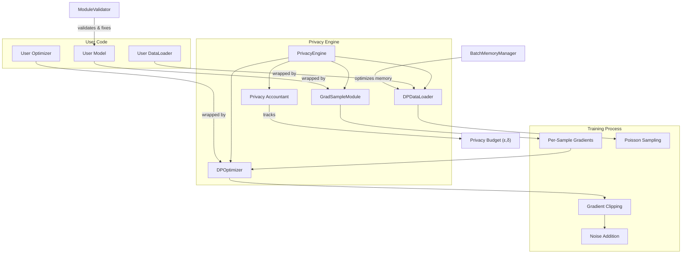
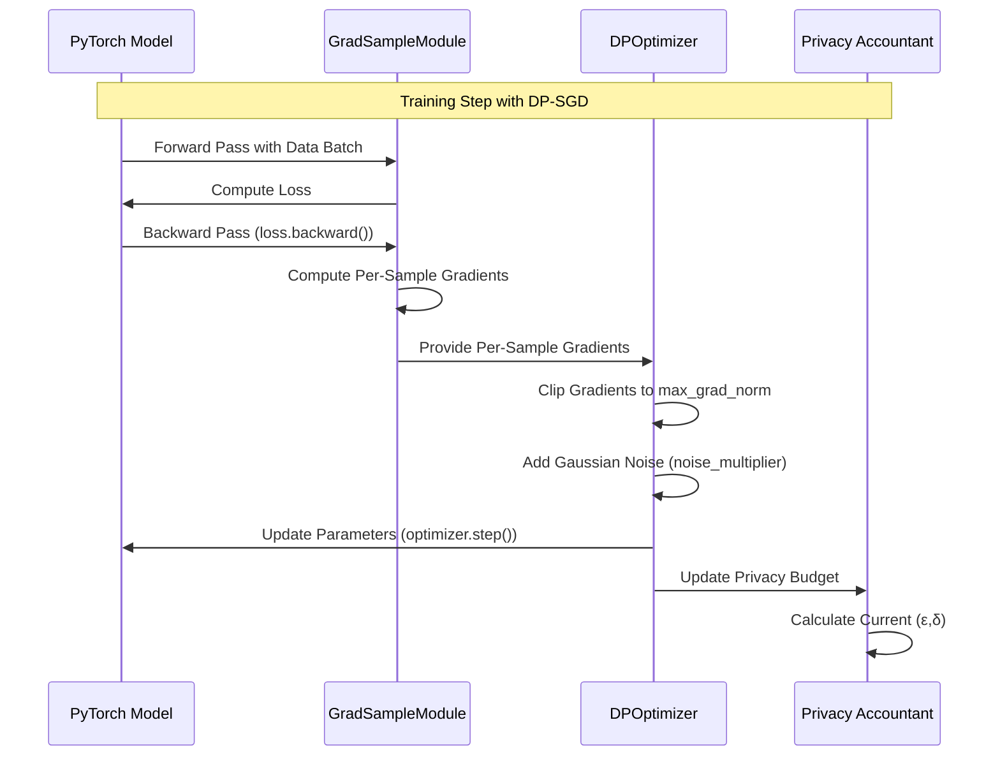
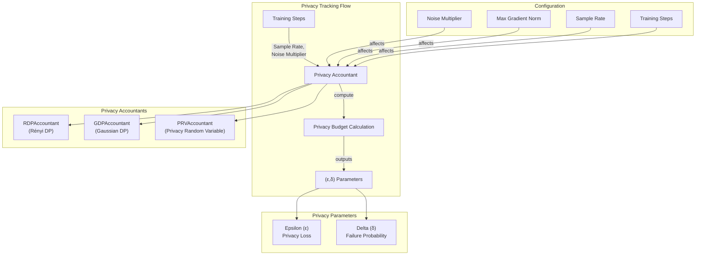
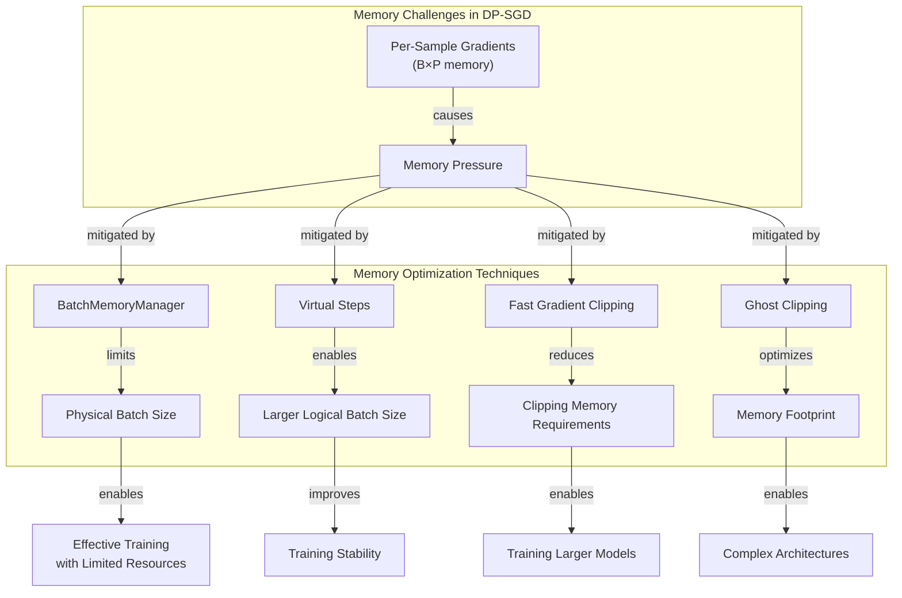
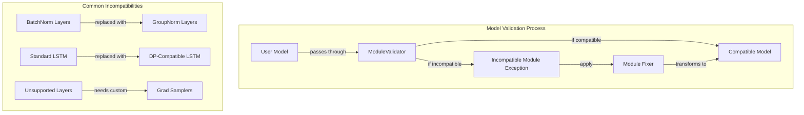

<!-- source: DeepWiki mcp.deepwiki.com · repo pytorch/opacus · page 1 Overview · fetched 2026-10-21 -->

# Overview

<details>
<summary>Relevant source files</summary>

The following files were used as context for generating this wiki page:

- [CHANGELOG.md](CHANGELOG.md)
- [Migration_Guide.md](Migration_Guide.md)
- [README.md](README.md)
- [docs/faq.md](docs/faq.md)
- [examples/vision_benchmark.py](examples/vision_benchmark.py)
- [opacus/version.py](opacus/version.py)
- [setup.py](setup.py)
- [website/pages/tutorials/index.js](website/pages/tutorials/index.js)

</details>


Opacus is a PyTorch library that enables training models with differential privacy (DP). It implements the DP-SGD algorithm (Differentially Private Stochastic Gradient Descent) with a focus on usability, performance, and accurate privacy accounting. For detailed information about individual components, refer to their respective documentation pages.

## Purpose and Key Features

Opacus allows data scientists and researchers to train PyTorch models with differential privacy guarantees while requiring minimal code changes. The library:

- Enables training with just a few lines of additional code
- Maintains reasonable training performance despite DP overhead
- Allows real-time tracking of privacy budget expenditure
- Supports various model architectures and training scenarios
- Offers multiple gradient computation techniques optimized for different use cases
- Provides tools to ensure model compatibility with differential privacy

For specific implementation details of privacy mechanisms, see [Privacy Accounting](#4), and for optimizers that implement differential privacy, see [Differential Privacy Optimizers](#3).

Sources: [README.md:11-14](), [setup.py:62-84]()

## System Architecture

Opacus is organized around several core components that transform standard PyTorch training into privacy-preserving training.

### High-Level Architecture



The `PrivacyEngine` is the central component that transforms standard PyTorch components into privacy-preserving equivalents:
- Wraps models with `GradSampleModule` to compute per-sample gradients
- Wraps optimizers with `DPOptimizer` to clip gradients and add noise
- Wraps data loaders with `DPDataLoader` to enable proper sampling
- Uses privacy accountants to track privacy budget expenditure

Sources: [README.md:60-78](), [CHANGELOG.md:48-49](), [docs/faq.md:6-8]()

### Core Components and Relationships

```mermaid
graph TD
    subgraph "Core Components"
        PrivacyEngine["PrivacyEngine"] --> |"creates"| GradSampleModule["GradSampleModule"]
        PrivacyEngine --> |"creates"| DPOptimizer["DPOptimizer"]
        PrivacyEngine --> |"creates"| DPDataLoader["DPDataLoader"]
        PrivacyEngine --> |"uses"| PrivacyAccountant["PrivacyAccountant"]
        
        GradSampleModule --> |"computes"| PerSampleGradients["Per-Sample Gradients"]
        DPOptimizer --> |"performs"| GradientClipping["Gradient Clipping"]
        DPOptimizer --> |"performs"| NoiseAddition["Noise Addition"]
        DPDataLoader --> |"enables"| PoissonSampling["Poisson Sampling"]
    end
    
    subgraph "Privacy Accountants"
        PrivacyAccountant --> RDPAccountant["RDPAccountant"]
        PrivacyAccountant --> GDPAccountant["GaussianAccountant"]
        PrivacyAccountant --> PRVAccountant["PRVAccountant"]
    end
    
    subgraph "Optimization Techniques"
        GradSampleModule --> HooksApproach["Hooks Approach"]
        GradSampleModule --> FunctorchApproach["Functorch Approach"]
        GradSampleModule --> ExpandedWeights["ExpandedWeights Approach"]
        DPOptimizer --> FastGradClipping["Fast Gradient Clipping"]
        DPOptimizer --> GhostClipping["Ghost Clipping"]
    end
    
    subgraph "Supporting Components"
        ModuleValidator["ModuleValidator"] --> |"ensures compatibility"| GradSampleModule
        BatchMemoryManager["BatchMemoryManager"] --> |"optimizes"| DPDataLoader
        DPDDP["DifferentiallyPrivateDistributedDataParallel"] --> |"enables distributed"| PrivacyEngine
    end
```



The diagram shows how Opacus components interact to implement differential privacy. The library offers multiple approaches for key operations like per-sample gradient computation and privacy accounting.

Sources: [README.md:60-78](), [CHANGELOG.md:99-104](), [CHANGELOG.md:48-49]()

## Basic Usage

Using Opacus requires minimal changes to standard PyTorch training code:

```python
# Standard PyTorch setup
model = Net()
optimizer = SGD(model.parameters(), lr=0.05)
data_loader = torch.utils.data.DataLoader(dataset, batch_size=1024)

# Fix model if needed (e.g. replacing BatchNorm with GroupNorm)
from opacus.validators import ModuleValidator
model = ModuleValidator.fix(model)

# Set up privacy engine
privacy_engine = PrivacyEngine()
model, optimizer, data_loader = privacy_engine.make_private(
    module=model,
    optimizer=optimizer,
    data_loader=data_loader,
    noise_multiplier=1.1,  # Controls privacy
    max_grad_norm=1.0,     # Clipping threshold
)

# Train as usual
for data, target in data_loader:
    optimizer.zero_grad()
    output = model(data)
    loss = criterion(output, target)
    loss.backward()
    optimizer.step()

# Check privacy budget
epsilon = privacy_engine.get_epsilon(delta=1e-5)
print(f"Privacy budget: ε = {epsilon:.2f}")
```

This example demonstrates the typical workflow: define standard PyTorch components, make them privacy-aware using the PrivacyEngine, and train as usual while tracking privacy budget.

Sources: [README.md:62-78](), [docs/faq.md:39-59]()

## DP-SGD Algorithm Flow

The DP-SGD algorithm modifies standard SGD by clipping per-sample gradients and adding noise. Here's how data flows through the system:



During training:
1. Each example in the batch contributes to its own gradient
2. Gradients are clipped to limit any single example's influence
3. Calibrated noise is added to preserve privacy
4. Privacy accountant tracks the cumulative privacy loss

Sources: [README.md:11-14](), [docs/faq.md:35-37](), [CHANGELOG.md:99-104]()

## Privacy Accounting

Opacus tracks privacy budget expenditure through privacy accountants:



Privacy accounting translates the mechanisms of DP-SGD (noise addition, sampling rate) into formal privacy guarantees expressed as (ε,δ) parameters:
- Lower ε means stronger privacy guarantees
- Delta (δ) represents the probability of privacy failure
- Opacus supports multiple accounting methods with different privacy-utility tradeoffs

Sources: [docs/faq.md:81-115](), [CHANGELOG.md:99-104](), [CHANGELOG.md:153-154]()

## Memory Management

Training with differential privacy requires storing per-sample gradients, which can be memory-intensive. Opacus provides tools to manage memory usage:



Key memory management techniques:
- **BatchMemoryManager**: Controls maximum physical batch size while maintaining logical batch size
- **Virtual Steps**: Accumulates gradients over multiple physical batches before updating parameters
- **Fast Gradient Clipping**: Optimized implementation reducing memory requirements
- **Ghost Clipping**: Advanced technique for memory-efficient clipping

Sources: [docs/faq.md:77-105](), [CHANGELOG.md:48-49](), [CHANGELOG.md:30-31]()

## Per-Sample Gradient Computation Approaches

Opacus provides multiple methods for computing per-sample gradients, each with different performance and memory tradeoffs:

| Approach | Description | Memory Usage | Computation Speed | Supported Layers |
|----------|-------------|--------------|-------------------|------------------|
| Hooks-based | Uses PyTorch hooks to capture activations | Higher | Moderate | Most common layers |
| Functorch | Uses functional transformations | Lower | Faster | Most layers with functional equivalents |
| ExpandedWeights | Alternative implementation | Moderate | Moderate | Various layers |
| Ghost Clipping | Memory-efficient clipping | Lower | Faster | Most layers |
| Fast Gradient Clipping | Performance-optimized | Lower | Faster | Most layers |

Each approach has its strengths, and Opacus allows choosing the appropriate one based on model architecture, hardware constraints, and performance requirements.

Sources: [CHANGELOG.md:99-104](), [CHANGELOG.md:48-49](), [README.md:92-98]()

## Model Compatibility

Not all PyTorch layers are compatible with differential privacy training out of the box. Opacus provides tools to validate and fix models:



The `ModuleValidator` checks if a model is compatible with differential privacy and can automatically fix common issues such as replacing BatchNorm layers with GroupNorm.

Sources: [docs/faq.md:99-101](), [Migration_Guide.md:110-115](), [README.md:96-98]()

## Development and Future Directions

Opacus is actively developed with new features and improvements in each release:

- **Version 1.5.3** (current): Improved ghost clipping, support for embedding layers, and generative NLP tasks
- **Version 1.5**: Added Fast Gradient Clipping and Ghost Clipping
- **Version 1.4**: Upgraded to PyTorch 1.13+ and added clipping schedulers
- **Version 1.3**: Added PRV Accountant based on numerical composition of differential privacy

Key areas of ongoing development include:
- Memory optimization techniques
- Support for more model architectures and layer types
- Improved privacy accounting methods
- Performance enhancements for large-scale training

Sources: [CHANGELOG.md:3-29](), [CHANGELOG.md:48-49](), [version.py:16]()

## Conclusion

Opacus provides a robust, user-friendly framework for training PyTorch models with differential privacy. By abstracting away the complexity of DP-SGD implementation, it allows researchers and practitioners to benefit from privacy-preserving machine learning with minimal overhead.

To explore specific aspects of Opacus in more detail, refer to the other pages in this documentation:

- Core Architecture (#2)
- Differential Privacy Optimizers (#3)
- Privacy Accounting (#4)
- Data Loading and Processing (#5)
- Model Validation and Compatibility (#6)

Sources: [README.md:11-14](), [setup.py:62-84](), [docs/faq.md:6-8]()

---

