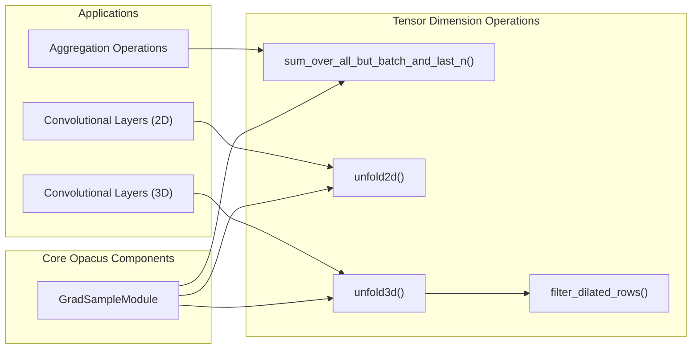
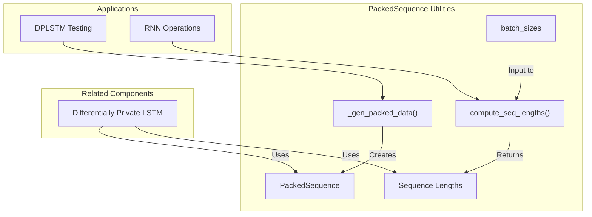
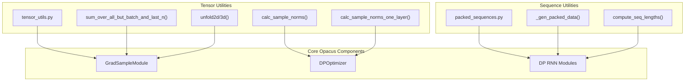

<!-- source: DeepWiki mcp.deepwiki.com · repo pytorch/opacus · page 10 Utilities · fetched 2026-10-21 -->

# Utilities

Relevant source files

The following files were used as context for generating this wiki page:

- [opacus/utils/packed_sequences.py](opacus/utils/packed_sequences.py)
- [opacus/utils/tensor_utils.py](opacus/utils/tensor_utils.py)

The Opacus library provides a set of utility functions that support differential privacy operations throughout the codebase. These utilities primarily focus on tensor manipulations and sequence handling, offering specialized functionality required by various components of the framework. This page documents these utilities and explains how they are integrated into the broader Opacus architecture.

For information about more specific components like the PrivacyEngine, please see [Core Architecture](#2).

## Tensor Utilities

The tensor utilities module contains functions that perform specialized tensor operations essential for computing and handling per-sample gradients and various tensor transformations required for differentially private training.

### Norm Calculation Functions

The following functions support computation of per-sample gradient norms, which is a critical step in the gradient clipping process for differential privacy:

- `calc_sample_norms`: Calculates norms of tensors for each sample across multiple layers
- `calc_sample_norms_one_layer`: Specialized version that calculates norms for a single parameter tensor

Sources: [opacus/utils/tensor_utils.py:27-84]()

### Dimension Manipulation Functions

The following functions manipulate tensor dimensions, which is useful in various DP operations:

- `sum_over_all_but_batch_and_last_n`: Performs a selective sum over certain dimensions while preserving batch dimension and specified last dimensions
- `unfold2d`: Enhanced implementation of the sliding window operation for 2D data
- `unfold3d`: Extension of unfold functionality for 3D data (e.g., volumetric data)
- `filter_dilated_rows`: Helper function for `unfold3d` that handles dilation

Sources: [opacus/utils/tensor_utils.py:87-336]()

## Sequence Handling Utilities

Opacus provides utility functions for handling packed sequences, which are particularly useful for implementing differentially private recurrent neural networks (e.g., LSTM, GRU).

### PackedSequence Utilities

- `_gen_packed_data`: Generates random PackedSequence data for testing DPLSTM
- `compute_seq_lengths`: Computes sequence lengths from batch sizes in a PackedSequence

Sources: [opacus/utils/packed_sequences.py:22-117]()

## Integration with Opacus Architecture

The utilities described in this document are used throughout the Opacus framework to support various operations related to differential privacy. The diagram below illustrates how these utilities fit into the broader Opacus architecture:

Sources: [opacus/utils/tensor_utils.py:27-336](), [opacus/utils/packed_sequences.py:22-117]()

## Utility Function Details

### Tensor Norm Calculations

The following table details the key tensor norm calculation functions:

| Function | Purpose | Key Parameters | Return Value |
|----------|---------|----------------|--------------|
| `calc_sample_norms` | Calculates norms of tensors per sample | `named_params`: iterator of parameter tuples `flat`: whether to return a flat norm | List of tensor norms |
| `calc_sample_norms_one_layer` | Calculates norms for a single parameter | `param`: a single tensor parameter | Tensor of norms |

Sources: [opacus/utils/tensor_utils.py:27-84]()

### Tensor Manipulation Functions

The following table details the key tensor manipulation functions:

| Function | Purpose | Key Parameters | Return Value |
|----------|---------|----------------|--------------|
| `sum_over_all_but_batch_and_last_n` | Sums over all dimensions except batch and last n | `tensor`: input tensor `n_dims`: number of dimensions to keep | Tensor with reduced dimensions |
| `unfold2d` | Sliding window operation for 2D data | `kernel_size`, `padding`, `stride`, `dilation` | Unfolded tensor |
| `unfold3d` | Extends unfold to 5D inputs | `kernel_size`, `padding`, `stride`, `dilation` | Unfolded tensor |
| `filter_dilated_rows` | Removes extra rows from dilation | `tensor`, `dilation`, `dilated_kernel_size`, `kernel_size` | Filtered tensor |

Sources: [opacus/utils/tensor_utils.py:87-336]()

### Sequence Handling Functions

The following table details the key sequence handling functions:

| Function | Purpose | Key Parameters | Return Value |
|----------|---------|----------------|--------------|
| `_gen_packed_data` | Generates test data for DPLSTM | `minibatch_size`, `max_seq_length`, `input_dim`, `batch_first`, `sorted_` | PackedSequence object |
| `compute_seq_lengths` | Computes sequence lengths from batch sizes | `batch_sizes`: batch sizes from PackedSequence | List of sequence lengths |

Sources: [opacus/utils/packed_sequences.py:22-117]()

## Usage Examples

### Using Tensor Norms for Gradient Clipping

The tensor norm calculation functions are primarily used in the gradient clipping process within the `DPOptimizer`:

1. Per-sample gradients are computed by the `GradSampleModule`
2. `calc_sample_norms` is used to calculate the norm of these gradients
3. The norms are used to clip gradients before noise addition

### Using Unfold Operations for Convolutional Networks

The unfold operations are used in gradient computation for convolutional layers:

1. `unfold2d` is used for 2D convolutional layers
2. `unfold3d` is used for 3D convolutional layers
3. These functions help implement the per-sample gradient computation efficiently

### Using Packed Sequence Utilities for RNNs

The packed sequence utilities support the implementation of differentially private RNNs:

1. `_gen_packed_data` is used for testing DP LSTM implementations
2. `compute_seq_lengths` helps with managing variable-length sequences in RNNs

These utilities provide essential functionality that underpins the differential privacy mechanisms in Opacus, supporting the framework's core components like the GradSampleModule and DPOptimizer.

---

