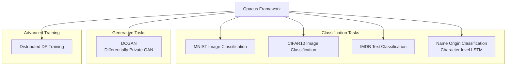
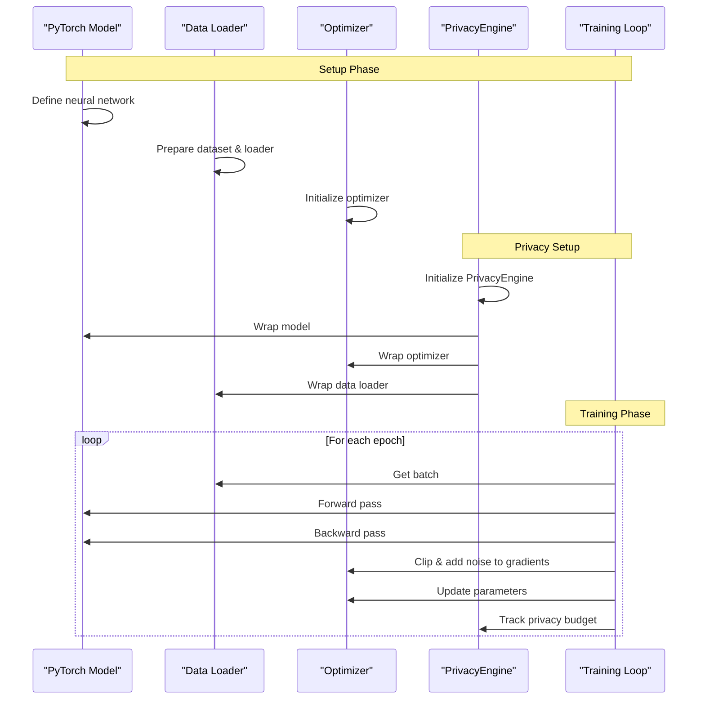
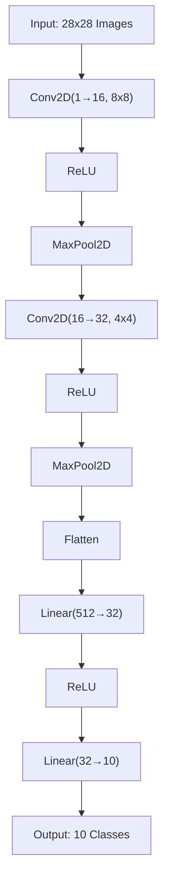
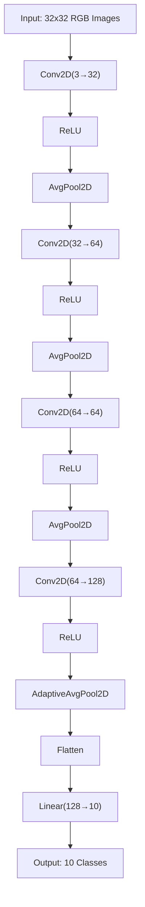
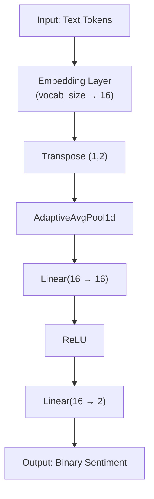
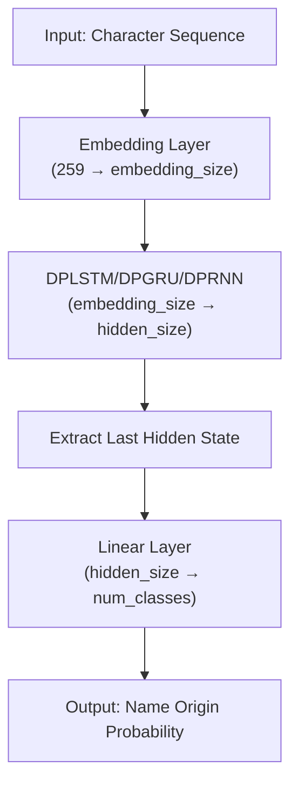
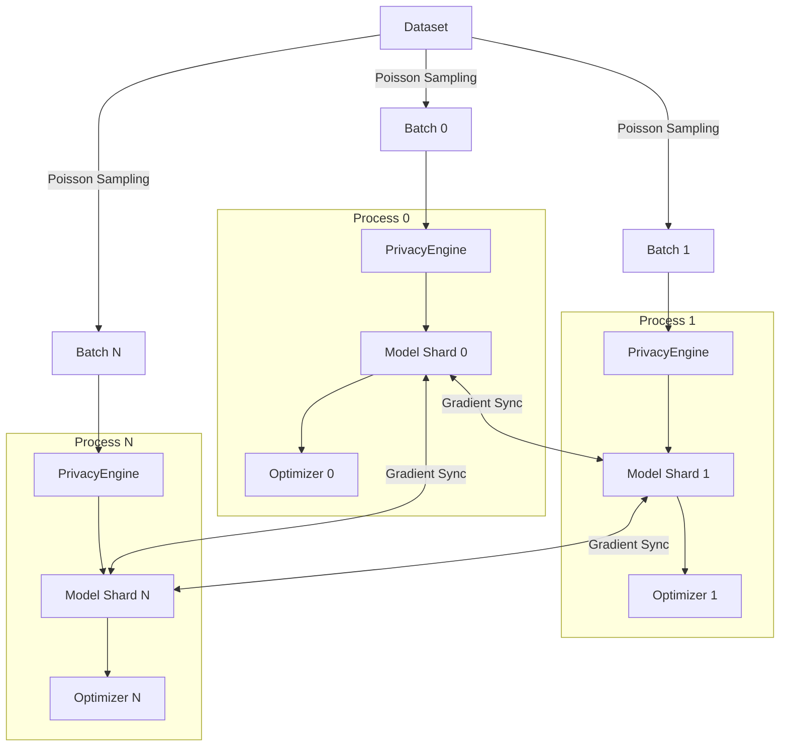

<!-- source: DeepWiki mcp.deepwiki.com · repo pytorch/opacus · page 11 Example Use Cases · fetched 2026-10-21 -->

# Example Use Cases

<details>
<summary>Relevant source files</summary>

The following files were used as context for generating this wiki page:

- [examples/char-lstm-classification.py](examples/char-lstm-classification.py)
- [examples/char-lstm_README.md](examples/char-lstm_README.md)
- [examples/cifar10.py](examples/cifar10.py)
- [examples/dcgan.py](examples/dcgan.py)
- [examples/imdb.py](examples/imdb.py)
- [examples/mnist.py](examples/mnist.py)
- [examples/mnist_README.md](examples/mnist_README.md)
- [opacus/grad_sample/README.md](opacus/grad_sample/README.md)
- [opacus/tests/ddp_hook_check.py](opacus/tests/ddp_hook_check.py)

</details>


This page demonstrates practical applications of differential privacy using Opacus across various machine learning tasks. It provides concrete examples of how to implement privacy-preserving training in different domains and model architectures. For technical details about how the PrivacyEngine works internally, see [Core Architecture](#2).

## Overview of Example Applications

Opacus comes with several ready-to-use example applications that showcase differential privacy applied to common machine learning tasks. These examples serve as both learning resources and starting points for your own privacy-preserving ML applications.



Sources: [examples/mnist.py](), [examples/cifar10.py](), [examples/imdb.py](), [examples/char-lstm-classification.py](), [examples/dcgan.py]()

## Common Implementation Pattern

All examples follow a consistent pattern for implementing differential privacy with Opacus:



Sources: [examples/mnist.py:113-277](), [examples/cifar10.py:240-413]()

## Basic Example: MNIST Classification

The MNIST example demonstrates how to train a simple convolutional neural network with differential privacy.

### Model Architecture



Sources: [examples/mnist.py:38-58]()

### Key Implementation Components

The typical setup for an Opacus-enabled training looks like:

```
# Standard PyTorch setup
model = SampleConvNet().to(device)
optimizer = optim.SGD(model.parameters(), lr=args.lr, momentum=0)

# Opacus privacy engine initialization and model wrapping
privacy_engine = PrivacyEngine(secure_mode=args.secure_rng)
model, optimizer, train_loader = privacy_engine.make_private(
    module=model,
    optimizer=optimizer,
    data_loader=train_loader,
    noise_multiplier=args.sigma,
    max_grad_norm=args.max_per_sample_grad_norm,
)
```

Sources: [examples/mnist.py:246-259]()

### Privacy-Accuracy Tradeoffs

The MNIST example demonstrates different privacy-accuracy tradeoffs:

| Privacy Budget (ε, δ) | Parameters | Test Accuracy |
|-----------------------|------------|---------------|
| No DP                 | `--disable-dp` | 98.94% ± 0.32% |
| (6.86, 10⁻⁵)          | `-n=45 --lr=.25 --sigma=.7 -c=1.5 -b=240` | 97.09% ± 0.17% |
| (2.91, 10⁻⁵)          | `-n 60 --lr=.15 --sigma=1.1 -c=1.0 -b=240` | 96.78% ± 0.21% |
| (1.16, 10⁻⁵)          | `-n=15 --lr=.25 --sigma=1.3 -c=1.5 -b=240` | 94.63% ± 0.34% |

Sources: [examples/mnist_README.md:39-62]()

## Image Classification: CIFAR10

The CIFAR10 example shows how to apply DP to a more complex image classification task.

### Model Architecture



Sources: [examples/cifar10.py:105-121]()

### Key Features

The CIFAR10 example introduces additional features:

1. **Multiple DP Optimization Strategies**:
   - Flat clipping (default)
   - Per-layer clipping (`--clip_per_layer`)

2. **Distributed Training**:
   - Support for multi-GPU training with DP
   - Special handling for distributed data parallel

3. **Multiple Gradient Sample Modes**:
   - Hooks-based approach (default)
   - Functorch-based approach (`--grad_sample_mode=no_op`)

4. **Learning Rate Scheduling**:
   - Cosine annealing scheduler

Sources: [examples/cifar10.py:337-361](), [examples/cifar10.py:143-159](), [examples/cifar10.py:567-568]()

## Text Classification: IMDB Sentiment Analysis

The IMDB example shows how to apply differential privacy to text classification tasks.

### Model Architecture



Sources: [examples/imdb.py:38-56]()

### Key Implementation Components

The IMDB example demonstrates:

1. **Handling text data**:
   - Using tokenization with BertTokenizerFast
   - Padding sequences to uniform length

2. **Binary classification with DP**:
   - Cross-entropy loss for text classification
   - Binary accuracy metrics

Sources: [examples/imdb.py:236-246](), [examples/imdb.py:59-62](), [examples/imdb.py:65-72]()

## Sequential Data: Character-level LSTM for Name Classification

This example demonstrates applying differential privacy to recurrent neural networks.

### Model Architecture



Sources: [examples/char-lstm-classification.py:254-287]()

### Key Features

The character-level LSTM example showcases:

1. **Privacy-preserving recurrent networks**:
   - Specialized DP-compatible RNN variants (DPLSTM, DPGRU, DPRNN)
   - Character-level processing for names

2. **Custom data handling**:
   - Character byte encoder
   - Sequence padding

3. **Privacy-accuracy tradeoff**:
   - DP-LSTM: ~74% accuracy at ε ≈ 11.83
   - Non-DP LSTM: ~76% accuracy

Sources: [examples/char-lstm-classification.py:23-24](), [examples/char-lstm-classification.py:135-213](), [examples/char-lstm_README.md:9-22]()

## Generative Models: DCGAN

The DCGAN example demonstrates how to apply differential privacy to generative adversarial networks.

### Model Architecture



```mermaid
flowchart TD
    subgraph "Generator"
        z["Latent Vector (100)"] --> ConvT1["ConvTranspose2d<br>nz → ngf*8"]
        ConvT1 --> GroupNorm1["GroupNorm"]
        GroupNorm1 --> ReLU1["ReLU"]
        ReLU1 --> ConvT2["ConvTranspose2d<br>ngf*8 → ngf*4"]
        ConvT2 --> GroupNorm2["GroupNorm"]
        GroupNorm2 --> ReLU2["ReLU"]
        ReLU2 --> ConvT3["ConvTranspose2d<br>ngf*4 → ngf*2"]
        ConvT3 --> GroupNorm3["GroupNorm"]
        GroupNorm3 --> ReLU3["ReLU"]
        ReLU3 --> ConvT4["ConvTranspose2d<br>ngf*2 → ngf"]
        ConvT4 --> GroupNorm4["GroupNorm"]
        GroupNorm4 --> ReLU4["ReLU"]
        ReLU4 --> ConvT5["ConvTranspose2d<br>ngf → nc"]
        ConvT5 --> Tanh["Tanh"]
        Tanh --> FakeImage["Generated Image"]
    end

    subgraph "Discriminator (DP-enabled)"
        RealImage["Real/Fake Image"] --> Conv1["Conv2d<br>nc → ndf"]
        Conv1 --> LeakyReLU1["LeakyReLU"]
        LeakyReLU1 --> Conv2["Conv2d<br>ndf → ndf*2"]
        Conv2 --> GroupNorm5["GroupNorm"]
        GroupNorm5 --> LeakyReLU2["LeakyReLU"]
        LeakyReLU2 --> Conv3["Conv2d<br>ndf*2 → ndf*4"]
        Conv3 --> GroupNorm6["GroupNorm"]
        GroupNorm6 --> LeakyReLU3["LeakyReLU"]
        LeakyReLU3 --> Conv4["Conv2d<br>ndf*4 → ndf*8"]
        Conv4 --> GroupNorm7["GroupNorm"]
        GroupNorm7 --> LeakyReLU4["LeakyReLU"]
        LeakyReLU4 --> Conv5["Conv2d<br>ndf*8 → 1"]
        Conv5 --> Sigmoid["Sigmoid"]
        Sigmoid --> RealFake["Real/Fake Prediction"]
    end

    FakeImage --> RealImage
```

Sources: [examples/dcgan.py:181-213](), [examples/dcgan.py:223-254]()

### Key Implementation Features

The DCGAN example demonstrates:

1. **Selective application of DP**:
   - Only the discriminator is trained with DP
   - The generator is trained regularly

2. **GroupNorm instead of BatchNorm**:
   - BatchNorm is incompatible with per-sample gradient computation
   - GroupNorm is used as a privacy-preserving alternative

3. **Two-phase training approach**:
   - Discriminator training with real and fake data
   - Generator training with discriminator feedback

Sources: [examples/dcgan.py:272-281](), [examples/dcgan.py:188-193](), [examples/dcgan.py:289-348]()

## Advanced: Distributed Training with DP

The CIFAR10 example also demonstrates how to use Opacus with distributed training.

### Distributed Training Architecture



Sources: [examples/cifar10.py:52-102](), [examples/cifar10.py:312-320]()

### Key Implementation Components

The distributed training example shows:

1. **Privacy-aware distributed data parallel**:
   - `DifferentiallyPrivateDistributedDataParallel` for DP training
   - Standard DDP for non-DP training

2. **Per-layer clipping for DDP**:
   - Required for distributed training

3. **Process group setup**:
   - Handling of various distributed environments (Slurm, local)
   - Backend selection (gloo, nccl)

Sources: [examples/cifar10.py:312-320](), [examples/cifar10.py:587-592](), [examples/cifar10.py:52-102]()

## Common Configuration Parameters

Across all examples, there are several important configuration parameters for tuning the privacy-utility tradeoff:

| Parameter | Description | Typical Values |
|-----------|-------------|----------------|
| `sigma` / `noise_multiplier` | Controls the amount of noise added (higher = more private) | 0.5-1.5 |
| `max_per_sample_grad_norm` / `max_grad_norm` | Gradient clipping threshold (lower = more bias) | 0.5-2.0 |
| `batch_size` | Training batch size (larger = better privacy accounting) | 64-2000 |
| `delta` | Target delta for (ε,δ)-DP (usually 1/N or smaller) | 1e-5 |
| `lr` | Learning rate (may need adjustment compared to non-DP) | 0.01-0.5 |
| `epochs` | Number of training epochs | 10-60 |

Sources: [examples/mnist.py:158-176](), [examples/cifar10.py:504-518](), [examples/imdb.py:169-189](), [examples/char-lstm-classification.py:94-126](), [examples/dcgan.py:101-121]()

## Monitoring Privacy Budget

All examples demonstrate how to track and report the privacy budget during training:

```
if not args.disable_dp:
    epsilon = privacy_engine.accountant.get_epsilon(delta=args.delta)
    print(
        f"Train Epoch: {epoch} \t"
        f"Loss: {np.mean(losses):.6f} "
        f"(ε = {epsilon:.2f}, δ = {args.delta})"
    )
```

Sources: [examples/mnist.py:74-80](), [examples/cifar10.py:196-203](), [examples/imdb.py:97-104](), [examples/char-lstm-classification.py:334-336]()

## Summary

The example applications demonstrate the versatility of Opacus for privacy-preserving machine learning across different domains:

1. **Image Classification**: MNIST and CIFAR10 examples show how to apply DP to convolutional neural networks
2. **Text Classification**: IMDB example demonstrates DP for sentiment analysis
3. **Sequential Data**: Character-level LSTM example shows DP for recurrent networks
4. **Generative Models**: DCGAN example demonstrates selective application of DP in GANs
5. **Distributed Training**: CIFAR10 example shows how to scale DP training across multiple GPUs

These examples serve as starting points for adapting Opacus to your specific use cases, with different tradeoffs between privacy, utility, and computational efficiency.

Sources: [examples/mnist.py](), [examples/cifar10.py](), [examples/imdb.py](), [examples/char-lstm-classification.py](), [examples/dcgan.py]()

---

