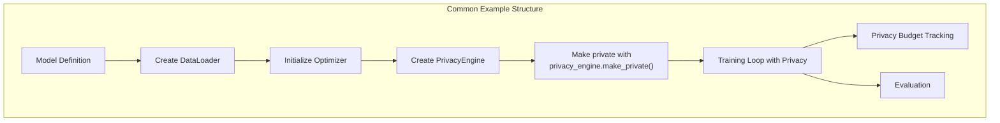
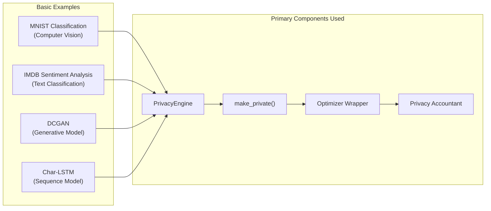
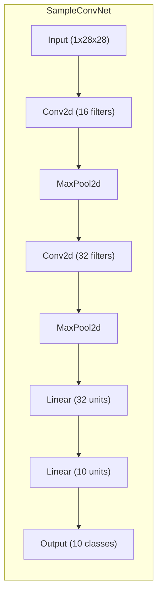
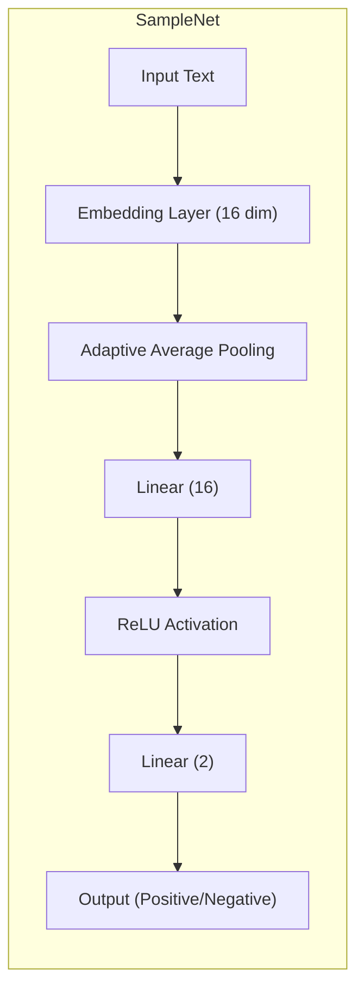
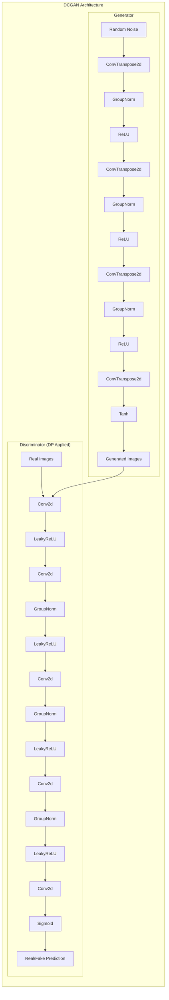
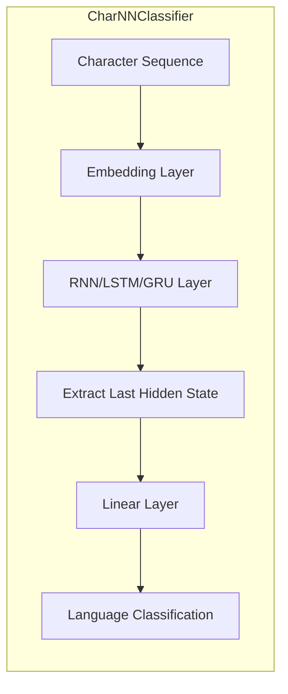
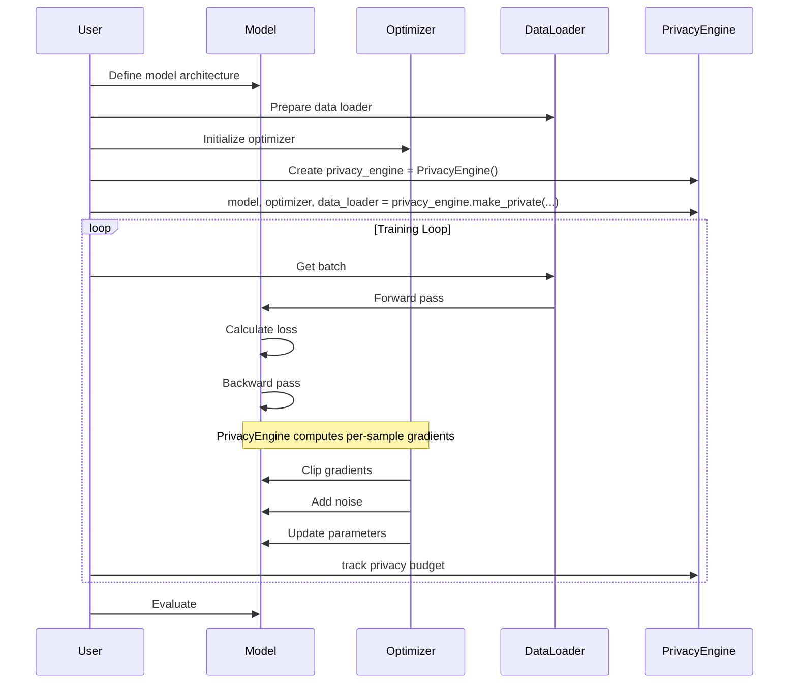

<!-- source: DeepWiki mcp.deepwiki.com · repo pytorch/opacus · page 11.1 Basic Examples · fetched 2026-10-21 -->

# Basic Examples

<details>
<summary>Relevant source files</summary>

The following files were used as context for generating this wiki page:

- [examples/char-lstm-classification.py](examples/char-lstm-classification.py)
- [examples/char-lstm_README.md](examples/char-lstm_README.md)
- [examples/dcgan.py](examples/dcgan.py)
- [examples/imdb.py](examples/imdb.py)
- [examples/mnist.py](examples/mnist.py)
- [examples/mnist_README.md](examples/mnist_README.md)
- [opacus/grad_sample/README.md](opacus/grad_sample/README.md)

</details>


This page provides an overview of the basic examples included in the Opacus repository. These examples demonstrate how to implement differentially private training using Opacus across various machine learning tasks and model architectures. For advanced examples including distributed training and more complex models, see [Advanced Examples](#11.2).

## Overview of Example Architecture

All examples in Opacus follow a common pattern for implementing differentially private training:



Sources: [examples/mnist.py:113-282](), [examples/imdb.py:139-289](), [examples/dcgan.py:37-282](), [examples/char-lstm-classification.py:366-466]()

## Key Example Overview

Opacus includes several examples demonstrating differentially private training across various tasks:



Sources: [examples/mnist.py](), [examples/imdb.py](), [examples/dcgan.py](), [examples/char-lstm-classification.py]()

## MNIST Classification Example

The MNIST example demonstrates training a simple convolutional neural network with differential privacy on the MNIST handwritten digit dataset.

### Model Architecture

The model is a simple CNN with the following architecture:
- 2 convolutional layers
- 2 fully connected layers
- Max pooling after each convolutional layer



Sources: [examples/mnist.py:38-59]()

### Key Implementation Steps

1. **Model Definition**:
   ```python
   model = SampleConvNet().to(device)
   ```

2. **Optimizer Setup**:
   ```python
   optimizer = optim.SGD(model.parameters(), lr=args.lr, momentum=0)
   ```

3. **Privacy Engine Integration**:
   ```python
   privacy_engine = PrivacyEngine(secure_mode=args.secure_rng)
   model, optimizer, train_loader = privacy_engine.make_private(
       module=model,
       optimizer=optimizer,
       data_loader=train_loader,
       noise_multiplier=args.sigma,
       max_grad_norm=args.max_per_sample_grad_norm,
   )
   ```

4. **Training Loop with Privacy Tracking**:
   ```python
   epsilon = privacy_engine.accountant.get_epsilon(delta=args.delta)
   print(f"Train Epoch: {epoch} \t Loss: {np.mean(losses):.6f} (ε = {epsilon:.2f}, δ = {args.delta})")
   ```

Sources: [examples/mnist.py:246-263](), [examples/mnist.py:74-82]()

### Running the Example

To run the MNIST example without DP:
```
python mnist.py --device=cpu --disable-dp --n=20 --lr=.1 -b=240
```

To run with DP:
```
python mnist.py --device=cpu -n=15 --lr=.25 --sigma=1.3 -c=1.5 -b=240
```

Expected results:
- Without DP: ~98.9% accuracy 
- With DP (ε=1.16, δ=10^-5): ~94.9% accuracy

Sources: [examples/mnist_README.md:1-36]()

## IMDB Text Classification Example

This example demonstrates training a differentially private text classifier on the IMDB movie reviews dataset for sentiment analysis.

### Model Architecture



Sources: [examples/imdb.py:38-56]()

### Key Implementation Steps

The implementation follows a similar pattern to the MNIST example, with adaptations for text data:

1. **Data Preparation**:
   - Tokenizing text data
   - Creating padded sequences

2. **Privacy Engine Configuration**:
   ```python
   privacy_engine = PrivacyEngine(secure_mode=args.secure_rng)
   model, optimizer, train_loader = privacy_engine.make_private(
       module=model,
       optimizer=optimizer,
       data_loader=train_loader,
       noise_multiplier=args.sigma,
       max_grad_norm=args.max_per_sample_grad_norm,
       poisson_sampling=False,
   )
   ```

3. **Privacy Budget Reporting**:
   ```python
   epsilon = privacy_engine.accountant.get_epsilon(delta=args.delta)
   print(f"Train Epoch: {epoch} \t Train Loss: {np.mean(losses):.6f} " 
         f"Train Accuracy: {np.mean(accuracies):.6f} (ε = {epsilon:.2f}, δ = {args.delta})")
   ```

Sources: [examples/imdb.py:270-282](), [examples/imdb.py:97-108]()

## DCGAN Example

The DCGAN example demonstrates how to apply differential privacy to a Generative Adversarial Network, specifically for generating MNIST digits.

### Model Architecture

This example consists of two networks: a Generator and a Discriminator. The privacy guarantees are applied to the Discriminator since it's the one interacting with the real data.



Sources: [examples/dcgan.py:181-254]()

### Privacy Application in GANs

In this example, differential privacy is applied only to the Discriminator, which processes real data:

```python
privacy_engine = PrivacyEngine(secure_mode=opt.secure_rng)
netD, optimizerD, dataloader = privacy_engine.make_private(
    module=netD,
    optimizer=optimizerD,
    data_loader=dataloader,
    noise_multiplier=opt.sigma,
    max_grad_norm=opt.max_per_sample_grad_norm,
)
```

The Generator is trained normally without privacy mechanisms since it doesn't directly access the training data.

Sources: [examples/dcgan.py:273-281]()

## Character-Level LSTM Classification

This example demonstrates training a recurrent neural network (LSTM, GRU, or RNN) with differential privacy for character-level language classification (identifying the language of names).

### Model Architecture



Sources: [examples/char-lstm-classification.py:254-287]()

### Key Implementation Features

1. **Support for Different RNN Types**:
   - LSTM (DPLSTM)
   - GRU (DPGRU)
   - RNN (DPRNN)

2. **Character-Level Processing**:
   - Uses a custom `CharByteEncoder` for character-level tokenization

3. **Privacy Engine Configuration**:
   ```python
   privacy_engine = PrivacyEngine(secure_mode=args.secure_rng)
   model, optimizer, train_loader = privacy_engine.make_private(
       module=model,
       optimizer=optimizer,
       data_loader=train_loader,
       noise_multiplier=args.sigma,
       max_grad_norm=args.max_per_sample_grad_norm,
   )
   ```

Sources: [examples/char-lstm-classification.py:437-445]()

## Common Implementation Pattern

All examples follow a similar pattern for implementing differential privacy:



Sources: [examples/mnist.py:61-110](), [examples/imdb.py:75-137](), [examples/dcgan.py:286-348](), [examples/char-lstm-classification.py:299-340]()

## Key Privacy Parameters

All examples use similar parameters for controlling the privacy guarantees:

| Parameter | Description | Typical Values |
|-----------|-------------|----------------|
| `sigma` | Noise multiplier, controls the amount of noise added | 0.7-1.3 for basic examples |
| `max_grad_norm` | Maximum L2 norm of per-sample gradients | 1.0-1.5 |
| `delta` | Target delta in (ε, δ)-DP | 1e-5 (should be < 1/dataset_size) |
| `batch_size` | Batch size | Larger batches often work better with DP |
| `lr` | Learning rate | May need to be higher with DP |
| `secure_rng` | Whether to use secure random number generation | Set to True for production applications |

Sources: [examples/mnist.py:119-202](), [examples/imdb.py:142-231](), [examples/dcgan.py:86-121](), [examples/char-lstm-classification.py:93-126]()

## Privacy-Accuracy Trade-offs

Each example demonstrates the trade-off between privacy and utility. For instance, in the MNIST example:

| Privacy Budget | Command | Accuracy |
|----------------|---------|----------|
| No DP | `--disable-dp --n=20 --lr=.1 -b=240` | 98.94% ± 0.32% |
| (6.86, 10^-5)-DP | `-n=45 --lr=.25 --sigma=.7 -c=1.5 -b=240` | 97.09% ± 0.17% |
| (2.91, 10^-5)-DP | `-n=60 --lr=.15 --sigma=1.1 -c=1.0 -b=240` | 96.78% ± 0.21% |
| (1.16, 10^-5)-DP | `-n=15 --lr=.25 --sigma=1.3 -c=1.5 -b=240` | 94.63% ± 0.34% |

Sources: [examples/mnist_README.md:38-62]()

## Conclusion

These examples demonstrate how to apply differential privacy to various neural network architectures and tasks using Opacus. The examples follow a consistent pattern:

1. Define model architecture
2. Initialize optimizer and data loader
3. Create a `PrivacyEngine` instance
4. Make the model, optimizer, and data loader private with `privacy_engine.make_private()`
5. Track privacy budget during training

By examining these examples, you can learn how to adapt Opacus for your specific use case and understand the privacy-utility trade-offs involved in differentially private deep learning.

---

