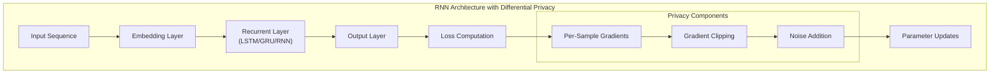
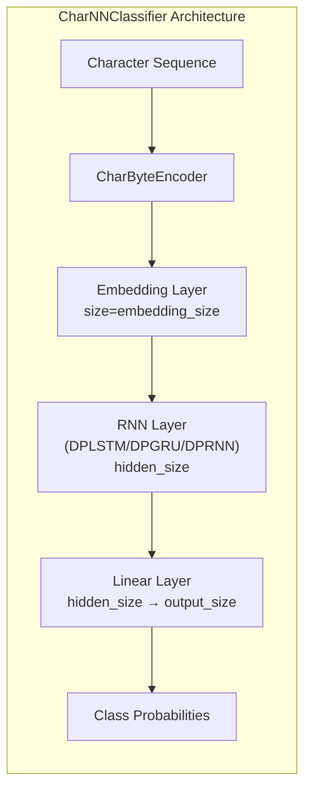
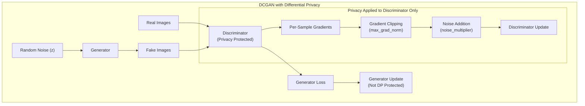
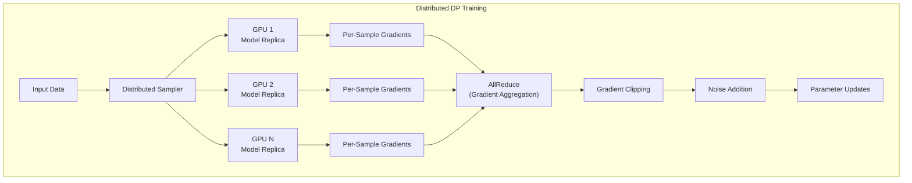
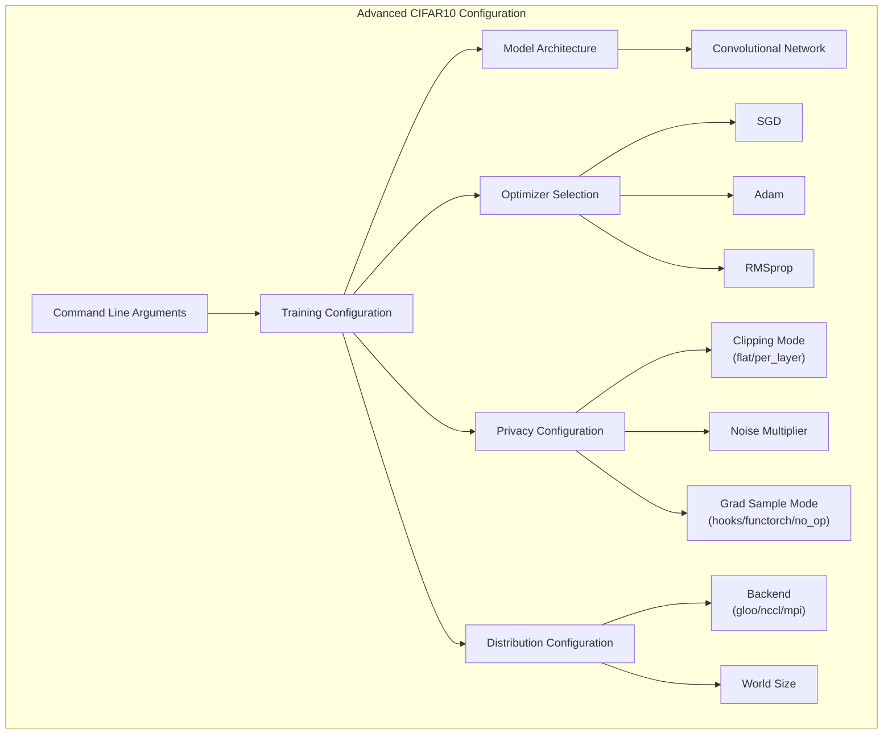

<!-- source: DeepWiki mcp.deepwiki.com · repo pytorch/opacus · page 11.2 Advanced Examples · fetched 2026-10-21 -->

# Advanced Examples

<details>
<summary>Relevant source files</summary>

The following files were used as context for generating this wiki page:

- [examples/char-lstm-classification.py](examples/char-lstm-classification.py)
- [examples/char-lstm_README.md](examples/char-lstm_README.md)
- [examples/cifar10.py](examples/cifar10.py)
- [examples/dcgan.py](examples/dcgan.py)
- [examples/imdb.py](examples/imdb.py)
- [examples/mnist.py](examples/mnist.py)
- [examples/mnist_README.md](examples/mnist_README.md)
- [opacus/grad_sample/README.md](opacus/grad_sample/README.md)
- [opacus/tests/ddp_hook_check.py](opacus/tests/ddp_hook_check.py)

</details>


## Purpose and Scope

This page documents advanced usage scenarios for Opacus, focusing on complex neural network architectures and specialized training configurations with differential privacy. These examples demonstrate how to apply differential privacy to recurrent neural networks, generative adversarial networks, distributed training, and more complex datasets.

For basic examples such as simple MNIST classification, see [Basic Examples](#11.1).

## Recurrent Neural Networks with Differential Privacy

Opacus provides support for training recurrent neural networks (RNNs) with differential privacy, which is particularly useful for sequence data such as text or time series.



The key components in the Opacus implementation of private RNNs:

- **Specialized DP Recurrent Layers**: Opacus provides `DPLSTM`, `DPGRU`, and `DPRNN` classes that are compatible with differential privacy requirements
- **Character/Token Embedding**: Converts input sequences to embeddings
- **Per-Sample Gradient Computation**: Handles backpropagation through time while preserving per-sample gradient information
- **Privacy Engine Integration**: Applies gradient clipping and noise addition in a privacy-preserving way

### Character-Level LSTM Example

The character-level LSTM example demonstrates how to use Opacus to train an RNN for character-level name classification with differential privacy.



Key implementation aspects:

1. **Character Encoding**: Uses a custom `CharByteEncoder` to convert strings to byte sequences
2. **Privacy-Compatible RNN**: Uses Opacus's `DPLSTM`, `DPGRU`, or `DPRNN` layers
3. **Privacy Engine Configuration**: Sets noise multiplier, max gradient norm, and other privacy parameters

The example supports different types of recurrent networks through the `--mode` parameter:

```
python char-lstm-classification.py --mode lstm --epochs 50 --learning-rate 2.0 --hidden-size 128 --delta 8e-5 --batch-size 64 --sigma 1.0 --max-per-sample-grad-norm 1.5
```

Typical privacy-utility tradeoff results:
- With DP (ε = 11.83, δ = 8e-05): ~74% accuracy 
- Without DP: ~76% accuracy

Sources: [examples/char-lstm-classification.py:1-471](), [examples/char-lstm_README.md:1-23]()

## Generative Adversarial Networks with DP

Training Generative Adversarial Networks (GANs) with differential privacy presents unique challenges, as only the discriminator needs to be protected with DP (the generator doesn't directly access private data).



The DCGAN example in Opacus demonstrates:
1. **Selective DP Application**: Only applying differential privacy to the discriminator
2. **GroupNorm Instead of BatchNorm**: Using group normalization which is compatible with DP (unlike batch normalization)
3. **Target-Specific Generation**: Focusing on generating a specific digit class from MNIST

Key implementation details:
- The discriminator training contains two parts: training with real data (which needs DP protection) and training with fake data generated by the generator (which doesn't need DP protection)
- Opacus correctly handles this by only applying noise to the relevant part

Example usage:
```
python dcgan.py --data-root /path/to/mnist --batch-size 64 --sigma 1.0 --max-per-sample-grad_norm 1.0 --target-digit 8
```

Sources: [examples/dcgan.py:1-364]()

## Natural Language Processing with DP

Applying differential privacy to NLP tasks requires careful handling of variable-length text inputs and embedding layers.

```mermaid
flowchart LR
    subgraph "Text Classification with DP"
        Input["Text Input"] --> Tok["Tokenization"]
        Tok --> Pad["Padding"]
        Pad --> Emb["Embedding Layer"]
        Emb --> Pool["Pooling"]
        Pool --> FC["Fully Connected Layers"]
        FC --> Out["Output (Classification)"]
    end
    
    subgraph "Privacy Engine"
        Loss["Loss Computation"] --> PE["PrivacyEngine"]
        PE --> PSG["Per-Sample Gradients"]
        PSG --> GC["Gradient Clipping"]
        GC --> NA["Noise Addition"]
        NA --> Update["Parameter Updates"]
    end
    
    Out --> Loss
```



The IMDB sentiment analysis example demonstrates:
1. **Text Preprocessing**: Tokenization and padding of variable-length reviews
2. **Embedding + Pooling Architecture**: Simple but effective for text classification
3. **DP Application to Embeddings**: Handling privacy for embedding layers

Implementation highlights:
- Uses a `SampleNet` model which applies an embedding layer followed by pooling and fully connected layers
- Uses `BertTokenizerFast` for tokenization
- Custom padding collation function to handle variable-length sequences

Example usage:
```
python imdb.py --batch-size 64 --epochs 10 --lr 0.02 --sigma 0.56 --max-per-sample-grad_norm 1.0
```

Sources: [examples/imdb.py:1-294]()

## Distributed Training with Differential Privacy

Opacus supports distributed training with DP through `DifferentiallyPrivateDistributedDataParallel` (DPDDP), which enables multi-GPU training while preserving privacy guarantees.



Key components and considerations:

1. **DPDDP Wrapper**: Extends PyTorch's `DistributedDataParallel` with privacy preservation
2. **Distributed Setup**: Handles initialization for various environments (Slurm clusters, multi-GPU workstations)
3. **Privacy Accounting**: Privacy budget is tracked correctly across multiple devices

The CIFAR10 example in Opacus demonstrates distributed training with differential privacy:

```python
# Key components for distributed DP training
if world_size > 1:
    if not args.disable_dp:
        if args.clip_per_layer:
            model = DDP(model, device_ids=[device])
        else:
            model = DPDDP(model)  # Use DP-compatible DDP
    else:
        model = DDP(model, device_ids=[device])
```

Performance considerations:
- When using per-layer clipping with distributed training, the standard DDP can be used
- For flat clipping across all parameters, the specialized DPDDP implementation is required
- Gradient accumulation is handled properly to maintain privacy guarantees

Example usage:
```
python cifar10.py --batch-size 2000 --sigma 1.5 --max-per-sample-grad_norm 10.0 --local_rank 0 --dist_backend nccl
```

Sources: [examples/cifar10.py:1-605](), [opacus/tests/ddp_hook_check.py:1-319]()

## CIFAR10 with Advanced Configuration Options

The CIFAR10 example demonstrates several advanced training techniques and configuration options that can be applied to more complex datasets:



Advanced features demonstrated:

1. **Multiple Gradient Sample Modes**:
   - `hooks`: The default, stable implementation using backward hooks
   - `functorch`: Uses functorch for computing per-sample gradients
   - `no_op`: Custom implementation for testing

2. **Clipping Strategies**:
   - Flat clipping (default): Clips the entire gradient vector
   - Per-layer clipping: Clips each layer's gradients separately, enabling different DDP implementations

3. **Learning Rate Schedules**:
   - Cosine annealing schedule
   - Constant learning rate

4. **Optimizer Selection**:
   - SGD with momentum
   - Adam
   - RMSprop

5. **Secure RNG Option**:
   - Optional secure random number generation for more trustworthy privacy guarantees

Example of running with advanced options:
```
python cifar10.py --sigma 1.3 --max-per-sample-grad_norm 1.5 --batch-size 512 --epochs 90 --lr-schedule cos --clip_per_layer --grad_sample_mode functorch --optim Adam
```

Sources: [examples/cifar10.py:1-605]()

## Comparative Performance and Privacy Results

The following table summarizes typical performance results for different advanced examples, showing the privacy-utility tradeoff:

| Example | Architecture | Dataset | Non-DP Accuracy | DP Parameters | DP Accuracy | Privacy Guarantee |
|---------|-------------|---------|----------------|---------------|-------------|------------------|
| MNIST | CNN | MNIST | 98.94% | σ=1.3, C=1.5, B=240 | 94.63% | ε=1.16, δ=10⁻⁵ |
| Char-LSTM | LSTM | Names | 76.07% | σ=1.0, C=1.5, B=64 | 73.95% | ε=11.83, δ=8×10⁻⁵ |
| CIFAR10 | ConvNet | CIFAR10 | ~82% | σ=1.5, C=10.0, B=2000 | ~70% | ε varies by epochs |
| IMDB | SampleNet | IMDB | ~86% | σ=0.56, C=1.0, B=64 | ~82% | ε varies by epochs |

*σ=noise multiplier, C=max gradient norm, B=batch size*

Sources: [examples/mnist_README.md:1-63](), [examples/char-lstm_README.md:1-23]()

## Performance Optimization Techniques

When working with advanced models, several optimization techniques can help balance privacy, utility, and computational efficiency:

1. **Batch Memory Management**: For large models or limited GPU memory
2. **Gradient Sample Mode Selection**:
   - `hooks`: Most compatible with custom architectures
   - `functorch`: Sometimes faster for complex models
   - `ew` (expanded weights): Fastest for standard architectures (use with caution)

3. **Distributed Training**: Scaling to multiple GPUs while maintaining privacy

```
# Example of using BatchMemoryManager
from opacus.utils.batch_memory_manager import BatchMemoryManager

with BatchMemoryManager(
    data_loader=train_loader,
    max_physical_batch_size=128,
    optimizer=optimizer
) as memory_safe_data_loader:
    for data, target in memory_safe_data_loader:
        # Training loop content
```

4. **Learning Rate Scheduling**: Important for convergence, especially with noisy updates

Source: [opacus/grad_sample/README.md:1-86]()

## Conclusion

These advanced examples demonstrate the flexibility and power of Opacus for training complex neural network architectures with differential privacy guarantees. By properly configuring the privacy parameters, optimizers, and training routines, it's possible to achieve strong privacy protection while maintaining reasonable model performance across a variety of tasks and model architectures.

Remember that each model architecture may require specific considerations for optimal performance with differential privacy, and experimentation with privacy parameters is often necessary to find the right balance for your specific application.

---

