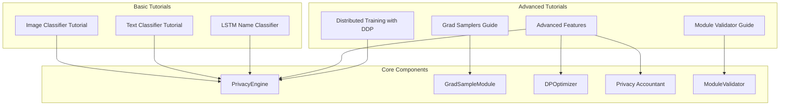
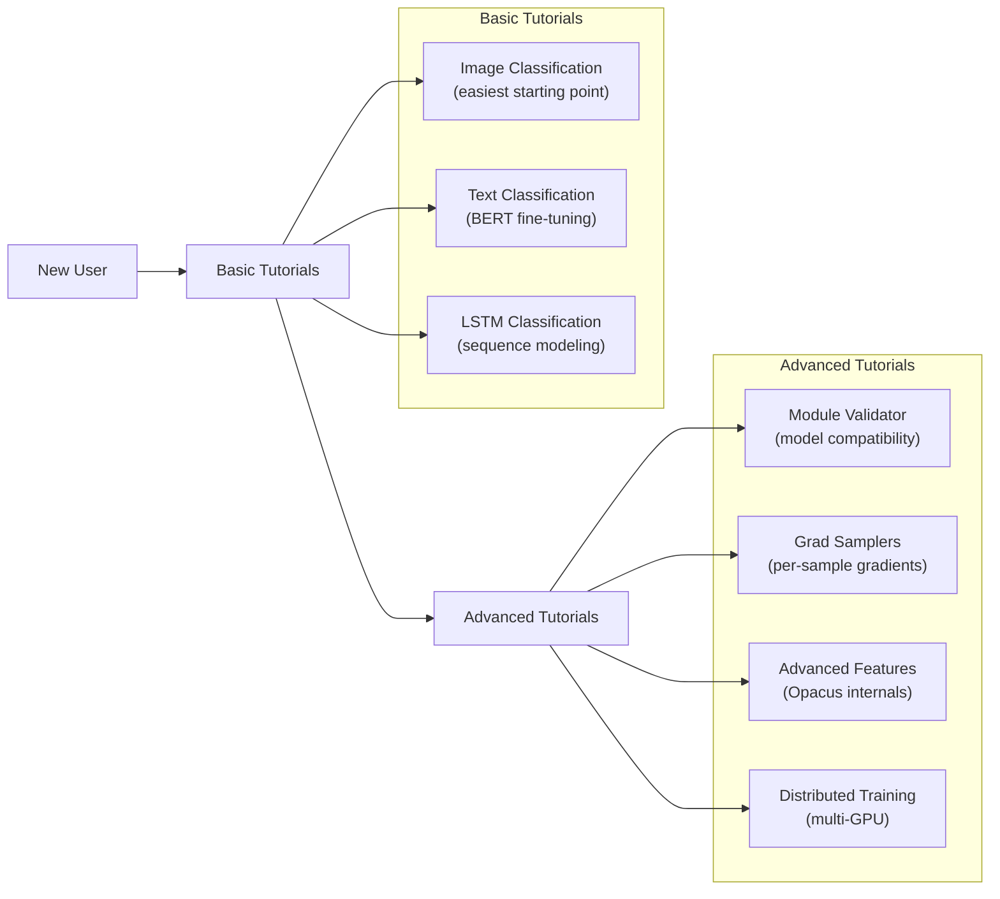
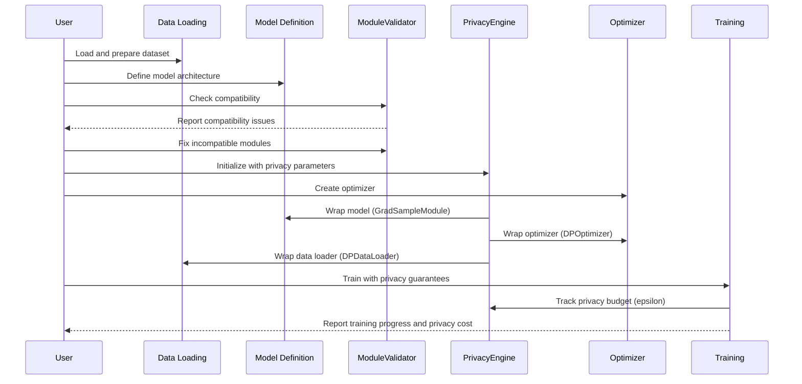

<!-- source: DeepWiki mcp.deepwiki.com · repo pytorch/opacus · page 12 Interactive Tutorials · fetched 2026-10-21 -->

# Interactive Tutorials

<details>
<summary>Relevant source files</summary>

The following files were used as context for generating this wiki page:

- [CODE_OF_CONDUCT.md](CODE_OF_CONDUCT.md)
- [tutorials/building_image_classifier.ipynb](tutorials/building_image_classifier.ipynb)
- [tutorials/building_lstm_name_classifier.ipynb](tutorials/building_lstm_name_classifier.ipynb)
- [tutorials/building_text_classifier.ipynb](tutorials/building_text_classifier.ipynb)
- [tutorials/ddp_tutorial.ipynb](tutorials/ddp_tutorial.ipynb)
- [tutorials/guide_to_grad_sampler.ipynb](tutorials/guide_to_grad_sampler.ipynb)
- [tutorials/guide_to_module_validator.ipynb](tutorials/guide_to_module_validator.ipynb)
- [tutorials/intro_to_advanced_features.ipynb](tutorials/intro_to_advanced_features.ipynb)
- [website/core/Footer.js](website/core/Footer.js)
- [website/tutorials.json](website/tutorials.json)

</details>


## Purpose and Scope

This document provides an overview of the interactive Jupyter notebook tutorials included with Opacus. These tutorials are designed to help users understand and implement differential privacy in their PyTorch models by walking through practical examples. The tutorials cover a range of topics from basic model training with differential privacy to advanced features and specialized use cases.

For general information about the core architecture of Opacus, see [Core Architecture](#2). For specific implementation details of key components, see the respective component pages such as [PrivacyEngine](#2.1), [GradSampleModule](#2.2), and [Differential Privacy Optimizers](#3).

## Tutorial Organization

The Opacus tutorials are organized into two main categories: basic tutorials that demonstrate fundamental concepts and advanced tutorials that cover specialized topics and more complex use cases.

### Tutorial Structure Diagram



Sources: [website/tutorials.json:1-32](), [tutorials/building_image_classifier.ipynb:1-652](), [tutorials/building_text_classifier.ipynb:1-770](), [tutorials/building_lstm_name_classifier.ipynb:1-1000](), [tutorials/guide_to_module_validator.ipynb:1-273](), [tutorials/guide_to_grad_sampler.ipynb:1-299](), [tutorials/intro_to_advanced_features.ipynb:1-1000](), [tutorials/ddp_tutorial.ipynb:1-407]()

### Available Tutorials

The following tutorials are available in the Opacus repository:

| Tutorial ID | Title | Key Topics |
|-------------|-------|------------|
| building_text_classifier | Building text classifier with Fast Gradient Clipping DP-SGD | BERT fine-tuning, Ghost Clipping, LoRA |
| building_image_classifier | Building image classifier with Differential Privacy | ResNet18, CIFAR10, BatchMemoryManager |
| building_lstm_name_classifier | Training a differentially private LSTM model for name classification | DPLSTM, character-level modeling |
| intro_to_advanced_features | Deep dive into advanced features of Opacus | Core abstractions, extending Opacus |
| guide_to_module_validator | Guide to Module Validator and Fixer | Model compatibility, custom validators |
| guide_to_grad_sampler | Guide to grad samplers | Per-sample gradients, custom samplers |
| ddp_tutorial | Training on multiple GPUs with DistributedDataParallel | Multi-GPU training, DPDDP wrapper |

Sources: [website/tutorials.json:1-32]()

## Tutorial Learning Path

For users new to Opacus, we recommend following the tutorials in a specific sequence to build a solid understanding of the framework:



Sources: [website/tutorials.json:1-32](), [tutorials/building_image_classifier.ipynb:24-30](), [tutorials/building_text_classifier.ipynb:54-67](), [tutorials/building_lstm_name_classifier.ipynb:14-15](), [tutorials/guide_to_module_validator.ipynb:18-27](), [tutorials/guide_to_grad_sampler.ipynb:18-28](), [tutorials/intro_to_advanced_features.ipynb:16-20](), [tutorials/ddp_tutorial.ipynb:16-22]()

## Basic Tutorials

### Image Classification Tutorial

The image classification tutorial demonstrates how to train a privacy-preserving ResNet18 model on the CIFAR10 dataset. It covers:

- Setting privacy-specific hyperparameters (max grad norm, noise multiplier, delta)
- Using the `ModuleValidator` to check and fix compatibility issues
- Implementing `BatchMemoryManager` for efficient memory usage
- Training with differential privacy using `PrivacyEngine`
- Monitoring privacy budget (epsilon) during training
- Evaluating model performance compared to non-private training

This tutorial serves as an excellent starting point for beginners as it walks through the complete workflow using a familiar computer vision task.

Sources: [tutorials/building_image_classifier.ipynb:24-30](), [tutorials/building_image_classifier.ipynb:43-50](), [tutorials/building_image_classifier.ipynb:189-229](), [tutorials/building_image_classifier.ipynb:330-350]()

### Text Classification Tutorial

The text classification tutorial shows how to build a differentially private text classifier by fine-tuning a pre-trained BERT model on the Stanford Natural Language Inference (SNLI) dataset. Key aspects include:

- Two-stage training approach: pre-training on public data followed by DP fine-tuning
- Using the pre-trained BERT-base model from HuggingFace Transformers
- Implementing DP-SGD with Ghost Clipping for memory efficiency
- Using LoRA (Low-Rank Adaptation) for parameter-efficient fine-tuning
- Freezing layers to reduce the number of trainable parameters

This tutorial is particularly valuable for NLP practitioners looking to apply differential privacy to large language models.

Sources: [tutorials/building_text_classifier.ipynb:54-67](), [tutorials/building_text_classifier.ipynb:586-592]()

### LSTM Name Classification Tutorial

The LSTM name classification tutorial demonstrates how to train a differentially private character-level LSTM model to classify names by their source language. Key components include:

- Using the `DPLSTM` module from `opacus.layers.dp_lstm`
- Character-level encoding of text data
- Training a recurrent neural network with differential privacy guarantees
- Handling sequence data in a privacy-preserving manner

This tutorial is helpful for understanding how to apply differential privacy to sequential data and recurrent architectures.

Sources: [tutorials/building_lstm_name_classifier.ipynb:14-15](), [tutorials/building_lstm_name_classifier.ipynb:102-177](), [tutorials/building_lstm_name_classifier.ipynb:446-486]()

## Advanced Tutorials

### Guide to Module Validator

The Module Validator tutorial explains how Opacus ensures model compatibility with differential privacy. It covers:

- Why some PyTorch modules are incompatible with differential privacy
- How to use `ModuleValidator.validate()` to check for compatibility issues
- Using `ModuleValidator.fix()` to automatically fix incompatible modules
- Creating custom validators and fixers for specialized modules
- Common issues like BatchNorm layers and their privacy-friendly alternatives

This guide is essential for users who work with custom architectures or encounter compatibility issues.

Sources: [tutorials/guide_to_module_validator.ipynb:18-27](), [tutorials/guide_to_module_validator.ipynb:36-46](), [tutorials/guide_to_module_validator.ipynb:66-136]()

### Guide to Grad Samplers

The Grad Samplers tutorial dives into the core mechanism behind Opacus - computing per-sample gradients. Key topics include:

- Why per-sample gradients are necessary for differential privacy
- How `GradSampleModule` computes and stores per-sample gradients
- Understanding grad samplers and how they work with PyTorch's autograd
- Registering custom grad samplers for specialized layers
- Verifying the correctness of per-sample gradient computation

This guide is valuable for understanding Opacus internals and extending its functionality to custom layers.

Sources: [tutorials/guide_to_grad_sampler.ipynb:18-28](), [tutorials/guide_to_grad_sampler.ipynb:67-84](), [tutorials/guide_to_grad_sampler.ipynb:155-171](), [tutorials/guide_to_grad_sampler.ipynb:189-221]()

### Advanced Features

The Advanced Features tutorial provides a deep dive into Opacus architecture and internals. It covers:

- Core abstractions in Opacus
- What happens under the hood of `PrivacyEngine`
- The three pillars of DP-SGD implementation (per-sample gradients, gradient clipping/noise addition, Poisson sampling)
- Extending and customizing Opacus components for specialized use cases

This tutorial is aimed at advanced users who need to adapt Opacus for specific requirements beyond the basic API.

Sources: [tutorials/intro_to_advanced_features.ipynb:16-20](), [tutorials/intro_to_advanced_features.ipynb:80-97]()

### Distributed Training with DDP

The Distributed Training tutorial explains how to use Opacus in a multi-GPU environment with PyTorch's DistributedDataParallel (DDP). Key topics include:

- Differences between regular DDP and differential privacy-aware DDP
- Using `DifferentiallyPrivateDistributedDataParallel` instead of `DistributedDataParallel`
- Setting up data loading for distributed privacy-preserving training
- Implementing a training loop with DDP and differential privacy

This tutorial is essential for scaling privacy-preserving training to larger models and datasets.

Sources: [tutorials/ddp_tutorial.ipynb:16-22](), [tutorials/ddp_tutorial.ipynb:198-209](), [tutorials/ddp_tutorial.ipynb:227-282]()

## Running the Tutorials

### Prerequisites

To run the Opacus tutorials, you'll need:

1. Python 3.7 or later
2. PyTorch 1.13 or later
3. Opacus
4. Jupyter Notebook or JupyterLab
5. Additional dependencies for specific tutorials (e.g., transformers, torchvision)

### Installation

The tutorials can be run locally after installing Opacus and its dependencies, or through Google Colab for a cloud-based environment.

For local installation:
```
pip install opacus torch torchvision jupyterlab
```

For specific tutorials, you may need additional packages:
```
pip install transformers tqdm
```

### Accessing the Tutorials

The tutorials are available in the Opacus GitHub repository under the `tutorials/` directory. They can also be accessed through the Opacus website's tutorials section.

Sources: [tutorials/building_image_classifier.ipynb:1-4](), [tutorials/building_text_classifier.ipynb:1-25](), [website/Footer.js:77-81]()

## Relationship to Core Opacus Components

The tutorials demonstrate how to use various Opacus components in practical applications. The following diagram shows how tutorial content maps to code entities:

```mermaid
flowchart TB
    subgraph "Code Entity Space"
        PE["PrivacyEngine
        (opacus/privacy_engine.py)"]
        GSM["GradSampleModule
        (opacus/grad_sample/grad_sample_module.py)"]
        DPO["DPOptimizer
        (opacus/optimizers/optimizer.py)"]
        DPDDP["DifferentiallyPrivateDistributedDataParallel
        (opacus/distributed.py)"]
        MV["ModuleValidator
        (opacus/validators/module_validator.py)"]
        DPLSTM["DPLSTM
        (opacus/layers/dp_lstm.py)"]
        BMM["BatchMemoryManager
        (opacus/utils/batch_memory_manager.py)"]
    end
    
    subgraph "Tutorial Space"
        ImgTut["Image Classifier Tutorial"]
        TextTut["Text Classifier Tutorial"]
        LSTMTut["LSTM Tutorial"]
        MVTut["Module Validator Tutorial"]
        GSTut["Grad Sampler Tutorial"]
        DDPTut["DDP Tutorial"]
        AdvTut["Advanced Features Tutorial"]
    end
    
    ImgTut --> PE
    ImgTut --> MV
    ImgTut --> BMM
    
    TextTut --> PE
    TextTut --> DPO
    
    LSTMTut --> PE
    LSTMTut --> DPLSTM
    
    MVTut --> MV
    
    GSTut --> GSM
    
    DDPTut --> DPDDP
    DDPTut --> PE
    
    AdvTut --> PE
    AdvTut --> GSM
    AdvTut --> DPO
```



Sources: [tutorials/building_image_classifier.ipynb:330-350](), [tutorials/building_text_classifier.ipynb:670-687](), [tutorials/building_lstm_name_classifier.ipynb:446-486](), [tutorials/guide_to_module_validator.ipynb:36-46](), [tutorials/guide_to_grad_sampler.ipynb:79-84](), [tutorials/ddp_tutorial.ipynb:227-245](), [tutorials/intro_to_advanced_features.ipynb:80-97]()

## Tutorial Implementation Details

The tutorials follow a consistent pattern in their implementation:

1. **Setup and Data Loading**: Each tutorial begins with dataset preparation and loading
2. **Model Definition**: Defining the model architecture, often with compatibility fixes
3. **Privacy Engine Integration**: Making models private using `PrivacyEngine`
4. **Training Loop**: Implementing the training process with privacy guarantees
5. **Evaluation**: Testing the model and analyzing the privacy-utility tradeoff

The following diagram shows the typical flow in a tutorial:



Sources: [tutorials/building_image_classifier.ipynb:92-163](), [tutorials/building_image_classifier.ipynb:189-229](), [tutorials/building_image_classifier.ipynb:330-350](), [tutorials/building_image_classifier.ipynb:369-412](), [tutorials/building_image_classifier.ipynb:426-453]()

## Contributing New Tutorials

Users are encouraged to contribute new tutorials to the Opacus repository. When creating a new tutorial:

1. Follow the established Jupyter notebook format
2. Focus on a specific use case or technique
3. Include detailed explanations with the code
4. Ensure compatibility with the latest Opacus version
5. Add your tutorial to `website/tutorials.json` for website integration

Contributions should be submitted as pull requests to the [Opacus GitHub repository](https://github.com/pytorch/opacus).

Sources: [website/tutorials.json:1-32](), [CODE_OF_CONDUCT.md:1-61]()

## Summary

The Opacus interactive tutorials provide practical examples of implementing differential privacy in various machine learning scenarios. They range from basic examples suitable for beginners to advanced topics for users looking to extend and customize Opacus functionality. By working through these tutorials, users can gain hands-on experience with privacy-preserving machine learning and understand the tradeoffs involved in different approaches.

---

