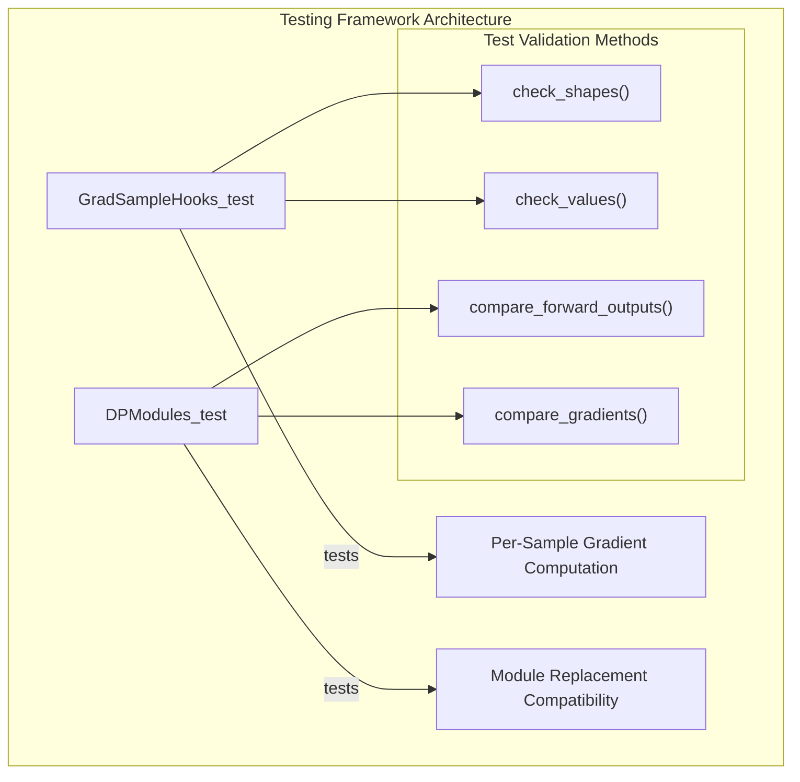
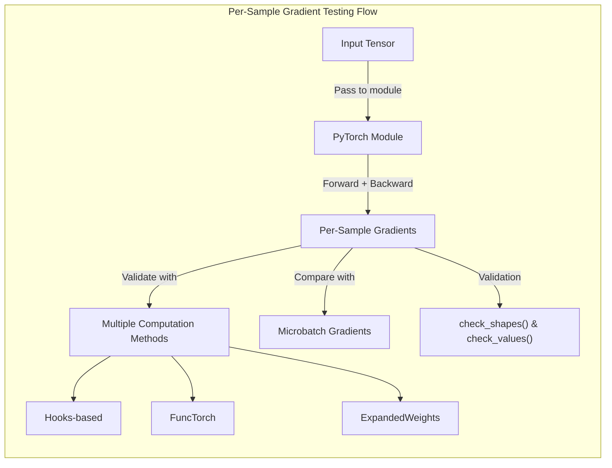
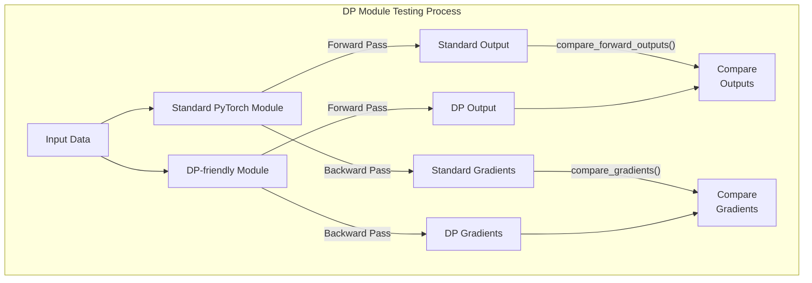
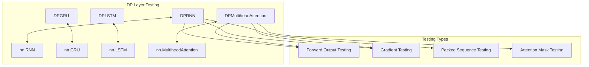
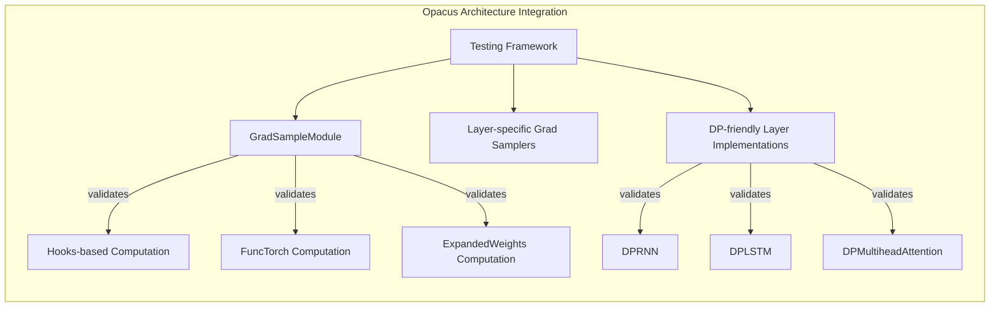

<!-- source: DeepWiki mcp.deepwiki.com · repo pytorch/opacus · page 13 Testing Framework · fetched 2026-10-21 -->

# Testing Framework

<details>
<summary>Relevant source files</summary>

The following files were used as context for generating this wiki page:

- [opacus/layers/dp_multihead_attention.py](opacus/layers/dp_multihead_attention.py)
- [opacus/tests/dp_layers/common.py](opacus/tests/dp_layers/common.py)
- [opacus/tests/dp_layers/dp_multihead_attention_test.py](opacus/tests/dp_layers/dp_multihead_attention_test.py)
- [opacus/tests/dp_layers/dp_rnn_test.py](opacus/tests/dp_layers/dp_rnn_test.py)
- [opacus/tests/grad_samples/common.py](opacus/tests/grad_samples/common.py)
- [opacus/tests/grad_samples/conv1d_test.py](opacus/tests/grad_samples/conv1d_test.py)
- [opacus/tests/grad_samples/conv2d_test.py](opacus/tests/grad_samples/conv2d_test.py)
- [opacus/tests/grad_samples/conv3d_test.py](opacus/tests/grad_samples/conv3d_test.py)
- [opacus/tests/grad_samples/embedding_bag_test.py](opacus/tests/grad_samples/embedding_bag_test.py)
- [opacus/tests/grad_samples/embedding_test.py](opacus/tests/grad_samples/embedding_test.py)
- [opacus/tests/grad_samples/group_norm_test.py](opacus/tests/grad_samples/group_norm_test.py)
- [opacus/tests/grad_samples/linear_test.py](opacus/tests/grad_samples/linear_test.py)

</details>


The Opacus Testing Framework provides a comprehensive system for verifying the correctness and accuracy of privacy-preserving computation in the library. The framework focuses on two critical aspects: validating per-sample gradient computation (essential for implementing differential privacy) and ensuring that DP-friendly module implementations are drop-in replacements for their standard PyTorch counterparts.

## Architecture Overview

The testing framework consists of two primary testing base classes, each serving a distinct purpose in the validation process:



Sources: [opacus/tests/grad_samples/common.py](), [opacus/tests/dp_layers/common.py]()

## Per-Sample Gradient Testing

The `GradSampleHooks_test` base class provides the foundation for testing the computation of per-sample gradients, which is essential for implementing differential privacy mechanisms in Opacus.



Sources: [opacus/tests/grad_samples/common.py:39-181]()

### Key Components of Per-Sample Gradient Testing

The `GradSampleHooks_test` class includes several essential methods:

1. **run_test**: Orchestrates the testing of a module with different gradient computation modes and loss reduction methods.

2. **run_test_with_reduction**: Tests gradient computation with a specific loss reduction method.

3. **check_shapes**: Verifies that the shapes of computed per-sample gradients match the expected shapes.

4. **check_values**: Ensures that the values of per-sample gradients are close to reference values within specified tolerance.

Testing extends across multiple gradient computation approaches:

| Approach | Description | Test Flag |
|----------|-------------|-----------|
| Hooks-based | Default approach using PyTorch hooks | "hooks" |
| FuncTorch | Using the functorch library | "functorch" |
| ExpandedWeights | Expanding weight tensors | "ew" |

Sources: [opacus/tests/grad_samples/common.py:45-79]()

## DP Module Testing

The `DPModules_test` base class verifies that DP-friendly module implementations are true drop-in replacements for standard PyTorch modules, with identical forward and backward pass behavior.



Sources: [opacus/tests/dp_layers/common.py:88-180]()

### Key Components of DP Module Testing

The `DPModules_test` class provides these critical methods:

1. **compare_forward_outputs**: Compares the outputs of forward passes between standard and DP modules.

2. **compare_gradients**: Verifies that gradients computed during backward passes match between implementations.

3. **_check_shapes** and **_check_values**: Internal utilities for validating tensor shapes and values.

4. **_check_packed_sequence**: Special handling for RNN packed sequences.

Sources: [opacus/tests/dp_layers/common.py:101-388]()

## Layer-Specific Testing

The framework includes specialized tests for various layer types, each with specific configurations and edge cases:

### Convolutional Layers

Tests for Conv1d, Conv2d, and Conv3d layers verify gradient computation with various kernel sizes, strides, padding modes, and dilation settings.

```python
# Example test parameters for Conv2d
N=st.integers(0, 4),         # Batch size
C=st.sampled_from([1, 3, 32]), # Input channels
H=st.integers(11, 17),       # Height
W=st.integers(11, 17),       # Width
kernel_size=st.integers(2, 4),
stride=st.integers(1, 2),
padding=st.sampled_from([0, 2, "same", "valid"]),
dilation=st.integers(1, 3),
groups=st.integers(1, 16)
```

Sources: [opacus/tests/grad_samples/conv1d_test.py](), [opacus/tests/grad_samples/conv2d_test.py](), [opacus/tests/grad_samples/conv3d_test.py]()

### Linear Layers

Tests for linear layers verify gradient computation across different input dimensions and batch configurations.

```python
# Example test parameters for Linear
N=st.integers(0, 4),     # Batch size
Z=st.integers(1, 4),     # Additional dimension
H=st.integers(1, 3),     # Height (for 4D inputs)
W=st.integers(10, 17),   # Width/features
input_dim=st.integers(2, 4), # Input dimensionality
bias=st.booleans(),      # With or without bias
batch_first=st.booleans() # Batch dimension first or not
```

Sources: [opacus/tests/grad_samples/linear_test.py]()

### Embedding Layers

Tests for Embedding and EmbeddingBag layers handle the unique aspects of embedding operations such as sparse gradients.

Sources: [opacus/tests/grad_samples/embedding_test.py](), [opacus/tests/grad_samples/embedding_bag_test.py]()

### Normalization Layers

Group normalization testing with various configurations.

Sources: [opacus/tests/grad_samples/group_norm_test.py]()

### Recurrent and Attention Layers

Tests for RNN, LSTM, GRU, and MultiheadAttention layers verify both forward compatibility and gradient computation.



Sources: [opacus/tests/dp_layers/dp_rnn_test.py](), [opacus/tests/dp_layers/dp_multihead_attention_test.py]()

## Testing Infrastructure

### Hypothesis-Based Testing

Opacus uses the Hypothesis library for property-based testing, which generates a wide range of test cases based on defined strategies.

```python
@given(
    N=st.integers(0, 4),             # Batch size
    C=st.sampled_from([1, 3, 32]),   # Channels
    H=st.integers(11, 17),           # Height
    W=st.integers(11, 17),           # Width
    # ...other parameters
)
@settings(deadline=60000)  # Time limit in milliseconds
def test_some_layer(self, N, C, H, W, ...):
    # Test implementation
```

This approach provides comprehensive coverage of parameter combinations without manually specifying each test case.

Sources: [opacus/tests/grad_samples/conv2d_test.py:30-104]()

### Tolerance-Based Validation

Tests use tolerance-based validation to account for small numerical differences in floating-point computation:

```python
assert_close(
    actual=microbatch_grad_sample,
    expected=opacus_grad_sample,
    atol=atol,    # Absolute tolerance
    rtol=rtol     # Relative tolerance
)
```

Sources: [opacus/tests/grad_samples/common.py:168-173]()

### Microbatch Validation

The testing framework uses microbatch computation as a reference point, breaking the input into single-example batches and computing gradients independently to validate the per-sample gradient computation.

```python
(
    microbatch_grad_samples,
    opacus_grad_samples,
) = compute_grad_samples_microbatch_and_opacus(
    x,
    module,
    batch_first=batch_first,
    loss_reduction=loss_reduction,
    grad_sample_mode=grad_sample_mode,
    chunk_method=chunk_method,
)
```

This approach serves as a ground truth for per-sample gradient computation.

Sources: [opacus/tests/grad_samples/common.py:102-112]()

## Integration with Opacus Components

The testing framework integrates with the broader Opacus architecture, validating components that are essential for differential privacy training:



Sources: [opacus/tests/grad_samples/common.py](), [opacus/tests/dp_layers/common.py]()

## Conclusion

The Opacus Testing Framework is crucial for ensuring that the library correctly implements differential privacy mechanisms. By thoroughly validating per-sample gradient computation and the compatibility of DP-friendly module implementations, the framework provides confidence in the privacy guarantees that Opacus offers.

The extensive use of property-based testing, precise validation methods, and comparison against ground truth implementations creates a robust validation system that catches potential issues across a wide range of configurations and edge cases.

---

