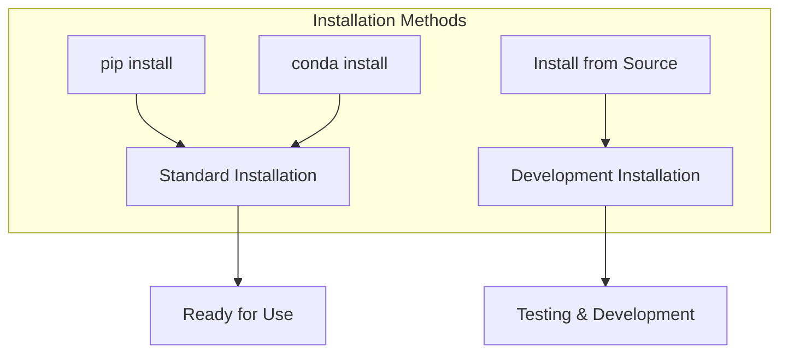
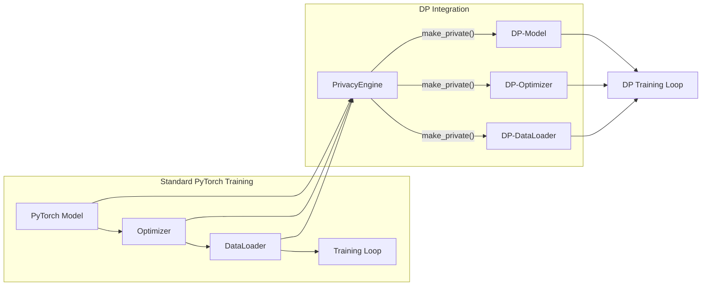
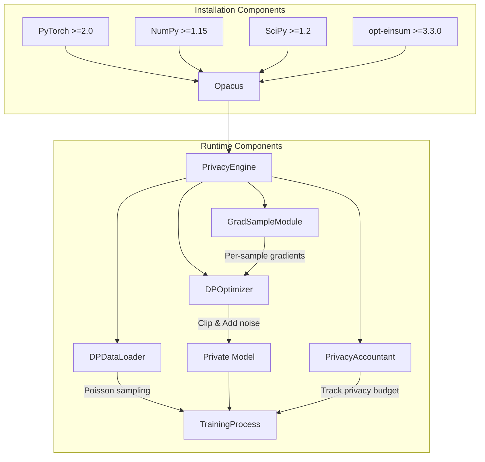

<!-- source: DeepWiki mcp.deepwiki.com · repo pytorch/opacus · page 14 Installation and Setup · fetched 2026-10-21 -->

# Installation and Setup

<details>
<summary>Relevant source files</summary>

The following files were used as context for generating this wiki page:

- [.github/workflows/python-publish.yml](.github/workflows/python-publish.yml)
- [.github/workflows/test-installation.yml](.github/workflows/test-installation.yml)
- [CONTRIBUTING.md](CONTRIBUTING.md)
- [README.md](README.md)
- [dev_requirements.txt](dev_requirements.txt)
- [docs/faq.md](docs/faq.md)
- [examples/mnist_lightning.py](examples/mnist_lightning.py)
- [opacus/lightning.py](opacus/lightning.py)
- [opacus/tests/distributed_poisson_test.py](opacus/tests/distributed_poisson_test.py)
- [requirements.txt](requirements.txt)
- [research/README.md](research/README.md)
- [scripts/pytorch_install.ps1](scripts/pytorch_install.ps1)
- [scripts/pytorch_install.sh](scripts/pytorch_install.sh)
- [website/pages/tutorials/index.js](website/pages/tutorials/index.js)

</details>


This document provides comprehensive instructions for installing and setting up Opacus, a library that enables training PyTorch models with differential privacy. It covers different installation methods, system requirements, and initial configuration of the PrivacyEngine to get started with privacy-preserving machine learning.

## System Requirements

Before installing Opacus, ensure your system meets the following requirements:

| Requirement | Supported Versions |
|-------------|-------------------|
| Python      | 3.9+              |
| PyTorch     | 2.0+ (1.13.1 minimum) |
| Operating Systems | Windows, macOS, Linux |

### Core Dependencies

Opacus requires the following core dependencies:

```
numpy>=1.15
torch>=2.0
scipy>=1.2
opt-einsum>=3.3.0
```

Sources: [requirements.txt:1-4]()

## Installation Methods

There are three main methods to install Opacus:



### Standard Installation

#### Using pip

The simplest way to install the latest stable release of Opacus:

```bash
pip install opacus
```

#### Using conda

Alternatively, you can install via conda:

```bash
conda install -c conda-forge opacus
```

Sources: [README.md:35-45]()

### Development Installation

For the latest features or if you want to contribute to Opacus, install from source:

```bash
git clone https://github.com/pytorch/opacus.git
cd opacus
pip install -e .
```

To include development dependencies (for testing, linting, documentation):

```bash
pip install -e .[dev]
```

Sources: [README.md:47-54](), [CONTRIBUTING.md:6-14]()

## Verifying Installation

After installation, you can verify that Opacus is correctly installed by importing it and checking its version:

```python
import opacus
print(opacus.__version__)
```

Sources: [.github/workflows/test-installation.yml:41-43]()

## Initial Setup and Configuration

Once Opacus is installed, you can set up differential privacy training with minimal code changes to your existing PyTorch training pipeline.

### Basic Integration Flow



### Basic Configuration Example

To enable differential privacy in your PyTorch model:

```python
# Import Opacus
from opacus import PrivacyEngine

# Define your model, optimizer, and data loader as usual
model = YourModel()
optimizer = torch.optim.SGD(model.parameters(), lr=0.05)
data_loader = torch.utils.data.DataLoader(dataset, batch_size=1024)

# Initialize the PrivacyEngine
privacy_engine = PrivacyEngine()

# Make private versions of your model, optimizer, and data loader
model, optimizer, data_loader = privacy_engine.make_private(
    module=model,
    optimizer=optimizer,
    data_loader=data_loader,
    noise_multiplier=1.1,
    max_grad_norm=1.0,
)

# Continue with your training loop as usual
```

Sources: [README.md:58-78](), [docs/faq.md:40-59]()

## Key Configuration Parameters

When configuring the PrivacyEngine, several parameters are critical for balancing privacy and utility:

| Parameter | Description | Typical Values |
|-----------|-------------|----------------|
| `noise_multiplier` | Controls noise added to gradients | 0.1 - 2.0 |
| `max_grad_norm` | Maximum L2 norm for gradient clipping | 0.1 - 10.0 |
| `delta` | Target delta for (ε,δ)-DP | Less than 1/dataset_size |
| `secure_rng` | Use cryptographically secure RNG | True/False |

**Note**: Lower `noise_multiplier` improves accuracy but reduces privacy protection. The `max_grad_norm` parameter should be set carefully based on your model architecture.

Sources: [docs/faq.md:67-75](), [docs/faq.md:62-66]()

## Component Relationships



Sources: [requirements.txt:1-4](), [README.md:58-78]()

## Integration with PyTorch Lightning

Opacus provides integration with PyTorch Lightning through the `DPLightningDataModule` class:

```python
from opacus.lightning import DPLightningDataModule

# Create a regular PyTorch Lightning DataModule
data = MNISTDataModule(batch_size=64)

# Wrap it with DPLightningDataModule
dp_data = DPLightningDataModule(data)

# Use in training as usual
trainer.fit(model, dp_data)
```

For a full example, see the provided Lightning example in the Opacus repository.

Sources: [examples/mnist_lightning.py:149-161](), [opacus/lightning.py:23-61]()

## Common Issues and Troubleshooting

### Memory Issues

If you encounter out-of-memory errors:

1. Reduce batch size
2. Enable Fast Gradient Clipping using the relevant parameter
3. Use virtual batch sizes with `BatchMemoryManager`

### Incompatible Modules

If you get `IncompatibleModuleException`:

```python
from opacus.validators import ModuleValidator

# Check if your model is compatible
valid = ModuleValidator.validate(model)

# If not, attempt to fix it
if not valid:
    model = ModuleValidator.fix(model)
```

Sources: [docs/faq.md:77-81](), [docs/faq.md:99-101]()

## Additional Resources

For more detailed information about Opacus usage:

- Interactive tutorials are available as Jupyter notebooks in the repository
- Blog posts explaining DP-SGD and implementation details
- Example implementations for various models and datasets

Sources: [README.md:87-98](), [website/pages/tutorials/index.js:54-85]()

## Compatibility Notes

Opacus is tested with:
- Multiple Python versions (3.9, 3.10)
- Multiple operating systems (Windows, macOS, Linux)
- Different PyTorch versions (minimum 1.13.1)

If you're using different versions, be aware that you may encounter compatibility issues.

Sources: [.github/workflows/test-installation.yml:14-19]()

---

