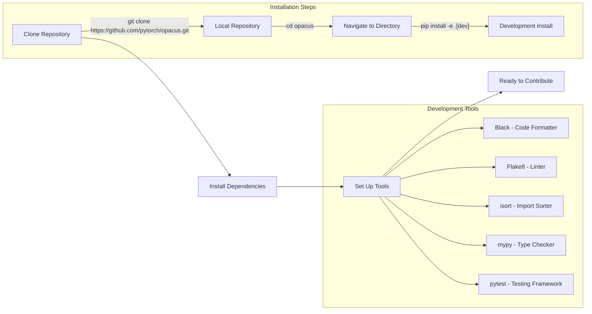
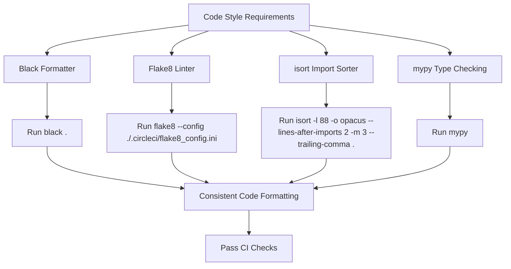
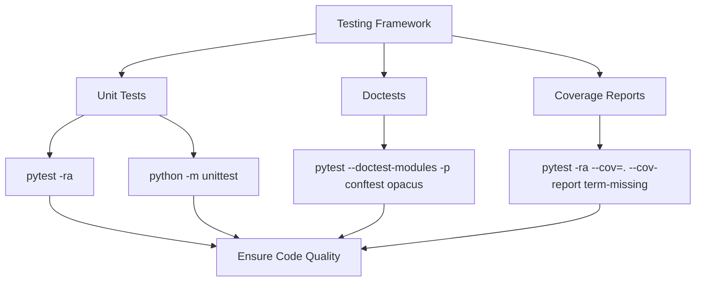
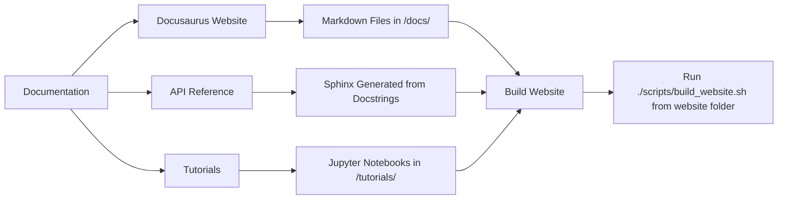
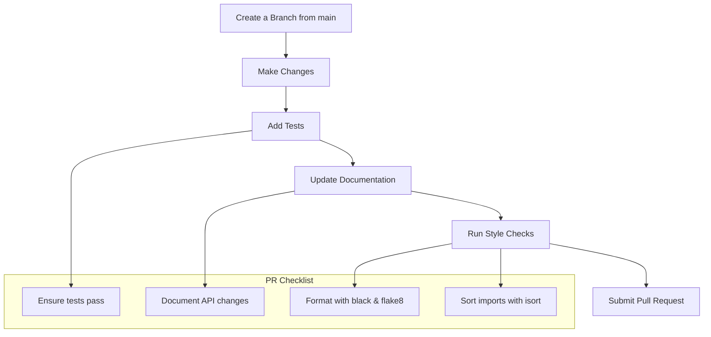
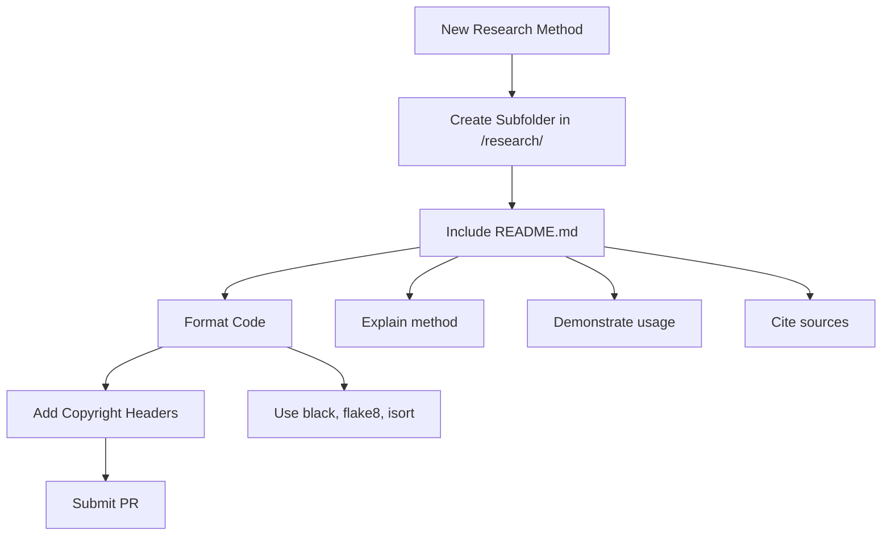
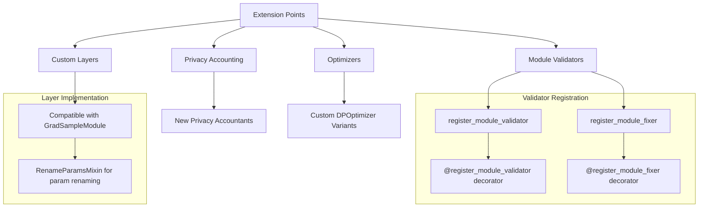
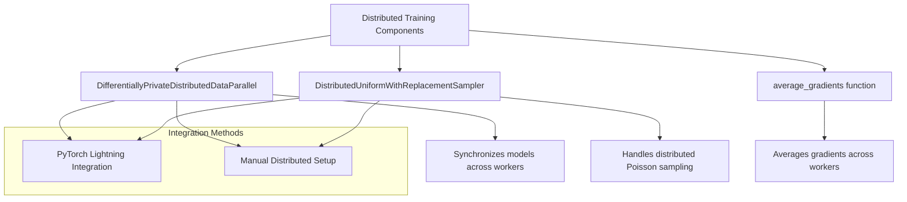

<!-- source: DeepWiki mcp.deepwiki.com · repo pytorch/opacus · page 15 Contributing to Opacus · fetched 2026-10-21 -->

# Contributing to Opacus

<details>
<summary>Relevant source files</summary>

The following files were used as context for generating this wiki page:

- [CONTRIBUTING.md](CONTRIBUTING.md)
- [conftest.py](conftest.py)
- [dev_requirements.txt](dev_requirements.txt)
- [examples/mnist_lightning.py](examples/mnist_lightning.py)
- [opacus/distributed.py](opacus/distributed.py)
- [opacus/layers/__init__.py](opacus/layers/__init__.py)
- [opacus/layers/param_rename.py](opacus/layers/param_rename.py)
- [opacus/lightning.py](opacus/lightning.py)
- [opacus/tests/distributed_poisson_test.py](opacus/tests/distributed_poisson_test.py)
- [opacus/validators/utils.py](opacus/validators/utils.py)
- [research/README.md](research/README.md)

</details>


This document provides guidelines and instructions for contributing to Opacus, a library for training PyTorch models with differential privacy. Whether you're looking to fix bugs, implement new features, extend functionality, or contribute research implementations, this guide will help you understand the development workflow and standards for contributing to Opacus.

## Development Environment Setup

Setting up your development environment is the first step toward contributing to Opacus. The process is designed to ensure you have all the necessary tools and dependencies for development, testing, and documentation.



To set up your development environment:

1. Clone the repository:
   ```bash
   git clone https://github.com/pytorch/opacus.git
   cd opacus
   ```

2. Install in development mode with all dependencies:
   ```bash
   pip install -e .[dev]
   ```

This will install all the dependencies listed in `dev_requirements.txt` needed for development, testing, and documentation.

Sources: [CONTRIBUTING.md:6-14](), [dev_requirements.txt:1-21]()

## Code Style and Quality

Opacus enforces a consistent code style across the codebase using several tools. Following these guidelines ensures your contributions are consistent with the existing codebase.



### Black and Flake8

Run Black to format your code:
```bash
black .
```

Run Flake8 to check for style issues:
```bash
flake8 --config ./.circleci/flake8_config.ini
```

### Import Sorting with isort

Sort imports using:
```bash
isort -l 88 -o opacus --lines-after-imports 2 -m 3 --trailing-comma .
```

### Type Hints

Opacus uses Python type hints throughout the codebase. Make sure to add type annotations to your code following the pattern in existing files.

Sources: [CONTRIBUTING.md:19-56]()

## Testing

Testing is a critical part of the contribution process to ensure code quality and prevent regressions.



### Running Unit Tests

You can run tests using pytest or unittest:
```bash
pytest -ra
```
or
```bash
python -m unittest
```

### Coverage Reports

Get coverage reports using:
```bash
pytest -ra --cov=. --cov-report term-missing
```

### Doctests

Opacus uses doctests to ensure documentation examples are up-to-date:
```bash
python -m pytest --doctest-modules -p conftest opacus
```

The `conftest.py` file contains setup code for doctests, including a sample model, optimizer, and data loader.

Sources: [CONTRIBUTING.md:60-78](), [conftest.py:15-76]()

## Documentation

Documentation is essential for making Opacus accessible to users. The website and documentation are open source and part of the repository.



To build the documentation:

1. Make sure you have Node >= 8.x and Yarn >= 1.5
2. Navigate to the website folder
3. Run the build script:
   ```bash
   ./scripts/build_website.sh
   ```

You can also check spelling in documentation using `sphinxcontrib-spelling`.

Sources: [CONTRIBUTING.md:81-126]()

## Pull Request Process

The pull request process is designed to ensure code quality and maintainability.



When submitting a pull request:

1. Fork the repo and create your branch from `main`
2. Add unit tests for any new code
3. Update documentation for API changes
4. Ensure all tests pass
5. Make sure your code passes style checks (black, flake8, isort)

Sources: [CONTRIBUTING.md:129-139]()

## Contributing New Methods in Research

Opacus welcomes novel methods built on top of DP-SGD. These contributions are placed in the `research` directory.



When contributing research methods:

1. Place your method in a separate subfolder within the `research` directory
2. Include a `README.md` explaining the method, usage, and citations
3. Format code according to Opacus coding standards
4. Add copyright headers to each `.py` file
5. Submit a PR following the standard process

Note that code in the research directory is not maintained by the Opacus team and may not be compatible with future changes.

Sources: [research/README.md:1-21]()

## Extending Opacus Functionality

Opacus is designed to be extensible, allowing contributors to add support for new modules and custom implementations.



### Module Validators and Fixers

Opacus provides decorators to register validators and fixers for custom module types:

```python
@register_module_validator(MyCustomModel)
def validate(module: nn.Module, **kwargs) -> List[UnsupportedError]:
    # Validation logic
    pass

@register_module_fixer(MyCustomModel)
def fix(module: nn.Module, **kwargs) -> nn.Module:
    # Fixing logic
    pass
```

### Custom Layers

When implementing custom layers, you may need to ensure parameter naming consistency using `RenameParamsMixin`:

```python
class CustomLayer(RenameParamsMixin, nn.Module):
    def __init__(self):
        super().__init__()
        self.param = nn.Parameter(...)
        self.set_rename_map({"param": "weight"})
```

Sources: [opacus/validators/utils.py:20-83](), [opacus/layers/param_rename.py:24-139](), [opacus/layers/__init__.py:16-28]()

## Distributed Training Support

Opacus supports differentially private distributed training.



For distributed training, Opacus provides:

1. `DifferentiallyPrivateDistributedDataParallel` - Wrapper for distributed model training
2. `DistributedUniformWithReplacementSampler` - Handles distributed sampling of data
3. `average_gradients` - Function to average gradients across workers

There's also PyTorch Lightning integration available for simplified distributed training.

Sources: [opacus/distributed.py:16-57](), [opacus/tests/distributed_poisson_test.py:16-90](), [opacus/lightning.py:16-61](), [examples/mnist_lightning.py:16-186]()

## Issues and Bug Reports

Reporting issues helps improve Opacus. When filing issues:

1. Ensure your description is clear with sufficient instructions to reproduce the issue
2. For security bugs, go through Facebook's [bounty program](https://www.facebook.com/whitehat/) and do not file a public issue

Sources: [CONTRIBUTING.md:142-148]()

## License

By contributing to Opacus, you agree that your contributions will be licensed under the LICENSE file in the root directory of the source tree, which is the Apache License, Version 2.0.

Sources: [CONTRIBUTING.md:152-154]()

---

