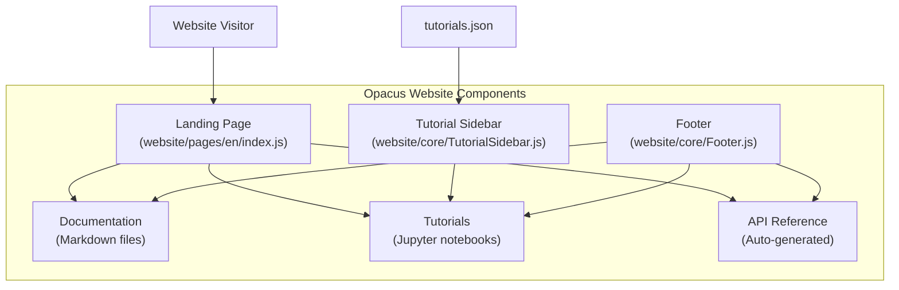
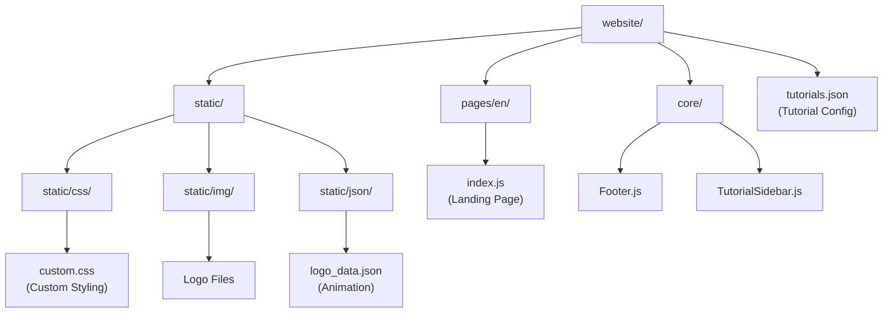
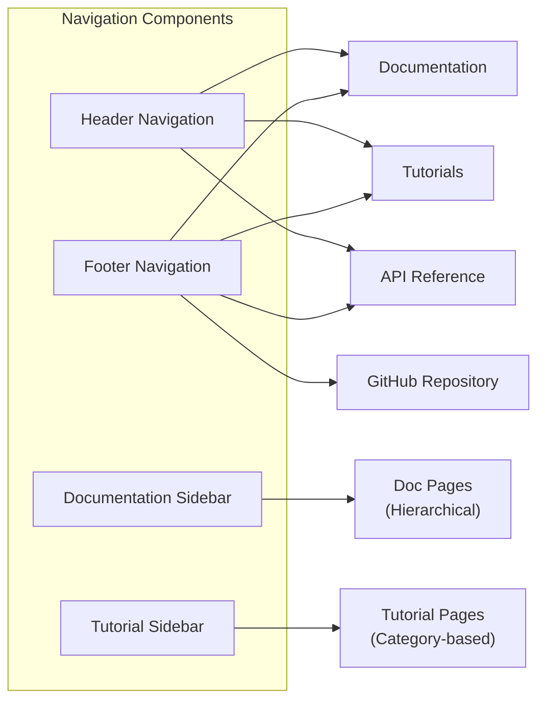
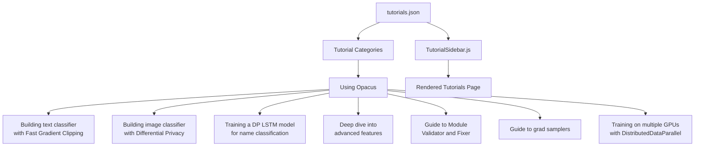
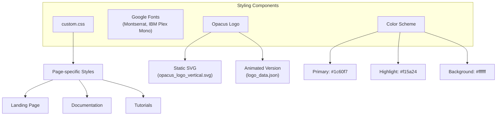
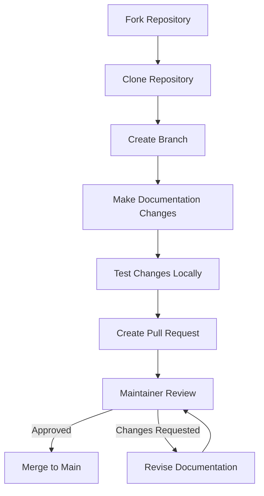
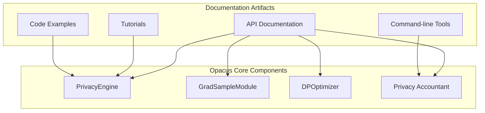

<!-- source: DeepWiki mcp.deepwiki.com · repo pytorch/opacus · page 16 Website and Documentation · fetched 2026-10-21 -->

# Website and Documentation

<details>
<summary>Relevant source files</summary>

The following files were used as context for generating this wiki page:

- [CODE_OF_CONDUCT.md](CODE_OF_CONDUCT.md)
- [MANIFEST.in](MANIFEST.in)
- [opacus/scripts/compute_dp_sgd_privacy.py](opacus/scripts/compute_dp_sgd_privacy.py)
- [website/core/Footer.js](website/core/Footer.js)
- [website/core/TutorialSidebar.js](website/core/TutorialSidebar.js)
- [website/package.json](website/package.json)
- [website/pages/en/index.js](website/pages/en/index.js)
- [website/static/css/custom.css](website/static/css/custom.css)
- [website/static/img/opacus_logo_vertical.svg](website/static/img/opacus_logo_vertical.svg)
- [website/static/img/oss_logo.png](website/static/img/oss_logo.png)
- [website/static/json/logo_data.json](website/static/json/logo_data.json)
- [website/tutorials.json](website/tutorials.json)

</details>


This document provides a comprehensive overview of the Opacus website and documentation infrastructure, including the underlying technology, file organization, content structure, and how users can navigate the documentation.

## Overview of Opacus Website Architecture

The Opacus website is built using Docusaurus (version 1.x), a React-based static site generator developed by Meta specifically for creating documentation websites. The website includes documentation, tutorials, and API references to help users learn and utilize the Opacus library effectively.



Sources: [website/pages/en/index.js](), [website/core/Footer.js](), [website/core/TutorialSidebar.js](), [website/tutorials.json]()

## Website Structure and Files

The Opacus website follows a standard Docusaurus project structure with key files organized in specific directories:



Sources: [website/pages/en/index.js](), [website/core/Footer.js](), [website/core/TutorialSidebar.js](), [website/static/css/custom.css](), [website/static/json/logo_data.json](), [website/static/img/opacus_logo_vertical.svg](), [website/tutorials.json]()

## Landing Page Structure

The landing page serves as the entry point to the Opacus ecosystem, providing quick access to key resources and highlighting the library's main features:

```mermaid
componentDiagram
    component "HomeSplash" {
        component "Logo"
        component "ProjectTitle"
        component "PromoSection" {
            component "Button(Introduction)"
            component "Button(Get Started)"
            component "Button(Tutorials)"
        }
    }
    
    component "Features" {
        component "Scalable"
        component "Built on PyTorch"
        component "Extensible"
    }
    
    component "QuickStart" {
        component "Installation Instructions"
        component "Basic Usage Example"
    }
```

Sources: [website/pages/en/index.js:29-102](), [website/pages/en/index.js:177-208](), [website/pages/en/index.js:143-175]()

## Documentation Navigation Structure

The navigation throughout the documentation is facilitated through various components that provide hierarchical access to content:



Sources: [website/core/Footer.js:76-81](), [website/core/TutorialSidebar.js:45-95]()

## Tutorial Management System

Tutorials are organized through a JSON configuration file that defines categories and individual tutorials:



Sources: [website/tutorials.json](), [website/core/TutorialSidebar.js:62-86]()

## Frontend Styling and Branding

The Opacus website has a custom styling system that ensures consistent branding across all pages:



Sources: [website/static/css/custom.css](), [website/static/img/opacus_logo_vertical.svg](), [website/static/json/logo_data.json]()

## Website Build and Deployment Process

The website uses npm scripts defined in package.json for building and deployment:

| Script Command | Purpose |
|----------------|---------|
| npm run start | Start development server |
| npm run build | Build static website |
| npm run publish-gh-pages | Publish to GitHub Pages |
| npm run examples | Generate examples |
| npm run write-translations | Generate translation files |
| npm run version | Create versioned docs |
| npm run rename-version | Rename a version |

Sources: [website/package.json:2-10]()

## Documentation Content Structure

The documentation is organized into categories with increasing levels of technical depth:

| Category | Content | Target Audience |
|----------|---------|----------------|
| Introduction | Basic overview, installation | All users |
| Core Concepts | DP-SGD, basic usage | Beginners |
| Advanced Features | Custom configurations, optimizations | Intermediate users |
| API Reference | Detailed class and function documentation | Advanced users |
| Tutorials | Step-by-step guides for specific tasks | All users |
| Command-line Tools | CLI utilities like compute_dp_sgd_privacy.py | Technical users |

Sources: [opacus/scripts/compute_dp_sgd_privacy.py]()

## Contributing to Documentation

Contributors to the Opacus documentation must follow the project's Code of Conduct and adhere to the established documentation style. Contributions are made through pull requests to the GitHub repository.



Sources: [CODE_OF_CONDUCT.md]()

## Integration with Core Opacus Library

The documentation and website are tightly integrated with the core Opacus library, with examples and tutorials referencing actual code and functionality:



Sources: [opacus/scripts/compute_dp_sgd_privacy.py:17-41]()

## Future Documentation Improvements

The documentation system is designed to be extensible to accommodate future enhancements to the Opacus library:

1. **Versioned documentation** - Allowing access to documentation for specific versions of Opacus
2. **Expanded tutorials** - Adding more use cases and applications
3. **Interactive examples** - Integrating with tools like Google Colab for live demonstrations
4. **Multi-language support** - Translating documentation to other languages

Sources: [website/package.json:2-10]()