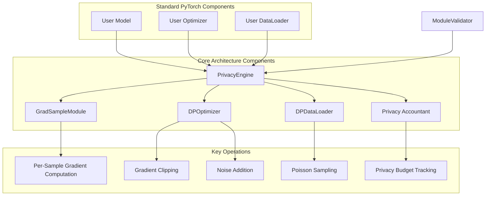
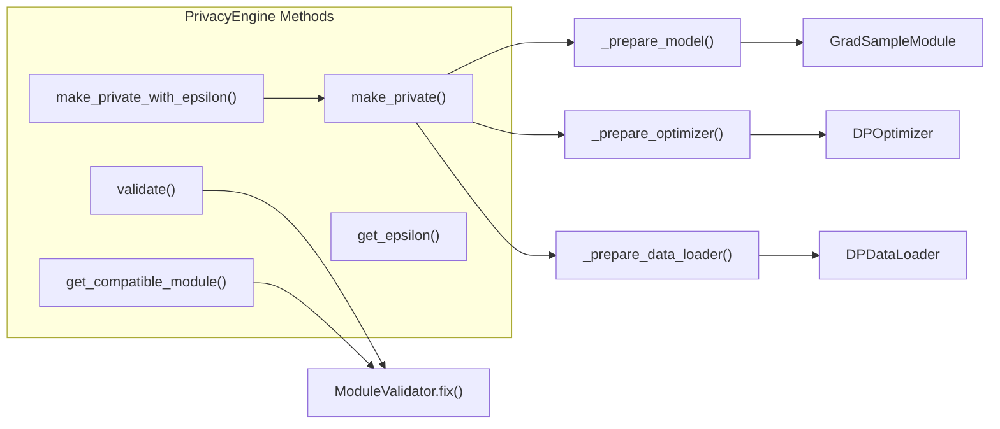
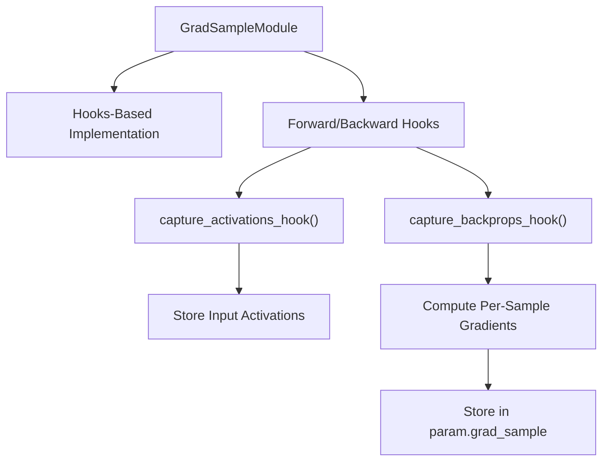
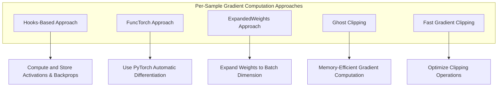
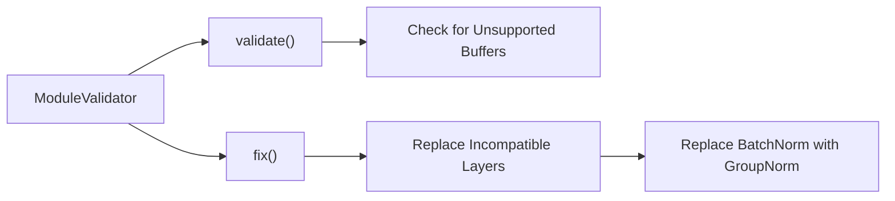
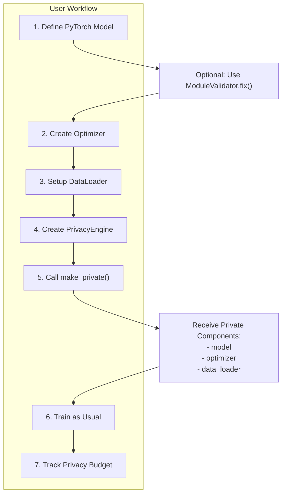

<!-- source: DeepWiki mcp.deepwiki.com · repo pytorch/opacus · page 2 Core Architecture · fetched 2026-10-21 -->

# Core Architecture

<details>
<summary>Relevant source files</summary>

The following files were used as context for generating this wiki page:

- [README.md](README.md)
- [docs/faq.md](docs/faq.md)
- [opacus/grad_sample/grad_sample_module.py](opacus/grad_sample/grad_sample_module.py)
- [opacus/privacy_engine.py](opacus/privacy_engine.py)
- [opacus/tests/privacy_engine_test.py](opacus/tests/privacy_engine_test.py)
- [website/pages/tutorials/index.js](website/pages/tutorials/index.js)

</details>


This page explains the foundational architecture of Opacus and how its main components interact to enable differentially private training of PyTorch models. For specifics about the PrivacyEngine API, see [PrivacyEngine](#2.1), and for details on per-sample gradient computation, see [GradSampleModule](#2.2).

## System Overview

The Opacus library implements Differentially Private Stochastic Gradient Descent (DP-SGD) by extending standard PyTorch components with privacy-preserving capabilities. The core architecture is built around several key components that work together to enable private training with minimal code changes and performance impact.



Sources: [opacus/privacy_engine.py:40-632]()

## Key Components and Their Roles

### PrivacyEngine

The `PrivacyEngine` class is the central orchestrator that transforms standard PyTorch training components into privacy-aware versions. It serves as the main entry point for users to enable differential privacy in their training pipeline.

Key responsibilities:
- Wrapping standard PyTorch modules to compute per-sample gradients
- Wrapping optimizers to implement gradient clipping and noise addition
- Wrapping data loaders to implement proper sampling methods
- Managing privacy accountants to track the privacy budget



Sources: [opacus/privacy_engine.py:40-102](), [opacus/privacy_engine.py:296-437]()

### GradSampleModule

The `GradSampleModule` wraps PyTorch modules to compute per-sample gradients, which is a fundamental requirement for DP-SGD. It implements various approaches for computing these gradients efficiently.



Sources: [opacus/grad_sample/grad_sample_module.py:79-489]()

### DPOptimizer

The `DPOptimizer` wraps standard PyTorch optimizers to implement the two key operations of DP-SGD:
1. Clipping per-sample gradients to limit sensitivity
2. Adding calibrated noise to ensure differential privacy

It works closely with the `GradSampleModule` to access the per-sample gradients.

### Privacy Accountants

Privacy accountants track the privacy budget expenditure throughout training. Opacus supports different accounting mechanisms:
- RDP Accountant (Rényi Differential Privacy)
- GDP Accountant (Gaussian Differential Privacy)
- PRV Accountant (Privacy Relaxation via Randomization)

## Data and Control Flow During Training

The following diagram illustrates the flow of data and operations during a training step with Opacus:

```mermaid
sequenceDiagram
    participant User as User Code
    participant PE as PrivacyEngine
    participant Model as GradSampleModule
    participant Opt as DPOptimizer
    participant PA as Privacy Accountant
    
    User->>PE: make_private(model, optimizer, data_loader)
    PE->>Model: Wrap model to compute per-sample gradients
    PE->>Opt: Wrap optimizer for clipping and noise
    PE->>User: Return private components
    
    User->>Model: Forward pass (inputs)
    Model->>Model: Compute outputs and store activations
    Model->>User: Return outputs
    User->>User: Compute loss
    User->>Model: Backward pass (loss)
    Model->>Model: Compute per-sample gradients
    Model->>Opt: Provide per-sample gradients
    Opt->>Opt: Clip gradients to max_grad_norm
    Opt->>Opt: Add noise scaled by noise_multiplier
    Opt->>Model: Update parameters
    Opt->>PA: Update privacy budget
    PA->>User: Current privacy guarantee (ε, δ)
```

Sources: [opacus/privacy_engine.py:296-437]()

## Per-Sample Gradient Computation Approaches

Opacus supports multiple approaches for computing per-sample gradients, each with different trade-offs in terms of memory usage, computational efficiency, and compatibility:



Sources: [opacus/grad_sample/grad_sample_module.py:79-489]()

## Module Validation and Compatibility

Not all PyTorch modules are compatible with differential privacy out of the box. Opacus provides validation and fixing mechanisms:



Sources: [opacus/privacy_engine.py:231-294]()

## User Integration Workflow

The typical workflow for integrating Opacus into a PyTorch training pipeline involves:



The following table summarizes the transformation of standard PyTorch components into their privacy-preserving counterparts:

| Standard Component | Privacy-Preserving Version | Purpose |
|--------------------|----------------------------|---------|
| `nn.Module` | `GradSampleModule` | Compute per-sample gradients |
| `Optimizer` | `DPOptimizer` | Implement gradient clipping and noise addition |
| `DataLoader` | `DPDataLoader` | Implement proper sampling for privacy guarantees |

Sources: [opacus/privacy_engine.py:296-437](), [README.md:56-79]()

## Example Usage

Here's a simplified example of how these components work together in practice:

1. The user defines standard PyTorch components (model, optimizer, data loader)
2. The user instantiates a `PrivacyEngine`
3. The user calls `privacy_engine.make_private()` to get privacy-preserving versions
4. The user trains the model as usual with the privacy-preserving components

During training:
- `GradSampleModule` computes per-sample gradients
- `DPOptimizer` clips gradients and adds noise
- The privacy accountant tracks the privacy budget

Sources: [README.md:56-79](), [opacus/privacy_engine.py:296-437]()

---

