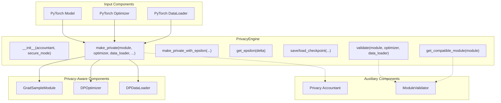
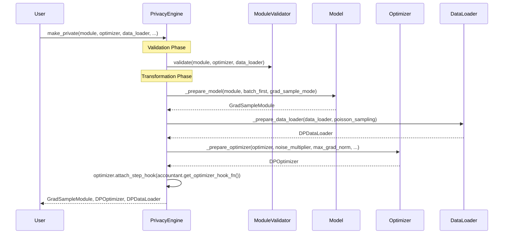
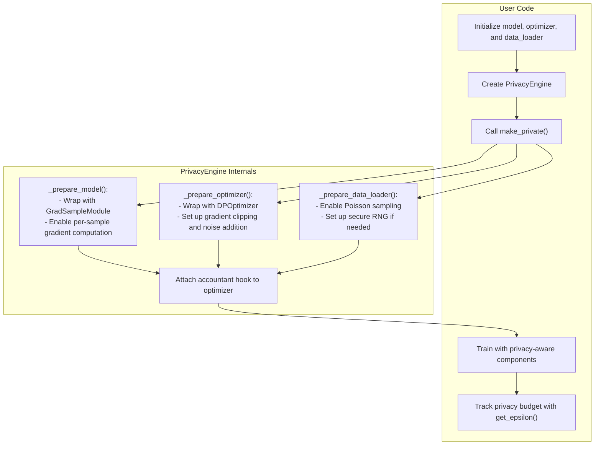

<!-- source: DeepWiki mcp.deepwiki.com · repo pytorch/opacus · page 2.1 PrivacyEngine · fetched 2026-10-21 -->

# PrivacyEngine

<details>
<summary>Relevant source files</summary>

The following files were used as context for generating this wiki page:

- [opacus/grad_sample/grad_sample_module.py](opacus/grad_sample/grad_sample_module.py)
- [opacus/privacy_engine.py](opacus/privacy_engine.py)
- [opacus/tests/privacy_engine_test.py](opacus/tests/privacy_engine_test.py)
- [tutorials/building_image_classifier.ipynb](tutorials/building_image_classifier.ipynb)
- [tutorials/building_lstm_name_classifier.ipynb](tutorials/building_lstm_name_classifier.ipynb)
- [tutorials/building_text_classifier.ipynb](tutorials/building_text_classifier.ipynb)
- [tutorials/ddp_tutorial.ipynb](tutorials/ddp_tutorial.ipynb)
- [tutorials/guide_to_grad_sampler.ipynb](tutorials/guide_to_grad_sampler.ipynb)
- [tutorials/guide_to_module_validator.ipynb](tutorials/guide_to_module_validator.ipynb)
- [tutorials/intro_to_advanced_features.ipynb](tutorials/intro_to_advanced_features.ipynb)

</details>


PrivacyEngine is the central orchestrator of the Opacus library that enables differential privacy for PyTorch models. It provides a high-level API to transform standard PyTorch training components (models, optimizers, and data loaders) into their privacy-aware counterparts, allowing for differentially private model training with minimal code changes.

For information about specific gradient computation methods, see [GradSampleModule](#2.2). For optimizers used in differential privacy training, see [Differential Privacy Optimizers](#3).

## Overview and Architecture

PrivacyEngine is designed to be the main entry point to the Opacus API. It wraps the core PyTorch training components with privacy-preserving functionality while maintaining their original interfaces, allowing users to incorporate differential privacy with minimal changes to their training code.



*Diagram: PrivacyEngine Architecture and Component Relationships*

Sources: [opacus/privacy_engine.py:40-51](), [opacus/privacy_engine.py:296-436]()

## Initialization

The PrivacyEngine is initialized with privacy accounting mechanism and security settings.

```python
privacy_engine = PrivacyEngine(
    accountant="prv",  # Options: "rdp", "gdp", or "prv"
    secure_mode=False  # Set to True for cryptographically strong DP guarantee
)
```

The `accountant` parameter specifies the privacy accounting mechanism:
- "rdp": RDP Accountant (Rényi Differential Privacy)
- "gdp": Gaussian Accountant
- "prv": PRV Accountant (Privacy Relaxation Verification)

When `secure_mode` is set to `True`, the engine uses secure random number generation via the `torchcsprng` package, which prevents certain floating-point arithmetic-based attacks.

Sources: [opacus/privacy_engine.py:65-100]()

## Core Methods

### make_private

The primary method of PrivacyEngine is `make_private()`, which transforms standard PyTorch components into privacy-aware versions:



*Diagram: PrivacyEngine's make_private Method Workflow*

Sources: [opacus/privacy_engine.py:296-436]()

The `make_private` method takes the following key parameters:

| Parameter | Description |
|-----------|-------------|
| `module` | PyTorch module to be used for training |
| `optimizer` | Optimizer to be used for training |
| `data_loader` | DataLoader to be used for training |
| `noise_multiplier` | The ratio of noise to sensitivity (higher = more privacy) |
| `max_grad_norm` | Maximum norm for per-sample gradient clipping |
| `batch_first` | Flag indicating if batch dimension is first in tensors |
| `loss_reduction` | Reduction type for aggregating gradients ("sum" or "mean") |
| `poisson_sampling` | Whether to use Poisson sampling for DP guarantees |
| `clipping` | Gradient clipping mechanism ("flat", "per_layer", or "adaptive") |
| `grad_sample_mode` | Mode for computing per-sample gradients ("hooks", "functorch", etc.) |

The method returns:
- A `GradSampleModule` that computes per-sample gradients
- A `DPOptimizer` that clips gradients and adds noise
- A modified `DataLoader` that handles privacy-preserving sampling

Sources: [opacus/privacy_engine.py:296-436]()

### make_private_with_epsilon

This method is a variant of `make_private` that calculates the appropriate noise multiplier to achieve a target privacy budget:

```python
model, optimizer, data_loader = privacy_engine.make_private_with_epsilon(
    module=model,
    optimizer=optimizer,
    data_loader=data_loader,
    target_epsilon=10.0,
    target_delta=1e-5,
    epochs=10,
    max_grad_norm=1.0
)
```

This method is useful when you have a specific privacy budget (ε, δ) that you want to achieve by the end of training.

Sources: [opacus/privacy_engine.py:438-540]()

### Privacy Budget Tracking

PrivacyEngine provides the `get_epsilon` method to track the current privacy budget:

```python
current_epsilon = privacy_engine.get_epsilon(delta=1e-5)
```

This returns the privacy budget (epsilon) expended so far for the specified delta.

Sources: [opacus/privacy_engine.py:542-552]()

## Module Validation and Compatibility

PrivacyEngine includes mechanisms to validate and fix modules for compatibility with differential privacy:

```python
# Check if module is compatible
is_compatible = privacy_engine.is_compatible(module=model, optimizer=optimizer, data_loader=data_loader)

# Validate and raise errors if incompatible
privacy_engine.validate(module=model, optimizer=optimizer, data_loader=data_loader)

# Fix incompatible modules (e.g., replacing BatchNorm with GroupNorm)
compatible_model = PrivacyEngine.get_compatible_module(model)
```

The validation process ensures that:
1. The model can compute per-sample gradients
2. There are no incompatible layers (like BatchNorm)
3. The model parameters match the optimizer parameters

Sources: [opacus/privacy_engine.py:235-294]()

## Checkpointing

PrivacyEngine provides methods to save and load the training state, including the privacy accountant:

```python
# Save checkpoint
privacy_engine.save_checkpoint(
    path="checkpoint.pt",
    module=model,
    optimizer=optimizer
)

# Load checkpoint
privacy_engine.load_checkpoint(
    path="checkpoint.pt", 
    module=model,
    optimizer=optimizer
)
```

This functionality is essential for resuming training while preserving privacy accounting.

Sources: [opacus/privacy_engine.py:554-632]()

## PrivacyEngine Workflow

The following diagram illustrates a typical workflow for training with differential privacy using PrivacyEngine:



*Diagram: Typical Workflow Using PrivacyEngine*

Sources: [opacus/privacy_engine.py:40-51](), [opacus/privacy_engine.py:296-436]()

## Usage Example

Here's a minimal example of how to use PrivacyEngine in a training pipeline:

```python
# Initialize standard PyTorch components
model = MyModel()
optimizer = torch.optim.SGD(model.parameters(), lr=0.1)
data_loader = DataLoader(dataset, batch_size=64)

# Initialize Privacy Engine
privacy_engine = PrivacyEngine()

# Make components private
model, optimizer, data_loader = privacy_engine.make_private(
    module=model,
    optimizer=optimizer,
    data_loader=data_loader,
    noise_multiplier=1.0,
    max_grad_norm=1.0
)

# Train as usual with the privacy-enhanced components
for epoch in range(epochs):
    for data, target in data_loader:
        optimizer.zero_grad()
        output = model(data)
        loss = criterion(output, target)
        loss.backward()
        optimizer.step()
    
    # Track privacy budget
    epsilon = privacy_engine.get_epsilon(delta=1e-5)
    print(f"ε = {epsilon:.2f}, δ = 1e-5")
```

## Parameter Selection and Advanced Configuration

### Noise Multiplier and Max Gradient Norm

These are the two primary levers for controlling the privacy-utility trade-off:

- **noise_multiplier**: Controls the amount of noise added to gradients. Higher values provide stronger privacy guarantees but may reduce model utility.
- **max_grad_norm**: Limits the sensitivity of the training procedure to individual samples. Lower values improve privacy but may slow down training.

### Secure Mode

When `secure_mode=True`, PrivacyEngine uses cryptographically strong random number generation, which provides stronger security guarantees but may be slower:

```python
privacy_engine = PrivacyEngine(secure_mode=True)
```

This requires the `torchcsprng` package to be installed.

### Gradient Clipping Methods

PrivacyEngine supports different gradient clipping strategies:

- **flat**: Clips the gradient norm across all parameters (default)
- **per_layer**: Clips each parameter tensor separately
- **adaptive**: Dynamically adjusts clipping bound during training

Sources: [opacus/privacy_engine.py:296-370]()

## Integration with Distributed Training

PrivacyEngine supports distributed training through integration with PyTorch's DistributedDataParallel:

```python
from torch.nn.parallel import DistributedDataParallel as DDP
from opacus.distributed import DifferentiallyPrivateDistributedDataParallel as DPDDP

# Wrap model with DPDDP instead of DDP
model = DPDDP(model)

# PrivacyEngine detects DPDDP and enables distributed mode
model, optimizer, data_loader = privacy_engine.make_private(
    module=model,
    optimizer=optimizer,
    data_loader=data_loader,
    noise_multiplier=1.0,
    max_grad_norm=1.0
)
```

Sources: [opacus/privacy_engine.py:385-419]()

## Conclusion

PrivacyEngine is the central component of Opacus that orchestrates differential privacy during model training. By transforming standard PyTorch components into privacy-aware versions, it allows developers to train models with differential privacy guarantees while maintaining a familiar PyTorch API.

---

