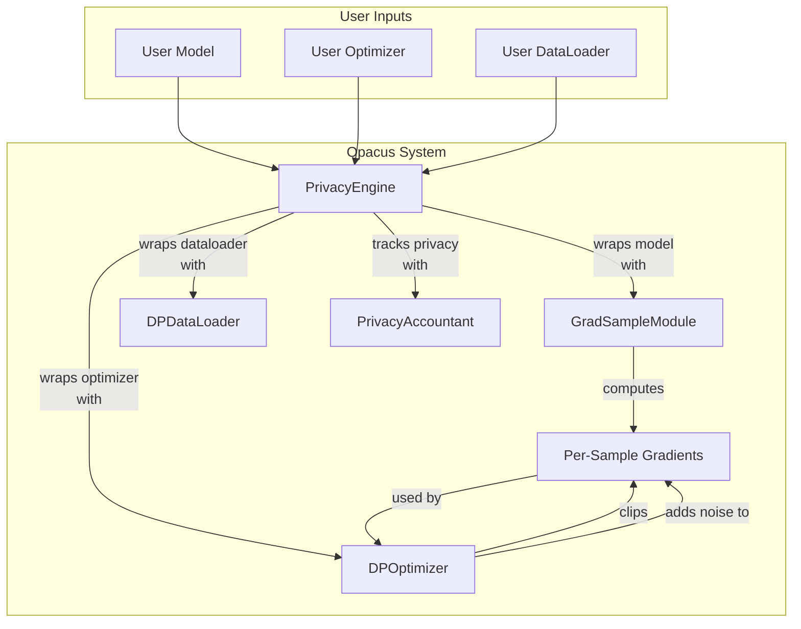
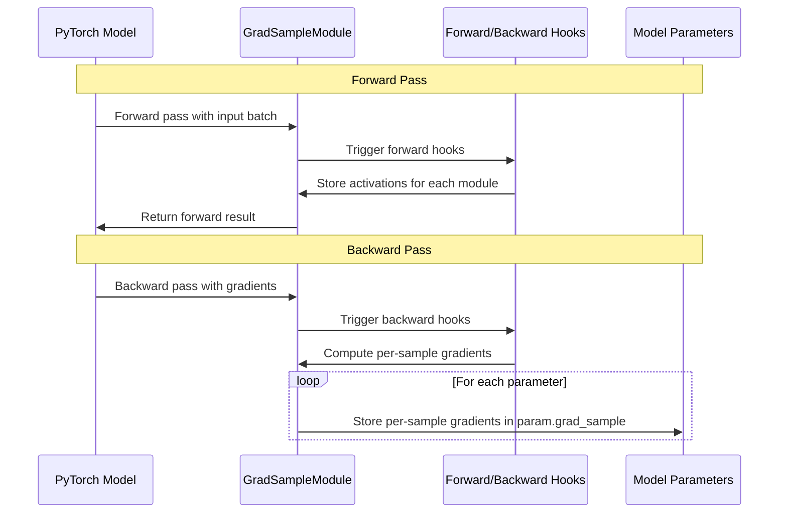
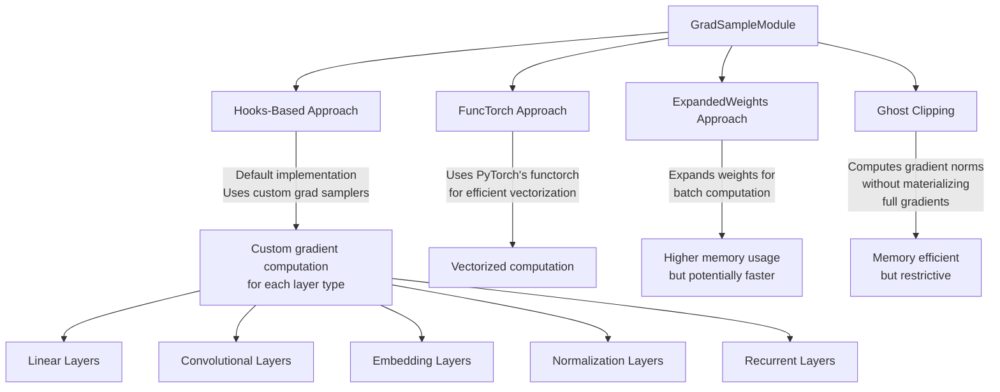
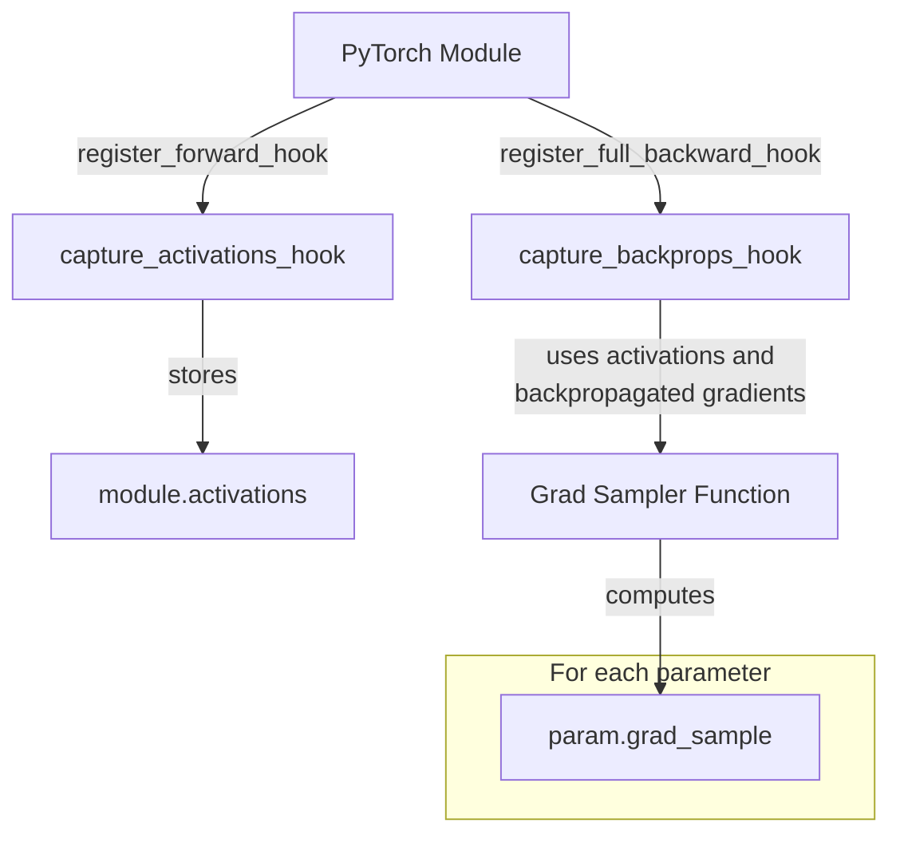
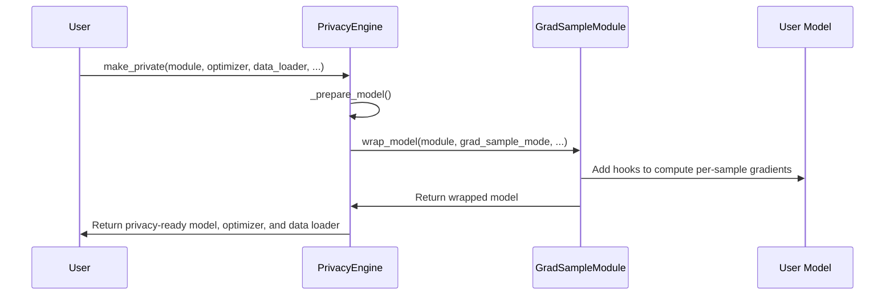
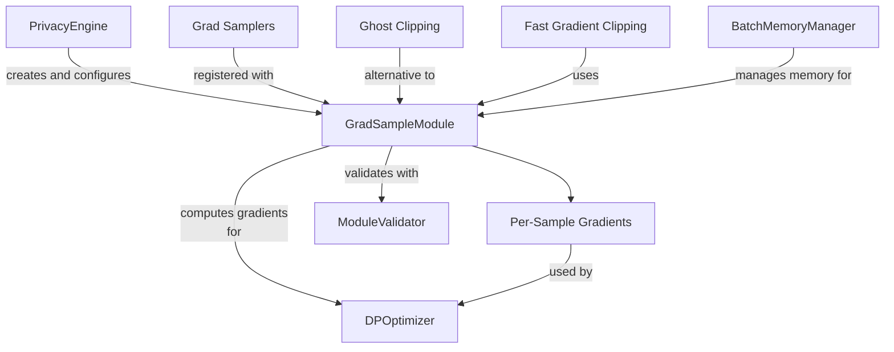

<!-- source: DeepWiki mcp.deepwiki.com · repo pytorch/opacus · page 2.2 GradSampleModule · fetched 2026-10-21 -->

# GradSampleModule

<details>
<summary>Relevant source files</summary>

The following files were used as context for generating this wiki page:

- [opacus/grad_sample/__init__.py](opacus/grad_sample/__init__.py)
- [opacus/grad_sample/embedding_norm_sample.py](opacus/grad_sample/embedding_norm_sample.py)
- [opacus/grad_sample/grad_sample_module.py](opacus/grad_sample/grad_sample_module.py)
- [opacus/grad_sample/utils.py](opacus/grad_sample/utils.py)
- [opacus/privacy_engine.py](opacus/privacy_engine.py)
- [opacus/tests/grad_samples/embedding_norm_sample_test.py](opacus/tests/grad_samples/embedding_norm_sample_test.py)
- [opacus/tests/privacy_engine_test.py](opacus/tests/privacy_engine_test.py)

</details>


GradSampleModule is a core component of Opacus that enables per-sample gradient computation, which is essential for implementing differential privacy in neural network training. This class wraps PyTorch modules to compute gradients for each individual sample in a batch, rather than only computing the aggregate gradient across the entire batch.

For information about the broader privacy engine architecture, see [PrivacyEngine](#2.1). For details on differential privacy optimization, see [Basic DPOptimizer](#3.1).

## Purpose and Functionality

GradSampleModule serves as an implementation of the abstract class AbstractGradSampleModule, providing a hooks-based approach for computing per-sample gradients. It works by:

1. Registering forward and backward hooks on PyTorch modules
2. Capturing activations during the forward pass
3. Computing per-sample gradients during the backward pass
4. Storing these gradients in the `grad_sample` attribute of each parameter

This mechanism is crucial for differential privacy, as it allows the privacy engine to clip gradients on a per-sample basis and add calibrated noise before updating model parameters.

Sources: [opacus/grad_sample/grad_sample_module.py:79-149](). [opacus/grad_sample/__init__.py:21-22]().

## Architecture and Position in Opacus

GradSampleModule sits between the user's PyTorch model and the privacy engine, transforming standard models into privacy-aware ones.



Sources: [opacus/privacy_engine.py:170-213](). [opacus/grad_sample/grad_sample_module.py:79-85]().

## Per-Sample Gradient Computation Process

Here's how GradSampleModule computes per-sample gradients during training:



Sources: [opacus/grad_sample/grad_sample_module.py:268-312](). [opacus/grad_sample/grad_sample_module.py:364-419]().

## Implementation Approaches

GradSampleModule supports multiple strategies for computing per-sample gradients, each with different trade-offs:



Sources: [opacus/grad_sample/utils.py:84-111](). [opacus/grad_sample/grad_sample_module.py:202-208]().

## Core Components and Methods

### Initialization and Configuration

GradSampleModule is initialized with several key parameters:

```python
def __init__(
    self,
    m: nn.Module,
    *,
    batch_first=True,
    loss_reduction="mean",
    strict: bool = True,
    force_functorch=False,
):
```

- `m`: The PyTorch module to be wrapped
- `batch_first`: Flag indicating if input tensor has batch as first dimension
- `loss_reduction`: Whether loss reduction is "mean" or "sum"
- `strict`: Whether to validate the module strictly for compatibility
- `force_functorch`: Whether to use functorch for all gradient computations

Sources: [opacus/grad_sample/grad_sample_module.py:89-118]().

### Key Methods

| Method | Purpose |
|--------|---------|
| `add_hooks()` | Adds forward and backward hooks to the model |
| `remove_hooks()` | Removes hooks from the model |
| `enable_hooks()` / `disable_hooks()` | Toggle hook functionality |
| `capture_activations_hook()` | Forward hook to store module activations |
| `capture_backprops_hook()` | Backward hook to compute per-sample gradients |
| `rearrange_grad_samples()` | Process activations and gradients based on batch dimension and loss reduction |
| `forbid_grad_accumulation()` / `allow_grad_accumulation()` | Control whether gradient accumulation is allowed |

Sources: [opacus/grad_sample/grad_sample_module.py:166-190](). [opacus/grad_sample/grad_sample_module.py:221-241](). [opacus/grad_sample/grad_sample_module.py:268-283](). [opacus/grad_sample/grad_sample_module.py:291-362](). [opacus/grad_sample/grad_sample_module.py:364-419](). [opacus/grad_sample/grad_sample_module.py:484-488]().

## Hook Management

GradSampleModule uses PyTorch's hook system to intercept forward and backward passes for computing per-sample gradients:



Sources: [opacus/grad_sample/grad_sample_module.py:202-217](). [opacus/grad_sample/grad_sample_module.py:268-283](). [opacus/grad_sample/grad_sample_module.py:291-362]().

## Gradient Computation and Storage

During the backward pass, GradSampleModule performs these key operations:

1. Captures backpropagated gradients
2. Retrieves stored activations
3. Determines appropriate gradient sampler function
4. Computes per-sample gradients
5. Stores or accumulates these gradients in parameter attributes

For gradient accumulation (needed for RNNs and certain training scenarios), gradients are first accumulated in `_current_grad_sample` and then promoted to `grad_sample` when processing of the current batch is complete.

Sources: [opacus/grad_sample/grad_sample_module.py:40-76](). [opacus/grad_sample/grad_sample_module.py:291-362]().

## Integration with PrivacyEngine

PrivacyEngine uses GradSampleModule through the `_prepare_model` method:



Sources: [opacus/privacy_engine.py:170-213](). [opacus/privacy_engine.py:296-436]().

## Extension through Custom Gradient Samplers

Opacus allows custom gradient samplers to be registered for specific layer types:

```python
@register_grad_sampler(CustomLayer)
def compute_custom_grad_sample(module, activations, backprops):
    # Custom implementation
    return {param: grad_sample for param, grad_sample in ...}
```

These sampler functions are stored in the `GRAD_SAMPLERS` dictionary and used during the backward pass.

Sources: [opacus/grad_sample/utils.py:29-55](). [opacus/grad_sample/grad_sample_module.py:87]().

## Practical Considerations

### Memory Usage

Computing per-sample gradients requires storing both activations and per-sample gradients, which can significantly increase memory usage. For large models or batches, this can become a bottleneck.

### Compatibility

Not all PyTorch modules are directly compatible with the hooks-based approach. Modules with buffers (like BatchNorm) require special handling. GradSampleModule validates modules to ensure compatibility.

### Performance Trade-offs

Different gradient computation approaches offer different trade-offs:

| Approach | Memory Usage | Computation Speed | Compatibility |
|----------|--------------|-------------------|---------------|
| Hooks-based | Medium | Medium | Most layers |
| FuncTorch | Low | Fast | All layers |
| ExpandedWeights | High | Fast | Some layers |
| Ghost Clipping | Very Low | Fast | Restrictive |

Sources: [opacus/grad_sample/grad_sample_module.py:130-146](). [opacus/grad_sample/utils.py:84-111]().

## Example Usage

GradSampleModule is typically not used directly but through the PrivacyEngine:

```python
model = MyModel()
optimizer = torch.optim.SGD(model.parameters(), lr=0.1)
data_loader = DataLoader(dataset, batch_size=64)

privacy_engine = PrivacyEngine()
model, optimizer, data_loader = privacy_engine.make_private(
    module=model,
    optimizer=optimizer,
    data_loader=data_loader,
    noise_multiplier=1.0,
    max_grad_norm=1.0,
    grad_sample_mode="hooks"  # or "functorch", "ew", "ghost"
)
```

Behind the scenes, this wraps the model with GradSampleModule configured with the specified `grad_sample_mode`.

Sources: [opacus/privacy_engine.py:296-436]().

## Relationship to Other Opacus Components

GradSampleModule interacts closely with other components in the Opacus ecosystem:



Sources: [opacus/privacy_engine.py:170-213](). [opacus/privacy_engine.py:296-436]().

## Advanced Features

### Gradient Accumulation

GradSampleModule supports gradient accumulation, which is necessary for:
- RNN-based models where backward hooks are called multiple times
- Training scenarios where gradients need to be accumulated over multiple batches

This is controlled through the `grad_accumulation_allowed` flag and the associated methods:
- `forbid_grad_accumulation()`
- `allow_grad_accumulation()`

Sources: [opacus/grad_sample/grad_sample_module.py:40-76](). [opacus/grad_sample/grad_sample_module.py:484-488]().

### Batch Size Inference

GradSampleModule automatically infers the batch size from activations, supporting:
- Regular batched inputs
- Packed sequences (as used in RNNs)
- Variable batch sizes

This is handled by the `_get_batch_size` helper function.

Sources: [opacus/grad_sample/grad_sample_module.py:491-512]().

## Summary

GradSampleModule is a foundational component of Opacus that enables differential privacy by computing per-sample gradients. It uses PyTorch hooks to capture activations and backpropagated gradients, supports multiple implementation strategies, and provides mechanisms for handling complex scenarios like RNNs and gradient accumulation. While typically used through PrivacyEngine rather than directly, understanding its operation is crucial for effectively using Opacus for privacy-preserving machine learning.

---

