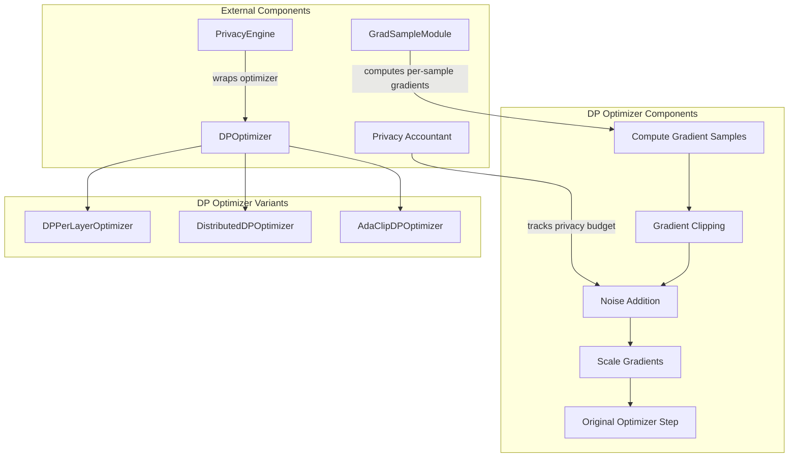
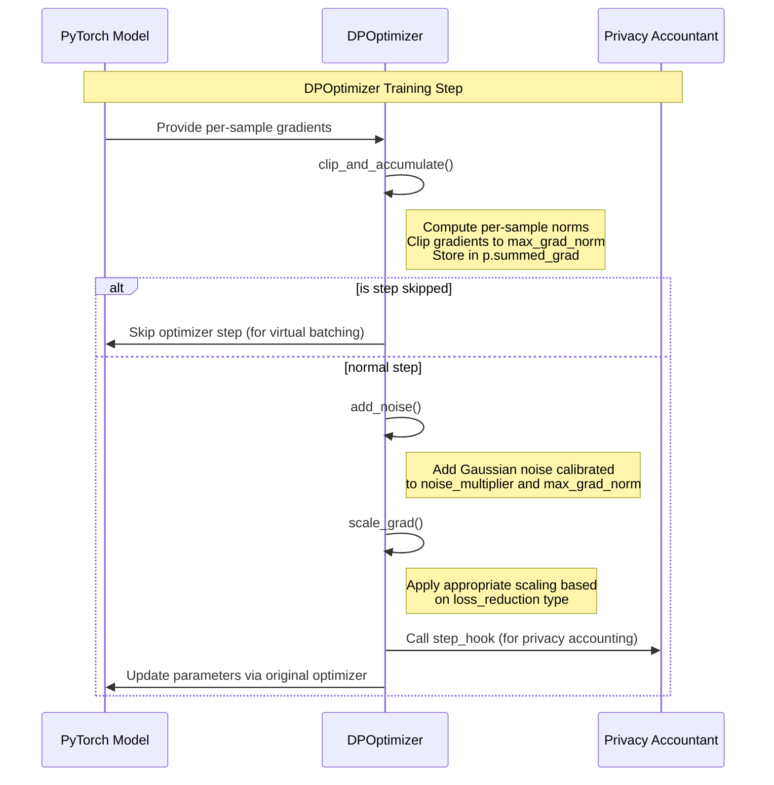
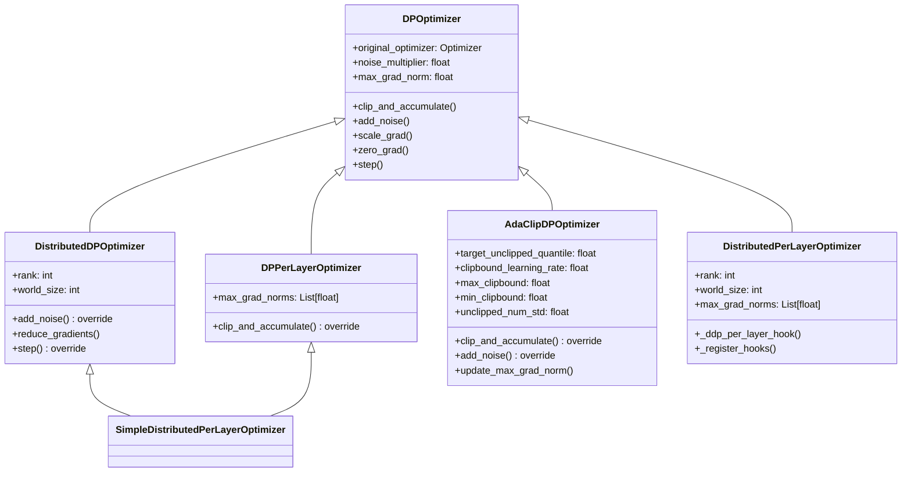
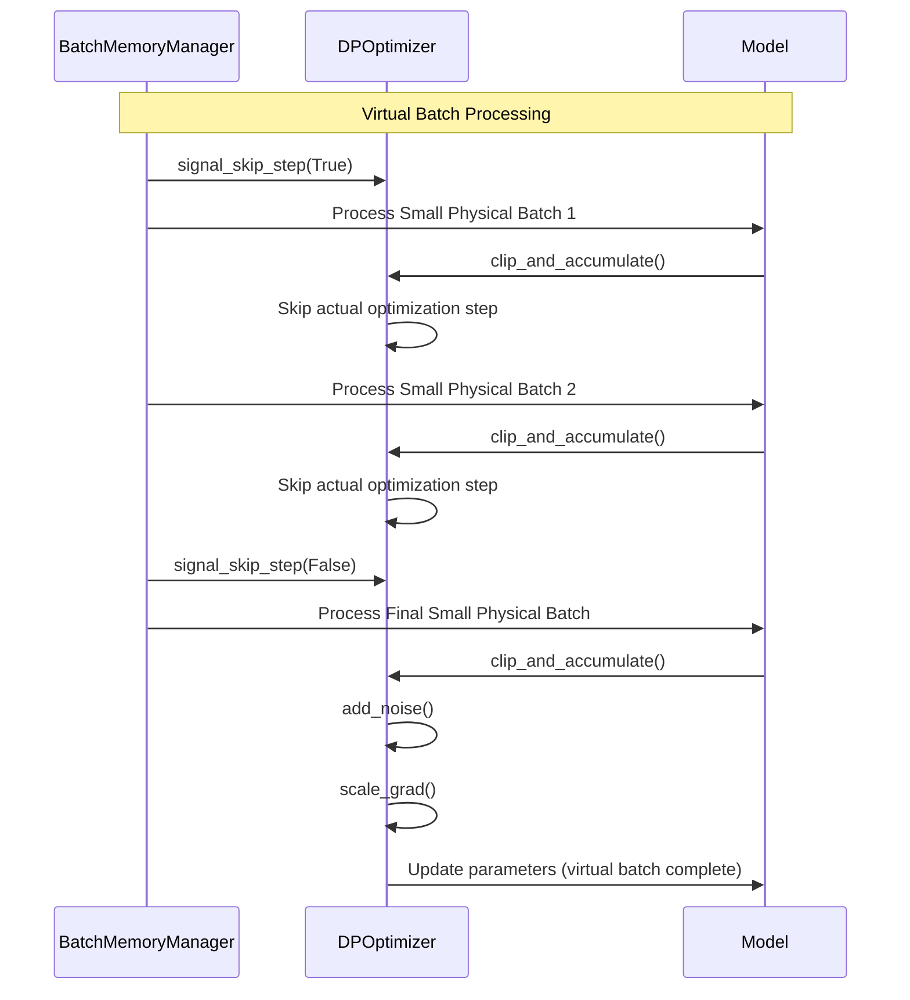

<!-- source: DeepWiki mcp.deepwiki.com · repo pytorch/opacus · page 3 Differential Privacy Optimizers · fetched 2026-10-21 -->

# Differential Privacy Optimizers

<details>
<summary>Relevant source files</summary>

The following files were used as context for generating this wiki page:

- [opacus/optimizers/adaclipoptimizer.py](opacus/optimizers/adaclipoptimizer.py)
- [opacus/optimizers/ddp_perlayeroptimizer.py](opacus/optimizers/ddp_perlayeroptimizer.py)
- [opacus/optimizers/ddpoptimizer.py](opacus/optimizers/ddpoptimizer.py)
- [opacus/optimizers/optimizer.py](opacus/optimizers/optimizer.py)
- [opacus/optimizers/perlayeroptimizer.py](opacus/optimizers/perlayeroptimizer.py)

</details>


This document provides an in-depth explanation of the differential privacy (DP) optimizers in Opacus, their functionality, and implementation details. DP optimizers are a core component of the Opacus library that handle gradient clipping, noise addition, and interfacing with privacy accounting during private model training. This document focuses on the optimizer implementations themselves; for information about the privacy engine that orchestrates these optimizers, see [PrivacyEngine](#2.1), and for details on privacy accounting, see [Privacy Accounting](#4).

## Overview of DP Optimizers

Differential privacy optimizers in Opacus extend standard PyTorch optimizers by adding privacy-preserving operations to the optimization process. These operations include per-sample gradient computation, gradient clipping, and noise addition to achieve differential privacy guarantees.



**Diagram: DP Optimizer Architecture and Workflow**

Sources: [opacus/optimizers/optimizer.py:170-566](), [opacus/optimizers/ddpoptimizer.py:25-83](), [opacus/optimizers/perlayeroptimizer.py:26-76](), [opacus/optimizers/adaclipoptimizer.py:34-151]()

## Base DPOptimizer

The `DPOptimizer` class is the foundation of all DP optimization in Opacus. It wraps any PyTorch optimizer to augment it with differential privacy functionality.



**Diagram: DPOptimizer Step Sequence**

Sources: [opacus/optimizers/optimizer.py:430-557]()

### Key Components

The `DPOptimizer` class implements several key methods that transform the optimization process:

1. **Initialization** - Takes an original optimizer, noise multiplier, max gradient norm, and other parameters.
   ```python
   def __init__(
       self,
       optimizer: Optimizer,
       *,
       noise_multiplier: float,
       max_grad_norm: float,
       expected_batch_size: Optional[int],
       loss_reduction: str = "mean",
       generator=None,
       secure_mode: bool = False,
       **kwargs,
   ):
   ```

2. **Gradient Clipping** - Implements per-sample gradient clipping to bound sensitivity.
   ```python
   def clip_and_accumulate(self):
       # Compute per-sample norms across all parameters
       per_param_norms = [
           g.reshape(len(g), -1).norm(2, dim=-1) for g in self.grad_samples
       ]
       per_sample_norms = torch.stack(per_param_norms, dim=1).norm(2, dim=1)
       per_sample_clip_factor = (
           self.max_grad_norm / (per_sample_norms + 1e-6)
       ).clamp(max=1.0)
       
       # Apply clipping to each parameter's gradients
       for p in self.params:
           grad_sample = self._get_flat_grad_sample(p)
           grad = torch.einsum("i,i...", per_sample_clip_factor, grad_sample)
           p.summed_grad = grad
   ```

3. **Noise Addition** - Adds calibrated Gaussian noise to achieve differential privacy.
   ```python
   def add_noise(self):
       for p in self.params:
           noise = _generate_noise(
               std=self.noise_multiplier * self.max_grad_norm,
               reference=p.summed_grad,
               generator=self.generator,
               secure_mode=self.secure_mode,
           )
           p.grad = (p.summed_grad + noise).view_as(p)
   ```

4. **Pre-step Processing** - Orchestrates the DP operations before the original optimizer step.
   ```python
   def pre_step(self, closure: Optional[Callable[[], float]] = None) -> Optional[float]:
       self.clip_and_accumulate()
       if self._check_skip_next_step():
           self._is_last_step_skipped = True
           return False
       self.add_noise()
       self.scale_grad()
       if self.step_hook:
           self.step_hook(self)  # For privacy accounting
       self._is_last_step_skipped = False
       return True
   ```

Sources: [opacus/optimizers/optimizer.py:198-227](), [opacus/optimizers/optimizer.py:430-460](), [opacus/optimizers/optimizer.py:462-478](), [opacus/optimizers/optimizer.py:524-548]()

### Secure Mode for Noise Generation

The `DPOptimizer` includes a secure mode that protects against floating-point representation attacks during noise generation:

```python
def _generate_noise(
    std: float,
    reference: torch.Tensor,
    generator=None,
    secure_mode: bool = False,
) -> torch.Tensor:
    # Special implementation for secure noise generation
    if secure_mode:
        # Generate and discard first sample to mitigate potential attacks
        torch.normal(mean=0, std=std, size=(1, 1), device=reference.device, generator=generator)
        
        # Sum multiple normal samples for better security
        sum = torch.zeros(reference.shape, device=reference.device)
        for _ in range(4):
            sum += torch.normal(
                mean=0, std=std, size=reference.shape, 
                device=reference.device, generator=generator
            )
        return sum / 2
    else:
        # Standard noise generation
        return torch.normal(
            mean=0, std=std, size=reference.shape,
            device=reference.device, generator=generator
        )
```

Sources: [opacus/optimizers/optimizer.py:103-167]()

## Specialized DP Optimizers

Opacus provides several specialized implementations of the base `DPOptimizer` class to address specific use cases and optimization strategies.



**Diagram: DP Optimizer Class Hierarchy**

Sources: [opacus/optimizers/optimizer.py:170-566](), [opacus/optimizers/perlayeroptimizer.py:26-76](), [opacus/optimizers/ddpoptimizer.py:25-83](), [opacus/optimizers/adaclipoptimizer.py:34-151](), [opacus/optimizers/ddp_perlayeroptimizer.py:40-175]()

### Per-Layer Clipping Optimizer

The `DPPerLayerOptimizer` extends the base optimizer to implement per-layer clipping, where each parameter can have a different clipping threshold.

```python
class DPPerLayerOptimizer(DPOptimizer):
    def __init__(
        self,
        optimizer: Optimizer,
        *,
        noise_multiplier: float,
        max_grad_norm: List[float],  # List of per-layer clip norms
        expected_batch_size: Optional[int],
        loss_reduction: str = "mean",
        generator=None,
        secure_mode: bool = False,
        **kwargs,
    ):
        # Calculate the overall max_grad_norm from the per-layer norms
        self.max_grad_norms = max_grad_norm
        max_grad_norm = torch.norm(torch.Tensor(self.max_grad_norms), p=2).item()
        super().__init__(...)
```

Unlike the base optimizer which clips all gradients with respect to a single norm threshold, the per-layer optimizer clips each parameter group separately:

```python
def clip_and_accumulate(self):
    for p, max_grad_norm in zip(self.params, self.max_grad_norms):
        grad_sample = self._get_flat_grad_sample(p)
        per_sample_norms = grad_sample.norm(
            2, dim=tuple(range(1, grad_sample.ndim))
        )
        per_sample_clip_factor = (max_grad_norm / (per_sample_norms + 1e-6)).clamp(
            max=1.0
        )
        grad = torch.einsum("i,i...", per_sample_clip_factor, grad_sample)
        p.summed_grad = grad
```

Sources: [opacus/optimizers/perlayeroptimizer.py:26-76]()

### Adaptive Clipping Optimizer

The `AdaClipDPOptimizer` implements an adaptive clipping strategy based on the paper ["Differentially Private Learning with Adaptive Clipping"](https://arxiv.org/pdf/1905.03871.pdf). It dynamically adjusts the clipping threshold during training:

```python
class AdaClipDPOptimizer(DPOptimizer):
    def __init__(
        self,
        optimizer: Optimizer,
        *,
        noise_multiplier: float,
        target_unclipped_quantile: float,  # Target fraction of unclipped gradients
        clipbound_learning_rate: float,    # Learning rate for clip bound adjustment
        max_clipbound: float,              # Maximum clipping bound
        min_clipbound: float,              # Minimum clipping bound
        unclipped_num_std: float,          # Standard deviation for noise on unclipped count
        max_grad_norm: float,
        expected_batch_size: Optional[int],
        loss_reduction: str = "mean",
        generator=None,
        secure_mode: bool = False,
        **kwargs,
    ):
```

The key method that updates the clipping threshold based on the observed fraction of unclipped gradients:

```python
def update_max_grad_norm(self):
    unclipped_frac = self.unclipped_num / self.sample_size
    # Adjust clipping threshold based on observed unclipped fraction
    self.max_grad_norm *= torch.exp(
        -self.clipbound_learning_rate
        * (unclipped_frac - self.target_unclipped_quantile)
    )
    # Enforce bounds on the clipping threshold
    if self.max_grad_norm > self.max_clipbound:
        self.max_grad_norm = self.max_clipbound
    elif self.max_grad_norm < self.min_clipbound:
        self.max_grad_norm = self.min_clipbound
```

Sources: [opacus/optimizers/adaclipoptimizer.py:34-151]()

### Distributed DP Optimizers

For distributed training scenarios, Opacus provides specialized DP optimizers that work with PyTorch's distributed data parallel (DDP) functionality:

1. **DistributedDPOptimizer** - Base class for distributed DP optimization
2. **DistributedPerLayerOptimizer** - Combines distributed training with per-layer clipping
3. **SimpleDistributedPerLayerOptimizer** - A simplified implementation that inherits from both distributed and per-layer optimizers

The `DistributedDPOptimizer` modifies the noise addition process to only add noise on the main process and properly reduces gradients across workers:

```python
def add_noise(self):
    # Noise only gets added to the first worker
    if self.rank == 0:
        super().add_noise()
    else:
        for p in self.params:
            p.grad = p.summed_grad.view_as(p)

def reduce_gradients(self):
    for p in self.params:
        if not p.requires_grad:
            continue
        # All-reduce operation to sum gradients across workers
        torch.distributed.all_reduce(p.grad, op=torch.distributed.ReduceOp.SUM)
        if self.loss_reduction == "mean":
            p.grad /= self.world_size
```

Sources: [opacus/optimizers/ddpoptimizer.py:25-83](), [opacus/optimizers/ddp_perlayeroptimizer.py:40-175]()

## Virtual Batching and Step Skipping

Opacus optimizers support a technique called "virtual batching" to simulate larger batch sizes than what can fit in memory. This is implemented through a step skipping mechanism:



**Diagram: Step Skipping for Virtual Batching**

Sources: [opacus/optimizers/optimizer.py:292-327](), [opacus/optimizers/optimizer.py:524-557]()

The implementation in `DPOptimizer` includes:

```python
def signal_skip_step(self, do_skip=True):
    """
    Signals the optimizer to skip an optimization step and only perform clipping and
    per sample gradient accumulation.
    """
    self._step_skip_queue.append(do_skip)

def _check_skip_next_step(self, pop_next=True):
    """
    Checks if next step should be skipped by the optimizer.
    """
    if self._step_skip_queue:
        if pop_next:
            return self._step_skip_queue.pop(0)
        else:
            return self._step_skip_queue[0]
    else:
        return False
```

This mechanism is used by the `BatchMemoryManager` to simulate large virtual batches with limited memory footprint.

Sources: [opacus/optimizers/optimizer.py:292-327]()

## Integration with Privacy Accounting

DP optimizers in Opacus support attaching hooks that are called during the optimization step, allowing for privacy budget accounting:

```python
def attach_step_hook(self, fn: Callable[[DPOptimizer], None]):
    """
    Attaches a hook to be executed after gradient clipping/noising, but before the
    actual optimization step.
    
    Most commonly used for privacy accounting.
    """
    self.step_hook = fn
```

During the optimization step, the hook is called to update privacy accounting:

```python
def pre_step(self, closure: Optional[Callable[[], float]] = None) -> Optional[float]:
    self.clip_and_accumulate()
    if self._check_skip_next_step():
        self._is_last_step_skipped = True
        return False
    self.add_noise()
    self.scale_grad()
    if self.step_hook:
        self.step_hook(self)  # Privacy accounting happens here
    self._is_last_step_skipped = False
    return True
```

This hook mechanism is how the various privacy accountants (RDP, GDP, etc.) track the privacy budget consumption during training. For more details on privacy accounting, see [Privacy Accounting](#4).

Sources: [opacus/optimizers/optimizer.py:418-428](), [opacus/optimizers/optimizer.py:524-548]()

## Summary Table of DP Optimizer Variants

| Optimizer Type | Key Features | Use Case |
|----------------|--------------|----------|
| **DPOptimizer** | Base implementation with per-sample gradient clipping and noise addition | Standard private training scenarios |
| **DPPerLayerOptimizer** | Different clipping thresholds for each parameter | When different layers require different sensitivity treatment |
| **AdaClipDPOptimizer** | Dynamically adjusts clipping threshold during training | When optimal clipping threshold is unknown |
| **DistributedDPOptimizer** | Synchronizes gradient processing across distributed workers | Distributed training with multiple GPUs/machines |
| **DistributedPerLayerOptimizer** | Combines distributed training with per-layer clipping | Distributed training with layer-specific sensitivity |

Sources: [opacus/optimizers/optimizer.py:170-566](), [opacus/optimizers/perlayeroptimizer.py:26-76](), [opacus/optimizers/adaclipoptimizer.py:34-151](), [opacus/optimizers/ddpoptimizer.py:25-83](), [opacus/optimizers/ddp_perlayeroptimizer.py:40-175]()

---

