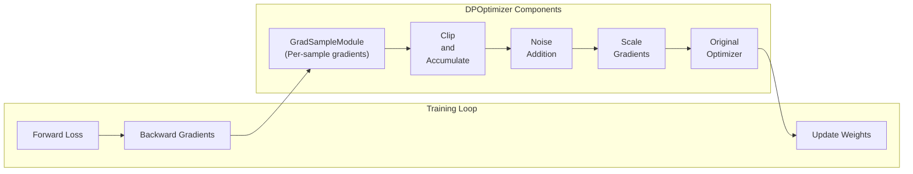
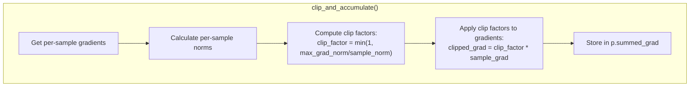
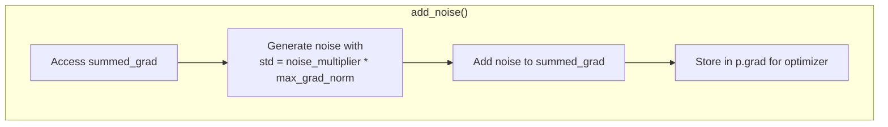
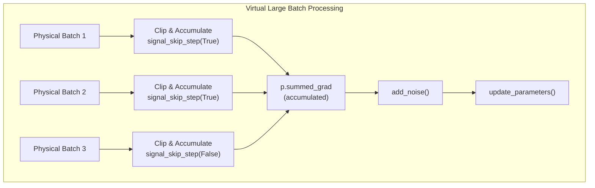
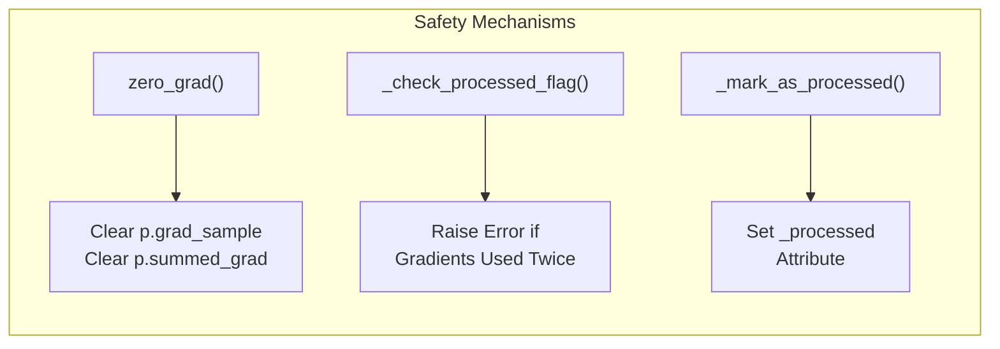
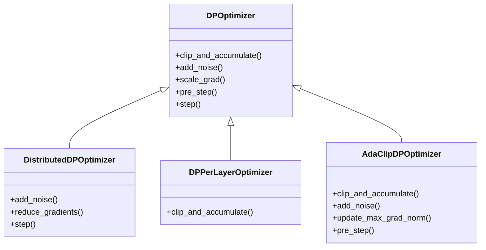

<!-- source: DeepWiki mcp.deepwiki.com · repo pytorch/opacus · page 3.1 Basic DPOptimizer · fetched 2026-10-21 -->

# Basic DPOptimizer

<details>
<summary>Relevant source files</summary>

The following files were used as context for generating this wiki page:

- [opacus/optimizers/adaclipoptimizer.py](opacus/optimizers/adaclipoptimizer.py)
- [opacus/optimizers/ddp_perlayeroptimizer.py](opacus/optimizers/ddp_perlayeroptimizer.py)
- [opacus/optimizers/ddpoptimizer.py](opacus/optimizers/ddpoptimizer.py)
- [opacus/optimizers/optimizer.py](opacus/optimizers/optimizer.py)
- [opacus/optimizers/perlayeroptimizer.py](opacus/optimizers/perlayeroptimizer.py)

</details>


## Purpose and Scope

This document covers the `DPOptimizer` class, which is the core component in Opacus that enables differentially private optimization. The DPOptimizer wraps any standard PyTorch optimizer and extends it with privacy-preserving capabilities, specifically gradient clipping and noise addition following the DP-SGD algorithm. For information about specialized optimizers like per-layer clipping or adaptive clipping, see [Specialized Optimizers](#3.2).

## Overview of DPOptimizer

The `DPOptimizer` is a wrapper around any standard PyTorch optimizer (such as SGD, Adam, etc.) that implements the differential privacy stochastic gradient descent (DP-SGD) algorithm. It sits between the model generating per-sample gradients and the underlying optimizer that updates parameters.



Sources: [opacus/optimizers/optimizer.py:31-566]()

## Key Parameters and Configuration

The `DPOptimizer` requires several key parameters that control the privacy-utility trade-off:

| Parameter | Type | Description |
|-----------|------|-------------|
| `optimizer` | `torch.optim.Optimizer` | The original PyTorch optimizer to wrap |
| `noise_multiplier` | `float` | Controls the amount of noise added to gradients |
| `max_grad_norm` | `float` | Clipping threshold for per-sample gradients |
| `expected_batch_size` | `int` | Used for gradient scaling when loss reduction is "mean" |
| `loss_reduction` | `str` | Either "mean" or "sum" depending on how loss is calculated |
| `generator` | `torch.Generator` | Random generator for noise (optional) |
| `secure_mode` | `bool` | Whether to use secure noise generation resistant to floating-point attacks |

Sources: [opacus/optimizers/optimizer.py:198-227]()

## DP-SGD Workflow

The `DPOptimizer` implements DP-SGD through a series of processing steps:

```mermaid
sequenceDiagram
    participant Model as "Model"
    participant GSM as "GradSampleModule"
    participant DPO as "DPOptimizer"
    participant Opt as "Original Optimizer"
    participant PA as "Privacy Accountant"
    
    Model->>GSM: Forward & Backward pass
    GSM->>DPO: Compute per-sample gradients
    
    Note over DPO: pre_step()
    
    DPO->>DPO: clip_and_accumulate()
    DPO->>DPO: add_noise()
    DPO->>DPO: scale_grad()
    DPO->>PA: step_hook (update privacy budget)
    DPO->>Opt: step()
    
    Opt->>Model: Update parameters
```

Sources: [opacus/optimizers/optimizer.py:524-548](), [opacus/optimizers/optimizer.py:550-557]()

## Core Implementation Details

### Gradient Processing Pipeline

The DPOptimizer processes gradients in three main stages:

1. **Clip and Accumulate**: Calculates per-sample gradient norms and clips them to not exceed `max_grad_norm`
2. **Add Noise**: Adds calibrated Gaussian noise to the clipped gradients (noise standard deviation = `noise_multiplier` * `max_grad_norm`)
3. **Scale Gradients**: Applies scaling based on batch size and loss reduction type

### Clipping Implementation

The clipping operation is fundamental to DP-SGD:



Sources: [opacus/optimizers/optimizer.py:430-461]()

The clipping procedure:
1. Calculates per-parameter norms for each sample: `per_param_norms = [g.reshape(len(g), -1).norm(2, dim=-1) for g in self.grad_samples]`
2. Computes the overall per-sample norm: `per_sample_norms = torch.stack(per_param_norms, dim=1).norm(2, dim=1)`
3. Calculates clipping factors: `per_sample_clip_factor = (self.max_grad_norm / (per_sample_norms + 1e-6)).clamp(max=1.0)`
4. Applies clipping and accumulates: `grad = torch.einsum("i,i...", per_sample_clip_factor, grad_sample)`

### Noise Addition

After clipping, noise is added to the gradients to provide differential privacy:



Sources: [opacus/optimizers/optimizer.py:462-479]()

In secure mode, a more robust noise generation procedure is used to protect against floating-point representation attacks, as described in the implementation.

### Gradient Scaling

If the loss reduction method is "mean", gradients are scaled by batch size before being passed to the optimizer:

```python
if self.loss_reduction == "mean":
    for p in self.params:
        p.grad /= self.expected_batch_size * self.accumulated_iterations
```

Sources: [opacus/optimizers/optimizer.py:480-490]()

## Integration with Batch Processing

The `DPOptimizer` includes features to support multi-batch accumulation through the `signal_skip_step` mechanism:



Sources: [opacus/optimizers/optimizer.py:292-327]()

This mechanism allows the `BatchMemoryManager` to split large logical batches into smaller physical batches, accumulating gradients without adding noise until the full virtual batch is processed.

## Safety Mechanisms

The `DPOptimizer` implements safety checks to prevent privacy leakage:

1. **Processed flag checking**: Ensures gradients aren't used twice (which would compromise privacy)
2. **Zero grad enforcement**: Verifies that gradients are properly zeroed between optimization steps



Sources: [opacus/optimizers/optimizer.py:31-100]()

## Integration with Privacy Accounting

The `DPOptimizer` includes a hook mechanism that enables privacy accountants to track the privacy budget:

```python
self.attach_step_hook(fn: Callable[[DPOptimizer], None])
```

This hook is called after gradient processing but before the optimizer step, allowing privacy accountants to update their state based on the clipping and noise parameters.

Sources: [opacus/optimizers/optimizer.py:418-428]()

## Example Usage

Here's how a `DPOptimizer` is typically instantiated:

```python
model = MyModel()
optimizer = torch.optim.SGD(model.parameters(), lr=0.1)
dp_optimizer = DPOptimizer(
    optimizer=optimizer,
    noise_multiplier=1.0,
    max_grad_norm=1.0,
    expected_batch_size=64,
    loss_reduction="mean"
)
```

In practice, the `PrivacyEngine` usually handles this for you:

```python
privacy_engine = PrivacyEngine()
model, optimizer, dataloader = privacy_engine.make_private(
    module=model,
    optimizer=optimizer,
    data_loader=dataloader,
    noise_multiplier=1.0,
    max_grad_norm=1.0
)
```

Sources: [opacus/optimizers/optimizer.py:187-195]()

## Relationship to Other Optimizers

The `DPOptimizer` serves as the base class for several specialized optimizers in Opacus:



Sources: [opacus/optimizers/ddpoptimizer.py:25-83](), [opacus/optimizers/perlayeroptimizer.py:26-76](), [opacus/optimizers/adaclipoptimizer.py:34-151]()

## Performance and Security Considerations

### Secure Mode

When `secure_mode=True`, the optimizer uses a more robust noise generation method that protects against floating-point attacks like those described in research papers ([arxiv:2107.10138](https://arxiv.org/abs/2107.10138) and [arxiv:2112.05307](https://arxiv.org/abs/2112.05307)). This comes with computational overhead but provides stronger security guarantees.

Sources: [opacus/optimizers/optimizer.py:103-167]()

### Memory Management

The DPOptimizer must manage several gradient representations during training:
- `p.grad`: Standard PyTorch gradient
- `p.grad_sample`: Per-sample gradients (can be a tensor or list of tensors)
- `p.summed_grad`: Accumulated clipped gradients

The `zero_grad()` method handles proper cleanup of these structures to prevent memory leaks.

Sources: [opacus/optimizers/optimizer.py:491-522]()

## Summary

The `DPOptimizer` is the central component in Opacus that implements DP-SGD by wrapping standard PyTorch optimizers. It performs gradient clipping at the per-sample level, adds calibrated noise, and works with privacy accountants to track privacy budget usage. The implementation includes safety features to prevent privacy violations and supports advanced usage patterns like gradient accumulation over multiple batches.

---

