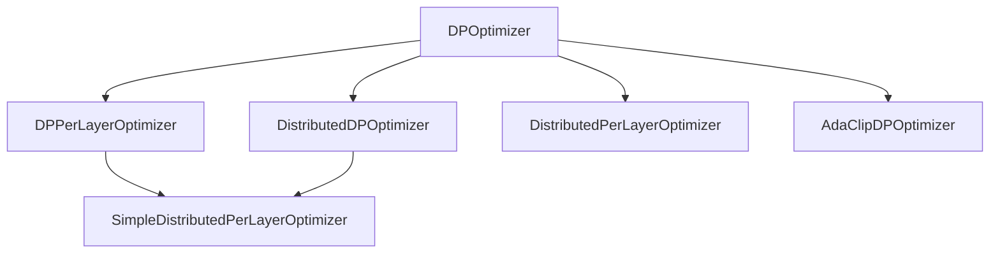
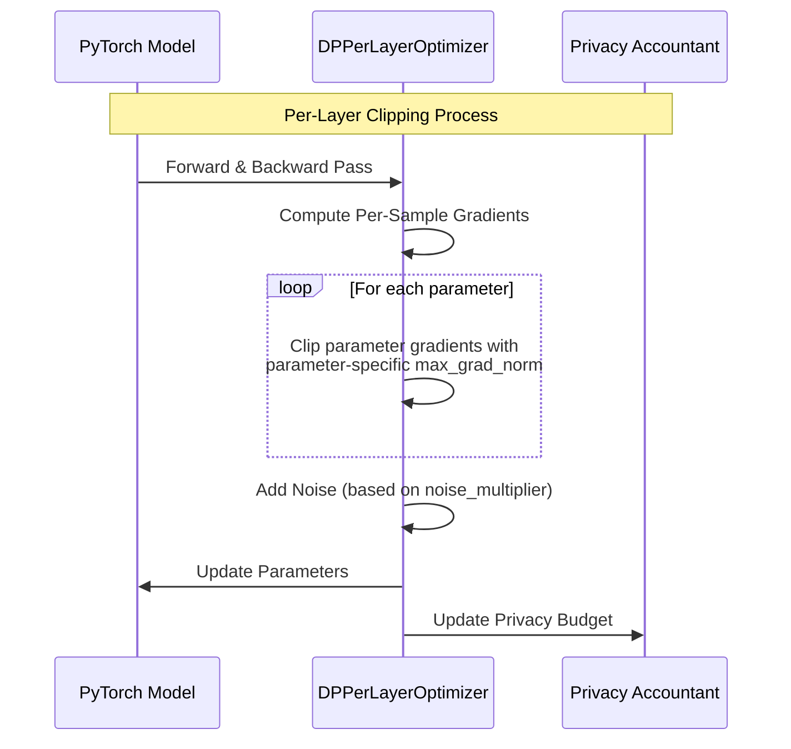
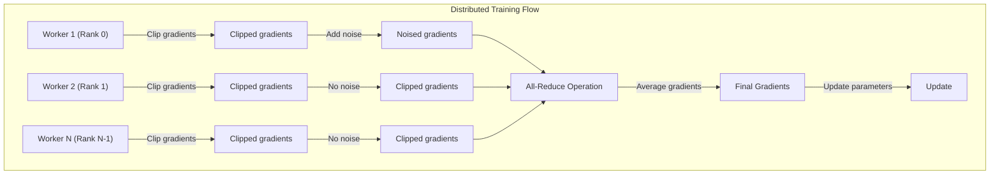
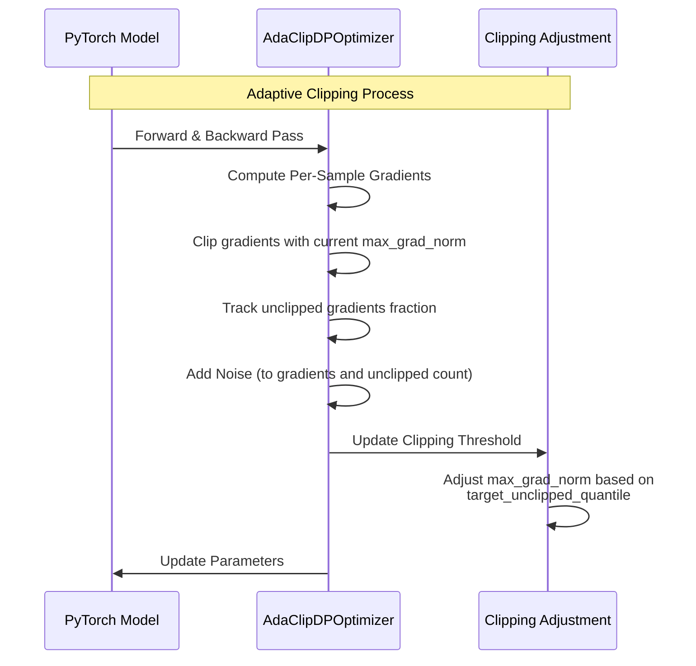

<!-- source: DeepWiki mcp.deepwiki.com · repo pytorch/opacus · page 3.2 Specialized Optimizers · fetched 2026-10-21 -->

# Specialized Optimizers

<details>
<summary>Relevant source files</summary>

The following files were used as context for generating this wiki page:

- [examples/cifar10.py](examples/cifar10.py)
- [opacus/optimizers/adaclipoptimizer.py](opacus/optimizers/adaclipoptimizer.py)
- [opacus/optimizers/ddp_perlayeroptimizer.py](opacus/optimizers/ddp_perlayeroptimizer.py)
- [opacus/optimizers/ddpoptimizer.py](opacus/optimizers/ddpoptimizer.py)
- [opacus/optimizers/optimizer.py](opacus/optimizers/optimizer.py)
- [opacus/optimizers/perlayeroptimizer.py](opacus/optimizers/perlayeroptimizer.py)
- [opacus/tests/ddp_hook_check.py](opacus/tests/ddp_hook_check.py)

</details>


This page documents the specialized optimizer variants available in Opacus beyond the basic `DPOptimizer`. These specialized optimizers implement alternative gradient clipping strategies, support distributed training scenarios, and provide adaptive clipping mechanisms to enhance differentially private training.

For information about the basic `DPOptimizer` implementation, see [Basic DPOptimizer](#3.1).

## Overview of Specialized Optimizers

Opacus provides several specialized optimizers that extend the base `DPOptimizer` functionality to address specific training requirements:



Sources: [opacus/optimizers/optimizer.py:170-566](), [opacus/optimizers/perlayeroptimizer.py:26-76](), [opacus/optimizers/ddpoptimizer.py:25-83](), [opacus/optimizers/ddp_perlayeroptimizer.py:40-175](), [opacus/optimizers/adaclipoptimizer.py:34-151]()

## Per-Layer Clipping Optimizers

### DPPerLayerOptimizer

The `DPPerLayerOptimizer` implements per-layer gradient clipping, where each layer has its own clipping threshold instead of clipping the entire model's gradients at once.

Key features:
- Accepts a list of `max_grad_norm` values, one per parameter
- Allows fine-grained control over clipping for different parameter groups
- Useful when layers have significantly different gradient magnitudes



Usage example:
```python
# Setting different clipping norms for different layers
max_grad_norms = [1.0, 0.5, 0.8]  # One value per parameter
optimizer = DPPerLayerOptimizer(
    optimizer=base_optimizer,
    noise_multiplier=1.0,
    max_grad_norm=max_grad_norms,
    expected_batch_size=batch_size
)
```

Implementation details:
- The constructor validates that the length of `max_grad_norm` matches the number of parameters
- The overall `max_grad_norm` is calculated as the L2 norm of individual max_grad_norms
- The `clip_and_accumulate` method is overridden to apply per-parameter clipping

Sources: [opacus/optimizers/perlayeroptimizer.py:26-76]()

## Distributed Training Optimizers

Opacus offers specialized optimizers for distributed training environments where computations are performed across multiple workers or GPUs.

### DistributedDPOptimizer

The `DistributedDPOptimizer` extends `DPOptimizer` to work in distributed training settings using PyTorch's distributed data parallel (DDP) framework.

Key features:
- Only adds noise on the first worker (rank 0)
- Properly synchronizes gradients across workers
- Maintains privacy guarantees in distributed settings

Implementation details:
- Overrides the `add_noise` method to only add noise on the first worker
- Adds a `reduce_gradients` method to aggregate gradients across workers
- Modifies the `step` method to include gradient reduction before optimization

```python
# Example of usage in distributed setting
optimizer = DistributedDPOptimizer(
    optimizer=base_optimizer,
    noise_multiplier=1.0,
    max_grad_norm=1.0,
    expected_batch_size=batch_size
)
```

Sources: [opacus/optimizers/ddpoptimizer.py:25-83]()

### DistributedPerLayerOptimizer

The `DistributedPerLayerOptimizer` combines per-layer clipping with distributed training support.

Key features:
- Performs per-layer clipping in a distributed environment
- Uses DDP hooks for efficient gradient processing
- Properly synchronizes gradients and noise across workers

Implementation details:
- Uses PyTorch backward hooks to perform per-layer operations
- Each parameter has its own clipping threshold and noise addition
- The backward hooks handle clipping, noise addition, and scaling in one pass

Sources: [opacus/optimizers/ddp_perlayeroptimizer.py:67-175]()

### SimpleDistributedPerLayerOptimizer

This optimizer is a simplified implementation that inherits from both `DPPerLayerOptimizer` and `DistributedDPOptimizer` to provide per-layer clipping in distributed settings.

Sources: [opacus/optimizers/ddp_perlayeroptimizer.py:40-64]()



Sources: [opacus/optimizers/ddpoptimizer.py:25-83](), [examples/cifar10.py:312-361]()

## Adaptive Clipping Optimizer

### AdaClipDPOptimizer

The `AdaClipDPOptimizer` implements an adaptive clipping strategy based on the paper "Differentially Private Learning with Adaptive Clipping" (https://arxiv.org/pdf/1905.03871.pdf).

Key features:
- Dynamically adjusts the clipping threshold based on observed gradient norms
- Targets a specific quantile of unclipped gradients
- Can improve model utility by adapting to the actual gradient distribution



Implementation details:
- Tracks the number of samples and number of unclipped gradients
- Adds noise to both the gradients and the unclipped count (for privacy)
- Updates the clipping threshold after each step based on the unclipped fraction
- Maintains the clipping threshold within specified bounds

Usage example:
```python
optimizer = AdaClipDPOptimizer(
    optimizer=base_optimizer,
    noise_multiplier=1.0,
    target_unclipped_quantile=0.5,
    clipbound_learning_rate=0.2,
    max_clipbound=10.0,
    min_clipbound=0.1,
    unclipped_num_std=0.5,
    max_grad_norm=1.0,
    expected_batch_size=batch_size
)
```

Sources: [opacus/optimizers/adaclipoptimizer.py:34-151]()

## Comparison of Optimizer Variants

| Optimizer | Clipping Strategy | Distributed Support | Adaptive | Key Use Case |
|-----------|-------------------|---------------------|----------|--------------|
| `DPOptimizer` | Flat global clipping | No | No | Standard DP training |
| `DPPerLayerOptimizer` | Per-layer clipping | No | No | Networks with varying gradient scales |
| `DistributedDPOptimizer` | Flat global clipping | Yes | No | Multi-GPU/node training |
| `DistributedPerLayerOptimizer` | Per-layer clipping | Yes | No | Distributed training with layer-specific clipping |
| `SimpleDistributedPerLayerOptimizer` | Per-layer clipping | Yes | No | Simplified distributed implementation |
| `AdaClipDPOptimizer` | Adaptive global clipping | No | Yes | Improved utility via dynamic threshold |

## Practical Considerations

### When to Use Each Optimizer

1. **Basic training**: Use standard `DPOptimizer` for single-device training with flat clipping.

2. **Layer-specific clipping**: Use `DPPerLayerOptimizer` when:
   - Your model has layers with very different gradient magnitudes
   - Some layers are more sensitive to noise than others
   - You want to fine-tune privacy-utility tradeoffs per layer

3. **Distributed training**: Use `DistributedDPOptimizer` when:
   - Training across multiple GPUs or nodes
   - Using PyTorch's distributed data parallel (DDP)

4. **Distributed with per-layer clipping**: Use `DistributedPerLayerOptimizer` when:
   - You need both distributed training and per-layer clipping
   - Working with large models across multiple devices

5. **Adaptive clipping**: Use `AdaClipDPOptimizer` when:
   - You don't know the optimal clipping threshold
   - Gradient norms change significantly during training
   - You want to maximize utility while maintaining privacy

### Implementation In Privacy Engine

When using Opacus's `PrivacyEngine`, you can select the appropriate optimizer by specifying the `clipping` parameter:

```python
privacy_engine = PrivacyEngine()
model, optimizer, train_loader = privacy_engine.make_private(
    module=model,
    optimizer=optimizer,
    data_loader=train_loader,
    noise_multiplier=noise_multiplier,
    max_grad_norm=max_grad_norm,
    clipping="flat",  # Or "per_layer" for layer-wise clipping
)
```

For distributed training with per-layer clipping, the CIFAR10 example shows how to set it up:

```python
if args.clip_per_layer:
    # Each layer has the same clipping threshold. The total grad norm is still bounded.
    n_layers = len([(n, p) for n, p in model.named_parameters() if p.requires_grad])
    max_grad_norm = [args.max_per_sample_grad_norm / np.sqrt(n_layers)] * n_layers
else:
    max_grad_norm = args.max_per_sample_grad_norm

clipping = "per_layer" if args.clip_per_layer else "flat"
```

Sources: [examples/cifar10.py:338-352]()

## Conclusion

Opacus offers a variety of specialized optimizers to meet different requirements for differentially private training. By choosing the appropriate optimizer, you can optimize for:

- Training across distributed environments
- Layer-specific gradient treatment
- Adaptive clipping for better utility
- Different architectural requirements

These optimizers extend the base `DPOptimizer` functionality while maintaining the same privacy guarantees, allowing for flexible and effective application of differential privacy across a wide range of scenarios.

---

