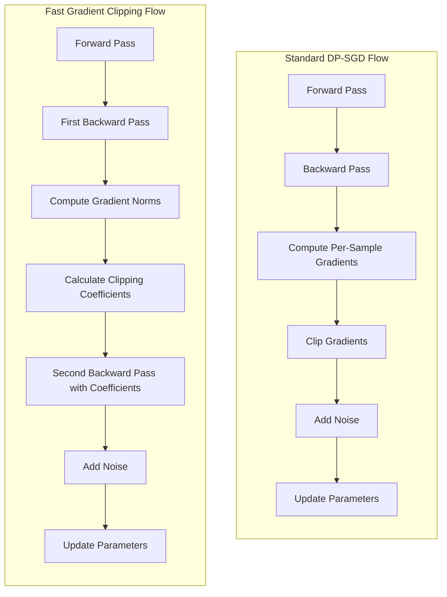
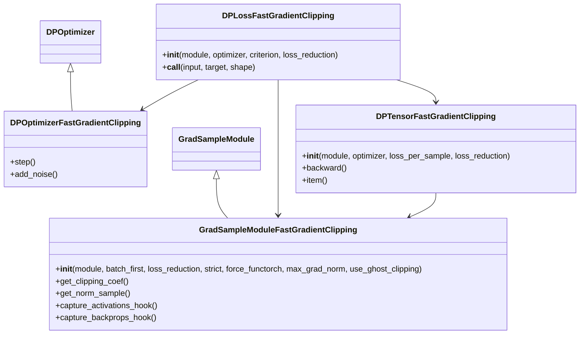
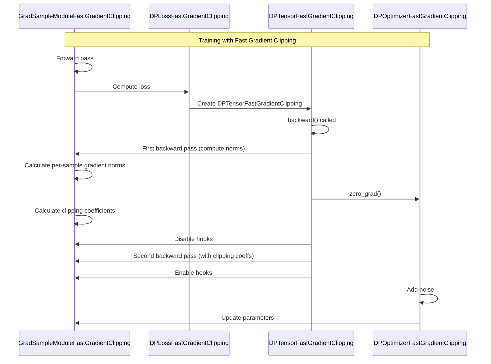
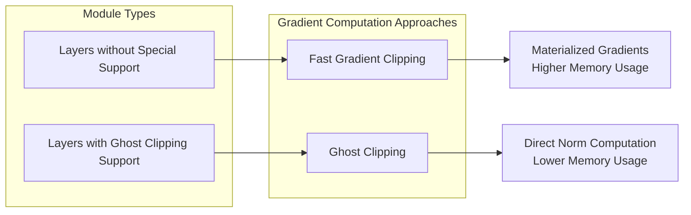
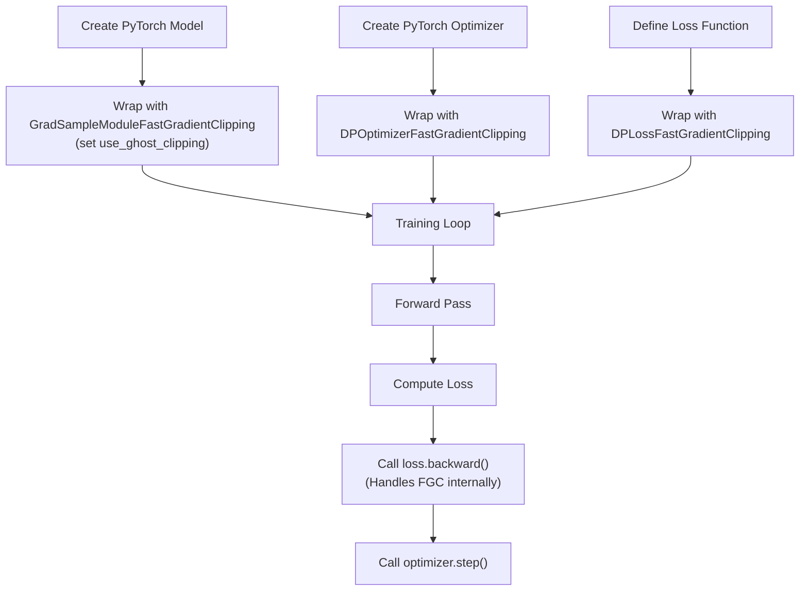
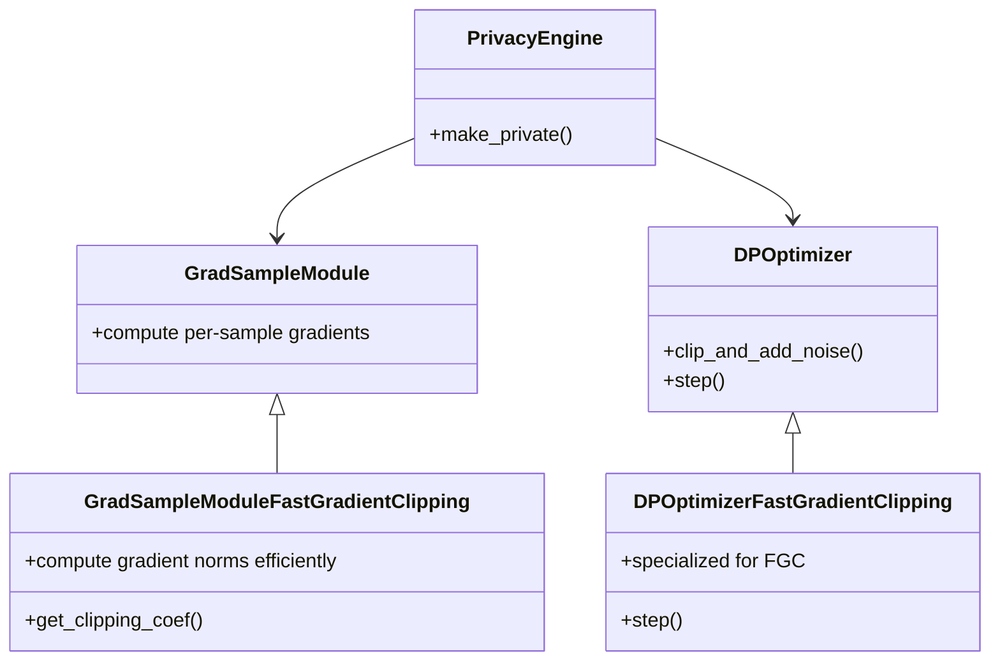
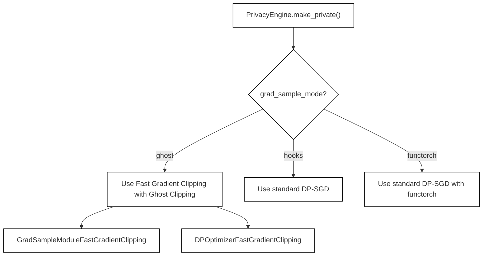

<!-- source: DeepWiki mcp.deepwiki.com · repo pytorch/opacus · page 3.3 Fast Gradient Clipping · fetched 2026-10-21 -->

# Fast Gradient Clipping

Relevant source files

The following files were used as context for generating this wiki page:

- [opacus/grad_sample/grad_sample_module_fast_gradient_clipping.py](opacus/grad_sample/grad_sample_module_fast_gradient_clipping.py)
- [opacus/optimizers/__init__.py](opacus/optimizers/__init__.py)
- [opacus/tests/grad_sample_module_fast_gradient_clipping_test.py](opacus/tests/grad_sample_module_fast_gradient_clipping_test.py)
- [opacus/utils/fast_gradient_clipping_utils.py](opacus/utils/fast_gradient_clipping_utils.py)

## Purpose and Scope

This document covers Fast Gradient Clipping (FGC), an optimization technique in Opacus that improves the performance and memory efficiency of gradient clipping during differentially private training. Fast Gradient Clipping enables training deep learning models with differential privacy while reducing memory consumption compared to standard DP-SGD implementations. This page explains how FGC works, how it's implemented in Opacus, and how to use it in your training workflow.

For information about basic gradient clipping mechanisms in Opacus, see [Basic DPOptimizer](#3.1).
For specialized optimizer variants beyond fast gradient clipping, see [Specialized Optimizers](#3.2).

## Overview of Fast Gradient Clipping

Standard DP-SGD requires computing per-sample gradients, which can be memory-intensive for large models and batch sizes. Fast Gradient Clipping addresses this challenge by modifying how gradients are calculated and clipped, reducing memory overhead while preserving the privacy guarantees.

Sources: [opacus/grad_sample/grad_sample_module_fast_gradient_clipping.py:72-148](), [opacus/utils/fast_gradient_clipping_utils.py:55-78]()

## Key Components

Fast Gradient Clipping in Opacus involves several specialized classes that work together:

Sources: [opacus/grad_sample/grad_sample_module_fast_gradient_clipping.py:72-79](), [opacus/optimizers/__init__.py:22-34](), [opacus/utils/fast_gradient_clipping_utils.py:23-132]()

### GradSampleModuleFastGradientClipping

This is the core class that implements the Fast Gradient Clipping approach. It extends the standard `GradSampleModule` but computes gradient norms without fully instantiating per-sample gradients.

Key methods:
- `get_clipping_coef()`: Calculates per-example scaling factors for gradient clipping
- `get_norm_sample()`: Retrieves per-example gradient norms
- `capture_activations_hook()`: Captures input activations during forward pass
- `capture_backprops_hook()`: Computes norms of per-sample gradients during backward pass

Sources: [opacus/grad_sample/grad_sample_module_fast_gradient_clipping.py:72-148]()

### DPOptimizerFastGradientClipping

This specialized optimizer works with `GradSampleModuleFastGradientClipping` to perform gradient updates with differential privacy.

Sources: [opacus/optimizers/__init__.py:22-32]()

### DPLossFastGradientClipping and DPTensorFastGradientClipping

These utility classes wrap the loss function and modify the backward pass to implement the two-stage backpropagation required for Fast Gradient Clipping:

- `DPLossFastGradientClipping`: Wraps the loss function to compute per-sample loss and return a `DPTensorFastGradientClipping` object
- `DPTensorFastGradientClipping`: Handles the specialized backward pass with two stages

Sources: [opacus/utils/fast_gradient_clipping_utils.py:23-132]()

## Fast Gradient Clipping Workflow

The Fast Gradient Clipping technique uses a two-stage backpropagation approach:

Sources: [opacus/utils/fast_gradient_clipping_utils.py:55-78](), [opacus/grad_sample/grad_sample_module_fast_gradient_clipping.py:136-147]()

## Ghost Clipping

Ghost Clipping is an additional optimization that can be used with Fast Gradient Clipping. It computes gradient norms for certain layer types without materializing the full per-sample gradients, further improving memory efficiency.

Sources: [opacus/grad_sample/grad_sample_module_fast_gradient_clipping.py:210-217]()

When `use_ghost_clipping=True` is set in the `GradSampleModuleFastGradientClipping` constructor, the module will use Ghost Clipping for supported layer types. This is determined by checking if the layer type is in the `NORM_SAMPLERS` dictionary.

## Using Fast Gradient Clipping

To use Fast Gradient Clipping in your training workflow, follow these steps:

1. Wrap your model with `GradSampleModuleFastGradientClipping`
2. Wrap your optimizer with `DPOptimizerFastGradientClipping`
3. Wrap your loss function with `DPLossFastGradientClipping`
4. Use the wrapped loss in your training loop

Here's the typical workflow:

Sources: [opacus/utils/fast_gradient_clipping_utils.py:80-132](), [opacus/tests/grad_sample_module_fast_gradient_clipping_test.py:127-196]()

## Implementation in Opacus

Within the Opacus system architecture, Fast Gradient Clipping is implemented as specialized versions of the core modules:

Sources: [opacus/grad_sample/grad_sample_module_fast_gradient_clipping.py:72-148](), [opacus/optimizers/__init__.py:30-40]()

## Performance Comparison

Fast Gradient Clipping, especially when combined with Ghost Clipping, can significantly reduce memory usage during training compared to standard DP-SGD implementations. The memory savings are especially pronounced for large models or when training with large batch sizes.

| Method | Memory Usage | Computation Time | Implementation Complexity |
|--------|--------------|------------------|---------------------------|
| Standard DP-SGD | High (stores all per-sample gradients) | Baseline | Simpler implementation |
| Fast Gradient Clipping | Medium | Similar to standard | More complex (requires two backward passes) |
| Fast Gradient Clipping + Ghost Clipping | Low | Similar to standard | Most complex (requires specialized per-layer implementations) |

Sources: [opacus/tests/grad_sample_module_fast_gradient_clipping_test.py:127-196](), [opacus/tests/grad_sample_module_fast_gradient_clipping_test.py:198-275]()

## Limitations and Considerations

When using Fast Gradient Clipping, consider the following:

1. Parameter tying is not supported with Ghost Clipping
2. Fast Gradient Clipping requires wrapping the loss computation in a special way
3. When using Ghost Clipping, only certain layer types are optimized

Sources: [opacus/grad_sample/grad_sample_module_fast_gradient_clipping.py:170-176](), [opacus/utils/fast_gradient_clipping_utils.py:92-101]()

## Integration with Opacus

Fast Gradient Clipping can be used when creating a private model with the `PrivacyEngine`:

Sources: [opacus/optimizers/__init__.py:37-62]()

To use Fast Gradient Clipping, set `grad_sample_mode="ghost"` when calling `make_private()`.

---

