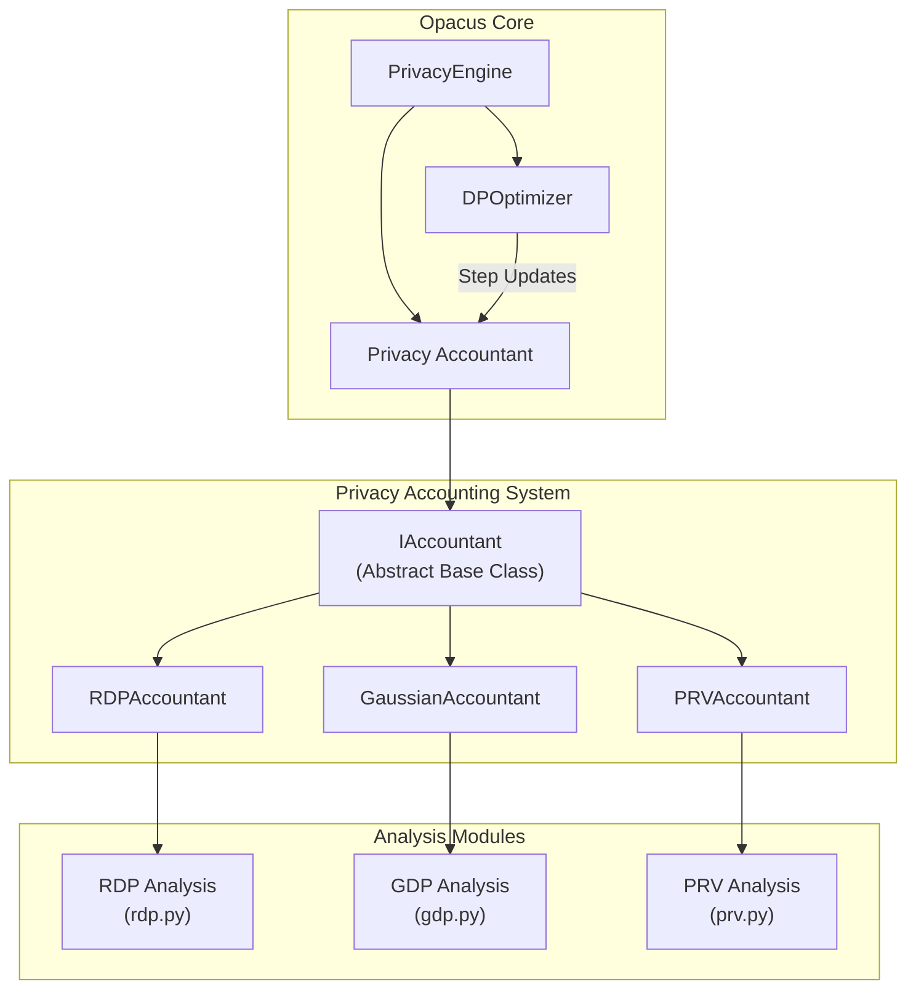
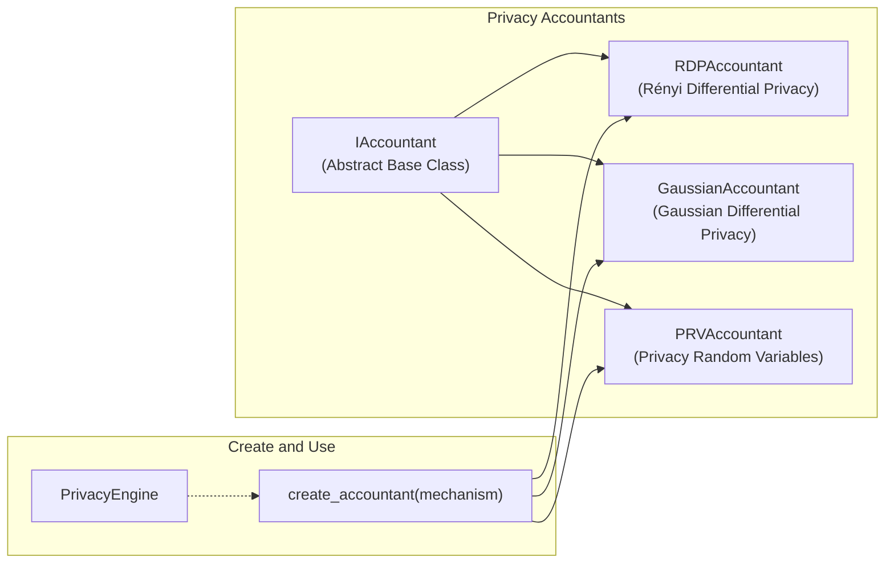
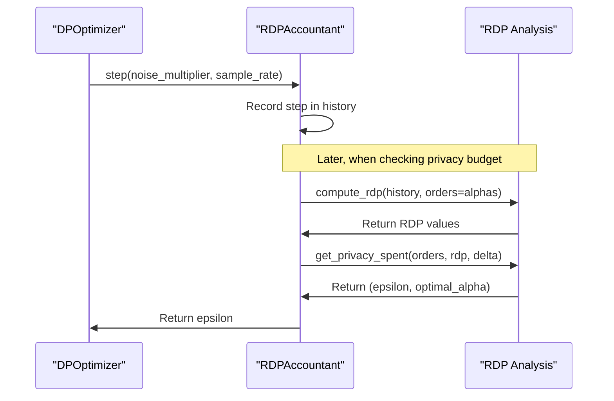
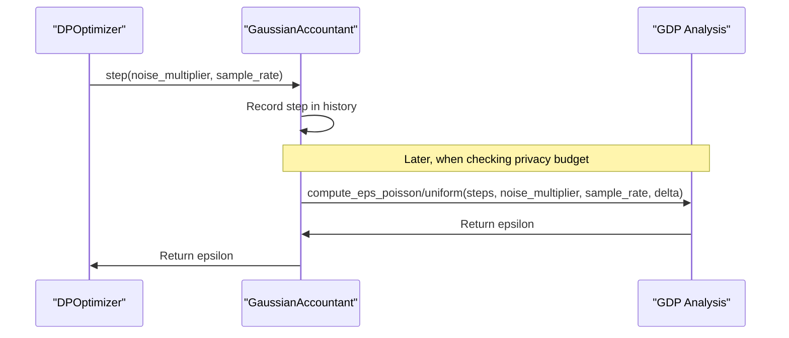
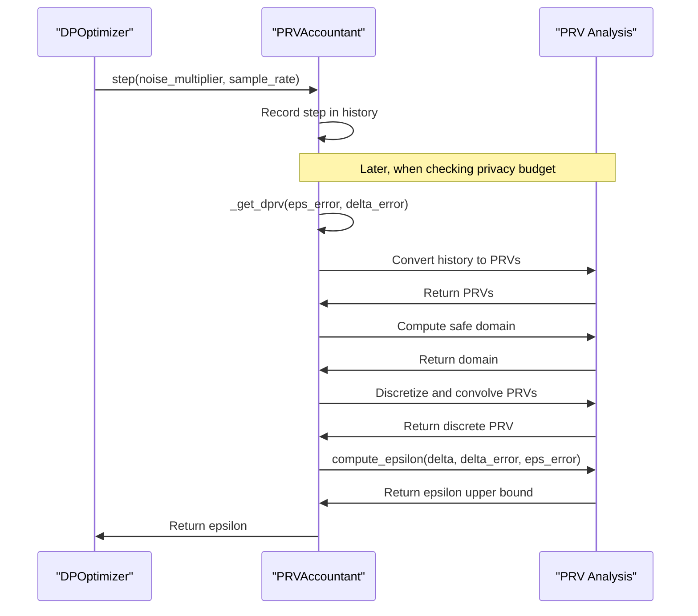
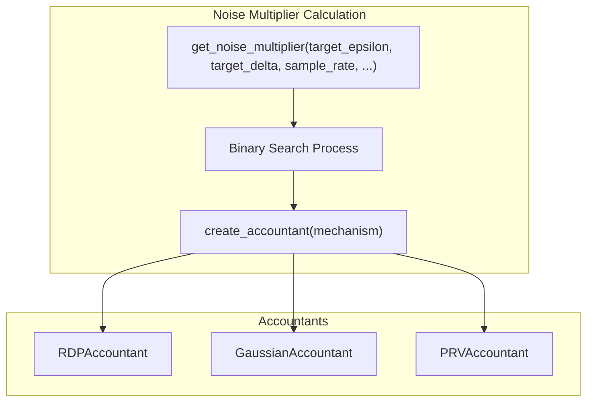

<!-- source: DeepWiki mcp.deepwiki.com · repo pytorch/opacus · page 4 Privacy Accounting · fetched 2026-10-21 -->

# Privacy Accounting

<details>
<summary>Relevant source files</summary>

The following files were used as context for generating this wiki page:

- [README.md](README.md)
- [docs/faq.md](docs/faq.md)
- [opacus/accountants/__init__.py](opacus/accountants/__init__.py)
- [opacus/accountants/accountant.py](opacus/accountants/accountant.py)
- [opacus/accountants/analysis/rdp.py](opacus/accountants/analysis/rdp.py)
- [opacus/accountants/gdp.py](opacus/accountants/gdp.py)
- [opacus/accountants/prv.py](opacus/accountants/prv.py)
- [opacus/accountants/rdp.py](opacus/accountants/rdp.py)
- [opacus/accountants/utils.py](opacus/accountants/utils.py)
- [opacus/tests/accountants_test.py](opacus/tests/accountants_test.py)
- [website/pages/tutorials/index.js](website/pages/tutorials/index.js)

</details>


## Purpose and Scope

This document explains the Privacy Accounting system in Opacus, which is responsible for tracking and calculating the privacy budget expended during differentially private training. Privacy accounting is critical for ensuring that models trained with differential privacy adhere to their promised privacy guarantees.

For information about the overall privacy engine that orchestrates the entire training process, see [PrivacyEngine](#2.1).

## What is Privacy Accounting?

In differential privacy, there's a quantifiable trade-off between privacy and utility. This trade-off is measured using parameters epsilon (ε) and delta (δ), which together form the privacy budget. As training progresses, more of this budget is "spent," and privacy accounting keeps track of how much has been spent so far.

Privacy accounting allows users to:
1. Monitor privacy expenditure during training
2. Ensure training stays within a predefined privacy budget
3. Understand the privacy guarantees of the final trained model

As defined in the FAQ:
> The (epsilon, delta) pair quantifies the privacy properties of the DP-SGD algorithm. A model trained with (epsilon, delta)-differential privacy (DP) protects the privacy of any training example, no matter how strange, ill-fitting, or perfect this example is.

Sources: [docs/faq.md:83-89]()

## Privacy Accounting System Architecture



Sources: [opacus/accountants/__init__.py](), [opacus/accountants/accountant.py]()

The Privacy Accounting system in Opacus tracks the privacy budget expended during training. It interfaces with the DPOptimizer, which provides updates about each training step, including the noise multiplier and sample rate used.

## Accountant Interface

All privacy accountants in Opacus implement the `IAccountant` abstract base class, which defines the following key methods:

| Method | Purpose |
|--------|---------|
| `step(noise_multiplier, sample_rate)` | Records one optimization step with the given parameters |
| `get_epsilon(delta)` | Returns the privacy budget (epsilon) expended so far for the given delta |
| `__len__()` | Returns the number of optimization steps taken so far |
| `mechanism()` | Returns the accounting mechanism name (e.g., "rdp", "gdp", "prv") |
| `state_dict()` and `load_state_dict()` | Save and load the accountant state |
| `get_optimizer_hook_fn(sample_rate)` | Returns a callback function to attach to DPOptimizer |

Sources: [opacus/accountants/accountant.py:15-135]()

## Available Privacy Accountants

Opacus provides three different privacy accounting mechanisms, each with its own strengths and characteristics:



Sources: [opacus/accountants/__init__.py:28-36]()

The accountant to use can be selected when creating a privacy engine:

```python
from opacus import PrivacyEngine
from opacus.accountants import create_accountant

# Either use the factory function
accountant = create_accountant("rdp")  # or "gdp" or "prv"

# Or create the privacy engine with the desired accountant
privacy_engine = PrivacyEngine(accountant="rdp")
```

Let's examine each accountant implementation in detail:

## RDP Accountant

The RDP Accountant uses Rényi Differential Privacy (RDP) to track privacy expenditure. RDP is a generalization of differential privacy that is particularly well-suited for analyzing the composition of DP-SGD (Differentially Private Stochastic Gradient Descent).



Sources: [opacus/accountants/rdp.py](), [opacus/accountants/analysis/rdp.py]()

### How RDP Accounting Works

The RDP Accountant tracks each optimization step by recording:
1. The noise multiplier used
2. The sampling rate used
3. The number of steps

When `get_epsilon` is called, it:
1. Computes the RDP values for each order (alpha) in a predefined range
2. Combines RDP values across all steps
3. Converts from RDP to (ε, δ)-DP using the optimal order

The default alphas (orders) used for RDP computation are:
```python
DEFAULT_ALPHAS = [1 + x / 10.0 for x in range(1, 100)] + list(range(12, 64))
```

The core computation is performed by summing the RDP values across all steps:

```python
rdp = sum(
    [
        privacy_analysis.compute_rdp(
            q=sample_rate,
            noise_multiplier=noise_multiplier,
            steps=num_steps,
            orders=alphas,
        )
        for (noise_multiplier, sample_rate, num_steps) in self.history
    ]
)
```

Sources: [opacus/accountants/rdp.py:22](), [opacus/accountants/rdp.py:54-67]()

## Gaussian Accountant

The Gaussian Accountant uses Gaussian Differential Privacy (GDP) for tracking privacy expenditure. It's computationally efficient but comes with limitations.



Sources: [opacus/accountants/gdp.py]()

### Limitations of Gaussian Accounting

The Gaussian Accountant requires that the noise multiplier and sample rate remain constant throughout training. If these values change, an error will be raised:

```python
if (last_noise_multiplier != noise_multiplier or last_sample_rate != sample_rate):
    raise ValueError(
        "Noise multiplier and sample rate have to stay constant in GaussianAccountant."
    )
```

Additionally, GDP accounting is experimental and may underestimate privacy expenditure:

```python
warnings.warn(
    "GDP accounting is experimental and can underestimate privacy expenditure."
    "Proceed with caution. More details: https://arxiv.org/pdf/2106.02848.pdf"
)
```

Sources: [opacus/accountants/gdp.py:32-38](), [opacus/accountants/gdp.py:23-26]()

## PRV Accountant

The PRV Accountant uses Privacy Random Variables (PRVs) to track privacy expenditure. It's based on the approach suggested by Gopi et al. in "Numerical Composition of Differential Privacy" and can provide tighter bounds than RDP in some cases.



Sources: [opacus/accountants/prv.py]()

### How PRV Accounting Works

The PRV Accountant works through the following steps:

1. Convert each step in the history to a PRV
2. Compute a safe domain for discretization
3. Truncate, discretize, and convolve the PRVs using Fast Fourier Transforms
4. Compute and return the upper bound on epsilon

```python
# Convert history to PRVs
prvs = [
    PoissonSubsampledGaussianPRV(sample_rate, noise_multiplier)
    for noise_multiplier, sample_rate, _ in self.history
]

# Compute safe domain, truncate and discretize PRVs
domain = self._get_domain(prvs=prvs, num_self_compositions=num_self_compositions, 
                          eps_error=eps_error, delta_error=delta_error)
tprvs = [TruncatedPrivacyRandomVariable(prv, domain.t_min, domain.t_max) for prv in prvs]
dprvs = [discretize(tprv, domain) for tprv in tprvs]

# Compose PRVs and compute epsilon
dprv = compose_heterogeneous(dprvs=dprvs, num_self_compositions=num_self_compositions)
_, _, eps_upper = dprv.compute_epsilon(delta, delta_error, eps_error)
```

Sources: [opacus/accountants/prv.py:83-106](), [opacus/accountants/prv.py:108-133]()

## Performance and Accuracy Comparison

The three accountants provided by Opacus have different characteristics:

| Accountant | Tightness of Bounds | Computational Efficiency | Restrictions |
|------------|---------------------|--------------------------|--------------|
| RDPAccountant | Good | Good | None |
| GaussianAccountant | May underestimate | Excellent | Constant noise multiplier and sample rate |
| PRVAccountant | Excellent | Good | None |

The test results in the codebase show a comparison of the epsilon values calculated by each accountant for the same parameters:

```
RDPAccountant: epsilon ≈ 7.33
GaussianAccountant: epsilon ≈ 6.60
PRVAccountant: epsilon ≈ 6.78
```

This indicates that the RDP accountant is the most conservative (providing the highest epsilon value), while the GDP accountant provides the lowest (potentially underestimating the privacy budget).

Sources: [opacus/tests/accountants_test.py:30-66]()

## Utility Functions for Privacy Accounting

Opacus provides utility functions to help with privacy accounting, particularly for finding the right noise multiplier to achieve a target privacy budget.



Sources: [opacus/accountants/utils.py]()

### Finding the Right Noise Multiplier

The `get_noise_multiplier` function helps find the appropriate noise level to achieve a target privacy budget:

```python
from opacus.accountants.utils import get_noise_multiplier

noise_multiplier = get_noise_multiplier(
    target_epsilon=3.0,
    target_delta=1e-5,
    sample_rate=0.01,
    epochs=30,
    accountant="rdp"
)
```

This function uses binary search to find the smallest noise multiplier that satisfies the privacy budget constraints:

```python
while target_epsilon - eps_high > epsilon_tolerance:
    sigma = (sigma_low + sigma_high) / 2
    accountant.history = [(sigma, sample_rate, steps)]
    eps = accountant.get_epsilon(delta=target_delta, **kwargs)

    if eps < target_epsilon:
        sigma_high = sigma
        eps_high = eps
    else:
        sigma_low = sigma
```

Sources: [opacus/accountants/utils.py:67-76]()

## Using Privacy Accountants in Practice

In most cases, you don't need to interact with the privacy accountants directly. The `PrivacyEngine` handles the accounting for you. However, you can check the current privacy budget during training:

```python
epsilon = privacy_engine.get_epsilon(delta=1e-5)
print(f"Current privacy guarantee: ({epsilon:.2f}, {1e-5})-DP")
```

### Attaching an Accountant to an Optimizer

The `IAccountant` provides a method to create a hook function that can be attached to a DPOptimizer:

```python
def get_optimizer_hook_fn(self, sample_rate: float):
    def hook_fn(optim: DPOptimizer):
        self.step(
            noise_multiplier=optim.noise_multiplier,
            sample_rate=sample_rate * optim.accumulated_iterations,
        )
    return hook_fn
```

Sources: [opacus/accountants/accountant.py:69-86]()

## Privacy Budget Interpretation

The privacy budget (ε, δ) quantifies the privacy guarantees of your model:

- **Smaller values** of ε and δ mean **stronger privacy guarantees**
- **Larger values** mean **weaker privacy guarantees**

As a rule of thumb, δ should be set to less than the inverse of the training dataset size.

When interpreting the privacy budget, it's important to understand that (ε, δ)-DP is a conservative upper bound on the actual privacy loss. There's growing evidence that the observable privacy loss of the DP-SGD algorithm can be significantly smaller in practice.

Sources: [docs/faq.md:83-93]()

## Conclusion

Privacy accounting is a crucial component of differential privacy training in Opacus. It enables:

1. Tracking privacy expenditure during training
2. Ensuring models meet specific privacy guarantees
3. Making informed trade-offs between privacy and utility

By understanding the different accounting mechanisms available in Opacus, you can choose the one that best suits your needs and constraints.

---

