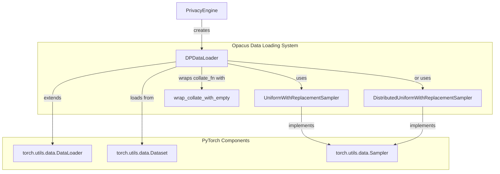
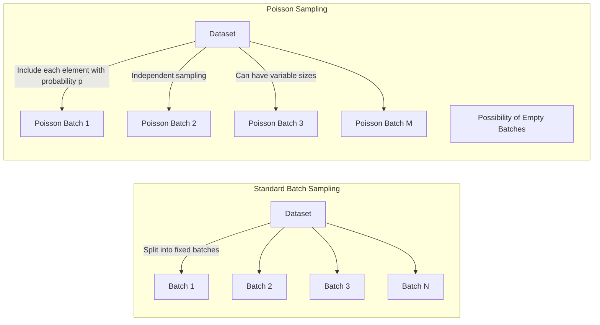
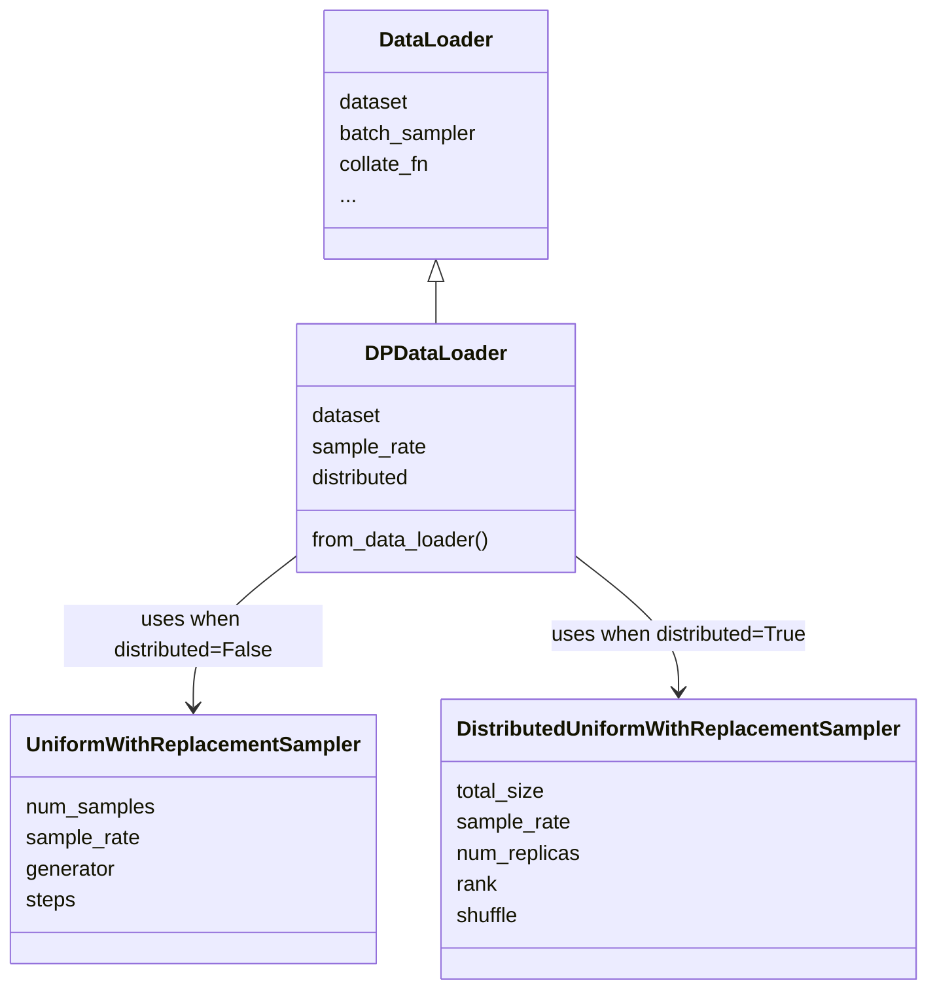
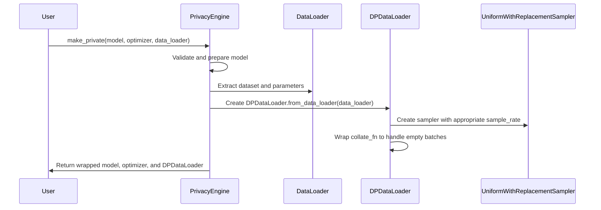

<!-- source: DeepWiki mcp.deepwiki.com · repo pytorch/opacus · page 5 Data Loading and Processing · fetched 2026-10-21 -->

# Data Loading and Processing

<details>
<summary>Relevant source files</summary>

The following files were used as context for generating this wiki page:

- [opacus/data_loader.py](opacus/data_loader.py)
- [opacus/tests/dpdataloader_test.py](opacus/tests/dpdataloader_test.py)
- [opacus/utils/uniform_sampler.py](opacus/utils/uniform_sampler.py)

</details>


## Purpose and Scope

This document explains how Opacus implements privacy-aware data loading through the `DPDataLoader` class. The key focus is on Poisson sampling for differential privacy and handling empty batches, which are essential requirements for differentially private training. For information about optimizers and gradient processing, see [Differential Privacy Optimizers](#3).

## Key Components of Data Loading in Opacus

Opacus provides specialized data loading components that ensure proper sampling for differential privacy:



Sources: [opacus/data_loader.py:120-254](), [opacus/utils/uniform_sampler.py:22-176]()

## Poisson Sampling for Differential Privacy

Poisson sampling (uniform sampling with replacement) is crucial for providing differential privacy guarantees. Unlike standard batch sampling, each element in the dataset has an independent probability (the sample rate) of being included in each batch.



Sources: [opacus/utils/uniform_sampler.py:22-68](), [opacus/data_loader.py:120-141]()

### UniformWithReplacementSampler

The `UniformWithReplacementSampler` implements Poisson sampling by including each sample with a fixed probability (sample_rate). This results in batches of varying sizes, which is required for the Sampled Gaussian Mechanism used in Opacus.

Key characteristics:
- Each sample is independently included with probability `sample_rate`
- Generates `steps` number of batches (defaults to 1/`sample_rate`)
- Returns indices of selected samples for each batch

Sources: [opacus/utils/uniform_sampler.py:22-68]()

### DistributedUniformWithReplacementSampler

For distributed training scenarios, Opacus provides the `DistributedUniformWithReplacementSampler`, which adapts Poisson sampling to work across multiple processing nodes.

Key characteristics:
- Divides the dataset among replicas
- Each replica performs Poisson sampling on its subset
- Supports shuffling the dataset before division
- Maintains balanced workload across replicas

Sources: [opacus/utils/uniform_sampler.py:70-176]()

## DPDataLoader Implementation

The `DPDataLoader` extends PyTorch's `DataLoader` with privacy-aware capabilities:



Sources: [opacus/data_loader.py:120-253]()

### Handling Empty Batches

A unique challenge with Poisson sampling is the possibility of empty batches (when no samples are selected). Most PyTorch components can handle tensors with zero batch dimension, but many collate functions cannot produce such batches. DPDataLoader addresses this issue by wrapping the collate function with `wrap_collate_with_empty`, which handles empty batches gracefully.

Key functions:
- `wrap_collate_with_empty`: Wraps a collate function to handle empty batches
- `collate`: Implementation that produces empty tensors with correct shapes when needed
- `shape_safe` and `dtype_safe`: Utilities for safely extracting shape and dtype information

Sources: [opacus/data_loader.py:32-118](), [opacus/tests/dpdataloader_test.py:28-48]()

## Creating a DPDataLoader

There are two ways to create a `DPDataLoader`:

1. **Direct initialization**:

```python
dp_dataloader = DPDataLoader(
    dataset=my_dataset,
    sample_rate=0.01,  # Each sample has 1% chance of being selected
    collate_fn=my_collate_fn,  # Optional
    generator=my_generator,  # Optional, for reproducibility
    distributed=False  # Set to True for distributed training
)
```

2. **From an existing DataLoader**:

```python
regular_dataloader = DataLoader(
    dataset=my_dataset,
    batch_size=32,
    shuffle=True
)

dp_dataloader = DPDataLoader.from_data_loader(
    regular_dataloader,
    distributed=False
)
```

When converting from a regular DataLoader, the `sample_rate` is automatically set to maintain the same average batch size (1/number of batches in the original loader).

Sources: [opacus/data_loader.py:143-253]()

## Integration with PrivacyEngine

In practice, `DPDataLoader` is typically not created directly by users but is created by the `PrivacyEngine` during the `make_private` operation. The privacy engine handles the entire orchestration:



Sources: [opacus/data_loader.py:213-254]()

## Utility Functions

Opacus also provides utility functions for data loading:

- `switch_generator`: Creates a new DataLoader with a different random number generator, while preserving all other behavior. This is useful for enhancing security with cryptographically secure random number generators.

Sources: [opacus/data_loader.py:264-310]()

## Technical Notes and Considerations

1. **Variable Batch Size**: Due to Poisson sampling, the batch size varies between iterations and can sometimes be zero. Your model and training loop should be designed to handle this.

2. **Sample Rate vs. Batch Size**: The `sample_rate` parameter directly affects privacy guarantees. A lower sample rate typically improves privacy but may require more training iterations.

3. **Distributed Training**: For distributed scenarios, use the `distributed=True` parameter when creating the DPDataLoader to ensure proper dataset partitioning across nodes.

4. **Memory Efficiency**: For large datasets, consider using Opacus's `BatchMemoryManager` to dynamically adjust batch sizes based on available memory (see [Memory Management](#8)).

5. **Drop Last Parameter**: The `drop_last` parameter from PyTorch's DataLoader is ignored in DPDataLoader as it is incompatible with Poisson sampling.

Sources: [opacus/data_loader.py:195-198]()

---

