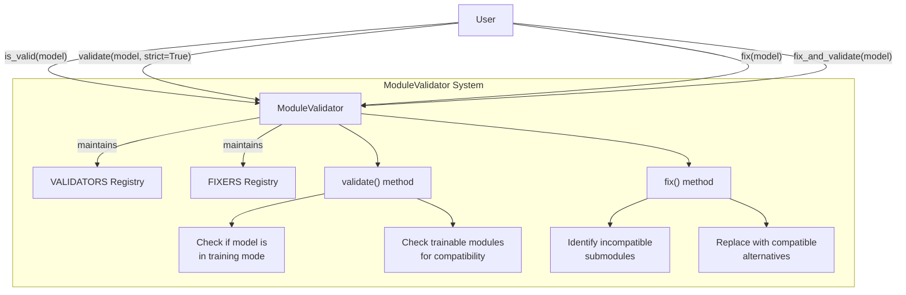
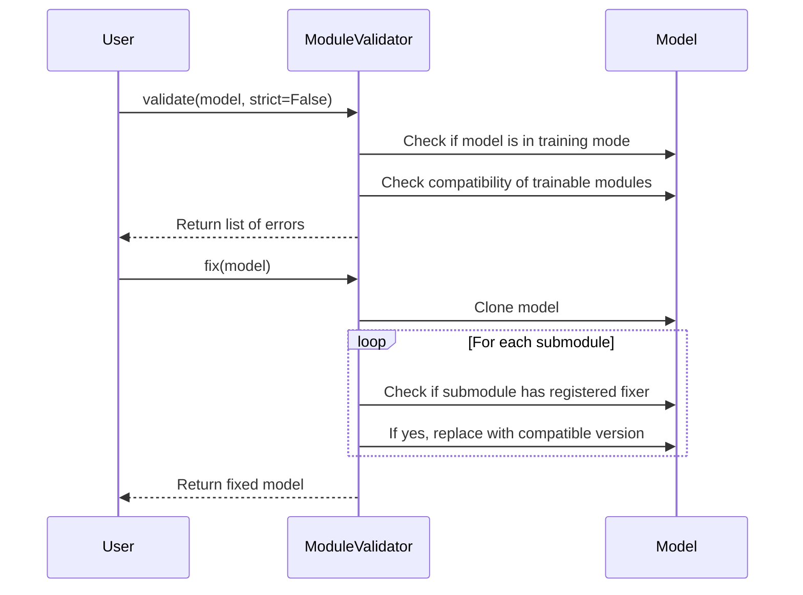
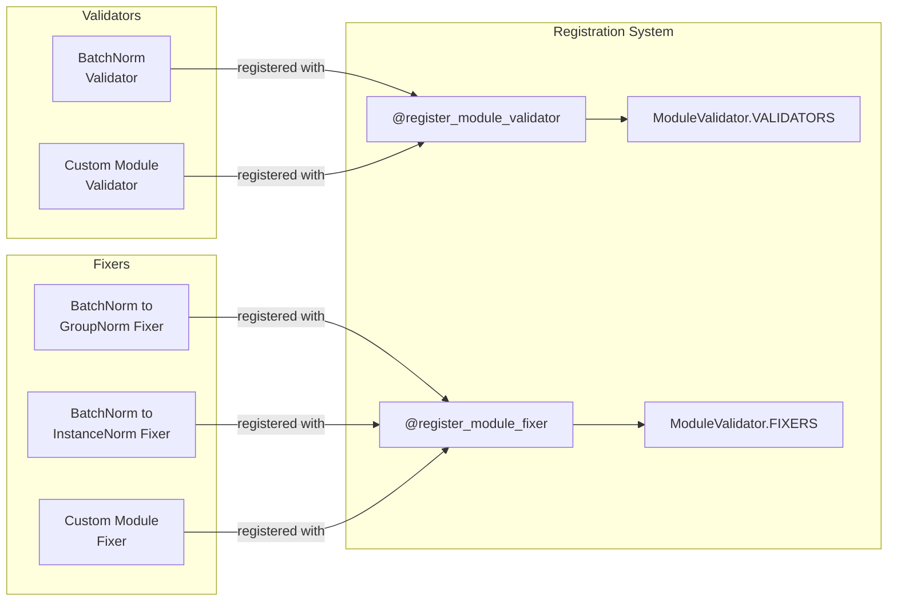
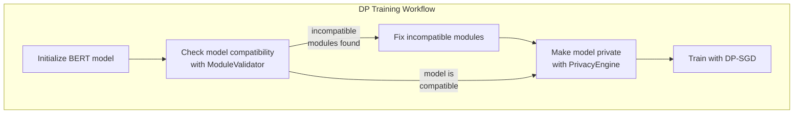
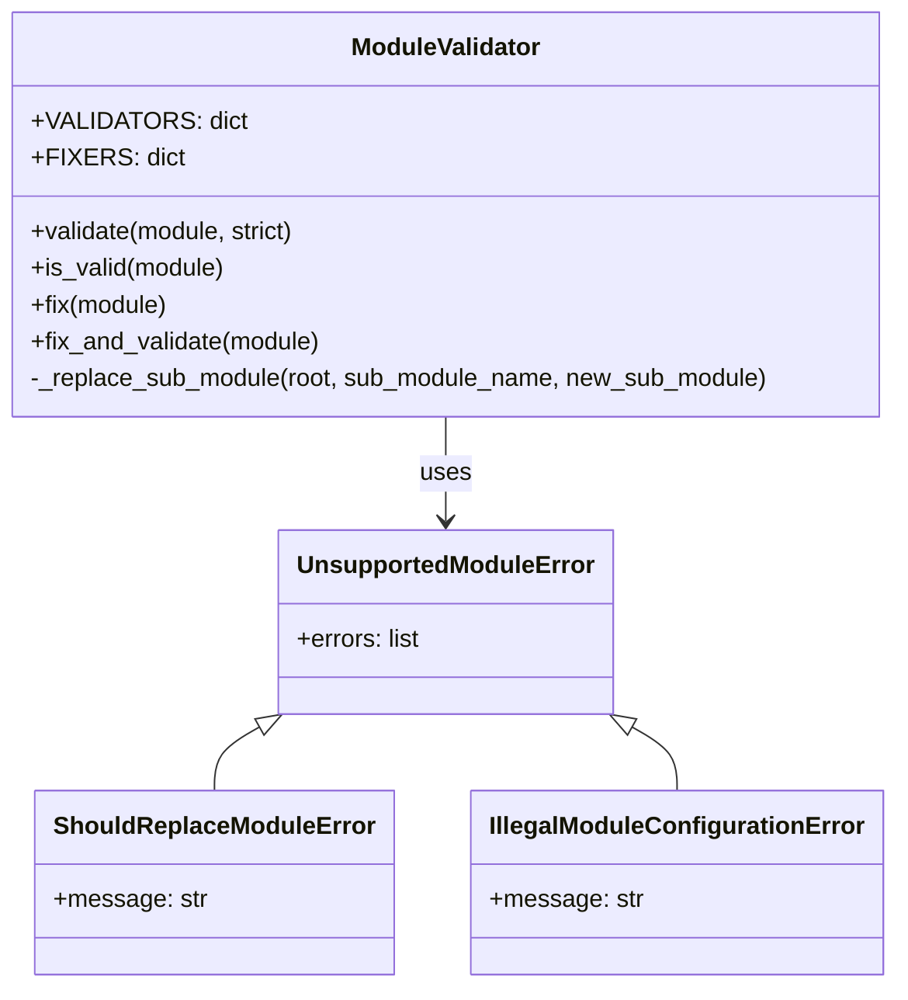

<!-- source: DeepWiki mcp.deepwiki.com · repo pytorch/opacus · page 6 Model Validation and Compatibility · fetched 2026-10-21 -->

# Model Validation and Compatibility

<details>
<summary>Relevant source files</summary>

The following files were used as context for generating this wiki page:

- [opacus/tests/module_validator_test.py](opacus/tests/module_validator_test.py)
- [opacus/utils/module_utils.py](opacus/utils/module_utils.py)
- [opacus/validators/batch_norm.py](opacus/validators/batch_norm.py)
- [opacus/validators/module_validator.py](opacus/validators/module_validator.py)
- [tutorials/building_image_classifier.ipynb](tutorials/building_image_classifier.ipynb)
- [tutorials/building_lstm_name_classifier.ipynb](tutorials/building_lstm_name_classifier.ipynb)
- [tutorials/building_text_classifier.ipynb](tutorials/building_text_classifier.ipynb)
- [tutorials/ddp_tutorial.ipynb](tutorials/ddp_tutorial.ipynb)
- [tutorials/guide_to_grad_sampler.ipynb](tutorials/guide_to_grad_sampler.ipynb)
- [tutorials/guide_to_module_validator.ipynb](tutorials/guide_to_module_validator.ipynb)
- [tutorials/intro_to_advanced_features.ipynb](tutorials/intro_to_advanced_features.ipynb)

</details>


## Introduction

This page documents the model validation system in Opacus, which ensures that PyTorch models are compatible with differential privacy training. Not all PyTorch modules work seamlessly with differential privacy, and the `ModuleValidator` helps identify incompatible components and provides methods to fix them.

For detailed information about per-sample gradient computation, which is central to implementing differential privacy, see [Layer-Specific Gradient Computation](#7).

## Key Concepts

Differential privacy training requires certain properties from neural network modules:

1. **Sample Independence**: Each sample's computation must be independent of other samples in the batch
2. **Per-Sample Gradient Compatibility**: Modules must support computing per-sample gradients
3. **Training Mode**: Models must be in training mode to properly capture gradients

The `ModuleValidator` system ensures these requirements are met before beginning privacy-preserving training.

Sources: [opacus/validators/module_validator.py:30-43]()/[tutorials/guide_to_module_validator.ipynb:17-27]()

## The ModuleValidator System

The `ModuleValidator` class serves as both a namespace for registered validators and fixers, and as the entry point for validation and fixing operations.



Sources: [opacus/validators/module_validator.py:30-168]()

### Key Methods

The `ModuleValidator` provides four main methods:

1. **validate(module, strict=False)**: Validates a module and returns a list of errors. If `strict=True`, raises exceptions on validation failures.
2. **is_valid(module)**: Returns a boolean indicating whether the module is valid.
3. **fix(module)**: Attempts to fix the module by replacing incompatible submodules with compatible alternatives.
4. **fix_and_validate(module)**: Combines fixing and validation in a single step.



Sources: [opacus/validators/module_validator.py:39-167]()/[opacus/tests/module_validator_test.py:31-39]()

## Common Compatibility Issues

### BatchNorm Modules

The most common incompatibility issue involves BatchNorm layers (`nn.BatchNorm1d`, `nn.BatchNorm2d`, `nn.BatchNorm3d`, `nn.SyncBatchNorm`). BatchNorm computes statistics across the entire batch, creating dependencies between samples that violate differential privacy requirements.

The explanation from the error message provides a clear rationale:

> "BatchNorm cannot support training with differential privacy. The reason for it is that BatchNorm makes each sample's normalized value depend on its peers in a batch, ie the same sample x will get normalized to a different value depending on who else is on its batch. Privacy-wise, this means that we would have to put a privacy mechanism there too."

### Recommended Replacements

| Incompatible Module | Compatible Replacement | Explanation |
|---------------------|------------------------|-------------|
| `nn.BatchNorm1d/2d/3d` | `nn.GroupNorm` | Normalizes within groups of channels per sample |
| `nn.BatchNorm1d/2d/3d` | `nn.InstanceNorm1d/2d/3d` | Normalizes each channel of each sample independently |
| `nn.BatchNorm1d/2d/3d` | `nn.LayerNorm` | Normalizes across all channels for each sample |

Sources: [opacus/validators/batch_norm.py:36-54]()/[tutorials/building_image_classifier.ipynb:189-228]()

## Validating and Fixing Models

### Validation Process

The validation process traverses the module hierarchy and checks each trainable module against registered validators. Here's how to use it:

```python
from opacus.validators import ModuleValidator

# Check if model is valid
errors = ModuleValidator.validate(model, strict=False)
if errors:  # List of errors if any
    for error in errors:
        print(error)

# Or for a simple boolean check
is_valid = ModuleValidator.is_valid(model)
```

The validation also checks if the model is in training mode, which is required for differential privacy training.

### Fixing Incompatible Models

When incompatibilities are found, the `ModuleValidator.fix()` method can automatically replace problematic modules:

```python
from opacus.validators import ModuleValidator

# Fix incompatible modules
fixed_model = ModuleValidator.fix(model)

# Alternatively, fix and validate in one step
fixed_model = ModuleValidator.fix_and_validate(model)
```

By default, BatchNorm modules are replaced with GroupNorm with an appropriate number of groups.

Sources: [opacus/validators/module_validator.py:73-84]()/[opacus/validators/module_validator.py:86-125]()/[tutorials/building_image_classifier.ipynb:231-250]()

## BatchNorm Replacement Details

When replacing BatchNorm layers, the default behavior is to convert them to GroupNorm. You can customize this:

```python
# Default behavior (BatchNorm → GroupNorm)
fixed_model = ModuleValidator.fix(model)

# Replace with InstanceNorm instead
fixed_model = ModuleValidator.fix(model, replace_bn_with_in=True)

# Customize GroupNorm's num_groups parameter
fixed_model = ModuleValidator.fix(model, num_groups=16)
```

The `_batchnorm_to_groupnorm` function calculates the number of groups based on the number of features in the BatchNorm layer, with a default maximum of 32 groups.

Sources: [opacus/validators/batch_norm.py:60-76]()/[opacus/validators/batch_norm.py:79-99]()/[opacus/tests/module_validator_test.py:149-161]()

## Validator and Fixer Registration System

The ModuleValidator uses a registration system that allows for extending support to custom modules. This is implemented through the `register_module_validator` and `register_module_fixer` decorators.



### Creating Custom Validators and Fixers

You can create custom validators and fixers for your own modules:

```python
import torch.nn as nn
from opacus.validators.utils import register_module_validator, register_module_fixer
from opacus.validators.errors import ShouldReplaceModuleError

# Register a validator
@register_module_validator([MyCustomModule])
def validate_my_module(module):
    if incompatible_condition:
        return [ShouldReplaceModuleError("My module is incompatible because...")]
    return []

# Register a fixer
@register_module_fixer([MyCustomModule])
def fix_my_module(module):
    return MyCompatibleModule(...)
```

The order of registration matters—if multiple validators or fixers are registered for the same module type, the last one registered will be used.

Sources: [tutorials/guide_to_module_validator.ipynb:79-146]()/[opacus/validators/batch_norm.py:36-54]()/[opacus/validators/batch_norm.py:57-76]()

## Practical Examples

### Validating and Fixing ResNet

One common use case is adapting pre-trained models like ResNet that contain BatchNorm layers:

```python
from torchvision import models
from opacus.validators import ModuleValidator

# Load a pre-trained ResNet
model = models.resnet18()

# Check for compatibility issues
errors = ModuleValidator.validate(model, strict=False)
print(f"Found {len(errors)} issues")

# Fix the model
fixed_model = ModuleValidator.fix(model)

# Verify the fix worked
assert ModuleValidator.is_valid(fixed_model)
```

This process typically involves replacing all BatchNorm layers with GroupNorm layers.

Sources: [tutorials/building_image_classifier.ipynb:179-250]()

### Real-World Flow in Text Classification Example

The following diagram shows how model validation integrates into the differential privacy training workflow from the text classifier example:



Sources: [tutorials/building_text_classifier.ipynb:184-228]()

## Model Validator Implementation Details

The internal implementation of the `ModuleValidator` handles different types of compatibility issues through a registry-based system.



The validator uses different error types to communicate specific issues:

1. `ShouldReplaceModuleError`: Indicates modules that should be replaced (e.g., BatchNorm)
2. `IllegalModuleConfigurationError`: Indicates modules with incorrect configurations (e.g., model not in training mode)

When the validator finds these issues, they are either returned as a list (when `strict=False`) or raised as exceptions (when `strict=True`).

Sources: [opacus/validators/module_validator.py:30-167]()/[opacus/validators/batch_norm.py:40-54]()

## Best Practices

1. **Always check model compatibility** before attempting to use Opacus for differentially private training.

2. **Use `fix_and_validate`** to ensure your model is fully compatible after fixing:
   ```python
   model = ModuleValidator.fix_and_validate(model)
   ```

3. **Customize BatchNorm replacement** if GroupNorm isn't appropriate:
   ```python
   model = ModuleValidator.fix(model, replace_bn_with_in=True)  # Use InstanceNorm
   ```

4. **Check validation results carefully** - look through all errors to understand compatibility issues:
   ```python
   errors = ModuleValidator.validate(model)
   for error in errors:
       print(f"Error: {error}")
   ```

5. **Ensure your model is in training mode** before validation, as this is a requirement for differential privacy training.

Sources: [tutorials/building_image_classifier.ipynb:179-250]()/[opacus/tests/module_validator_test.py:26-161]()

## Summary

The `ModuleValidator` system provides a robust way to ensure that PyTorch models are compatible with differential privacy training in Opacus. It offers:

1. Validation methods to identify compatibility issues
2. Automatic fixing of common incompatibilities, particularly BatchNorm layers
3. An extensible registration system for custom validators and fixers

By using these tools, you can easily adapt existing models for differentially private training, enabling privacy-preserving machine learning with minimal code changes.

---

