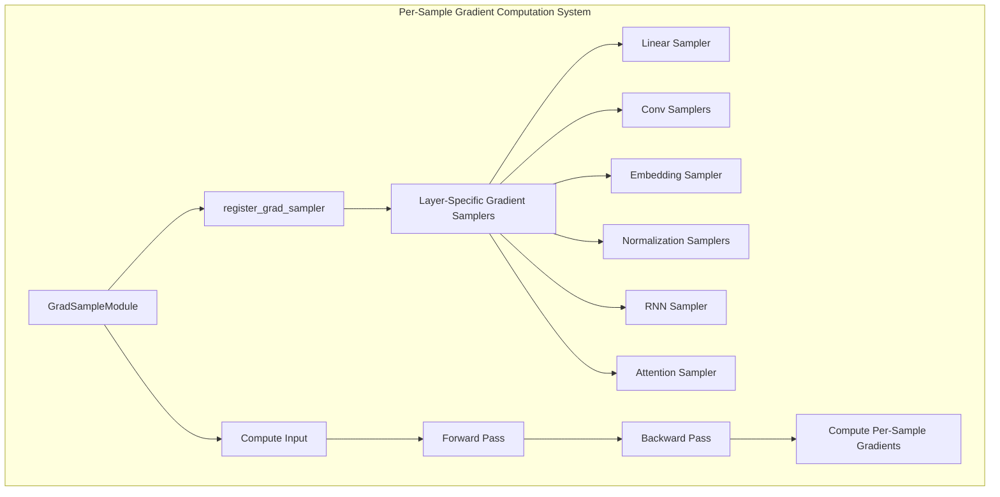
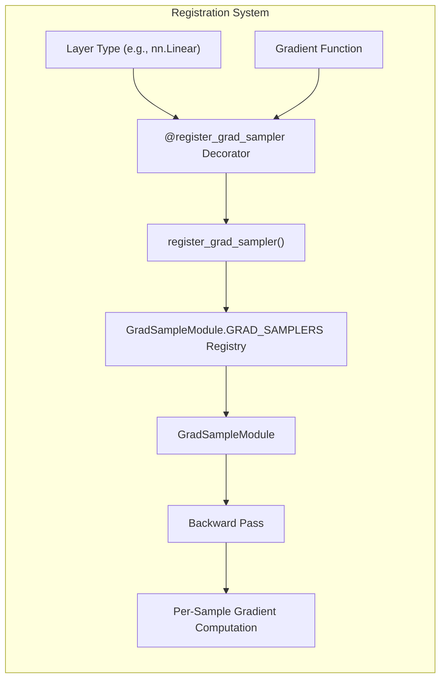
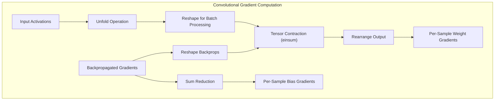
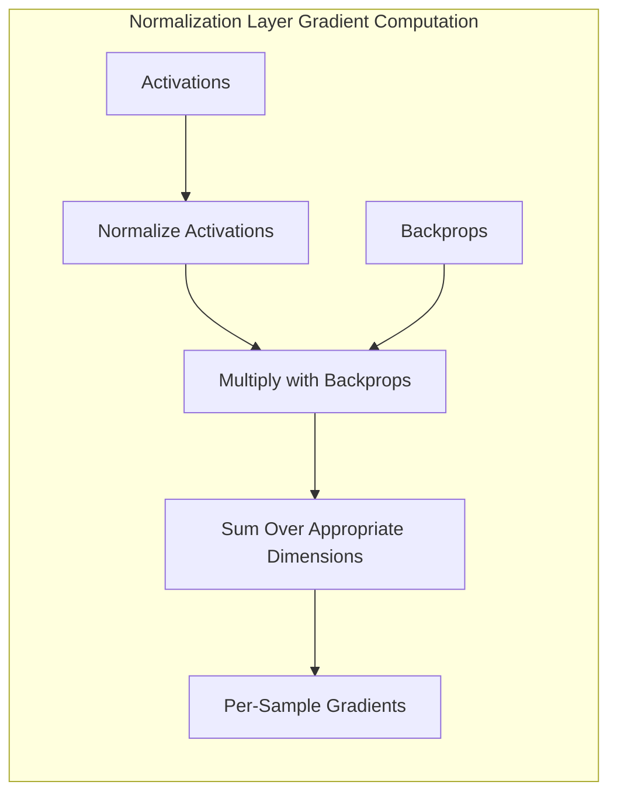
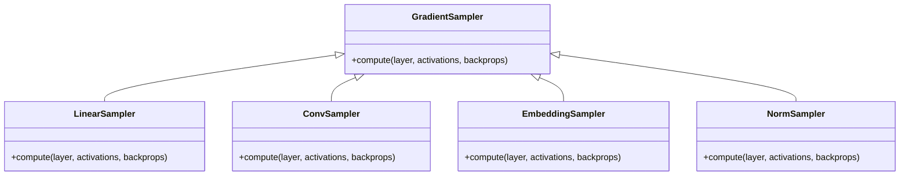
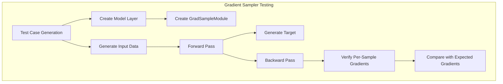
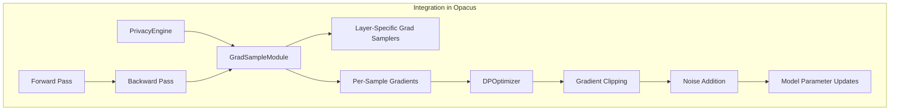

<!-- source: DeepWiki mcp.deepwiki.com · repo pytorch/opacus · page 7 Layer-Specific Gradient Computation · fetched 2026-10-21 -->

# Layer-Specific Gradient Computation

<details>
<summary>Relevant source files</summary>

The following files were used as context for generating this wiki page:

- [opacus/grad_sample/conv.py](opacus/grad_sample/conv.py)
- [opacus/grad_sample/dp_multihead_attention.py](opacus/grad_sample/dp_multihead_attention.py)
- [opacus/grad_sample/dp_rnn.py](opacus/grad_sample/dp_rnn.py)
- [opacus/grad_sample/embedding.py](opacus/grad_sample/embedding.py)
- [opacus/grad_sample/group_norm.py](opacus/grad_sample/group_norm.py)
- [opacus/grad_sample/instance_norm.py](opacus/grad_sample/instance_norm.py)
- [opacus/grad_sample/layer_norm.py](opacus/grad_sample/layer_norm.py)
- [opacus/grad_sample/linear.py](opacus/grad_sample/linear.py)
- [opacus/tests/grad_samples/conv1d_test.py](opacus/tests/grad_samples/conv1d_test.py)
- [opacus/tests/grad_samples/conv2d_test.py](opacus/tests/grad_samples/conv2d_test.py)
- [opacus/tests/grad_samples/conv3d_test.py](opacus/tests/grad_samples/conv3d_test.py)
- [opacus/tests/grad_samples/embedding_test.py](opacus/tests/grad_samples/embedding_test.py)
- [opacus/tests/grad_samples/group_norm_test.py](opacus/tests/grad_samples/group_norm_test.py)
- [opacus/tests/grad_samples/linear_test.py](opacus/tests/grad_samples/linear_test.py)

</details>


This document details how Opacus computes per-sample gradients for different neural network layer types. Per-sample gradient computation is a foundational requirement for implementing differential privacy in deep learning, as it allows us to clip and add noise to individual training examples' contributions to the gradient. For information about how these gradients are used in the overall training process, see [Core Architecture](#2) and [Differential Privacy Optimizers](#3).

## Overview

Layer-specific gradient computation in Opacus is implemented through a flexible registration system that allows adding custom gradient computation methods for each PyTorch layer type. Each implementation handles the nuances of computing per-sample gradients for a specific layer architecture, considering factors like parameter structure, activation patterns, and computational efficiency.



Sources: [opacus/grad_sample/linear.py](), [opacus/grad_sample/conv.py](), [opacus/grad_sample/embedding.py](), [opacus/grad_sample/group_norm.py](), [opacus/grad_sample/instance_norm.py](), [opacus/grad_sample/layer_norm.py](), [opacus/grad_sample/dp_rnn.py](), [opacus/grad_sample/dp_multihead_attention.py]()

## Registration System

Opacus uses a decorator-based registration system to associate layer types with their corresponding gradient sampling functions. This design allows for modularity and easy extension with new layer types.



Sources: [opacus/grad_sample/utils.py](), [opacus/grad_sample/linear.py:29-31](), [opacus/grad_sample/conv.py:28-29]()

When a layer's gradient needs to be computed, the GradSampleModule looks up the appropriate function in its registry and calls it with the layer instance, activations, and backpropagated gradients.

## Layer-Specific Implementations

### Linear Layers

Linear layers (nn.Linear) compute per-sample gradients by taking the outer product of backpropagated gradients and input activations for each sample in the batch.

```python
# Conceptual implementation for nn.Linear
def compute_linear_grad_sample(layer, activations, backprops):
    # Weight gradients: outer product of backprops and activations
    gs = torch.einsum("n...i,n...j->nij", backprops, backprops)
    
    # Bias gradients: sum over all dimensions except batch
    bias_grad = torch.einsum("n...k->nk", backprops)
    
    return {layer.weight: gs, layer.bias: bias_grad}
```

Sources: [opacus/grad_sample/linear.py:29-48]()

### Convolutional Layers

Convolutional layers are more complex due to the spatial relationships in their operations. Opacus implements gradient computation for 1D, 2D, and 3D convolutions using unfolding operations and tensor contractions.



Sources: [opacus/grad_sample/conv.py:28-109](), [opacus/grad_sample/conv.py:113-182]()

For Conv2D, Opacus also provides an alternative implementation through `convolution2d_backward_as_a_convolution`, which expresses the gradient computation itself as a convolution operation.

### Embedding Layers

Embedding layers require special handling due to their lookup-based nature. The gradient computation uses scatter operations to accumulate gradients for each embedding vector that was accessed by a sample.

```python
# Conceptual implementation for nn.Embedding
def compute_embedding_grad_sample(layer, activations, backprops):
    # Expand indices to create mapping to embedding dimensions
    index = activations.unsqueeze(-1).expand(*activations.shape, layer.embedding_dim)
    
    # Initialize gradient tensor
    grad_sample = torch.zeros(batch_size, *layer.weight.shape)
    
    # Scatter-add backprops to the appropriate indices
    grad_sample.scatter_add_(1, index, backprops)
    
    return {layer.weight: grad_sample}
```

Sources: [opacus/grad_sample/embedding.py:25-61]()

### Normalization Layers

Normalization layers (LayerNorm, GroupNorm, InstanceNorm) compute gradients by multiplying normalized activations by backpropagated gradients.



Sources: [opacus/grad_sample/layer_norm.py:27-51](), [opacus/grad_sample/group_norm.py:26-47](), [opacus/grad_sample/instance_norm.py:25-56]()

### RNN and Attention Layers

Opacus provides specialized gradient computation for RNN-based layers through the `RNNLinear` class and attention mechanisms through `SequenceBias`.

Sources: [opacus/grad_sample/dp_rnn.py:26-48](), [opacus/grad_sample/dp_multihead_attention.py:26-41]()

## Computation Patterns and Common Structure

Despite the implementation differences, all layer-specific gradient samplers share a common interface and pattern:

1. They take three arguments:
   - `layer`: The layer instance
   - `activations`: A list of tensors saved during the forward pass
   - `backprops`: The gradients backpropagated to this layer

2. They return a dictionary mapping layer parameters (weight, bias) to their per-sample gradients.

This consistent interface allows the `GradSampleModule` to interact with them uniformly regardless of the layer type.



Sources: [opacus/grad_sample/linear.py:29-48](), [opacus/grad_sample/conv.py:28-109](), [opacus/grad_sample/embedding.py:25-61](), [opacus/grad_sample/layer_norm.py:27-51]()

## Performance Optimizations

The gradient computation implementations include several optimizations:

1. **Efficient tensor operations**: Using `einsum` for tensor contractions instead of explicit loops
2. **Smart reshaping**: Minimizing memory usage through strategic tensor reshaping
3. **Alternative implementations**: For some layers like Conv2D, alternative implementations are provided for different performance characteristics
4. **Empty batch handling**: Special case handling for empty batches to avoid errors
5. **Device consistency**: Ensuring operations happen on the same device as the layer parameters

For Conv2D specifically, the `convolution2d_backward_as_a_convolution` method provides an alternative implementation that can be more efficient in certain scenarios.

Sources: [opacus/grad_sample/conv.py:113-182](), [opacus/tests/grad_samples/conv2d_test.py:88-104]()

## Testing Framework

Each layer's gradient computation is thoroughly tested with a variety of input shapes, parameter configurations, and edge cases. The testing framework uses property-based testing through the Hypothesis library to generate diverse test cases.



Sources: [opacus/tests/grad_samples/conv1d_test.py](), [opacus/tests/grad_samples/conv2d_test.py](), [opacus/tests/grad_samples/conv3d_test.py](), [opacus/tests/grad_samples/linear_test.py](), [opacus/tests/grad_samples/embedding_test.py](), [opacus/tests/grad_samples/group_norm_test.py]()

## Layer Support Table

The following table summarizes the supported layers and their gradient computation characteristics:

| Layer Type | Gradient Computation Method | Special Considerations |
|------------|------------------------------|------------------------|
| nn.Linear | Outer product of backprops and activations | Supports various input dimensions |
| nn.Conv1d | Unfold + tensor contraction | Handles padding modes: same, valid |
| nn.Conv2d | Unfold2d + tensor contraction | Two implementations available |
| nn.Conv3d | Unfold3d + tensor contraction | Handles complex 3D shapes |
| nn.Embedding | Scatter-based accumulation | Special deterministic setting |
| nn.EmbeddingBag | Mode-dependent accumulation | Supports sum and mean modes |
| nn.LayerNorm | Normalized activations × backprops | Summed over appropriate dimensions |
| nn.GroupNorm | Group-normalized activations × backprops | Handles multiple groups |
| nn.InstanceNorm | Instance-normalized activations × backprops | 1D, 2D, and 3D variants |
| RNNLinear | Specialized linear computation | For RNN-based layers |
| SequenceBias | Extract from backprops | For attention mechanisms |

Sources: All files provided

## Integration with Opacus

The layer-specific gradient computation system is a foundational component in Opacus's privacy-preserving training pipeline:



Sources: Based on all files and system architecture diagrams

## Extending with New Layers

To add support for a new layer type, you need to:

1. Create a function that computes per-sample gradients for the layer
2. Register it with the `@register_grad_sampler` decorator
3. Ensure proper testing

Example of registering a new layer:

```python
@register_grad_sampler(NewLayerType)
def compute_new_layer_grad_sample(layer, activations, backprops):
    # Implementation for computing per-sample gradients
    # ...
    return {layer.weight: weight_grad_samples, layer.bias: bias_grad_samples}
```

This extensible design allows Opacus to support a wide range of neural network architectures while maintaining privacy guarantees.

Sources: Based on implementation patterns in provided files

---

