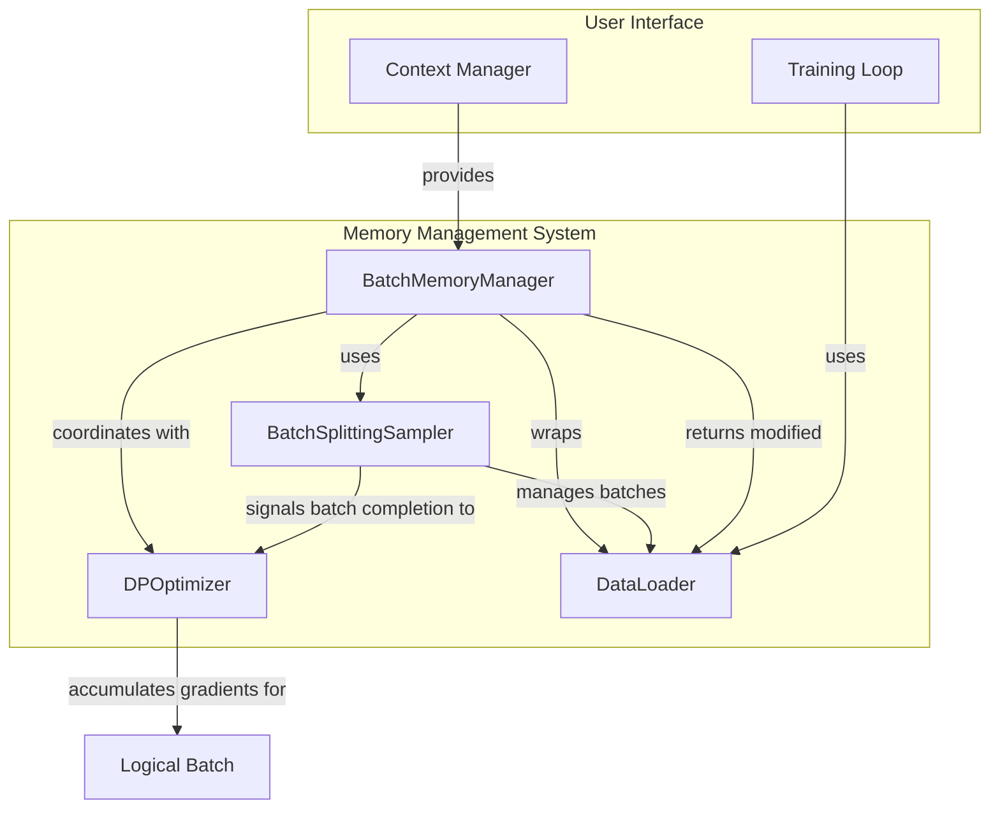
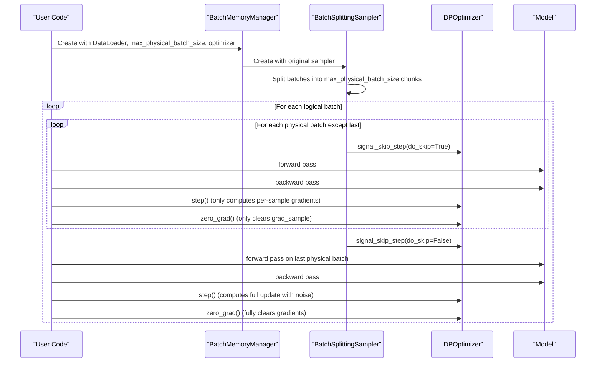
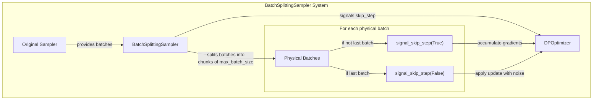
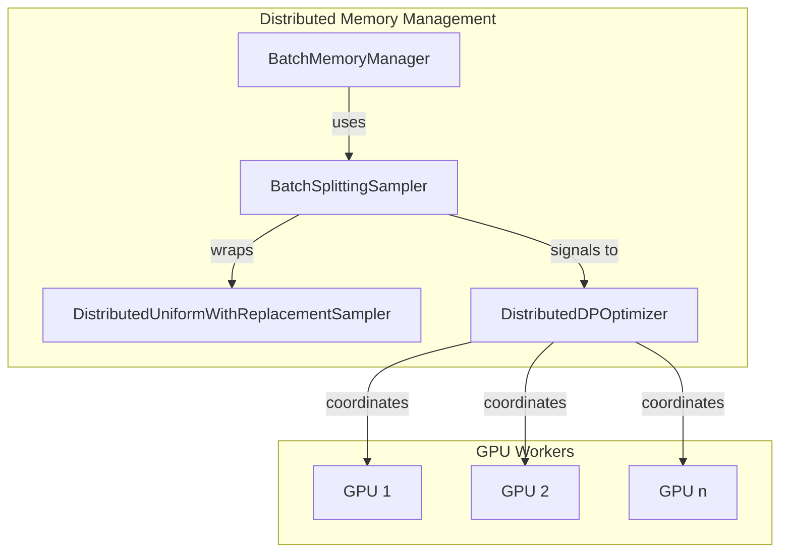

<!-- source: DeepWiki mcp.deepwiki.com · repo pytorch/opacus · page 8 Memory Management · fetched 2026-10-21 -->

# Memory Management

<details>
<summary>Relevant source files</summary>

The following files were used as context for generating this wiki page:

- [opacus/tests/batch_memory_manager_test.py](opacus/tests/batch_memory_manager_test.py)
- [opacus/tests/grad_samples/dp_rnn_test.py](opacus/tests/grad_samples/dp_rnn_test.py)
- [opacus/tests/per_sample_gradients_utils_test.py](opacus/tests/per_sample_gradients_utils_test.py)
- [opacus/utils/batch_memory_manager.py](opacus/utils/batch_memory_manager.py)

</details>


## Purpose and Scope

This document explains how Opacus manages memory during differentially private training. Training with differential privacy typically requires more memory than standard training due to the need to store per-sample gradients. The `BatchMemoryManager` provides a solution to memory limitations by splitting large logical batches into smaller physical batches while maintaining the same privacy guarantees and training outcome.

For information about the core differential privacy optimizers, see [Differential Privacy Optimizers](#3), and for details on per-sample gradient computation, see [Layer-Specific Gradient Computation](#7).

Sources: [opacus/utils/batch_memory_manager.py:121-183]()

## Memory Challenges in DP Training

Training with differential privacy presents unique memory challenges not found in standard training:

1. **Per-sample gradient storage**: The need to compute and store gradients for each individual sample rather than just the batch gradient
2. **Clipping per-sample gradients**: Processing each sample's gradient separately for clipping
3. **Large batch requirements**: DP training often benefits from larger batch sizes to reduce privacy costs

These challenges can lead to out-of-memory (OOM) errors, especially when training complex models on limited hardware.

## BatchMemoryManager Overview

The `BatchMemoryManager` is a context manager that helps manage memory consumption during differentially private training. It works by splitting large "logical" batches into smaller "physical" batches, allowing you to simulate training with large batch sizes even when your hardware memory is limited.



**Diagram: BatchMemoryManager System Architecture**

Sources: [opacus/utils/batch_memory_manager.py:121-183](), [opacus/utils/batch_memory_manager.py:27-84]()

## Logical vs Physical Batches

A key concept in Opacus memory management is the distinction between logical and physical batches:

| Concept | Description |
|---------|-------------|
| **Logical Batch** | The original batch size from the user's DataLoader (e.g., 1024 samples) |
| **Physical Batch** | The actual batch size processed by the model in one forward/backward pass (e.g., 256 samples) |
| **Batch Splitting** | The process of dividing a logical batch into multiple physical batches |
| **Gradient Accumulation** | Accumulating gradients across physical batches before applying a single update |

Sources: [opacus/utils/batch_memory_manager.py:121-137]()

## How BatchMemoryManager Works



**Diagram: BatchMemoryManager Sequence Flow**

The `BatchMemoryManager` works through these steps:

1. It wraps the user's DataLoader with a specialized `BatchSplittingSampler`
2. For each logical batch, the sampler splits it into smaller physical batches
3. The sampler signals to the optimizer whether the current physical batch is the last one in the logical batch
4. For non-final physical batches, the optimizer only accumulates gradients
5. For the final physical batch, the optimizer performs clipping, adds noise, and updates parameters

Sources: [opacus/utils/batch_memory_manager.py:121-183](), [opacus/utils/batch_memory_manager.py:27-84]()

## BatchSplittingSampler

The `BatchSplittingSampler` is a key component that:

1. Wraps the original sampler of the DataLoader
2. Splits index sequences into smaller chunks based on `max_physical_batch_size`
3. Signals to the optimizer when a logical batch ends using `signal_skip_step()`



**Diagram: BatchSplittingSampler Operation**

Sources: [opacus/utils/batch_memory_manager.py:27-84]()

## Using BatchMemoryManager

Here's how to use `BatchMemoryManager` in your training loop:

```python
# Assuming you've set up your model, optimizer, and data_loader with PrivacyEngine
with BatchMemoryManager(
    data_loader=data_loader,
    max_physical_batch_size=256,  # Maximum batch size that fits in memory
    optimizer=optimizer
) as new_data_loader:
    for data, target in new_data_loader:
        # Normal training loop
        output = model(data)
        loss = criterion(output, target)
        loss.backward()
        optimizer.step()
        optimizer.zero_grad()
```

The key advantage is that you can use a large logical batch size in your original DataLoader (e.g., 1024) while specifying a smaller physical batch size (e.g., 256) that fits in your GPU memory.

Sources: [opacus/utils/batch_memory_manager.py:143-162](), [opacus/tests/batch_memory_manager_test.py:87-116]()

## Memory Optimization Example

Let's look at how the `BatchMemoryManager` helps with memory optimization:

| Scenario | Without BatchMemoryManager | With BatchMemoryManager |
|----------|---------------------------|------------------------|
| **Batch Size** | Limited by available memory | Can use larger logical batches |
| **Memory Usage** | Spikes with large batches | Controlled by max_physical_batch_size |
| **Training Steps** | More steps with smaller batches | Fewer effective steps with larger logical batches |
| **Privacy Budget** | More privacy cost with smaller batches | Better privacy with larger logical batches |
| **Implementation** | Need manual gradient accumulation | Handled automatically |

Sources: [opacus/tests/batch_memory_manager_test.py:56-116]()

## Integration with DPOptimizer

The `BatchMemoryManager` works closely with the `DPOptimizer` through two key mechanisms:

1. **Signaling**: The `BatchSplittingSampler` tells the optimizer whether to skip the actual parameter update
2. **Gradient Accumulation**: For non-final physical batches, only per-sample gradients are computed and accumulated

When `signal_skip_step(True)` is called:
- `optimizer.step()` only computes per-sample gradients and accumulates them in `p.summed_grad`
- `optimizer.zero_grad()` only clears `p.grad_sample` but preserves `p.grad` and `p.summed_grad`

When `signal_skip_step(False)` is called:
- `optimizer.step()` performs the full update: clipping, noise addition, and parameter update
- `optimizer.zero_grad()` clears all gradients

Sources: [opacus/utils/batch_memory_manager.py:52-69](), [opacus/utils/batch_memory_manager.py:138-144]()

## Compatibility with Different Gradient Computation Modes

`BatchMemoryManager` works with all gradient computation modes supported by Opacus:

| Gradient Computation Mode | Compatible | Notes |
|---------------------------|------------|-------|
| Hooks-based ("hooks") | ✓ | Fully tested and supported |
| Expanded Weights ("ew") | ✓ | May have restrictions with empty batches |
| Functorch ("functorch") | ✓ | Fully tested and supported |

Sources: [opacus/tests/batch_memory_manager_test.py:229-237](), [opacus/tests/per_sample_gradients_utils_test.py:72]()

## Memory Management in Distributed Training

The `BatchMemoryManager` can also be used in distributed training scenarios, working with specialized samplers for distributed environments:



**Diagram: Distributed Memory Management**

Sources: [opacus/utils/batch_memory_manager.py:76-78]()

## Limitations and Considerations

When using `BatchMemoryManager`, keep these considerations in mind:

1. **Training Time**: Using more physical batches increases training time
2. **Batch Statistics**: Batch normalization layers see physical batch statistics, not logical batch statistics
3. **Empty Batches**: The system handles empty batches gracefully, which might occur with sampling
4. **Equivalent Results**: When using the same random seed, training with `BatchMemoryManager` produces identical results to training with a single batch

Sources: [opacus/tests/batch_memory_manager_test.py:174-226](), [opacus/tests/batch_memory_manager_test.py:123-172]()

## Conclusion

The `BatchMemoryManager` is a powerful tool in Opacus that helps manage memory during differentially private training. By splitting large logical batches into smaller physical batches, it allows you to train models with differential privacy even with limited memory resources. The system works seamlessly with the core components of Opacus, providing a simple interface for users while handling the complexity of gradient accumulation internally.

---

