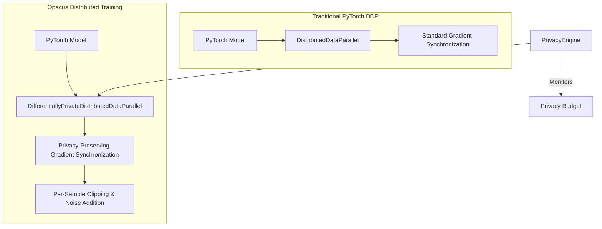
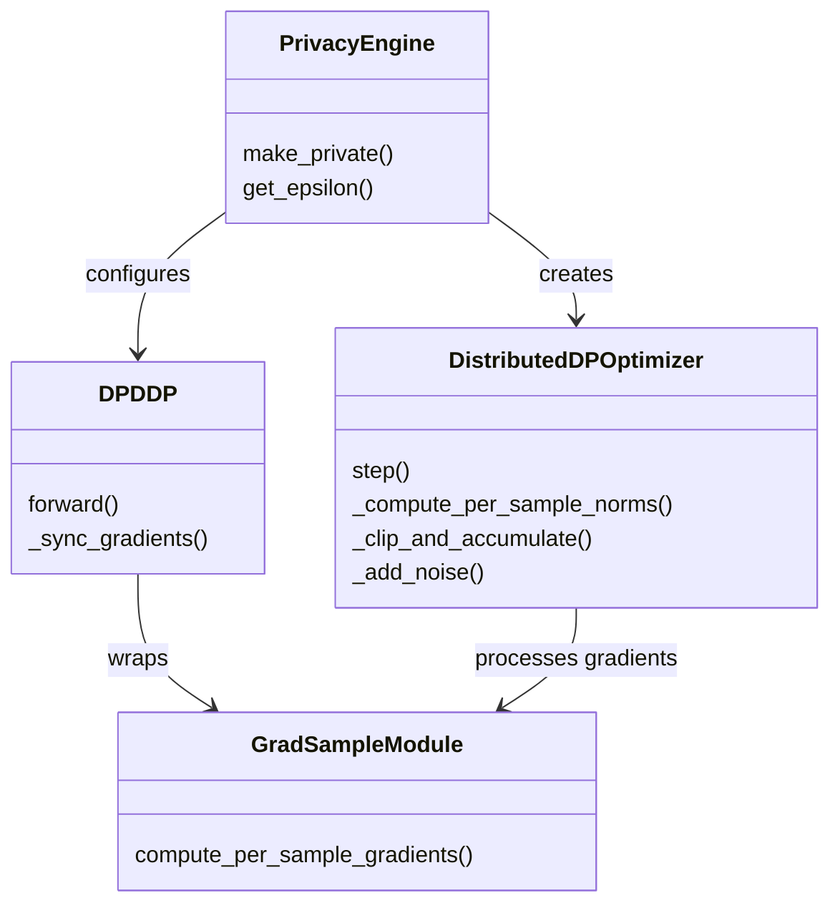
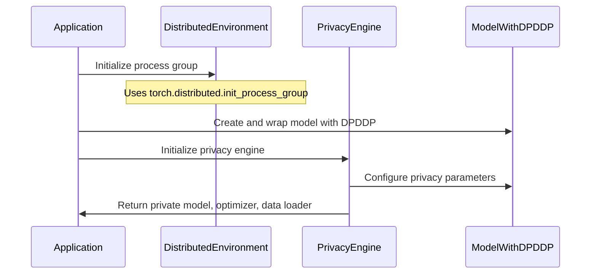
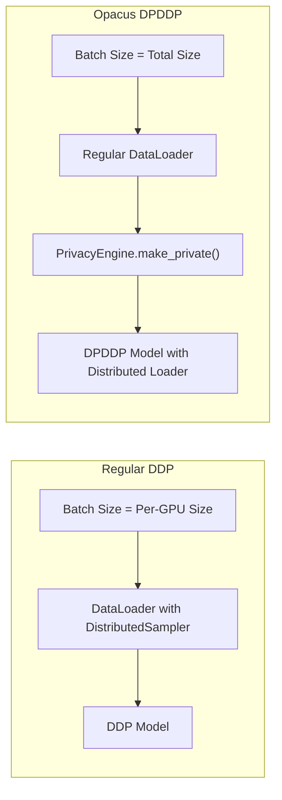
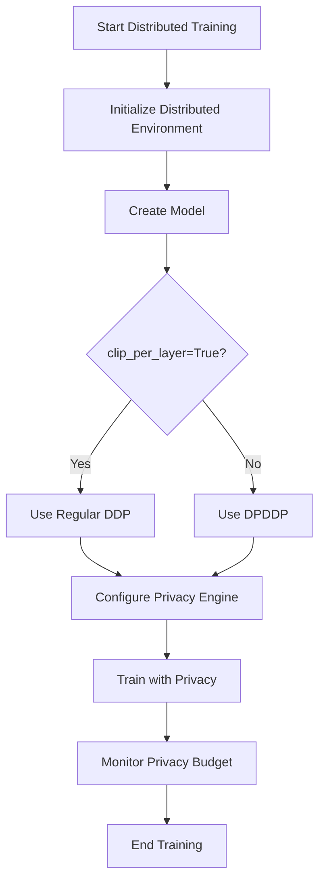

<!-- source: DeepWiki mcp.deepwiki.com · repo pytorch/opacus · page 9 Distributed Training · fetched 2026-10-21 -->

# Distributed Training

<details>
<summary>Relevant source files</summary>

The following files were used as context for generating this wiki page:

- [examples/cifar10.py](examples/cifar10.py)
- [opacus/tests/ddp_hook_check.py](opacus/tests/ddp_hook_check.py)
- [tutorials/building_image_classifier.ipynb](tutorials/building_image_classifier.ipynb)
- [tutorials/building_lstm_name_classifier.ipynb](tutorials/building_lstm_name_classifier.ipynb)
- [tutorials/building_text_classifier.ipynb](tutorials/building_text_classifier.ipynb)
- [tutorials/ddp_tutorial.ipynb](tutorials/ddp_tutorial.ipynb)
- [tutorials/guide_to_grad_sampler.ipynb](tutorials/guide_to_grad_sampler.ipynb)
- [tutorials/guide_to_module_validator.ipynb](tutorials/guide_to_module_validator.ipynb)
- [tutorials/intro_to_advanced_features.ipynb](tutorials/intro_to_advanced_features.ipynb)

</details>


This page covers the integration of distributed training with differential privacy in Opacus. It explains how to leverage multiple GPUs or nodes while maintaining privacy guarantees during model training. For information about general differential privacy optimization techniques, see [Differential Privacy Optimizers](#3).

## Overview

Opacus supports distributed training through a specialized implementation that ensures proper privacy accounting and gradient processing across multiple devices. This implementation allows users to scale training to multiple GPUs or nodes while maintaining the same privacy guarantees as single-device training.

The key component enabling this functionality is the `DifferentiallyPrivateDistributedDataParallel` (DPDDP) wrapper, which extends PyTorch's native `DistributedDataParallel` (DDP) to work with Opacus's privacy mechanisms.



Sources: [examples/cifar10.py:35-36](). [tutorials/ddp_tutorial.ipynb:232-233]().

## Key Components for Distributed Training

Opacus implements distributed training with differential privacy through these main components:

1. **DifferentiallyPrivateDistributedDataParallel (DPDDP)**: A wrapper that replaces PyTorch's DDP for privacy-preserving distributed training
2. **DistributedDPOptimizer**: A specialized optimizer for distributed training with differential privacy
3. **Privacy-aware batch processing**: Special handling of data batches to maintain privacy guarantees across devices



Sources: [tutorials/ddp_tutorial.ipynb:232-282](), [examples/cifar10.py:314-321]().

## Setting Up Distributed Training

### Initialization

To set up distributed training with Opacus, you first need to initialize the distributed environment:



The initialization involves:

1. Setting up the distributed environment with `torch.distributed.init_process_group`
2. Wrapping your model with `DifferentiallyPrivateDistributedDataParallel` instead of PyTorch's `DistributedDataParallel`
3. Creating an optimizer and data loader
4. Making the model, optimizer, and data loader private with the `PrivacyEngine`

Sources: [examples/cifar10.py:52-98](), [tutorials/ddp_tutorial.ipynb:84-92]().

### Code Example for Distributed Setup

The basic setup for a distributed training environment with Opacus requires:

1. Initialize the distributed environment
2. Create and wrap your model with `DPDDP`
3. Create your optimizer and data loader
4. Use `PrivacyEngine.make_private` to enable privacy-preserving training

When setting up distributed training with Opacus, there are a few important differences compared to regular PyTorch DDP:

1. Use `DPDDP` instead of `DDP` for wrapping your model
2. Do not use `DistributedSampler` - Opacus handles data distribution internally
3. Specify the full batch size, not the per-GPU batch size - Opacus will divide it appropriately

Sources: [tutorials/ddp_tutorial.ipynb:193-282](), [examples/cifar10.py:307-321]().

## Key Differences from Regular DDP

### Data Loading and Batch Sizes

In regular DDP:
- Batch size is per-GPU (total batch size = batch_size * num_gpus)
- Need to specify `DistributedSampler` for the data loader

In Opacus with DPDDP:
- Batch size is the total batch size (Opacus divides it across GPUs)
- Do not use `DistributedSampler` - Opacus handles data distribution internally



Sources: [tutorials/ddp_tutorial.ipynb:198-265]().

### Gradient Synchronization Process

In regular DDP, gradients are synchronized across devices before the optimizer updates parameters. With Opacus's DPDDP, the process includes additional steps to maintain privacy guarantees:

1. Per-sample gradients are computed at each device using `GradSampleModule`
2. Gradient norms are computed and clipped locally on each device
3. Clipped gradients are synchronized across devices
4. Noise calibrated to the privacy parameters is added to the aggregated gradients
5. Parameters are updated with the privatized gradients

```mermaid
sequenceDiagram
    participant GPU1 as GPU 1
    participant GPU2 as GPU 2
    participant Opt as DistributedDPOptimizer
    
    GPU1->>GPU1: Compute per-sample gradients
    GPU2->>GPU2: Compute per-sample gradients
    
    GPU1->>GPU1: Compute gradient norms
    GPU2->>GPU2: Compute gradient norms
    
    GPU1->>GPU1: Clip gradients
    GPU2->>GPU2: Clip gradients
    
    GPU1->>Opt: Send clipped gradients
    GPU2->>Opt: Send clipped gradients
    
    Opt->>Opt: Aggregate gradients across GPUs
    Opt->>Opt: Add calibrated noise for privacy
    
    Opt->>GPU1: Update parameters
    Opt->>GPU2: Update parameters
```

Sources: [tutorials/ddp_tutorial.ipynb:312-374](), [opacus/tests/ddp_hook_check.py:90-138]().

## Practical Example: Training CIFAR10 with DPDDP

The CIFAR10 example in Opacus demonstrates how to use distributed training with differential privacy. Here's a simplified overview of the key steps:

1. Setup the distributed environment
2. Create model and move to appropriate device
3. Conditionally wrap model with DDP or DPDDP based on privacy requirements
4. Create optimizer and data loader
5. Make model, optimizer, and data loader private with the privacy engine
6. Train with standard PyTorch training loop

When using clip_per_layer=True with distributed training, Opacus automatically uses regular DDP instead of DPDDP, as per-layer clipping requires a different approach to gradient aggregation.

Sources: [examples/cifar10.py:307-321](), [examples/cifar10.py:349-361]().

## Considerations and Best Practices

### Performance Considerations

- **Batch Size**: Larger batch sizes generally work better with distributed training, improving the signal-to-noise ratio in the privacy-preserving setting
- **Memory Management**: Using `BatchMemoryManager` with DPDDP can help manage memory constraints when training with larger logical batch sizes

### Privacy Budget Accounting

When using distributed training, privacy accounting works the same way as in single-device training. The `PrivacyEngine` tracks the privacy budget (epsilon) across all devices, ensuring consistent privacy guarantees regardless of the number of GPUs used.

### Limitations

- Per-layer clipping with DPDDP requires special handling. If `clip_per_layer=True`, Opacus will use regular DDP instead of DPDDP.
- All GPUs should have the same number of samples to prevent skewing the privacy accounting.



Sources: [examples/cifar10.py:313-320](), [examples/cifar10.py:338-347]().

## Debugging and Troubleshooting

Common issues with distributed training in Opacus:

1. **Incorrect environment setup**: Ensure the distributed environment is properly initialized before creating DPDDP models
2. **Batch size mismatches**: Remember that with Opacus, you specify the total batch size, not per-GPU
3. **Hook errors**: If you encounter issues with backward hooks, check that all hooks are properly attached and detached when using DPDDP

The DDP hook check test in Opacus can be useful for debugging gradient-related issues in distributed settings.

Sources: [opacus/tests/ddp_hook_check.py:187-217]().

## Conclusion

Distributed training with Opacus allows you to leverage multiple GPUs or nodes while maintaining differential privacy guarantees. By using the `DifferentiallyPrivateDistributedDataParallel` wrapper and following the specific requirements for data loading and batch size specification, you can scale your private training to larger models and datasets.

The key differences from regular PyTorch DDP involve how data loaders are configured and how gradient synchronization is handled to preserve privacy guarantees across devices.

---

