# Page: Overview

# Overview

<details>
<summary>Relevant source files</summary>

The following files were used as context for generating this wiki page:

- [CHANGELOG.md](CHANGELOG.md)
- [Migration_Guide.md](Migration_Guide.md)
- [README.md](README.md)
- [docs/faq.md](docs/faq.md)
- [examples/vision_benchmark.py](examples/vision_benchmark.py)
- [opacus/version.py](opacus/version.py)
- [setup.py](setup.py)
- [website/pages/tutorials/index.js](website/pages/tutorials/index.js)

</details>


Opacus is a PyTorch library that enables training models with differential privacy (DP). It implements the DP-SGD algorithm (Differentially Private Stochastic Gradient Descent) with a focus on usability, performance, and accurate privacy accounting. For detailed information about individual components, refer to their respective documentation pages.

## Purpose and Key Features

Opacus allows data scientists and researchers to train PyTorch models with differential privacy guarantees while requiring minimal code changes. The library:

- Enables training with just a few lines of additional code
- Maintains reasonable training performance despite DP overhead
- Allows real-time tracking of privacy budget expenditure
- Supports various model architectures and training scenarios
- Offers multiple gradient computation techniques optimized for different use cases
- Provides tools to ensure model compatibility with differential privacy

For specific implementation details of privacy mechanisms, see [Privacy Accounting](#4), and for optimizers that implement differential privacy, see [Differential Privacy Optimizers](#3).

Sources: [README.md:11-14](), [setup.py:62-84]()

## System Architecture

Opacus is organized around several core components that transform standard PyTorch training into privacy-preserving training.

### High-Level Architecture

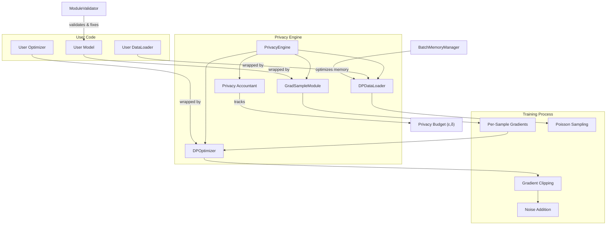

The `PrivacyEngine` is the central component that transforms standard PyTorch components into privacy-preserving equivalents:
- Wraps models with `GradSampleModule` to compute per-sample gradients
- Wraps optimizers with `DPOptimizer` to clip gradients and add noise
- Wraps data loaders with `DPDataLoader` to enable proper sampling
- Uses privacy accountants to track privacy budget expenditure

Sources: [README.md:60-78](), [CHANGELOG.md:48-49](), [docs/faq.md:6-8]()

### Core Components and Relationships

```mermaid
graph TD
    subgraph "Core Components"
        PrivacyEngine["PrivacyEngine"] --> |"creates"| GradSampleModule["GradSampleModule"]
        PrivacyEngine --> |"creates"| DPOptimizer["DPOptimizer"]
        PrivacyEngine --> |"creates"| DPDataLoader["DPDataLoader"]
        PrivacyEngine --> |"uses"| PrivacyAccountant["PrivacyAccountant"]
        
        GradSampleModule --> |"computes"| PerSampleGradients["Per-Sample Gradients"]
        DPOptimizer --> |"performs"| GradientClipping["Gradient Clipping"]
        DPOptimizer --> |"performs"| NoiseAddition["Noise Addition"]
        DPDataLoader --> |"enables"| PoissonSampling["Poisson Sampling"]
    end
    
    subgraph "Privacy Accountants"
        PrivacyAccountant --> RDPAccountant["RDPAccountant"]
        PrivacyAccountant --> GDPAccountant["GaussianAccountant"]
        PrivacyAccountant --> PRVAccountant["PRVAccountant"]
    end
    
    subgraph "Optimization Techniques"
        GradSampleModule --> HooksApproach["Hooks Approach"]
        GradSampleModule --> FunctorchApproach["Functorch Approach"]
        GradSampleModule --> ExpandedWeights["ExpandedWeights Approach"]
        DPOptimizer --> FastGradClipping["Fast Gradient Clipping"]
        DPOptimizer --> GhostClipping["Ghost Clipping"]
    end
    
    subgraph "Supporting Components"
        ModuleValidator["ModuleValidator"] --> |"ensures compatibility"| GradSampleModule
        BatchMemoryManager["BatchMemoryManager"] --> |"optimizes"| DPDataLoader
        DPDDP["DifferentiallyPrivateDistributedDataParallel"] --> |"enables distributed"| PrivacyEngine
    end
```

The diagram shows how Opacus components interact to implement differential privacy. The library offers multiple approaches for key operations like per-sample gradient computation and privacy accounting.

Sources: [README.md:60-78](), [CHANGELOG.md:99-104](), [CHANGELOG.md:48-49]()

## Basic Usage

Using Opacus requires minimal changes to standard PyTorch training code:

```python
# Standard PyTorch setup
model = Net()
optimizer = SGD(model.parameters(), lr=0.05)
data_loader = torch.utils.data.DataLoader(dataset, batch_size=1024)

# Fix model if needed (e.g. replacing BatchNorm with GroupNorm)
from opacus.validators import ModuleValidator
model = ModuleValidator.fix(model)

# Set up privacy engine
privacy_engine = PrivacyEngine()
model, optimizer, data_loader = privacy_engine.make_private(
    module=model,
    optimizer=optimizer,
    data_loader=data_loader,
    noise_multiplier=1.1,  # Controls privacy
    max_grad_norm=1.0,     # Clipping threshold
)

# Train as usual
for data, target in data_loader:
    optimizer.zero_grad()
    output = model(data)
    loss = criterion(output, target)
    loss.backward()
    optimizer.step()

# Check privacy budget
epsilon = privacy_engine.get_epsilon(delta=1e-5)
print(f"Privacy budget: ε = {epsilon:.2f}")
```

This example demonstrates the typical workflow: define standard PyTorch components, make them privacy-aware using the PrivacyEngine, and train as usual while tracking privacy budget.

Sources: [README.md:62-78](), [docs/faq.md:39-59]()

## DP-SGD Algorithm Flow

The DP-SGD algorithm modifies standard SGD by clipping per-sample gradients and adding noise. Here's how data flows through the system:

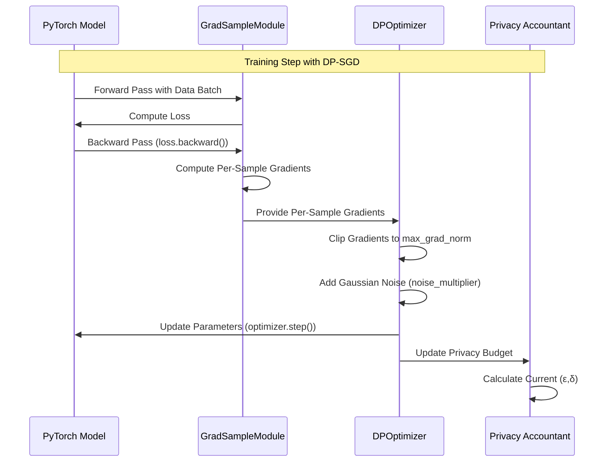

During training:
1. Each example in the batch contributes to its own gradient
2. Gradients are clipped to limit any single example's influence
3. Calibrated noise is added to preserve privacy
4. Privacy accountant tracks the cumulative privacy loss

Sources: [README.md:11-14](), [docs/faq.md:35-37](), [CHANGELOG.md:99-104]()

## Privacy Accounting

Opacus tracks privacy budget expenditure through privacy accountants:

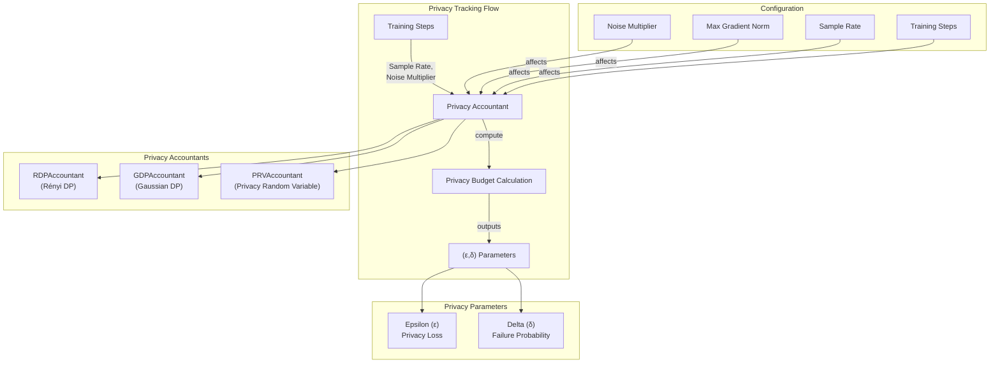

Privacy accounting translates the mechanisms of DP-SGD (noise addition, sampling rate) into formal privacy guarantees expressed as (ε,δ) parameters:
- Lower ε means stronger privacy guarantees
- Delta (δ) represents the probability of privacy failure
- Opacus supports multiple accounting methods with different privacy-utility tradeoffs

Sources: [docs/faq.md:81-115](), [CHANGELOG.md:99-104](), [CHANGELOG.md:153-154]()

## Memory Management

Training with differential privacy requires storing per-sample gradients, which can be memory-intensive. Opacus provides tools to manage memory usage:

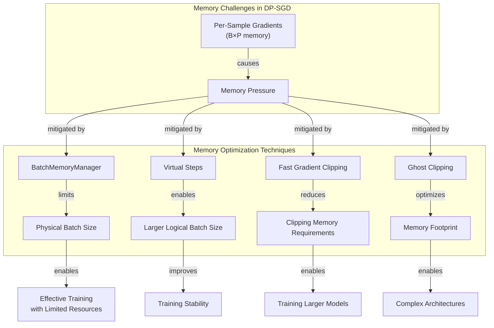

Key memory management techniques:
- **BatchMemoryManager**: Controls maximum physical batch size while maintaining logical batch size
- **Virtual Steps**: Accumulates gradients over multiple physical batches before updating parameters
- **Fast Gradient Clipping**: Optimized implementation reducing memory requirements
- **Ghost Clipping**: Advanced technique for memory-efficient clipping

Sources: [docs/faq.md:77-105](), [CHANGELOG.md:48-49](), [CHANGELOG.md:30-31]()

## Per-Sample Gradient Computation Approaches

Opacus provides multiple methods for computing per-sample gradients, each with different performance and memory tradeoffs:

| Approach | Description | Memory Usage | Computation Speed | Supported Layers |
|----------|-------------|--------------|-------------------|------------------|
| Hooks-based | Uses PyTorch hooks to capture activations | Higher | Moderate | Most common layers |
| Functorch | Uses functional transformations | Lower | Faster | Most layers with functional equivalents |
| ExpandedWeights | Alternative implementation | Moderate | Moderate | Various layers |
| Ghost Clipping | Memory-efficient clipping | Lower | Faster | Most layers |
| Fast Gradient Clipping | Performance-optimized | Lower | Faster | Most layers |

Each approach has its strengths, and Opacus allows choosing the appropriate one based on model architecture, hardware constraints, and performance requirements.

Sources: [CHANGELOG.md:99-104](), [CHANGELOG.md:48-49](), [README.md:92-98]()

## Model Compatibility

Not all PyTorch layers are compatible with differential privacy training out of the box. Opacus provides tools to validate and fix models:

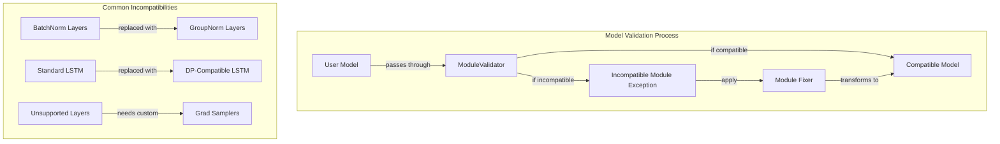

The `ModuleValidator` checks if a model is compatible with differential privacy and can automatically fix common issues such as replacing BatchNorm layers with GroupNorm.

Sources: [docs/faq.md:99-101](), [Migration_Guide.md:110-115](), [README.md:96-98]()

## Development and Future Directions

Opacus is actively developed with new features and improvements in each release:

- **Version 1.5.3** (current): Improved ghost clipping, support for embedding layers, and generative NLP tasks
- **Version 1.5**: Added Fast Gradient Clipping and Ghost Clipping
- **Version 1.4**: Upgraded to PyTorch 1.13+ and added clipping schedulers
- **Version 1.3**: Added PRV Accountant based on numerical composition of differential privacy

Key areas of ongoing development include:
- Memory optimization techniques
- Support for more model architectures and layer types
- Improved privacy accounting methods
- Performance enhancements for large-scale training

Sources: [CHANGELOG.md:3-29](), [CHANGELOG.md:48-49](), [version.py:16]()

## Conclusion

Opacus provides a robust, user-friendly framework for training PyTorch models with differential privacy. By abstracting away the complexity of DP-SGD implementation, it allows researchers and practitioners to benefit from privacy-preserving machine learning with minimal overhead.

To explore specific aspects of Opacus in more detail, refer to the other pages in this documentation:

- Core Architecture (#2)
- Differential Privacy Optimizers (#3)
- Privacy Accounting (#4)
- Data Loading and Processing (#5)
- Model Validation and Compatibility (#6)

Sources: [README.md:11-14](), [setup.py:62-84](), [docs/faq.md:6-8]()

---

# Page: Core Architecture

# Core Architecture

<details>
<summary>Relevant source files</summary>

The following files were used as context for generating this wiki page:

- [README.md](README.md)
- [docs/faq.md](docs/faq.md)
- [opacus/grad_sample/grad_sample_module.py](opacus/grad_sample/grad_sample_module.py)
- [opacus/privacy_engine.py](opacus/privacy_engine.py)
- [opacus/tests/privacy_engine_test.py](opacus/tests/privacy_engine_test.py)
- [website/pages/tutorials/index.js](website/pages/tutorials/index.js)

</details>


This page explains the foundational architecture of Opacus and how its main components interact to enable differentially private training of PyTorch models. For specifics about the PrivacyEngine API, see [PrivacyEngine](#2.1), and for details on per-sample gradient computation, see [GradSampleModule](#2.2).

## System Overview

The Opacus library implements Differentially Private Stochastic Gradient Descent (DP-SGD) by extending standard PyTorch components with privacy-preserving capabilities. The core architecture is built around several key components that work together to enable private training with minimal code changes and performance impact.

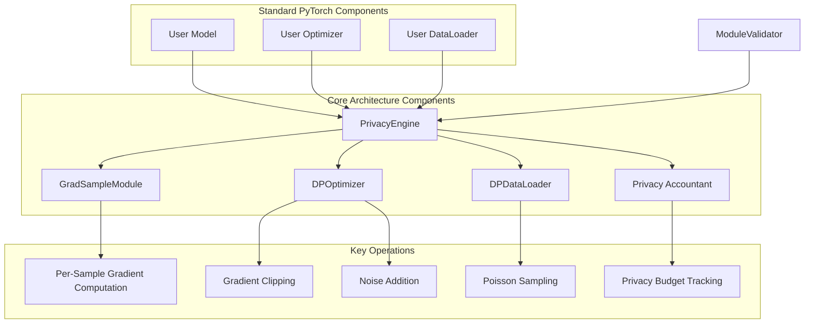

Sources: [opacus/privacy_engine.py:40-632]()

## Key Components and Their Roles

### PrivacyEngine

The `PrivacyEngine` class is the central orchestrator that transforms standard PyTorch training components into privacy-aware versions. It serves as the main entry point for users to enable differential privacy in their training pipeline.

Key responsibilities:
- Wrapping standard PyTorch modules to compute per-sample gradients
- Wrapping optimizers to implement gradient clipping and noise addition
- Wrapping data loaders to implement proper sampling methods
- Managing privacy accountants to track the privacy budget

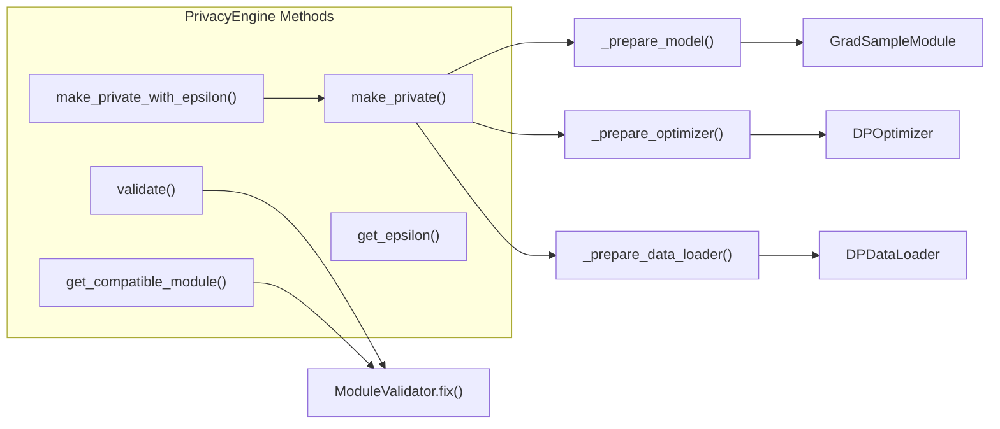

Sources: [opacus/privacy_engine.py:40-102](), [opacus/privacy_engine.py:296-437]()

### GradSampleModule

The `GradSampleModule` wraps PyTorch modules to compute per-sample gradients, which is a fundamental requirement for DP-SGD. It implements various approaches for computing these gradients efficiently.

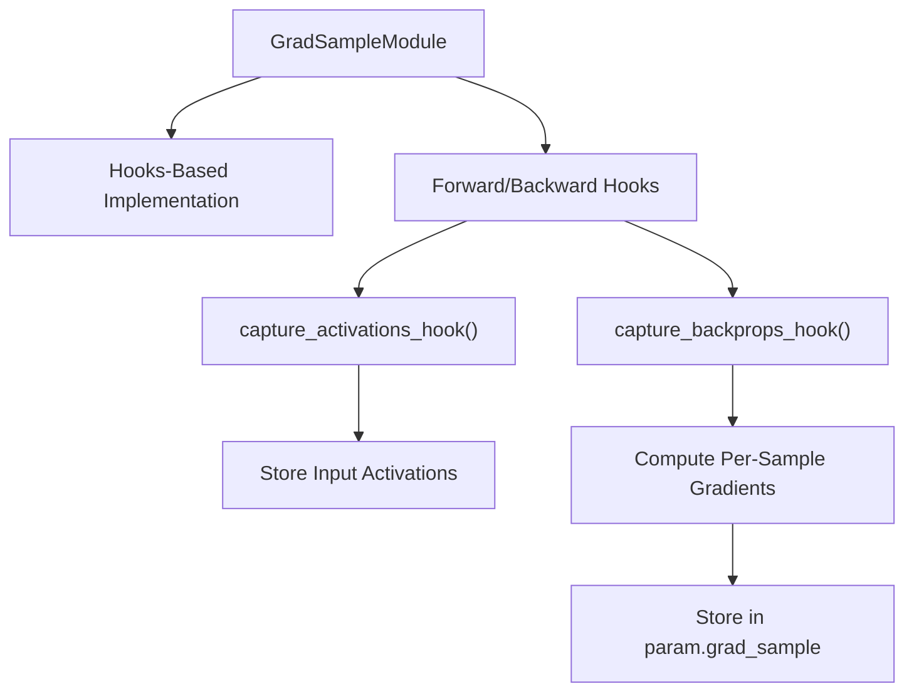

Sources: [opacus/grad_sample/grad_sample_module.py:79-489]()

### DPOptimizer

The `DPOptimizer` wraps standard PyTorch optimizers to implement the two key operations of DP-SGD:
1. Clipping per-sample gradients to limit sensitivity
2. Adding calibrated noise to ensure differential privacy

It works closely with the `GradSampleModule` to access the per-sample gradients.

### Privacy Accountants

Privacy accountants track the privacy budget expenditure throughout training. Opacus supports different accounting mechanisms:
- RDP Accountant (Rényi Differential Privacy)
- GDP Accountant (Gaussian Differential Privacy)
- PRV Accountant (Privacy Relaxation via Randomization)

## Data and Control Flow During Training

The following diagram illustrates the flow of data and operations during a training step with Opacus:

```mermaid
sequenceDiagram
    participant User as User Code
    participant PE as PrivacyEngine
    participant Model as GradSampleModule
    participant Opt as DPOptimizer
    participant PA as Privacy Accountant
    
    User->>PE: make_private(model, optimizer, data_loader)
    PE->>Model: Wrap model to compute per-sample gradients
    PE->>Opt: Wrap optimizer for clipping and noise
    PE->>User: Return private components
    
    User->>Model: Forward pass (inputs)
    Model->>Model: Compute outputs and store activations
    Model->>User: Return outputs
    User->>User: Compute loss
    User->>Model: Backward pass (loss)
    Model->>Model: Compute per-sample gradients
    Model->>Opt: Provide per-sample gradients
    Opt->>Opt: Clip gradients to max_grad_norm
    Opt->>Opt: Add noise scaled by noise_multiplier
    Opt->>Model: Update parameters
    Opt->>PA: Update privacy budget
    PA->>User: Current privacy guarantee (ε, δ)
```

Sources: [opacus/privacy_engine.py:296-437]()

## Per-Sample Gradient Computation Approaches

Opacus supports multiple approaches for computing per-sample gradients, each with different trade-offs in terms of memory usage, computational efficiency, and compatibility:

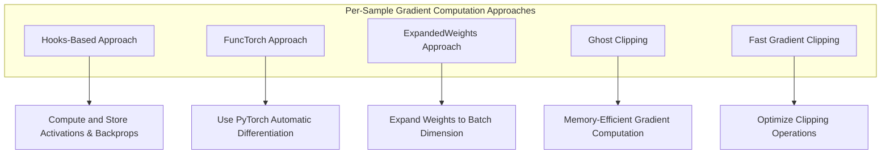

Sources: [opacus/grad_sample/grad_sample_module.py:79-489]()

## Module Validation and Compatibility

Not all PyTorch modules are compatible with differential privacy out of the box. Opacus provides validation and fixing mechanisms:

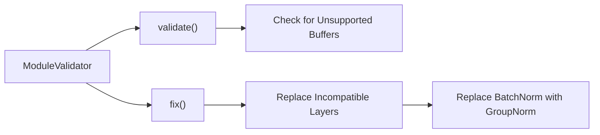

Sources: [opacus/privacy_engine.py:231-294]()

## User Integration Workflow

The typical workflow for integrating Opacus into a PyTorch training pipeline involves:

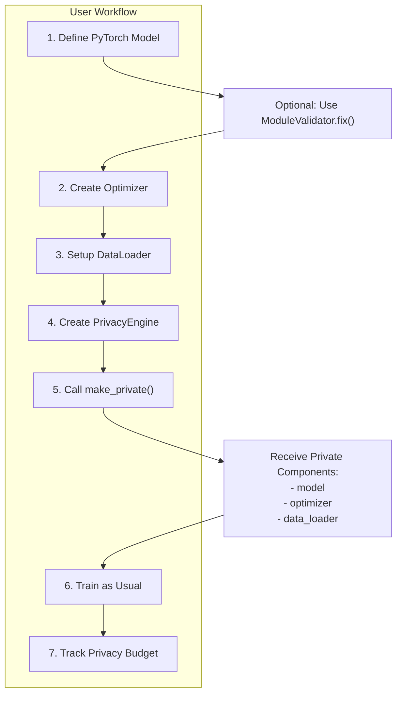

The following table summarizes the transformation of standard PyTorch components into their privacy-preserving counterparts:

| Standard Component | Privacy-Preserving Version | Purpose |
|--------------------|----------------------------|---------|
| `nn.Module` | `GradSampleModule` | Compute per-sample gradients |
| `Optimizer` | `DPOptimizer` | Implement gradient clipping and noise addition |
| `DataLoader` | `DPDataLoader` | Implement proper sampling for privacy guarantees |

Sources: [opacus/privacy_engine.py:296-437](), [README.md:56-79]()

## Example Usage

Here's a simplified example of how these components work together in practice:

1. The user defines standard PyTorch components (model, optimizer, data loader)
2. The user instantiates a `PrivacyEngine`
3. The user calls `privacy_engine.make_private()` to get privacy-preserving versions
4. The user trains the model as usual with the privacy-preserving components

During training:
- `GradSampleModule` computes per-sample gradients
- `DPOptimizer` clips gradients and adds noise
- The privacy accountant tracks the privacy budget

Sources: [README.md:56-79](), [opacus/privacy_engine.py:296-437]()

---

# Page: PrivacyEngine

# PrivacyEngine

<details>
<summary>Relevant source files</summary>

The following files were used as context for generating this wiki page:

- [opacus/grad_sample/grad_sample_module.py](opacus/grad_sample/grad_sample_module.py)
- [opacus/privacy_engine.py](opacus/privacy_engine.py)
- [opacus/tests/privacy_engine_test.py](opacus/tests/privacy_engine_test.py)
- [tutorials/building_image_classifier.ipynb](tutorials/building_image_classifier.ipynb)
- [tutorials/building_lstm_name_classifier.ipynb](tutorials/building_lstm_name_classifier.ipynb)
- [tutorials/building_text_classifier.ipynb](tutorials/building_text_classifier.ipynb)
- [tutorials/ddp_tutorial.ipynb](tutorials/ddp_tutorial.ipynb)
- [tutorials/guide_to_grad_sampler.ipynb](tutorials/guide_to_grad_sampler.ipynb)
- [tutorials/guide_to_module_validator.ipynb](tutorials/guide_to_module_validator.ipynb)
- [tutorials/intro_to_advanced_features.ipynb](tutorials/intro_to_advanced_features.ipynb)

</details>


PrivacyEngine is the central orchestrator of the Opacus library that enables differential privacy for PyTorch models. It provides a high-level API to transform standard PyTorch training components (models, optimizers, and data loaders) into their privacy-aware counterparts, allowing for differentially private model training with minimal code changes.

For information about specific gradient computation methods, see [GradSampleModule](#2.2). For optimizers used in differential privacy training, see [Differential Privacy Optimizers](#3).

## Overview and Architecture

PrivacyEngine is designed to be the main entry point to the Opacus API. It wraps the core PyTorch training components with privacy-preserving functionality while maintaining their original interfaces, allowing users to incorporate differential privacy with minimal changes to their training code.

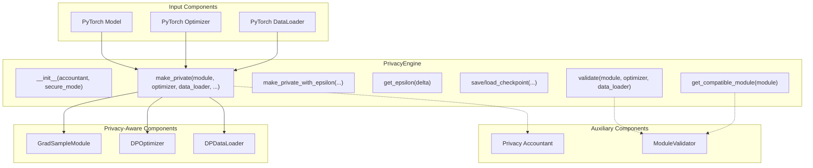

*Diagram: PrivacyEngine Architecture and Component Relationships*

Sources: [opacus/privacy_engine.py:40-51](), [opacus/privacy_engine.py:296-436]()

## Initialization

The PrivacyEngine is initialized with privacy accounting mechanism and security settings.

```python
privacy_engine = PrivacyEngine(
    accountant="prv",  # Options: "rdp", "gdp", or "prv"
    secure_mode=False  # Set to True for cryptographically strong DP guarantee
)
```

The `accountant` parameter specifies the privacy accounting mechanism:
- "rdp": RDP Accountant (Rényi Differential Privacy)
- "gdp": Gaussian Accountant
- "prv": PRV Accountant (Privacy Relaxation Verification)

When `secure_mode` is set to `True`, the engine uses secure random number generation via the `torchcsprng` package, which prevents certain floating-point arithmetic-based attacks.

Sources: [opacus/privacy_engine.py:65-100]()

## Core Methods

### make_private

The primary method of PrivacyEngine is `make_private()`, which transforms standard PyTorch components into privacy-aware versions:

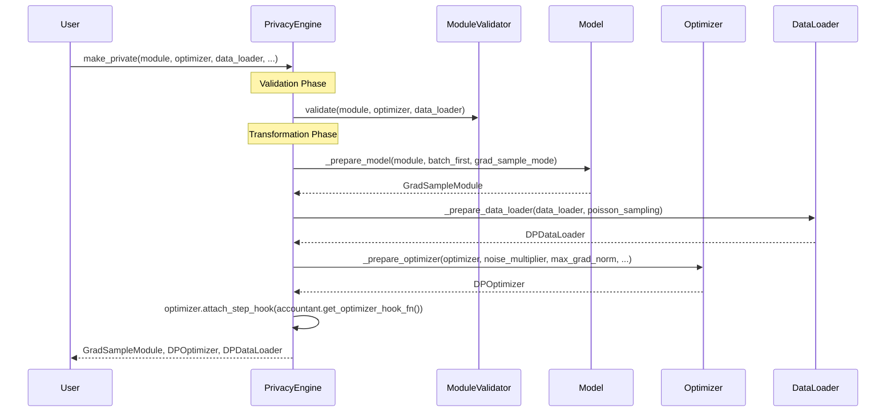

*Diagram: PrivacyEngine's make_private Method Workflow*

Sources: [opacus/privacy_engine.py:296-436]()

The `make_private` method takes the following key parameters:

| Parameter | Description |
|-----------|-------------|
| `module` | PyTorch module to be used for training |
| `optimizer` | Optimizer to be used for training |
| `data_loader` | DataLoader to be used for training |
| `noise_multiplier` | The ratio of noise to sensitivity (higher = more privacy) |
| `max_grad_norm` | Maximum norm for per-sample gradient clipping |
| `batch_first` | Flag indicating if batch dimension is first in tensors |
| `loss_reduction` | Reduction type for aggregating gradients ("sum" or "mean") |
| `poisson_sampling` | Whether to use Poisson sampling for DP guarantees |
| `clipping` | Gradient clipping mechanism ("flat", "per_layer", or "adaptive") |
| `grad_sample_mode` | Mode for computing per-sample gradients ("hooks", "functorch", etc.) |

The method returns:
- A `GradSampleModule` that computes per-sample gradients
- A `DPOptimizer` that clips gradients and adds noise
- A modified `DataLoader` that handles privacy-preserving sampling

Sources: [opacus/privacy_engine.py:296-436]()

### make_private_with_epsilon

This method is a variant of `make_private` that calculates the appropriate noise multiplier to achieve a target privacy budget:

```python
model, optimizer, data_loader = privacy_engine.make_private_with_epsilon(
    module=model,
    optimizer=optimizer,
    data_loader=data_loader,
    target_epsilon=10.0,
    target_delta=1e-5,
    epochs=10,
    max_grad_norm=1.0
)
```

This method is useful when you have a specific privacy budget (ε, δ) that you want to achieve by the end of training.

Sources: [opacus/privacy_engine.py:438-540]()

### Privacy Budget Tracking

PrivacyEngine provides the `get_epsilon` method to track the current privacy budget:

```python
current_epsilon = privacy_engine.get_epsilon(delta=1e-5)
```

This returns the privacy budget (epsilon) expended so far for the specified delta.

Sources: [opacus/privacy_engine.py:542-552]()

## Module Validation and Compatibility

PrivacyEngine includes mechanisms to validate and fix modules for compatibility with differential privacy:

```python
# Check if module is compatible
is_compatible = privacy_engine.is_compatible(module=model, optimizer=optimizer, data_loader=data_loader)

# Validate and raise errors if incompatible
privacy_engine.validate(module=model, optimizer=optimizer, data_loader=data_loader)

# Fix incompatible modules (e.g., replacing BatchNorm with GroupNorm)
compatible_model = PrivacyEngine.get_compatible_module(model)
```

The validation process ensures that:
1. The model can compute per-sample gradients
2. There are no incompatible layers (like BatchNorm)
3. The model parameters match the optimizer parameters

Sources: [opacus/privacy_engine.py:235-294]()

## Checkpointing

PrivacyEngine provides methods to save and load the training state, including the privacy accountant:

```python
# Save checkpoint
privacy_engine.save_checkpoint(
    path="checkpoint.pt",
    module=model,
    optimizer=optimizer
)

# Load checkpoint
privacy_engine.load_checkpoint(
    path="checkpoint.pt", 
    module=model,
    optimizer=optimizer
)
```

This functionality is essential for resuming training while preserving privacy accounting.

Sources: [opacus/privacy_engine.py:554-632]()

## PrivacyEngine Workflow

The following diagram illustrates a typical workflow for training with differential privacy using PrivacyEngine:

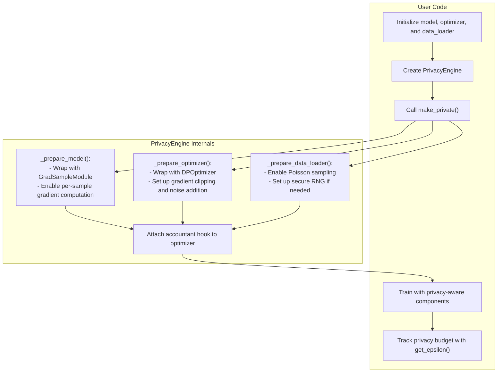

*Diagram: Typical Workflow Using PrivacyEngine*

Sources: [opacus/privacy_engine.py:40-51](), [opacus/privacy_engine.py:296-436]()

## Usage Example

Here's a minimal example of how to use PrivacyEngine in a training pipeline:

```python
# Initialize standard PyTorch components
model = MyModel()
optimizer = torch.optim.SGD(model.parameters(), lr=0.1)
data_loader = DataLoader(dataset, batch_size=64)

# Initialize Privacy Engine
privacy_engine = PrivacyEngine()

# Make components private
model, optimizer, data_loader = privacy_engine.make_private(
    module=model,
    optimizer=optimizer,
    data_loader=data_loader,
    noise_multiplier=1.0,
    max_grad_norm=1.0
)

# Train as usual with the privacy-enhanced components
for epoch in range(epochs):
    for data, target in data_loader:
        optimizer.zero_grad()
        output = model(data)
        loss = criterion(output, target)
        loss.backward()
        optimizer.step()
    
    # Track privacy budget
    epsilon = privacy_engine.get_epsilon(delta=1e-5)
    print(f"ε = {epsilon:.2f}, δ = 1e-5")
```

## Parameter Selection and Advanced Configuration

### Noise Multiplier and Max Gradient Norm

These are the two primary levers for controlling the privacy-utility trade-off:

- **noise_multiplier**: Controls the amount of noise added to gradients. Higher values provide stronger privacy guarantees but may reduce model utility.
- **max_grad_norm**: Limits the sensitivity of the training procedure to individual samples. Lower values improve privacy but may slow down training.

### Secure Mode

When `secure_mode=True`, PrivacyEngine uses cryptographically strong random number generation, which provides stronger security guarantees but may be slower:

```python
privacy_engine = PrivacyEngine(secure_mode=True)
```

This requires the `torchcsprng` package to be installed.

### Gradient Clipping Methods

PrivacyEngine supports different gradient clipping strategies:

- **flat**: Clips the gradient norm across all parameters (default)
- **per_layer**: Clips each parameter tensor separately
- **adaptive**: Dynamically adjusts clipping bound during training

Sources: [opacus/privacy_engine.py:296-370]()

## Integration with Distributed Training

PrivacyEngine supports distributed training through integration with PyTorch's DistributedDataParallel:

```python
from torch.nn.parallel import DistributedDataParallel as DDP
from opacus.distributed import DifferentiallyPrivateDistributedDataParallel as DPDDP

# Wrap model with DPDDP instead of DDP
model = DPDDP(model)

# PrivacyEngine detects DPDDP and enables distributed mode
model, optimizer, data_loader = privacy_engine.make_private(
    module=model,
    optimizer=optimizer,
    data_loader=data_loader,
    noise_multiplier=1.0,
    max_grad_norm=1.0
)
```

Sources: [opacus/privacy_engine.py:385-419]()

## Conclusion

PrivacyEngine is the central component of Opacus that orchestrates differential privacy during model training. By transforming standard PyTorch components into privacy-aware versions, it allows developers to train models with differential privacy guarantees while maintaining a familiar PyTorch API.

---

# Page: GradSampleModule

# GradSampleModule

<details>
<summary>Relevant source files</summary>

The following files were used as context for generating this wiki page:

- [opacus/grad_sample/__init__.py](opacus/grad_sample/__init__.py)
- [opacus/grad_sample/embedding_norm_sample.py](opacus/grad_sample/embedding_norm_sample.py)
- [opacus/grad_sample/grad_sample_module.py](opacus/grad_sample/grad_sample_module.py)
- [opacus/grad_sample/utils.py](opacus/grad_sample/utils.py)
- [opacus/privacy_engine.py](opacus/privacy_engine.py)
- [opacus/tests/grad_samples/embedding_norm_sample_test.py](opacus/tests/grad_samples/embedding_norm_sample_test.py)
- [opacus/tests/privacy_engine_test.py](opacus/tests/privacy_engine_test.py)

</details>


GradSampleModule is a core component of Opacus that enables per-sample gradient computation, which is essential for implementing differential privacy in neural network training. This class wraps PyTorch modules to compute gradients for each individual sample in a batch, rather than only computing the aggregate gradient across the entire batch.

For information about the broader privacy engine architecture, see [PrivacyEngine](#2.1). For details on differential privacy optimization, see [Basic DPOptimizer](#3.1).

## Purpose and Functionality

GradSampleModule serves as an implementation of the abstract class AbstractGradSampleModule, providing a hooks-based approach for computing per-sample gradients. It works by:

1. Registering forward and backward hooks on PyTorch modules
2. Capturing activations during the forward pass
3. Computing per-sample gradients during the backward pass
4. Storing these gradients in the `grad_sample` attribute of each parameter

This mechanism is crucial for differential privacy, as it allows the privacy engine to clip gradients on a per-sample basis and add calibrated noise before updating model parameters.

Sources: [opacus/grad_sample/grad_sample_module.py:79-149](). [opacus/grad_sample/__init__.py:21-22]().

## Architecture and Position in Opacus

GradSampleModule sits between the user's PyTorch model and the privacy engine, transforming standard models into privacy-aware ones.

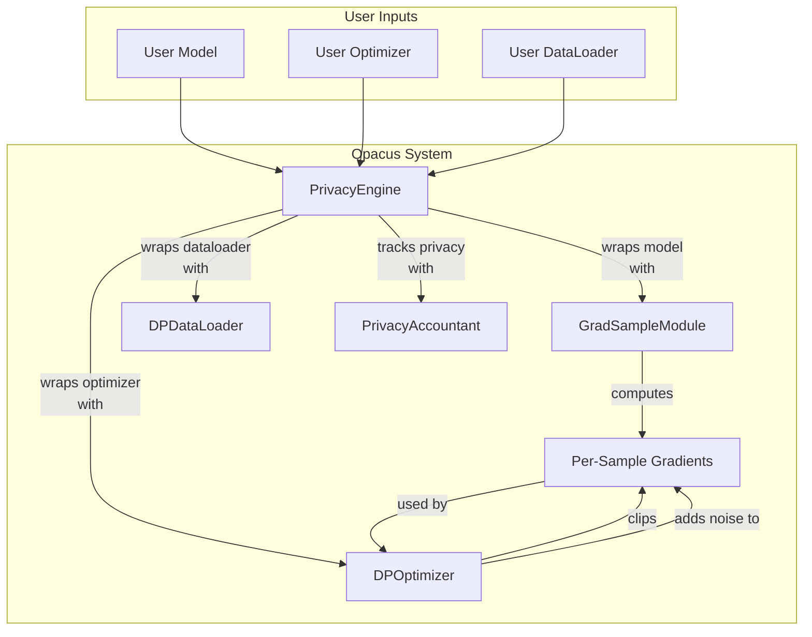

Sources: [opacus/privacy_engine.py:170-213](). [opacus/grad_sample/grad_sample_module.py:79-85]().

## Per-Sample Gradient Computation Process

Here's how GradSampleModule computes per-sample gradients during training:

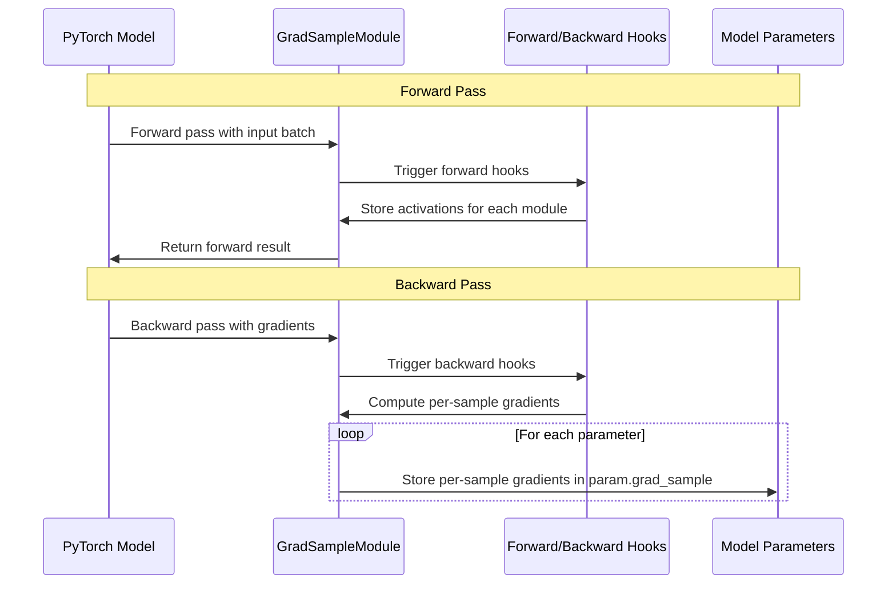

Sources: [opacus/grad_sample/grad_sample_module.py:268-312](). [opacus/grad_sample/grad_sample_module.py:364-419]().

## Implementation Approaches

GradSampleModule supports multiple strategies for computing per-sample gradients, each with different trade-offs:

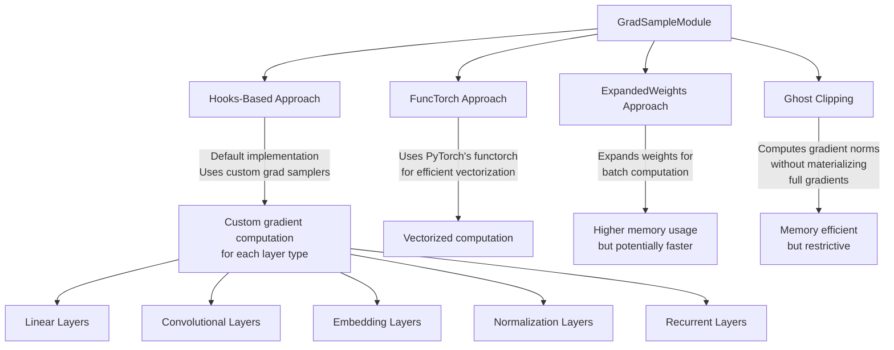

Sources: [opacus/grad_sample/utils.py:84-111](). [opacus/grad_sample/grad_sample_module.py:202-208]().

## Core Components and Methods

### Initialization and Configuration

GradSampleModule is initialized with several key parameters:

```python
def __init__(
    self,
    m: nn.Module,
    *,
    batch_first=True,
    loss_reduction="mean",
    strict: bool = True,
    force_functorch=False,
):
```

- `m`: The PyTorch module to be wrapped
- `batch_first`: Flag indicating if input tensor has batch as first dimension
- `loss_reduction`: Whether loss reduction is "mean" or "sum"
- `strict`: Whether to validate the module strictly for compatibility
- `force_functorch`: Whether to use functorch for all gradient computations

Sources: [opacus/grad_sample/grad_sample_module.py:89-118]().

### Key Methods

| Method | Purpose |
|--------|---------|
| `add_hooks()` | Adds forward and backward hooks to the model |
| `remove_hooks()` | Removes hooks from the model |
| `enable_hooks()` / `disable_hooks()` | Toggle hook functionality |
| `capture_activations_hook()` | Forward hook to store module activations |
| `capture_backprops_hook()` | Backward hook to compute per-sample gradients |
| `rearrange_grad_samples()` | Process activations and gradients based on batch dimension and loss reduction |
| `forbid_grad_accumulation()` / `allow_grad_accumulation()` | Control whether gradient accumulation is allowed |

Sources: [opacus/grad_sample/grad_sample_module.py:166-190](). [opacus/grad_sample/grad_sample_module.py:221-241](). [opacus/grad_sample/grad_sample_module.py:268-283](). [opacus/grad_sample/grad_sample_module.py:291-362](). [opacus/grad_sample/grad_sample_module.py:364-419](). [opacus/grad_sample/grad_sample_module.py:484-488]().

## Hook Management

GradSampleModule uses PyTorch's hook system to intercept forward and backward passes for computing per-sample gradients:

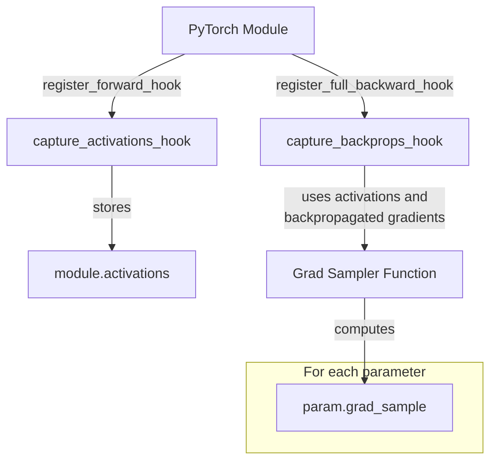

Sources: [opacus/grad_sample/grad_sample_module.py:202-217](). [opacus/grad_sample/grad_sample_module.py:268-283](). [opacus/grad_sample/grad_sample_module.py:291-362]().

## Gradient Computation and Storage

During the backward pass, GradSampleModule performs these key operations:

1. Captures backpropagated gradients
2. Retrieves stored activations
3. Determines appropriate gradient sampler function
4. Computes per-sample gradients
5. Stores or accumulates these gradients in parameter attributes

For gradient accumulation (needed for RNNs and certain training scenarios), gradients are first accumulated in `_current_grad_sample` and then promoted to `grad_sample` when processing of the current batch is complete.

Sources: [opacus/grad_sample/grad_sample_module.py:40-76](). [opacus/grad_sample/grad_sample_module.py:291-362]().

## Integration with PrivacyEngine

PrivacyEngine uses GradSampleModule through the `_prepare_model` method:

```mermaid
sequenceDiagram
    participant User
    participant PE as PrivacyEngine
    participant GSM as GradSampleModule
    participant Model as User Model
    
    User->>PE: make_private(module, optimizer, data_loader, ...)
    PE->>PE: _prepare_model()
    PE->>GSM: wrap_model(module, grad_sample_mode, ...)
    GSM->>Model: Add hooks to compute per-sample gradients
    GSM->>PE: Return wrapped model
    PE->>User: Return privacy-ready model, optimizer, and data loader
```

Sources: [opacus/privacy_engine.py:170-213](). [opacus/privacy_engine.py:296-436]().

## Extension through Custom Gradient Samplers

Opacus allows custom gradient samplers to be registered for specific layer types:

```python
@register_grad_sampler(CustomLayer)
def compute_custom_grad_sample(module, activations, backprops):
    # Custom implementation
    return {param: grad_sample for param, grad_sample in ...}
```

These sampler functions are stored in the `GRAD_SAMPLERS` dictionary and used during the backward pass.

Sources: [opacus/grad_sample/utils.py:29-55](). [opacus/grad_sample/grad_sample_module.py:87]().

## Practical Considerations

### Memory Usage

Computing per-sample gradients requires storing both activations and per-sample gradients, which can significantly increase memory usage. For large models or batches, this can become a bottleneck.

### Compatibility

Not all PyTorch modules are directly compatible with the hooks-based approach. Modules with buffers (like BatchNorm) require special handling. GradSampleModule validates modules to ensure compatibility.

### Performance Trade-offs

Different gradient computation approaches offer different trade-offs:

| Approach | Memory Usage | Computation Speed | Compatibility |
|----------|--------------|-------------------|---------------|
| Hooks-based | Medium | Medium | Most layers |
| FuncTorch | Low | Fast | All layers |
| ExpandedWeights | High | Fast | Some layers |
| Ghost Clipping | Very Low | Fast | Restrictive |

Sources: [opacus/grad_sample/grad_sample_module.py:130-146](). [opacus/grad_sample/utils.py:84-111]().

## Example Usage

GradSampleModule is typically not used directly but through the PrivacyEngine:

```python
model = MyModel()
optimizer = torch.optim.SGD(model.parameters(), lr=0.1)
data_loader = DataLoader(dataset, batch_size=64)

privacy_engine = PrivacyEngine()
model, optimizer, data_loader = privacy_engine.make_private(
    module=model,
    optimizer=optimizer,
    data_loader=data_loader,
    noise_multiplier=1.0,
    max_grad_norm=1.0,
    grad_sample_mode="hooks"  # or "functorch", "ew", "ghost"
)
```

Behind the scenes, this wraps the model with GradSampleModule configured with the specified `grad_sample_mode`.

Sources: [opacus/privacy_engine.py:296-436]().

## Relationship to Other Opacus Components

GradSampleModule interacts closely with other components in the Opacus ecosystem:

```mermaid
graph TD
    GSM["GradSampleModule"]
    
    PE["PrivacyEngine"] --> |"creates and configures"| GSM
    GSM --> |"computes gradients\nfor"| DPO["DPOptimizer"]
    GSM --> PSG["Per-Sample Gradients"]
    PSG --> |"used by"| DPO
    
    GS["Grad Samplers"] --> |"registered with"| GSM
    GSM --> |"validates with"| MV["ModuleValidator"]
    
    GC["Ghost Clipping"] --> |"alternative to"| GSM
    FGC["Fast Gradient Clipping"] --> |"uses"| GSM
    
    BMM["BatchMemoryManager"] --> |"manages memory for"| GSM
```

Sources: [opacus/privacy_engine.py:170-213](). [opacus/privacy_engine.py:296-436]().

## Advanced Features

### Gradient Accumulation

GradSampleModule supports gradient accumulation, which is necessary for:
- RNN-based models where backward hooks are called multiple times
- Training scenarios where gradients need to be accumulated over multiple batches

This is controlled through the `grad_accumulation_allowed` flag and the associated methods:
- `forbid_grad_accumulation()`
- `allow_grad_accumulation()`

Sources: [opacus/grad_sample/grad_sample_module.py:40-76](). [opacus/grad_sample/grad_sample_module.py:484-488]().

### Batch Size Inference

GradSampleModule automatically infers the batch size from activations, supporting:
- Regular batched inputs
- Packed sequences (as used in RNNs)
- Variable batch sizes

This is handled by the `_get_batch_size` helper function.

Sources: [opacus/grad_sample/grad_sample_module.py:491-512]().

## Summary

GradSampleModule is a foundational component of Opacus that enables differential privacy by computing per-sample gradients. It uses PyTorch hooks to capture activations and backpropagated gradients, supports multiple implementation strategies, and provides mechanisms for handling complex scenarios like RNNs and gradient accumulation. While typically used through PrivacyEngine rather than directly, understanding its operation is crucial for effectively using Opacus for privacy-preserving machine learning.

---

# Page: Differential Privacy Optimizers

# Differential Privacy Optimizers

<details>
<summary>Relevant source files</summary>

The following files were used as context for generating this wiki page:

- [opacus/optimizers/adaclipoptimizer.py](opacus/optimizers/adaclipoptimizer.py)
- [opacus/optimizers/ddp_perlayeroptimizer.py](opacus/optimizers/ddp_perlayeroptimizer.py)
- [opacus/optimizers/ddpoptimizer.py](opacus/optimizers/ddpoptimizer.py)
- [opacus/optimizers/optimizer.py](opacus/optimizers/optimizer.py)
- [opacus/optimizers/perlayeroptimizer.py](opacus/optimizers/perlayeroptimizer.py)

</details>


This document provides an in-depth explanation of the differential privacy (DP) optimizers in Opacus, their functionality, and implementation details. DP optimizers are a core component of the Opacus library that handle gradient clipping, noise addition, and interfacing with privacy accounting during private model training. This document focuses on the optimizer implementations themselves; for information about the privacy engine that orchestrates these optimizers, see [PrivacyEngine](#2.1), and for details on privacy accounting, see [Privacy Accounting](#4).

## Overview of DP Optimizers

Differential privacy optimizers in Opacus extend standard PyTorch optimizers by adding privacy-preserving operations to the optimization process. These operations include per-sample gradient computation, gradient clipping, and noise addition to achieve differential privacy guarantees.

```mermaid
flowchart TD
    subgraph "DP Optimizer Components"
        direction TB
        CGS["Compute Gradient Samples"] --> GC["Gradient Clipping"]
        GC --> NA["Noise Addition"]
        NA --> SG["Scale Gradients"]
        SG --> OO["Original Optimizer Step"]
    end
    
    subgraph "External Components"
        PE["PrivacyEngine"] --> |"wraps optimizer"| DPO
        GSM["GradSampleModule"] --> |"computes per-sample gradients"| CGS
        PA["Privacy Accountant"] --> |"tracks privacy budget"| NA
    end
    
    subgraph "DP Optimizer Variants"
        DPO["DPOptimizer"] --> DPLP["DPPerLayerOptimizer"]
        DPO --> DDPO["DistributedDPOptimizer"]
        DPO --> ADP["AdaClipDPOptimizer"]
    end
```

**Diagram: DP Optimizer Architecture and Workflow**

Sources: [opacus/optimizers/optimizer.py:170-566](), [opacus/optimizers/ddpoptimizer.py:25-83](), [opacus/optimizers/perlayeroptimizer.py:26-76](), [opacus/optimizers/adaclipoptimizer.py:34-151]()

## Base DPOptimizer

The `DPOptimizer` class is the foundation of all DP optimization in Opacus. It wraps any PyTorch optimizer to augment it with differential privacy functionality.

```mermaid
sequenceDiagram
    participant Model as PyTorch Model
    participant DPO as DPOptimizer
    participant PA as Privacy Accountant
    
    Note over Model,PA: DPOptimizer Training Step
    
    Model->>DPO: Provide per-sample gradients
    
    DPO->>DPO: clip_and_accumulate()
    Note right of DPO: Compute per-sample norms<br/>Clip gradients to max_grad_norm<br/>Store in p.summed_grad
    
    alt is step skipped
        DPO->>Model: Skip optimizer step (for virtual batching)
    else normal step
        DPO->>DPO: add_noise()
        Note right of DPO: Add Gaussian noise calibrated<br/>to noise_multiplier and max_grad_norm
        
        DPO->>DPO: scale_grad()
        Note right of DPO: Apply appropriate scaling based<br/>on loss_reduction type
        
        DPO->>PA: Call step_hook (for privacy accounting)
        
        DPO->>Model: Update parameters via original optimizer
    end
```

**Diagram: DPOptimizer Step Sequence**

Sources: [opacus/optimizers/optimizer.py:430-557]()

### Key Components

The `DPOptimizer` class implements several key methods that transform the optimization process:

1. **Initialization** - Takes an original optimizer, noise multiplier, max gradient norm, and other parameters.
   ```python
   def __init__(
       self,
       optimizer: Optimizer,
       *,
       noise_multiplier: float,
       max_grad_norm: float,
       expected_batch_size: Optional[int],
       loss_reduction: str = "mean",
       generator=None,
       secure_mode: bool = False,
       **kwargs,
   ):
   ```

2. **Gradient Clipping** - Implements per-sample gradient clipping to bound sensitivity.
   ```python
   def clip_and_accumulate(self):
       # Compute per-sample norms across all parameters
       per_param_norms = [
           g.reshape(len(g), -1).norm(2, dim=-1) for g in self.grad_samples
       ]
       per_sample_norms = torch.stack(per_param_norms, dim=1).norm(2, dim=1)
       per_sample_clip_factor = (
           self.max_grad_norm / (per_sample_norms + 1e-6)
       ).clamp(max=1.0)
       
       # Apply clipping to each parameter's gradients
       for p in self.params:
           grad_sample = self._get_flat_grad_sample(p)
           grad = torch.einsum("i,i...", per_sample_clip_factor, grad_sample)
           p.summed_grad = grad
   ```

3. **Noise Addition** - Adds calibrated Gaussian noise to achieve differential privacy.
   ```python
   def add_noise(self):
       for p in self.params:
           noise = _generate_noise(
               std=self.noise_multiplier * self.max_grad_norm,
               reference=p.summed_grad,
               generator=self.generator,
               secure_mode=self.secure_mode,
           )
           p.grad = (p.summed_grad + noise).view_as(p)
   ```

4. **Pre-step Processing** - Orchestrates the DP operations before the original optimizer step.
   ```python
   def pre_step(self, closure: Optional[Callable[[], float]] = None) -> Optional[float]:
       self.clip_and_accumulate()
       if self._check_skip_next_step():
           self._is_last_step_skipped = True
           return False
       self.add_noise()
       self.scale_grad()
       if self.step_hook:
           self.step_hook(self)  # For privacy accounting
       self._is_last_step_skipped = False
       return True
   ```

Sources: [opacus/optimizers/optimizer.py:198-227](), [opacus/optimizers/optimizer.py:430-460](), [opacus/optimizers/optimizer.py:462-478](), [opacus/optimizers/optimizer.py:524-548]()

### Secure Mode for Noise Generation

The `DPOptimizer` includes a secure mode that protects against floating-point representation attacks during noise generation:

```python
def _generate_noise(
    std: float,
    reference: torch.Tensor,
    generator=None,
    secure_mode: bool = False,
) -> torch.Tensor:
    # Special implementation for secure noise generation
    if secure_mode:
        # Generate and discard first sample to mitigate potential attacks
        torch.normal(mean=0, std=std, size=(1, 1), device=reference.device, generator=generator)
        
        # Sum multiple normal samples for better security
        sum = torch.zeros(reference.shape, device=reference.device)
        for _ in range(4):
            sum += torch.normal(
                mean=0, std=std, size=reference.shape, 
                device=reference.device, generator=generator
            )
        return sum / 2
    else:
        # Standard noise generation
        return torch.normal(
            mean=0, std=std, size=reference.shape,
            device=reference.device, generator=generator
        )
```

Sources: [opacus/optimizers/optimizer.py:103-167]()

## Specialized DP Optimizers

Opacus provides several specialized implementations of the base `DPOptimizer` class to address specific use cases and optimization strategies.

```mermaid
classDiagram
    class DPOptimizer {
        +original_optimizer: Optimizer
        +noise_multiplier: float
        +max_grad_norm: float
        +clip_and_accumulate()
        +add_noise()
        +scale_grad()
        +zero_grad()
        +step()
    }
    
    class DPPerLayerOptimizer {
        +max_grad_norms: List[float]
        +clip_and_accumulate() override
    }
    
    class DistributedDPOptimizer {
        +rank: int
        +world_size: int
        +add_noise() override
        +reduce_gradients()
        +step() override
    }
    
    class AdaClipDPOptimizer {
        +target_unclipped_quantile: float
        +clipbound_learning_rate: float
        +max_clipbound: float
        +min_clipbound: float
        +unclipped_num_std: float
        +clip_and_accumulate() override
        +add_noise() override
        +update_max_grad_norm()
    }
    
    class DistributedPerLayerOptimizer {
        +rank: int
        +world_size: int
        +max_grad_norms: List[float]
        +_ddp_per_layer_hook()
        +_register_hooks()
    }
    
    DPOptimizer <|-- DPPerLayerOptimizer
    DPOptimizer <|-- DistributedDPOptimizer
    DPOptimizer <|-- AdaClipDPOptimizer
    DPOptimizer <|-- DistributedPerLayerOptimizer
    DistributedDPOptimizer <|-- SimpleDistributedPerLayerOptimizer
    DPPerLayerOptimizer <|-- SimpleDistributedPerLayerOptimizer
```

**Diagram: DP Optimizer Class Hierarchy**

Sources: [opacus/optimizers/optimizer.py:170-566](), [opacus/optimizers/perlayeroptimizer.py:26-76](), [opacus/optimizers/ddpoptimizer.py:25-83](), [opacus/optimizers/adaclipoptimizer.py:34-151](), [opacus/optimizers/ddp_perlayeroptimizer.py:40-175]()

### Per-Layer Clipping Optimizer

The `DPPerLayerOptimizer` extends the base optimizer to implement per-layer clipping, where each parameter can have a different clipping threshold.

```python
class DPPerLayerOptimizer(DPOptimizer):
    def __init__(
        self,
        optimizer: Optimizer,
        *,
        noise_multiplier: float,
        max_grad_norm: List[float],  # List of per-layer clip norms
        expected_batch_size: Optional[int],
        loss_reduction: str = "mean",
        generator=None,
        secure_mode: bool = False,
        **kwargs,
    ):
        # Calculate the overall max_grad_norm from the per-layer norms
        self.max_grad_norms = max_grad_norm
        max_grad_norm = torch.norm(torch.Tensor(self.max_grad_norms), p=2).item()
        super().__init__(...)
```

Unlike the base optimizer which clips all gradients with respect to a single norm threshold, the per-layer optimizer clips each parameter group separately:

```python
def clip_and_accumulate(self):
    for p, max_grad_norm in zip(self.params, self.max_grad_norms):
        grad_sample = self._get_flat_grad_sample(p)
        per_sample_norms = grad_sample.norm(
            2, dim=tuple(range(1, grad_sample.ndim))
        )
        per_sample_clip_factor = (max_grad_norm / (per_sample_norms + 1e-6)).clamp(
            max=1.0
        )
        grad = torch.einsum("i,i...", per_sample_clip_factor, grad_sample)
        p.summed_grad = grad
```

Sources: [opacus/optimizers/perlayeroptimizer.py:26-76]()

### Adaptive Clipping Optimizer

The `AdaClipDPOptimizer` implements an adaptive clipping strategy based on the paper ["Differentially Private Learning with Adaptive Clipping"](https://arxiv.org/pdf/1905.03871.pdf). It dynamically adjusts the clipping threshold during training:

```python
class AdaClipDPOptimizer(DPOptimizer):
    def __init__(
        self,
        optimizer: Optimizer,
        *,
        noise_multiplier: float,
        target_unclipped_quantile: float,  # Target fraction of unclipped gradients
        clipbound_learning_rate: float,    # Learning rate for clip bound adjustment
        max_clipbound: float,              # Maximum clipping bound
        min_clipbound: float,              # Minimum clipping bound
        unclipped_num_std: float,          # Standard deviation for noise on unclipped count
        max_grad_norm: float,
        expected_batch_size: Optional[int],
        loss_reduction: str = "mean",
        generator=None,
        secure_mode: bool = False,
        **kwargs,
    ):
```

The key method that updates the clipping threshold based on the observed fraction of unclipped gradients:

```python
def update_max_grad_norm(self):
    unclipped_frac = self.unclipped_num / self.sample_size
    # Adjust clipping threshold based on observed unclipped fraction
    self.max_grad_norm *= torch.exp(
        -self.clipbound_learning_rate
        * (unclipped_frac - self.target_unclipped_quantile)
    )
    # Enforce bounds on the clipping threshold
    if self.max_grad_norm > self.max_clipbound:
        self.max_grad_norm = self.max_clipbound
    elif self.max_grad_norm < self.min_clipbound:
        self.max_grad_norm = self.min_clipbound
```

Sources: [opacus/optimizers/adaclipoptimizer.py:34-151]()

### Distributed DP Optimizers

For distributed training scenarios, Opacus provides specialized DP optimizers that work with PyTorch's distributed data parallel (DDP) functionality:

1. **DistributedDPOptimizer** - Base class for distributed DP optimization
2. **DistributedPerLayerOptimizer** - Combines distributed training with per-layer clipping
3. **SimpleDistributedPerLayerOptimizer** - A simplified implementation that inherits from both distributed and per-layer optimizers

The `DistributedDPOptimizer` modifies the noise addition process to only add noise on the main process and properly reduces gradients across workers:

```python
def add_noise(self):
    # Noise only gets added to the first worker
    if self.rank == 0:
        super().add_noise()
    else:
        for p in self.params:
            p.grad = p.summed_grad.view_as(p)

def reduce_gradients(self):
    for p in self.params:
        if not p.requires_grad:
            continue
        # All-reduce operation to sum gradients across workers
        torch.distributed.all_reduce(p.grad, op=torch.distributed.ReduceOp.SUM)
        if self.loss_reduction == "mean":
            p.grad /= self.world_size
```

Sources: [opacus/optimizers/ddpoptimizer.py:25-83](), [opacus/optimizers/ddp_perlayeroptimizer.py:40-175]()

## Virtual Batching and Step Skipping

Opacus optimizers support a technique called "virtual batching" to simulate larger batch sizes than what can fit in memory. This is implemented through a step skipping mechanism:

```mermaid
sequenceDiagram
    participant BMM as BatchMemoryManager
    participant DPO as DPOptimizer
    participant Model as Model
    
    Note over BMM,Model: Virtual Batch Processing
    
    BMM->>DPO: signal_skip_step(True)
    BMM->>Model: Process Small Physical Batch 1
    Model->>DPO: clip_and_accumulate()
    DPO->>DPO: Skip actual optimization step
    
    BMM->>Model: Process Small Physical Batch 2
    Model->>DPO: clip_and_accumulate()
    DPO->>DPO: Skip actual optimization step
    
    BMM->>DPO: signal_skip_step(False)
    BMM->>Model: Process Final Small Physical Batch
    Model->>DPO: clip_and_accumulate()
    DPO->>DPO: add_noise()
    DPO->>DPO: scale_grad()
    DPO->>Model: Update parameters (virtual batch complete)
```

**Diagram: Step Skipping for Virtual Batching**

Sources: [opacus/optimizers/optimizer.py:292-327](), [opacus/optimizers/optimizer.py:524-557]()

The implementation in `DPOptimizer` includes:

```python
def signal_skip_step(self, do_skip=True):
    """
    Signals the optimizer to skip an optimization step and only perform clipping and
    per sample gradient accumulation.
    """
    self._step_skip_queue.append(do_skip)

def _check_skip_next_step(self, pop_next=True):
    """
    Checks if next step should be skipped by the optimizer.
    """
    if self._step_skip_queue:
        if pop_next:
            return self._step_skip_queue.pop(0)
        else:
            return self._step_skip_queue[0]
    else:
        return False
```

This mechanism is used by the `BatchMemoryManager` to simulate large virtual batches with limited memory footprint.

Sources: [opacus/optimizers/optimizer.py:292-327]()

## Integration with Privacy Accounting

DP optimizers in Opacus support attaching hooks that are called during the optimization step, allowing for privacy budget accounting:

```python
def attach_step_hook(self, fn: Callable[[DPOptimizer], None]):
    """
    Attaches a hook to be executed after gradient clipping/noising, but before the
    actual optimization step.
    
    Most commonly used for privacy accounting.
    """
    self.step_hook = fn
```

During the optimization step, the hook is called to update privacy accounting:

```python
def pre_step(self, closure: Optional[Callable[[], float]] = None) -> Optional[float]:
    self.clip_and_accumulate()
    if self._check_skip_next_step():
        self._is_last_step_skipped = True
        return False
    self.add_noise()
    self.scale_grad()
    if self.step_hook:
        self.step_hook(self)  # Privacy accounting happens here
    self._is_last_step_skipped = False
    return True
```

This hook mechanism is how the various privacy accountants (RDP, GDP, etc.) track the privacy budget consumption during training. For more details on privacy accounting, see [Privacy Accounting](#4).

Sources: [opacus/optimizers/optimizer.py:418-428](), [opacus/optimizers/optimizer.py:524-548]()

## Summary Table of DP Optimizer Variants

| Optimizer Type | Key Features | Use Case |
|----------------|--------------|----------|
| **DPOptimizer** | Base implementation with per-sample gradient clipping and noise addition | Standard private training scenarios |
| **DPPerLayerOptimizer** | Different clipping thresholds for each parameter | When different layers require different sensitivity treatment |
| **AdaClipDPOptimizer** | Dynamically adjusts clipping threshold during training | When optimal clipping threshold is unknown |
| **DistributedDPOptimizer** | Synchronizes gradient processing across distributed workers | Distributed training with multiple GPUs/machines |
| **DistributedPerLayerOptimizer** | Combines distributed training with per-layer clipping | Distributed training with layer-specific sensitivity |

Sources: [opacus/optimizers/optimizer.py:170-566](), [opacus/optimizers/perlayeroptimizer.py:26-76](), [opacus/optimizers/adaclipoptimizer.py:34-151](), [opacus/optimizers/ddpoptimizer.py:25-83](), [opacus/optimizers/ddp_perlayeroptimizer.py:40-175]()

---

# Page: Basic DPOptimizer

# Basic DPOptimizer

<details>
<summary>Relevant source files</summary>

The following files were used as context for generating this wiki page:

- [opacus/optimizers/adaclipoptimizer.py](opacus/optimizers/adaclipoptimizer.py)
- [opacus/optimizers/ddp_perlayeroptimizer.py](opacus/optimizers/ddp_perlayeroptimizer.py)
- [opacus/optimizers/ddpoptimizer.py](opacus/optimizers/ddpoptimizer.py)
- [opacus/optimizers/optimizer.py](opacus/optimizers/optimizer.py)
- [opacus/optimizers/perlayeroptimizer.py](opacus/optimizers/perlayeroptimizer.py)

</details>


## Purpose and Scope

This document covers the `DPOptimizer` class, which is the core component in Opacus that enables differentially private optimization. The DPOptimizer wraps any standard PyTorch optimizer and extends it with privacy-preserving capabilities, specifically gradient clipping and noise addition following the DP-SGD algorithm. For information about specialized optimizers like per-layer clipping or adaptive clipping, see [Specialized Optimizers](#3.2).

## Overview of DPOptimizer

The `DPOptimizer` is a wrapper around any standard PyTorch optimizer (such as SGD, Adam, etc.) that implements the differential privacy stochastic gradient descent (DP-SGD) algorithm. It sits between the model generating per-sample gradients and the underlying optimizer that updates parameters.

```mermaid
flowchart LR
    subgraph "Training Loop"
        FL["Forward Loss"]
        BG["Backward Gradients"]
        UW["Update Weights"]
    end

    subgraph "DPOptimizer Components"
        GSM["GradSampleModule\n(Per-sample gradients)"]
        CC["Clip\nand\nAccumulate"]
        NA["Noise\nAddition"]
        SG["Scale\nGradients"]
        OO["Original\nOptimizer"]
    end

    FL --> BG
    BG --> GSM
    GSM --> CC
    CC --> NA
    NA --> SG
    SG --> OO
    OO --> UW
```

Sources: [opacus/optimizers/optimizer.py:31-566]()

## Key Parameters and Configuration

The `DPOptimizer` requires several key parameters that control the privacy-utility trade-off:

| Parameter | Type | Description |
|-----------|------|-------------|
| `optimizer` | `torch.optim.Optimizer` | The original PyTorch optimizer to wrap |
| `noise_multiplier` | `float` | Controls the amount of noise added to gradients |
| `max_grad_norm` | `float` | Clipping threshold for per-sample gradients |
| `expected_batch_size` | `int` | Used for gradient scaling when loss reduction is "mean" |
| `loss_reduction` | `str` | Either "mean" or "sum" depending on how loss is calculated |
| `generator` | `torch.Generator` | Random generator for noise (optional) |
| `secure_mode` | `bool` | Whether to use secure noise generation resistant to floating-point attacks |

Sources: [opacus/optimizers/optimizer.py:198-227]()

## DP-SGD Workflow

The `DPOptimizer` implements DP-SGD through a series of processing steps:

```mermaid
sequenceDiagram
    participant Model as "Model"
    participant GSM as "GradSampleModule"
    participant DPO as "DPOptimizer"
    participant Opt as "Original Optimizer"
    participant PA as "Privacy Accountant"
    
    Model->>GSM: Forward & Backward pass
    GSM->>DPO: Compute per-sample gradients
    
    Note over DPO: pre_step()
    
    DPO->>DPO: clip_and_accumulate()
    DPO->>DPO: add_noise()
    DPO->>DPO: scale_grad()
    DPO->>PA: step_hook (update privacy budget)
    DPO->>Opt: step()
    
    Opt->>Model: Update parameters
```

Sources: [opacus/optimizers/optimizer.py:524-548](), [opacus/optimizers/optimizer.py:550-557]()

## Core Implementation Details

### Gradient Processing Pipeline

The DPOptimizer processes gradients in three main stages:

1. **Clip and Accumulate**: Calculates per-sample gradient norms and clips them to not exceed `max_grad_norm`
2. **Add Noise**: Adds calibrated Gaussian noise to the clipped gradients (noise standard deviation = `noise_multiplier` * `max_grad_norm`)
3. **Scale Gradients**: Applies scaling based on batch size and loss reduction type

### Clipping Implementation

The clipping operation is fundamental to DP-SGD:

```mermaid
flowchart TB
    subgraph "clip_and_accumulate()"
        G["Get per-sample gradients"] --> N["Calculate per-sample norms"]
        N --> C["Compute clip factors:\nclip_factor = min(1, max_grad_norm/sample_norm)"]
        C --> A["Apply clip factors to gradients:\nclipped_grad = clip_factor * sample_grad"]
        A --> S["Store in p.summed_grad"]
    end
```

Sources: [opacus/optimizers/optimizer.py:430-461]()

The clipping procedure:
1. Calculates per-parameter norms for each sample: `per_param_norms = [g.reshape(len(g), -1).norm(2, dim=-1) for g in self.grad_samples]`
2. Computes the overall per-sample norm: `per_sample_norms = torch.stack(per_param_norms, dim=1).norm(2, dim=1)`
3. Calculates clipping factors: `per_sample_clip_factor = (self.max_grad_norm / (per_sample_norms + 1e-6)).clamp(max=1.0)`
4. Applies clipping and accumulates: `grad = torch.einsum("i,i...", per_sample_clip_factor, grad_sample)`

### Noise Addition

After clipping, noise is added to the gradients to provide differential privacy:

```mermaid
flowchart TB
    subgraph "add_noise()"
        G["Access summed_grad"] --> N["Generate noise with\nstd = noise_multiplier * max_grad_norm"]
        N --> A["Add noise to summed_grad"]
        A --> S["Store in p.grad for optimizer"]
    end
```

Sources: [opacus/optimizers/optimizer.py:462-479]()

In secure mode, a more robust noise generation procedure is used to protect against floating-point representation attacks, as described in the implementation.

### Gradient Scaling

If the loss reduction method is "mean", gradients are scaled by batch size before being passed to the optimizer:

```python
if self.loss_reduction == "mean":
    for p in self.params:
        p.grad /= self.expected_batch_size * self.accumulated_iterations
```

Sources: [opacus/optimizers/optimizer.py:480-490]()

## Integration with Batch Processing

The `DPOptimizer` includes features to support multi-batch accumulation through the `signal_skip_step` mechanism:

```mermaid
flowchart TD
    subgraph "Virtual Large Batch Processing"
        B1["Physical Batch 1"] --> CA1["Clip & Accumulate\nsignal_skip_step(True)"]
        B2["Physical Batch 2"] --> CA2["Clip & Accumulate\nsignal_skip_step(True)"]
        B3["Physical Batch 3"] --> CA3["Clip & Accumulate\nsignal_skip_step(False)"]
        
        CA1 --> SG["p.summed_grad\n(accumulated)"]
        CA2 --> SG
        CA3 --> SG
        
        SG --> AN["add_noise()"]
        AN --> UP["update_parameters()"]
    end
```

Sources: [opacus/optimizers/optimizer.py:292-327]()

This mechanism allows the `BatchMemoryManager` to split large logical batches into smaller physical batches, accumulating gradients without adding noise until the full virtual batch is processed.

## Safety Mechanisms

The `DPOptimizer` implements safety checks to prevent privacy leakage:

1. **Processed flag checking**: Ensures gradients aren't used twice (which would compromise privacy)
2. **Zero grad enforcement**: Verifies that gradients are properly zeroed between optimization steps

```mermaid
flowchart LR
    subgraph "Safety Mechanisms"
        ZG["zero_grad()"] --> CLEAR["Clear p.grad_sample\nClear p.summed_grad"]
        
        CHECK["_check_processed_flag()"] --> WARN["Raise Error if\nGradients Used Twice"]
        
        MARK["_mark_as_processed()"] --> FLAG["Set _processed\nAttribute"]
    end
```

Sources: [opacus/optimizers/optimizer.py:31-100]()

## Integration with Privacy Accounting

The `DPOptimizer` includes a hook mechanism that enables privacy accountants to track the privacy budget:

```python
self.attach_step_hook(fn: Callable[[DPOptimizer], None])
```

This hook is called after gradient processing but before the optimizer step, allowing privacy accountants to update their state based on the clipping and noise parameters.

Sources: [opacus/optimizers/optimizer.py:418-428]()

## Example Usage

Here's how a `DPOptimizer` is typically instantiated:

```python
model = MyModel()
optimizer = torch.optim.SGD(model.parameters(), lr=0.1)
dp_optimizer = DPOptimizer(
    optimizer=optimizer,
    noise_multiplier=1.0,
    max_grad_norm=1.0,
    expected_batch_size=64,
    loss_reduction="mean"
)
```

In practice, the `PrivacyEngine` usually handles this for you:

```python
privacy_engine = PrivacyEngine()
model, optimizer, dataloader = privacy_engine.make_private(
    module=model,
    optimizer=optimizer,
    data_loader=dataloader,
    noise_multiplier=1.0,
    max_grad_norm=1.0
)
```

Sources: [opacus/optimizers/optimizer.py:187-195]()

## Relationship to Other Optimizers

The `DPOptimizer` serves as the base class for several specialized optimizers in Opacus:

```mermaid
classDiagram
    class DPOptimizer {
        +clip_and_accumulate()
        +add_noise()
        +scale_grad()
        +pre_step()
        +step()
    }
    
    class DistributedDPOptimizer {
        +add_noise()
        +reduce_gradients()
        +step()
    }
    
    class DPPerLayerOptimizer {
        +clip_and_accumulate()
    }
    
    class AdaClipDPOptimizer {
        +clip_and_accumulate()
        +add_noise()
        +update_max_grad_norm()
        +pre_step()
    }
    
    DPOptimizer <|-- DistributedDPOptimizer
    DPOptimizer <|-- DPPerLayerOptimizer
    DPOptimizer <|-- AdaClipDPOptimizer
```

Sources: [opacus/optimizers/ddpoptimizer.py:25-83](), [opacus/optimizers/perlayeroptimizer.py:26-76](), [opacus/optimizers/adaclipoptimizer.py:34-151]()

## Performance and Security Considerations

### Secure Mode

When `secure_mode=True`, the optimizer uses a more robust noise generation method that protects against floating-point attacks like those described in research papers ([arxiv:2107.10138](https://arxiv.org/abs/2107.10138) and [arxiv:2112.05307](https://arxiv.org/abs/2112.05307)). This comes with computational overhead but provides stronger security guarantees.

Sources: [opacus/optimizers/optimizer.py:103-167]()

### Memory Management

The DPOptimizer must manage several gradient representations during training:
- `p.grad`: Standard PyTorch gradient
- `p.grad_sample`: Per-sample gradients (can be a tensor or list of tensors)
- `p.summed_grad`: Accumulated clipped gradients

The `zero_grad()` method handles proper cleanup of these structures to prevent memory leaks.

Sources: [opacus/optimizers/optimizer.py:491-522]()

## Summary

The `DPOptimizer` is the central component in Opacus that implements DP-SGD by wrapping standard PyTorch optimizers. It performs gradient clipping at the per-sample level, adds calibrated noise, and works with privacy accountants to track privacy budget usage. The implementation includes safety features to prevent privacy violations and supports advanced usage patterns like gradient accumulation over multiple batches.

---

# Page: Specialized Optimizers

# Specialized Optimizers

<details>
<summary>Relevant source files</summary>

The following files were used as context for generating this wiki page:

- [examples/cifar10.py](examples/cifar10.py)
- [opacus/optimizers/adaclipoptimizer.py](opacus/optimizers/adaclipoptimizer.py)
- [opacus/optimizers/ddp_perlayeroptimizer.py](opacus/optimizers/ddp_perlayeroptimizer.py)
- [opacus/optimizers/ddpoptimizer.py](opacus/optimizers/ddpoptimizer.py)
- [opacus/optimizers/optimizer.py](opacus/optimizers/optimizer.py)
- [opacus/optimizers/perlayeroptimizer.py](opacus/optimizers/perlayeroptimizer.py)
- [opacus/tests/ddp_hook_check.py](opacus/tests/ddp_hook_check.py)

</details>


This page documents the specialized optimizer variants available in Opacus beyond the basic `DPOptimizer`. These specialized optimizers implement alternative gradient clipping strategies, support distributed training scenarios, and provide adaptive clipping mechanisms to enhance differentially private training.

For information about the basic `DPOptimizer` implementation, see [Basic DPOptimizer](#3.1).

## Overview of Specialized Optimizers

Opacus provides several specialized optimizers that extend the base `DPOptimizer` functionality to address specific training requirements:

```mermaid
graph TD
    DPOptimizer["DPOptimizer"]
    DPPL["DPPerLayerOptimizer"]
    DDPO["DistributedDPOptimizer"]
    DPL["DistributedPerLayerOptimizer"]
    SDPL["SimpleDistributedPerLayerOptimizer"]
    AClip["AdaClipDPOptimizer"]
    
    DPOptimizer --> DPPL
    DPOptimizer --> DDPO
    DPOptimizer --> AClip
    DPPL --> SDPL
    DDPO --> SDPL
    DPOptimizer --> DPL
    
    class DPOptimizer,DPPL,DDPO,DPL,SDPL,AClip node;
```

Sources: [opacus/optimizers/optimizer.py:170-566](), [opacus/optimizers/perlayeroptimizer.py:26-76](), [opacus/optimizers/ddpoptimizer.py:25-83](), [opacus/optimizers/ddp_perlayeroptimizer.py:40-175](), [opacus/optimizers/adaclipoptimizer.py:34-151]()

## Per-Layer Clipping Optimizers

### DPPerLayerOptimizer

The `DPPerLayerOptimizer` implements per-layer gradient clipping, where each layer has its own clipping threshold instead of clipping the entire model's gradients at once.

Key features:
- Accepts a list of `max_grad_norm` values, one per parameter
- Allows fine-grained control over clipping for different parameter groups
- Useful when layers have significantly different gradient magnitudes

```mermaid
sequenceDiagram
    participant Model as PyTorch Model
    participant PL as DPPerLayerOptimizer
    participant PA as Privacy Accountant
    
    Note over Model,PA: Per-Layer Clipping Process
    
    Model->>PL: Forward & Backward Pass
    PL->>PL: Compute Per-Sample Gradients
    loop For each parameter
        PL->>PL: Clip parameter gradients with<br>parameter-specific max_grad_norm
    end
    PL->>PL: Add Noise (based on noise_multiplier)
    PL->>Model: Update Parameters
    PL->>PA: Update Privacy Budget
```

Usage example:
```python
# Setting different clipping norms for different layers
max_grad_norms = [1.0, 0.5, 0.8]  # One value per parameter
optimizer = DPPerLayerOptimizer(
    optimizer=base_optimizer,
    noise_multiplier=1.0,
    max_grad_norm=max_grad_norms,
    expected_batch_size=batch_size
)
```

Implementation details:
- The constructor validates that the length of `max_grad_norm` matches the number of parameters
- The overall `max_grad_norm` is calculated as the L2 norm of individual max_grad_norms
- The `clip_and_accumulate` method is overridden to apply per-parameter clipping

Sources: [opacus/optimizers/perlayeroptimizer.py:26-76]()

## Distributed Training Optimizers

Opacus offers specialized optimizers for distributed training environments where computations are performed across multiple workers or GPUs.

### DistributedDPOptimizer

The `DistributedDPOptimizer` extends `DPOptimizer` to work in distributed training settings using PyTorch's distributed data parallel (DDP) framework.

Key features:
- Only adds noise on the first worker (rank 0)
- Properly synchronizes gradients across workers
- Maintains privacy guarantees in distributed settings

Implementation details:
- Overrides the `add_noise` method to only add noise on the first worker
- Adds a `reduce_gradients` method to aggregate gradients across workers
- Modifies the `step` method to include gradient reduction before optimization

```python
# Example of usage in distributed setting
optimizer = DistributedDPOptimizer(
    optimizer=base_optimizer,
    noise_multiplier=1.0,
    max_grad_norm=1.0,
    expected_batch_size=batch_size
)
```

Sources: [opacus/optimizers/ddpoptimizer.py:25-83]()

### DistributedPerLayerOptimizer

The `DistributedPerLayerOptimizer` combines per-layer clipping with distributed training support.

Key features:
- Performs per-layer clipping in a distributed environment
- Uses DDP hooks for efficient gradient processing
- Properly synchronizes gradients and noise across workers

Implementation details:
- Uses PyTorch backward hooks to perform per-layer operations
- Each parameter has its own clipping threshold and noise addition
- The backward hooks handle clipping, noise addition, and scaling in one pass

Sources: [opacus/optimizers/ddp_perlayeroptimizer.py:67-175]()

### SimpleDistributedPerLayerOptimizer

This optimizer is a simplified implementation that inherits from both `DPPerLayerOptimizer` and `DistributedDPOptimizer` to provide per-layer clipping in distributed settings.

Sources: [opacus/optimizers/ddp_perlayeroptimizer.py:40-64]()

```mermaid
flowchart TD
    subgraph "Distributed Training Flow"
        Worker1["Worker 1 (Rank 0)"]
        Worker2["Worker 2 (Rank 1)"]
        WorkerN["Worker N (Rank N-1)"]
        
        Worker1 --> |"Clip gradients"| W1C["Clipped gradients"]
        Worker2 --> |"Clip gradients"| W2C["Clipped gradients"]
        WorkerN --> |"Clip gradients"| WNC["Clipped gradients"]
        
        W1C --> |"Add noise"| W1N["Noised gradients"]
        W2C --> |"No noise"| W2N["Clipped gradients"]
        WNC --> |"No noise"| WNN["Clipped gradients"]
        
        W1N --> AllReduce["All-Reduce Operation"]
        W2N --> AllReduce
        WNN --> AllReduce
        
        AllReduce --> |"Average gradients"| FinalGrad["Final Gradients"]
        FinalGrad --> |"Update parameters"| Update
    end
```

Sources: [opacus/optimizers/ddpoptimizer.py:25-83](), [examples/cifar10.py:312-361]()

## Adaptive Clipping Optimizer

### AdaClipDPOptimizer

The `AdaClipDPOptimizer` implements an adaptive clipping strategy based on the paper "Differentially Private Learning with Adaptive Clipping" (https://arxiv.org/pdf/1905.03871.pdf).

Key features:
- Dynamically adjusts the clipping threshold based on observed gradient norms
- Targets a specific quantile of unclipped gradients
- Can improve model utility by adapting to the actual gradient distribution

```mermaid
sequenceDiagram
    participant Model as PyTorch Model
    participant AC as AdaClipDPOptimizer
    participant CA as Clipping Adjustment
    
    Note over Model,CA: Adaptive Clipping Process
    
    Model->>AC: Forward & Backward Pass
    AC->>AC: Compute Per-Sample Gradients
    AC->>AC: Clip gradients with current max_grad_norm
    AC->>AC: Track unclipped gradients fraction
    AC->>AC: Add Noise (to gradients and unclipped count)
    AC->>CA: Update Clipping Threshold
    CA->>CA: Adjust max_grad_norm based on<br>target_unclipped_quantile
    AC->>Model: Update Parameters
```

Implementation details:
- Tracks the number of samples and number of unclipped gradients
- Adds noise to both the gradients and the unclipped count (for privacy)
- Updates the clipping threshold after each step based on the unclipped fraction
- Maintains the clipping threshold within specified bounds

Usage example:
```python
optimizer = AdaClipDPOptimizer(
    optimizer=base_optimizer,
    noise_multiplier=1.0,
    target_unclipped_quantile=0.5,
    clipbound_learning_rate=0.2,
    max_clipbound=10.0,
    min_clipbound=0.1,
    unclipped_num_std=0.5,
    max_grad_norm=1.0,
    expected_batch_size=batch_size
)
```

Sources: [opacus/optimizers/adaclipoptimizer.py:34-151]()

## Comparison of Optimizer Variants

| Optimizer | Clipping Strategy | Distributed Support | Adaptive | Key Use Case |
|-----------|-------------------|---------------------|----------|--------------|
| `DPOptimizer` | Flat global clipping | No | No | Standard DP training |
| `DPPerLayerOptimizer` | Per-layer clipping | No | No | Networks with varying gradient scales |
| `DistributedDPOptimizer` | Flat global clipping | Yes | No | Multi-GPU/node training |
| `DistributedPerLayerOptimizer` | Per-layer clipping | Yes | No | Distributed training with layer-specific clipping |
| `SimpleDistributedPerLayerOptimizer` | Per-layer clipping | Yes | No | Simplified distributed implementation |
| `AdaClipDPOptimizer` | Adaptive global clipping | No | Yes | Improved utility via dynamic threshold |

## Practical Considerations

### When to Use Each Optimizer

1. **Basic training**: Use standard `DPOptimizer` for single-device training with flat clipping.

2. **Layer-specific clipping**: Use `DPPerLayerOptimizer` when:
   - Your model has layers with very different gradient magnitudes
   - Some layers are more sensitive to noise than others
   - You want to fine-tune privacy-utility tradeoffs per layer

3. **Distributed training**: Use `DistributedDPOptimizer` when:
   - Training across multiple GPUs or nodes
   - Using PyTorch's distributed data parallel (DDP)

4. **Distributed with per-layer clipping**: Use `DistributedPerLayerOptimizer` when:
   - You need both distributed training and per-layer clipping
   - Working with large models across multiple devices

5. **Adaptive clipping**: Use `AdaClipDPOptimizer` when:
   - You don't know the optimal clipping threshold
   - Gradient norms change significantly during training
   - You want to maximize utility while maintaining privacy

### Implementation In Privacy Engine

When using Opacus's `PrivacyEngine`, you can select the appropriate optimizer by specifying the `clipping` parameter:

```python
privacy_engine = PrivacyEngine()
model, optimizer, train_loader = privacy_engine.make_private(
    module=model,
    optimizer=optimizer,
    data_loader=train_loader,
    noise_multiplier=noise_multiplier,
    max_grad_norm=max_grad_norm,
    clipping="flat",  # Or "per_layer" for layer-wise clipping
)
```

For distributed training with per-layer clipping, the CIFAR10 example shows how to set it up:

```python
if args.clip_per_layer:
    # Each layer has the same clipping threshold. The total grad norm is still bounded.
    n_layers = len([(n, p) for n, p in model.named_parameters() if p.requires_grad])
    max_grad_norm = [args.max_per_sample_grad_norm / np.sqrt(n_layers)] * n_layers
else:
    max_grad_norm = args.max_per_sample_grad_norm

clipping = "per_layer" if args.clip_per_layer else "flat"
```

Sources: [examples/cifar10.py:338-352]()

## Conclusion

Opacus offers a variety of specialized optimizers to meet different requirements for differentially private training. By choosing the appropriate optimizer, you can optimize for:

- Training across distributed environments
- Layer-specific gradient treatment
- Adaptive clipping for better utility
- Different architectural requirements

These optimizers extend the base `DPOptimizer` functionality while maintaining the same privacy guarantees, allowing for flexible and effective application of differential privacy across a wide range of scenarios.

---

# Page: Fast Gradient Clipping

# Fast Gradient Clipping

<details>
<summary>Relevant source files</summary>

The following files were used as context for generating this wiki page:

- [opacus/grad_sample/grad_sample_module_fast_gradient_clipping.py](opacus/grad_sample/grad_sample_module_fast_gradient_clipping.py)
- [opacus/optimizers/__init__.py](opacus/optimizers/__init__.py)
- [opacus/tests/grad_sample_module_fast_gradient_clipping_test.py](opacus/tests/grad_sample_module_fast_gradient_clipping_test.py)
- [opacus/utils/fast_gradient_clipping_utils.py](opacus/utils/fast_gradient_clipping_utils.py)

</details>


## Purpose and Scope

This document covers Fast Gradient Clipping (FGC), an optimization technique in Opacus that improves the performance and memory efficiency of gradient clipping during differentially private training. Fast Gradient Clipping enables training deep learning models with differential privacy while reducing memory consumption compared to standard DP-SGD implementations. This page explains how FGC works, how it's implemented in Opacus, and how to use it in your training workflow.

For information about basic gradient clipping mechanisms in Opacus, see [Basic DPOptimizer](#3.1).
For specialized optimizer variants beyond fast gradient clipping, see [Specialized Optimizers](#3.2).

## Overview of Fast Gradient Clipping

Standard DP-SGD requires computing per-sample gradients, which can be memory-intensive for large models and batch sizes. Fast Gradient Clipping addresses this challenge by modifying how gradients are calculated and clipped, reducing memory overhead while preserving the privacy guarantees.

```mermaid
flowchart TD
    subgraph "Standard DP-SGD Flow"
        direction TB
        A1["Forward Pass"] --> B1["Backward Pass"]
        B1 --> C1["Compute Per-Sample Gradients"]
        C1 --> D1["Clip Gradients"]
        D1 --> E1["Add Noise"]
        E1 --> F1["Update Parameters"]
    end

    subgraph "Fast Gradient Clipping Flow"
        direction TB
        A2["Forward Pass"] --> B2["First Backward Pass"]
        B2 --> C2["Compute Gradient Norms"]
        C2 --> D2["Calculate Clipping Coefficients"]
        D2 --> E2["Second Backward Pass with Coefficients"]
        E2 --> F2["Add Noise"]
        F2 --> G2["Update Parameters"]
    end
```

Sources: [opacus/grad_sample/grad_sample_module_fast_gradient_clipping.py:72-148](), [opacus/utils/fast_gradient_clipping_utils.py:55-78]()

## Key Components

Fast Gradient Clipping in Opacus involves several specialized classes that work together:

```mermaid
classDiagram
    class GradSampleModuleFastGradientClipping {
        +__init__(module, batch_first, loss_reduction, strict, force_functorch, max_grad_norm, use_ghost_clipping)
        +get_clipping_coef()
        +get_norm_sample()
        +capture_activations_hook()
        +capture_backprops_hook()
    }
    class DPOptimizerFastGradientClipping {
        +step()
        +add_noise()
    }
    class DPLossFastGradientClipping {
        +__init__(module, optimizer, criterion, loss_reduction)
        +__call__(input, target, shape)
    }
    class DPTensorFastGradientClipping {
        +__init__(module, optimizer, loss_per_sample, loss_reduction)
        +backward()
        +item()
    }
    
    GradSampleModule <|-- GradSampleModuleFastGradientClipping
    DPOptimizer <|-- DPOptimizerFastGradientClipping
    DPLossFastGradientClipping --> DPTensorFastGradientClipping
    DPLossFastGradientClipping --> GradSampleModuleFastGradientClipping
    DPLossFastGradientClipping --> DPOptimizerFastGradientClipping
    DPTensorFastGradientClipping --> GradSampleModuleFastGradientClipping
```

Sources: [opacus/grad_sample/grad_sample_module_fast_gradient_clipping.py:72-79](), [opacus/optimizers/__init__.py:22-34](), [opacus/utils/fast_gradient_clipping_utils.py:23-132]()

### GradSampleModuleFastGradientClipping

This is the core class that implements the Fast Gradient Clipping approach. It extends the standard `GradSampleModule` but computes gradient norms without fully instantiating per-sample gradients.

Key methods:
- `get_clipping_coef()`: Calculates per-example scaling factors for gradient clipping
- `get_norm_sample()`: Retrieves per-example gradient norms
- `capture_activations_hook()`: Captures input activations during forward pass
- `capture_backprops_hook()`: Computes norms of per-sample gradients during backward pass

Sources: [opacus/grad_sample/grad_sample_module_fast_gradient_clipping.py:72-148]()

### DPOptimizerFastGradientClipping

This specialized optimizer works with `GradSampleModuleFastGradientClipping` to perform gradient updates with differential privacy.

Sources: [opacus/optimizers/__init__.py:22-32]()

### DPLossFastGradientClipping and DPTensorFastGradientClipping

These utility classes wrap the loss function and modify the backward pass to implement the two-stage backpropagation required for Fast Gradient Clipping:

- `DPLossFastGradientClipping`: Wraps the loss function to compute per-sample loss and return a `DPTensorFastGradientClipping` object
- `DPTensorFastGradientClipping`: Handles the specialized backward pass with two stages

Sources: [opacus/utils/fast_gradient_clipping_utils.py:23-132]()

## Fast Gradient Clipping Workflow

The Fast Gradient Clipping technique uses a two-stage backpropagation approach:

```mermaid
sequenceDiagram
    participant Model as GradSampleModuleFastGradientClipping
    participant Loss as DPLossFastGradientClipping
    participant Tensor as DPTensorFastGradientClipping
    participant Optimizer as DPOptimizerFastGradientClipping
    
    Note over Model,Optimizer: Training with Fast Gradient Clipping
    
    Model->>Model: Forward pass
    Model->>Loss: Compute loss
    Loss->>Tensor: Create DPTensorFastGradientClipping
    Tensor->>Tensor: backward() called
    
    Tensor->>Model: First backward pass (compute norms)
    Model->>Model: Calculate per-sample gradient norms
    Tensor->>Optimizer: zero_grad()
    Model->>Model: Calculate clipping coefficients
    Tensor->>Model: Disable hooks
    Tensor->>Model: Second backward pass (with clipping coeffs)
    Tensor->>Model: Enable hooks
    
    Optimizer->>Optimizer: Add noise
    Optimizer->>Model: Update parameters
```

Sources: [opacus/utils/fast_gradient_clipping_utils.py:55-78](), [opacus/grad_sample/grad_sample_module_fast_gradient_clipping.py:136-147]()

## Ghost Clipping

Ghost Clipping is an additional optimization that can be used with Fast Gradient Clipping. It computes gradient norms for certain layer types without materializing the full per-sample gradients, further improving memory efficiency.

```mermaid
flowchart LR
    subgraph "Module Types"
        StandardLayers["Layers without Special Support"]
        GhostClippingLayers["Layers with Ghost Clipping Support"]
    end
    
    subgraph "Gradient Computation Approaches"
        FGC["Fast Gradient Clipping"]
        GC["Ghost Clipping"]
    end
    
    StandardLayers --> FGC
    GhostClippingLayers --> GC
    
    FGC --> matGrad["Materialized Gradients<br>Higher Memory Usage"]
    GC --> normOnly["Direct Norm Computation<br>Lower Memory Usage"]
```

Sources: [opacus/grad_sample/grad_sample_module_fast_gradient_clipping.py:210-217]()

When `use_ghost_clipping=True` is set in the `GradSampleModuleFastGradientClipping` constructor, the module will use Ghost Clipping for supported layer types. This is determined by checking if the layer type is in the `NORM_SAMPLERS` dictionary.

## Using Fast Gradient Clipping

To use Fast Gradient Clipping in your training workflow, follow these steps:

1. Wrap your model with `GradSampleModuleFastGradientClipping`
2. Wrap your optimizer with `DPOptimizerFastGradientClipping`
3. Wrap your loss function with `DPLossFastGradientClipping`
4. Use the wrapped loss in your training loop

Here's the typical workflow:

```mermaid
flowchart TD
    A["Create PyTorch Model"] --> B["Wrap with GradSampleModuleFastGradientClipping<br>(set use_ghost_clipping)"]
    C["Create PyTorch Optimizer"] --> D["Wrap with DPOptimizerFastGradientClipping"]
    E["Define Loss Function"] --> F["Wrap with DPLossFastGradientClipping"]
    
    B --> G["Training Loop"]
    D --> G
    F --> G
    
    G --> H["Forward Pass"]
    H --> I["Compute Loss"]
    I --> J["Call loss.backward()<br>(Handles FGC internally)"]
    J --> K["Call optimizer.step()"]
```

Sources: [opacus/utils/fast_gradient_clipping_utils.py:80-132](), [opacus/tests/grad_sample_module_fast_gradient_clipping_test.py:127-196]()

## Implementation in Opacus

Within the Opacus system architecture, Fast Gradient Clipping is implemented as specialized versions of the core modules:

```mermaid
classDiagram
    class PrivacyEngine {
        +make_private()
    }
    
    class GradSampleModule {
        +compute per-sample gradients
    }
    
    class GradSampleModuleFastGradientClipping {
        +compute gradient norms efficiently
        +get_clipping_coef()
    }
    
    class DPOptimizer {
        +clip_and_add_noise()
        +step()
    }
    
    class DPOptimizerFastGradientClipping {
        +specialized for FGC
        +step()
    }
    
    PrivacyEngine --> GradSampleModule
    PrivacyEngine --> DPOptimizer
    
    GradSampleModule <|-- GradSampleModuleFastGradientClipping
    DPOptimizer <|-- DPOptimizerFastGradientClipping
```

Sources: [opacus/grad_sample/grad_sample_module_fast_gradient_clipping.py:72-148](), [opacus/optimizers/__init__.py:30-40]()

## Performance Comparison

Fast Gradient Clipping, especially when combined with Ghost Clipping, can significantly reduce memory usage during training compared to standard DP-SGD implementations. The memory savings are especially pronounced for large models or when training with large batch sizes.

| Method | Memory Usage | Computation Time | Implementation Complexity |
|--------|--------------|------------------|---------------------------|
| Standard DP-SGD | High (stores all per-sample gradients) | Baseline | Simpler implementation |
| Fast Gradient Clipping | Medium | Similar to standard | More complex (requires two backward passes) |
| Fast Gradient Clipping + Ghost Clipping | Low | Similar to standard | Most complex (requires specialized per-layer implementations) |

Sources: [opacus/tests/grad_sample_module_fast_gradient_clipping_test.py:127-196](), [opacus/tests/grad_sample_module_fast_gradient_clipping_test.py:198-275]()

## Limitations and Considerations

When using Fast Gradient Clipping, consider the following:

1. Parameter tying is not supported with Ghost Clipping
2. Fast Gradient Clipping requires wrapping the loss computation in a special way
3. When using Ghost Clipping, only certain layer types are optimized

Sources: [opacus/grad_sample/grad_sample_module_fast_gradient_clipping.py:170-176](), [opacus/utils/fast_gradient_clipping_utils.py:92-101]()

## Integration with Opacus

Fast Gradient Clipping can be used when creating a private model with the `PrivacyEngine`:

```mermaid
flowchart TD
    A["PrivacyEngine.make_private()"] --> B{grad_sample_mode?}
    B -->|"ghost"| C["Use Fast Gradient Clipping with Ghost Clipping"]
    B -->|"hooks"| D["Use standard DP-SGD"]
    B -->|"functorch"| E["Use standard DP-SGD with functorch"]
    
    C --> F["GradSampleModuleFastGradientClipping"]
    C --> G["DPOptimizerFastGradientClipping"]
    
    style A fill:white,stroke:black
    style B fill:white,stroke:black
    style C fill:white,stroke:black
    style D fill:white,stroke:black
    style E fill:white,stroke:black
    style F fill:white,stroke:black
    style G fill:white,stroke:black
```

Sources: [opacus/optimizers/__init__.py:37-62]()

To use Fast Gradient Clipping, set `grad_sample_mode="ghost"` when calling `make_private()`.

---

# Page: Privacy Accounting

# Privacy Accounting

<details>
<summary>Relevant source files</summary>

The following files were used as context for generating this wiki page:

- [README.md](README.md)
- [docs/faq.md](docs/faq.md)
- [opacus/accountants/__init__.py](opacus/accountants/__init__.py)
- [opacus/accountants/accountant.py](opacus/accountants/accountant.py)
- [opacus/accountants/analysis/rdp.py](opacus/accountants/analysis/rdp.py)
- [opacus/accountants/gdp.py](opacus/accountants/gdp.py)
- [opacus/accountants/prv.py](opacus/accountants/prv.py)
- [opacus/accountants/rdp.py](opacus/accountants/rdp.py)
- [opacus/accountants/utils.py](opacus/accountants/utils.py)
- [opacus/tests/accountants_test.py](opacus/tests/accountants_test.py)
- [website/pages/tutorials/index.js](website/pages/tutorials/index.js)

</details>


## Purpose and Scope

This document explains the Privacy Accounting system in Opacus, which is responsible for tracking and calculating the privacy budget expended during differentially private training. Privacy accounting is critical for ensuring that models trained with differential privacy adhere to their promised privacy guarantees.

For information about the overall privacy engine that orchestrates the entire training process, see [PrivacyEngine](#2.1).

## What is Privacy Accounting?

In differential privacy, there's a quantifiable trade-off between privacy and utility. This trade-off is measured using parameters epsilon (ε) and delta (δ), which together form the privacy budget. As training progresses, more of this budget is "spent," and privacy accounting keeps track of how much has been spent so far.

Privacy accounting allows users to:
1. Monitor privacy expenditure during training
2. Ensure training stays within a predefined privacy budget
3. Understand the privacy guarantees of the final trained model

As defined in the FAQ:
> The (epsilon, delta) pair quantifies the privacy properties of the DP-SGD algorithm. A model trained with (epsilon, delta)-differential privacy (DP) protects the privacy of any training example, no matter how strange, ill-fitting, or perfect this example is.

Sources: [docs/faq.md:83-89]()

## Privacy Accounting System Architecture

```mermaid
graph TD
    subgraph "Opacus Core"
        PE["PrivacyEngine"] --> PA["Privacy Accountant"]
        PE --> DPO["DPOptimizer"]
        DPO -- "Step Updates" --> PA
    end

    subgraph "Privacy Accounting System"
        PA --> IAccount["IAccountant<br>(Abstract Base Class)"]
        IAccount --> RDP["RDPAccountant"]
        IAccount --> GDP["GaussianAccountant"]
        IAccount --> PRV["PRVAccountant"]
    end

    subgraph "Analysis Modules"
        RDP --> RDPAnalysis["RDP Analysis<br>(rdp.py)"]
        GDP --> GDPAnalysis["GDP Analysis<br>(gdp.py)"]
        PRV --> PRVAnalysis["PRV Analysis<br>(prv.py)"]
    end
    
    class PE,PA,IAccount primaryNode;
```

Sources: [opacus/accountants/__init__.py](), [opacus/accountants/accountant.py]()

The Privacy Accounting system in Opacus tracks the privacy budget expended during training. It interfaces with the DPOptimizer, which provides updates about each training step, including the noise multiplier and sample rate used.

## Accountant Interface

All privacy accountants in Opacus implement the `IAccountant` abstract base class, which defines the following key methods:

| Method | Purpose |
|--------|---------|
| `step(noise_multiplier, sample_rate)` | Records one optimization step with the given parameters |
| `get_epsilon(delta)` | Returns the privacy budget (epsilon) expended so far for the given delta |
| `__len__()` | Returns the number of optimization steps taken so far |
| `mechanism()` | Returns the accounting mechanism name (e.g., "rdp", "gdp", "prv") |
| `state_dict()` and `load_state_dict()` | Save and load the accountant state |
| `get_optimizer_hook_fn(sample_rate)` | Returns a callback function to attach to DPOptimizer |

Sources: [opacus/accountants/accountant.py:15-135]()

## Available Privacy Accountants

Opacus provides three different privacy accounting mechanisms, each with its own strengths and characteristics:

```mermaid
flowchart LR
    subgraph "Privacy Accountants"
        direction TB
        IAccount["IAccountant<br>(Abstract Base Class)"]
        IAccount --> RDP["RDPAccountant<br>(Rényi Differential Privacy)"]
        IAccount --> GDP["GaussianAccountant<br>(Gaussian Differential Privacy)"]
        IAccount --> PRV["PRVAccountant<br>(Privacy Random Variables)"]
    end

    subgraph "Create and Use"
        direction TB
        create["create_accountant(mechanism)"]
        PE["PrivacyEngine"]
        create --> RDP
        create --> GDP
        create --> PRV
        PE -.-> create
    end
```

Sources: [opacus/accountants/__init__.py:28-36]()

The accountant to use can be selected when creating a privacy engine:

```python
from opacus import PrivacyEngine
from opacus.accountants import create_accountant

# Either use the factory function
accountant = create_accountant("rdp")  # or "gdp" or "prv"

# Or create the privacy engine with the desired accountant
privacy_engine = PrivacyEngine(accountant="rdp")
```

Let's examine each accountant implementation in detail:

## RDP Accountant

The RDP Accountant uses Rényi Differential Privacy (RDP) to track privacy expenditure. RDP is a generalization of differential privacy that is particularly well-suited for analyzing the composition of DP-SGD (Differentially Private Stochastic Gradient Descent).

```mermaid
sequenceDiagram
    participant DPO as "DPOptimizer"
    participant RDP as "RDPAccountant"
    participant Analysis as "RDP Analysis"

    DPO->>RDP: step(noise_multiplier, sample_rate)
    RDP->>RDP: Record step in history
    
    Note over RDP,Analysis: Later, when checking privacy budget
    
    RDP->>Analysis: compute_rdp(history, orders=alphas)
    Analysis->>RDP: Return RDP values
    RDP->>Analysis: get_privacy_spent(orders, rdp, delta)
    Analysis->>RDP: Return (epsilon, optimal_alpha)
    RDP->>DPO: Return epsilon
```

Sources: [opacus/accountants/rdp.py](), [opacus/accountants/analysis/rdp.py]()

### How RDP Accounting Works

The RDP Accountant tracks each optimization step by recording:
1. The noise multiplier used
2. The sampling rate used
3. The number of steps

When `get_epsilon` is called, it:
1. Computes the RDP values for each order (alpha) in a predefined range
2. Combines RDP values across all steps
3. Converts from RDP to (ε, δ)-DP using the optimal order

The default alphas (orders) used for RDP computation are:
```python
DEFAULT_ALPHAS = [1 + x / 10.0 for x in range(1, 100)] + list(range(12, 64))
```

The core computation is performed by summing the RDP values across all steps:

```python
rdp = sum(
    [
        privacy_analysis.compute_rdp(
            q=sample_rate,
            noise_multiplier=noise_multiplier,
            steps=num_steps,
            orders=alphas,
        )
        for (noise_multiplier, sample_rate, num_steps) in self.history
    ]
)
```

Sources: [opacus/accountants/rdp.py:22](), [opacus/accountants/rdp.py:54-67]()

## Gaussian Accountant

The Gaussian Accountant uses Gaussian Differential Privacy (GDP) for tracking privacy expenditure. It's computationally efficient but comes with limitations.

```mermaid
sequenceDiagram
    participant DPO as "DPOptimizer"
    participant GDP as "GaussianAccountant"
    participant Analysis as "GDP Analysis"

    DPO->>GDP: step(noise_multiplier, sample_rate)
    GDP->>GDP: Record step in history
    
    Note over GDP,Analysis: Later, when checking privacy budget
    
    GDP->>Analysis: compute_eps_poisson/uniform(steps, noise_multiplier, sample_rate, delta)
    Analysis->>GDP: Return epsilon
    GDP->>DPO: Return epsilon
```

Sources: [opacus/accountants/gdp.py]()

### Limitations of Gaussian Accounting

The Gaussian Accountant requires that the noise multiplier and sample rate remain constant throughout training. If these values change, an error will be raised:

```python
if (last_noise_multiplier != noise_multiplier or last_sample_rate != sample_rate):
    raise ValueError(
        "Noise multiplier and sample rate have to stay constant in GaussianAccountant."
    )
```

Additionally, GDP accounting is experimental and may underestimate privacy expenditure:

```python
warnings.warn(
    "GDP accounting is experimental and can underestimate privacy expenditure."
    "Proceed with caution. More details: https://arxiv.org/pdf/2106.02848.pdf"
)
```

Sources: [opacus/accountants/gdp.py:32-38](), [opacus/accountants/gdp.py:23-26]()

## PRV Accountant

The PRV Accountant uses Privacy Random Variables (PRVs) to track privacy expenditure. It's based on the approach suggested by Gopi et al. in "Numerical Composition of Differential Privacy" and can provide tighter bounds than RDP in some cases.

```mermaid
sequenceDiagram
    participant DPO as "DPOptimizer"
    participant PRV as "PRVAccountant"
    participant Analysis as "PRV Analysis"

    DPO->>PRV: step(noise_multiplier, sample_rate)
    PRV->>PRV: Record step in history
    
    Note over PRV,Analysis: Later, when checking privacy budget
    
    PRV->>PRV: _get_dprv(eps_error, delta_error)
    PRV->>Analysis: Convert history to PRVs
    Analysis->>PRV: Return PRVs
    PRV->>Analysis: Compute safe domain
    Analysis->>PRV: Return domain
    PRV->>Analysis: Discretize and convolve PRVs
    Analysis->>PRV: Return discrete PRV
    PRV->>Analysis: compute_epsilon(delta, delta_error, eps_error)
    Analysis->>PRV: Return epsilon upper bound
    PRV->>DPO: Return epsilon
```

Sources: [opacus/accountants/prv.py]()

### How PRV Accounting Works

The PRV Accountant works through the following steps:

1. Convert each step in the history to a PRV
2. Compute a safe domain for discretization
3. Truncate, discretize, and convolve the PRVs using Fast Fourier Transforms
4. Compute and return the upper bound on epsilon

```python
# Convert history to PRVs
prvs = [
    PoissonSubsampledGaussianPRV(sample_rate, noise_multiplier)
    for noise_multiplier, sample_rate, _ in self.history
]

# Compute safe domain, truncate and discretize PRVs
domain = self._get_domain(prvs=prvs, num_self_compositions=num_self_compositions, 
                          eps_error=eps_error, delta_error=delta_error)
tprvs = [TruncatedPrivacyRandomVariable(prv, domain.t_min, domain.t_max) for prv in prvs]
dprvs = [discretize(tprv, domain) for tprv in tprvs]

# Compose PRVs and compute epsilon
dprv = compose_heterogeneous(dprvs=dprvs, num_self_compositions=num_self_compositions)
_, _, eps_upper = dprv.compute_epsilon(delta, delta_error, eps_error)
```

Sources: [opacus/accountants/prv.py:83-106](), [opacus/accountants/prv.py:108-133]()

## Performance and Accuracy Comparison

The three accountants provided by Opacus have different characteristics:

| Accountant | Tightness of Bounds | Computational Efficiency | Restrictions |
|------------|---------------------|--------------------------|--------------|
| RDPAccountant | Good | Good | None |
| GaussianAccountant | May underestimate | Excellent | Constant noise multiplier and sample rate |
| PRVAccountant | Excellent | Good | None |

The test results in the codebase show a comparison of the epsilon values calculated by each accountant for the same parameters:

```
RDPAccountant: epsilon ≈ 7.33
GaussianAccountant: epsilon ≈ 6.60
PRVAccountant: epsilon ≈ 6.78
```

This indicates that the RDP accountant is the most conservative (providing the highest epsilon value), while the GDP accountant provides the lowest (potentially underestimating the privacy budget).

Sources: [opacus/tests/accountants_test.py:30-66]()

## Utility Functions for Privacy Accounting

Opacus provides utility functions to help with privacy accounting, particularly for finding the right noise multiplier to achieve a target privacy budget.

```mermaid
graph TD
    subgraph "Noise Multiplier Calculation"
        getNM["get_noise_multiplier(target_epsilon, target_delta, sample_rate, ...)"]
        bSrch["Binary Search Process"]
        create["create_accountant(mechanism)"]
    end

    subgraph "Accountants"
        RDP["RDPAccountant"]
        GDP["GaussianAccountant"]
        PRV["PRVAccountant"]
    end

    getNM --> bSrch
    bSrch --> create
    create --> RDP
    create --> GDP
    create --> PRV
```

Sources: [opacus/accountants/utils.py]()

### Finding the Right Noise Multiplier

The `get_noise_multiplier` function helps find the appropriate noise level to achieve a target privacy budget:

```python
from opacus.accountants.utils import get_noise_multiplier

noise_multiplier = get_noise_multiplier(
    target_epsilon=3.0,
    target_delta=1e-5,
    sample_rate=0.01,
    epochs=30,
    accountant="rdp"
)
```

This function uses binary search to find the smallest noise multiplier that satisfies the privacy budget constraints:

```python
while target_epsilon - eps_high > epsilon_tolerance:
    sigma = (sigma_low + sigma_high) / 2
    accountant.history = [(sigma, sample_rate, steps)]
    eps = accountant.get_epsilon(delta=target_delta, **kwargs)

    if eps < target_epsilon:
        sigma_high = sigma
        eps_high = eps
    else:
        sigma_low = sigma
```

Sources: [opacus/accountants/utils.py:67-76]()

## Using Privacy Accountants in Practice

In most cases, you don't need to interact with the privacy accountants directly. The `PrivacyEngine` handles the accounting for you. However, you can check the current privacy budget during training:

```python
epsilon = privacy_engine.get_epsilon(delta=1e-5)
print(f"Current privacy guarantee: ({epsilon:.2f}, {1e-5})-DP")
```

### Attaching an Accountant to an Optimizer

The `IAccountant` provides a method to create a hook function that can be attached to a DPOptimizer:

```python
def get_optimizer_hook_fn(self, sample_rate: float):
    def hook_fn(optim: DPOptimizer):
        self.step(
            noise_multiplier=optim.noise_multiplier,
            sample_rate=sample_rate * optim.accumulated_iterations,
        )
    return hook_fn
```

Sources: [opacus/accountants/accountant.py:69-86]()

## Privacy Budget Interpretation

The privacy budget (ε, δ) quantifies the privacy guarantees of your model:

- **Smaller values** of ε and δ mean **stronger privacy guarantees**
- **Larger values** mean **weaker privacy guarantees**

As a rule of thumb, δ should be set to less than the inverse of the training dataset size.

When interpreting the privacy budget, it's important to understand that (ε, δ)-DP is a conservative upper bound on the actual privacy loss. There's growing evidence that the observable privacy loss of the DP-SGD algorithm can be significantly smaller in practice.

Sources: [docs/faq.md:83-93]()

## Conclusion

Privacy accounting is a crucial component of differential privacy training in Opacus. It enables:

1. Tracking privacy expenditure during training
2. Ensuring models meet specific privacy guarantees
3. Making informed trade-offs between privacy and utility

By understanding the different accounting mechanisms available in Opacus, you can choose the one that best suits your needs and constraints.

---

# Page: Data Loading and Processing

# Data Loading and Processing

<details>
<summary>Relevant source files</summary>

The following files were used as context for generating this wiki page:

- [opacus/data_loader.py](opacus/data_loader.py)
- [opacus/tests/dpdataloader_test.py](opacus/tests/dpdataloader_test.py)
- [opacus/utils/uniform_sampler.py](opacus/utils/uniform_sampler.py)

</details>


## Purpose and Scope

This document explains how Opacus implements privacy-aware data loading through the `DPDataLoader` class. The key focus is on Poisson sampling for differential privacy and handling empty batches, which are essential requirements for differentially private training. For information about optimizers and gradient processing, see [Differential Privacy Optimizers](#3).

## Key Components of Data Loading in Opacus

Opacus provides specialized data loading components that ensure proper sampling for differential privacy:

```mermaid
graph TD
    subgraph "Opacus Data Loading System"
        DPDL["DPDataLoader"]
        UWRS["UniformWithReplacementSampler"]
        DUWRS["DistributedUniformWithReplacementSampler"]
        WC["wrap_collate_with_empty"]
        DPDL -->|uses| UWRS
        DPDL -->|or uses| DUWRS
        DPDL -->|wraps collate_fn with| WC
    end
    
    subgraph "PyTorch Components"
        DL["torch.utils.data.DataLoader"]
        DS["torch.utils.data.Dataset"]
        S["torch.utils.data.Sampler"]
    end
    
    DPDL -->|extends| DL
    DPDL -->|loads from| DS
    UWRS -->|implements| S
    DUWRS -->|implements| S
    
    PE["PrivacyEngine"] -->|creates| DPDL
```

Sources: [opacus/data_loader.py:120-254](), [opacus/utils/uniform_sampler.py:22-176]()

## Poisson Sampling for Differential Privacy

Poisson sampling (uniform sampling with replacement) is crucial for providing differential privacy guarantees. Unlike standard batch sampling, each element in the dataset has an independent probability (the sample rate) of being included in each batch.

```mermaid
graph LR
    subgraph "Standard Batch Sampling"
        D1["Dataset"] --> |"Split into fixed batches"| B1["Batch 1"]
        D1 --> B2["Batch 2"]
        D1 --> B3["Batch 3"]
        D1 --> BN["Batch N"]
    end
    
    subgraph "Poisson Sampling"
        D2["Dataset"] --> |"Include each element with probability p"| PB1["Poisson Batch 1"]
        D2 --> |"Independent sampling"| PB2["Poisson Batch 2"]
        D2 --> |"Can have variable sizes"| PB3["Poisson Batch 3"]
        D2 --> PBM["Poisson Batch M"]
        PBE["Possibility of Empty Batches"]
    end
```

Sources: [opacus/utils/uniform_sampler.py:22-68](), [opacus/data_loader.py:120-141]()

### UniformWithReplacementSampler

The `UniformWithReplacementSampler` implements Poisson sampling by including each sample with a fixed probability (sample_rate). This results in batches of varying sizes, which is required for the Sampled Gaussian Mechanism used in Opacus.

Key characteristics:
- Each sample is independently included with probability `sample_rate`
- Generates `steps` number of batches (defaults to 1/`sample_rate`)
- Returns indices of selected samples for each batch

Sources: [opacus/utils/uniform_sampler.py:22-68]()

### DistributedUniformWithReplacementSampler

For distributed training scenarios, Opacus provides the `DistributedUniformWithReplacementSampler`, which adapts Poisson sampling to work across multiple processing nodes.

Key characteristics:
- Divides the dataset among replicas
- Each replica performs Poisson sampling on its subset
- Supports shuffling the dataset before division
- Maintains balanced workload across replicas

Sources: [opacus/utils/uniform_sampler.py:70-176]()

## DPDataLoader Implementation

The `DPDataLoader` extends PyTorch's `DataLoader` with privacy-aware capabilities:

```mermaid
classDiagram
    class DataLoader {
        dataset
        batch_sampler
        collate_fn
        ...
    }
    
    class DPDataLoader {
        dataset
        sample_rate
        distributed
        from_data_loader()
    }
    
    DataLoader <|-- DPDataLoader
    
    class UniformWithReplacementSampler {
        num_samples
        sample_rate
        generator
        steps
    }
    
    class DistributedUniformWithReplacementSampler {
        total_size
        sample_rate
        num_replicas
        rank
        shuffle
    }
    
    DPDataLoader --> UniformWithReplacementSampler : uses when distributed=False
    DPDataLoader --> DistributedUniformWithReplacementSampler : uses when distributed=True
```

Sources: [opacus/data_loader.py:120-253]()

### Handling Empty Batches

A unique challenge with Poisson sampling is the possibility of empty batches (when no samples are selected). Most PyTorch components can handle tensors with zero batch dimension, but many collate functions cannot produce such batches. DPDataLoader addresses this issue by wrapping the collate function with `wrap_collate_with_empty`, which handles empty batches gracefully.

Key functions:
- `wrap_collate_with_empty`: Wraps a collate function to handle empty batches
- `collate`: Implementation that produces empty tensors with correct shapes when needed
- `shape_safe` and `dtype_safe`: Utilities for safely extracting shape and dtype information

Sources: [opacus/data_loader.py:32-118](), [opacus/tests/dpdataloader_test.py:28-48]()

## Creating a DPDataLoader

There are two ways to create a `DPDataLoader`:

1. **Direct initialization**:

```python
dp_dataloader = DPDataLoader(
    dataset=my_dataset,
    sample_rate=0.01,  # Each sample has 1% chance of being selected
    collate_fn=my_collate_fn,  # Optional
    generator=my_generator,  # Optional, for reproducibility
    distributed=False  # Set to True for distributed training
)
```

2. **From an existing DataLoader**:

```python
regular_dataloader = DataLoader(
    dataset=my_dataset,
    batch_size=32,
    shuffle=True
)

dp_dataloader = DPDataLoader.from_data_loader(
    regular_dataloader,
    distributed=False
)
```

When converting from a regular DataLoader, the `sample_rate` is automatically set to maintain the same average batch size (1/number of batches in the original loader).

Sources: [opacus/data_loader.py:143-253]()

## Integration with PrivacyEngine

In practice, `DPDataLoader` is typically not created directly by users but is created by the `PrivacyEngine` during the `make_private` operation. The privacy engine handles the entire orchestration:

```mermaid
sequenceDiagram
    participant User
    participant PE as PrivacyEngine
    participant DL as DataLoader
    participant DPDL as DPDataLoader
    participant UWRS as UniformWithReplacementSampler
    
    User->>PE: make_private(model, optimizer, data_loader)
    PE->>PE: Validate and prepare model
    PE->>DL: Extract dataset and parameters
    PE->>DPDL: Create DPDataLoader.from_data_loader(data_loader)
    DPDL->>UWRS: Create sampler with appropriate sample_rate
    DPDL->>DPDL: Wrap collate_fn to handle empty batches
    PE->>User: Return wrapped model, optimizer, and DPDataLoader
```

Sources: [opacus/data_loader.py:213-254]()

## Utility Functions

Opacus also provides utility functions for data loading:

- `switch_generator`: Creates a new DataLoader with a different random number generator, while preserving all other behavior. This is useful for enhancing security with cryptographically secure random number generators.

Sources: [opacus/data_loader.py:264-310]()

## Technical Notes and Considerations

1. **Variable Batch Size**: Due to Poisson sampling, the batch size varies between iterations and can sometimes be zero. Your model and training loop should be designed to handle this.

2. **Sample Rate vs. Batch Size**: The `sample_rate` parameter directly affects privacy guarantees. A lower sample rate typically improves privacy but may require more training iterations.

3. **Distributed Training**: For distributed scenarios, use the `distributed=True` parameter when creating the DPDataLoader to ensure proper dataset partitioning across nodes.

4. **Memory Efficiency**: For large datasets, consider using Opacus's `BatchMemoryManager` to dynamically adjust batch sizes based on available memory (see [Memory Management](#8)).

5. **Drop Last Parameter**: The `drop_last` parameter from PyTorch's DataLoader is ignored in DPDataLoader as it is incompatible with Poisson sampling.

Sources: [opacus/data_loader.py:195-198]()

---

# Page: Model Validation and Compatibility

# Model Validation and Compatibility

<details>
<summary>Relevant source files</summary>

The following files were used as context for generating this wiki page:

- [opacus/tests/module_validator_test.py](opacus/tests/module_validator_test.py)
- [opacus/utils/module_utils.py](opacus/utils/module_utils.py)
- [opacus/validators/batch_norm.py](opacus/validators/batch_norm.py)
- [opacus/validators/module_validator.py](opacus/validators/module_validator.py)
- [tutorials/building_image_classifier.ipynb](tutorials/building_image_classifier.ipynb)
- [tutorials/building_lstm_name_classifier.ipynb](tutorials/building_lstm_name_classifier.ipynb)
- [tutorials/building_text_classifier.ipynb](tutorials/building_text_classifier.ipynb)
- [tutorials/ddp_tutorial.ipynb](tutorials/ddp_tutorial.ipynb)
- [tutorials/guide_to_grad_sampler.ipynb](tutorials/guide_to_grad_sampler.ipynb)
- [tutorials/guide_to_module_validator.ipynb](tutorials/guide_to_module_validator.ipynb)
- [tutorials/intro_to_advanced_features.ipynb](tutorials/intro_to_advanced_features.ipynb)

</details>


## Introduction

This page documents the model validation system in Opacus, which ensures that PyTorch models are compatible with differential privacy training. Not all PyTorch modules work seamlessly with differential privacy, and the `ModuleValidator` helps identify incompatible components and provides methods to fix them.

For detailed information about per-sample gradient computation, which is central to implementing differential privacy, see [Layer-Specific Gradient Computation](#7).

## Key Concepts

Differential privacy training requires certain properties from neural network modules:

1. **Sample Independence**: Each sample's computation must be independent of other samples in the batch
2. **Per-Sample Gradient Compatibility**: Modules must support computing per-sample gradients
3. **Training Mode**: Models must be in training mode to properly capture gradients

The `ModuleValidator` system ensures these requirements are met before beginning privacy-preserving training.

Sources: [opacus/validators/module_validator.py:30-43]()/[tutorials/guide_to_module_validator.ipynb:17-27]()

## The ModuleValidator System

The `ModuleValidator` class serves as both a namespace for registered validators and fixers, and as the entry point for validation and fixing operations.

```mermaid
flowchart TD
    subgraph "ModuleValidator System"
        MV["ModuleValidator"]
        VR["VALIDATORS Registry"]
        FR["FIXERS Registry"]
        
        MV --> |maintains| VR
        MV --> |maintains| FR
        
        VM["validate() method"] --> VC["Check if model is\nin training mode"]
        VM --> VT["Check trainable modules\nfor compatibility"]
        
        FM["fix() method"] --> FI["Identify incompatible\nsubmodules"]
        FM --> FR1["Replace with compatible\nalternatives"]
        
        MV --> VM
        MV --> FM
    end
    
    User --> |"is_valid(model)"| MV
    User --> |"validate(model, strict=True)"| MV  
    User --> |"fix(model)"| MV
    User --> |"fix_and_validate(model)"| MV
```

Sources: [opacus/validators/module_validator.py:30-168]()

### Key Methods

The `ModuleValidator` provides four main methods:

1. **validate(module, strict=False)**: Validates a module and returns a list of errors. If `strict=True`, raises exceptions on validation failures.
2. **is_valid(module)**: Returns a boolean indicating whether the module is valid.
3. **fix(module)**: Attempts to fix the module by replacing incompatible submodules with compatible alternatives.
4. **fix_and_validate(module)**: Combines fixing and validation in a single step.

```mermaid
sequenceDiagram
    participant User
    participant MV as ModuleValidator
    participant Model
    
    User->>MV: validate(model, strict=False)
    MV->>Model: Check if model is in training mode
    MV->>Model: Check compatibility of trainable modules
    MV-->>User: Return list of errors
    
    User->>MV: fix(model)
    MV->>Model: Clone model
    loop For each submodule
        MV->>Model: Check if submodule has registered fixer
        MV->>Model: If yes, replace with compatible version
    end
    MV-->>User: Return fixed model
```

Sources: [opacus/validators/module_validator.py:39-167]()/[opacus/tests/module_validator_test.py:31-39]()

## Common Compatibility Issues

### BatchNorm Modules

The most common incompatibility issue involves BatchNorm layers (`nn.BatchNorm1d`, `nn.BatchNorm2d`, `nn.BatchNorm3d`, `nn.SyncBatchNorm`). BatchNorm computes statistics across the entire batch, creating dependencies between samples that violate differential privacy requirements.

The explanation from the error message provides a clear rationale:

> "BatchNorm cannot support training with differential privacy. The reason for it is that BatchNorm makes each sample's normalized value depend on its peers in a batch, ie the same sample x will get normalized to a different value depending on who else is on its batch. Privacy-wise, this means that we would have to put a privacy mechanism there too."

### Recommended Replacements

| Incompatible Module | Compatible Replacement | Explanation |
|---------------------|------------------------|-------------|
| `nn.BatchNorm1d/2d/3d` | `nn.GroupNorm` | Normalizes within groups of channels per sample |
| `nn.BatchNorm1d/2d/3d` | `nn.InstanceNorm1d/2d/3d` | Normalizes each channel of each sample independently |
| `nn.BatchNorm1d/2d/3d` | `nn.LayerNorm` | Normalizes across all channels for each sample |

Sources: [opacus/validators/batch_norm.py:36-54]()/[tutorials/building_image_classifier.ipynb:189-228]()

## Validating and Fixing Models

### Validation Process

The validation process traverses the module hierarchy and checks each trainable module against registered validators. Here's how to use it:

```python
from opacus.validators import ModuleValidator

# Check if model is valid
errors = ModuleValidator.validate(model, strict=False)
if errors:  # List of errors if any
    for error in errors:
        print(error)

# Or for a simple boolean check
is_valid = ModuleValidator.is_valid(model)
```

The validation also checks if the model is in training mode, which is required for differential privacy training.

### Fixing Incompatible Models

When incompatibilities are found, the `ModuleValidator.fix()` method can automatically replace problematic modules:

```python
from opacus.validators import ModuleValidator

# Fix incompatible modules
fixed_model = ModuleValidator.fix(model)

# Alternatively, fix and validate in one step
fixed_model = ModuleValidator.fix_and_validate(model)
```

By default, BatchNorm modules are replaced with GroupNorm with an appropriate number of groups.

Sources: [opacus/validators/module_validator.py:73-84]()/[opacus/validators/module_validator.py:86-125]()/[tutorials/building_image_classifier.ipynb:231-250]()

## BatchNorm Replacement Details

When replacing BatchNorm layers, the default behavior is to convert them to GroupNorm. You can customize this:

```python
# Default behavior (BatchNorm → GroupNorm)
fixed_model = ModuleValidator.fix(model)

# Replace with InstanceNorm instead
fixed_model = ModuleValidator.fix(model, replace_bn_with_in=True)

# Customize GroupNorm's num_groups parameter
fixed_model = ModuleValidator.fix(model, num_groups=16)
```

The `_batchnorm_to_groupnorm` function calculates the number of groups based on the number of features in the BatchNorm layer, with a default maximum of 32 groups.

Sources: [opacus/validators/batch_norm.py:60-76]()/[opacus/validators/batch_norm.py:79-99]()/[opacus/tests/module_validator_test.py:149-161]()

## Validator and Fixer Registration System

The ModuleValidator uses a registration system that allows for extending support to custom modules. This is implemented through the `register_module_validator` and `register_module_fixer` decorators.

```mermaid
flowchart LR
    subgraph "Registration System"
        RV["@register_module_validator"]
        RF["@register_module_fixer"]
        
        RV --> MVR["ModuleValidator.VALIDATORS"]
        RF --> MFR["ModuleValidator.FIXERS"]
    end

    subgraph "Validators"
        V1["BatchNorm\nValidator"]
        V2["Custom Module\nValidator"]
    end

    subgraph "Fixers"
        F1["BatchNorm to\nGroupNorm Fixer"]
        F2["BatchNorm to\nInstanceNorm Fixer"]
        F3["Custom Module\nFixer"]
    end

    V1 --> |registered with| RV
    V2 --> |registered with| RV
    
    F1 --> |registered with| RF
    F2 --> |registered with| RF
    F3 --> |registered with| RF
```

### Creating Custom Validators and Fixers

You can create custom validators and fixers for your own modules:

```python
import torch.nn as nn
from opacus.validators.utils import register_module_validator, register_module_fixer
from opacus.validators.errors import ShouldReplaceModuleError

# Register a validator
@register_module_validator([MyCustomModule])
def validate_my_module(module):
    if incompatible_condition:
        return [ShouldReplaceModuleError("My module is incompatible because...")]
    return []

# Register a fixer
@register_module_fixer([MyCustomModule])
def fix_my_module(module):
    return MyCompatibleModule(...)
```

The order of registration matters—if multiple validators or fixers are registered for the same module type, the last one registered will be used.

Sources: [tutorials/guide_to_module_validator.ipynb:79-146]()/[opacus/validators/batch_norm.py:36-54]()/[opacus/validators/batch_norm.py:57-76]()

## Practical Examples

### Validating and Fixing ResNet

One common use case is adapting pre-trained models like ResNet that contain BatchNorm layers:

```python
from torchvision import models
from opacus.validators import ModuleValidator

# Load a pre-trained ResNet
model = models.resnet18()

# Check for compatibility issues
errors = ModuleValidator.validate(model, strict=False)
print(f"Found {len(errors)} issues")

# Fix the model
fixed_model = ModuleValidator.fix(model)

# Verify the fix worked
assert ModuleValidator.is_valid(fixed_model)
```

This process typically involves replacing all BatchNorm layers with GroupNorm layers.

Sources: [tutorials/building_image_classifier.ipynb:179-250]()

### Real-World Flow in Text Classification Example

The following diagram shows how model validation integrates into the differential privacy training workflow from the text classifier example:

```mermaid
flowchart TD
    subgraph "DP Training Workflow"
        InitModel["Initialize BERT model"]
        ValidateModel["Check model compatibility\nwith ModuleValidator"]
        FixModel["Fix incompatible modules"]
        MakePrivate["Make model private\nwith PrivacyEngine"]
        Train["Train with DP-SGD"]
    end
    
    InitModel --> ValidateModel
    ValidateModel -->|"incompatible\nmodules found"| FixModel
    FixModel --> MakePrivate
    ValidateModel -->|"model is\ncompatible"| MakePrivate
    MakePrivate --> Train
```

Sources: [tutorials/building_text_classifier.ipynb:184-228]()

## Model Validator Implementation Details

The internal implementation of the `ModuleValidator` handles different types of compatibility issues through a registry-based system.

```mermaid
classDiagram
    class ModuleValidator {
        +VALIDATORS: dict
        +FIXERS: dict
        +validate(module, strict)
        +is_valid(module)
        +fix(module)
        +fix_and_validate(module)
        -_replace_sub_module(root, sub_module_name, new_sub_module)
    }
    
    class UnsupportedModuleError {
        +errors: list
    }
    
    class ShouldReplaceModuleError {
        +message: str
    }
    
    class IllegalModuleConfigurationError {
        +message: str
    }
    
    ModuleValidator --> UnsupportedModuleError: uses
    UnsupportedModuleError <|-- ShouldReplaceModuleError
    UnsupportedModuleError <|-- IllegalModuleConfigurationError
```

The validator uses different error types to communicate specific issues:

1. `ShouldReplaceModuleError`: Indicates modules that should be replaced (e.g., BatchNorm)
2. `IllegalModuleConfigurationError`: Indicates modules with incorrect configurations (e.g., model not in training mode)

When the validator finds these issues, they are either returned as a list (when `strict=False`) or raised as exceptions (when `strict=True`).

Sources: [opacus/validators/module_validator.py:30-167]()/[opacus/validators/batch_norm.py:40-54]()

## Best Practices

1. **Always check model compatibility** before attempting to use Opacus for differentially private training.

2. **Use `fix_and_validate`** to ensure your model is fully compatible after fixing:
   ```python
   model = ModuleValidator.fix_and_validate(model)
   ```

3. **Customize BatchNorm replacement** if GroupNorm isn't appropriate:
   ```python
   model = ModuleValidator.fix(model, replace_bn_with_in=True)  # Use InstanceNorm
   ```

4. **Check validation results carefully** - look through all errors to understand compatibility issues:
   ```python
   errors = ModuleValidator.validate(model)
   for error in errors:
       print(f"Error: {error}")
   ```

5. **Ensure your model is in training mode** before validation, as this is a requirement for differential privacy training.

Sources: [tutorials/building_image_classifier.ipynb:179-250]()/[opacus/tests/module_validator_test.py:26-161]()

## Summary

The `ModuleValidator` system provides a robust way to ensure that PyTorch models are compatible with differential privacy training in Opacus. It offers:

1. Validation methods to identify compatibility issues
2. Automatic fixing of common incompatibilities, particularly BatchNorm layers
3. An extensible registration system for custom validators and fixers

By using these tools, you can easily adapt existing models for differentially private training, enabling privacy-preserving machine learning with minimal code changes.

---

# Page: Layer-Specific Gradient Computation

# Layer-Specific Gradient Computation

<details>
<summary>Relevant source files</summary>

The following files were used as context for generating this wiki page:

- [opacus/grad_sample/conv.py](opacus/grad_sample/conv.py)
- [opacus/grad_sample/dp_multihead_attention.py](opacus/grad_sample/dp_multihead_attention.py)
- [opacus/grad_sample/dp_rnn.py](opacus/grad_sample/dp_rnn.py)
- [opacus/grad_sample/embedding.py](opacus/grad_sample/embedding.py)
- [opacus/grad_sample/group_norm.py](opacus/grad_sample/group_norm.py)
- [opacus/grad_sample/instance_norm.py](opacus/grad_sample/instance_norm.py)
- [opacus/grad_sample/layer_norm.py](opacus/grad_sample/layer_norm.py)
- [opacus/grad_sample/linear.py](opacus/grad_sample/linear.py)
- [opacus/tests/grad_samples/conv1d_test.py](opacus/tests/grad_samples/conv1d_test.py)
- [opacus/tests/grad_samples/conv2d_test.py](opacus/tests/grad_samples/conv2d_test.py)
- [opacus/tests/grad_samples/conv3d_test.py](opacus/tests/grad_samples/conv3d_test.py)
- [opacus/tests/grad_samples/embedding_test.py](opacus/tests/grad_samples/embedding_test.py)
- [opacus/tests/grad_samples/group_norm_test.py](opacus/tests/grad_samples/group_norm_test.py)
- [opacus/tests/grad_samples/linear_test.py](opacus/tests/grad_samples/linear_test.py)

</details>


This document details how Opacus computes per-sample gradients for different neural network layer types. Per-sample gradient computation is a foundational requirement for implementing differential privacy in deep learning, as it allows us to clip and add noise to individual training examples' contributions to the gradient. For information about how these gradients are used in the overall training process, see [Core Architecture](#2) and [Differential Privacy Optimizers](#3).

## Overview

Layer-specific gradient computation in Opacus is implemented through a flexible registration system that allows adding custom gradient computation methods for each PyTorch layer type. Each implementation handles the nuances of computing per-sample gradients for a specific layer architecture, considering factors like parameter structure, activation patterns, and computational efficiency.

```mermaid
flowchart TD
    subgraph "Per-Sample Gradient Computation System"
        GSM["GradSampleModule"] --> RSG["register_grad_sampler"] 
        RSG --> LSGS["Layer-Specific Gradient Samplers"]
        
        LSGS --> LS["Linear Sampler"]
        LSGS --> CS["Conv Samplers"]
        LSGS --> ES["Embedding Sampler"]
        LSGS --> NS["Normalization Samplers"]
        LSGS --> RS["RNN Sampler"]
        LSGS --> AS["Attention Sampler"]
        
        GSM --> CI["Compute Input"]
        CI --> FP["Forward Pass"]
        FP --> BP["Backward Pass"]
        BP --> CPSG["Compute Per-Sample Gradients"]
    end
```

Sources: [opacus/grad_sample/linear.py](), [opacus/grad_sample/conv.py](), [opacus/grad_sample/embedding.py](), [opacus/grad_sample/group_norm.py](), [opacus/grad_sample/instance_norm.py](), [opacus/grad_sample/layer_norm.py](), [opacus/grad_sample/dp_rnn.py](), [opacus/grad_sample/dp_multihead_attention.py]()

## Registration System

Opacus uses a decorator-based registration system to associate layer types with their corresponding gradient sampling functions. This design allows for modularity and easy extension with new layer types.

```mermaid
flowchart LR
    subgraph "Registration System"
        RGSD["@register_grad_sampler Decorator"]
        RGSD --> RGS["register_grad_sampler()"]
        RGS --> GSREG["GradSampleModule.GRAD_SAMPLERS Registry"]
        
        LL["Layer Type (e.g., nn.Linear)"] --> RGSD
        GF["Gradient Function"] --> RGSD
        
        GSREG --> GSM["GradSampleModule"]
        GSM --> BP["Backward Pass"]
        BP --> PGSC["Per-Sample Gradient Computation"]
    end
```

Sources: [opacus/grad_sample/utils.py](), [opacus/grad_sample/linear.py:29-31](), [opacus/grad_sample/conv.py:28-29]()

When a layer's gradient needs to be computed, the GradSampleModule looks up the appropriate function in its registry and calls it with the layer instance, activations, and backpropagated gradients.

## Layer-Specific Implementations

### Linear Layers

Linear layers (nn.Linear) compute per-sample gradients by taking the outer product of backpropagated gradients and input activations for each sample in the batch.

```python
# Conceptual implementation for nn.Linear
def compute_linear_grad_sample(layer, activations, backprops):
    # Weight gradients: outer product of backprops and activations
    gs = torch.einsum("n...i,n...j->nij", backprops, backprops)
    
    # Bias gradients: sum over all dimensions except batch
    bias_grad = torch.einsum("n...k->nk", backprops)
    
    return {layer.weight: gs, layer.bias: bias_grad}
```

Sources: [opacus/grad_sample/linear.py:29-48]()

### Convolutional Layers

Convolutional layers are more complex due to the spatial relationships in their operations. Opacus implements gradient computation for 1D, 2D, and 3D convolutions using unfolding operations and tensor contractions.

```mermaid
flowchart TD
    subgraph "Convolutional Gradient Computation"
        A["Input Activations"] --> UF["Unfold Operation"]
        UF --> RS["Reshape for Batch Processing"]
        BP["Backpropagated Gradients"] --> RSB["Reshape Backprops"]
        
        RS --> TC["Tensor Contraction (einsum)"]
        RSB --> TC
        
        TC --> RO["Rearrange Output"]
        RO --> GSW["Per-Sample Weight Gradients"]
        
        BP --> SUM["Sum Reduction"]
        SUM --> GSB["Per-Sample Bias Gradients"]
    end
```

Sources: [opacus/grad_sample/conv.py:28-109](), [opacus/grad_sample/conv.py:113-182]()

For Conv2D, Opacus also provides an alternative implementation through `convolution2d_backward_as_a_convolution`, which expresses the gradient computation itself as a convolution operation.

### Embedding Layers

Embedding layers require special handling due to their lookup-based nature. The gradient computation uses scatter operations to accumulate gradients for each embedding vector that was accessed by a sample.

```python
# Conceptual implementation for nn.Embedding
def compute_embedding_grad_sample(layer, activations, backprops):
    # Expand indices to create mapping to embedding dimensions
    index = activations.unsqueeze(-1).expand(*activations.shape, layer.embedding_dim)
    
    # Initialize gradient tensor
    grad_sample = torch.zeros(batch_size, *layer.weight.shape)
    
    # Scatter-add backprops to the appropriate indices
    grad_sample.scatter_add_(1, index, backprops)
    
    return {layer.weight: grad_sample}
```

Sources: [opacus/grad_sample/embedding.py:25-61]()

### Normalization Layers

Normalization layers (LayerNorm, GroupNorm, InstanceNorm) compute gradients by multiplying normalized activations by backpropagated gradients.

```mermaid
flowchart LR
    subgraph "Normalization Layer Gradient Computation"
        A["Activations"] --> NA["Normalize Activations"]
        NA --> MP["Multiply with Backprops"]
        B["Backprops"] --> MP
        
        MP --> SUM["Sum Over Appropriate Dimensions"]
        SUM --> GS["Per-Sample Gradients"]
    end
```

Sources: [opacus/grad_sample/layer_norm.py:27-51](), [opacus/grad_sample/group_norm.py:26-47](), [opacus/grad_sample/instance_norm.py:25-56]()

### RNN and Attention Layers

Opacus provides specialized gradient computation for RNN-based layers through the `RNNLinear` class and attention mechanisms through `SequenceBias`.

Sources: [opacus/grad_sample/dp_rnn.py:26-48](), [opacus/grad_sample/dp_multihead_attention.py:26-41]()

## Computation Patterns and Common Structure

Despite the implementation differences, all layer-specific gradient samplers share a common interface and pattern:

1. They take three arguments:
   - `layer`: The layer instance
   - `activations`: A list of tensors saved during the forward pass
   - `backprops`: The gradients backpropagated to this layer

2. They return a dictionary mapping layer parameters (weight, bias) to their per-sample gradients.

This consistent interface allows the `GradSampleModule` to interact with them uniformly regardless of the layer type.

```mermaid
classDiagram
    class GradientSampler {
        +compute(layer, activations, backprops)
    }
    
    class LinearSampler {
        +compute(layer, activations, backprops)
    }
    
    class ConvSampler {
        +compute(layer, activations, backprops)
    }
    
    class EmbeddingSampler {
        +compute(layer, activations, backprops)
    }
    
    class NormSampler {
        +compute(layer, activations, backprops)
    }
    
    GradientSampler <|-- LinearSampler
    GradientSampler <|-- ConvSampler
    GradientSampler <|-- EmbeddingSampler
    GradientSampler <|-- NormSampler
```

Sources: [opacus/grad_sample/linear.py:29-48](), [opacus/grad_sample/conv.py:28-109](), [opacus/grad_sample/embedding.py:25-61](), [opacus/grad_sample/layer_norm.py:27-51]()

## Performance Optimizations

The gradient computation implementations include several optimizations:

1. **Efficient tensor operations**: Using `einsum` for tensor contractions instead of explicit loops
2. **Smart reshaping**: Minimizing memory usage through strategic tensor reshaping
3. **Alternative implementations**: For some layers like Conv2D, alternative implementations are provided for different performance characteristics
4. **Empty batch handling**: Special case handling for empty batches to avoid errors
5. **Device consistency**: Ensuring operations happen on the same device as the layer parameters

For Conv2D specifically, the `convolution2d_backward_as_a_convolution` method provides an alternative implementation that can be more efficient in certain scenarios.

Sources: [opacus/grad_sample/conv.py:113-182](), [opacus/tests/grad_samples/conv2d_test.py:88-104]()

## Testing Framework

Each layer's gradient computation is thoroughly tested with a variety of input shapes, parameter configurations, and edge cases. The testing framework uses property-based testing through the Hypothesis library to generate diverse test cases.

```mermaid
flowchart TD
    subgraph "Gradient Sampler Testing"
        TC["Test Case Generation"] --> M["Create Model Layer"]
        TC --> IG["Generate Input Data"]
        
        M --> GSM["Create GradSampleModule"]
        IG --> FP["Forward Pass"]
        FP --> GT["Generate Target"]
        FP --> BP["Backward Pass"]
        
        BP --> VPSG["Verify Per-Sample Gradients"]
        VPSG --> CEG["Compare with Expected Gradients"]
    end
```

Sources: [opacus/tests/grad_samples/conv1d_test.py](), [opacus/tests/grad_samples/conv2d_test.py](), [opacus/tests/grad_samples/conv3d_test.py](), [opacus/tests/grad_samples/linear_test.py](), [opacus/tests/grad_samples/embedding_test.py](), [opacus/tests/grad_samples/group_norm_test.py]()

## Layer Support Table

The following table summarizes the supported layers and their gradient computation characteristics:

| Layer Type | Gradient Computation Method | Special Considerations |
|------------|------------------------------|------------------------|
| nn.Linear | Outer product of backprops and activations | Supports various input dimensions |
| nn.Conv1d | Unfold + tensor contraction | Handles padding modes: same, valid |
| nn.Conv2d | Unfold2d + tensor contraction | Two implementations available |
| nn.Conv3d | Unfold3d + tensor contraction | Handles complex 3D shapes |
| nn.Embedding | Scatter-based accumulation | Special deterministic setting |
| nn.EmbeddingBag | Mode-dependent accumulation | Supports sum and mean modes |
| nn.LayerNorm | Normalized activations × backprops | Summed over appropriate dimensions |
| nn.GroupNorm | Group-normalized activations × backprops | Handles multiple groups |
| nn.InstanceNorm | Instance-normalized activations × backprops | 1D, 2D, and 3D variants |
| RNNLinear | Specialized linear computation | For RNN-based layers |
| SequenceBias | Extract from backprops | For attention mechanisms |

Sources: All files provided

## Integration with Opacus

The layer-specific gradient computation system is a foundational component in Opacus's privacy-preserving training pipeline:

```mermaid
flowchart TD
    subgraph "Integration in Opacus"
        PE["PrivacyEngine"] --> GSM["GradSampleModule"]
        GSM --> LSGS["Layer-Specific Grad Samplers"]
        
        FP["Forward Pass"] --> BP["Backward Pass"]
        BP --> GSM
        GSM --> PSG["Per-Sample Gradients"]
        
        PSG --> DPO["DPOptimizer"]
        DPO --> GC["Gradient Clipping"]
        GC --> NA["Noise Addition"]
        NA --> MP["Model Parameter Updates"]
    end
```

Sources: Based on all files and system architecture diagrams

## Extending with New Layers

To add support for a new layer type, you need to:

1. Create a function that computes per-sample gradients for the layer
2. Register it with the `@register_grad_sampler` decorator
3. Ensure proper testing

Example of registering a new layer:

```python
@register_grad_sampler(NewLayerType)
def compute_new_layer_grad_sample(layer, activations, backprops):
    # Implementation for computing per-sample gradients
    # ...
    return {layer.weight: weight_grad_samples, layer.bias: bias_grad_samples}
```

This extensible design allows Opacus to support a wide range of neural network architectures while maintaining privacy guarantees.

Sources: Based on implementation patterns in provided files

---

# Page: Memory Management

# Memory Management

<details>
<summary>Relevant source files</summary>

The following files were used as context for generating this wiki page:

- [opacus/tests/batch_memory_manager_test.py](opacus/tests/batch_memory_manager_test.py)
- [opacus/tests/grad_samples/dp_rnn_test.py](opacus/tests/grad_samples/dp_rnn_test.py)
- [opacus/tests/per_sample_gradients_utils_test.py](opacus/tests/per_sample_gradients_utils_test.py)
- [opacus/utils/batch_memory_manager.py](opacus/utils/batch_memory_manager.py)

</details>


## Purpose and Scope

This document explains how Opacus manages memory during differentially private training. Training with differential privacy typically requires more memory than standard training due to the need to store per-sample gradients. The `BatchMemoryManager` provides a solution to memory limitations by splitting large logical batches into smaller physical batches while maintaining the same privacy guarantees and training outcome.

For information about the core differential privacy optimizers, see [Differential Privacy Optimizers](#3), and for details on per-sample gradient computation, see [Layer-Specific Gradient Computation](#7).

Sources: [opacus/utils/batch_memory_manager.py:121-183]()

## Memory Challenges in DP Training

Training with differential privacy presents unique memory challenges not found in standard training:

1. **Per-sample gradient storage**: The need to compute and store gradients for each individual sample rather than just the batch gradient
2. **Clipping per-sample gradients**: Processing each sample's gradient separately for clipping
3. **Large batch requirements**: DP training often benefits from larger batch sizes to reduce privacy costs

These challenges can lead to out-of-memory (OOM) errors, especially when training complex models on limited hardware.

## BatchMemoryManager Overview

The `BatchMemoryManager` is a context manager that helps manage memory consumption during differentially private training. It works by splitting large "logical" batches into smaller "physical" batches, allowing you to simulate training with large batch sizes even when your hardware memory is limited.

```mermaid
flowchart TD
    subgraph "Memory Management System"
        BMM["BatchMemoryManager"]
        BSS["BatchSplittingSampler"]
        DPO["DPOptimizer"]
        DL["DataLoader"]
    end

    BMM -->|"uses"| BSS
    BMM -->|"coordinates with"| DPO
    BMM -->|"wraps"| DL
    BSS -->|"manages batches"| DL
    BSS -->|"signals batch completion to"| DPO
    DPO -->|"accumulates gradients for"| LB["Logical Batch"]
    
    subgraph "User Interface"
        CTX["Context Manager"]
        TRAIN["Training Loop"]
    end
    
    CTX -->|"provides"| BMM
    BMM -->|"returns modified"| DL
    TRAIN -->|"uses"| DL
```

**Diagram: BatchMemoryManager System Architecture**

Sources: [opacus/utils/batch_memory_manager.py:121-183](), [opacus/utils/batch_memory_manager.py:27-84]()

## Logical vs Physical Batches

A key concept in Opacus memory management is the distinction between logical and physical batches:

| Concept | Description |
|---------|-------------|
| **Logical Batch** | The original batch size from the user's DataLoader (e.g., 1024 samples) |
| **Physical Batch** | The actual batch size processed by the model in one forward/backward pass (e.g., 256 samples) |
| **Batch Splitting** | The process of dividing a logical batch into multiple physical batches |
| **Gradient Accumulation** | Accumulating gradients across physical batches before applying a single update |

Sources: [opacus/utils/batch_memory_manager.py:121-137]()

## How BatchMemoryManager Works

```mermaid
sequenceDiagram
    participant User as "User Code"
    participant BMM as "BatchMemoryManager"
    participant BSS as "BatchSplittingSampler"
    participant DPO as "DPOptimizer"
    participant Model as "Model"
    
    User->>BMM: Create with DataLoader, max_physical_batch_size, optimizer
    BMM->>BSS: Create with original sampler
    BSS->>BSS: Split batches into max_physical_batch_size chunks
    
    loop For each logical batch
        loop For each physical batch except last
            BSS->>DPO: signal_skip_step(do_skip=True)
            User->>Model: forward pass
            User->>Model: backward pass
            User->>DPO: step() (only computes per-sample gradients)
            User->>DPO: zero_grad() (only clears grad_sample)
        end
        
        BSS->>DPO: signal_skip_step(do_skip=False)
        User->>Model: forward pass on last physical batch
        User->>Model: backward pass
        User->>DPO: step() (computes full update with noise)
        User->>DPO: zero_grad() (fully clears gradients)
    end
```

**Diagram: BatchMemoryManager Sequence Flow**

The `BatchMemoryManager` works through these steps:

1. It wraps the user's DataLoader with a specialized `BatchSplittingSampler`
2. For each logical batch, the sampler splits it into smaller physical batches
3. The sampler signals to the optimizer whether the current physical batch is the last one in the logical batch
4. For non-final physical batches, the optimizer only accumulates gradients
5. For the final physical batch, the optimizer performs clipping, adds noise, and updates parameters

Sources: [opacus/utils/batch_memory_manager.py:121-183](), [opacus/utils/batch_memory_manager.py:27-84]()

## BatchSplittingSampler

The `BatchSplittingSampler` is a key component that:

1. Wraps the original sampler of the DataLoader
2. Splits index sequences into smaller chunks based on `max_physical_batch_size`
3. Signals to the optimizer when a logical batch ends using `signal_skip_step()`

```mermaid
flowchart TD
    subgraph "BatchSplittingSampler System"
        direction LR
        Sampler["Original Sampler"]
        BSS["BatchSplittingSampler"]
        DPO["DPOptimizer"]
        
        Sampler -->|"provides batches"| BSS
        BSS -->|"splits batches into\nchunks of max_batch_size"| PB["Physical Batches"]
        BSS -->|"signals skip_step"| DPO
        
        subgraph "For each physical batch"
            PB -->|"if not last batch"| Skip["signal_skip_step(True)"]
            PB -->|"if last batch"| NoSkip["signal_skip_step(False)"]
        end
        
        Skip -->|"accumulate gradients"| DPO
        NoSkip -->|"apply update with noise"| DPO
    end
```

**Diagram: BatchSplittingSampler Operation**

Sources: [opacus/utils/batch_memory_manager.py:27-84]()

## Using BatchMemoryManager

Here's how to use `BatchMemoryManager` in your training loop:

```python
# Assuming you've set up your model, optimizer, and data_loader with PrivacyEngine
with BatchMemoryManager(
    data_loader=data_loader,
    max_physical_batch_size=256,  # Maximum batch size that fits in memory
    optimizer=optimizer
) as new_data_loader:
    for data, target in new_data_loader:
        # Normal training loop
        output = model(data)
        loss = criterion(output, target)
        loss.backward()
        optimizer.step()
        optimizer.zero_grad()
```

The key advantage is that you can use a large logical batch size in your original DataLoader (e.g., 1024) while specifying a smaller physical batch size (e.g., 256) that fits in your GPU memory.

Sources: [opacus/utils/batch_memory_manager.py:143-162](), [opacus/tests/batch_memory_manager_test.py:87-116]()

## Memory Optimization Example

Let's look at how the `BatchMemoryManager` helps with memory optimization:

| Scenario | Without BatchMemoryManager | With BatchMemoryManager |
|----------|---------------------------|------------------------|
| **Batch Size** | Limited by available memory | Can use larger logical batches |
| **Memory Usage** | Spikes with large batches | Controlled by max_physical_batch_size |
| **Training Steps** | More steps with smaller batches | Fewer effective steps with larger logical batches |
| **Privacy Budget** | More privacy cost with smaller batches | Better privacy with larger logical batches |
| **Implementation** | Need manual gradient accumulation | Handled automatically |

Sources: [opacus/tests/batch_memory_manager_test.py:56-116]()

## Integration with DPOptimizer

The `BatchMemoryManager` works closely with the `DPOptimizer` through two key mechanisms:

1. **Signaling**: The `BatchSplittingSampler` tells the optimizer whether to skip the actual parameter update
2. **Gradient Accumulation**: For non-final physical batches, only per-sample gradients are computed and accumulated

When `signal_skip_step(True)` is called:
- `optimizer.step()` only computes per-sample gradients and accumulates them in `p.summed_grad`
- `optimizer.zero_grad()` only clears `p.grad_sample` but preserves `p.grad` and `p.summed_grad`

When `signal_skip_step(False)` is called:
- `optimizer.step()` performs the full update: clipping, noise addition, and parameter update
- `optimizer.zero_grad()` clears all gradients

Sources: [opacus/utils/batch_memory_manager.py:52-69](), [opacus/utils/batch_memory_manager.py:138-144]()

## Compatibility with Different Gradient Computation Modes

`BatchMemoryManager` works with all gradient computation modes supported by Opacus:

| Gradient Computation Mode | Compatible | Notes |
|---------------------------|------------|-------|
| Hooks-based ("hooks") | ✓ | Fully tested and supported |
| Expanded Weights ("ew") | ✓ | May have restrictions with empty batches |
| Functorch ("functorch") | ✓ | Fully tested and supported |

Sources: [opacus/tests/batch_memory_manager_test.py:229-237](), [opacus/tests/per_sample_gradients_utils_test.py:72]()

## Memory Management in Distributed Training

The `BatchMemoryManager` can also be used in distributed training scenarios, working with specialized samplers for distributed environments:

```mermaid
flowchart TD
    subgraph "Distributed Memory Management"
        BMM["BatchMemoryManager"]
        BSS["BatchSplittingSampler"]
        DUWR["DistributedUniformWithReplacementSampler"]
        DDPO["DistributedDPOptimizer"]
    end
    
    BMM -->|"uses"| BSS
    BSS -->|"wraps"| DUWR
    BSS -->|"signals to"| DDPO
    
    subgraph "GPU Workers"
        GPU1["GPU 1"]
        GPU2["GPU 2"]
        GPUn["GPU n"]
    end
    
    DDPO -->|"coordinates"| GPU1
    DDPO -->|"coordinates"| GPU2
    DDPO -->|"coordinates"| GPUn
```

**Diagram: Distributed Memory Management**

Sources: [opacus/utils/batch_memory_manager.py:76-78]()

## Limitations and Considerations

When using `BatchMemoryManager`, keep these considerations in mind:

1. **Training Time**: Using more physical batches increases training time
2. **Batch Statistics**: Batch normalization layers see physical batch statistics, not logical batch statistics
3. **Empty Batches**: The system handles empty batches gracefully, which might occur with sampling
4. **Equivalent Results**: When using the same random seed, training with `BatchMemoryManager` produces identical results to training with a single batch

Sources: [opacus/tests/batch_memory_manager_test.py:174-226](), [opacus/tests/batch_memory_manager_test.py:123-172]()

## Conclusion

The `BatchMemoryManager` is a powerful tool in Opacus that helps manage memory during differentially private training. By splitting large logical batches into smaller physical batches, it allows you to train models with differential privacy even with limited memory resources. The system works seamlessly with the core components of Opacus, providing a simple interface for users while handling the complexity of gradient accumulation internally.

---

# Page: Distributed Training

# Distributed Training

<details>
<summary>Relevant source files</summary>

The following files were used as context for generating this wiki page:

- [examples/cifar10.py](examples/cifar10.py)
- [opacus/tests/ddp_hook_check.py](opacus/tests/ddp_hook_check.py)
- [tutorials/building_image_classifier.ipynb](tutorials/building_image_classifier.ipynb)
- [tutorials/building_lstm_name_classifier.ipynb](tutorials/building_lstm_name_classifier.ipynb)
- [tutorials/building_text_classifier.ipynb](tutorials/building_text_classifier.ipynb)
- [tutorials/ddp_tutorial.ipynb](tutorials/ddp_tutorial.ipynb)
- [tutorials/guide_to_grad_sampler.ipynb](tutorials/guide_to_grad_sampler.ipynb)
- [tutorials/guide_to_module_validator.ipynb](tutorials/guide_to_module_validator.ipynb)
- [tutorials/intro_to_advanced_features.ipynb](tutorials/intro_to_advanced_features.ipynb)

</details>


This page covers the integration of distributed training with differential privacy in Opacus. It explains how to leverage multiple GPUs or nodes while maintaining privacy guarantees during model training. For information about general differential privacy optimization techniques, see [Differential Privacy Optimizers](#3).

## Overview

Opacus supports distributed training through a specialized implementation that ensures proper privacy accounting and gradient processing across multiple devices. This implementation allows users to scale training to multiple GPUs or nodes while maintaining the same privacy guarantees as single-device training.

The key component enabling this functionality is the `DifferentiallyPrivateDistributedDataParallel` (DPDDP) wrapper, which extends PyTorch's native `DistributedDataParallel` (DDP) to work with Opacus's privacy mechanisms.

```mermaid
flowchart TB
    subgraph "Traditional PyTorch DDP"
        Model1["PyTorch Model"] --> DDP["DistributedDataParallel"]
        DDP --> DDPGradSync["Standard Gradient Synchronization"]
    end
    
    subgraph "Opacus Distributed Training"
        Model2["PyTorch Model"] --> DPDDP["DifferentiallyPrivateDistributedDataParallel"]
        DPDDP --> PrivGradSync["Privacy-Preserving Gradient Synchronization"]
        PrivGradSync --> ClipNoise["Per-Sample Clipping & Noise Addition"]
    end
    
    PrivacyEngine["PrivacyEngine"] -->|"Configures"| DPDDP
    PrivacyEngine -->|"Monitors"| PrivBudget["Privacy Budget"]
```

Sources: [examples/cifar10.py:35-36](). [tutorials/ddp_tutorial.ipynb:232-233]().

## Key Components for Distributed Training

Opacus implements distributed training with differential privacy through these main components:

1. **DifferentiallyPrivateDistributedDataParallel (DPDDP)**: A wrapper that replaces PyTorch's DDP for privacy-preserving distributed training
2. **DistributedDPOptimizer**: A specialized optimizer for distributed training with differential privacy
3. **Privacy-aware batch processing**: Special handling of data batches to maintain privacy guarantees across devices

```mermaid
classDiagram
    class PrivacyEngine {
        make_private()
        get_epsilon()
    }
    
    class DPDDP {
        forward()
        _sync_gradients()
    }
    
    class DistributedDPOptimizer {
        step()
        _compute_per_sample_norms()
        _clip_and_accumulate()
        _add_noise()
    }
    
    class GradSampleModule {
        compute_per_sample_gradients()
    }
    
    PrivacyEngine --> DPDDP : configures
    PrivacyEngine --> DistributedDPOptimizer : creates
    DPDDP --> GradSampleModule : wraps
    DistributedDPOptimizer --> GradSampleModule : processes gradients
```

Sources: [tutorials/ddp_tutorial.ipynb:232-282](), [examples/cifar10.py:314-321]().

## Setting Up Distributed Training

### Initialization

To set up distributed training with Opacus, you first need to initialize the distributed environment:

```mermaid
sequenceDiagram
    participant App as Application
    participant DE as DistributedEnvironment
    participant PE as PrivacyEngine
    participant Model as ModelWithDPDDP
    
    App->>DE: Initialize process group
    Note over DE: Uses torch.distributed.init_process_group
    App->>Model: Create and wrap model with DPDDP
    App->>PE: Initialize privacy engine
    PE->>Model: Configure privacy parameters
    PE->>App: Return private model, optimizer, data loader
```

The initialization involves:

1. Setting up the distributed environment with `torch.distributed.init_process_group`
2. Wrapping your model with `DifferentiallyPrivateDistributedDataParallel` instead of PyTorch's `DistributedDataParallel`
3. Creating an optimizer and data loader
4. Making the model, optimizer, and data loader private with the `PrivacyEngine`

Sources: [examples/cifar10.py:52-98](), [tutorials/ddp_tutorial.ipynb:84-92]().

### Code Example for Distributed Setup

The basic setup for a distributed training environment with Opacus requires:

1. Initialize the distributed environment
2. Create and wrap your model with `DPDDP`
3. Create your optimizer and data loader
4. Use `PrivacyEngine.make_private` to enable privacy-preserving training

When setting up distributed training with Opacus, there are a few important differences compared to regular PyTorch DDP:

1. Use `DPDDP` instead of `DDP` for wrapping your model
2. Do not use `DistributedSampler` - Opacus handles data distribution internally
3. Specify the full batch size, not the per-GPU batch size - Opacus will divide it appropriately

Sources: [tutorials/ddp_tutorial.ipynb:193-282](), [examples/cifar10.py:307-321]().

## Key Differences from Regular DDP

### Data Loading and Batch Sizes

In regular DDP:
- Batch size is per-GPU (total batch size = batch_size * num_gpus)
- Need to specify `DistributedSampler` for the data loader

In Opacus with DPDDP:
- Batch size is the total batch size (Opacus divides it across GPUs)
- Do not use `DistributedSampler` - Opacus handles data distribution internally

```mermaid
flowchart LR
    subgraph "Regular DDP"
        RegBatch["Batch Size = Per-GPU Size"] --> RegDataLoader["DataLoader with DistributedSampler"]
        RegDataLoader --> RegDDP["DDP Model"]
    end
    
    subgraph "Opacus DPDDP"
        OpBatch["Batch Size = Total Size"] --> OpDataLoader["Regular DataLoader"]
        OpDataLoader --> PrivEngine["PrivacyEngine.make_private()"]
        PrivEngine --> OpDPDDP["DPDDP Model with Distributed Loader"]
    end
```

Sources: [tutorials/ddp_tutorial.ipynb:198-265]().

### Gradient Synchronization Process

In regular DDP, gradients are synchronized across devices before the optimizer updates parameters. With Opacus's DPDDP, the process includes additional steps to maintain privacy guarantees:

1. Per-sample gradients are computed at each device using `GradSampleModule`
2. Gradient norms are computed and clipped locally on each device
3. Clipped gradients are synchronized across devices
4. Noise calibrated to the privacy parameters is added to the aggregated gradients
5. Parameters are updated with the privatized gradients

```mermaid
sequenceDiagram
    participant GPU1 as GPU 1
    participant GPU2 as GPU 2
    participant Opt as DistributedDPOptimizer
    
    GPU1->>GPU1: Compute per-sample gradients
    GPU2->>GPU2: Compute per-sample gradients
    
    GPU1->>GPU1: Compute gradient norms
    GPU2->>GPU2: Compute gradient norms
    
    GPU1->>GPU1: Clip gradients
    GPU2->>GPU2: Clip gradients
    
    GPU1->>Opt: Send clipped gradients
    GPU2->>Opt: Send clipped gradients
    
    Opt->>Opt: Aggregate gradients across GPUs
    Opt->>Opt: Add calibrated noise for privacy
    
    Opt->>GPU1: Update parameters
    Opt->>GPU2: Update parameters
```

Sources: [tutorials/ddp_tutorial.ipynb:312-374](), [opacus/tests/ddp_hook_check.py:90-138]().

## Practical Example: Training CIFAR10 with DPDDP

The CIFAR10 example in Opacus demonstrates how to use distributed training with differential privacy. Here's a simplified overview of the key steps:

1. Setup the distributed environment
2. Create model and move to appropriate device
3. Conditionally wrap model with DDP or DPDDP based on privacy requirements
4. Create optimizer and data loader
5. Make model, optimizer, and data loader private with the privacy engine
6. Train with standard PyTorch training loop

When using clip_per_layer=True with distributed training, Opacus automatically uses regular DDP instead of DPDDP, as per-layer clipping requires a different approach to gradient aggregation.

Sources: [examples/cifar10.py:307-321](), [examples/cifar10.py:349-361]().

## Considerations and Best Practices

### Performance Considerations

- **Batch Size**: Larger batch sizes generally work better with distributed training, improving the signal-to-noise ratio in the privacy-preserving setting
- **Memory Management**: Using `BatchMemoryManager` with DPDDP can help manage memory constraints when training with larger logical batch sizes

### Privacy Budget Accounting

When using distributed training, privacy accounting works the same way as in single-device training. The `PrivacyEngine` tracks the privacy budget (epsilon) across all devices, ensuring consistent privacy guarantees regardless of the number of GPUs used.

### Limitations

- Per-layer clipping with DPDDP requires special handling. If `clip_per_layer=True`, Opacus will use regular DDP instead of DPDDP.
- All GPUs should have the same number of samples to prevent skewing the privacy accounting.

```mermaid
flowchart TD
    Start["Start Distributed Training"] --> Init["Initialize Distributed Environment"]
    Init --> ModelSetup["Create Model"]
    ModelSetup --> Wrap{"clip_per_layer=True?"}
    Wrap -->|Yes| RegDDP["Use Regular DDP"]
    Wrap -->|No| DPDDP["Use DPDDP"]
    
    RegDDP --> PrivEng["Configure Privacy Engine"]
    DPDDP --> PrivEng
    
    PrivEng --> TrainLoop["Train with Privacy"]
    TrainLoop --> Monitor["Monitor Privacy Budget"]
    Monitor --> End["End Training"]
```

Sources: [examples/cifar10.py:313-320](), [examples/cifar10.py:338-347]().

## Debugging and Troubleshooting

Common issues with distributed training in Opacus:

1. **Incorrect environment setup**: Ensure the distributed environment is properly initialized before creating DPDDP models
2. **Batch size mismatches**: Remember that with Opacus, you specify the total batch size, not per-GPU
3. **Hook errors**: If you encounter issues with backward hooks, check that all hooks are properly attached and detached when using DPDDP

The DDP hook check test in Opacus can be useful for debugging gradient-related issues in distributed settings.

Sources: [opacus/tests/ddp_hook_check.py:187-217]().

## Conclusion

Distributed training with Opacus allows you to leverage multiple GPUs or nodes while maintaining differential privacy guarantees. By using the `DifferentiallyPrivateDistributedDataParallel` wrapper and following the specific requirements for data loading and batch size specification, you can scale your private training to larger models and datasets.

The key differences from regular PyTorch DDP involve how data loaders are configured and how gradient synchronization is handled to preserve privacy guarantees across devices.

---

# Page: Utilities

# Utilities

<details>
<summary>Relevant source files</summary>

The following files were used as context for generating this wiki page:

- [opacus/utils/packed_sequences.py](opacus/utils/packed_sequences.py)
- [opacus/utils/tensor_utils.py](opacus/utils/tensor_utils.py)

</details>


The Opacus library provides a set of utility functions that support differential privacy operations throughout the codebase. These utilities primarily focus on tensor manipulations and sequence handling, offering specialized functionality required by various components of the framework. This page documents these utilities and explains how they are integrated into the broader Opacus architecture.

For information about more specific components like the PrivacyEngine, please see [Core Architecture](#2).

## Tensor Utilities

The tensor utilities module contains functions that perform specialized tensor operations essential for computing and handling per-sample gradients and various tensor transformations required for differentially private training.

### Norm Calculation Functions

The following functions support computation of per-sample gradient norms, which is a critical step in the gradient clipping process for differential privacy:

- `calc_sample_norms`: Calculates norms of tensors for each sample across multiple layers
- `calc_sample_norms_one_layer`: Specialized version that calculates norms for a single parameter tensor

```mermaid
flowchart TD
    subgraph "Gradient Norm Calculation"
        direction LR
        PG["Per-sample Gradients"] --> 
        CSN["calc_sample_norms()"] --> 
        SN["Sample Norms"] -->
        GC["Gradient Clipping"]
    end

    subgraph "Single Layer Use Case"
        PG1["Per-sample Gradient Layer"] --> 
        CSNOL["calc_sample_norms_one_layer()"] --> 
        SN1["Sample Norm"] -->
        LC["Layer Clipping"]
    end
```

Sources: [opacus/utils/tensor_utils.py:27-84]()

### Dimension Manipulation Functions

The following functions manipulate tensor dimensions, which is useful in various DP operations:

- `sum_over_all_but_batch_and_last_n`: Performs a selective sum over certain dimensions while preserving batch dimension and specified last dimensions
- `unfold2d`: Enhanced implementation of the sliding window operation for 2D data
- `unfold3d`: Extension of unfold functionality for 3D data (e.g., volumetric data)
- `filter_dilated_rows`: Helper function for `unfold3d` that handles dilation

```mermaid
flowchart LR
    subgraph "Tensor Dimension Operations"
        SOAB["sum_over_all_but_batch_and_last_n()"]
        U2["unfold2d()"]
        U3["unfold3d()"] --> FDR["filter_dilated_rows()"]
    end

    subgraph "Applications"
        Conv2D["Convolutional Layers (2D)"] --> U2
        Conv3D["Convolutional Layers (3D)"] --> U3
        AggOps["Aggregation Operations"] --> SOAB
    end

    subgraph "Core Opacus Components"
        GSM["GradSampleModule"] --> SOAB
        GSM --> U2
        GSM --> U3
    end
```

Sources: [opacus/utils/tensor_utils.py:87-336]()

## Sequence Handling Utilities

Opacus provides utility functions for handling packed sequences, which are particularly useful for implementing differentially private recurrent neural networks (e.g., LSTM, GRU).

### PackedSequence Utilities

- `_gen_packed_data`: Generates random PackedSequence data for testing DPLSTM
- `compute_seq_lengths`: Computes sequence lengths from batch sizes in a PackedSequence

```mermaid
flowchart TD
    subgraph "PackedSequence Utilities"
        GPD["_gen_packed_data()"] -->|"Creates"| PS["PackedSequence"]
        BS["batch_sizes"] -->|"Input to"| CSL["compute_seq_lengths()"]
        CSL -->|"Returns"| SL["Sequence Lengths"]
    end

    subgraph "Applications"
        Testing["DPLSTM Testing"] --> GPD
        RNNOP["RNN Operations"] --> CSL
    end

    subgraph "Related Components"
        DPLSTM["Differentially Private LSTM"] -->|"Uses"| PS
        DPLSTM -->|"Uses"| SL
    end
```

Sources: [opacus/utils/packed_sequences.py:22-117]()

## Integration with Opacus Architecture

The utilities described in this document are used throughout the Opacus framework to support various operations related to differential privacy. The diagram below illustrates how these utilities fit into the broader Opacus architecture:

```mermaid
flowchart TD
    subgraph "Tensor Utilities"
        TU["tensor_utils.py"]
        CSN["calc_sample_norms()"]
        CSNOL["calc_sample_norms_one_layer()"]
        SOAB["sum_over_all_but_batch_and_last_n()"]
        Unfold["unfold2d/3d()"]
    end

    subgraph "Sequence Utilities"
        SU["packed_sequences.py"]
        GPS["_gen_packed_data()"]
        CSL["compute_seq_lengths()"]
    end

    subgraph "Core Opacus Components"
        GSM["GradSampleModule"]
        DPO["DPOptimizer"]
        DPRNN["DP RNN Modules"]
    end

    TU --> GSM
    CSN --> DPO
    CSNOL --> DPO
    SOAB --> GSM
    Unfold --> GSM
    SU --> DPRNN
    GPS --> DPRNN
    CSL --> DPRNN
```

Sources: [opacus/utils/tensor_utils.py:27-336](), [opacus/utils/packed_sequences.py:22-117]()

## Utility Function Details

### Tensor Norm Calculations

The following table details the key tensor norm calculation functions:

| Function | Purpose | Key Parameters | Return Value |
|----------|---------|----------------|--------------|
| `calc_sample_norms` | Calculates norms of tensors per sample | `named_params`: iterator of parameter tuples<br>`flat`: whether to return a flat norm | List of tensor norms |
| `calc_sample_norms_one_layer` | Calculates norms for a single parameter | `param`: a single tensor parameter | Tensor of norms |

Sources: [opacus/utils/tensor_utils.py:27-84]()

### Tensor Manipulation Functions

The following table details the key tensor manipulation functions:

| Function | Purpose | Key Parameters | Return Value |
|----------|---------|----------------|--------------|
| `sum_over_all_but_batch_and_last_n` | Sums over all dimensions except batch and last n | `tensor`: input tensor<br>`n_dims`: number of dimensions to keep | Tensor with reduced dimensions |
| `unfold2d` | Sliding window operation for 2D data | `kernel_size`, `padding`, `stride`, `dilation` | Unfolded tensor |
| `unfold3d` | Extends unfold to 5D inputs | `kernel_size`, `padding`, `stride`, `dilation` | Unfolded tensor |
| `filter_dilated_rows` | Removes extra rows from dilation | `tensor`, `dilation`, `dilated_kernel_size`, `kernel_size` | Filtered tensor |

Sources: [opacus/utils/tensor_utils.py:87-336]()

### Sequence Handling Functions

The following table details the key sequence handling functions:

| Function | Purpose | Key Parameters | Return Value |
|----------|---------|----------------|--------------|
| `_gen_packed_data` | Generates test data for DPLSTM | `minibatch_size`, `max_seq_length`, `input_dim`, `batch_first`, `sorted_` | PackedSequence object |
| `compute_seq_lengths` | Computes sequence lengths from batch sizes | `batch_sizes`: batch sizes from PackedSequence | List of sequence lengths |

Sources: [opacus/utils/packed_sequences.py:22-117]()

## Usage Examples

### Using Tensor Norms for Gradient Clipping

The tensor norm calculation functions are primarily used in the gradient clipping process within the `DPOptimizer`:

1. Per-sample gradients are computed by the `GradSampleModule`
2. `calc_sample_norms` is used to calculate the norm of these gradients
3. The norms are used to clip gradients before noise addition

### Using Unfold Operations for Convolutional Networks

The unfold operations are used in gradient computation for convolutional layers:

1. `unfold2d` is used for 2D convolutional layers
2. `unfold3d` is used for 3D convolutional layers
3. These functions help implement the per-sample gradient computation efficiently

### Using Packed Sequence Utilities for RNNs

The packed sequence utilities support the implementation of differentially private RNNs:

1. `_gen_packed_data` is used for testing DP LSTM implementations
2. `compute_seq_lengths` helps with managing variable-length sequences in RNNs

These utilities provide essential functionality that underpins the differential privacy mechanisms in Opacus, supporting the framework's core components like the GradSampleModule and DPOptimizer.

---

# Page: Example Use Cases

# Example Use Cases

<details>
<summary>Relevant source files</summary>

The following files were used as context for generating this wiki page:

- [examples/char-lstm-classification.py](examples/char-lstm-classification.py)
- [examples/char-lstm_README.md](examples/char-lstm_README.md)
- [examples/cifar10.py](examples/cifar10.py)
- [examples/dcgan.py](examples/dcgan.py)
- [examples/imdb.py](examples/imdb.py)
- [examples/mnist.py](examples/mnist.py)
- [examples/mnist_README.md](examples/mnist_README.md)
- [opacus/grad_sample/README.md](opacus/grad_sample/README.md)
- [opacus/tests/ddp_hook_check.py](opacus/tests/ddp_hook_check.py)

</details>


This page demonstrates practical applications of differential privacy using Opacus across various machine learning tasks. It provides concrete examples of how to implement privacy-preserving training in different domains and model architectures. For technical details about how the PrivacyEngine works internally, see [Core Architecture](#2).

## Overview of Example Applications

Opacus comes with several ready-to-use example applications that showcase differential privacy applied to common machine learning tasks. These examples serve as both learning resources and starting points for your own privacy-preserving ML applications.

```mermaid
flowchart TD
    subgraph "Classification Tasks"
        MNIST["MNIST Image Classification"]
        CIFAR["CIFAR10 Image Classification"]
        IMDB["IMDB Text Classification"]
        NAME["Name Origin Classification<br>Character-level LSTM"]
    end

    subgraph "Generative Tasks"
        DCGAN["DCGAN<br>Differentially Private GAN"]
    end

    subgraph "Advanced Training"
        DIST["Distributed DP Training"]
    end

    OPACUS["Opacus Framework"] --> MNIST
    OPACUS --> CIFAR
    OPACUS --> IMDB
    OPACUS --> NAME
    OPACUS --> DCGAN
    OPACUS --> DIST

    class OPACUS primaryNode
```

Sources: [examples/mnist.py](), [examples/cifar10.py](), [examples/imdb.py](), [examples/char-lstm-classification.py](), [examples/dcgan.py]()

## Common Implementation Pattern

All examples follow a consistent pattern for implementing differential privacy with Opacus:

```mermaid
sequenceDiagram
    participant Model as "PyTorch Model"
    participant Data as "Data Loader"
    participant Optim as "Optimizer"
    participant PE as "PrivacyEngine"
    participant Train as "Training Loop"
    
    Note over Model,Train: Setup Phase
    Model->>Model: Define neural network
    Data->>Data: Prepare dataset & loader
    Optim->>Optim: Initialize optimizer
    
    Note over PE,Train: Privacy Setup
    PE->>PE: Initialize PrivacyEngine
    PE->>Model: Wrap model
    PE->>Optim: Wrap optimizer
    PE->>Data: Wrap data loader
    
    Note over Train: Training Phase
    loop For each epoch
        Train->>Data: Get batch
        Train->>Model: Forward pass
        Train->>Model: Backward pass
        Train->>Optim: Clip & add noise to gradients
        Train->>Optim: Update parameters
        Train->>PE: Track privacy budget
    end
```

Sources: [examples/mnist.py:113-277](), [examples/cifar10.py:240-413]()

## Basic Example: MNIST Classification

The MNIST example demonstrates how to train a simple convolutional neural network with differential privacy.

### Model Architecture

```mermaid
flowchart TD
    Input["Input: 28x28 Images"] --> Conv1["Conv2D(1→16, 8x8)"]
    Conv1 --> ReLU1["ReLU"]
    ReLU1 --> Pool1["MaxPool2D"]
    Pool1 --> Conv2["Conv2D(16→32, 4x4)"]
    Conv2 --> ReLU2["ReLU"]
    ReLU2 --> Pool2["MaxPool2D"]
    Pool2 --> Flatten["Flatten"]
    Flatten --> FC1["Linear(512→32)"]
    FC1 --> ReLU3["ReLU"]
    ReLU3 --> FC2["Linear(32→10)"]
    FC2 --> Output["Output: 10 Classes"]
```

Sources: [examples/mnist.py:38-58]()

### Key Implementation Components

The typical setup for an Opacus-enabled training looks like:

```
# Standard PyTorch setup
model = SampleConvNet().to(device)
optimizer = optim.SGD(model.parameters(), lr=args.lr, momentum=0)

# Opacus privacy engine initialization and model wrapping
privacy_engine = PrivacyEngine(secure_mode=args.secure_rng)
model, optimizer, train_loader = privacy_engine.make_private(
    module=model,
    optimizer=optimizer,
    data_loader=train_loader,
    noise_multiplier=args.sigma,
    max_grad_norm=args.max_per_sample_grad_norm,
)
```

Sources: [examples/mnist.py:246-259]()

### Privacy-Accuracy Tradeoffs

The MNIST example demonstrates different privacy-accuracy tradeoffs:

| Privacy Budget (ε, δ) | Parameters | Test Accuracy |
|-----------------------|------------|---------------|
| No DP                 | `--disable-dp` | 98.94% ± 0.32% |
| (6.86, 10⁻⁵)          | `-n=45 --lr=.25 --sigma=.7 -c=1.5 -b=240` | 97.09% ± 0.17% |
| (2.91, 10⁻⁵)          | `-n 60 --lr=.15 --sigma=1.1 -c=1.0 -b=240` | 96.78% ± 0.21% |
| (1.16, 10⁻⁵)          | `-n=15 --lr=.25 --sigma=1.3 -c=1.5 -b=240` | 94.63% ± 0.34% |

Sources: [examples/mnist_README.md:39-62]()

## Image Classification: CIFAR10

The CIFAR10 example shows how to apply DP to a more complex image classification task.

### Model Architecture

```mermaid
flowchart TD
    Input["Input: 32x32 RGB Images"] --> Conv1["Conv2D(3→32)"]
    Conv1 --> ReLU1["ReLU"]
    ReLU1 --> Pool1["AvgPool2D"]
    Pool1 --> Conv2["Conv2D(32→64)"]
    Conv2 --> ReLU2["ReLU"]
    ReLU2 --> Pool2["AvgPool2D"]
    Pool2 --> Conv3["Conv2D(64→64)"]
    Conv3 --> ReLU3["ReLU"]
    ReLU3 --> Pool3["AvgPool2D"]
    Pool3 --> Conv4["Conv2D(64→128)"]
    Conv4 --> ReLU4["ReLU"]
    ReLU4 --> AdaptivePool["AdaptiveAvgPool2D"]
    AdaptivePool --> Flatten["Flatten"]
    Flatten --> FC["Linear(128→10)"]
    FC --> Output["Output: 10 Classes"]
```

Sources: [examples/cifar10.py:105-121]()

### Key Features

The CIFAR10 example introduces additional features:

1. **Multiple DP Optimization Strategies**:
   - Flat clipping (default)
   - Per-layer clipping (`--clip_per_layer`)

2. **Distributed Training**:
   - Support for multi-GPU training with DP
   - Special handling for distributed data parallel

3. **Multiple Gradient Sample Modes**:
   - Hooks-based approach (default)
   - Functorch-based approach (`--grad_sample_mode=no_op`)

4. **Learning Rate Scheduling**:
   - Cosine annealing scheduler

Sources: [examples/cifar10.py:337-361](), [examples/cifar10.py:143-159](), [examples/cifar10.py:567-568]()

## Text Classification: IMDB Sentiment Analysis

The IMDB example shows how to apply differential privacy to text classification tasks.

### Model Architecture

```mermaid
flowchart TD
    Input["Input: Text Tokens"] --> Emb["Embedding Layer<br>(vocab_size → 16)"]
    Emb --> Transpose["Transpose (1,2)"]
    Transpose --> Pool["AdaptiveAvgPool1d"]
    Pool --> FC1["Linear(16 → 16)"]
    FC1 --> ReLU["ReLU"]
    ReLU --> FC2["Linear(16 → 2)"]
    FC2 --> Output["Output: Binary Sentiment"]
```

Sources: [examples/imdb.py:38-56]()

### Key Implementation Components

The IMDB example demonstrates:

1. **Handling text data**:
   - Using tokenization with BertTokenizerFast
   - Padding sequences to uniform length

2. **Binary classification with DP**:
   - Cross-entropy loss for text classification
   - Binary accuracy metrics

Sources: [examples/imdb.py:236-246](), [examples/imdb.py:59-62](), [examples/imdb.py:65-72]()

## Sequential Data: Character-level LSTM for Name Classification

This example demonstrates applying differential privacy to recurrent neural networks.

### Model Architecture

```mermaid
flowchart TD
    Input["Input: Character Sequence"] --> Emb["Embedding Layer<br>(259 → embedding_size)"]
    Emb --> RNN["DPLSTM/DPGRU/DPRNN<br>(embedding_size → hidden_size)"]
    RNN --> LastHidden["Extract Last Hidden State"]
    LastHidden --> Out["Linear Layer<br>(hidden_size → num_classes)"]
    Out --> Output["Output: Name Origin Probability"]
```

Sources: [examples/char-lstm-classification.py:254-287]()

### Key Features

The character-level LSTM example showcases:

1. **Privacy-preserving recurrent networks**:
   - Specialized DP-compatible RNN variants (DPLSTM, DPGRU, DPRNN)
   - Character-level processing for names

2. **Custom data handling**:
   - Character byte encoder
   - Sequence padding

3. **Privacy-accuracy tradeoff**:
   - DP-LSTM: ~74% accuracy at ε ≈ 11.83
   - Non-DP LSTM: ~76% accuracy

Sources: [examples/char-lstm-classification.py:23-24](), [examples/char-lstm-classification.py:135-213](), [examples/char-lstm_README.md:9-22]()

## Generative Models: DCGAN

The DCGAN example demonstrates how to apply differential privacy to generative adversarial networks.

### Model Architecture

```mermaid
flowchart TD
    subgraph "Generator"
        z["Latent Vector (100)"] --> ConvT1["ConvTranspose2d<br>nz → ngf*8"]
        ConvT1 --> GroupNorm1["GroupNorm"]
        GroupNorm1 --> ReLU1["ReLU"]
        ReLU1 --> ConvT2["ConvTranspose2d<br>ngf*8 → ngf*4"]
        ConvT2 --> GroupNorm2["GroupNorm"]
        GroupNorm2 --> ReLU2["ReLU"]
        ReLU2 --> ConvT3["ConvTranspose2d<br>ngf*4 → ngf*2"]
        ConvT3 --> GroupNorm3["GroupNorm"]
        GroupNorm3 --> ReLU3["ReLU"]
        ReLU3 --> ConvT4["ConvTranspose2d<br>ngf*2 → ngf"]
        ConvT4 --> GroupNorm4["GroupNorm"]
        GroupNorm4 --> ReLU4["ReLU"]
        ReLU4 --> ConvT5["ConvTranspose2d<br>ngf → nc"]
        ConvT5 --> Tanh["Tanh"]
        Tanh --> FakeImage["Generated Image"]
    end

    subgraph "Discriminator (DP-enabled)"
        RealImage["Real/Fake Image"] --> Conv1["Conv2d<br>nc → ndf"]
        Conv1 --> LeakyReLU1["LeakyReLU"]
        LeakyReLU1 --> Conv2["Conv2d<br>ndf → ndf*2"]
        Conv2 --> GroupNorm5["GroupNorm"]
        GroupNorm5 --> LeakyReLU2["LeakyReLU"]
        LeakyReLU2 --> Conv3["Conv2d<br>ndf*2 → ndf*4"]
        Conv3 --> GroupNorm6["GroupNorm"]
        GroupNorm6 --> LeakyReLU3["LeakyReLU"]
        LeakyReLU3 --> Conv4["Conv2d<br>ndf*4 → ndf*8"]
        Conv4 --> GroupNorm7["GroupNorm"]
        GroupNorm7 --> LeakyReLU4["LeakyReLU"]
        LeakyReLU4 --> Conv5["Conv2d<br>ndf*8 → 1"]
        Conv5 --> Sigmoid["Sigmoid"]
        Sigmoid --> RealFake["Real/Fake Prediction"]
    end

    FakeImage --> RealImage
```

Sources: [examples/dcgan.py:181-213](), [examples/dcgan.py:223-254]()

### Key Implementation Features

The DCGAN example demonstrates:

1. **Selective application of DP**:
   - Only the discriminator is trained with DP
   - The generator is trained regularly

2. **GroupNorm instead of BatchNorm**:
   - BatchNorm is incompatible with per-sample gradient computation
   - GroupNorm is used as a privacy-preserving alternative

3. **Two-phase training approach**:
   - Discriminator training with real and fake data
   - Generator training with discriminator feedback

Sources: [examples/dcgan.py:272-281](), [examples/dcgan.py:188-193](), [examples/dcgan.py:289-348]()

## Advanced: Distributed Training with DP

The CIFAR10 example also demonstrates how to use Opacus with distributed training.

### Distributed Training Architecture

```mermaid
flowchart TD
    subgraph "Process 0"
        PE0["PrivacyEngine"]
        Model0["Model Shard 0"]
        Opt0["Optimizer 0"]
    end

    subgraph "Process 1"
        PE1["PrivacyEngine"]
        Model1["Model Shard 1"] 
        Opt1["Optimizer 1"]
    end

    subgraph "Process N"
        PEN["PrivacyEngine"]
        ModelN["Model Shard N"]
        OptN["Optimizer N"]
    end

    Data["Dataset"] --> |"Poisson Sampling"| Batch0["Batch 0"]
    Data --> |"Poisson Sampling"| Batch1["Batch 1"]
    Data --> |"Poisson Sampling"| BatchN["Batch N"]

    Batch0 --> PE0
    Batch1 --> PE1
    BatchN --> PEN

    PE0 --> Model0
    PE1 --> Model1  
    PEN --> ModelN

    Model0 <-->|"Gradient Sync"| Model1
    Model1 <-->|"Gradient Sync"| ModelN
    ModelN <-->|"Gradient Sync"| Model0

    Model0 --> Opt0
    Model1 --> Opt1
    ModelN --> OptN
```

Sources: [examples/cifar10.py:52-102](), [examples/cifar10.py:312-320]()

### Key Implementation Components

The distributed training example shows:

1. **Privacy-aware distributed data parallel**:
   - `DifferentiallyPrivateDistributedDataParallel` for DP training
   - Standard DDP for non-DP training

2. **Per-layer clipping for DDP**:
   - Required for distributed training

3. **Process group setup**:
   - Handling of various distributed environments (Slurm, local)
   - Backend selection (gloo, nccl)

Sources: [examples/cifar10.py:312-320](), [examples/cifar10.py:587-592](), [examples/cifar10.py:52-102]()

## Common Configuration Parameters

Across all examples, there are several important configuration parameters for tuning the privacy-utility tradeoff:

| Parameter | Description | Typical Values |
|-----------|-------------|----------------|
| `sigma` / `noise_multiplier` | Controls the amount of noise added (higher = more private) | 0.5-1.5 |
| `max_per_sample_grad_norm` / `max_grad_norm` | Gradient clipping threshold (lower = more bias) | 0.5-2.0 |
| `batch_size` | Training batch size (larger = better privacy accounting) | 64-2000 |
| `delta` | Target delta for (ε,δ)-DP (usually 1/N or smaller) | 1e-5 |
| `lr` | Learning rate (may need adjustment compared to non-DP) | 0.01-0.5 |
| `epochs` | Number of training epochs | 10-60 |

Sources: [examples/mnist.py:158-176](), [examples/cifar10.py:504-518](), [examples/imdb.py:169-189](), [examples/char-lstm-classification.py:94-126](), [examples/dcgan.py:101-121]()

## Monitoring Privacy Budget

All examples demonstrate how to track and report the privacy budget during training:

```
if not args.disable_dp:
    epsilon = privacy_engine.accountant.get_epsilon(delta=args.delta)
    print(
        f"Train Epoch: {epoch} \t"
        f"Loss: {np.mean(losses):.6f} "
        f"(ε = {epsilon:.2f}, δ = {args.delta})"
    )
```

Sources: [examples/mnist.py:74-80](), [examples/cifar10.py:196-203](), [examples/imdb.py:97-104](), [examples/char-lstm-classification.py:334-336]()

## Summary

The example applications demonstrate the versatility of Opacus for privacy-preserving machine learning across different domains:

1. **Image Classification**: MNIST and CIFAR10 examples show how to apply DP to convolutional neural networks
2. **Text Classification**: IMDB example demonstrates DP for sentiment analysis
3. **Sequential Data**: Character-level LSTM example shows DP for recurrent networks
4. **Generative Models**: DCGAN example demonstrates selective application of DP in GANs
5. **Distributed Training**: CIFAR10 example shows how to scale DP training across multiple GPUs

These examples serve as starting points for adapting Opacus to your specific use cases, with different tradeoffs between privacy, utility, and computational efficiency.

Sources: [examples/mnist.py](), [examples/cifar10.py](), [examples/imdb.py](), [examples/char-lstm-classification.py](), [examples/dcgan.py]()

---

# Page: Basic Examples

# Basic Examples

<details>
<summary>Relevant source files</summary>

The following files were used as context for generating this wiki page:

- [examples/char-lstm-classification.py](examples/char-lstm-classification.py)
- [examples/char-lstm_README.md](examples/char-lstm_README.md)
- [examples/dcgan.py](examples/dcgan.py)
- [examples/imdb.py](examples/imdb.py)
- [examples/mnist.py](examples/mnist.py)
- [examples/mnist_README.md](examples/mnist_README.md)
- [opacus/grad_sample/README.md](opacus/grad_sample/README.md)

</details>


This page provides an overview of the basic examples included in the Opacus repository. These examples demonstrate how to implement differentially private training using Opacus across various machine learning tasks and model architectures. For advanced examples including distributed training and more complex models, see [Advanced Examples](#11.2).

## Overview of Example Architecture

All examples in Opacus follow a common pattern for implementing differentially private training:

```mermaid
flowchart TD
    subgraph "Common Example Structure"
        A["Model Definition"] --> B["Create DataLoader"]
        B --> C["Initialize Optimizer"]
        C --> D["Create PrivacyEngine"]
        D --> E["Make private with\nprivacy_engine.make_private()"]
        E --> F["Training Loop with Privacy"]
        F --> G["Privacy Budget Tracking"]
        F --> H["Evaluation"]
    end
```

Sources: [examples/mnist.py:113-282](), [examples/imdb.py:139-289](), [examples/dcgan.py:37-282](), [examples/char-lstm-classification.py:366-466]()

## Key Example Overview

Opacus includes several examples demonstrating differentially private training across various tasks:

```mermaid
graph LR
    subgraph "Basic Examples"
        MNIST["MNIST Classification\n(Computer Vision)"]
        IMDB["IMDB Sentiment Analysis\n(Text Classification)"]
        DCGAN["DCGAN\n(Generative Model)"]
        LSTM["Char-LSTM\n(Sequence Model)"]
    end
    
    subgraph "Primary Components Used"
        PE["PrivacyEngine"]
        OPT["Optimizer Wrapper"]
        PRIV["make_private()"]
        ACC["Privacy Accountant"]
    end
    
    MNIST --> PE
    IMDB --> PE
    DCGAN --> PE
    LSTM --> PE
    
    PE --> PRIV
    PRIV --> OPT
    OPT --> ACC
```

Sources: [examples/mnist.py](), [examples/imdb.py](), [examples/dcgan.py](), [examples/char-lstm-classification.py]()

## MNIST Classification Example

The MNIST example demonstrates training a simple convolutional neural network with differential privacy on the MNIST handwritten digit dataset.

### Model Architecture

The model is a simple CNN with the following architecture:
- 2 convolutional layers
- 2 fully connected layers
- Max pooling after each convolutional layer

```mermaid
flowchart LR
    subgraph "SampleConvNet"
        Input["Input (1x28x28)"] --> Conv1["Conv2d (16 filters)"]
        Conv1 --> MaxPool1["MaxPool2d"]
        MaxPool1 --> Conv2["Conv2d (32 filters)"]
        Conv2 --> MaxPool2["MaxPool2d"]
        MaxPool2 --> FC1["Linear (32 units)"]
        FC1 --> FC2["Linear (10 units)"]
        FC2 --> Output["Output (10 classes)"]
    end
```

Sources: [examples/mnist.py:38-59]()

### Key Implementation Steps

1. **Model Definition**:
   ```python
   model = SampleConvNet().to(device)
   ```

2. **Optimizer Setup**:
   ```python
   optimizer = optim.SGD(model.parameters(), lr=args.lr, momentum=0)
   ```

3. **Privacy Engine Integration**:
   ```python
   privacy_engine = PrivacyEngine(secure_mode=args.secure_rng)
   model, optimizer, train_loader = privacy_engine.make_private(
       module=model,
       optimizer=optimizer,
       data_loader=train_loader,
       noise_multiplier=args.sigma,
       max_grad_norm=args.max_per_sample_grad_norm,
   )
   ```

4. **Training Loop with Privacy Tracking**:
   ```python
   epsilon = privacy_engine.accountant.get_epsilon(delta=args.delta)
   print(f"Train Epoch: {epoch} \t Loss: {np.mean(losses):.6f} (ε = {epsilon:.2f}, δ = {args.delta})")
   ```

Sources: [examples/mnist.py:246-263](), [examples/mnist.py:74-82]()

### Running the Example

To run the MNIST example without DP:
```
python mnist.py --device=cpu --disable-dp --n=20 --lr=.1 -b=240
```

To run with DP:
```
python mnist.py --device=cpu -n=15 --lr=.25 --sigma=1.3 -c=1.5 -b=240
```

Expected results:
- Without DP: ~98.9% accuracy 
- With DP (ε=1.16, δ=10^-5): ~94.9% accuracy

Sources: [examples/mnist_README.md:1-36]()

## IMDB Text Classification Example

This example demonstrates training a differentially private text classifier on the IMDB movie reviews dataset for sentiment analysis.

### Model Architecture

```mermaid
flowchart LR
    subgraph "SampleNet"
        Input["Input Text"] --> Embedding["Embedding Layer (16 dim)"]
        Embedding --> Pool["Adaptive Average Pooling"]
        Pool --> FC1["Linear (16)"]
        FC1 --> ReLU["ReLU Activation"]
        ReLU --> FC2["Linear (2)"]
        FC2 --> Output["Output (Positive/Negative)"]
    end
```

Sources: [examples/imdb.py:38-56]()

### Key Implementation Steps

The implementation follows a similar pattern to the MNIST example, with adaptations for text data:

1. **Data Preparation**:
   - Tokenizing text data
   - Creating padded sequences

2. **Privacy Engine Configuration**:
   ```python
   privacy_engine = PrivacyEngine(secure_mode=args.secure_rng)
   model, optimizer, train_loader = privacy_engine.make_private(
       module=model,
       optimizer=optimizer,
       data_loader=train_loader,
       noise_multiplier=args.sigma,
       max_grad_norm=args.max_per_sample_grad_norm,
       poisson_sampling=False,
   )
   ```

3. **Privacy Budget Reporting**:
   ```python
   epsilon = privacy_engine.accountant.get_epsilon(delta=args.delta)
   print(f"Train Epoch: {epoch} \t Train Loss: {np.mean(losses):.6f} " 
         f"Train Accuracy: {np.mean(accuracies):.6f} (ε = {epsilon:.2f}, δ = {args.delta})")
   ```

Sources: [examples/imdb.py:270-282](), [examples/imdb.py:97-108]()

## DCGAN Example

The DCGAN example demonstrates how to apply differential privacy to a Generative Adversarial Network, specifically for generating MNIST digits.

### Model Architecture

This example consists of two networks: a Generator and a Discriminator. The privacy guarantees are applied to the Discriminator since it's the one interacting with the real data.

```mermaid
flowchart LR
    subgraph "DCGAN Architecture"
        subgraph "Generator"
            Z["Random Noise"] --> ConvT1["ConvTranspose2d"]
            ConvT1 --> GN1["GroupNorm"]
            GN1 --> ReLU1["ReLU"]
            ReLU1 --> ConvT2["ConvTranspose2d"]
            ConvT2 --> GN2["GroupNorm"]
            GN2 --> ReLU2["ReLU"]
            ReLU2 --> ConvT3["ConvTranspose2d"]
            ConvT3 --> GN3["GroupNorm"]
            GN3 --> ReLU3["ReLU"]
            ReLU3 --> ConvT4["ConvTranspose2d"]
            ConvT4 --> Tanh["Tanh"]
            Tanh --> FakeImages["Generated Images"]
        end
        
        subgraph "Discriminator (DP Applied)"
            RealImages["Real Images"] --> Conv1["Conv2d"]
            FakeImages --> Conv1
            Conv1 --> LeakyReLU1["LeakyReLU"]
            LeakyReLU1 --> Conv2["Conv2d"]
            Conv2 --> GN4["GroupNorm"]
            GN4 --> LeakyReLU2["LeakyReLU"]
            LeakyReLU2 --> Conv3["Conv2d"]
            Conv3 --> GN5["GroupNorm"]
            GN5 --> LeakyReLU3["LeakyReLU"]
            LeakyReLU3 --> Conv4["Conv2d"]
            Conv4 --> GN6["GroupNorm"]
            GN6 --> LeakyReLU4["LeakyReLU"]
            LeakyReLU4 --> Conv5["Conv2d"]
            Conv5 --> Sigmoid["Sigmoid"]
            Sigmoid --> Prediction["Real/Fake Prediction"]
        end
    end
```

Sources: [examples/dcgan.py:181-254]()

### Privacy Application in GANs

In this example, differential privacy is applied only to the Discriminator, which processes real data:

```python
privacy_engine = PrivacyEngine(secure_mode=opt.secure_rng)
netD, optimizerD, dataloader = privacy_engine.make_private(
    module=netD,
    optimizer=optimizerD,
    data_loader=dataloader,
    noise_multiplier=opt.sigma,
    max_grad_norm=opt.max_per_sample_grad_norm,
)
```

The Generator is trained normally without privacy mechanisms since it doesn't directly access the training data.

Sources: [examples/dcgan.py:273-281]()

## Character-Level LSTM Classification

This example demonstrates training a recurrent neural network (LSTM, GRU, or RNN) with differential privacy for character-level language classification (identifying the language of names).

### Model Architecture

```mermaid
flowchart LR
    subgraph "CharNNClassifier"
        Input["Character Sequence"] --> Embedding["Embedding Layer"]
        Embedding --> RNN["RNN/LSTM/GRU Layer"]
        RNN --> LastHidden["Extract Last Hidden State"]
        LastHidden --> Linear["Linear Layer"]
        Linear --> Output["Language Classification"]
    end
```

Sources: [examples/char-lstm-classification.py:254-287]()

### Key Implementation Features

1. **Support for Different RNN Types**:
   - LSTM (DPLSTM)
   - GRU (DPGRU)
   - RNN (DPRNN)

2. **Character-Level Processing**:
   - Uses a custom `CharByteEncoder` for character-level tokenization

3. **Privacy Engine Configuration**:
   ```python
   privacy_engine = PrivacyEngine(secure_mode=args.secure_rng)
   model, optimizer, train_loader = privacy_engine.make_private(
       module=model,
       optimizer=optimizer,
       data_loader=train_loader,
       noise_multiplier=args.sigma,
       max_grad_norm=args.max_per_sample_grad_norm,
   )
   ```

Sources: [examples/char-lstm-classification.py:437-445]()

## Common Implementation Pattern

All examples follow a similar pattern for implementing differential privacy:

```mermaid
sequenceDiagram
    participant User
    participant Model
    participant Optimizer
    participant DataLoader
    participant PrivacyEngine
    
    User->>Model: Define model architecture
    User->>DataLoader: Prepare data loader
    User->>Optimizer: Initialize optimizer
    User->>PrivacyEngine: Create privacy_engine = PrivacyEngine()
    
    User->>PrivacyEngine: model, optimizer, data_loader = privacy_engine.make_private(...)
    
    loop Training Loop
        User->>DataLoader: Get batch
        DataLoader->>Model: Forward pass
        Model->>Model: Calculate loss
        Model->>Model: Backward pass
        
        Note over Model,Optimizer: PrivacyEngine computes per-sample gradients
        
        Optimizer->>Model: Clip gradients
        Optimizer->>Model: Add noise
        Optimizer->>Model: Update parameters
        
        User->>PrivacyEngine: track privacy budget
    end
    
    User->>Model: Evaluate
```

Sources: [examples/mnist.py:61-110](), [examples/imdb.py:75-137](), [examples/dcgan.py:286-348](), [examples/char-lstm-classification.py:299-340]()

## Key Privacy Parameters

All examples use similar parameters for controlling the privacy guarantees:

| Parameter | Description | Typical Values |
|-----------|-------------|----------------|
| `sigma` | Noise multiplier, controls the amount of noise added | 0.7-1.3 for basic examples |
| `max_grad_norm` | Maximum L2 norm of per-sample gradients | 1.0-1.5 |
| `delta` | Target delta in (ε, δ)-DP | 1e-5 (should be < 1/dataset_size) |
| `batch_size` | Batch size | Larger batches often work better with DP |
| `lr` | Learning rate | May need to be higher with DP |
| `secure_rng` | Whether to use secure random number generation | Set to True for production applications |

Sources: [examples/mnist.py:119-202](), [examples/imdb.py:142-231](), [examples/dcgan.py:86-121](), [examples/char-lstm-classification.py:93-126]()

## Privacy-Accuracy Trade-offs

Each example demonstrates the trade-off between privacy and utility. For instance, in the MNIST example:

| Privacy Budget | Command | Accuracy |
|----------------|---------|----------|
| No DP | `--disable-dp --n=20 --lr=.1 -b=240` | 98.94% ± 0.32% |
| (6.86, 10^-5)-DP | `-n=45 --lr=.25 --sigma=.7 -c=1.5 -b=240` | 97.09% ± 0.17% |
| (2.91, 10^-5)-DP | `-n=60 --lr=.15 --sigma=1.1 -c=1.0 -b=240` | 96.78% ± 0.21% |
| (1.16, 10^-5)-DP | `-n=15 --lr=.25 --sigma=1.3 -c=1.5 -b=240` | 94.63% ± 0.34% |

Sources: [examples/mnist_README.md:38-62]()

## Conclusion

These examples demonstrate how to apply differential privacy to various neural network architectures and tasks using Opacus. The examples follow a consistent pattern:

1. Define model architecture
2. Initialize optimizer and data loader
3. Create a `PrivacyEngine` instance
4. Make the model, optimizer, and data loader private with `privacy_engine.make_private()`
5. Track privacy budget during training

By examining these examples, you can learn how to adapt Opacus for your specific use case and understand the privacy-utility trade-offs involved in differentially private deep learning.

---

# Page: Advanced Examples

# Advanced Examples

<details>
<summary>Relevant source files</summary>

The following files were used as context for generating this wiki page:

- [examples/char-lstm-classification.py](examples/char-lstm-classification.py)
- [examples/char-lstm_README.md](examples/char-lstm_README.md)
- [examples/cifar10.py](examples/cifar10.py)
- [examples/dcgan.py](examples/dcgan.py)
- [examples/imdb.py](examples/imdb.py)
- [examples/mnist.py](examples/mnist.py)
- [examples/mnist_README.md](examples/mnist_README.md)
- [opacus/grad_sample/README.md](opacus/grad_sample/README.md)
- [opacus/tests/ddp_hook_check.py](opacus/tests/ddp_hook_check.py)

</details>


## Purpose and Scope

This page documents advanced usage scenarios for Opacus, focusing on complex neural network architectures and specialized training configurations with differential privacy. These examples demonstrate how to apply differential privacy to recurrent neural networks, generative adversarial networks, distributed training, and more complex datasets.

For basic examples such as simple MNIST classification, see [Basic Examples](#11.1).

## Recurrent Neural Networks with Differential Privacy

Opacus provides support for training recurrent neural networks (RNNs) with differential privacy, which is particularly useful for sequence data such as text or time series.

```mermaid
flowchart TD
    subgraph "RNN Architecture with Differential Privacy"
        Input["Input Sequence"] --> Emb["Embedding Layer"]
        Emb --> RNN["Recurrent Layer\n(LSTM/GRU/RNN)"]
        RNN --> Out["Output Layer"]
        
        subgraph "Privacy Components"
            PSG["Per-Sample Gradients"]
            GC["Gradient Clipping"]
            NA["Noise Addition"]
        end
        
        Out --> Loss["Loss Computation"]
        Loss --> PSG
        PSG --> GC
        GC --> NA
        NA --> Update["Parameter Updates"]
    end
```

The key components in the Opacus implementation of private RNNs:

- **Specialized DP Recurrent Layers**: Opacus provides `DPLSTM`, `DPGRU`, and `DPRNN` classes that are compatible with differential privacy requirements
- **Character/Token Embedding**: Converts input sequences to embeddings
- **Per-Sample Gradient Computation**: Handles backpropagation through time while preserving per-sample gradient information
- **Privacy Engine Integration**: Applies gradient clipping and noise addition in a privacy-preserving way

### Character-Level LSTM Example

The character-level LSTM example demonstrates how to use Opacus to train an RNN for character-level name classification with differential privacy.

```mermaid
flowchart LR
    subgraph "CharNNClassifier Architecture"
        Input["Character Sequence"] --> Encoder["CharByteEncoder"]
        Encoder --> Embed["Embedding Layer\nsize=embedding_size"]
        Embed --> RNN["RNN Layer\n(DPLSTM/DPGRU/DPRNN)\nhidden_size"]
        RNN --> Linear["Linear Layer\nhidden_size → output_size"]
        Linear --> Output["Class Probabilities"]
    end
```

Key implementation aspects:

1. **Character Encoding**: Uses a custom `CharByteEncoder` to convert strings to byte sequences
2. **Privacy-Compatible RNN**: Uses Opacus's `DPLSTM`, `DPGRU`, or `DPRNN` layers
3. **Privacy Engine Configuration**: Sets noise multiplier, max gradient norm, and other privacy parameters

The example supports different types of recurrent networks through the `--mode` parameter:

```
python char-lstm-classification.py --mode lstm --epochs 50 --learning-rate 2.0 --hidden-size 128 --delta 8e-5 --batch-size 64 --sigma 1.0 --max-per-sample-grad-norm 1.5
```

Typical privacy-utility tradeoff results:
- With DP (ε = 11.83, δ = 8e-05): ~74% accuracy 
- Without DP: ~76% accuracy

Sources: [examples/char-lstm-classification.py:1-471](), [examples/char-lstm_README.md:1-23]()

## Generative Adversarial Networks with DP

Training Generative Adversarial Networks (GANs) with differential privacy presents unique challenges, as only the discriminator needs to be protected with DP (the generator doesn't directly access private data).

```mermaid
flowchart TD
    subgraph "DCGAN with Differential Privacy"
        Z["Random Noise (z)"] --> G["Generator"]
        G --> FakeImg["Fake Images"]
        RealImg["Real Images"] --> D["Discriminator\n(Privacy Protected)"]
        FakeImg --> D
        
        subgraph "Privacy Applied to Discriminator Only"
            D --> PSG["Per-Sample Gradients"]
            PSG --> GC["Gradient Clipping\n(max_grad_norm)"]
            GC --> NA["Noise Addition\n(noise_multiplier)"]
            NA --> DUpdate["Discriminator Update"]
        end
        
        D --> GLoss["Generator Loss"]
        GLoss --> GUpdate["Generator Update\n(Not DP Protected)"]
    end
```

The DCGAN example in Opacus demonstrates:
1. **Selective DP Application**: Only applying differential privacy to the discriminator
2. **GroupNorm Instead of BatchNorm**: Using group normalization which is compatible with DP (unlike batch normalization)
3. **Target-Specific Generation**: Focusing on generating a specific digit class from MNIST

Key implementation details:
- The discriminator training contains two parts: training with real data (which needs DP protection) and training with fake data generated by the generator (which doesn't need DP protection)
- Opacus correctly handles this by only applying noise to the relevant part

Example usage:
```
python dcgan.py --data-root /path/to/mnist --batch-size 64 --sigma 1.0 --max-per-sample-grad_norm 1.0 --target-digit 8
```

Sources: [examples/dcgan.py:1-364]()

## Natural Language Processing with DP

Applying differential privacy to NLP tasks requires careful handling of variable-length text inputs and embedding layers.

```mermaid
flowchart LR
    subgraph "Text Classification with DP"
        Input["Text Input"] --> Tok["Tokenization"]
        Tok --> Pad["Padding"]
        Pad --> Emb["Embedding Layer"]
        Emb --> Pool["Pooling"]
        Pool --> FC["Fully Connected Layers"]
        FC --> Out["Output (Classification)"]
    end
    
    subgraph "Privacy Engine"
        Loss["Loss Computation"] --> PE["PrivacyEngine"]
        PE --> PSG["Per-Sample Gradients"]
        PSG --> GC["Gradient Clipping"]
        GC --> NA["Noise Addition"]
        NA --> Update["Parameter Updates"]
    end
    
    Out --> Loss
```

The IMDB sentiment analysis example demonstrates:
1. **Text Preprocessing**: Tokenization and padding of variable-length reviews
2. **Embedding + Pooling Architecture**: Simple but effective for text classification
3. **DP Application to Embeddings**: Handling privacy for embedding layers

Implementation highlights:
- Uses a `SampleNet` model which applies an embedding layer followed by pooling and fully connected layers
- Uses `BertTokenizerFast` for tokenization
- Custom padding collation function to handle variable-length sequences

Example usage:
```
python imdb.py --batch-size 64 --epochs 10 --lr 0.02 --sigma 0.56 --max-per-sample-grad_norm 1.0
```

Sources: [examples/imdb.py:1-294]()

## Distributed Training with Differential Privacy

Opacus supports distributed training with DP through `DifferentiallyPrivateDistributedDataParallel` (DPDDP), which enables multi-GPU training while preserving privacy guarantees.

```mermaid
flowchart TD
    subgraph "Distributed DP Training"
        Data["Input Data"] --> Sampler["Distributed Sampler"]
        Sampler --> GPU1["GPU 1\nModel Replica"]
        Sampler --> GPU2["GPU 2\nModel Replica"]
        Sampler --> GPUN["GPU N\nModel Replica"]
        
        GPU1 --> PSG1["Per-Sample Gradients"]
        GPU2 --> PSG2["Per-Sample Gradients"]
        GPUN --> PSGN["Per-Sample Gradients"]
        
        PSG1 --> AllReduce["AllReduce\n(Gradient Aggregation)"]
        PSG2 --> AllReduce
        PSGN --> AllReduce
        
        AllReduce --> GC["Gradient Clipping"]
        GC --> NA["Noise Addition"]
        NA --> Update["Parameter Updates"]
    end
```

Key components and considerations:

1. **DPDDP Wrapper**: Extends PyTorch's `DistributedDataParallel` with privacy preservation
2. **Distributed Setup**: Handles initialization for various environments (Slurm clusters, multi-GPU workstations)
3. **Privacy Accounting**: Privacy budget is tracked correctly across multiple devices

The CIFAR10 example in Opacus demonstrates distributed training with differential privacy:

```python
# Key components for distributed DP training
if world_size > 1:
    if not args.disable_dp:
        if args.clip_per_layer:
            model = DDP(model, device_ids=[device])
        else:
            model = DPDDP(model)  # Use DP-compatible DDP
    else:
        model = DDP(model, device_ids=[device])
```

Performance considerations:
- When using per-layer clipping with distributed training, the standard DDP can be used
- For flat clipping across all parameters, the specialized DPDDP implementation is required
- Gradient accumulation is handled properly to maintain privacy guarantees

Example usage:
```
python cifar10.py --batch-size 2000 --sigma 1.5 --max-per-sample-grad_norm 10.0 --local_rank 0 --dist_backend nccl
```

Sources: [examples/cifar10.py:1-605](), [opacus/tests/ddp_hook_check.py:1-319]()

## CIFAR10 with Advanced Configuration Options

The CIFAR10 example demonstrates several advanced training techniques and configuration options that can be applied to more complex datasets:

```mermaid
flowchart TD
    subgraph "Advanced CIFAR10 Configuration"
        CLI["Command Line Arguments"] --> Training["Training Configuration"]
        Training --> Model["Model Architecture"]
        Training --> Optimizer["Optimizer Selection"]
        Training --> PrivacyConfig["Privacy Configuration"]
        Training --> DistConfig["Distribution Configuration"]
        
        Model --> ConvNet["Convolutional Network"]
        
        Optimizer --> SGD["SGD"]
        Optimizer --> Adam["Adam"]
        Optimizer --> RMSprop["RMSprop"]
        
        PrivacyConfig --> ClipMode["Clipping Mode\n(flat/per_layer)"]
        PrivacyConfig --> NoiseMultiplier["Noise Multiplier"]
        PrivacyConfig --> GradSampleMode["Grad Sample Mode\n(hooks/functorch/no_op)"]
        
        DistConfig --> Backend["Backend\n(gloo/nccl/mpi)"]
        DistConfig --> WorldSize["World Size"]
    end
```

Advanced features demonstrated:

1. **Multiple Gradient Sample Modes**:
   - `hooks`: The default, stable implementation using backward hooks
   - `functorch`: Uses functorch for computing per-sample gradients
   - `no_op`: Custom implementation for testing

2. **Clipping Strategies**:
   - Flat clipping (default): Clips the entire gradient vector
   - Per-layer clipping: Clips each layer's gradients separately, enabling different DDP implementations

3. **Learning Rate Schedules**:
   - Cosine annealing schedule
   - Constant learning rate

4. **Optimizer Selection**:
   - SGD with momentum
   - Adam
   - RMSprop

5. **Secure RNG Option**:
   - Optional secure random number generation for more trustworthy privacy guarantees

Example of running with advanced options:
```
python cifar10.py --sigma 1.3 --max-per-sample-grad_norm 1.5 --batch-size 512 --epochs 90 --lr-schedule cos --clip_per_layer --grad_sample_mode functorch --optim Adam
```

Sources: [examples/cifar10.py:1-605]()

## Comparative Performance and Privacy Results

The following table summarizes typical performance results for different advanced examples, showing the privacy-utility tradeoff:

| Example | Architecture | Dataset | Non-DP Accuracy | DP Parameters | DP Accuracy | Privacy Guarantee |
|---------|-------------|---------|----------------|---------------|-------------|------------------|
| MNIST | CNN | MNIST | 98.94% | σ=1.3, C=1.5, B=240 | 94.63% | ε=1.16, δ=10⁻⁵ |
| Char-LSTM | LSTM | Names | 76.07% | σ=1.0, C=1.5, B=64 | 73.95% | ε=11.83, δ=8×10⁻⁵ |
| CIFAR10 | ConvNet | CIFAR10 | ~82% | σ=1.5, C=10.0, B=2000 | ~70% | ε varies by epochs |
| IMDB | SampleNet | IMDB | ~86% | σ=0.56, C=1.0, B=64 | ~82% | ε varies by epochs |

*σ=noise multiplier, C=max gradient norm, B=batch size*

Sources: [examples/mnist_README.md:1-63](), [examples/char-lstm_README.md:1-23]()

## Performance Optimization Techniques

When working with advanced models, several optimization techniques can help balance privacy, utility, and computational efficiency:

1. **Batch Memory Management**: For large models or limited GPU memory
2. **Gradient Sample Mode Selection**:
   - `hooks`: Most compatible with custom architectures
   - `functorch`: Sometimes faster for complex models
   - `ew` (expanded weights): Fastest for standard architectures (use with caution)

3. **Distributed Training**: Scaling to multiple GPUs while maintaining privacy

```
# Example of using BatchMemoryManager
from opacus.utils.batch_memory_manager import BatchMemoryManager

with BatchMemoryManager(
    data_loader=train_loader,
    max_physical_batch_size=128,
    optimizer=optimizer
) as memory_safe_data_loader:
    for data, target in memory_safe_data_loader:
        # Training loop content
```

4. **Learning Rate Scheduling**: Important for convergence, especially with noisy updates

Source: [opacus/grad_sample/README.md:1-86]()

## Conclusion

These advanced examples demonstrate the flexibility and power of Opacus for training complex neural network architectures with differential privacy guarantees. By properly configuring the privacy parameters, optimizers, and training routines, it's possible to achieve strong privacy protection while maintaining reasonable model performance across a variety of tasks and model architectures.

Remember that each model architecture may require specific considerations for optimal performance with differential privacy, and experimentation with privacy parameters is often necessary to find the right balance for your specific application.

---

# Page: Interactive Tutorials

# Interactive Tutorials

<details>
<summary>Relevant source files</summary>

The following files were used as context for generating this wiki page:

- [CODE_OF_CONDUCT.md](CODE_OF_CONDUCT.md)
- [tutorials/building_image_classifier.ipynb](tutorials/building_image_classifier.ipynb)
- [tutorials/building_lstm_name_classifier.ipynb](tutorials/building_lstm_name_classifier.ipynb)
- [tutorials/building_text_classifier.ipynb](tutorials/building_text_classifier.ipynb)
- [tutorials/ddp_tutorial.ipynb](tutorials/ddp_tutorial.ipynb)
- [tutorials/guide_to_grad_sampler.ipynb](tutorials/guide_to_grad_sampler.ipynb)
- [tutorials/guide_to_module_validator.ipynb](tutorials/guide_to_module_validator.ipynb)
- [tutorials/intro_to_advanced_features.ipynb](tutorials/intro_to_advanced_features.ipynb)
- [website/core/Footer.js](website/core/Footer.js)
- [website/tutorials.json](website/tutorials.json)

</details>


## Purpose and Scope

This document provides an overview of the interactive Jupyter notebook tutorials included with Opacus. These tutorials are designed to help users understand and implement differential privacy in their PyTorch models by walking through practical examples. The tutorials cover a range of topics from basic model training with differential privacy to advanced features and specialized use cases.

For general information about the core architecture of Opacus, see [Core Architecture](#2). For specific implementation details of key components, see the respective component pages such as [PrivacyEngine](#2.1), [GradSampleModule](#2.2), and [Differential Privacy Optimizers](#3).

## Tutorial Organization

The Opacus tutorials are organized into two main categories: basic tutorials that demonstrate fundamental concepts and advanced tutorials that cover specialized topics and more complex use cases.

### Tutorial Structure Diagram

```mermaid
flowchart TD
    subgraph "Basic Tutorials"
        ImageClassifier["Image Classifier Tutorial"]
        TextClassifier["Text Classifier Tutorial"]
        LSTMClassifier["LSTM Name Classifier"]
    end

    subgraph "Advanced Tutorials"
        AdvFeatures["Advanced Features"]
        ModuleVal["Module Validator Guide"]
        GradSampler["Grad Samplers Guide"]
        DDP["Distributed Training with DDP"]
    end

    subgraph "Core Components" 
        PE["PrivacyEngine"]
        GSM["GradSampleModule"]
        DPO["DPOptimizer"]
        PA["Privacy Accountant"]
        MV["ModuleValidator"]
    end

    ImageClassifier --> PE
    TextClassifier --> PE
    LSTMClassifier --> PE
    
    AdvFeatures --> PE
    AdvFeatures --> DPO
    AdvFeatures --> PA
    
    GradSampler --> GSM
    ModuleVal --> MV
    DDP --> PE
```

Sources: [website/tutorials.json:1-32](), [tutorials/building_image_classifier.ipynb:1-652](), [tutorials/building_text_classifier.ipynb:1-770](), [tutorials/building_lstm_name_classifier.ipynb:1-1000](), [tutorials/guide_to_module_validator.ipynb:1-273](), [tutorials/guide_to_grad_sampler.ipynb:1-299](), [tutorials/intro_to_advanced_features.ipynb:1-1000](), [tutorials/ddp_tutorial.ipynb:1-407]()

### Available Tutorials

The following tutorials are available in the Opacus repository:

| Tutorial ID | Title | Key Topics |
|-------------|-------|------------|
| building_text_classifier | Building text classifier with Fast Gradient Clipping DP-SGD | BERT fine-tuning, Ghost Clipping, LoRA |
| building_image_classifier | Building image classifier with Differential Privacy | ResNet18, CIFAR10, BatchMemoryManager |
| building_lstm_name_classifier | Training a differentially private LSTM model for name classification | DPLSTM, character-level modeling |
| intro_to_advanced_features | Deep dive into advanced features of Opacus | Core abstractions, extending Opacus |
| guide_to_module_validator | Guide to Module Validator and Fixer | Model compatibility, custom validators |
| guide_to_grad_sampler | Guide to grad samplers | Per-sample gradients, custom samplers |
| ddp_tutorial | Training on multiple GPUs with DistributedDataParallel | Multi-GPU training, DPDDP wrapper |

Sources: [website/tutorials.json:1-32]()

## Tutorial Learning Path

For users new to Opacus, we recommend following the tutorials in a specific sequence to build a solid understanding of the framework:

```mermaid
flowchart LR
    Start["New User"] --> Basic["Basic Tutorials"]
    Basic --> Advanced["Advanced Tutorials"]
    
    subgraph "Basic Tutorials"
        ImgClass["Image Classification
        (easiest starting point)"]
        TextClass["Text Classification
        (BERT fine-tuning)"]
        LSTM["LSTM Classification
        (sequence modeling)"]
    end
    
    subgraph "Advanced Tutorials"
        ModVal["Module Validator
        (model compatibility)"]
        GradSamp["Grad Samplers
        (per-sample gradients)"]
        AdvFeat["Advanced Features
        (Opacus internals)"]
        DDPTrain["Distributed Training
        (multi-GPU)"]
    end
    
    Basic --> ImgClass
    Basic --> TextClass
    Basic --> LSTM
    
    Advanced --> ModVal
    Advanced --> GradSamp
    Advanced --> AdvFeat
    Advanced --> DDPTrain
```

Sources: [website/tutorials.json:1-32](), [tutorials/building_image_classifier.ipynb:24-30](), [tutorials/building_text_classifier.ipynb:54-67](), [tutorials/building_lstm_name_classifier.ipynb:14-15](), [tutorials/guide_to_module_validator.ipynb:18-27](), [tutorials/guide_to_grad_sampler.ipynb:18-28](), [tutorials/intro_to_advanced_features.ipynb:16-20](), [tutorials/ddp_tutorial.ipynb:16-22]()

## Basic Tutorials

### Image Classification Tutorial

The image classification tutorial demonstrates how to train a privacy-preserving ResNet18 model on the CIFAR10 dataset. It covers:

- Setting privacy-specific hyperparameters (max grad norm, noise multiplier, delta)
- Using the `ModuleValidator` to check and fix compatibility issues
- Implementing `BatchMemoryManager` for efficient memory usage
- Training with differential privacy using `PrivacyEngine`
- Monitoring privacy budget (epsilon) during training
- Evaluating model performance compared to non-private training

This tutorial serves as an excellent starting point for beginners as it walks through the complete workflow using a familiar computer vision task.

Sources: [tutorials/building_image_classifier.ipynb:24-30](), [tutorials/building_image_classifier.ipynb:43-50](), [tutorials/building_image_classifier.ipynb:189-229](), [tutorials/building_image_classifier.ipynb:330-350]()

### Text Classification Tutorial

The text classification tutorial shows how to build a differentially private text classifier by fine-tuning a pre-trained BERT model on the Stanford Natural Language Inference (SNLI) dataset. Key aspects include:

- Two-stage training approach: pre-training on public data followed by DP fine-tuning
- Using the pre-trained BERT-base model from HuggingFace Transformers
- Implementing DP-SGD with Ghost Clipping for memory efficiency
- Using LoRA (Low-Rank Adaptation) for parameter-efficient fine-tuning
- Freezing layers to reduce the number of trainable parameters

This tutorial is particularly valuable for NLP practitioners looking to apply differential privacy to large language models.

Sources: [tutorials/building_text_classifier.ipynb:54-67](), [tutorials/building_text_classifier.ipynb:586-592]()

### LSTM Name Classification Tutorial

The LSTM name classification tutorial demonstrates how to train a differentially private character-level LSTM model to classify names by their source language. Key components include:

- Using the `DPLSTM` module from `opacus.layers.dp_lstm`
- Character-level encoding of text data
- Training a recurrent neural network with differential privacy guarantees
- Handling sequence data in a privacy-preserving manner

This tutorial is helpful for understanding how to apply differential privacy to sequential data and recurrent architectures.

Sources: [tutorials/building_lstm_name_classifier.ipynb:14-15](), [tutorials/building_lstm_name_classifier.ipynb:102-177](), [tutorials/building_lstm_name_classifier.ipynb:446-486]()

## Advanced Tutorials

### Guide to Module Validator

The Module Validator tutorial explains how Opacus ensures model compatibility with differential privacy. It covers:

- Why some PyTorch modules are incompatible with differential privacy
- How to use `ModuleValidator.validate()` to check for compatibility issues
- Using `ModuleValidator.fix()` to automatically fix incompatible modules
- Creating custom validators and fixers for specialized modules
- Common issues like BatchNorm layers and their privacy-friendly alternatives

This guide is essential for users who work with custom architectures or encounter compatibility issues.

Sources: [tutorials/guide_to_module_validator.ipynb:18-27](), [tutorials/guide_to_module_validator.ipynb:36-46](), [tutorials/guide_to_module_validator.ipynb:66-136]()

### Guide to Grad Samplers

The Grad Samplers tutorial dives into the core mechanism behind Opacus - computing per-sample gradients. Key topics include:

- Why per-sample gradients are necessary for differential privacy
- How `GradSampleModule` computes and stores per-sample gradients
- Understanding grad samplers and how they work with PyTorch's autograd
- Registering custom grad samplers for specialized layers
- Verifying the correctness of per-sample gradient computation

This guide is valuable for understanding Opacus internals and extending its functionality to custom layers.

Sources: [tutorials/guide_to_grad_sampler.ipynb:18-28](), [tutorials/guide_to_grad_sampler.ipynb:67-84](), [tutorials/guide_to_grad_sampler.ipynb:155-171](), [tutorials/guide_to_grad_sampler.ipynb:189-221]()

### Advanced Features

The Advanced Features tutorial provides a deep dive into Opacus architecture and internals. It covers:

- Core abstractions in Opacus
- What happens under the hood of `PrivacyEngine`
- The three pillars of DP-SGD implementation (per-sample gradients, gradient clipping/noise addition, Poisson sampling)
- Extending and customizing Opacus components for specialized use cases

This tutorial is aimed at advanced users who need to adapt Opacus for specific requirements beyond the basic API.

Sources: [tutorials/intro_to_advanced_features.ipynb:16-20](), [tutorials/intro_to_advanced_features.ipynb:80-97]()

### Distributed Training with DDP

The Distributed Training tutorial explains how to use Opacus in a multi-GPU environment with PyTorch's DistributedDataParallel (DDP). Key topics include:

- Differences between regular DDP and differential privacy-aware DDP
- Using `DifferentiallyPrivateDistributedDataParallel` instead of `DistributedDataParallel`
- Setting up data loading for distributed privacy-preserving training
- Implementing a training loop with DDP and differential privacy

This tutorial is essential for scaling privacy-preserving training to larger models and datasets.

Sources: [tutorials/ddp_tutorial.ipynb:16-22](), [tutorials/ddp_tutorial.ipynb:198-209](), [tutorials/ddp_tutorial.ipynb:227-282]()

## Running the Tutorials

### Prerequisites

To run the Opacus tutorials, you'll need:

1. Python 3.7 or later
2. PyTorch 1.13 or later
3. Opacus
4. Jupyter Notebook or JupyterLab
5. Additional dependencies for specific tutorials (e.g., transformers, torchvision)

### Installation

The tutorials can be run locally after installing Opacus and its dependencies, or through Google Colab for a cloud-based environment.

For local installation:
```
pip install opacus torch torchvision jupyterlab
```

For specific tutorials, you may need additional packages:
```
pip install transformers tqdm
```

### Accessing the Tutorials

The tutorials are available in the Opacus GitHub repository under the `tutorials/` directory. They can also be accessed through the Opacus website's tutorials section.

Sources: [tutorials/building_image_classifier.ipynb:1-4](), [tutorials/building_text_classifier.ipynb:1-25](), [website/Footer.js:77-81]()

## Relationship to Core Opacus Components

The tutorials demonstrate how to use various Opacus components in practical applications. The following diagram shows how tutorial content maps to code entities:

```mermaid
flowchart TB
    subgraph "Code Entity Space"
        PE["PrivacyEngine
        (opacus/privacy_engine.py)"]
        GSM["GradSampleModule
        (opacus/grad_sample/grad_sample_module.py)"]
        DPO["DPOptimizer
        (opacus/optimizers/optimizer.py)"]
        DPDDP["DifferentiallyPrivateDistributedDataParallel
        (opacus/distributed.py)"]
        MV["ModuleValidator
        (opacus/validators/module_validator.py)"]
        DPLSTM["DPLSTM
        (opacus/layers/dp_lstm.py)"]
        BMM["BatchMemoryManager
        (opacus/utils/batch_memory_manager.py)"]
    end
    
    subgraph "Tutorial Space"
        ImgTut["Image Classifier Tutorial"]
        TextTut["Text Classifier Tutorial"]
        LSTMTut["LSTM Tutorial"]
        MVTut["Module Validator Tutorial"]
        GSTut["Grad Sampler Tutorial"]
        DDPTut["DDP Tutorial"]
        AdvTut["Advanced Features Tutorial"]
    end
    
    ImgTut --> PE
    ImgTut --> MV
    ImgTut --> BMM
    
    TextTut --> PE
    TextTut --> DPO
    
    LSTMTut --> PE
    LSTMTut --> DPLSTM
    
    MVTut --> MV
    
    GSTut --> GSM
    
    DDPTut --> DPDDP
    DDPTut --> PE
    
    AdvTut --> PE
    AdvTut --> GSM
    AdvTut --> DPO
```

Sources: [tutorials/building_image_classifier.ipynb:330-350](), [tutorials/building_text_classifier.ipynb:670-687](), [tutorials/building_lstm_name_classifier.ipynb:446-486](), [tutorials/guide_to_module_validator.ipynb:36-46](), [tutorials/guide_to_grad_sampler.ipynb:79-84](), [tutorials/ddp_tutorial.ipynb:227-245](), [tutorials/intro_to_advanced_features.ipynb:80-97]()

## Tutorial Implementation Details

The tutorials follow a consistent pattern in their implementation:

1. **Setup and Data Loading**: Each tutorial begins with dataset preparation and loading
2. **Model Definition**: Defining the model architecture, often with compatibility fixes
3. **Privacy Engine Integration**: Making models private using `PrivacyEngine`
4. **Training Loop**: Implementing the training process with privacy guarantees
5. **Evaluation**: Testing the model and analyzing the privacy-utility tradeoff

The following diagram shows the typical flow in a tutorial:

```mermaid
sequenceDiagram
    participant User
    participant Dataset as Data Loading
    participant Model as Model Definition
    participant ModuleValidator
    participant PrivacyEngine
    participant Optimizer
    participant Training
    
    User->>Dataset: Load and prepare dataset
    User->>Model: Define model architecture
    User->>ModuleValidator: Check compatibility
    ModuleValidator-->>User: Report compatibility issues
    User->>ModuleValidator: Fix incompatible modules
    User->>PrivacyEngine: Initialize with privacy parameters
    User->>Optimizer: Create optimizer
    PrivacyEngine->>Model: Wrap model (GradSampleModule)
    PrivacyEngine->>Optimizer: Wrap optimizer (DPOptimizer)
    PrivacyEngine->>Dataset: Wrap data loader (DPDataLoader)
    User->>Training: Train with privacy guarantees
    Training->>PrivacyEngine: Track privacy budget (epsilon)
    Training-->>User: Report training progress and privacy cost
```

Sources: [tutorials/building_image_classifier.ipynb:92-163](), [tutorials/building_image_classifier.ipynb:189-229](), [tutorials/building_image_classifier.ipynb:330-350](), [tutorials/building_image_classifier.ipynb:369-412](), [tutorials/building_image_classifier.ipynb:426-453]()

## Contributing New Tutorials

Users are encouraged to contribute new tutorials to the Opacus repository. When creating a new tutorial:

1. Follow the established Jupyter notebook format
2. Focus on a specific use case or technique
3. Include detailed explanations with the code
4. Ensure compatibility with the latest Opacus version
5. Add your tutorial to `website/tutorials.json` for website integration

Contributions should be submitted as pull requests to the [Opacus GitHub repository](https://github.com/pytorch/opacus).

Sources: [website/tutorials.json:1-32](), [CODE_OF_CONDUCT.md:1-61]()

## Summary

The Opacus interactive tutorials provide practical examples of implementing differential privacy in various machine learning scenarios. They range from basic examples suitable for beginners to advanced topics for users looking to extend and customize Opacus functionality. By working through these tutorials, users can gain hands-on experience with privacy-preserving machine learning and understand the tradeoffs involved in different approaches.

---

# Page: Testing Framework

# Testing Framework

<details>
<summary>Relevant source files</summary>

The following files were used as context for generating this wiki page:

- [opacus/layers/dp_multihead_attention.py](opacus/layers/dp_multihead_attention.py)
- [opacus/tests/dp_layers/common.py](opacus/tests/dp_layers/common.py)
- [opacus/tests/dp_layers/dp_multihead_attention_test.py](opacus/tests/dp_layers/dp_multihead_attention_test.py)
- [opacus/tests/dp_layers/dp_rnn_test.py](opacus/tests/dp_layers/dp_rnn_test.py)
- [opacus/tests/grad_samples/common.py](opacus/tests/grad_samples/common.py)
- [opacus/tests/grad_samples/conv1d_test.py](opacus/tests/grad_samples/conv1d_test.py)
- [opacus/tests/grad_samples/conv2d_test.py](opacus/tests/grad_samples/conv2d_test.py)
- [opacus/tests/grad_samples/conv3d_test.py](opacus/tests/grad_samples/conv3d_test.py)
- [opacus/tests/grad_samples/embedding_bag_test.py](opacus/tests/grad_samples/embedding_bag_test.py)
- [opacus/tests/grad_samples/embedding_test.py](opacus/tests/grad_samples/embedding_test.py)
- [opacus/tests/grad_samples/group_norm_test.py](opacus/tests/grad_samples/group_norm_test.py)
- [opacus/tests/grad_samples/linear_test.py](opacus/tests/grad_samples/linear_test.py)

</details>


The Opacus Testing Framework provides a comprehensive system for verifying the correctness and accuracy of privacy-preserving computation in the library. The framework focuses on two critical aspects: validating per-sample gradient computation (essential for implementing differential privacy) and ensuring that DP-friendly module implementations are drop-in replacements for their standard PyTorch counterparts.

## Architecture Overview

The testing framework consists of two primary testing base classes, each serving a distinct purpose in the validation process:

```mermaid
graph TD
    subgraph "Testing Framework Architecture"
        GradSampleHooks_test["GradSampleHooks_test"]
        DPModules_test["DPModules_test"]
        
        GradSampleHooks_test --> |tests| PerSampleGradients["Per-Sample Gradient Computation"]
        DPModules_test --> |tests| ModuleReplacement["Module Replacement Compatibility"]
        
        subgraph "Test Validation Methods"
            CompareShapes["check_shapes()"]
            CompareValues["check_values()"]
            CompareForward["compare_forward_outputs()"]
            CompareGradients["compare_gradients()"]
        end
        
        GradSampleHooks_test --> CompareShapes
        GradSampleHooks_test --> CompareValues
        DPModules_test --> CompareForward
        DPModules_test --> CompareGradients
    end
```

Sources: [opacus/tests/grad_samples/common.py](), [opacus/tests/dp_layers/common.py]()

## Per-Sample Gradient Testing

The `GradSampleHooks_test` base class provides the foundation for testing the computation of per-sample gradients, which is essential for implementing differential privacy mechanisms in Opacus.

```mermaid
flowchart LR
    subgraph "Per-Sample Gradient Testing Flow"
        Input["Input Tensor"] --> |"Pass to module"| Module["PyTorch Module"]
        Module --> |"Forward + Backward"| PSG["Per-Sample Gradients"]
        PSG --> |"Validate with"| Methods["Multiple Computation Methods"]
        Methods --> Hooks["Hooks-based"]
        Methods --> FT["FuncTorch"]
        Methods --> EW["ExpandedWeights"]
        
        PSG --> |"Compare with"| Micro["Microbatch Gradients"]
        PSG --> |"Validation"| Check["check_shapes() & check_values()"]
    end
```

Sources: [opacus/tests/grad_samples/common.py:39-181]()

### Key Components of Per-Sample Gradient Testing

The `GradSampleHooks_test` class includes several essential methods:

1. **run_test**: Orchestrates the testing of a module with different gradient computation modes and loss reduction methods.

2. **run_test_with_reduction**: Tests gradient computation with a specific loss reduction method.

3. **check_shapes**: Verifies that the shapes of computed per-sample gradients match the expected shapes.

4. **check_values**: Ensures that the values of per-sample gradients are close to reference values within specified tolerance.

Testing extends across multiple gradient computation approaches:

| Approach | Description | Test Flag |
|----------|-------------|-----------|
| Hooks-based | Default approach using PyTorch hooks | "hooks" |
| FuncTorch | Using the functorch library | "functorch" |
| ExpandedWeights | Expanding weight tensors | "ew" |

Sources: [opacus/tests/grad_samples/common.py:45-79]()

## DP Module Testing

The `DPModules_test` base class verifies that DP-friendly module implementations are true drop-in replacements for standard PyTorch modules, with identical forward and backward pass behavior.

```mermaid
flowchart TD
    subgraph "DP Module Testing Process"
        Input["Input Data"] --> StandardModule["Standard PyTorch Module"]
        Input --> DPModule["DP-friendly Module"]
        
        StandardModule --> |"Forward Pass"| StandardOutput["Standard Output"]
        DPModule --> |"Forward Pass"| DPOutput["DP Output"]
        
        StandardOutput --> |"compare_forward_outputs()"| Compare1["Compare\nOutputs"]
        DPOutput --> Compare1
        
        StandardModule --> |"Backward Pass"| StandardGrads["Standard Gradients"]
        DPModule --> |"Backward Pass"| DPGrads["DP Gradients"]
        
        StandardGrads --> |"compare_gradients()"| Compare2["Compare\nGradients"]
        DPGrads --> Compare2
    end
```

Sources: [opacus/tests/dp_layers/common.py:88-180]()

### Key Components of DP Module Testing

The `DPModules_test` class provides these critical methods:

1. **compare_forward_outputs**: Compares the outputs of forward passes between standard and DP modules.

2. **compare_gradients**: Verifies that gradients computed during backward passes match between implementations.

3. **_check_shapes** and **_check_values**: Internal utilities for validating tensor shapes and values.

4. **_check_packed_sequence**: Special handling for RNN packed sequences.

Sources: [opacus/tests/dp_layers/common.py:101-388]()

## Layer-Specific Testing

The framework includes specialized tests for various layer types, each with specific configurations and edge cases:

### Convolutional Layers

Tests for Conv1d, Conv2d, and Conv3d layers verify gradient computation with various kernel sizes, strides, padding modes, and dilation settings.

```python
# Example test parameters for Conv2d
N=st.integers(0, 4),         # Batch size
C=st.sampled_from([1, 3, 32]), # Input channels
H=st.integers(11, 17),       # Height
W=st.integers(11, 17),       # Width
kernel_size=st.integers(2, 4),
stride=st.integers(1, 2),
padding=st.sampled_from([0, 2, "same", "valid"]),
dilation=st.integers(1, 3),
groups=st.integers(1, 16)
```

Sources: [opacus/tests/grad_samples/conv1d_test.py](), [opacus/tests/grad_samples/conv2d_test.py](), [opacus/tests/grad_samples/conv3d_test.py]()

### Linear Layers

Tests for linear layers verify gradient computation across different input dimensions and batch configurations.

```python
# Example test parameters for Linear
N=st.integers(0, 4),     # Batch size
Z=st.integers(1, 4),     # Additional dimension
H=st.integers(1, 3),     # Height (for 4D inputs)
W=st.integers(10, 17),   # Width/features
input_dim=st.integers(2, 4), # Input dimensionality
bias=st.booleans(),      # With or without bias
batch_first=st.booleans() # Batch dimension first or not
```

Sources: [opacus/tests/grad_samples/linear_test.py]()

### Embedding Layers

Tests for Embedding and EmbeddingBag layers handle the unique aspects of embedding operations such as sparse gradients.

Sources: [opacus/tests/grad_samples/embedding_test.py](), [opacus/tests/grad_samples/embedding_bag_test.py]()

### Normalization Layers

Group normalization testing with various configurations.

Sources: [opacus/tests/grad_samples/group_norm_test.py]()

### Recurrent and Attention Layers

Tests for RNN, LSTM, GRU, and MultiheadAttention layers verify both forward compatibility and gradient computation.

```mermaid
flowchart TD
    subgraph "DP Layer Testing"
        DPRNN["DPRNN"] <--> RNN["nn.RNN"]
        DPGRU["DPGRU"] <--> GRU["nn.GRU"]
        DPLSTM["DPLSTM"] <--> LSTM["nn.LSTM"]
        DPMultiheadAttention["DPMultiheadAttention"] <--> MultiheadAttention["nn.MultiheadAttention"]
    end
    
    subgraph "Testing Types"
        ForwardTest["Forward Output Testing"]
        GradientTest["Gradient Testing"]
        PackedTest["Packed Sequence Testing"]
        MaskTest["Attention Mask Testing"]
    end
    
    DPRNN --> ForwardTest
    DPRNN --> GradientTest
    DPRNN --> PackedTest
    
    DPMultiheadAttention --> ForwardTest
    DPMultiheadAttention --> GradientTest
    DPMultiheadAttention --> MaskTest
```

Sources: [opacus/tests/dp_layers/dp_rnn_test.py](), [opacus/tests/dp_layers/dp_multihead_attention_test.py]()

## Testing Infrastructure

### Hypothesis-Based Testing

Opacus uses the Hypothesis library for property-based testing, which generates a wide range of test cases based on defined strategies.

```python
@given(
    N=st.integers(0, 4),             # Batch size
    C=st.sampled_from([1, 3, 32]),   # Channels
    H=st.integers(11, 17),           # Height
    W=st.integers(11, 17),           # Width
    # ...other parameters
)
@settings(deadline=60000)  # Time limit in milliseconds
def test_some_layer(self, N, C, H, W, ...):
    # Test implementation
```

This approach provides comprehensive coverage of parameter combinations without manually specifying each test case.

Sources: [opacus/tests/grad_samples/conv2d_test.py:30-104]()

### Tolerance-Based Validation

Tests use tolerance-based validation to account for small numerical differences in floating-point computation:

```python
assert_close(
    actual=microbatch_grad_sample,
    expected=opacus_grad_sample,
    atol=atol,    # Absolute tolerance
    rtol=rtol     # Relative tolerance
)
```

Sources: [opacus/tests/grad_samples/common.py:168-173]()

### Microbatch Validation

The testing framework uses microbatch computation as a reference point, breaking the input into single-example batches and computing gradients independently to validate the per-sample gradient computation.

```python
(
    microbatch_grad_samples,
    opacus_grad_samples,
) = compute_grad_samples_microbatch_and_opacus(
    x,
    module,
    batch_first=batch_first,
    loss_reduction=loss_reduction,
    grad_sample_mode=grad_sample_mode,
    chunk_method=chunk_method,
)
```

This approach serves as a ground truth for per-sample gradient computation.

Sources: [opacus/tests/grad_samples/common.py:102-112]()

## Integration with Opacus Components

The testing framework integrates with the broader Opacus architecture, validating components that are essential for differential privacy training:

```mermaid
flowchart LR
    subgraph "Opacus Architecture Integration"
        Testing["Testing Framework"]
        
        Testing --> GSM["GradSampleModule"]
        Testing --> Samplers["Layer-specific Grad Samplers"]
        Testing --> DPLayers["DP-friendly Layer Implementations"]
        
        GSM --> |"validates"| Hooks["Hooks-based Computation"]
        GSM --> |"validates"| FuncTorch["FuncTorch Computation"]
        GSM --> |"validates"| EW["ExpandedWeights Computation"]
        
        DPLayers --> |"validates"| DPRNN["DPRNN"]
        DPLayers --> |"validates"| DPLSTM["DPLSTM"]
        DPLayers --> |"validates"| DPMultiheadAttention["DPMultiheadAttention"]
    end
```

Sources: [opacus/tests/grad_samples/common.py](), [opacus/tests/dp_layers/common.py]()

## Conclusion

The Opacus Testing Framework is crucial for ensuring that the library correctly implements differential privacy mechanisms. By thoroughly validating per-sample gradient computation and the compatibility of DP-friendly module implementations, the framework provides confidence in the privacy guarantees that Opacus offers.

The extensive use of property-based testing, precise validation methods, and comparison against ground truth implementations creates a robust validation system that catches potential issues across a wide range of configurations and edge cases.

---

# Page: Installation and Setup

# Installation and Setup

<details>
<summary>Relevant source files</summary>

The following files were used as context for generating this wiki page:

- [.github/workflows/python-publish.yml](.github/workflows/python-publish.yml)
- [.github/workflows/test-installation.yml](.github/workflows/test-installation.yml)
- [CONTRIBUTING.md](CONTRIBUTING.md)
- [README.md](README.md)
- [dev_requirements.txt](dev_requirements.txt)
- [docs/faq.md](docs/faq.md)
- [examples/mnist_lightning.py](examples/mnist_lightning.py)
- [opacus/lightning.py](opacus/lightning.py)
- [opacus/tests/distributed_poisson_test.py](opacus/tests/distributed_poisson_test.py)
- [requirements.txt](requirements.txt)
- [research/README.md](research/README.md)
- [scripts/pytorch_install.ps1](scripts/pytorch_install.ps1)
- [scripts/pytorch_install.sh](scripts/pytorch_install.sh)
- [website/pages/tutorials/index.js](website/pages/tutorials/index.js)

</details>


This document provides comprehensive instructions for installing and setting up Opacus, a library that enables training PyTorch models with differential privacy. It covers different installation methods, system requirements, and initial configuration of the PrivacyEngine to get started with privacy-preserving machine learning.

## System Requirements

Before installing Opacus, ensure your system meets the following requirements:

| Requirement | Supported Versions |
|-------------|-------------------|
| Python      | 3.9+              |
| PyTorch     | 2.0+ (1.13.1 minimum) |
| Operating Systems | Windows, macOS, Linux |

### Core Dependencies

Opacus requires the following core dependencies:

```
numpy>=1.15
torch>=2.0
scipy>=1.2
opt-einsum>=3.3.0
```

Sources: [requirements.txt:1-4]()

## Installation Methods

There are three main methods to install Opacus:

```mermaid
flowchart TD
    subgraph "Installation Methods"
        A["pip install"] --> B["Standard Installation"]
        C["conda install"] --> B
        D["Install from Source"] --> E["Development Installation"]
    end
    
    B --> F["Ready for Use"]
    E --> G["Testing & Development"]
    
    class A,C,D primaryMethods;
```

### Standard Installation

#### Using pip

The simplest way to install the latest stable release of Opacus:

```bash
pip install opacus
```

#### Using conda

Alternatively, you can install via conda:

```bash
conda install -c conda-forge opacus
```

Sources: [README.md:35-45]()

### Development Installation

For the latest features or if you want to contribute to Opacus, install from source:

```bash
git clone https://github.com/pytorch/opacus.git
cd opacus
pip install -e .
```

To include development dependencies (for testing, linting, documentation):

```bash
pip install -e .[dev]
```

Sources: [README.md:47-54](), [CONTRIBUTING.md:6-14]()

## Verifying Installation

After installation, you can verify that Opacus is correctly installed by importing it and checking its version:

```python
import opacus
print(opacus.__version__)
```

Sources: [.github/workflows/test-installation.yml:41-43]()

## Initial Setup and Configuration

Once Opacus is installed, you can set up differential privacy training with minimal code changes to your existing PyTorch training pipeline.

### Basic Integration Flow

```mermaid
flowchart LR
    subgraph "Standard PyTorch Training"
        A["PyTorch Model"] --> B["Optimizer"]
        B --> C["DataLoader"]
        C --> D["Training Loop"]
    end
    
    subgraph "DP Integration"
        E["PrivacyEngine"]
        E --> |"make_private()"| F["DP-Model"]
        E --> |"make_private()"| G["DP-Optimizer"]
        E --> |"make_private()"| H["DP-DataLoader"]
    end
    
    A --> E
    B --> E
    C --> E
    
    F --> I["DP Training Loop"]
    G --> I
    H --> I
```

### Basic Configuration Example

To enable differential privacy in your PyTorch model:

```python
# Import Opacus
from opacus import PrivacyEngine

# Define your model, optimizer, and data loader as usual
model = YourModel()
optimizer = torch.optim.SGD(model.parameters(), lr=0.05)
data_loader = torch.utils.data.DataLoader(dataset, batch_size=1024)

# Initialize the PrivacyEngine
privacy_engine = PrivacyEngine()

# Make private versions of your model, optimizer, and data loader
model, optimizer, data_loader = privacy_engine.make_private(
    module=model,
    optimizer=optimizer,
    data_loader=data_loader,
    noise_multiplier=1.1,
    max_grad_norm=1.0,
)

# Continue with your training loop as usual
```

Sources: [README.md:58-78](), [docs/faq.md:40-59]()

## Key Configuration Parameters

When configuring the PrivacyEngine, several parameters are critical for balancing privacy and utility:

| Parameter | Description | Typical Values |
|-----------|-------------|----------------|
| `noise_multiplier` | Controls noise added to gradients | 0.1 - 2.0 |
| `max_grad_norm` | Maximum L2 norm for gradient clipping | 0.1 - 10.0 |
| `delta` | Target delta for (ε,δ)-DP | Less than 1/dataset_size |
| `secure_rng` | Use cryptographically secure RNG | True/False |

**Note**: Lower `noise_multiplier` improves accuracy but reduces privacy protection. The `max_grad_norm` parameter should be set carefully based on your model architecture.

Sources: [docs/faq.md:67-75](), [docs/faq.md:62-66]()

## Component Relationships

```mermaid
graph TD
    subgraph "Installation Components"
        PyTorch["PyTorch >=2.0"] --> Opacus
        NumPy["NumPy >=1.15"] --> Opacus
        SciPy["SciPy >=1.2"] --> Opacus
        OptEinsum["opt-einsum >=3.3.0"] --> Opacus
    end
    
    subgraph "Runtime Components"
        Opacus --> PrivacyEngine
        PrivacyEngine --> GradSampleModule
        PrivacyEngine --> DPOptimizer
        PrivacyEngine --> DPDataLoader
        PrivacyEngine --> PrivacyAccountant
        
        GradSampleModule --> |"Per-sample gradients"| DPOptimizer
        DPOptimizer --> |"Clip & Add noise"| Model["Private Model"]
        DPDataLoader --> |"Poisson sampling"| TrainingProcess
        Model --> TrainingProcess
        PrivacyAccountant --> |"Track privacy budget"| TrainingProcess
    end
```

Sources: [requirements.txt:1-4](), [README.md:58-78]()

## Integration with PyTorch Lightning

Opacus provides integration with PyTorch Lightning through the `DPLightningDataModule` class:

```python
from opacus.lightning import DPLightningDataModule

# Create a regular PyTorch Lightning DataModule
data = MNISTDataModule(batch_size=64)

# Wrap it with DPLightningDataModule
dp_data = DPLightningDataModule(data)

# Use in training as usual
trainer.fit(model, dp_data)
```

For a full example, see the provided Lightning example in the Opacus repository.

Sources: [examples/mnist_lightning.py:149-161](), [opacus/lightning.py:23-61]()

## Common Issues and Troubleshooting

### Memory Issues

If you encounter out-of-memory errors:

1. Reduce batch size
2. Enable Fast Gradient Clipping using the relevant parameter
3. Use virtual batch sizes with `BatchMemoryManager`

### Incompatible Modules

If you get `IncompatibleModuleException`:

```python
from opacus.validators import ModuleValidator

# Check if your model is compatible
valid = ModuleValidator.validate(model)

# If not, attempt to fix it
if not valid:
    model = ModuleValidator.fix(model)
```

Sources: [docs/faq.md:77-81](), [docs/faq.md:99-101]()

## Additional Resources

For more detailed information about Opacus usage:

- Interactive tutorials are available as Jupyter notebooks in the repository
- Blog posts explaining DP-SGD and implementation details
- Example implementations for various models and datasets

Sources: [README.md:87-98](), [website/pages/tutorials/index.js:54-85]()

## Compatibility Notes

Opacus is tested with:
- Multiple Python versions (3.9, 3.10)
- Multiple operating systems (Windows, macOS, Linux)
- Different PyTorch versions (minimum 1.13.1)

If you're using different versions, be aware that you may encounter compatibility issues.

Sources: [.github/workflows/test-installation.yml:14-19]()

---

# Page: Contributing to Opacus

# Contributing to Opacus

<details>
<summary>Relevant source files</summary>

The following files were used as context for generating this wiki page:

- [CONTRIBUTING.md](CONTRIBUTING.md)
- [conftest.py](conftest.py)
- [dev_requirements.txt](dev_requirements.txt)
- [examples/mnist_lightning.py](examples/mnist_lightning.py)
- [opacus/distributed.py](opacus/distributed.py)
- [opacus/layers/__init__.py](opacus/layers/__init__.py)
- [opacus/layers/param_rename.py](opacus/layers/param_rename.py)
- [opacus/lightning.py](opacus/lightning.py)
- [opacus/tests/distributed_poisson_test.py](opacus/tests/distributed_poisson_test.py)
- [opacus/validators/utils.py](opacus/validators/utils.py)
- [research/README.md](research/README.md)

</details>


This document provides guidelines and instructions for contributing to Opacus, a library for training PyTorch models with differential privacy. Whether you're looking to fix bugs, implement new features, extend functionality, or contribute research implementations, this guide will help you understand the development workflow and standards for contributing to Opacus.

## Development Environment Setup

Setting up your development environment is the first step toward contributing to Opacus. The process is designed to ensure you have all the necessary tools and dependencies for development, testing, and documentation.

```mermaid
flowchart LR
    A["Clone Repository"] --> B["Install Dependencies"]
    B --> C["Set Up Tools"]
    C --> D["Ready to Contribute"]
    
    subgraph "Installation Steps"
        A --> |"git clone https://github.com/pytorch/opacus.git"| A1["Local Repository"]
        A1 --> |"cd opacus"| A2["Navigate to Directory"]
        A2 --> |"pip install -e .[dev]"| B1["Development Install"]
    end
    
    subgraph "Development Tools"
        C --> C1["Black - Code Formatter"]
        C --> C2["Flake8 - Linter"]
        C --> C3["isort - Import Sorter"]
        C --> C4["mypy - Type Checker"]
        C --> C5["pytest - Testing Framework"]
    end
```

To set up your development environment:

1. Clone the repository:
   ```bash
   git clone https://github.com/pytorch/opacus.git
   cd opacus
   ```

2. Install in development mode with all dependencies:
   ```bash
   pip install -e .[dev]
   ```

This will install all the dependencies listed in `dev_requirements.txt` needed for development, testing, and documentation.

Sources: [CONTRIBUTING.md:6-14](), [dev_requirements.txt:1-21]()

## Code Style and Quality

Opacus enforces a consistent code style across the codebase using several tools. Following these guidelines ensures your contributions are consistent with the existing codebase.

```mermaid
flowchart TD
    A["Code Style Requirements"] --> B["Black Formatter"]
    A --> C["Flake8 Linter"]
    A --> D["isort Import Sorter"]
    A --> E["mypy Type Checking"]
    
    B --> F["Run black ."]
    C --> G["Run flake8 --config ./.circleci/flake8_config.ini"]
    D --> H["Run isort -l 88 -o opacus --lines-after-imports 2 -m 3 --trailing-comma ."]
    E --> I["Run mypy"]
    
    F --> J["Consistent Code Formatting"]
    G --> J
    H --> J
    I --> J
    
    J --> K["Pass CI Checks"]
```

### Black and Flake8

Run Black to format your code:
```bash
black .
```

Run Flake8 to check for style issues:
```bash
flake8 --config ./.circleci/flake8_config.ini
```

### Import Sorting with isort

Sort imports using:
```bash
isort -l 88 -o opacus --lines-after-imports 2 -m 3 --trailing-comma .
```

### Type Hints

Opacus uses Python type hints throughout the codebase. Make sure to add type annotations to your code following the pattern in existing files.

Sources: [CONTRIBUTING.md:19-56]()

## Testing

Testing is a critical part of the contribution process to ensure code quality and prevent regressions.

```mermaid
flowchart TD
    A["Testing Framework"] --> B["Unit Tests"]
    A --> C["Doctests"]
    A --> D["Coverage Reports"]
    
    B --> B1["pytest -ra"]
    B --> B2["python -m unittest"]
    
    C --> C1["pytest --doctest-modules -p conftest opacus"]
    
    D --> D1["pytest -ra --cov=. --cov-report term-missing"]
    
    B1 --> E["Validation"]
    B2 --> E
    C1 --> E
    D1 --> E["Ensure Code Quality"]
```

### Running Unit Tests

You can run tests using pytest or unittest:
```bash
pytest -ra
```
or
```bash
python -m unittest
```

### Coverage Reports

Get coverage reports using:
```bash
pytest -ra --cov=. --cov-report term-missing
```

### Doctests

Opacus uses doctests to ensure documentation examples are up-to-date:
```bash
python -m pytest --doctest-modules -p conftest opacus
```

The `conftest.py` file contains setup code for doctests, including a sample model, optimizer, and data loader.

Sources: [CONTRIBUTING.md:60-78](), [conftest.py:15-76]()

## Documentation

Documentation is essential for making Opacus accessible to users. The website and documentation are open source and part of the repository.

```mermaid
flowchart LR
    A["Documentation"] --> B["Docusaurus Website"]
    A --> C["API Reference"]
    A --> D["Tutorials"]
    
    B --> B1["Markdown Files in /docs/"]
    C --> C1["Sphinx Generated from Docstrings"]
    D --> D1["Jupyter Notebooks in /tutorials/"]
    
    B1 --> E["Build Website"]
    C1 --> E
    D1 --> E
    
    E --> F["Run ./scripts/build_website.sh from website folder"]
```

To build the documentation:

1. Make sure you have Node >= 8.x and Yarn >= 1.5
2. Navigate to the website folder
3. Run the build script:
   ```bash
   ./scripts/build_website.sh
   ```

You can also check spelling in documentation using `sphinxcontrib-spelling`.

Sources: [CONTRIBUTING.md:81-126]()

## Pull Request Process

The pull request process is designed to ensure code quality and maintainability.

```mermaid
flowchart TD
    A["Create a Branch from main"] --> B["Make Changes"]
    B --> C["Add Tests"]
    C --> D["Update Documentation"]
    D --> E["Run Style Checks"]
    E --> F["Submit Pull Request"]
    
    subgraph "PR Checklist"
        C1["Ensure tests pass"]
        D1["Document API changes"]
        E1["Format with black & flake8"]
        E2["Sort imports with isort"]
    end
    
    C --> C1
    D --> D1
    E --> E1
    E --> E2
```

When submitting a pull request:

1. Fork the repo and create your branch from `main`
2. Add unit tests for any new code
3. Update documentation for API changes
4. Ensure all tests pass
5. Make sure your code passes style checks (black, flake8, isort)

Sources: [CONTRIBUTING.md:129-139]()

## Contributing New Methods in Research

Opacus welcomes novel methods built on top of DP-SGD. These contributions are placed in the `research` directory.

```mermaid
flowchart TD
    A["New Research Method"] --> B["Create Subfolder in /research/"]
    B --> C["Include README.md"]
    C --> D["Format Code"]
    D --> E["Add Copyright Headers"]
    E --> F["Submit PR"]
    
    C --> C1["Explain method"]
    C --> C2["Demonstrate usage"]
    C --> C3["Cite sources"]
    
    D --> D1["Use black, flake8, isort"]
```

When contributing research methods:

1. Place your method in a separate subfolder within the `research` directory
2. Include a `README.md` explaining the method, usage, and citations
3. Format code according to Opacus coding standards
4. Add copyright headers to each `.py` file
5. Submit a PR following the standard process

Note that code in the research directory is not maintained by the Opacus team and may not be compatible with future changes.

Sources: [research/README.md:1-21]()

## Extending Opacus Functionality

Opacus is designed to be extensible, allowing contributors to add support for new modules and custom implementations.

```mermaid
graph TD
    A["Extension Points"] --> B["Module Validators"]
    A --> C["Custom Layers"]
    A --> D["Privacy Accounting"]
    A --> E["Optimizers"]
    
    B --> B1["register_module_validator"]
    B --> B2["register_module_fixer"]
    
    C --> C1["Compatible with GradSampleModule"]
    
    D --> D1["New Privacy Accountants"]
    
    E --> E1["Custom DPOptimizer Variants"]
    
    subgraph "Validator Registration"
        B1 --> F["@register_module_validator decorator"]
        B2 --> G["@register_module_fixer decorator"]
    end
    
    subgraph "Layer Implementation"
        C1 --> H["RenameParamsMixin for param renaming"]
    end
```

### Module Validators and Fixers

Opacus provides decorators to register validators and fixers for custom module types:

```python
@register_module_validator(MyCustomModel)
def validate(module: nn.Module, **kwargs) -> List[UnsupportedError]:
    # Validation logic
    pass

@register_module_fixer(MyCustomModel)
def fix(module: nn.Module, **kwargs) -> nn.Module:
    # Fixing logic
    pass
```

### Custom Layers

When implementing custom layers, you may need to ensure parameter naming consistency using `RenameParamsMixin`:

```python
class CustomLayer(RenameParamsMixin, nn.Module):
    def __init__(self):
        super().__init__()
        self.param = nn.Parameter(...)
        self.set_rename_map({"param": "weight"})
```

Sources: [opacus/validators/utils.py:20-83](), [opacus/layers/param_rename.py:24-139](), [opacus/layers/__init__.py:16-28]()

## Distributed Training Support

Opacus supports differentially private distributed training.

```mermaid
graph TD
    A["Distributed Training Components"] --> B["DifferentiallyPrivateDistributedDataParallel"]
    A --> C["DistributedUniformWithReplacementSampler"]
    A --> D["average_gradients function"]
    
    B --> B1["Synchronizes models across workers"]
    C --> C1["Handles distributed Poisson sampling"]
    D --> D1["Averages gradients across workers"]
    
    subgraph "Integration Methods"
        E["PyTorch Lightning Integration"]
        F["Manual Distributed Setup"]
    end
    
    B --> E
    B --> F
    C --> E
    C --> F
```

For distributed training, Opacus provides:

1. `DifferentiallyPrivateDistributedDataParallel` - Wrapper for distributed model training
2. `DistributedUniformWithReplacementSampler` - Handles distributed sampling of data
3. `average_gradients` - Function to average gradients across workers

There's also PyTorch Lightning integration available for simplified distributed training.

Sources: [opacus/distributed.py:16-57](), [opacus/tests/distributed_poisson_test.py:16-90](), [opacus/lightning.py:16-61](), [examples/mnist_lightning.py:16-186]()

## Issues and Bug Reports

Reporting issues helps improve Opacus. When filing issues:

1. Ensure your description is clear with sufficient instructions to reproduce the issue
2. For security bugs, go through Facebook's [bounty program](https://www.facebook.com/whitehat/) and do not file a public issue

Sources: [CONTRIBUTING.md:142-148]()

## License

By contributing to Opacus, you agree that your contributions will be licensed under the LICENSE file in the root directory of the source tree, which is the Apache License, Version 2.0.

Sources: [CONTRIBUTING.md:152-154]()

---

# Page: Website and Documentation

# Website and Documentation

<details>
<summary>Relevant source files</summary>

The following files were used as context for generating this wiki page:

- [CODE_OF_CONDUCT.md](CODE_OF_CONDUCT.md)
- [MANIFEST.in](MANIFEST.in)
- [opacus/scripts/compute_dp_sgd_privacy.py](opacus/scripts/compute_dp_sgd_privacy.py)
- [website/core/Footer.js](website/core/Footer.js)
- [website/core/TutorialSidebar.js](website/core/TutorialSidebar.js)
- [website/package.json](website/package.json)
- [website/pages/en/index.js](website/pages/en/index.js)
- [website/static/css/custom.css](website/static/css/custom.css)
- [website/static/img/opacus_logo_vertical.svg](website/static/img/opacus_logo_vertical.svg)
- [website/static/img/oss_logo.png](website/static/img/oss_logo.png)
- [website/static/json/logo_data.json](website/static/json/logo_data.json)
- [website/tutorials.json](website/tutorials.json)

</details>


This document provides a comprehensive overview of the Opacus website and documentation infrastructure, including the underlying technology, file organization, content structure, and how users can navigate the documentation.

## Overview of Opacus Website Architecture

The Opacus website is built using Docusaurus (version 1.x), a React-based static site generator developed by Meta specifically for creating documentation websites. The website includes documentation, tutorials, and API references to help users learn and utilize the Opacus library effectively.

```mermaid
flowchart TD
    subgraph "Opacus Website Components"
        LandingPage["Landing Page\n(website/pages/en/index.js)"]
        Docs["Documentation\n(Markdown files)"]
        Tutorials["Tutorials\n(Jupyter notebooks)"]
        API["API Reference\n(Auto-generated)"]
        Footer["Footer\n(website/core/Footer.js)"]
        TutorialSidebar["Tutorial Sidebar\n(website/core/TutorialSidebar.js)"]
    end

    User["Website Visitor"] --> LandingPage
    LandingPage --> Docs
    LandingPage --> Tutorials
    LandingPage --> API
    
    TutorialsConfig["tutorials.json"] --> TutorialSidebar
    TutorialSidebar --> Tutorials
    Footer --> Docs
    Footer --> Tutorials
    Footer --> API
```

Sources: [website/pages/en/index.js](), [website/core/Footer.js](), [website/core/TutorialSidebar.js](), [website/tutorials.json]()

## Website Structure and Files

The Opacus website follows a standard Docusaurus project structure with key files organized in specific directories:

```mermaid
flowchart TD
    website["website/"]
    pages["pages/en/"]
    core["core/"]
    static["static/"]
    css["static/css/"]
    img["static/img/"]
    json["static/json/"]
    
    website --> pages
    website --> core
    website --> static
    static --> css
    static --> img
    static --> json
    
    pages --> index["index.js\n(Landing Page)"]
    core --> Footer["Footer.js"]
    core --> TutorialSidebar["TutorialSidebar.js"]
    css --> custom["custom.css\n(Custom Styling)"]
    img --> logos["Logo Files"]
    json --> logoData["logo_data.json\n(Animation)"]
    website --> tutorials["tutorials.json\n(Tutorial Config)"]
```

Sources: [website/pages/en/index.js](), [website/core/Footer.js](), [website/core/TutorialSidebar.js](), [website/static/css/custom.css](), [website/static/json/logo_data.json](), [website/static/img/opacus_logo_vertical.svg](), [website/tutorials.json]()

## Landing Page Structure

The landing page serves as the entry point to the Opacus ecosystem, providing quick access to key resources and highlighting the library's main features:

```mermaid
componentDiagram
    component "HomeSplash" {
        component "Logo"
        component "ProjectTitle"
        component "PromoSection" {
            component "Button(Introduction)"
            component "Button(Get Started)"
            component "Button(Tutorials)"
        }
    }
    
    component "Features" {
        component "Scalable"
        component "Built on PyTorch"
        component "Extensible"
    }
    
    component "QuickStart" {
        component "Installation Instructions"
        component "Basic Usage Example"
    }
```

Sources: [website/pages/en/index.js:29-102](), [website/pages/en/index.js:177-208](), [website/pages/en/index.js:143-175]()

## Documentation Navigation Structure

The navigation throughout the documentation is facilitated through various components that provide hierarchical access to content:

```mermaid
flowchart LR
    subgraph "Navigation Components"
        Header["Header Navigation"]
        FooterNav["Footer Navigation"]
        DocSidebar["Documentation Sidebar"]
        TutSidebar["Tutorial Sidebar"]
    end
    
    Header --> Docs["Documentation"]
    Header --> Tuts["Tutorials"]
    Header --> API["API Reference"]
    
    FooterNav --> Docs
    FooterNav --> Tuts
    FooterNav --> API
    FooterNav --> GitHub["GitHub Repository"]
    
    DocSidebar --> DocPages["Doc Pages\n(Hierarchical)"]
    TutSidebar --> TutPages["Tutorial Pages\n(Category-based)"]
```

Sources: [website/core/Footer.js:76-81](), [website/core/TutorialSidebar.js:45-95]()

## Tutorial Management System

Tutorials are organized through a JSON configuration file that defines categories and individual tutorials:

```mermaid
flowchart TD
    TutorialsJSON["tutorials.json"] --> Categories["Tutorial Categories"]
    Categories --> UsingOpacus["Using Opacus"]
    
    UsingOpacus --> Tut1["Building text classifier\nwith Fast Gradient Clipping"]
    UsingOpacus --> Tut2["Building image classifier\nwith Differential Privacy"]
    UsingOpacus --> Tut3["Training a DP LSTM model\nfor name classification"]
    UsingOpacus --> Tut4["Deep dive into\nadvanced features"]
    UsingOpacus --> Tut5["Guide to Module\nValidator and Fixer"]
    UsingOpacus --> Tut6["Guide to grad samplers"]
    UsingOpacus --> Tut7["Training on multiple GPUs\nwith DistributedDataParallel"]
    
    TutorialsJSON --> TutorialSidebar["TutorialSidebar.js"]
    TutorialSidebar --> RenderTuts["Rendered Tutorials Page"]
```

Sources: [website/tutorials.json](), [website/core/TutorialSidebar.js:62-86]()

## Frontend Styling and Branding

The Opacus website has a custom styling system that ensures consistent branding across all pages:

```mermaid
flowchart TD
    subgraph "Styling Components"
        CustomCSS["custom.css"]
        Fonts["Google Fonts\n(Montserrat, IBM Plex Mono)"]
        ColorScheme["Color Scheme"]
        Logo["Opacus Logo"]
    end
    
    CustomCSS --> PageStyles["Page-specific Styles"]
    PageStyles --> HomeStyle["Landing Page"]
    PageStyles --> DocStyle["Documentation"]
    PageStyles --> TutStyle["Tutorials"]
    
    Logo --> Static["Static SVG\n(opacus_logo_vertical.svg)"]
    Logo --> Animated["Animated Version\n(logo_data.json)"]
    
    ColorScheme --> Primary["Primary: #1c60f7"]
    ColorScheme --> Highlight["Highlight: #f15a24"]
    ColorScheme --> Background["Background: #ffffff"]
```

Sources: [website/static/css/custom.css](), [website/static/img/opacus_logo_vertical.svg](), [website/static/json/logo_data.json]()

## Website Build and Deployment Process

The website uses npm scripts defined in package.json for building and deployment:

| Script Command | Purpose |
|----------------|---------|
| npm run start | Start development server |
| npm run build | Build static website |
| npm run publish-gh-pages | Publish to GitHub Pages |
| npm run examples | Generate examples |
| npm run write-translations | Generate translation files |
| npm run version | Create versioned docs |
| npm run rename-version | Rename a version |

Sources: [website/package.json:2-10]()

## Documentation Content Structure

The documentation is organized into categories with increasing levels of technical depth:

| Category | Content | Target Audience |
|----------|---------|----------------|
| Introduction | Basic overview, installation | All users |
| Core Concepts | DP-SGD, basic usage | Beginners |
| Advanced Features | Custom configurations, optimizations | Intermediate users |
| API Reference | Detailed class and function documentation | Advanced users |
| Tutorials | Step-by-step guides for specific tasks | All users |
| Command-line Tools | CLI utilities like compute_dp_sgd_privacy.py | Technical users |

Sources: [opacus/scripts/compute_dp_sgd_privacy.py]()

## Contributing to Documentation

Contributors to the Opacus documentation must follow the project's Code of Conduct and adhere to the established documentation style. Contributions are made through pull requests to the GitHub repository.

```mermaid
flowchart TD
    Fork["Fork Repository"] --> Clone["Clone Repository"]
    Clone --> CreateBranch["Create Branch"]
    CreateBranch --> MakeChanges["Make Documentation Changes"]
    MakeChanges --> Test["Test Changes Locally"]
    Test --> CreatePR["Create Pull Request"]
    CreatePR --> Review["Maintainer Review"]
    Review --> |Approved| Merge["Merge to Main"]
    Review --> |Changes Requested| Revise["Revise Documentation"]
    Revise --> Review
```

Sources: [CODE_OF_CONDUCT.md]()

## Integration with Core Opacus Library

The documentation and website are tightly integrated with the core Opacus library, with examples and tutorials referencing actual code and functionality:

```mermaid
flowchart TD
    subgraph "Documentation Artifacts"
        APIDocs["API Documentation"]
        Tutorials["Tutorials"]
        Examples["Code Examples"]
        CLITools["Command-line Tools"]
    end
    
    subgraph "Opacus Core Components"
        PrivacyEngine["PrivacyEngine"]
        GradSampleModule["GradSampleModule"]
        DPOptimizer["DPOptimizer"]
        PrivacyAccountant["Privacy Accountant"]
    end
    
    APIDocs --> PrivacyEngine
    APIDocs --> GradSampleModule
    APIDocs --> DPOptimizer
    APIDocs --> PrivacyAccountant
    
    Tutorials --> PrivacyEngine
    Examples --> PrivacyEngine
    CLITools --> PrivacyAccountant
```

Sources: [opacus/scripts/compute_dp_sgd_privacy.py:17-41]()

## Future Documentation Improvements

The documentation system is designed to be extensible to accommodate future enhancements to the Opacus library:

1. **Versioned documentation** - Allowing access to documentation for specific versions of Opacus
2. **Expanded tutorials** - Adding more use cases and applications
3. **Interactive examples** - Integrating with tools like Google Colab for live demonstrations
4. **Multi-language support** - Translating documentation to other languages

Sources: [website/package.json:2-10]()