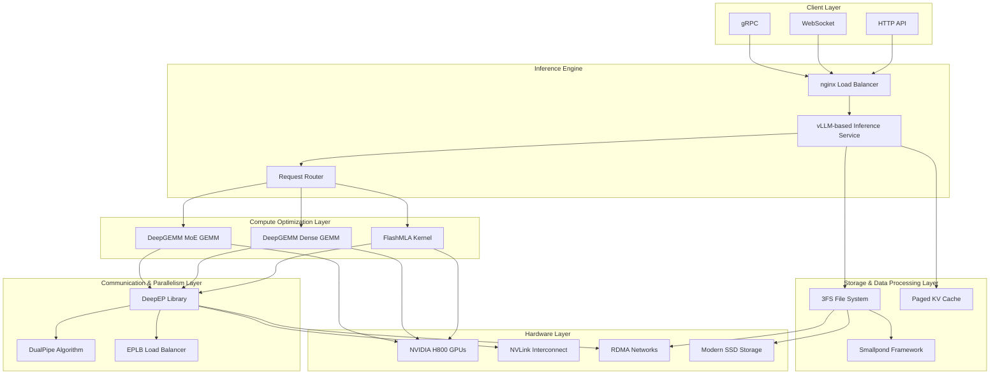
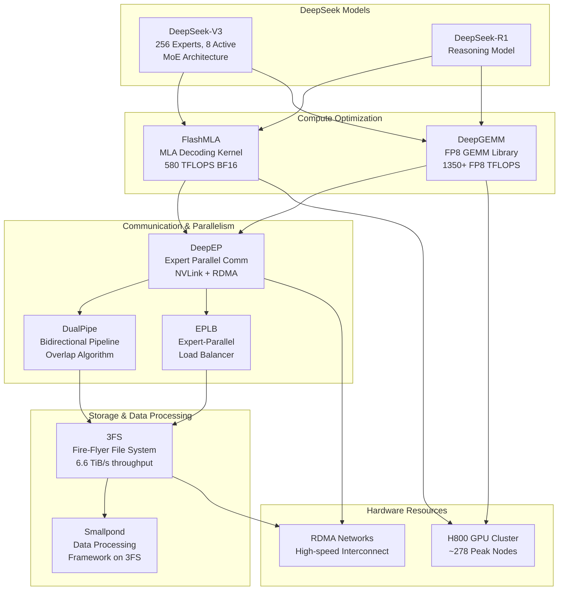

<!-- source: DeepWiki mcp.deepwiki.com · repo deepseek-ai/open-infra-index · page 1 Overview · fetched 2026-10-30 -->

# Overview

Relevant source files

The following files were used as context for generating this wiki page:

- [LICENSE](LICENSE)
- [README.md](README.md)

## Purpose and Scope

This document introduces the DeepSeek AI infrastructure repository, which contains seven core infrastructure components released during DeepSeek's February 2025 Open-Source Week initiative. These components form the foundational building blocks of DeepSeek's production AI training and inference systems, specifically optimized for large-scale Mixture of Experts (MoE) models including DeepSeek-V3 and DeepSeek-R1.

This overview covers the high-level system architecture, component relationships, and production performance characteristics. For detailed technical information about individual components, see [Components](#2). For comprehensive inference system documentation, see [DeepSeek V3/R1 Inference System](#3). For in-depth technical analyses, see [Technical Deep Dives](#4).

Sources: [README.md:1-112]()

## DeepSeek Open-Source Week Initiative

DeepSeek's Open-Source Week represents a systematic release of production-tested infrastructure components that power their online AI services. Starting February 24, 2025, DeepSeek released one component daily for six days, culminating in a comprehensive inference system overview.

The initiative emphasizes practical, battle-tested code rather than theoretical contributions - all components are documented, deployed, and actively serving production workloads handling millions of daily requests for DeepSeek's V3 and R1 models.

### Release Timeline

| Day | Component | Category | Key Capability |
|-----|-----------|----------|----------------|
| 1 | `FlashMLA` | Compute Optimization | MLA decoding kernel for Hopper GPUs |
| 2 | `DeepEP` | Communication & Parallelism | Expert Parallel communication library |
| 3 | `DeepGEMM` | Compute Optimization | FP8 GEMM library for dense and MoE |
| 4 | `DualPipe` + `EPLB` | Communication & Parallelism | Pipeline parallelism and load balancing |
| 5 | `3FS` + `Smallpond` | Storage & Data Processing | File system and data processing |
| 6 | Inference System | Integration | Complete V3/R1 inference architecture |

Sources: [README.md:18-104]()

## System Architecture Overview

The DeepSeek infrastructure implements a comprehensive software-hardware co-design optimized for MoE model architectures. The system integrates specialized compute kernels, communication libraries, and storage solutions to achieve high throughput and efficiency.

**DeepSeek Infrastructure System Architecture**

Sources: [README.md:32-87]()

## Component Categories and Relationships

The seven core components are organized into three functional categories, each addressing specific optimization challenges in large-scale AI infrastructure.

**Component Categorization and Data Flow**

Sources: [README.md:32-87]()

## Production Performance Metrics

The integrated system achieves significant performance benchmarks in production environments, demonstrating the effectiveness of the co-designed infrastructure components.

### Inference Performance

| Metric | Value | Hardware Context |
|--------|-------|------------------|
| Input tokens/second | 73.7k per H800 node | Production V3/R1 serving |
| Output tokens/second | 14.8k per H800 node | Production V3/R1 serving |
| Daily input volume | 608B tokens | Aggregate system throughput |
| Daily output volume | 168B tokens | Aggregate system throughput |
| Cost profit margin | 545% | Economic efficiency analysis |

### Component Performance

| Component | Performance Metric | Hardware |
|-----------|-------------------|----------|
| `FlashMLA` | 580 TFLOPS BF16 compute-bound | H800 GPU |
| `FlashMLA` | 3000 GB/s memory-bound | H800 GPU |
| `DeepGEMM` | 1350+ FP8 TFLOPS | Hopper GPUs |
| `3FS` | 6.6 TiB/s aggregate read | 180-node cluster |
| `3FS` | 40+ GiB/s per client | KV cache lookup |

### Cache Performance

The production system maintains efficient caching with Redis achieving 342B cache hits at a 56.3% hit rate, significantly reducing computational overhead for repeated queries.

Sources: [README.md:96-100]()

## Research and Publications

The infrastructure components are supported by peer-reviewed research publications that detail the theoretical foundations and empirical evaluations.

### Current Publications

- **ISCA 2025**: "Insights into DeepSeek-V3: Scaling Challenges and Reflections on Hardware for AI Architectures" - Industry track paper analyzing V3 scaling challenges
- **SC 2024**: "Fire-Flyer AI-HPC: A Cost-Effective Software-Hardware Co-Design for Deep Learning" - Comprehensive system architecture analysis

These publications provide deeper technical context for the infrastructure design decisions and performance optimizations implemented across the component suite.

Sources: [README.md:12-14](), [README.md:107-111]()

---

