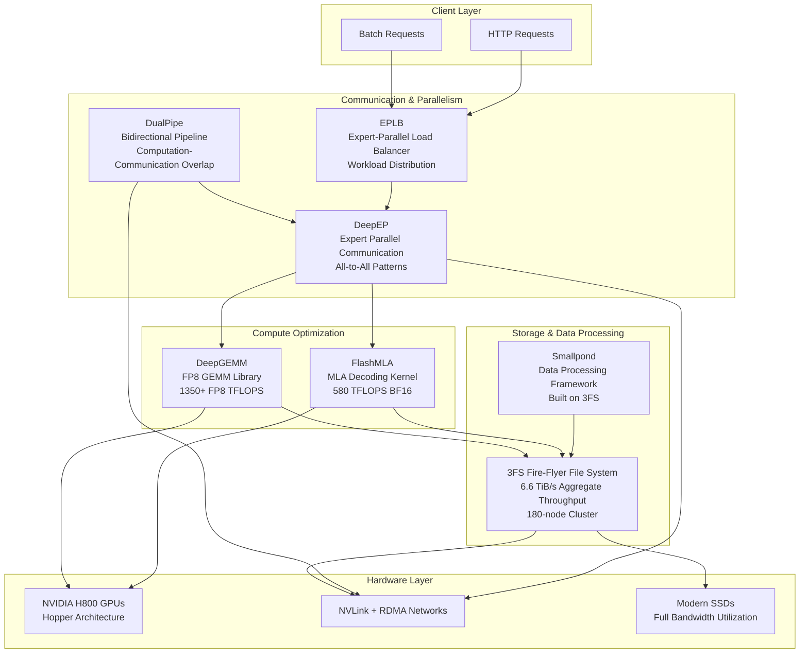
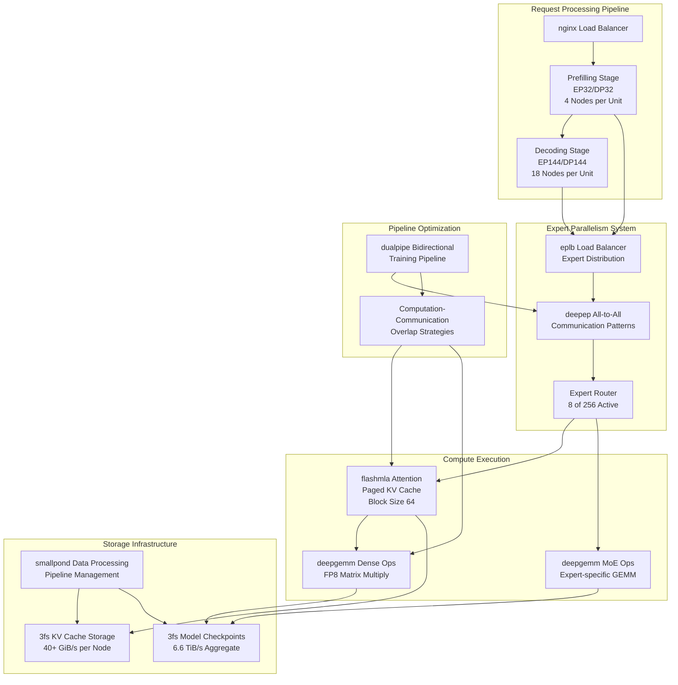

<!-- source: DeepWiki mcp.deepwiki.com · repo deepseek-ai/open-infra-index · page 2 Components · fetched 2026-10-30 -->

# Components

Relevant source files

The following files were used as context for generating this wiki page:

- [README.md](README.md)

## Purpose and Scope

This document provides a comprehensive overview of the seven core infrastructure components released during DeepSeek's Open-Source Week initiative. These components form the foundational building blocks of DeepSeek's production AI infrastructure, specifically optimized for large-scale Mixture of Experts (MoE) model training and inference.

The components are organized into three functional categories: Compute Optimization, Communication & Parallelism, and Storage & Data Processing. For detailed implementation specifics of individual components, refer to their respective subsections ([2.1](#2.1), [2.2](#2.2), [2.3](#2.3)). For information about the complete inference system architecture, see [DeepSeek V3/R1 Inference System](#3).

## Component Architecture Overview

The following diagram illustrates how all seven components integrate within the DeepSeek AI infrastructure:

Sources: [README.md:32-87]()

## Component Categories and Specifications

The seven components are categorized based on their primary functional roles within the infrastructure:

| Category | Components | Primary Function | Key Performance Metrics |
|----------|------------|------------------|-------------------------|
| **Compute Optimization** | FlashMLA, DeepGEMM | Optimizing core computational operations | 580 TFLOPS (FlashMLA), 1350+ TFLOPS (DeepGEMM) |
| **Communication & Parallelism** | DeepEP, DualPipe, EPLB | Distributed communication and parallelization | All-to-All patterns, bidirectional pipelines |
| **Storage & Data Processing** | 3FS, Smallpond | High-performance storage and data pipelines | 6.6 TiB/s throughput, 40+ GiB/s per node |

Sources: [README.md:32-87]()

## Compute Optimization Components

### FlashMLA - Efficient MLA Decoding Kernel

`FlashMLA` provides optimized Multi-Layer Attention decoding specifically designed for NVIDIA Hopper GPUs with variable-length sequence support.

**Technical Specifications:**
- **Memory Performance**: 3000 GB/s memory-bound operations
- **Compute Performance**: 580 TFLOPS compute-bound on H800
- **Precision Support**: BF16 operations
- **Cache Architecture**: Paged KV cache with block size 64

### DeepGEMM - FP8 General Matrix Multiply Library

`DeepGEMM` delivers high-performance matrix operations supporting both dense and MoE computations for V3/R1 model training and inference.

**Technical Specifications:**
- **Peak Performance**: 1350+ FP8 TFLOPS on Hopper GPUs
- **Implementation**: Just-In-Time compiled with ~300 lines core logic
- **Layout Support**: Dense layout and two MoE layouts
- **Dependencies**: Minimal dependency footprint

Sources: [README.md:32-64]()

## Communication & Parallelism Components

### DeepEP - Expert Parallel Communication Library

`DeepEP` implements efficient all-to-all communication patterns for MoE model distributed processing.

**Communication Features:**
- **Network Support**: NVLink intranode and RDMA internode
- **Kernel Types**: High-throughput (training/prefilling) and low-latency (decoding)
- **Precision Support**: Native FP8 dispatch
- **Resource Management**: Flexible GPU resource control for computation-communication overlap

### DualPipe - Bidirectional Pipeline Parallelism

`DualPipe` enables bidirectional pipeline parallelism algorithm optimized for V3/R1 training with computation-communication overlap.

### EPLB - Expert-Parallel Load Balancer

`EPLB` manages workload distribution across expert parallel architectures for optimal resource utilization in V3/R1 systems.

Sources: [README.md:42-75]()

## Storage & Data Processing Components

### 3FS - Fire-Flyer File System

`3FS` provides a parallel file system utilizing full bandwidth of modern SSDs and RDMA networks.

**Performance Specifications:**
- **Aggregate Throughput**: 6.6 TiB/s in 180-node cluster
- **Benchmark Performance**: 3.66 TiB/min on GraySort (25-node cluster)
- **Per-Node Performance**: 40+ GiB/s peak throughput for KVCache lookup
- **Architecture**: Disaggregated with strong consistency semantics

**Use Cases:**
- Training data preprocessing and dataset loading
- Model checkpoint saving and reloading
- Embedding vector search operations
- KVCache lookups for V3/R1 inference

### Smallpond - Data Processing Framework

`Smallpond` operates as a data processing framework built on top of the `3FS` infrastructure, providing efficient data pipeline management.

Sources: [README.md:76-87]()

## Production Integration Architecture

The following diagram shows how components integrate in the production V3/R1 inference system:

**Production Performance Metrics:**
- **Throughput**: 73.7k input tokens/sec per H800 node
- **Output Generation**: 14.8k output tokens/sec per H800 node  
- **Cost Efficiency**: 545% profit margin

Sources: [README.md:89-105]()

---

