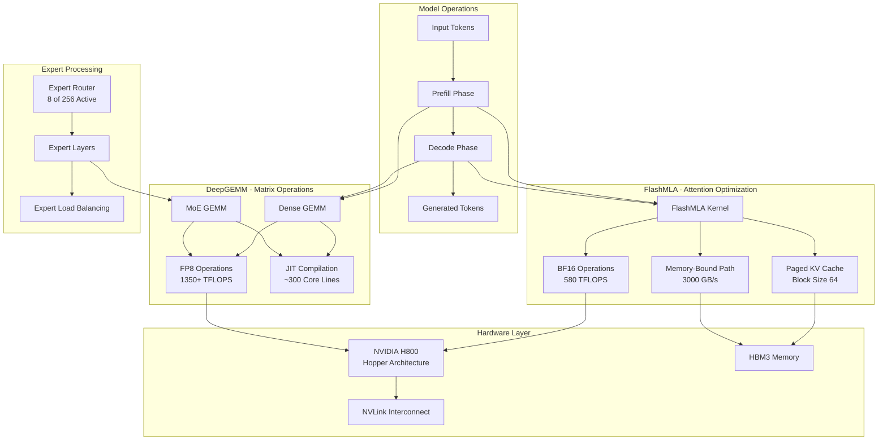
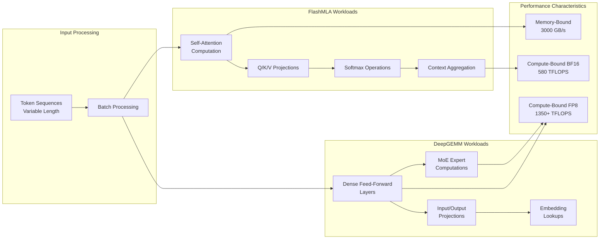

<!-- source: DeepWiki mcp.deepwiki.com · repo deepseek-ai/open-infra-index · page 2.1 Compute Optimization · fetched 2026-10-30 -->

# Compute Optimization

Relevant source files

The following files were used as context for generating this wiki page:

- [README.md](README.md)

## Purpose and Scope

This section covers the core computational optimization components within the DeepSeek AI infrastructure, specifically focusing on components that accelerate the most computationally intensive operations in AI model training and inference. The compute optimization layer consists of two primary components: FlashMLA for attention mechanism optimization and DeepGEMM for matrix multiplication acceleration.

For detailed communication and parallelism strategies, see [Communication & Parallelism](#2.2). For storage and data processing infrastructure, see [Storage & Data Processing](#2.3).

## Component Overview

The compute optimization layer provides two specialized libraries that form the computational backbone of DeepSeek's V3/R1 models:

| Component | Primary Function | Target Hardware | Key Performance Metric |
|-----------|------------------|-----------------|------------------------|
| FlashMLA | Multi-Layer Attention decoding | NVIDIA Hopper GPUs | 580 TFLOPS BF16 compute-bound |
| DeepGEMM | FP8 matrix multiplication | NVIDIA Hopper GPUs | 1350+ FP8 TFLOPS |

Both components are production-tested and optimized specifically for the MoE (Mixture of Experts) architecture used in DeepSeek's V3/R1 models.

Sources: [README.md:32-63]()

## Compute Optimization Architecture

The following diagram illustrates how the compute optimization components integrate with the broader inference and training pipeline:

This architecture demonstrates the dual-path optimization approach: FlashMLA handles attention computations with memory-bandwidth optimization, while DeepGEMM accelerates matrix operations with compute-throughput optimization.

Sources: [README.md:32-63]()

## Computational Workload Distribution

The following diagram shows how different computational patterns are distributed across the optimization components:

This distribution shows that FlashMLA primarily handles memory-intensive attention operations, while DeepGEMM focuses on compute-intensive matrix multiplications across both dense and MoE patterns.

Sources: [README.md:32-63]()

## Integration with Hardware Architecture

Both compute optimization components are specifically designed for NVIDIA Hopper architecture GPUs, particularly the H800. The integration leverages several hardware features:

### FlashMLA Hardware Integration
- **Paged KV Cache**: Uses block size 64 optimized for H800 memory hierarchy
- **BF16 Precision**: Balances numerical precision with memory bandwidth utilization
- **Memory Bandwidth**: Achieves 3000 GB/s memory throughput on memory-bound workloads

### DeepGEMM Hardware Integration  
- **FP8 Precision**: Maximizes compute throughput using Hopper's FP8 tensor cores
- **JIT Compilation**: Runtime optimization for varying matrix dimensions
- **Dual Layout Support**: Handles both dense computations and MoE expert routing patterns

The combined optimization strategy achieves production performance metrics of 73.7k input tokens and 14.8k output tokens per second per H800 node in the DeepSeek V3/R1 inference system.

Sources: [README.md:40](), [README.md:59](), [README.md:97]()

## Performance Optimization Strategy

The compute optimization approach follows a workload-specific strategy:

1. **Attention Operations**: FlashMLA optimizes for variable-length sequences and memory bandwidth utilization
2. **Matrix Operations**: DeepGEMM optimizes for high compute throughput with minimal dependencies
3. **Mixed Precision**: Strategic use of BF16 and FP8 based on numerical requirements and hardware capabilities
4. **Runtime Compilation**: JIT compilation ensures optimal performance across diverse matrix dimensions

This strategy enables the system to achieve a cost profit margin of 545% in production deployments.

Sources: [README.md:98]()

## Component Details

For comprehensive technical documentation of each compute optimization component:

- **FlashMLA**: See [FlashMLA](#2.1.1) for detailed kernel implementation, memory optimization techniques, and performance characteristics
- **DeepGEMM**: See [DeepGEMM](#2.1.2) for matrix multiplication algorithms, FP8 optimizations, and JIT compilation details

Sources: [README.md:32-63]()

---

