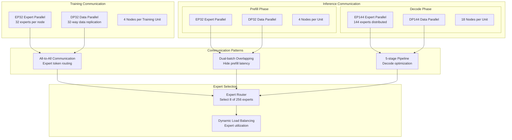
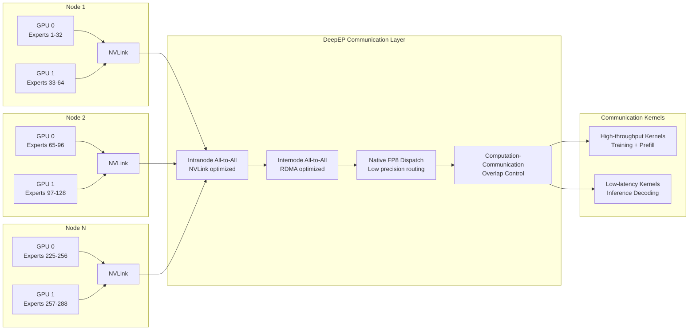
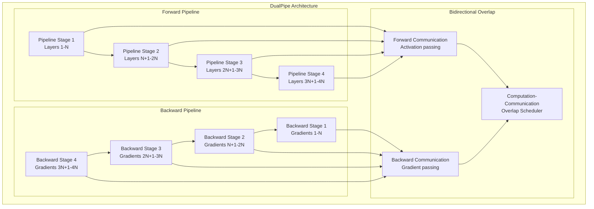
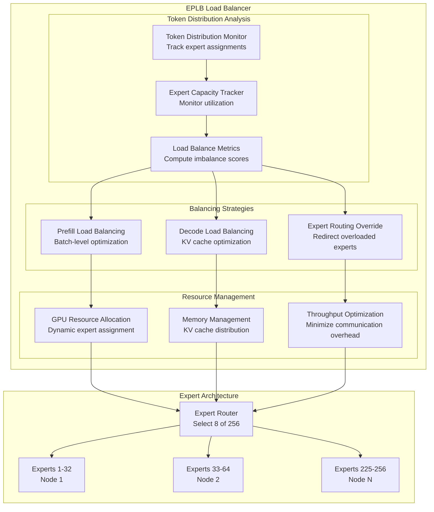
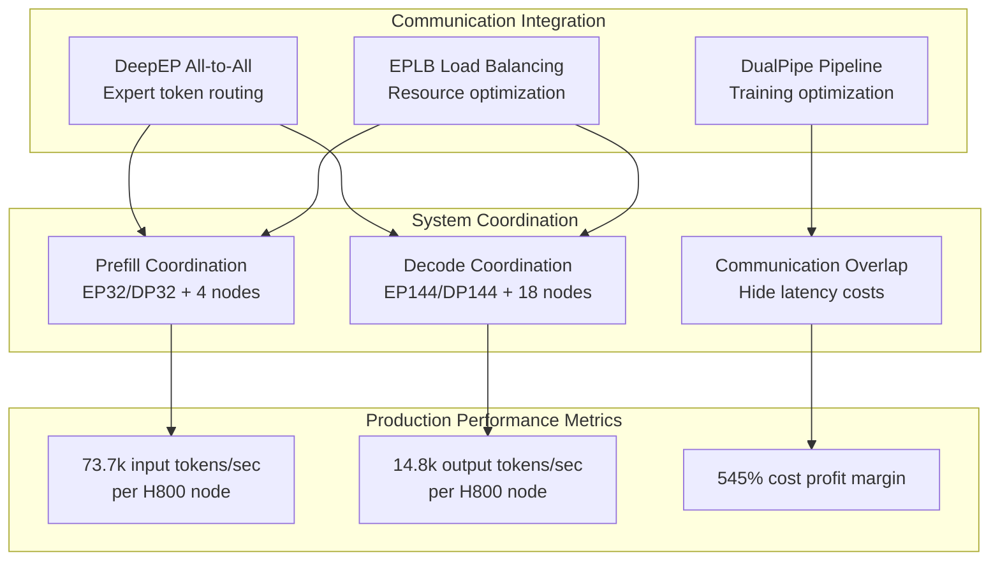

<!-- source: DeepWiki mcp.deepwiki.com · repo deepseek-ai/open-infra-index · page 2.2 Communication & Parallelism · fetched 2026-10-30 -->

# Communication & Parallelism

Relevant source files

The following files were used as context for generating this wiki page:

- [README.md](README.md)

This document covers the communication and parallelization components that enable distributed training and inference for large-scale MoE (Mixture of Experts) models. These systems handle the complex communication patterns required to efficiently distribute workloads across multiple nodes and GPUs, with particular focus on expert parallel communication, pipeline parallelism, and dynamic load balancing.

For compute optimization components like matrix operations and attention kernels, see [Compute Optimization](#2.1). For storage and data processing infrastructure, see [Storage & Data Processing](#2.3).

## MoE Communication Architecture Overview

The DeepSeek MoE architecture requires sophisticated communication patterns to coordinate work across distributed expert layers. The system employs different parallelization strategies for training versus inference, and for prefill versus decode phases.

**Sources:** [README.md:42-53](), [README.md:89-104]()

## Expert Parallel Communication with DeepEP

DeepEP provides the foundational communication primitives for expert parallel training and inference. It handles the all-to-all communication patterns required when tokens are dynamically routed to different experts across nodes.

**Sources:** [README.md:42-53]()

## Pipeline Parallelism with DualPipe

DualPipe implements bidirectional pipeline parallelism specifically optimized for the V3/R1 model architectures. It enables computation-communication overlap during training by managing forward and backward passes across pipeline stages.

**Sources:** [README.md:67-68](), [README.md:73-74]()

## Expert Load Balancing with EPLB

EPLB manages the distribution of tokens across experts to maintain balanced utilization and prevent expert capacity overflow. It operates at both the prefill and decode phases with different optimization strategies.

**Sources:** [README.md:70-71]()

## Integrated Communication Orchestration

The communication and parallelism components work together to enable the high-throughput, low-latency performance reported in the production V3/R1 inference system.

| Component | Function | Performance Impact |
|-----------|----------|-------------------|
| `DeepEP` | Expert parallel all-to-all communication | Enables 256-expert MoE scaling across nodes |
| `DualPipe` | Bidirectional pipeline parallelism | Hides communication latency in training |  
| `EPLB` | Expert load balancing | Maintains 73.7k tokens/sec/node throughput |

**Sources:** [README.md:89-104]()

---

