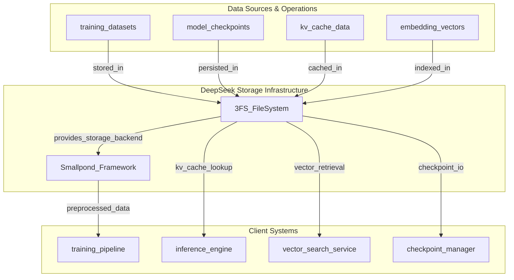
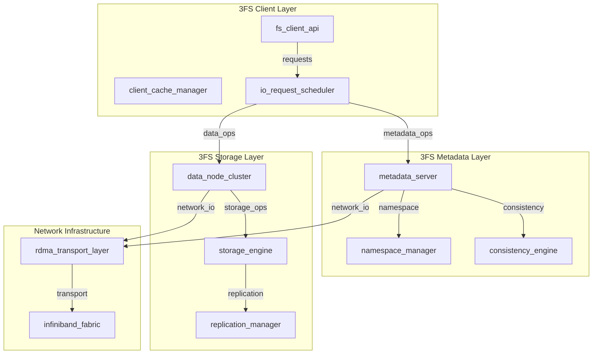
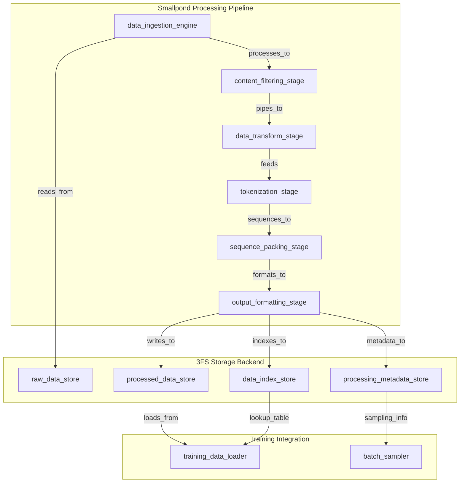
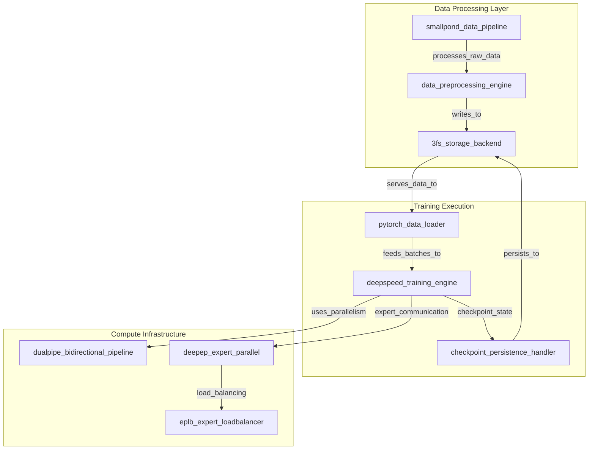
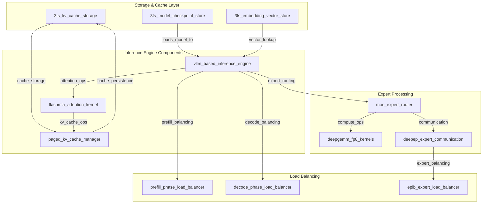
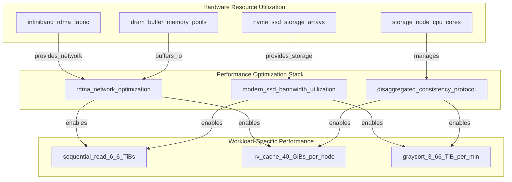
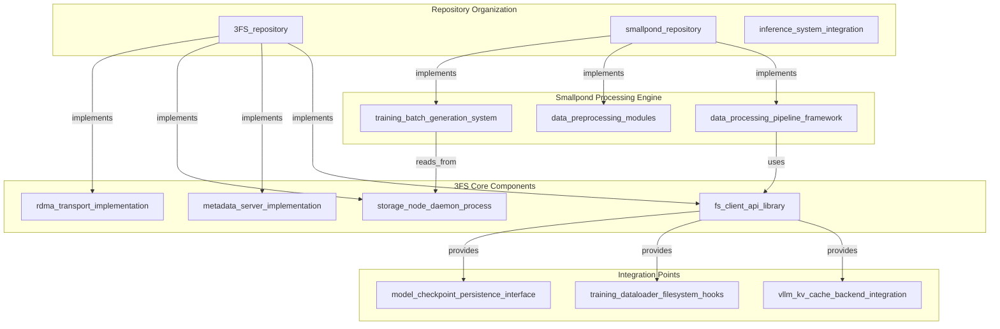
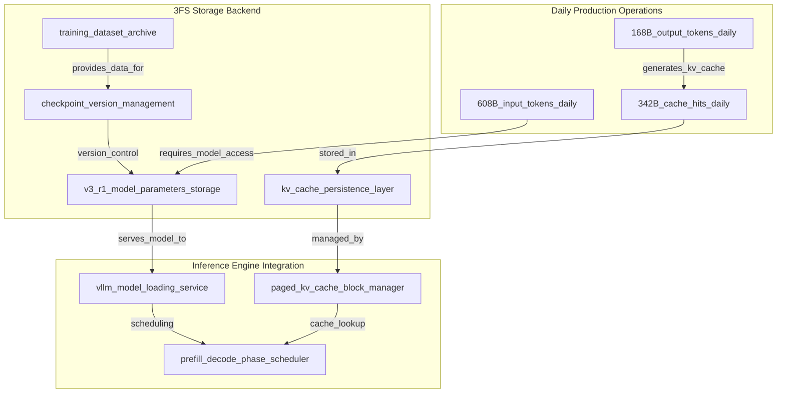

<!-- source: DeepWiki mcp.deepwiki.com · repo deepseek-ai/open-infra-index · page 2.3 Storage & Data Processing · fetched 2026-10-30 -->

# Storage & Data Processing

Relevant source files

The following files were used as context for generating this wiki page:

- [README.md](README.md)

This document provides technical documentation of DeepSeek's high-performance storage and data processing infrastructure that supports both training and inference workloads for large AI models. The system consists of two primary components: the Fire-Flyer File System (3FS) and the Smallpond data processing framework. For information about compute optimization, see [Compute Optimization](#2.1), and for details on communication and parallelism, see [Communication & Parallelism](#2.2).

## Overview

The Storage & Data Processing subsystem provides the foundational data infrastructure for DeepSeek's AI operations, delivering high-bandwidth storage and specialized data processing capabilities optimized for large-scale model training and inference. The system handles:

1. Training data preprocessing and loading pipeline
2. KV cache storage and retrieval during inference phases
3. Model checkpoint persistence and loading operations
4. Embedding vector storage and search operations

### Storage & Data Processing System Architecture

Sources: [README.md:74-87]()

## Core Components

### 3FS (Fire-Flyer File System)

The Fire-Flyer File System (3FS) is a high-performance parallel file system engineered for AI workloads, providing maximum bandwidth utilization of modern SSDs and RDMA network infrastructure. The system implements a disaggregated architecture with strong consistency guarantees suitable for distributed training and inference operations.

#### Technical Specifications

- **Architecture**: Disaggregated storage with strong consistency semantics
- **Network**: RDMA-optimized with modern SSD backend integration
- **Performance Metrics**: 
  - Aggregate read throughput: 6.6 TiB/s (180-node cluster configuration)
  - GraySort benchmark: 3.66 TiB/min (25-node cluster configuration)
  - KV Cache lookup: 40+ GiB/s peak per client node

#### 3FS Integration Points

| Operation Type | Performance Target | DeepSeek V3/R1 Integration |
|----------------|-------------------|---------------------------|
| `training_data_preprocessing` | High-throughput sequential reads | Smallpond framework data pipeline |
| `dataset_loading` | Low-latency random access | Training loop data loading |
| `checkpoint_save_load` | High-bandwidth writes/reads | Model state persistence during training |
| `embedding_vector_search` | Low-latency point queries | RAG and similarity search operations |
| `kv_cache_lookup` | Ultra-low latency access | V3/R1 inference attention mechanism |

#### 3FS System Architecture

Sources: [README.md:78-84]()

### Smallpond

Smallpond is a data processing framework built on top of the 3FS storage backend, providing specialized data preprocessing and pipeline management capabilities for large language model training workflows.

#### Smallpond Framework Components

Sources: [README.md:87]()

## DeepSeek Infrastructure Integration

The 3FS and Smallpond systems integrate with the complete DeepSeek infrastructure stack, providing critical storage and data processing services for both training and inference operations.

### Training Workflow Integration

### Inference Workflow Integration

Sources: [README.md:74-87]()

## Performance Characteristics

The 3FS and Smallpond systems deliver high-performance storage and data processing capabilities optimized for AI workloads, with specific performance targets designed for DeepSeek's large-scale model operations.

### 3FS Performance Benchmarks

| Benchmark Type | Performance Value | Configuration | Workload Characteristics |
|----------------|------------------|---------------|-------------------------|
| Aggregate Read Throughput | 6.6 TiB/s | 180-node cluster | Sequential read operations |
| GraySort Benchmark | 3.66 TiB/min | 25-node cluster | External sorting workload |
| KV Cache Lookup | 40+ GiB/s per node | Per client node | Random access patterns |

### 3FS Performance Architecture

### V3/R1 Inference Performance Impact

The storage system performance directly impacts DeepSeek V3/R1 inference throughput and latency characteristics:

| Storage Operation | Impact on Inference | Performance Requirement |
|------------------|-------------------|------------------------|
| `kv_cache_lookup` | Decoding phase latency | < 1ms access time per lookup |
| `model_checkpoint_loading` | Service startup time | Full model load < 60 seconds |
| `embedding_vector_search` | RAG response latency | < 10ms for vector similarity queries |

Sources: [README.md:78-84]()

## Repository Structure and Implementation

The storage and data processing components are implemented across dedicated repositories that integrate with the broader DeepSeek infrastructure:

### Component Repositories

| Component | Repository | Primary Functionality |
|-----------|------------|---------------------|
| 3FS (Fire-Flyer File System) | [3FS GitHub Repository](https://github.com/deepseek-ai/3FS) | High-performance parallel file system |
| Smallpond | [Smallpond GitHub Repository](https://github.com/deepseek-ai/smallpond) | Data processing framework on 3FS |

### Technical Implementation Architecture

Sources: [README.md:86-87]()

## Production Deployment and Usage

The storage and data processing systems support the production DeepSeek V3/R1 inference system, handling massive daily throughput and providing the storage backbone for model operations.

### Production Scale Metrics

Based on the DeepSeek V3/R1 inference system performance data:

| Metric | Daily Volume | Storage System Impact |
|--------|-------------|----------------------|
| Input Token Processing | 608B tokens/day | Training data and model checkpoint access |
| Output Token Generation | 168B tokens/day | KV cache storage and retrieval |
| Cache Hit Operations | 342B cache hits/day | 3FS KV cache storage performance |
| Cache Hit Rate | 56.3% | Reduces storage I/O load by >50% |

### Production Integration Workflow

Sources: [README.md:96-98]()

## Summary

The Storage & Data Processing subsystem, comprising 3FS and Smallpond, forms the backbone of DeepSeek's data infrastructure. With its exceptional performance characteristics and specialized design for AI workloads, this system enables the efficient training and deployment of DeepSeek's large language models.

The 3FS file system provides the raw storage capabilities with impressive throughput metrics, while Smallpond builds on this foundation to offer sophisticated data processing functionality. Together, these components address the significant data management challenges inherent in modern AI infrastructure.

Sources: README.md:74-83

---

