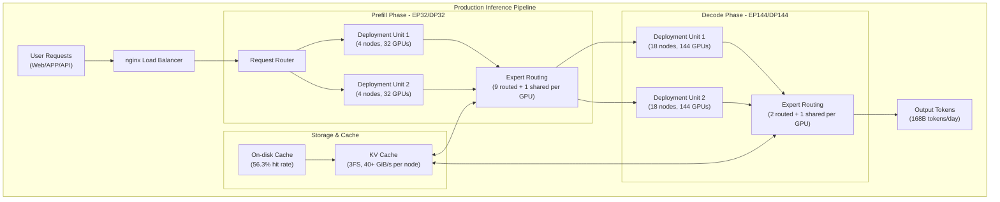
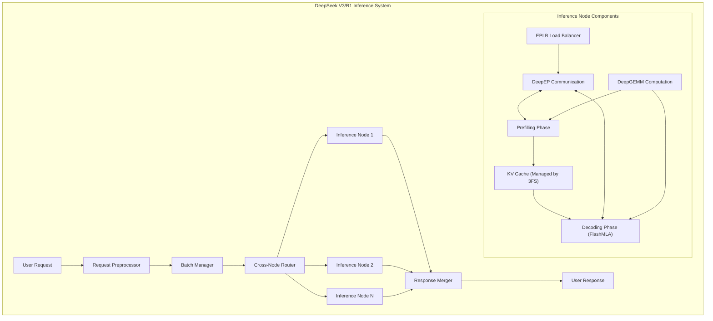
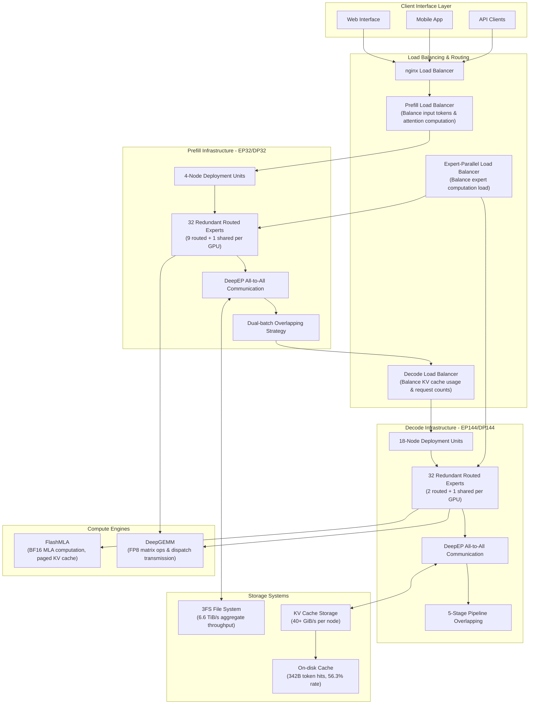
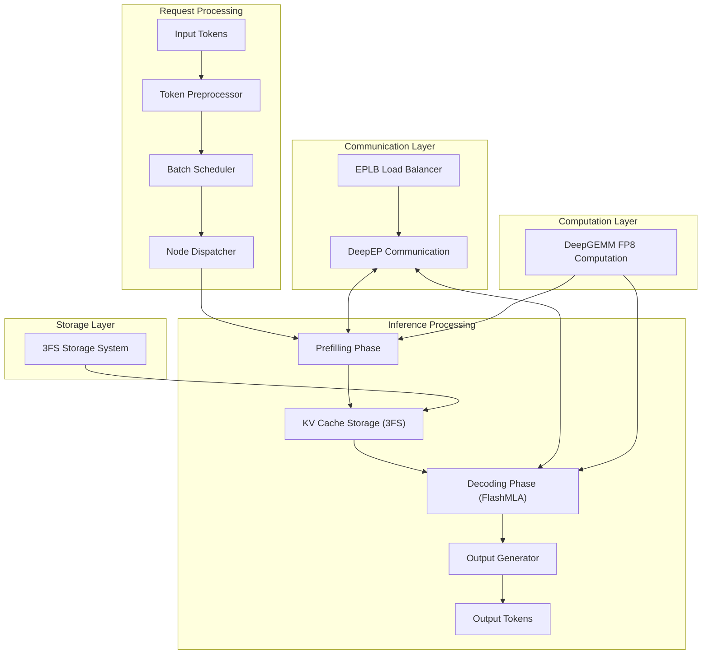
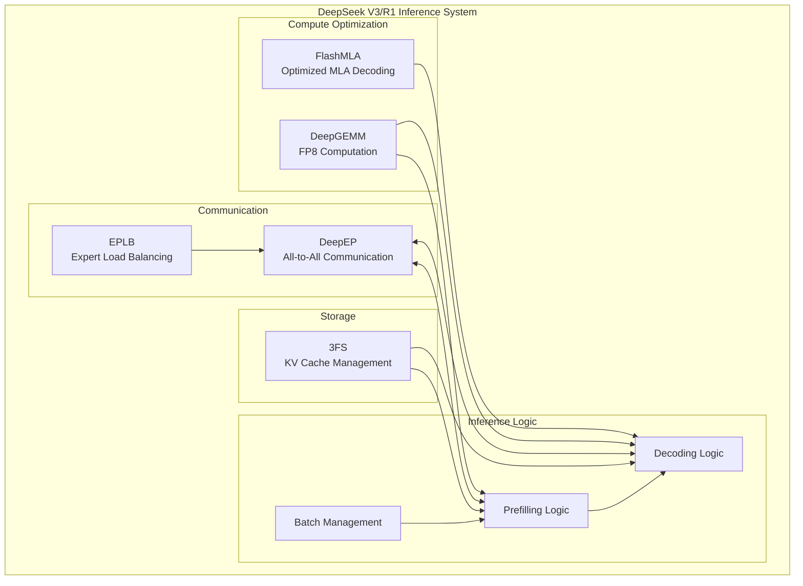
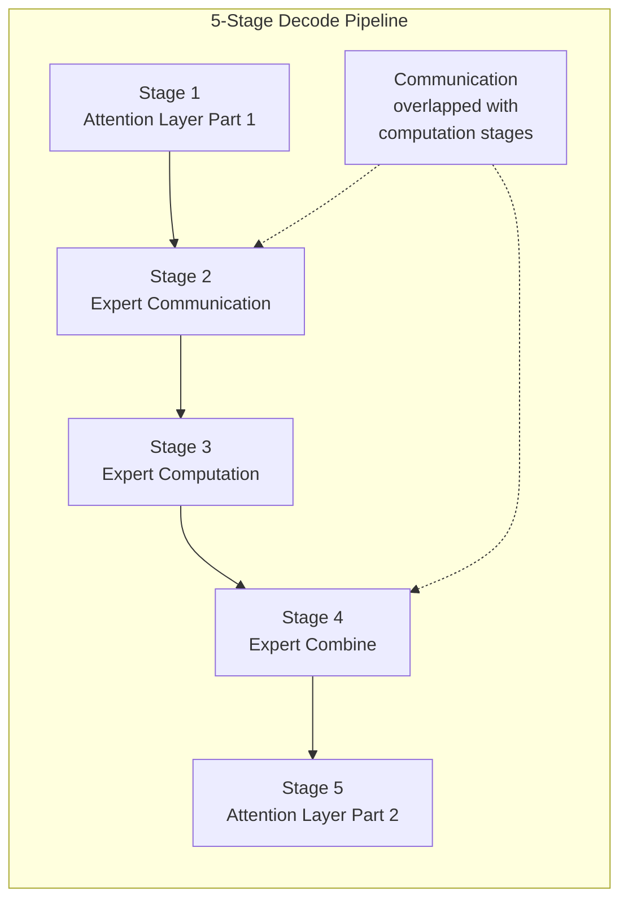
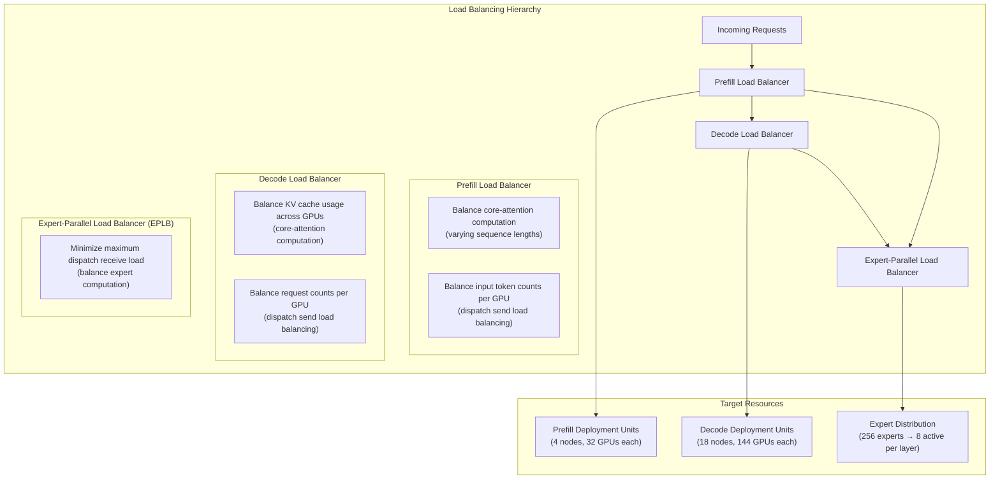
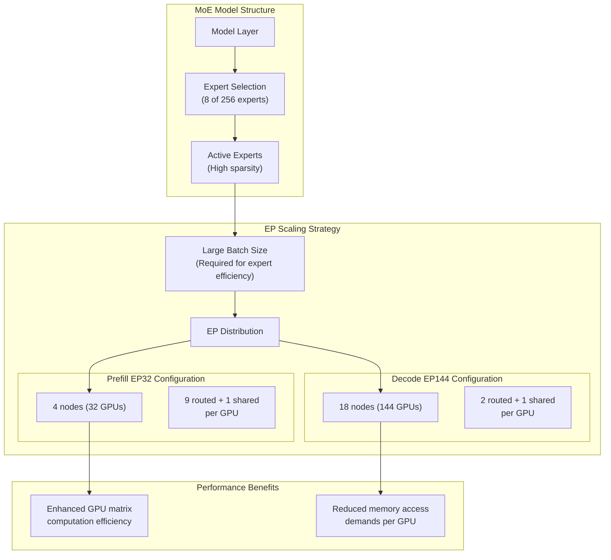
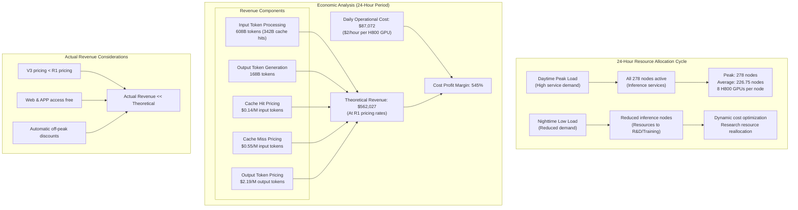

<!-- source: DeepWiki mcp.deepwiki.com · repo deepseek-ai/open-infra-index · page 3 DeepSeek V3/R1 Inference System · fetched 2026-10-30 -->

# DeepSeek V3/R1 Inference System

Relevant source files

The following files were used as context for generating this wiki page:

- [202502OpenSourceWeek/day_6_one_more_thing_deepseekV3R1_inference_system_overview.md](202502OpenSourceWeek/day_6_one_more_thing_deepseekV3R1_inference_system_overview.md)
- [README.md](README.md)

## Purpose and Scope

This document provides comprehensive technical documentation of the production DeepSeek V3/R1 Inference System, focusing on the large-scale Expert Parallelism (EP) architecture that serves DeepSeek's Mixture-of-Experts models. The system achieves higher throughput and lower latency through cross-node EP, computation-communication overlapping, and sophisticated load balancing strategies. This documentation covers the distributed inference architecture, prefill-decode disaggregation, performance optimizations, and production statistics from DeepSeek's online services.
</old_str>

<old_str>
## Key Performance Metrics

Production statistics from 24-hour period (UTC+8 02/27/2025 12:00 PM to 02/28/2025 12:00 PM):

| Metric | Value | Details |
|--------|-------|---------|
| **Token Processing** | | |
| Total input tokens | 608B | Daily processing volume |
| Total output tokens | 168B | Daily generation volume |
| Cache hit rate | 56.3% | 342B tokens from on-disk KV cache |
| Input tokens/sec per H800 | 73.7k | Including cache hits during prefill |
| Output tokens/sec per H800 | 14.8k | During decode phase |
| Average output speed | 20-22 tokens/sec | End-user experience |
| Average KV cache length | 4,989 tokens | Per output token |
| **Infrastructure** | | |
| Peak node count | 278 nodes | Combined V3/R1 services |
| Average node count | 226.75 nodes | 24-hour average |
| GPUs per node | 8 H800 | Total ~2,214 peak GPUs |
| **Economics** | | |
| Daily operational cost | $87,072 | At $2/hour per H800 GPU |
| Theoretical daily revenue | $562,027 | At R1 pricing rates |
| Cost profit margin | 545% | Theoretical calculation |

Sources: [202502OpenSourceWeek/day_6_one_more_thing_deepseekV3R1_inference_system_overview.md:67-81](), [202502OpenSourceWeek/day_6_one_more_thing_deepseekV3R1_inference_system_overview.md:73-76]()
</old_str>
<new_str>
## System Overview

The DeepSeek V3/R1 Inference System employs large-scale cross-node Expert Parallelism to serve MoE models where only 8 out of 256 experts per layer are activated. The system's high sparsity necessitates extremely large batch sizes to ensure sufficient per-expert batching for optimal throughput and latency. The architecture implements prefill-decode disaggregation with different parallelism degrees for each phase.

**Core System Characteristics:**
- **Model Architecture**: 256 experts per layer, 8 active experts per forward pass
- **Prefill Configuration**: EP32/DP32 across 4 nodes per deployment unit
- **Decode Configuration**: EP144/DP144 across 18 nodes per deployment unit  
- **Expert Distribution**: 32 redundant routed experts with dynamic load balancing

Sources: [202502OpenSourceWeek/day_6_one_more_thing_deepseekV3R1_inference_system_overview.md:21-24](), [202502OpenSourceWeek/day_6_one_more_thing_deepseekV3R1_inference_system_overview.md:73-76]()

## System Overview

The DeepSeek V3/R1 Inference System is a high-performance, distributed inference architecture designed specifically for serving large-scale mixture-of-experts (MoE) models. The system leverages multiple optimized components to achieve exceptional throughput, low latency, and cost-effective scaling across GPU nodes.

Sources: [README.md:85-101]()

## System Architecture

The system implements a sophisticated multi-stage architecture with disaggregated prefill and decode processing, each optimized for different computational and communication patterns.

**Architecture Overview Diagram**

Sources: [202502OpenSourceWeek/day_6_one_more_thing_deepseekV3R1_inference_system_overview.md:21-24](), [202502OpenSourceWeek/day_6_one_more_thing_deepseekV3R1_inference_system_overview.md:38-55](), [202502OpenSourceWeek/day_6_one_more_thing_deepseekV3R1_inference_system_overview.md:57-58]()

## System Architecture

The DeepSeek V3/R1 Inference System follows a distributed architecture that efficiently processes inference requests through specialized components optimized for both the prefilling and decoding phases of inference.

Sources: [README.md:85-101]()

### Inference Workflow

The inference process in the DeepSeek V3/R1 system follows two main phases:

1. **Prefilling Phase**: 
   - Processes all input tokens to generate the initial hidden states
   - Handles variable-length inputs efficiently through batching
   - Uses DeepEP for expert routing across GPUs
   - Stores intermediate states in the KV cache managed by 3FS

2. **Decoding Phase**: 
   - Generates output tokens one at a time
   - Utilizes FlashMLA for optimized multi-head attention
   - Employs DeepGEMM for efficient FP8 computation
   - Balances expert loads using EPLB

## Component Integration

The DeepSeek V3/R1 Inference System integrates several specialized components that work together to create a high-performance inference pipeline.

Sources: [README.md:28-83]()

### Key Component Roles

| Component | Role in Inference System |
|-----------|--------------------------|
| FlashMLA | Provides optimized multi-head attention for variable-length sequences during decoding; achieves 3000 GB/s memory-bound performance and BF16 580 TFLOPS compute-bound on H800 |
| DeepGEMM | Handles FP8 matrix multiplications for both dense and MoE operations; delivers up to 1350+ FP8 TFLOPS on Hopper GPUs |
| DeepEP | Manages all-to-all communication for expert parallelism; supports both intranode and internode communication with NVLink and RDMA |
| EPLB | Optimizes expert-parallel load balancing across GPUs to prevent bottlenecks |
| 3FS | Provides high-performance storage for KV cache with 40+ GiB/s peak throughput per client node |

Sources: [README.md:28-83]()

## Optimization Techniques

The system employs three core optimization strategies to maximize resource utilization and minimize latency bottlenecks across the distributed inference infrastructure.

### Communication-Computation Overlapping

The system implements phase-specific overlapping strategies to hide communication latency behind computation operations.

**Prefill Phase: Dual-Batch Overlapping Strategy**

```mermaid
gantt
    title Dual-Batch Prefill Communication-Computation Overlap
    dateFormat s
    axisFormat %S
    
    section Microbatch A
    Communication A    :commA, 0, 2
    Computation A      :compA, 2, 6
    
    section Microbatch B  
    Communication B    :commB, 3, 5
    Computation B      :compB, 5, 9
    
    section Timeline
    Overlap Period     :milestone, overlap, 3, 0
```

**Decode Phase: 5-Stage Pipeline Strategy**

Sources: [202502OpenSourceWeek/day_6_one_more_thing_deepseekV3R1_inference_system_overview.md:25-36]()

### Multi-Level Load Balancing

The system implements three distinct load balancers to optimize resource utilization across different computational bottlenecks:

**Load Balancing Architecture**

Sources: [202502OpenSourceWeek/day_6_one_more_thing_deepseekV3R1_inference_system_overview.md:38-55]()

### Expert Parallelism Scaling

Large-scale cross-node EP addresses the sparsity challenge of MoE models where only 8 of 256 experts are active per layer, requiring extremely large batch sizes for optimal expert utilization.

**Expert Parallelism Configuration**

Sources: [202502OpenSourceWeek/day_6_one_more_thing_deepseekV3R1_inference_system_overview.md:18-24](), [202502OpenSourceWeek/day_6_one_more_thing_deepseekV3R1_inference_system_overview.md:5-7]()

## Production Economics and Dynamic Resource Allocation

The system implements dynamic resource allocation based on diurnal usage patterns, optimizing costs while maintaining service quality during peak and off-peak periods.

**Dynamic Resource Management**

**Performance and Economic Metrics:**

| Resource Allocation | Peak Period | Off-Peak Period |
|--------------------|-----------|----|
| **Node Configuration** | 278 nodes active | Reduced allocation |
| **Service Priority** | Full inference capacity | Research/training priority |
| **Cost Optimization** | Maximum throughput | Resource reallocation |

| Economic Factor | Value | Impact |
|----------------|-------|--------|
| **Theoretical Profit Margin** | 545% | Based on R1 pricing |
| **Daily Operational Cost** | $87,072 | H800 GPU lease costs |
| **Cache Hit Efficiency** | 56.3% | Reduces computation costs |
| **Average Token Processing Speed** | 20-22 tokens/sec | End-user experience |

Sources: [202502OpenSourceWeek/day_6_one_more_thing_deepseekV3R1_inference_system_overview.md:65-86](), [202502OpenSourceWeek/day_6_one_more_thing_deepseekV3R1_inference_system_overview.md:82-86]()

## Related Documentation

For more detailed information about specific components of the inference system:

- For detailed information about the system architecture, see [Inference System Architecture](#3.1)
- For in-depth performance optimization details, see [Performance Optimization](#3.2)
- For the strategy behind open-sourcing components, see [Open-Sourcing Strategy](#3.3)
- For information about FlashMLA, see [FlashMLA](#2.1.1)
- For information about DeepEP, see [DeepEP](#2.2.1)
- For information about DeepGEMM, see [DeepGEMM](#2.1.2)
- For information about EPLB, see [EPLB](#2.2.3)
- For information about 3FS, see [3FS](#2.3.1)

---

